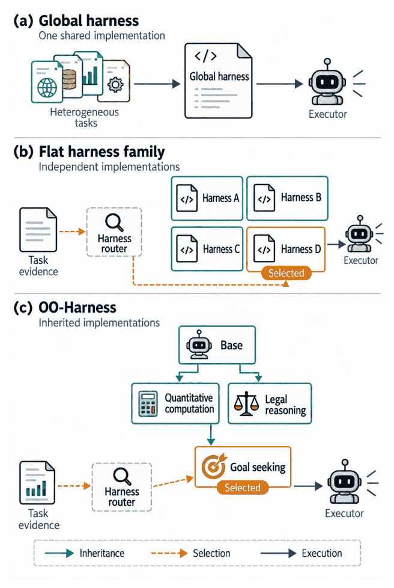
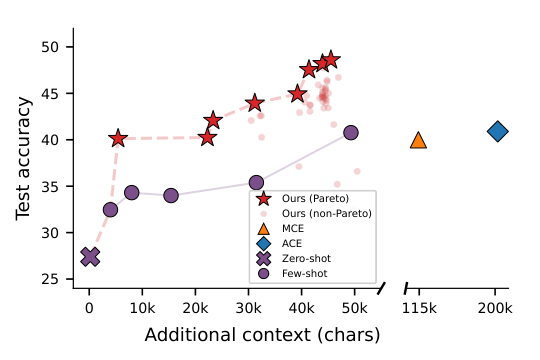
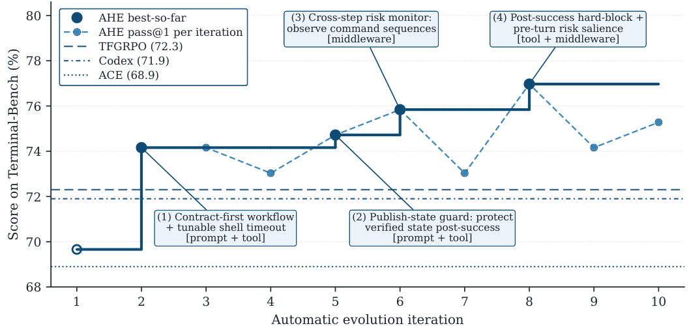
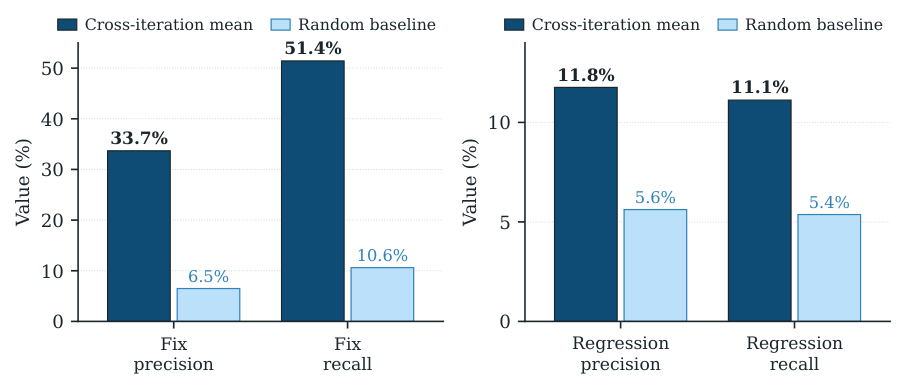

# 8 — Harness Maturity and Failure Modes

> Where a harness sits today, what to build next, and the five ways teams fool themselves.

Teams rarely know how mature their harness is, and "we have evals" often means one notebook run by hand. Most teams claiming Stage 3 are at Stage 1, so they invest in the wrong next layer while plan errors propagate through expensive execution and the same failure recurs monthly. This chapter gives you a five-stage maturity model and a per-task pipeline to place your harness honestly, then covers production lessons from PRINCE, the failure modes, and how to remove parts of the harness when a model no longer needs them.

---

## The five-stage maturity model

| Stage | Name | What exists |
|---|---|---|
| **0** | Ad-hoc | Scripts, manual tool invocation, no registry, no structured logging |
| **1** | Basic | Schema-first tool specs, simple registry, minimal verification via unit tests |
| **2** | Verified | Static verification in CI, sandboxed execution, structured tracing, behavioral evals, **branch-per-agent** |
| **3** | Observability-first | End-to-end tracing, LLM-as-judge scoring, composable middleware, versioned memory |
| **4** | Self-healing | Automated remediation, cost-aware orchestration, policy-as-code governance |

Stage 4 remains **emerging as of 2026** — treat it as direction, not a target.

Reading the ladder: **Stage 1 makes the agent work. Stage 2 makes it trustworthy. Stage 3 makes it improvable.** Most production value lands at 2→3, and most teams claiming 3 are at 1 — see failure mode 1.

Reference implementations: **LangChain DeepAgents** (Stage 2→3, branch-per-agent A/B testing), **Claude Code** (opinionated commercial starter with visible orchestration), **Goose** (Block, model-agnostic MCP-native open source).

---

## The canonical six-stage pipeline

The per-task shape a mature harness runs:

```
Preflight → Plan → Approve → Tasks → Verify → Finish
```

| Stage | What happens |
|---|---|
| **Preflight** | Gather context; establish current state |
| **Plan** | Decompose into steps |
| **Approve** | **Mandatory human gate** on the plan |
| **Tasks** | Execute, documenting as you go |
| **Verify** | Quality gate — binary pass/fail |
| **Finish** | Export artifacts, log outcome |

Three gates constrain behavior throughout: **scope boundary, permissions, responsibility boundary.**

The **Approve** gate is the one teams skip and the one that pays best. It costs one human review of a *plan* — cheap, fast, high-information — and prevents plan errors from propagating through an entire expensive execution. Reviewing a wrong plan takes two minutes; reviewing the code produced by a wrong plan takes an hour.

An **incident memory** captures problems for future reference, enabling compound learning — the ratchet ([note 01](01-what-a-harness-is.md#the-ratchet)) as a persistent artifact rather than a habit.

---

## Three parallel branches, not a progression

A common category error: treating these as an evolutionary ladder. They are **choices to make on problem fit.**

| | **Pipelines** | **Agents** | **Self-improvers** |
|---|---|---|---|
| Who orchestrates | Code orchestrates LLM calls | LLM orchestrates tool calls | Agent modifies its own prompts or harness code from evals |
| Strength | Observability, cost control, determinism | Handles unpredictable task shapes | Compounds without human tuning |
| Cost | Lowest | Higher | Highest |
| Precondition | Known task shape | Task shape varies | **Binary evals** + team accepts unreadable prompts |

If the task shape is known, a pipeline is *better* than an agent, not less advanced. Self-improvers only earn their cost with binary evals in place — without them the system optimizes against a distorted signal.

---

## Core practices

### KISS discipline

> **The dumbest variant that works outperforms elaborate prompts under production noise.**

Elaborate scaffolding is tuned to conditions observed during development. Production has different noise, and complexity fails in ways nobody anticipated. Complexity should be **pulled in by an observed failure**, never pushed in by anticipation.

### Diagnose in order

When an agent fails, audit:

1. **Orchestration layer** — tool descriptions, retry budgets, handoff schemas
2. **Context layer** — data quality, coverage, recency
3. **Model** — last, and rarely the answer

*"The model itself is rarely the bottleneck in mature setups."* Reaching for a model upgrade before auditing tool descriptions is the field's most expensive reflex.

The same symptom can need either fix, so attribute before you repair. Raj et al. ([arXiv:2607.28802](https://arxiv.org/abs/2607.28802) (Raj et al., 2026-07, preprint, Scale AI)) give the case: an agent ignores an earlier user instruction because the harness's compaction removed it, or because it was still in context and the model didn't follow it. "The observed behavior is the same, but the first case requires a harness-level fix." Their taxonomy labels each failure by the interaction where it starts (tool to model, for example) and by the side whose repair is needed. A tool wrapper that swallows an error is a tool fault, and a model that ignores a returned error is a model fault. With cascades, they label "the earliest failure from which execution does not recover". On 40 worked examples, four frontier-model judges matched one human annotator's category label with Cohen's kappa 0.70 to 0.76. The paper is descriptive: it doesn't estimate how often each failure occurs, and its 36-of-41 model-side modes follow from its rule that blames the model whenever a stronger model could have recovered, so it says nothing about how often the model is the bottleneck.

### Sequence accuracy before cost

> **Get it right, then get it cheap. Optimizing cost before accuracy compromises both.**

PRINCE deliberately ate high inference costs during its early phase and only optimized after reaching target accuracy. The reasoning: a system that isn't yet good enough to adopt has no usage worth optimizing, and cost-driven choices made early — a smaller model, fewer retrieval passes, a dropped reranker — remove exactly the headroom you need to find the quality bar.

The corollary is that **cheap-and-wrong is the more expensive failure**, because it burns adoption. Note 05's asymmetric-QA economics assume you already know where the quality bar is; you cannot spend selectively until you've found it. This does not license permanent extravagance — it sequences two optimizations that conflict when run simultaneously.

### The rules from prior notes

- **Asymmetric QA** — verifier smarter than executor ([note 05](05-verification-loops.md#asymmetric-qa))
- **Two-retry rule** — beyond two, it's context or spec, not execution
- **Eval-first gate** — binary pass/fail before tuning anything else

---

## Production reliability primitives

The maturity ladder says *what* to build; these are the mechanisms that keep a Stage 2–3 harness running once real traffic hits it. All four come from PRINCE, and all four are unglamorous.

PRINCE's own framing: the LangGraph workflow *is* the harness. It decides which component can act, which tools it can use, where the workflow can pause, how failures are retried, how state is persisted, and when to move from research to reflection to writing. Those are the control points for recovery, inspection, evaluation and human intervention that an unconstrained autonomous agent lacks. (PRINCE's retrieval stack is in [genai/02 agent-rag-patterns](../../../generative-ai/02-rag-retrieval/notes/08-agentic-rag-prince.md).)

### Resume from the failed node

State persisted **after every step** means a failure resumes from that step instead of restarting the workflow. PRINCE checkpoints agent state to Postgres via a LangGraph checkpointer, with application-level state (logs, intermediate steps, citations) kept separately in DynamoDB.

Three payoffs, in ascending order of importance:

1. **Cost** — completed steps aren't re-executed or re-billed.
2. **Latency** — recovery is proportional to what remains, not what was attempted.
3. **User-initiated retry becomes viable** — a user can retry a failed query and the system continues from the failure point. Without checkpointing, "retry" means "start the multi-minute workflow over," which nobody does twice.

This is [note 06](06-long-horizon-execution.md#state-externalization)'s state externalization arriving for a different reason: not context-window survival, but failure recovery. The same mechanism buys both, which is a good sign it's the right primitive.

### Cross-provider model fallback

When a model fails after its retries, fall back to **a different model, ideally on a different provider**. Retrying the same endpoint cannot fix a provider outage — and provider availability is outside your control, so it must be designed around rather than monitored.

The enabling detail is boring and load-bearing: PRINCE's internal platforms expose every model behind **a single OpenAI-compatible endpoint**, which is what makes swapping one for another a config change rather than an integration. Uniform interface first, fallback policy second.

### Fail fast on ambiguity

Rather than trial-and-error across every data source, PRINCE asks a clarifying question when intent is ambiguous — and offers AI-suggested sources the user can accept, adjust, or override.

> **A clarifying question is cheaper than a wrong execution, but only if it's rare.**

Both halves matter. The gate must trigger on genuine ambiguity and stay silent when intent is clear, or it becomes friction users learn to click through — the same false-positive economics that killed the SQL reviewer in [note 05](05-verification-loops.md#when-a-verifier-is-worth-deleting). Note the default: the machine proposes, the domain expert disposes.

### Confidence-scored automation with a quarantine lane

For its metadata-enrichment pipeline, PRINCE scores each extracted field and **routes by confidence**: high-confidence fields apply automatically, low-confidence fields are quarantined for human review.

This is the generalizable shape for HITL at volume. Full automation is unsafe and full review doesn't scale, so the threshold decides which regime each item lands in — and human attention concentrates where the model is *uncertain*, which is where it's most likely wrong. The threshold is a tunable knob, and moving it as measured accuracy improves is the ratchet running in the direction of less human work.

---

## Runtime vs. process observability

"Add logging" covers half of observability. A harness needs two layers, and they answer different questions:

| Layer | Signals | Answers |
|---|---|---|
| **Runtime** | Logs, traces, process lifecycle (start → ready → shutdown), critical-path checkpoints, data flow between components, resource trends, errors *with context* | *What did the system do?* |
| **Process** | Plans, sprint contracts, rubrics, acceptance criteria, scored verdicts | *Why should this change be accepted?* |

Without runtime signals the agent can't tell "correct" from "looks correct", and its retries become guesses. Without process artifacts, evaluation comes down to taste: "it doesn't feel right" gives the generator nothing to fix, while "contrast 2.1:1, WCAG AA needs 4.5:1" does.

**The harness collects the signals, not the agent.** Agents don't log what they don't know they need, formats drift between sessions, and contracts and rubrics are structured artifacts that print statements can't produce. Practical shape:

- **Structured logs** on startup and the critical path, queryable locally.
- **One repeatable workload** the agent re-runs after every change. The loop is query → correlate → reason → fix → restart → re-run → verify.
- **One trace per session, one span per task, sub-spans per verification step**, using OpenTelemetry conventions so it plugs into standard tooling (Jaeger etc.). This is the raw material for [trace-driven improvement](05-verification-loops.md#trace-driven-improvement).
- For UI work, a **browser validation loop**: snapshot before, trigger exactly one path, snapshot after, compare, fix the smallest responsible layer, re-run until the same path is clean twice.

Process artifacts are covered in [note 05](05-verification-loops.md#sprint-contracts) (contracts, rubrics).

**A run status is not a content verdict.** One of Rothman's published traces reads `Trace Status: Success`, while the Researcher step's own output begins "Note: The provided 'Sources' are unrelated to Apollo" (*Context Engineering for Multi-Agent Systems*, ch. 5). The book's walkthrough still describes that step as retrieving facts "related to the Apollo 11 mission", and the final answer was fluent, so the facts most likely came from the model's own memory rather than the knowledge base. The runtime layer recorded that every step returned. Nothing checked whether the retrieval step had anything to retrieve. Give steps a way to report "no grounding found" as a status the trace and the evaluator can see, not as prose inside a successful output.

**Starting alert thresholds.** Albada's illustrative defaults (*Building Applications with AI Agents*, ch. 12): error or hallucination rate above **5% over a rolling hour**; **p99 latency above 2 s** on critical operations; **80% sustained** CPU, GPU or memory utilization; output drift (semantic similarity to expected outputs) **below 0.85**; and **any** race condition or synchronization failure in a multi-agent setup. Treat these as a first draft to tune against your own baseline. A 2 s p99 is impossible for the multi-call plans in [note 07](07-orchestration.md#the-latency-budget-of-a-sequential-plan). His point about tuning is the important one: thresholds that ignore workload peaks cause alert fatigue.

**Test recovery by breaking things on purpose.** Chaos engineering applied to agents (ch. 12): inject faults such as a 500 ms latency spike on a dependency, noisy inputs or a killed plug-in, and watch whether the agent recovers. Run game days against a named hypothesis ("what if state sync fails across the swarm?") and measure recovery time and recovery point objectives. Control the blast radius: start in a sandbox, then move to production with automated rollback. This is the only way to find out whether the [recovery ladder](05b-recovery-and-termination.md#failure-recovery-and-termination) works before an outage tests it for you.

---

## The quality document

A per-area health record that both agents and humans read, so codebase quality is *tracked* rather than assumed.

| Domain / layer | Grade | Verification | Agent legibility | Test stability | Boundary compliance | Key gaps |
|---|---|---|---|---|---|---|
| Auth | A | passing | clear | stable | compliant | — |
| Payments | C | partial (callback untested) | logic spread over 3 files | 2 flaky | violations | callback e2e |

The scale: **A** all verification passing, clean and legible; **B** passing with minor gaps; **C** partially working, hard for agents to follow; **D** broken or structurally unsound.

It does three jobs. A fresh session reads it and **fixes the lowest grade first.** The periodic cleanup loop ([note 06](06-long-horizon-execution.md#entropy-management-two-cleanup-modes)) updates it, so the change history shows whether the repo is getting stronger or weaker. And it gives the subtraction pass below a baseline to measure against. Update it after significant sessions and before a new phase of work, not on a separate cleanup day.

---

## The five failure modes

| # | Failure | Tell |
|---|---|---|
| **1** | **Skipped harness** — claiming Stage 2 while at Stage 0 | "We have evals" means one notebook run manually |
| **2** | **No Approve gate** | Plan errors propagate into fully executed wasted work |
| **3** | **No incident memory** | The same failure recurs monthly; nobody remembers the earlier fix |
| **4** | **Symmetric verification** | The same model confirms its own wrong work, confidently |
| **5** | **No binary eval** | Changes are argued about; nothing can be measured or tuned |

Failure 1 is the meta-failure — it hides the other four. The honest test is not *"do we have verification?"* but *"can I point to the code that runs it, on every task, without a human remembering to?"*

Adoption data shows why a gate on structure matters, not only on tests passing. Agarwal et al. ([arXiv:2601.13597](https://arxiv.org/abs/2601.13597) (Agarwal et al., MSR 2026)) matched open-source GitHub repos (at least 10 stars) before and after their first agent pull request, with a staggered difference-in-differences design. Repos with no earlier AI tool gained +36.3% commits and +76.6% lines added; repos that already used an AI IDE gained +3.1% and -6.3%. In both groups static-analysis warnings rose about 18% and cognitive complexity about 39%, and in agent-first repos the complexity rise grew to about +49% by month five. Intent-to-treat, observational, with some significant pre-trends, and the study does not look at harness or prompt differences between repos.

---

## Iterative simplification

The counterweight to the ratchet, and the practice most teams lack entirely:

> **Every component encodes an assumption about what the model can't do on its own.**

When models improve, those assumptions expire — but the components remain, adding cost, latency, and constraint for no benefit. Worse, they can actively suppress capability the newer model has.

The method: **strip load-bearing components one at a time and re-evaluate.**

Anthropic's own case: Opus 4.6's improvements allowed **removing sprint decomposition entirely** while maintaining quality. Similarly, context resets were needed for Sonnet 4.5 and largely unnecessary for Opus 4.6 ([note 06](06-long-horizon-execution.md#compaction-vs-context-reset)).

Practical protocol on every model upgrade:

1. List components and the weakness each was built to mitigate.
2. Disable one; run the eval suite.
3. Quality holds → delete it. Quality drops → keep it, note the model version.
4. Repeat.

This requires the binary eval from failure mode 5. Without it, subtraction is unmeasurable and nobody dares — which is exactly how harnesses calcify.

Note the direction of travel: harness complexity **shifts rather than shrinks.** Removing anxiety-mitigation scaffolding frees budget for constraints on newly-unlocked failure modes.

There is a first, small measurement of why more structure can hurt. Wang et al. ([arXiv:2605.21516](https://arxiv.org/abs/2605.21516) (Wang et al., 2026-05, preprint)) had a planner write a workflow of k steps, for k from 1 to 10, for a GLM-5 solver on 32 Terminal-Bench 2 tasks (chosen after the fact, dropping four tasks that scored zero at every k). **Pass rate rose and then fell, peaking at six steps.** That was one attempt per task and step count, with no confidence intervals. In a synthetic task, stronger agents peaked at fewer steps. Their rule is to "keep extending the harness only while the next scaffolded stage saves more residual risk than it introduces". The claim that a partial workflow can beat a full one rests on a single task, so treat it as a hypothesis for your own ablations, not a result.

Two independent corroborations are worth having, because this is the practice teams most doubt:

- **A component can be worth removing before any model upgrade.** PRINCE deleted its LLM SQL-reviewer for false positives ([note 05](05-verification-loops.md#when-a-verifier-is-worth-deleting)) — not because the model got better, but because the component never paid for itself. Subtraction has two triggers: capability arrived, or the component was always a net negative. The second is more common and less often checked.
- **The expiry is anticipated by practitioners, not just vendors.** PRINCE's own conclusion is that parts of today's harness will thin out as models absorb them — while holding that explicit control over state, recovery, and verification stays essential where trust and traceability are requirements. Both halves belong: regulated domains don't get to delete the audit trail because the model improved. Scaffolding that compensates for a *model weakness* expires; scaffolding that satisfies an *external constraint* does not.

---

## Open frontiers

Three unsolved problems, named consistently across sources:

1. **Orchestrating hundreds of parallel agents on a shared codebase** — merge conflict resolution and coordination at a scale current tooling doesn't reach.
2. **Agents analyzing their own traces to identify and fix harness-level failure modes** — automating the ratchet. LangChain's Trace Analyzer Skill ([note 05](05-verification-loops.md#trace-driven-improvement)) is an early instance, and two research systems have [measured results](#automating-the-ratchet-two-measured-runs).
3. **Just-in-time harness assembly** — dynamically composing the right tools and context per task instead of pre-configuring everything.

The third points somewhere interesting:

> **Harnesses stop being static config and start becoming something closer to a compiler.**

Rather than a fixed configuration, the harness becomes a system that *compiles* a task specification into the tool set, context, and constraint layer that task needs.

### An early step: a family of harnesses and a router

The Object-Oriented Harness paper (Li G. et al., 2026, Google Cloud) is a concrete step toward the third frontier. Instead of one global harness, it evolves a **hierarchy of harness subclasses**. Each subclass inherits its parent's components and overrides or adds one. A **router** picks a harness per task, using lessons recorded about which harness worked on which kind of task.


*Image Source: Li G. et al. (2026)*

Reported gain: up to **+15.79 points absolute** over the base harness. The findings matter for iterative simplification as much as for the frontier:

- **A component that helps one task class can hurt another.** The paper cites evolved memory that helps hard tasks and hurts easy ones, and benchmark results where adding tools, skills or agents degraded behaviour. A single global harness has to carry every component for every task. Specialization lets each one live only where it pays.
- **"Valid" is not "correct".** One subclass overrides the write backend for office documents, because a file that opens in the right format can still have the wrong content. Its verification is specific to that task class.
- **Keep discovery and evaluation sets separate.** A harness evolved and scored on the same tasks overfits to them, just as a model does.

The subtraction protocol above still applies, now per subclass: a component that never helps any task class gets deleted from the base.

### Automating the ratchet: two measured runs

Two 2026 systems run the second frontier as an outer loop: a coding agent reads the evidence from earlier runs, edits the harness and has the result scored. The model never changes. Both are preprints with no confidence intervals or results from repeated campaigns, and on their coding benchmark both selected on the tasks they report, which breaks the separation rule above. The authors say so for Meta-Harness and treat it as a discovery problem. Read those coding scores as an upper bound.

**Meta-Harness** ([arXiv:2603.28052](https://arxiv.org/abs/2603.28052) (Lee et al., 2026-03, preprint)) gives its proposer (Claude Code on Opus 4.6) a filesystem holding every earlier candidate's source, traces and scores. A typical run evaluates about 60 single-file harnesses over 20 iterations in a few hours. On held-out test sets from three text-classification datasets, the highest-accuracy variant on its Pareto frontier reached 48.6%, against 40.9% for ACE and 40.0% for MCE, while using less context (11.4K tokens vs. 50.8K and 28.5K). The paper doesn't say whether "highest-accuracy" means search or test scores. ACE still beat that variant on one of the three datasets. On Terminal-Bench 2 (89 tasks) with Opus 4.6 it reached 76.4%, against a leaderboard 74.7% for Terminus-KIRA, the harness it started from. On Haiku 4.5 it reached 37.6%, against a leaderboard 35.5% for the next-best harness.


*Image Source: Lee et al., [Meta-Harness](https://arxiv.org/abs/2603.28052) (2026), Fig. 3*

**Agentic Harness Engineering** ([arXiv:2604.25850](https://arxiv.org/abs/2604.25850) (Lin et al., 2026-04, preprint)) starts from a bash-only seed and edits tools, middleware, memory, prompts and more. One campaign of ten iterations, about 32 hours on GPT-5.4 high, moved Terminal-Bench 2 from 69.7% to 77.0%, past Codex at 71.9%, though Codex stayed ahead on the 30 hard tasks (56.7% vs. 53.3%). Frozen and moved to SWE-bench Verified (500 tasks), the harness matched the seed on success (75.6% vs. 75.2%) and used 12% fewer tokens. No human-designed harness was in that comparison.


*Image Source: Lin et al., [Agentic Harness Engineering](https://arxiv.org/abs/2604.25850) (2026), Fig. 1*

**A later re-run tested transfer.** Wang et al. ([arXiv:2607.12227](https://arxiv.org/abs/2607.12227) (Wang et al., 2026-07, preprint)) re-ran AHE, with its step that fetches outside harnesses turned off, on Terminal-Bench 2.1, split into 45 search, 10 validation and 34 held-out tasks. **The evolved harness changed held-out pass@1 by +1.2, 0.0 and −1.4 points** on Claude Opus 4.6, GPT-5.4 and GPT-5.4 mini: flat on average, and the authors read it as overfitting to the search tasks. That is one re-run on a different benchmark version, also a preprint, but it is the number to set beside the 69.7% to 77.0% above. [Measuring the evolve loop itself](../../04-loop-engineering/notes/08b-releasing-self-edits.md#measuring-the-evolve-loop-itself) has the comparison with plain retries.

Three findings bear on running this yourself:

- **Prompts were the weakest place to edit.** Swapped into the seed alone, the evolved system prompt lowered the score from 69.7% to 67.4%, while evolved memory raised it to 75.3%. The comparison covers the four layers the paper calls evolved. Skills and sub-agents, also among its listed component types, get no row.
- **Components interfere.** The three positive single-component gains summed to +11.1 points and the full set gained +7.3. On the hard tasks, memory alone beat the full harness (63.3% vs. 53.3%), which the authors attribute to redundant verification checks using up turns. "Disable one and re-run" finds a component that does nothing. It won't show you that two good components interfere, so re-test the combination.
- **An agent can predict fixes much better than breakage.** Each AHE edit declared what it would fix and what it might break, and the next round scored those claims over nine rounds. Fix predictions had 33.7% precision and 51.4% recall, against 6.5% and 10.6% for random. Regression predictions had 11.8% and 11.1%, against 5.6% and 5.4% (means across rounds). Cumulatively, of 43 predicted regressions 5 happened, and 40 unforeseen ones also occurred. Keep the prediction for attribution, but rely on a regression suite to catch what breaks.


*Image Source: Lin et al., [Agentic Harness Engineering](https://arxiv.org/abs/2604.25850) (2026), Fig. 4*

---

## Builder gotchas

Non-obvious failures for anyone *building* harness runtime (memory, tools, subagents, hooks) rather than configuring one. They come from the *harness-creator* skill's analysis of a production coding-agent runtime. Each one fails silently.

**Memory and instructions**
- **Index caps truncate silently.** An always-loaded memory index has line and byte caps enforced at read time. Long entries hit the byte cap first and recent memories just "disappear". Keep index entries to one-line hooks and put detail in topic files.
- **Most-local wins.** Org → user → project → local override, and the local file has the final say. A rule injected at user level is silently overridden by a project-root override. Test with the whole instruction stack present.
- **Don't memorize what's derivable.** Architecture, code patterns and history are in the repo and go stale in memory. The memory taxonomy should forbid them by design.
- **Two-step saves leave orphans.** Write the topic file, then the index pointer. A crash in between orphans the file but keeps the index consistent. That's the right failure direction; add a periodic sweep.
- **Memoized context goes stale.** Context builders cached at startup must be invalidated *at every mutation point*, or the model sees stale data for the whole session.
- **Skill descriptions are truncated** (~150 chars per entry in the listing). Front-load the distinctive trigger words.

**Tools and permissions**
- **Fail closed by default.** Tools are non-concurrent and non-read-only unless marked otherwise, and sensitive tools default to *ask*, not *allow*. Keep a bypass-immune list (`.git/**`, `rm -rf*`, `DROP TABLE*`) that no mode auto-approves.
- **Concurrency safety is per call, not per tool.** `shell cat` is safe to parallelize and `shell rm` isn't. Classify each call at runtime.
- **Permission checks have side effects** (denial tracking, mode changes). Don't cache verdicts across calls.

**Subagents and lifecycle**
- **Forks don't fork.** Recursive forks multiply context cost. Enforce one level, and block at call time rather than removing the tool, so the prompt cache still matches.
- **Notify, then evict.** Clear a finished work unit's disk output eagerly, but its in-memory record only after the parent has read the result. Otherwise the parent reaches for a result that's already gone.
- **Don't assume a "pending" state.** Work units usually register straight as running, so UI built around pending shows nothing.
- **Hook trust is all-or-nothing.** An untrusted workspace skips *every* hook. Gate trust at dispatch rather than trying to judge each hook.

---

## A build checklist

Ordered by return on effort:

- [ ] Tool schemas typed; descriptions carry WHEN NOT TO USE
- [ ] Sandbox with a real execution boundary
- [ ] Filesystem + git for durable state and rollback
- [ ] Plan file for anything past ~5 steps
- [ ] **One binary eval** — pass/fail, runs automatically
- [ ] Verification gate that the agent cannot skip
- [ ] Structured traces on every step
- [ ] State checkpointed per step — resume from the failed node, not the start
- [ ] Blocking hooks on destructive operations
- [ ] Approve gate between plan and execution
- [ ] Separate evaluator, stronger model than the generator
- [ ] Retry caps + cost ceiling per run
- [ ] Errors fed back as context, not just re-attempted
- [ ] Model fallback across providers behind a uniform interface
- [ ] Live-traffic eval alongside the dataset eval
- [ ] Incident memory — failures become permanent fixes
- [ ] Subtraction pass scheduled on each model upgrade — and on any gate that false-positives

Items 1–8 get you to Stage 2. Items 9–16 get you to Stage 3. Item 17 keeps it from calcifying.

---

## Pitfalls

Eight deployment anti-patterns, the [five failure modes](#the-five-failure-modes) again at the level of individual design choices. Each looks like a model limitation and turns out to be a missing engineering constraint.

| Anti-pattern | Symptom | Fix |
|---|---|---|
| **System prompt as knowledge base** | Prompt keeps growing; key rules get ignored | Keep conventions in the prompt and move knowledge to skills ([03](03-tool-design.md#progressive-disclosure-skills)) |
| **Unbounded tool count** | Wrong tool chosen often | Merge overlapping tools, namespace the rest |
| **No verification loop** | "Done" that nobody can check | Acceptance criteria per task type ([05](05-verification-loops.md#the-three-layer-termination-check)) |
| **Boundaryless multi-agent** | State drift; failures can't be attributed | Roles, permissions, a worktree per agent ([07](07-orchestration.md#protocols-precede-collaboration)) |
| **Unmanaged memory** | Decision quality drops after ~20 turns | Monitor tokens; compact or reset at a threshold ([06](06-long-horizon-execution.md#compaction-vs-context-reset)) |
| **No evaluation** | Nobody knows whether a change regressed | Turn every failure into a test case |
| **Premature multi-agent** | Coordination overhead exceeds the parallel gain | Find the single-agent limit first ([07](07-orchestration.md#when-not-to-go-multi-agent)) |
| **Constraints by expectation** | Documented rules are followed selectively | Enforce with tools, linters and hooks ([04](04-execution-boundaries.md#prompts-vs-hooks)) |

## Try it

1. A team has schema-first tool specs, unit tests in CI and logs in a shared notebook. They say they are at Stage 3. Where are they, and what comes next?

   <details><summary>Answer</summary>

   Stage 1: tool specs and minimal verification through unit tests. Stage 2 needs static verification in CI, sandboxed execution, structured tracing, behavioral evals and branch-per-agent. The honest test: can they point to the code that runs verification on every task, without a human remembering to?

   </details>

2. Your agent's run status reads Success and its output is wrong. Which observability layer failed, and what do you add?

   <details><summary>Answer</summary>

   The runtime layer reported what the system did, and nothing checked the content. A run status is not a content verdict, as in Rothman's `Trace Status: Success` over a step whose output said its sources were unrelated. Add a process artifact with a binary verdict, such as a rubric or an acceptance check.

   </details>

3. Plan the subtraction protocol for your next model upgrade. List three components, the weakness each mitigates, and the eval you will re-run.

   <details><summary>What a good plan has</summary>

   One disable at a time, a re-run of the same eval suite, then delete if quality holds or keep and note the model version if it drops. If you have no binary eval, build that first (failure mode 5), since subtraction can't be measured without it. Remember that a component that helps one task class can hurt another, so read results per class when you can.

   </details>

## Interview checklist

| Prompt | Answer in one line |
|---|---|
| What are the maturity stages, and where does most production value land? | Ad-hoc, Basic, Verified, Observability-first and Self-healing, numbered 0 to 4, with value concentrated at 2→3. Stage 4 is still emerging, so treat it as direction rather than a target. |
| Which pipeline stage do teams skip, and why does it pay? | Approve, the human gate on the plan in Preflight → Plan → Approve → Tasks → Verify → Finish. Reviewing a wrong plan takes minutes, while reviewing code from a wrong plan takes an hour. |
| Do you cut cost or raise accuracy first? | Accuracy. PRINCE accepted high inference costs early, because a system not good enough to adopt has no usage worth optimizing and cheap-and-wrong burns adoption. |
| Runtime or process observability? | Runtime answers what the system did, through logs and traces. Process answers why a change should be accepted, through contracts and rubrics. You need both, and the harness collects them, not the agent. |
| A new model is out. What do you do to the harness? | List components with the weakness each mitigates, disable one, run the eval suite, then delete it if quality holds. Opus 4.6 allowed Anthropic to remove sprint decomposition. |
| What is the meta-failure among the five? | Skipped harness: claiming Stage 2 while at Stage 0, which hides the other four. Ask for the code that runs verification on every task with no human remembering. |

## Next

[09-repo-as-system-of-record.md](09-repo-as-system-of-record.md): building this harness into a real repo.
