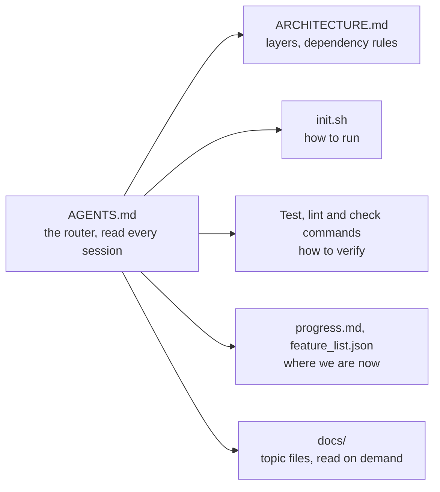

# 9 — The Repo as System of Record

> If it isn't in the repository, it doesn't exist for the agent. The harness starts with the map.

Notes 01–08 describe the harness as components. This note and [note 10](10-scope-and-done.md) are about what goes into an actual repository so a coding agent can work in it across many sessions; the session routine that uses these files is in [note 06](06-long-horizon-execution.md#the-session-lifecycle). Adapted from the *learn-harness-engineering* course (lectures 03–04 plus its OpenAI-advanced SOPs). The course's own team anecdotes and percentages are left out because they are unsourced. The principles are kept.

---

## The agent's three inputs

A coding agent sees exactly three things:

1. The system prompt and task description
2. File contents from the repository
3. Tool execution output

It never sees Slack threads, Jira tickets, Confluence pages or the decision made at a whiteboard on Friday, and it can't ask a colleague. OpenAI states this as **"repo as spec"**: the repository is the highest-authority specification. Anthropic's long-running-agents post makes the same point from the continuity side. State that must survive across sessions has to live somewhere stable and reachable, and the repo is the only such place.

The work this calls for is **not writing more docs. It is putting decision information where the agent will find it.** A 50-line `ARCHITECTURE.md` in `src/api/` is worth more than a 500-page design doc nobody maintains. Proximity beats length.

---

## Vocabulary

| Term | Meaning |
|---|---|
| **Knowledge visibility gap** | Share of project knowledge that is *not* in the repo. List the decisions and constraints that matter, mark each in-repo or not, and the ratio is the gap. |
| **System of record** | The repo has the final say on decisions, constraints, execution state and verification standards. Nowhere else counts. |
| **Discovery cost** | Context budget spent finding one key fact. Buried information taxes every session that needs it. |
| **Knowledge decay** | Docs drifting out of sync with code. A stale doc is worse than none: it points the agent the wrong way while it believes it is on track. |

---

## The fresh session test

The acceptance test for the map. Open a brand-new agent session with no verbal context and ask:

| Question | Typically answered by |
|---|---|
| What is this system? | `AGENTS.md` / README |
| How is it organized? | `ARCHITECTURE.md`, module docs |
| How do I run it? | `init.sh`, Makefile, package scripts |
| How do I verify it? | Test, lint and check commands |
| Where are we now? | Progress log, feature list, git history |

Every question it can't answer is a blank spot on the map. Blank spots get guessed, wrong guesses become bugs, and **every new session guesses again.** The cost of drawing the map once is always lower than the repeated guessing.

---

## Four rules for the map

1. **Knowledge lives next to code.** A rule about endpoint auth belongs beside the API code. When the agent reaches the code it also reaches the constraint, with no search needed.
2. **One standard entry file.** `AGENTS.md` (or `CLAUDE.md`) is the landing page. It answers *what is this, how do I run it, how do I verify it*, then routes elsewhere.
3. **Minimal but complete.** If deleting a rule doesn't change decision quality, delete it. But every fresh-session question must have an answer.
4. **Update with code.** Docs in the module directory get noticed when the module changes. CI can prompt for a doc check on changes to watched paths.

```
project/
├── AGENTS.md              # entry: overview, run/verify commands, hard constraints, links
├── ARCHITECTURE.md        # domains, layers, allowed dependency directions
├── src/api/ARCHITECTURE.md
├── src/db/CONSTRAINTS.md  # MUST / MUST NOT
├── feature_list.json      # what's done, with evidence (note 10)
├── progress.md            # where we are (note 06)
└── init.sh                # standard startup + verification path (note 06)
```

---

## The entry file is a router

The common failure: the agent makes a mistake, you add a rule, it works for a while, and the next mistake adds another. In a few months the file is 600 lines and the agent is doing *worse*. Four things go wrong:

- **Budget crowding.** Instruction tokens are spent on every task, including the ones they're irrelevant to.
- **Lost in the middle.** Models use information at the start and end of a long context far better than the middle (Liu et al., 2023). A security constraint at line 300 is the one most likely to be ignored.
- **Flat priority.** "Never use `eval()`", "prefer functional style" and "we fixed a WebSocket leak last week" look identical. The agent has no signal for which is a red line.
- **Decay and contradiction.** Adding feels free and deleting feels risky, so the file only grows, and rules written months apart start disagreeing.

The fix is **progressive disclosure.** The entry file is an index, and the details live in topic docs read on demand. OpenAI calls `AGENTS.md` a *table of contents, not an encyclopedia*, and keeps theirs to about 100 lines.



Everything to the right of the router costs tokens only when a task opens it. Each arrow answers one question from the fresh session test above.

How long, exactly? The sources disagree. Osmani says under ~60 lines ([note 01](01-what-a-harness-is.md#the-ratchet)), OpenAI about 100, the *learn-harness-engineering* course 50–200. They agree on the rule behind the number: **everything in the root file is read on every task, so each line has to earn that.** Start near 60. Grow only when a line traces to a real failure ([the ratchet](01-what-a-harness-is.md#the-ratchet)), and move a section out to a topic doc once it applies to only some tasks:

```markdown
# AGENTS.md
## Overview
Python 3.11 FastAPI backend, PostgreSQL 15.

## Quick start
- Install: `make setup`   - Test: `make test`   - Full check: `make check`

## Hard constraints        ← top of file, ≤15 items, non-negotiable only
- All DB queries use parameterized SQLAlchemy 2.0
- All PRs pass pytest + mypy --strict + ruff

## Topic docs              ← one line each: what + when to read it
- docs/api-patterns.md — required when adding endpoints
- docs/database-rules.md — required when touching DB code
```

Topic docs run 50–150 lines each and are read only when the task needs them.

**What stays in the root vs. what moves out:**

| Keep in the root | Move out |
|---|---|
| Purpose and scope | Long historical edge cases |
| Startup path and verification path | Topic-specific implementation detail |
| Non-negotiable constraints | Architecture notes that belong near the code |
| Required state artifacts | Examples that apply to one subsystem |
| End-of-session rules | Tool manuals |

**Each rule records three things:** its *source* (why it was added), its *applicability* (when it matters), and its *expiry* (what would make it removable). Audit on a schedule and remove dead rules the way you remove unused dependencies. If a rule must sit in a long file, put it at the top or bottom, never the middle.

Anti-patterns to check for: the same rule in several places; obsolete rules nobody audits; conditional rules so specific they almost never fire; long tool manuals in startup context.

Same idea from the context side: [02-context](../../02-context-engineering/README.md), especially progressive disclosure and stable-before-dynamic ordering.

### Karpathy's environment layer

Karpathy's version of the same idea (as relayed from his AISN 2026 talk) treats the repo as the workshop the agent works in. Most people rebuild it from scratch every session. Three parts carry over between sessions:

1. **`CLAUDE.md` as the operating contract.** Repo layout, skill routing, where to look for what, standing rules. *"It's your world and AI is living in it, not the other way around."*
2. **An LLM knowledge base.** A folder system of your own curated material, laid out so the model knows where information lives. *"Your data is your moat."*
3. **Skills for anything repeated.** One handbook per recurring task ([note 03](03-tool-design.md#progressive-disclosure-skills)). *"The best way to find a leak in a hose is to run water through it"*: using a skill shows where it needs fixing, so the set improves with use.

The fourth part of his environment layer, rules vs. requests, is in [note 04](04-execution-boundaries.md#prompts-vs-hooks).

---

## Encoding knowledge the agent can't see

Signs that knowledge lives outside the repo: the agent keeps asking how the system works, humans say "we decided that in Slack", reviews cite rules nobody wrote down, and new sessions redo discovery that should already be settled.

The procedure: **classify each piece, then file it where it belongs.**

| Kind of knowledge | Home |
|---|---|
| Architecture, layers, dependency rules | `ARCHITECTURE.md` |
| Product behavior | `docs/product-specs/` |
| Design rationale | `docs/design-docs/` |
| Execution state and plans | `docs/exec-plans/active/`, `completed/` |
| Repeated external references | `docs/references/` (e.g. `*-llms.txt`) |
| Quality and reliability expectations | `docs/QUALITY_SCORE.md`, `docs/RELIABILITY.md` |

Write for discoverability, not completeness: short files, clear names, linked to each other. Store durable rules, not meeting transcripts. **Update the repo in the same session the decision is made**, and delete the stale copy so there is one truth.

That layout is OpenAI's. Start with the minimal set (`AGENTS.md`, `init.sh`, `feature_list.json`, `progress.md`) and add the `docs/` folders when the repo outgrows it.

---

## Make the map enforceable

Docs tell the agent what the rules are. A check makes them hold. OpenAI's recommended structure within a business domain is a one-way layer flow:

```
Types → Config → Repo → Service → Runtime → UI
```

Cross-cutting concerns (auth, telemetry, external APIs) enter only through named providers or adapters. Shared utils stay generic and don't accumulate domain logic. The procedure:

1. Map the codebase into domains and write the allowed directions into `ARCHITECTURE.md`.
2. Pick the **single costliest boundary violation** and add one executable guardrail for it, such as a lint rule, an import-graph test or a script in CI.
3. Make the guardrail's error message tell the agent how to fix it ([note 05](05-verification-loops.md#agent-oriented-error-messages)).

Done when a fresh agent can tell which layer owns a change and at least one important boundary is enforced mechanically. This is the practical form of [note 04 — encode constraints, don't document them](04-execution-boundaries.md#encode-constraints-dont-document-them).

---

## State as transactions (ACID)

A useful lens for agent state:

- **Atomicity.** One logical change is one commit. If it fails midway, roll back. No half-done states.
- **Consistency.** A named predicate for "consistent", e.g. tests green and lint clean. Don't commit states that fail it.
- **Isolation.** Concurrent agents get their own branch or worktree and their own progress file. Concurrent writes to one state file are a classic source of corruption.
- **Durability.** Anything that must outlive the session goes into a git-tracked file.

---

## Working reference

`~/.claude/refs/agent-context.md` — what loads at startup vs. on demand.

---

## Pitfalls

- **Treating a growing rules file as progress.** Symptom: after a few months the entry file is 600 lines and the agent is doing worse. Fix: make it a router with topic docs on demand, whatever length you pick from the sources' ~60, about 100 or 50–200 lines.
- **Critical rules in the middle of a long file.** Symptom: a security constraint at line 300 gets ignored, since models use the start and end of a long context better (Liu et al., 2023). Fix: keep non-negotiable constraints in the root, near the top.
- **Decisions that stay in Slack.** Symptom: reviews cite rules nobody wrote down, and sessions redo settled discovery. Fix: update the repo in the same session the decision is made, and delete the stale copy.
- **Writing a long design doc instead of a short near one.** Symptom: nobody maintains it, and the agent never reaches it. Fix: proximity beats length, so a 50-line `ARCHITECTURE.md` in `src/api/` is worth more than a 500-page design doc.
- **Rules with no expiry.** Symptom: contradictions between rules written months apart. Fix: record each rule's source, applicability and expiry, and audit on a schedule the way you remove unused dependencies.
- **Rules that only live in docs.** Symptom: the same boundary violation keeps coming back. Fix: pick the single costliest violation and add one executable guardrail, with an error message that tells the agent how to fix it.
- **Concurrent writes to one state file.** Symptom: a corrupted progress file. Fix: treat state as transactions, and give each concurrent agent its own branch or worktree and its own progress file.

## Try it

1. Run the fresh session test on a repo you own: a new session, no verbal context, and the five questions. Count the blank spots.

   <details><summary>What to look for</summary>

   Each unanswered question is a blank spot that every new session guesses at again. Fill them in table order: entry file, architecture doc, `init.sh`, verification commands, progress log. Use a second fresh session to confirm, since the first one can't check its own answers against what you know.

   </details>

2. Decide where each goes: "never use `eval()`", "we fixed a WebSocket leak last week", an endpoint auth rule, how to run the migration tool, the decision to use Postgres over DynamoDB.

   <details><summary>Answer</summary>

   Root: `eval()`, as a non-negotiable constraint, ideally also enforced by a check. Progress log or decision log: the WebSocket fix, which is history rather than a rule. Next to the API code: the auth rule. A topic doc or `docs/references/`: the migration tool manual, since long tool manuals don't belong in startup context. `docs/design-docs/`: the Postgres rationale.

   </details>

3. Measure your knowledge visibility gap. List ten decisions or constraints that matter on a project, mark each as in the repo or not, and compute the ratio.

   <details><summary>Worked example</summary>

   If 4 of 10 aren't in the repo, the gap is 40%. Move those in with short, clearly named files, then check that a fresh session finds them without being told where they are. Discovery cost is the next number to reduce.

   </details>

## Interview checklist

| Prompt | Answer in one line |
|---|---|
| What can a coding agent actually see? | The system prompt and task, file contents in the repo, and tool output. Slack, Jira and whiteboard decisions don't exist for it. |
| What is the fresh session test? | Open a new session with no verbal context and ask what this is, how it's organized, how to run it, how to verify it and where things stand. Every miss is guessed again in every later session. |
| Why does a long `AGENTS.md` hurt? | Budget crowding, lost in the middle, flat priority, and decay with contradiction. The fix is progressive disclosure: an index, plus topic docs of 50–150 lines read on demand. |
| How long should the entry file be? | Sources disagree: Osmani under ~60 lines, OpenAI about 100, *learn-harness-engineering* 50–200. They agree that everything there is read on every task, so each line has to earn it. |
| An agent keeps importing across layers despite the docs. What do you do? | Add a lint rule, import-graph test or CI script for that boundary, with an error message saying how to fix it. Docs state rules, and a check makes them hold. |
| Why is a stale doc worse than none? | It sends the agent the wrong way while it believes it's on track. Update docs with the code and keep one truth. |

## Next

[10-scope-and-done.md](10-scope-and-done.md): one feature at a time, and what "done" means.
