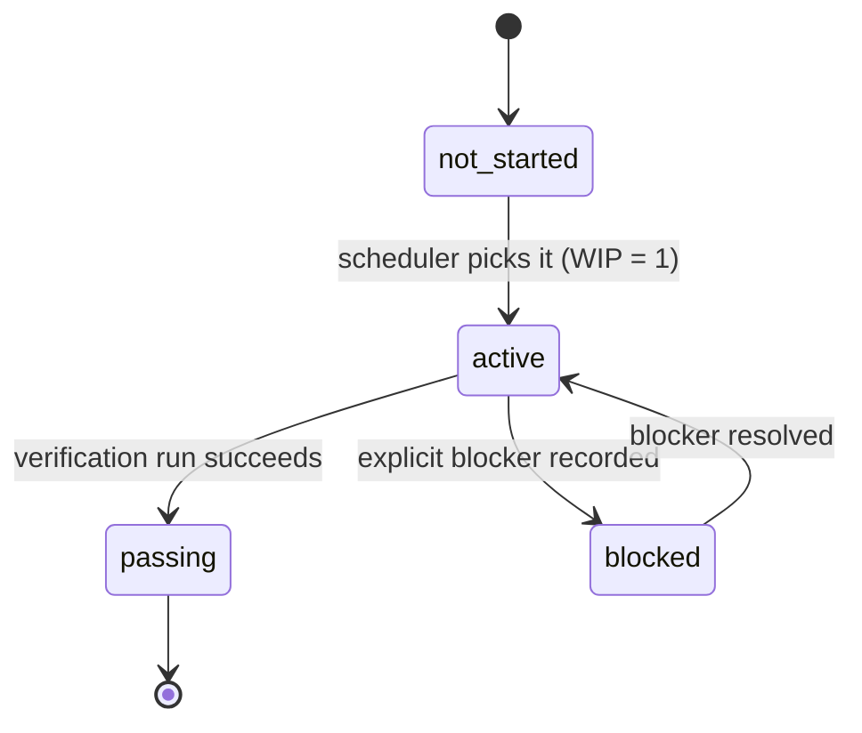

# 10 — Scope and Done

> An agent left alone starts five things and finishes none. Limit it to one active feature, and let a passing check be the only way that feature counts as done.

The [acceptance baseline](01-what-a-harness-is.md#the-four-parts) from note 01, made concrete for a coding agent: a feature list in the repo that defines the work, gates completion, and carries state between sessions. Adapted from *learn-harness-engineering* lectures 07–08.

---

## Overreach and under-finish

Ask an agent to "add user registration" and it will create the model, write the route, notice email verification and add a mail service, add password hashing, decide the error middleware is inconsistent and refactor it, then reorganize the test directory. Six things are touched, none of them work end to end, and the next session gets a pile of coupled half-implementations.

Anthropic's long-running-agents post names this directly: broad prompts make agents **start multiple things rather than finish one.** Two failures feed each other:

- **Overreach.** More tasks active than the session can finish.
- **Under-finish.** Of the activated tasks, too few pass end-to-end verification.

Overreach spreads attention thin, which causes under-finish. The half-done code raises complexity, which invites more overreach. Humans have a sense of "that's enough for now". Agents don't: one more "while I'm here" costs nearly nothing to generate. It's the same queueing math as Kanban (Little's Law): more work in progress means longer lead time per item and more items that never land.

The tell is that **lines of code written goes up while verified features stay flat.**

---

## Before the list: the spec

A feature list is only as good as the understanding behind it. Karpathy (as relayed from his AISN 2026 talk) puts the spec first: it is how your understanding reaches the model. He finds plan mode too high-level: *"you have to work with your agent to design a spec that is very detailed."* Three disciplines:

1. **Uncover the goal, not the task.** "Create an end-of-month report" is a task. The goal is the decision the report drives, and it is the one thing the model can never infer. Extract it on purpose, for example: *"interview me to identify the goal of this project."*
2. **Agile specs, not waterfall.** People hand an agent everything at once because delegation feels efficient. Bias toward smaller, compartmentalized specs with a checkpoint, a review and an adjustment each round. This is WIP = 1 below, applied to the spec.
3. **Precision with explicit sign-off.** Every assumption the model makes is a chance to drift. When the model drafts the spec, have it ask: *"make me verify key decisions explicitly."*

The feature list below is that spec in a form the harness can check.

---

## WIP = 1

The default for a coding-agent harness: **exactly one feature is `active` at any time.** The next starts only after the current one passes verification or is explicitly marked `blocked`.

```markdown
## Work rules                       (AGENTS.md)
- One feature at a time.
- Start the next only after the current one passes end-to-end verification.
- Don't "also refactor" B while implementing A. Note it in progress.md instead.
- A narrow supporting fix is allowed only when it blocks the active feature.
```

A small **next-task block** at the start of each feature keeps the scope honest:

```markdown
- Active feature:
- Why it's next:
- What counts as passing:
- What must NOT change during this step:
```

The last line matters most. Naming what is out of bounds is cheaper than reverting it afterwards.

Track the **verified completion rate (VCR)** = verified features ÷ activated features. Under WIP=1 it should sit at 1.0 between features. A harness can refuse to activate a new feature while VCR < 1.

---

## The feature list is a primitive, not a memo

Compare a typical progress note:

```
Did user auth, cart mostly done, still need payments
```

What does "mostly done" mean? Which cart checks pass? What's blocking payments? A fresh session can't tell, so it re-derives everything or reimplements finished work.

A feature list differs from a memo because **other parts of the harness read it:**

| Component | Uses the list to |
|---|---|
| **Scheduler** | Pick the next `not_started` feature by priority and dependencies |
| **Verifier** | Run that feature's checks and decide whether the state may change |
| **Handoff reporter** | Generate "what's passing / active / blocked" with no prose |
| **Progress tracker** | Count states for project health; the remaining non-passing count is the back-pressure |

A document can be ignored. A primitive is a constraint like a database check: other parts of the harness depend on it, so the agent can't route around it.

---

## The triple

Every entry has three parts, and is incomplete without any one:

| Part | Tells the agent |
|---|---|
| **Behavior** | What to build, as user-visible behavior, not implementation |
| **Verification** | What counts as done: executable steps or a command |
| **State** | Where it stands now |

Plus **evidence** once it passes: a commit, test output or screenshot.

```json
{
  "id": "cart-002",
  "priority": 2,
  "depends_on": ["cart-001"],
  "user_visible_behavior": "POST /api/cart/items with {product_id, quantity} returns 201 and the item appears in GET /api/cart",
  "verification": [
    "curl -s -o /dev/null -w '%{http_code}' -X POST localhost:3000/api/cart/items -d '{\"product_id\":1,\"quantity\":2}'  → 201",
    "curl -s localhost:3000/api/cart | jq '.items | length'  → 1"
  ],
  "status": "passing",
  "evidence": ["commit abc123", "logs/verify-cart-002.txt"]
}
```

A JSON Schema for the file lets a pre-commit hook reject entries missing any part of the triple.

---

## States and the pass gate


*Image Source: diagram based on learn-harness-engineering, lecture 08*

Four states only. The important rule is **pass-state gating: the only way into `passing` is a successful run of that feature's verification.** Ideally a script runs the checks and flips the state. The agent requests verification; it doesn't edit the status field to say it passed.

A feature may move to `passing` only when:

- the expected workflow was actually exercised
- the evidence is recorded
- no blocking error is present on the tested path
- the app isn't left broken or ambiguous

Rules worth stating explicitly in `AGENTS.md`, because each one is a shortcut agents take:

- Don't mark complete just because code was added.
- Don't rewrite the feature list to hide unfinished work.
- Don't weaken or delete tests to make a feature pass.
- Don't change the verification rules mid-implementation.

---

## Granularity

**One feature should be finishable in one session.**

| Too broad | Right | Too narrow |
|---|---|---|
| "Implement the shopping cart" | "User can add an item to the cart" | "Add `name` field to Cart model" |
| "Implement indexing" | "Split imported docs into chunks" · "Persist chunk metadata" · "Show indexing status in UI" · "Add a re-index action" | — |

Too broad and it never finishes inside the WIP=1 limit. Too narrow and list management costs more than the work. Write behaviors from the user's side, and let dependencies (`depends_on`) carry the order, which turns the list into a small DAG.

---

## Strict vs. loose verification

The value of the list depends on the strength of its checks:

| Loose (false positives) | Strict |
|---|---|
| "Code compiles" | "E2E test for the flow passes" |
| "Component renders" | "User can click New Chat and see an empty thread" |
| "Endpoint exists" | "POST returns 201 and the item is retrievable" |

Loose checks give you a list of `passing` features that don't work. When in doubt, verify the *behavior* the user would see, not the artifact the agent wrote. Layered checks and E2E are covered in [note 05](05-verification-loops.md#the-three-layer-termination-check).

---

## Single source of truth

Every "what's left to do" lives in the feature list, not in chat history, TODO comments or a side note. If scope shows up anywhere else, either move it into the list or delete it. Two sources of scope will eventually disagree, and the agent will pick one at random.

---

→ Next: [04-loop-engineering](../../04-loop-engineering/README.md) — run the harness again, against a goal, until a scorekeeper says stop.
