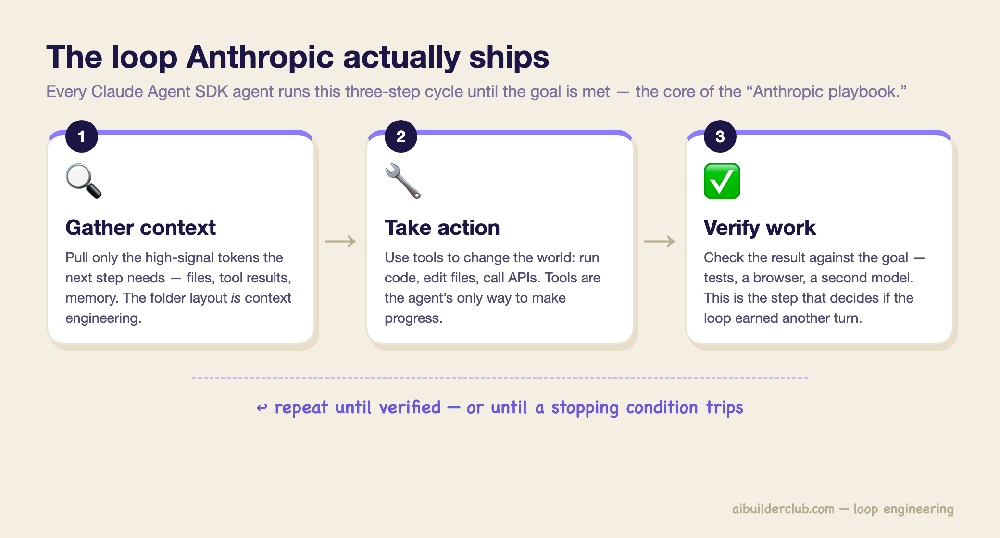
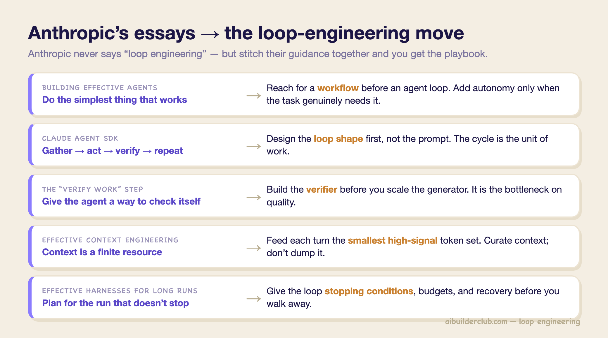

# 1 — What a Loop Is

> The cycle, the two things every loop needs before it runs, and the map of this pillar.

Most agent work still stalls on a person: someone reads the output, decides what is next and types the next prompt. Automate that step carelessly and you get the opposite problem, an agent that repeats a wrong move all night, grades its own work and reports success. This chapter defines the loop as a goal plus a scorekeeper, repeated, with a way to stop. It sets out what must exist before the first pass, when not to build a loop at all, and how the rest of the pillar maps the options.

---

## The definition

> **Loop engineering is designing the cycle that keeps an agent correct and productive when nobody is watching.**

The question changes from "how do I phrase this?" to "what cycle re-prompts the agent, checks it, and decides when it quits?"

Two framings worth holding together:

- **Addy Osmani (operator):** *"Loop engineering is replacing yourself as the person who prompts the agent. You design the system that does it instead."*
- **Adnan Masood (systems):** a loop is *"the trigger, the topology, the verifier, and the stop rules that decide what an agent does next and when it quits."* His tl;dr: *"stop prompting your agents and start designing the loops that prompt them."*

Boris Cherny's version, quoted in Pragmatic Engineer: agents now "prompt Claude and figure out what to do. My job is to write loops."

The shortest working definition, and the thesis of this pillar:

> **A loop is a goal plus a scorekeeper, repeated, with a way to stop.**

Generation becomes nearly free inside a loop, so the binding constraint moves to **verification**. That is why the scorekeeper comes before the loop ([note 03](03-the-scorekeeper.md)), and why the hardest failures are human ones, comprehension rot and cognitive surrender, rather than mechanical ones ([note 09](09-failure-modes-and-guardrails.md#the-four-silent-costs-osmani)).

A loop is *dynamic*, unlike a chain. The agent may go A → B, discover B failed, revise, and only then reach C. A chain runs a fixed sequence whatever the intermediate results. That difference, feedback changing the next step, is the whole discipline.

Here is the difference in a few lines, with a stub maker editing a stand-in for a codebase. The chain runs its planned edits. The loop scores each edit and rolls back the one that breaks a passing test.

```python
# Four auth tests. A stub maker edits a "codebase" represented by which tests pass.
CHECKS = ["login", "logout", "refresh", "expiry"]

def score(code):
    return sum(code[c] for c in CHECKS)

def apply(code, edit):
    fixed, broke = edit
    new = dict(code)
    if fixed:
        new[fixed] = True
    if broke:
        new[broke] = False
    return new

# (test it fixes, test it breaks). Edit 2 fixes refresh and breaks login.
EDITS = [("login", None), ("refresh", "login"), ("logout", None),
         ("refresh", None), ("expiry", None)]

def chain():
    """Runs the planned edits in order, whatever they do."""
    code = dict.fromkeys(CHECKS, False)
    for edit in EDITS[:3]:
        code = apply(code, edit)
    return score(code)

def loop(max_passes=8):
    """Each pass: try one edit, score it, save or roll back, stop on green."""
    saved = dict.fromkeys(CHECKS, False)
    for n, edit in enumerate(EDITS[:max_passes], 1):
        candidate = apply(saved, edit)
        before, after = score(saved), score(candidate)
        kept = after > before
        print(f"pass {n}: {before}/4 -> {after}/4  {'save' if kept else 'roll back'}")
        if kept:
            saved = candidate
        if score(saved) == len(CHECKS):
            return f"stop: goal met after {n} passes"
    return "stop: cap reached, escalate"

print(f"chain, three planned edits: {chain()}/4, and it reports finished")
print(loop())
```

Output:

```text
chain, three planned edits: 2/4, and it reports finished
pass 1: 0/4 -> 1/4  save
pass 2: 1/4 -> 1/4  roll back
pass 3: 1/4 -> 2/4  save
pass 4: 2/4 -> 3/4  save
pass 5: 3/4 -> 4/4  save
stop: goal met after 5 passes
```

The chain finished with half the tests failing and had no way to notice. Pass 2 of the loop fixed one test and broke another, so the score didn't rise and the edit wasn't saved. That save-or-roll-back step is the ratchet this note describes below.

---

## One cycle, three vocabularies

Every source describes the same cycle in different words:

| Source | The cycle |
|---|---|
| Classic agents | perceive → decide → act → repeat |
| Anthropic (Claude Agent SDK) | gather context → take action → verify work → repeat |
| KodeKloud course | try → test → fix → save → repeat |


*Image Source: AI Builder Club, "Loop engineering: the Anthropic playbook" (2026)*

The KodeKloud version adds the step the others leave implicit: **save**. A pass that improves the score is committed before the next pass starts, so progress is a ratchet. A bad pass costs one rollback, not the run.

---

## Two things before anything runs

Every loop rests on two foundations. Nothing else should run until both exist:

| Foundation | What it is | Example |
|---|---|---|
| **A clear goal** | A plain statement of what "done" looks like | "Make all auth tests pass", not "improve the app" |
| **A scorekeeper** | An objective check that says whether a step helped or hurt | Test suite, build, linter, rubric graded by a separate agent |

The goal points the work; the scorekeeper proves it. A testable goal is a loop invariant. A vague one ("improve the app") is an infinite loop. The scorekeeper gets its own note ([03](03-the-scorekeeper.md)) because it is the load-bearing part.

> **Write the scorekeeper first.** Defining the check before the loop makes "done" explicit and gives every later decision something to measure against.

---

## Green first

Get **one small, validated win saved** before adding anything. Build a thin vertical slice: goal → one change → score → persist. A loop that has produced one green result proves it runs end to end and gives you a baseline to roll back to. A grand loop design that has never gone green proves nothing.

Then **add parts only when a real failure demands them**. That is the design order for the rest of this pillar: each building block in [04](04-building-blocks.md) exists to fix a specific failure, and you add it when you see that failure.

---

## When not to build a loop

Anthropic's *Building Effective Agents* opens with the line between **workflows** (fixed code paths that orchestrate a model) and **agents** (models that direct their own process). Their advice is to use the workflow first and accept an agent loop's cost and unpredictability only when the task needs it.

Build a loop only when **both** hold:

1. The work **repeats** often enough to pay back the token and compute cost of many passes.
2. A scorekeeper can **reliably validate** the result.

For one-off work a good prompt is cheaper. For work whose success is only "looks right," there is nothing for the loop to steer by (see [rung 2 of the autonomy ladder](07-autonomy-ladder.md#2--goal-based-hand-off-the-stop-condition)). Many "my agent keeps going in circles" problems are really a task that needed three fixed steps, given to an open-ended loop.

---

## Lineage

Geoffrey Huntley's **Ralph Wiggum** technique (mid-2025) was the crude ancestor: a bash loop that re-runs the agent with the same prompt forever. It splits work into small context windows and keeps progress on the filesystem, so the agent can amend its own plan between runs. It showed that a dumb, steady loop plus passing tests can build real software.

The name took hold in the first week of June 2026, when three people said the same thing without comparing notes. Peter Steinberger: *"You shouldn't be prompting coding agents anymore. You should be designing loops that prompt your agents."* Boris Cherny (Claude Code): *"I don't prompt Claude anymore. I have loops running that prompt Claude… My job is to write loops."* He reported 259 merged PRs in 30 days, with over 80% of production code written by Claude. Addy Osmani named the concept on June 7, and LangChain followed with its four levels. By May 2026 the harnesses had absorbed the pattern: `/loop` (cadence-based) and `/goal` (condition-based, run until done) ship in Codex, Hermes and Claude Code, so nobody hand-rolls the bash wrapper any more. Two things made it practical then: models that reason and code well enough to recover from their own errors, and tooling (file access, test runners, CI, connectors) that lets an agent see the consequences of what it did.

Loop engineering doesn't replace TDD or CI. It **runs them under an agent**: small commits, quick tests and incremental fixes, with the agent doing the repetitions.

### Inside the loop vs outside it

With a full harness (`AGENTS.md`, feature list, `init.sh`, progress file) you are still **inside the loop**: you read the progress file, decide what's next, type the instruction. You are the engine. **Outside the loop**, a system you designed does that: trigger → discover work → dispatch → verify → save state → repeat, and you get only the decisions it can't make, in an inbox. The leverage moves from writing the right prompt to designing the right loop. Generation becomes nearly free; judgment becomes the scarce resource.

The same artifacts change role when you cross the line:

| Harness engineering | Loop engineering |
|---|---|
| One run: tools, sandbox, hooks, verification inside the run | Many runs: what starts the next one, and when to stop |
| Progress file written at session end | Progress file *read* by the next pass to pick its own task |
| Generator/evaluator separation | Maker/checker as the loop's quality ceiling |
| Ratchet on the harness (every failure → a rule) | Ratchet on the work (score only goes up, else roll back) |

The moment the agent's next run starts without you typing a prompt, you've crossed from harness into loop.

---

## The map of this pillar

Loops are classified on **two independent axes**.

**Capability: what the loop automates** (LangChain's four levels). Each wraps the one before, and production systems stack all four:

| Level | Loop | Automates | Note |
|---|---|---|---|
| 1 | **Agent loop**: model calls tools until done | Work | [02](02-loop-shapes.md), [04](04-building-blocks.md), [05](05-long-running-loops.md) |
| 2 | **Verification loop**: grader feeds failures back | Quality | [03](03-the-scorekeeper.md) |
| 3 | **Event-driven loop**: schedules and webhooks start runs | Invocation | [06](06-triggers-and-schedules.md) |
| 4 | **Hill-climbing loop**: traces rewrite the harness | Improvement | [08](08-self-improving-loops.md) |

**Autonomy: how much of the operator's job has been handed off.** Turn-based → goal-based → time-based → proactive. See [07](07-autonomy-ladder.md).

A loop has a position on both axes:

| Capability level (LangChain): *what it automates* | Autonomy rung: *what the operator handed off* |
|---|---|
| 1. Agent loop: work | 1. Turn-based: tool approval |
| 2. Verification loop: quality | 2. Goal-based: the stop condition (`/goal`) |
| 3. Event-driven loop: invocation | 3. Time-based: the trigger, to a clock (`/loop`) |
| 4. Hill-climbing loop: improvement | 4. Proactive: the trigger and session (`/schedule`) |

Levels 1–3 automate work; level 4 automates improvement and starts editing the harness underneath it. The two axes are independent: a hill-climbing loop (capability 4) can run at autonomy rung 1, with a human approving each rewrite. Earn each rung with a verifier that has been seen catching a real failure.

LangChain is explicit that **humans stay in at every level**: approval before sensitive tool calls (L1), humans as graders for sensitive work (L2), review before output reaches users (L3), and review of harness changes before deploy (L4). *"Automation doesn't mean removing humans from the loop."*

### The Anthropic playbook in one picture

Anthropic never uses the phrase "loop engineering," but their engineering essays add up to a playbook for it (synthesis by AI Builder Club). Each row points to the note that develops it:


*Image Source: AI Builder Club, "Loop engineering: the Anthropic playbook" (2026)*

| Principle (source essay) | Loop-engineering move | Note |
|---|---|---|
| Do the simplest thing that works (*Building Effective Agents*) | Use a workflow until the task earns an agent loop | this note |
| Gather → act → verify → repeat (*Claude Agent SDK*) | Design the loop shape before the prompt | [02](02-loop-shapes.md) |
| Verify work is what unlocks quality (*Claude Agent SDK*) | Build the verifier before you scale the generator | [03](03-the-scorekeeper.md) |
| Context is a finite resource (*Effective Context Engineering*) | Feed each turn the smallest high-signal token set | [05](05-long-running-loops.md) |
| Plan for the run that doesn't stop (*Effective Harnesses for Long-Running Agents*) | Budgets, stopping conditions, recovery before you walk away | [09](09-failure-modes-and-guardrails.md) |

---

## Where it sits

prompt → context → harness → **loop** → graph. The harness ([03-harness](../../03-harness-engineering/README.md)) supplies tools, state and guardrails; the loop decides how many times to use them and when to stop. *The loop decides what happens; the harness decides where it can safely happen.* The graph layer ([05-graph](../../05-graph-engineering/README.md)) composes loops into multi-agent topologies.

**Inherits the weaknesses of:** harness engineering. A loop running inside a poorly instrumented harness repeats unreliable behavior faster, and that is harder to debug than a single bad run.

---

## Pitfalls

- **A vague goal.** Symptom: "improve the app" runs without finishing and scope drifts. Fix: a testable goal such as "make all auth tests pass". A testable goal is a loop invariant, and a vague one is an infinite loop.
- **Writing the loop before the scorekeeper.** Symptom: passes pile up and nobody can say whether the work is winning. Fix: write the check first, since generation is nearly free inside a loop and verification is the binding constraint.
- **Building the full loop on day one.** Symptom: six parts running and no saved result to roll back to. Fix: green first, with one thin slice from goal to one change to score to persist. Add parts when a real failure demands them.
- **Looping on work that doesn't pay.** Symptom: a one-off task burns many passes, or success is only "looks right". Fix: build a loop only when the work repeats and a scorekeeper can reliably validate it. Otherwise a prompt or a fixed workflow is cheaper.
- **Skipping "save".** Symptom: one bad pass loses the gains of several good ones. Fix: commit each pass that improves the score, so a bad pass costs one rollback rather than the run.
- **Looping on an unreliable harness.** Symptom: a loop repeats unreliable behavior faster, and that is harder to debug than one bad run. Fix: instrument the harness first ([pillar 03](../../03-harness-engineering/README.md)).

## Try it

1. Decide whether each deserves a loop: (a) a one-off migration script you will review line by line; (b) fixing flaky tests each morning; (c) rewriting marketing copy until it "feels on brand".

   <details><summary>Answer</summary>

   (a) No: it doesn't repeat, so a good prompt is cheaper. (b) Yes: it repeats and the test suite validates it. (c) Not yet: there is nothing for the loop to steer by until a rubric or a separate grader exists, so it stays at autonomy rung 1.

   </details>

2. In `EDITS`, insert `(None, "logout")` as the third edit: it fixes nothing and breaks `logout`. What do the chain and the loop each report?

   <details><summary>Answer</summary>

   The chain drops to 1/4 and still reports finished, because it never reads a score. The loop takes 6 passes and reaches 4/4: the new edit doesn't raise the score, so it is the second rollback, and the four good edits save.

   </details>

3. Place these on both axes: (a) a nightly agent that triages CI failures and opens PRs for a human to merge; (b) a person approving each config rewrite proposed from traces.

   <details><summary>Answer</summary>

   (a) Capability level 3, event-driven invocation by the clock, and autonomy rung 4, since the session and trigger are handed off, with humans reviewing output. (b) Capability level 4, hill-climbing, at autonomy rung 1. The axes are independent, and this is the note's own example of level 4 at rung 1.

   </details>

## Interview checklist

| Prompt | Answer in one line |
|---|---|
| What is a loop, in one sentence? | A goal plus a scorekeeper, repeated, with a way to stop. |
| How is a loop different from a chain? | A chain runs a fixed sequence whatever the intermediate results. In a loop, feedback changes the next step, so the agent can discover B failed and revise before reaching C. |
| Why write the scorekeeper first? | Generation is nearly free inside a loop, so verification becomes the constraint. The check makes "done" explicit and gives later decisions something to measure against. |
| When would you refuse to build a loop? | When the work doesn't repeat often enough to pay for many passes, or no scorekeeper can validate it. Anthropic's advice is to use a workflow first. |
| Where is the line between harness and loop? | The moment the agent's next run starts without you typing a prompt. The harness covers one run, and the loop decides what starts the next and when to stop. |
| What are the two axes in this pillar? | Capability is what the loop automates, in LangChain's four levels from work to improvement. Autonomy is what the operator handed off, from turn-based to proactive. |

## Next

[02-loop-shapes.md](02-loop-shapes.md): anatomy, the canonical skeleton, and which pattern fits which task.
