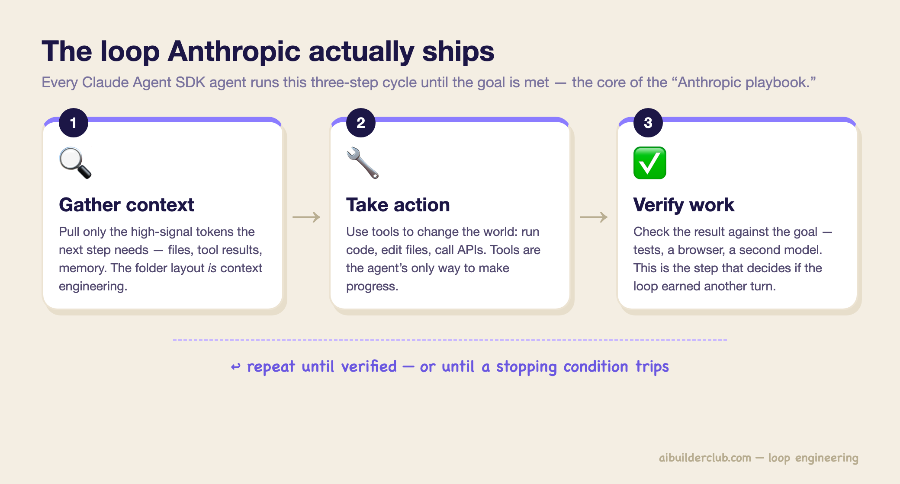
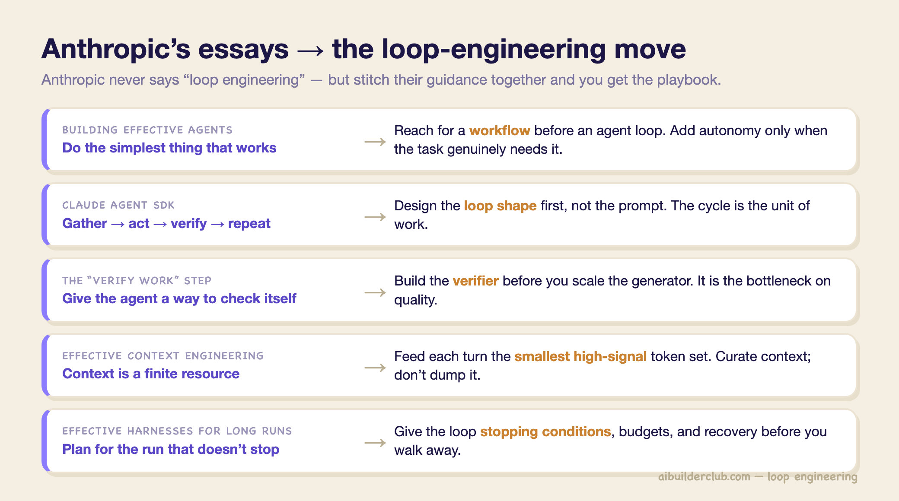

# 1 — What a Loop Is

> The cycle, the two things every loop needs before it runs, and the map of this pillar.

---

## The definition

> **Loop engineering is designing the cycle that keeps an agent correct and productive when nobody is watching.**

The question changes from "how do I phrase this?" to "what cycle re-prompts the agent, checks it, and decides when it quits?"

Two framings worth holding together:

- **Addy Osmani (operator):** *"Loop engineering is replacing yourself as the person who prompts the agent. You design the system that does it instead."*
- **Adnan Masood (systems):** a loop is *"the trigger, the topology, the verifier, and the stop rules that decide what an agent does next and when it quits."* His tl;dr: *"stop prompting your agents and start designing the loops that prompt them."*

Boris Cherny's version, quoted in Pragmatic Engineer: agents now "prompt Claude and figure out what to do. My job is to write loops."

A loop is *dynamic*, unlike a chain. The agent may go A → B, discover B failed, revise, and only then reach C. A chain runs a fixed sequence whatever the intermediate results. That difference, feedback changing the next step, is the whole discipline.

---

## One cycle, three vocabularies

Every source describes the same cycle in different words:

| Source | The cycle |
|---|---|
| Classic agents | perceive → decide → act → repeat |
| Anthropic (Claude Agent SDK) | gather context → take action → verify work → repeat |
| KodeKloud course | try → test → fix → save → repeat |

The KodeKloud version adds the step the others leave implicit: **save**. A pass that improves the score is committed before the next pass starts, so progress is a ratchet. A bad pass costs one rollback, not the run.

---

## Two things before anything runs

Every loop rests on two foundations. Nothing else should run until both exist:

| Foundation | What it is | Example |
|---|---|---|
| **A clear goal** | A plain statement of what "done" looks like | "Make all auth tests pass", not "improve the app" |
| **A scorekeeper** | An objective check that says whether a step helped or hurt | Test suite, build, linter, rubric graded by a separate agent |

The goal points the work; the scorekeeper proves it. A testable goal is a loop invariant. A vague one ("improve the app") is an infinite loop. The scorekeeper gets its own note ([03](03-the-scorekeeper.md)) because it is the load-bearing part.

> **Write the scorekeeper first.** Defining the check before the loop makes "done" explicit and gives every later decision something to measure against.

---

## Green first

Get **one small, validated win saved** before adding anything. Build a thin vertical slice: goal → one change → score → persist. A loop that has produced one green result proves it runs end to end and gives you a baseline to roll back to. A grand loop design that has never gone green proves nothing.

Then **add parts only when a real failure demands them**. That is the design order for the rest of this pillar: each building block in [04](04-building-blocks.md) exists to fix a specific failure, and you add it when you see that failure.

---

## When not to build a loop

Anthropic's *Building Effective Agents* opens with the line between **workflows** (fixed code paths that orchestrate a model) and **agents** (models that direct their own process). Their advice is to use the workflow first and accept an agent loop's cost and unpredictability only when the task needs it.

Build a loop only when **both** hold:

1. The work **repeats** often enough to pay back the token and compute cost of many passes.
2. A scorekeeper can **reliably validate** the result.

For one-off work a good prompt is cheaper. For work whose success is only "looks right," there is nothing for the loop to steer by (see [rung 2 of the autonomy ladder](07-autonomy-ladder.md#2--goal-based-hand-off-the-stop-condition)). Many "my agent keeps going in circles" problems are really a task that needed three fixed steps, given to an open-ended loop.

---

## Lineage

Geoffrey Huntley's **Ralph Wiggum** technique (mid-2025) was the crude ancestor: a bash loop that re-runs the agent with the same prompt forever. It splits work into small context windows and keeps progress on the filesystem, so the agent can amend its own plan between runs. It showed that a dumb, steady loop plus passing tests can build real software.

The name took hold in the first week of June 2026, when three people said the same thing without comparing notes. Peter Steinberger: *"You shouldn't be prompting coding agents anymore. You should be designing loops that prompt your agents."* Boris Cherny (Claude Code): *"I don't prompt Claude anymore. I have loops running that prompt Claude… My job is to write loops."* He reported 259 merged PRs in 30 days, with over 80% of production code written by Claude. Addy Osmani named the concept on June 7, and LangChain followed with its four levels. By May 2026 the harnesses had absorbed the pattern: `/loop` (cadence-based) and `/goal` (condition-based, run until done) ship in Codex, Hermes and Claude Code, so nobody hand-rolls the bash wrapper any more. Two things made it practical then: models that reason and code well enough to recover from their own errors, and tooling (file access, test runners, CI, connectors) that lets an agent see the consequences of what it did.

Loop engineering doesn't replace TDD or CI. It **runs them under an agent**: small commits, quick tests and incremental fixes, with the agent doing the repetitions.

### Inside the loop vs outside it

With a full harness (`AGENTS.md`, feature list, `init.sh`, progress file) you are still **inside the loop**: you read the progress file, decide what's next, type the instruction. You are the engine. **Outside the loop**, a system you designed does that: trigger → discover work → dispatch → verify → save state → repeat, and you get only the decisions it can't make, in an inbox. The leverage moves from writing the right prompt to designing the right loop. Generation becomes nearly free; judgment becomes the scarce resource.

---

## The map of this pillar

Loops are classified on **two independent axes**.

**Capability: what the loop automates** (LangChain's four levels). Each wraps the one before, and production systems stack all four:

| Level | Loop | Automates | Note |
|---|---|---|---|
| 1 | **Agent loop**: model calls tools until done | Work | [02](02-loop-shapes.md), [04](04-building-blocks.md), [05](05-long-running-loops.md) |
| 2 | **Verification loop**: grader feeds failures back | Quality | [03](03-the-scorekeeper.md) |
| 3 | **Event-driven loop**: schedules and webhooks start runs | Invocation | [06](06-triggers-and-schedules.md) |
| 4 | **Hill-climbing loop**: traces rewrite the harness | Improvement | [08](08-self-improving-loops.md) |

**Autonomy: how much of the operator's job has been handed off.** Turn-based → goal-based → time-based → proactive. See [07](07-autonomy-ladder.md).

A loop has a position on both axes. A hill-climbing loop (capability 4) can run at autonomy rung 1, with a human approving each rewrite.

LangChain is explicit that **humans stay in at every level**: approval before sensitive tool calls (L1), humans as graders for sensitive work (L2), review before output reaches users (L3), and review of harness changes before deploy (L4). *"Automation doesn't mean removing humans from the loop."*

### The Anthropic playbook in one picture

Anthropic never uses the phrase "loop engineering," but their engineering essays add up to a playbook for it (synthesis by AI Builder Club). Each row points to the note that develops it:

| Principle (source essay) | Loop-engineering move | Note |
|---|---|---|
| Do the simplest thing that works (*Building Effective Agents*) | Use a workflow until the task earns an agent loop | this note |
| Gather → act → verify → repeat (*Claude Agent SDK*) | Design the loop shape before the prompt | [02](02-loop-shapes.md) |
| Verify work is what unlocks quality (*Claude Agent SDK*) | Build the verifier before you scale the generator | [03](03-the-scorekeeper.md) |
| Context is a finite resource (*Effective Context Engineering*) | Feed each turn the smallest high-signal token set | [05](05-long-running-loops.md) |
| Plan for the run that doesn't stop (*Effective Harnesses for Long-Running Agents*) | Budgets, stopping conditions, recovery before you walk away | [09](09-failure-modes-and-guardrails.md) |

---

## Where it sits

prompt → context → harness → **loop** → graph. The harness ([03-harness](../../03-harness-engineering/README.md)) supplies tools, state and guardrails; the loop decides how many times to use them and when to stop. *The loop decides what happens; the harness decides where it can safely happen.* The graph layer ([05-graph](../../05-graph-engineering/README.md)) composes loops into multi-agent topologies.

---

## Working reference

`~/.claude/refs/agent-architecture.md` — loop shapes and turn termination control.

---

→ Next: [02-loop-shapes.md](02-loop-shapes.md) — anatomy, the canonical skeleton, and which pattern fits which task.
