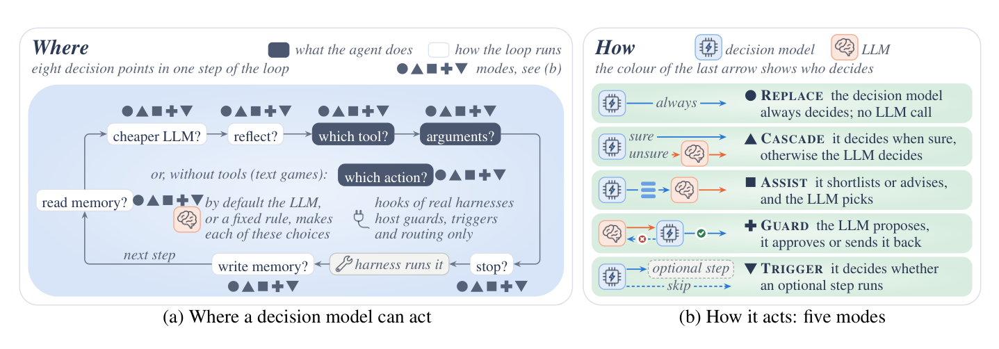

# 2 — Loop Shapes

> The five parts every loop needs, the skeleton they make, and which pattern fits which task. Design the shape before you write the prompt.

---

## Loop shape before prompt

Anthropic built Claude Code around one loop (gather → act → verify → repeat), then extracted the Claude Agent SDK so teams could "build their own agents on the same machinery instead of maintaining a homegrown loop." The message: **the loop is the reusable object, not the prompt inside it.**

Before tuning any prompt, answer the shape questions:

- What context does each pass **gather**?
- Which **tools** can it act with?
- How is "done" **judged**?
- When does it **stop** if "done" never arrives?

Each answer is a line in the skeleton below. A prompt cannot fix a missing line.

---

## The five required parts

ML Mastery, MindStudio and Masood agree on these. A loop missing any one will hang, thrash, or quietly ship garbage.

| Part | What it means | Missing it looks like |
|---|---|---|
| **1. Testable goal** | Specific enough to evaluate. "Make all auth tests pass." | Loop never finishes; scope drifts |
| **2. Tool set** | Real access to the environment: code execution, filesystem, terminal, test runner, docs lookup | The agent can't see consequences, so it guesses repeatedly |
| **3. Context management** | Summarize and prune earlier passes into compact working memory | Token overflow; the agent forgets what it tried |
| **4. Termination logic** | *Layered, independent* exits: success check, iteration cap, budget cap, stall detector, escalation to a human | Runs forever or stops at random |
| **5. Error handling** | Tell recoverable errors from hard blockers; change strategy based on error type | Retries the same failed approach |

Part 1 is half of the foundation from [note 01](01-what-a-loop-is.md#two-things-before-anything-runs). The other half, the scorekeeper, is what part 4's success check calls ([note 03](03-the-scorekeeper.md)).

---

## The canonical skeleton

```
initialize state with goal
for step in range(MAX_STEPS):
    reason about current state                  # the model
    choose a concrete action                    # the model
    execute the tool against the real environment
    update state with the outcome
    compact context to prevent overflow
    if scorekeeper says goal met: save; return success
    if score went down: roll back this step
    if no progress for N steps or budget exhausted: escalate
escalate to human  # cap reached, not success
```

*"Engineering is everything wrapped around"* the model (Masood). The model supplies two lines; every other line is yours.

The skeleton runs. In this version the model's two lines are a stub that returns a score, so the only behavior left is the code you own. Each scenario leaves by a different door, and only one of those exits is a success.

```python
def run(maker, goal=4, max_steps=8, budget=500, stall_after=3, cost_per_pass=60):
    """The canonical skeleton. Exits are independent, and only one is a success."""
    best, spent, stalled, tried = 0, 0, 0, []
    for step in range(1, max_steps + 1):
        new_score = maker(step, best)         # the model's two lines live in here
        spent += cost_per_pass                # update state with the outcome
        tried.append(new_score)               # compact: only scores are kept
        if new_score >= goal:
            return "success", step, spent, tried
        if new_score > best:
            best, stalled = new_score, 0      # save: the score only goes up
        else:
            stalled += 1                      # a lower score is not saved: roll back
        if spent >= budget:
            return "budget cap: escalate", step, spent, tried
        if stalled >= stall_after:
            return "stall: escalate", step, spent, tried
    return "iteration cap: escalate", step, spent, tried

scenarios = {
    "steady progress":     (lambda step, best: step, {}),
    "stuck after one win": (lambda step, best: min(step, 1), {}),
    "slow, expensive":     (lambda step, best: step // 2, {"cost_per_pass": 150}),
    "slow, low cap":       (lambda step, best: step // 2, {"max_steps": 3, "stall_after": 9}),
}
for name, (maker, limits) in scenarios.items():
    outcome, steps, spent, tried = run(maker, **limits)
    print(f"{name:<20} {outcome:<24} {steps} passes, {spent} tokens, scores {tried}")
```

Output:

```text
steady progress      success                  4 passes, 240 tokens, scores [1, 2, 3, 4]
stuck after one win  stall: escalate          4 passes, 240 tokens, scores [1, 1, 1, 1]
slow, expensive      budget cap: escalate     4 passes, 600 tokens, scores [0, 1, 1, 2]
slow, low cap        iteration cap: escalate  3 passes, 180 tokens, scores [0, 1, 1]
```

Read the second row as the common case in production: a loop that got one win and then did the same thing three more times. Without a stall check it would spend all eight passes. The limits here are arbitrary numbers for the demo. Set your own from cost per pass and from how long a real fix takes. The fourth row hit its cap with a score of 1, and nothing in it should report success, because a cap isn't one.

Part 4's exits are *independent* for a reason: the stall check doesn't depend on the score being correct or on the agent being honest, and the budget cap doesn't depend on either of them. If one fails, another still stops the run. [Agent fundamentals](../../../generative-ai/03-agentic-foundations/notes/01-agent-fundamentals.md#the-react-loop) in generative AI has the plainest of these exits, a cap on rounds.

Even those two lines are mostly multiple-choice questions: which tool, which arguments, reflect or not, stop or not. JevAgentHarness ([arXiv:2610.21412](https://arxiv.org/abs/2610.21412) (Zhu et al., 2026-10, preprint)) counts **eight decision points** in one step of the loop and hands each to a small decision model that scores the listed options instead of generating text (in one recorded episode, a call cost 28% of an LLM call's time and 2.6% of its price):


*Image Source: Zhu et al., [JevAgentHarness: Benchmarking, Deploying and Training Decision Models That Share Control with LLMs](https://arxiv.org/abs/2610.21412) (2026), Fig. 3*

The catch is the threshold. The decision model most accurate on isolated questions solved only **69.5%** of agent tasks, and delegating tool choices without a fitted confidence threshold cut success by **19 points**. With a threshold fitted per decision point (the *cascade*: decide when sure, defer to the LLM when not) and a 4B decision model trained on the agent's own states, customer-service and household agents ran **81–89% cheaper** and up to **2.5× faster** on tasks like the training data, while losing less than 3 points of success. Coding agents, whose actions are free text, saved only 7–10.5%. Same lesson as the scorekeeper: a cheap component in the loop is only safe once you have measured where it is wrong.

Two lines come from the KodeKloud course and are worth making explicit: **save** on success, and **roll back** on a score drop. Together they make progress a ratchet: the score only goes up. See [note 09](09-failure-modes-and-guardrails.md#the-two-ratchet-rules).

---

## Loop patterns: pick by task shape

| Pattern | Use when | Shape |
|---|---|---|
| **Retry** | Atomic task, clear pass/fail | act → check → act again with the error |
| **Plan–Execute–Verify** | Multi-step work where order matters | plan once, run steps, verify each |
| **Explore–Narrow** | Unfamiliar territory | fan out in parallel, then converge on the best lead |
| **Human-in-the-loop** | Ambiguity or high stakes | pause at decision points for approval |

### Planning variants inside the agent loop

| Variant | How it plans | Trade-off |
|---|---|---|
| **ReAct** | Reason → act → observe, one step at a time | Adaptive; can wander on long tasks |
| **Plan-then-Act** | Write the full plan up front, then execute | Predictable; brittle when step 3 invalidates step 5 |
| **Plan-and-Revise** | Plan up front, re-plan when an observation breaks it | The usual production compromise |

For long work the plan should live in a file, not in the context window, so a fresh pass can read and revise it. See [harness note 06](../../03-harness-engineering/notes/06-long-horizon-execution.md#plans-as-first-class-artifacts).

When one pass is not enough, keep the branches instead of retrying one line. CEDAR ([arXiv:2608.06871](https://arxiv.org/abs/2608.06871) (Tian, 2026-08, preprint)) runs Monte Carlo tree search over system code: an LLM editor patches a node and an LLM judge scores it, and the tree context goes in the prompt. On a stochastic population-model fit (one target run), the GPT-5.1 variant reached L1 error 2.22 against 3.71 for Optuna given the full formulae (100 trials), but the Claude variant was worse on DTW (757 vs 478). The tree-versus-linear ablation is qualitative, the judge shares a model class with the editor, and the appendix and main text disagree on the iteration count.

### Vercel's sequencing advice

Vercel groups agentic workflows into **planning**, **tool use**, **reflection** and **multi-agent collaboration**, and gives an order for adding them:

1. Start with **tool use**.
2. Add **reflection** (a verification pass) once that is stable.
3. Introduce **planning** and **multi-agent** only after eval infrastructure exists.

That is the green-first rule from [note 01](01-what-a-loop-is.md#green-first) applied to patterns: each one is added in response to a failure you have measured.

---

## Loop vs workflow vs graph

| | Workflow | Loop | Graph |
|---|---|---|---|
| Control flow | Fixed by your code | Decided by feedback each pass | Explicit nodes and edges, may contain loops |
| Use when | Steps are known in advance | Steps depend on what the last one found | Several loops or agents must hand off |
| Layer | prompt / harness | **this pillar** | [05-graph](../../05-graph-engineering/README.md) |

Start at the left column and move right only when the task forces you to. Agentless ([arXiv:2407.01489](https://arxiv.org/abs/2407.01489) (Xia et al., 2024-07, preprint)) is the evidence: a fixed three-phase pipeline (localize, repair, validate) in which the model never picks the next action solved 96 of 300 SWE-bench Lite issues (32.00%) at USD 0.70 each with GPT-4o. Baseline agents in the same table, each with its own model, reported USD 1.62 for 23.00% (SWE-agent, Claude 3.5 Sonnet) and USD 2.53 for 18.33% (SWE-agent, GPT-4o). Most of the gain came from sampling 40 patches and selecting with tests, not from a loop. Majority vote alone solved 77; adding generated reproduction tests solved 96, though only 94 of 213 such tests passed on the true fix. Agents still did better when the issue gave no hint of where the bug was. The comparison is not matched on model or budget, the numbers date from October 2024 (stronger Claude-based agents reach 49.0% on SWE-bench Verified in the same paper), and it is tested on Python bug-fix issues only.

The same split holds for a loop that runs on a 3-day cadence against live traffic. CORAL ([arXiv:2609.02730](https://arxiv.org/abs/2609.02730) (Azhar et al., 2026-09, preprint)), from Meta, tunes resource allocation in production recommenders. Its harness calls five tools (analysis, retrieval, attribution, a constrained optimizer, apply) "in the same fixed order every cycle rather than leaving control flow to the model". The model proposes allocations, and the optimizer projects them onto the budget, so **every change fits the budget by construction**. Where an A/B experiment is available, each cycle's outcome is written back to memory, and the last 3 cycles stay in context. On a video service, three rounds (the third aggregating several cycles) went from +0.13% watch time, through a neutral overcorrection, to +0.16% sessions and +0.15% watch time at no added serving cost. The gains are under 1%. There are no confidence intervals, no human-tuned or non-LLM baseline and no ablation of the memory, and a human still supervised the loop.

---

## Pitfalls

- **Tuning the prompt before the shape is settled.** Symptom: wording changes don't stop the hanging or thrashing. Fix: answer the four shape questions first, because a prompt cannot fix a missing line in the skeleton.
- **An iteration cap as the only exit.** Symptom: the loop stops at random or reports its cap as completion. Fix: layered, independent exits: success check, iteration cap, budget cap, stall detector and human escalation.
- **No distinction between recoverable errors and blockers.** Symptom: the same failed approach is retried. Fix: part 5, changing strategy by error type.
- **Choosing Plan-then-Act for long work.** Symptom: step 3 invalidates step 5 and the plan runs anyway. Fix: Plan-and-Revise, the usual production compromise, with the plan in a file a fresh pass can revise.
- **Adding planning and multi-agent early.** Symptom: more moving parts with no way to tell if they help. Fix: Vercel's order. Start with tool use, add reflection once that is stable, and add planning and multi-agent only after eval infrastructure exists.
- **Handing decisions to a small model with no threshold.** Symptom: success falls even though the decision model scores well on isolated questions. In JevAgentHarness, delegating tool choices without a fitted confidence threshold cut success by 19 points. Fix: fit the threshold and measure on whole agent tasks.

## Try it

1. Change the script so `stuck after one win` runs with `stall_after=9`. What exit fires, and what does it cost compared with the original?

   <details><summary>Answer</summary>

   The iteration cap fires after 8 passes at 480 tokens, instead of the stall exit at 4 passes and 240 tokens. The run spends twice as much to reach the same score of 1.

   </details>

2. Pick a pattern and a planning variant for each: (a) get a failing unit test green; (b) find why a service is slow in a codebase you don't know; (c) a schema migration with ordered steps that can fail partway; (d) deleting customer data.

   <details><summary>Answer</summary>

   (a) Retry, with ReAct, since it is atomic with a clear pass/fail. (b) Explore-Narrow, fanning out and converging on the best lead. (c) Plan-Execute-Verify, using Plan-and-Revise because a step can invalidate later ones. (d) Human-in-the-loop, because the stakes call for a pause at the decision point.

   </details>

3. Take a loop you already run and mark each of the five required parts as present or missing, then read across the table's "missing it looks like" column.

   <details><summary>What to look for</summary>

   Match your observed symptom to the column: hanging points to termination logic, repeated failed approaches to error handling, and forgetting what it tried to context management. Add one part and re-run. The [pillar lab](../practice/loop-scorekeeper-py/README.md) has a scripted maker for each way a loop ends.

   </details>

## Interview checklist

| Prompt | Answer in one line |
|---|---|
| What five parts does every loop need? | A testable goal, a tool set, context management, termination logic and error handling. Missing any one, it hangs, thrashes or quietly ships garbage. |
| How many lines of the loop are the model's? | Two: reasoning about state and choosing an action. Everything else is yours, including executing, updating state, compacting, scoring, rollback and escalation. |
| Why several independent exits? | So one failing doesn't leave the run going. Success, iteration cap, budget cap, stall detector and human escalation fire on different signals, and only success counts as success. |
| ReAct, Plan-then-Act or Plan-and-Revise? | ReAct adapts and can wander on long tasks. Plan-then-Act is predictable and brittle when a step invalidates a later one. Plan-and-Revise is the usual production compromise. |
| Loop, workflow or graph for a new task? | Start with a workflow if steps are known in advance, a loop if steps depend on what the last one found, and a graph if several loops or agents must hand off. Move right only when the task forces it. |
| You could delegate decisions in the loop to a small, cheap model. What's the catch? | The threshold. In JevAgentHarness a call cost 28% of an LLM call's time and 2.6% of its price in one recorded episode, but delegating tool choices with no fitted threshold cut success by 19 points. |

## Next

[03-the-scorekeeper.md](03-the-scorekeeper.md): the part of the loop everything else depends on.
