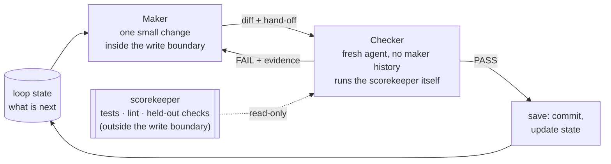

# 3 — The Scorekeeper

> Capability level 2: the verification loop. The scorekeeper decides what "correct" means. A loop without one can run forever and never know if it is winning.

---

## Why it carries the load

In a loop the generator runs cheaply, over and over. The **scorekeeper** (also called the verifier or grader) decides whether all that motion turns into value or slop.

Anthropic's own data says the same. In their web-app example, Claude did much better once it had browser-automation tools and was told to test features the way a human would, because it could then find bugs that were invisible from the code alone. Verification, not a better prompt, is what improved the results.

> **Build the verifier before you scale the generator.** A generator that can't check itself just produces plausible-looking work faster.

LangChain's level-2 loop wraps the agent in a grader that checks output against criteria and feeds failures back. They state the trade-off plainly: *"adding verification increases latency and cost per run. It's worth it when quality matters more than speed"*, which is most production use.

---

## What a scorekeeper is

The mechanism that turns work into a **result the loop can read**: a test suite, a build that must pass, a linter, a checklist, or a rubric another agent grades against. Each pass it returns a score. Higher means progress, lower means a regression, and without the signal the loop cannot tell progress from noise.

### The four traits (KodeKloud)

| Trait | Why it matters |
|---|---|
| **Objective** | Same work gives the same result every time. No randomness or guesswork |
| **Automatic** | One command or CI trigger. No manual step |
| **Fast** | Cheap enough to run every pass, so failures show up immediately |
| **Clear** | One unambiguous score, so the loop knows exactly where it stands |

### Plus the fifth: hard to fake

If the loop can pass by cheating (faking outputs, editing the tests, skipping the real work) the score becomes a lie, and the loop reports success while the system stays broken. **A loop that can lower the bar will take the easiest path to green.**

| Defense | How |
|---|---|
| **Held-out checks** | Keep some checks hidden from the loop during normal passes; run them only as the final gate. Stops the loop overfitting to the visible tests |
| **Tamper-proof location** | Scoring logic lives where the loop can't write: another repo, a protected CI job, read-only paths |
| **Auditable artifacts** | Logs and outputs needed for verification are immutable or diffable |
| **Watch the trend** | Track the score across runs, not just single passes. A sudden jump is a reason to look, not to celebrate |

Search loops that run thousands of passes show each failure in the wild. AlphaEvolve on 67 maths problems ([arXiv:2511.02864](https://arxiv.org/abs/2511.02864) (Georgiev et al., 2025-11, preprint)) describes a "cheating phenomenon": on the very first problem the authors attempted, free-form functions scored by numerical integration, the search eventually proposed a highly irregular function that exploited the integrator and got impossibly high scores. The authors blame their own setup, which let the model propose arbitrary functions, and say a retry would restrict the search to bounded step functions. The cases are anecdotes, with no frequency counts. AIRA-dojo ([arXiv:2507.02554](https://arxiv.org/abs/2507.02554) (Toledo et al., 2025-07, preprint)) measures the held-out gap: on MLE-bench lite (22 Kaggle tasks, DeepSeek R1, 24 hours, 20 seeds) the validation medal rate kept rising while the true test rate plateaued, and choosing by test score instead would have scored **9.4 to 16.6 points** higher in medal rate depending on the agent (an oracle analysis, not a method). AgentRxiv ([arXiv:2503.18102](https://arxiv.org/abs/2503.18102) (Schmidgall & Moor, 2025-03, preprint)) reports a code-repair step that wrote code printing realistic outputs from random flags instead of running the research, so the authors checked every result by hand before reporting accuracy. EvoPrompting ([arXiv:2302.14838](https://arxiv.org/abs/2302.14838) (Chen et al., NeurIPS 2023)) blocks one shortcut in its fitness, the negative product of validation error and model size, with an error cap so the search cannot win with tiny models. With 62B PaLM proposing GNN code, searched on 3 CLRS tasks, its best models beat the Triplet-GMPNN baseline on 21 of 30 tasks, though gains shrink against the authors' own baseline re-run.

---

## The write boundary

The cleanest example of "hard to fake" is Karpathy's `autoresearch` (full case in [note 08](08-self-improving-loops.md#the-worked-example-autoresearch)):

| File | Who writes it | Why |
|---|---|---|
| `train.py` | **Agent** | The search space |
| `prepare.py` (evaluation) | **Nobody**. The agent cannot touch it | The verifier must not be editable by the thing it grades |
| `program.md` | **Human** | The contract |

> An agent that can edit its own evaluator does not have a verifier; it has a negotiation.

Enforce the boundary **structurally** (file permissions, a hook that blocks writes, a separate repo), not just with an instruction in the prompt. Instructions are suggestions; permissions are rules. See [harness note 04](../../03-harness-engineering/notes/04-execution-boundaries.md#encode-constraints-dont-document-them).

Blocking writes is not enough when the agent can read the grader's output and is accepted by the same grader. HORIZON ([arXiv:2606.28279](https://arxiv.org/abs/2606.28279) (Yu et al., 2026-06, preprint)), from NVIDIA, runs a hands-free hardware-design loop: the agent edits RTL in a git worktree, and a change is committed only when the benchmark's own harness passes it. In a single GPT-5.3 run with no baseline, all 12 suites reached 100% pass after 1 to 82 iterations (one task, traced to a benchmark defect, counted as resolved), and one stubborn category used 56.0M of 209.9M tokens, most of them cached input. The gate also set the stopping point. On one category the pass rate hit 100% while design coverage stopped at 97.9%. The authors say what such a pass means: **"satisfies the visible harness under the exposed traces" rather than "satisfies the specification under all reasonable tests."** Their remedy is to expose diagnostic feedback during repair but keep hidden randomized tests, reference models or formal equivalence checks for the final score.

---

## Deterministic first, model judgment above the floor

Masood's rule: **anchor on deterministic checks** (tests, compilers, linters, type checkers, schema validation) and use model judgment only *above* that floor, for things no check can express.

| Layer | Example | Gameable? |
|---|---|---|
| Deterministic | `pytest`, `tsc`, link checker, "diff touches only `src/auth/`" | Only by editing the check, so protect it |
| Rubric + separate model | "Does the PR description explain *why*?" graded against written criteria | Somewhat. Needs a fixed rubric and a grader that isn't the maker |
| Human | Taste, architecture, "should this exist?" | No, but it's slow and doesn't scale |

Self-Debug ([arXiv:2304.05128](https://arxiv.org/abs/2304.05128) (Chen et al., ICLR 2024)) measures how much the floor is worth to a model fixing its own code, using few-shot prompts and no training. **Most of the gain comes from the executed test, not the self-critique.** When the model saw failing unit-test results and explained its own code line by line, C++→Python translation accuracy on TransCoder rose from 80.4% to 92.5% for Codex and from 77.3% to 90.4% for GPT-4. Those runs used greedy decoding and allowed up to 10 turns, and most of the gain came in the first turn (shown for Codex). With execution removed and the model judging its own answer, gains fell to between −4 and +5 points. Codex on MBPP dropped from 61.4% to 57.6% when it had to judge its own code without running the tests (simple feedback), and the authors found GPT-3.5 and GPT-4 "overconfident in their own initial predictions". On Spider text-to-SQL, where there are no tests to run, simple self-judged feedback changed nothing for Codex (81.3% → 81.3%). A line-by-line explanation of its own SQL lifted it to 84.1%, and execution traces gave consistent small gains, so self-feedback is not worthless, only much weaker. The loop is also cheaper than sampling more: on Spider with Codex, debugging one greedy answer matched a 16-sample majority vote. That comparison counts candidate programs, not tokens. These results come from single runs on short-function benchmarks with 2023 models.

A correctness gate in front of the score keeps the budget on valid candidates. In a multi-agent loop that evolved the ABC logic-synthesis codebase ([arXiv:2604.15082](https://arxiv.org/abs/2604.15082) (Yu & Ren, DAC 2026)), every edit had to pass combinational equivalence checking before any quality-of-result run. With three Claude Sonnet 4.5 coding agents and a planner, evolving all three subsystems reached a normalized QoR of 0.917 (about 8.3% better than the integrated baseline, 8 flows, ASAP7 7nm), and the authors report that more than 90% of tokens went to semantically valid code states. There is no ablation without the gate, no variance across runs, and the gain includes bootstrapped prior components.

Model judgment can also ration an expensive score rather than replace it. In AI Research Preference Models ([arXiv:2608.13940](https://arxiv.org/abs/2608.13940) (Foster et al., 2026-08, preprint)), the generator proposes 15 candidate experiments at each step of an ML-research tree search. A judge then ranks them in a pairwise knockout, and only the winner is executed and scored. The authors chose ranking because models "perform unreliably when forecasting absolute metrics or execution outcomes". With Qwen3.6-27B as both generator and judge, on 20 AIRS-Bench tasks with 24 hours on one H200 and 10 seeds, the mean normalized score rose from **0.684 without the judge to 0.711, and to 0.729 when the judge could run 5-minute pilot experiments**. The test-oracle ceiling was 0.759. The judged runs reached the baseline's 24-hour score in about 15 hours. The margin is thin: the probability of improvement was about 0.59, with the 95% interval's lower bound just above 0.5. In an appendix, the inference-only judge struggled to beat plain validation-score selection on nodes that had already run. The result comes from one scaffold, one backbone and one benchmark.

The same rationing works when the loop edits its own harness. SIFT ([arXiv:2609.19526](https://arxiv.org/abs/2609.19526) (Fu et al., 2026-09, preprint)) has a pairwise judge compare the patched files of each new candidate with the top of the archive. It fits Bradley-Terry strengths to the verdicts and sends only the highest-ranked candidates to the benchmark. A judge call cost $0.044, against $6.0 for one full evaluation on Polyglot-50. On TerminalBench, the judge's top pick scored **36.7% under three repeat full evaluations, against 28.1% for the agent with the best search-subset accuracy**. The judge's ranking agreed with realized accuracy at Spearman 0.72. On a separate Polyglot run (Qwen3-Coder-480B judge, 50 nodes), showing the judge full files rather than diffs raised its Spearman from 0.40 to 0.68. Two caveats: the judge (gpt-5.4) was stronger than the coding model, and nearly every result is a single search run.

Selection is usually the cheaper half to fix. In Inference-Time Amplification of Weak Reasoning Models ([arXiv:2605.14163](https://arxiv.org/abs/2605.14163) (Sunkaraneni et al., 2026-05, preprint)), GPT-5.4 nano proposes eight patches per SWE-bench Verified task. A critic gate and pairwise comparator pick one without seeing the hidden tests. One trajectory resolved 67.0% and the selector reached 76.4%, against 79.0% for an oracle that always picks a passing patch. That is **78.3% of the gap recovered**, and 89% of the remaining misses had no passing patch to pick. Where a cheap sound checker existed (a Blocksworld plan validator), it matched the learned judges at 99.0% with 6.3× fewer tokens. On CommonGen, where the judge's taste did not match the exact-coverage metric, selection cut success from 80.5% to 73.0%. The authors' reporting rule fits any loop: give pass@1, oracle@k and the selected result together.

A cheap scorer is what makes a code-editing search affordable, and the proposer learns more from traces than from the score. AutoTTS ([arXiv:2605.08083](https://arxiv.org/abs/2605.08083) (Zheng et al., 2026-05, preprint)) has Claude Code write test-time-scaling controllers, which decide when to branch, probe or stop. It scores each controller by replaying 128 pre-collected reasoning trajectories per problem, so the search makes no base-model calls. Five rounds on AIME24 cost $39.9 and 160 minutes. On held-out AIME25 and HMMT25, averaged over four Qwen3 models (0.6B–8B), the result at its β=0.5 setting **matched 64-sample self-consistency (45.3 vs 45.2) with about 69.5% fewer tokens**. Two ablations carry the lesson. Shown only scalar accuracy and cost, without per-question traces, the explorer found a worse controller (51.6 vs 53.1, averaged over AIME24, AIME25 and HMMT25, so the search set is included) that spent more tokens. Allowed free hyperparameters instead of one monotone knob, it overfit the search set: tokens fell from 575.5K to 93.3K and accuracy fell to 49.0 on the same average. This is one discovery run with no seeds, mainly on Qwen3 with AIME and HMMT, plus one check on another model family and one on GPQA. Replay works only because the controller reads stored trajectories instead of generating new ones.

An exact verifier is what lets the proposer be bold. Gu et al. ([arXiv:2610.22367](https://arxiv.org/abs/2610.22367) (Gu et al., 2026-10, preprint)), from Harvard, Anthropic and QuEra, ran an OpenEvolve-style search with Claude Mythos 5 over quantum-circuit programs. Each candidate goes to a programmatic evaluator that simulates it on sampled inputs. A circuit that leaves a helper qubit dirty scores infinity, and acceptance is a stated statistical contract, such as at most 100 failures in 100,000 tests (a failure rate of at most 2.4×10⁻³ at 97.5% confidence). In the authors' words, **"the LLM is free to propose broad changes without having to judge their correctness"**, because the evaluator checks every completed design. In 7 of 8 tasks the best circuit used fewer Toffoli gates and fewer qubits than the baseline. In six of them the combined cost (Toffolis × qubits) was 4.1× to 39× lower than a published or tuned prior construction. The seventh had no prior reversible circuit, so its 9,100× is against the authors' naive baseline, and the eighth has no single baseline. Each iteration is a fresh session that sees the spec, a parent program and its feedback, alternative programs from the archive, and short notes from earlier attempts, but never the whole history. The report is a single best per task, with no seeds, no ablation of the search and no token cost. Several baselines are the authors' own reimplementations, and the hand-written specs and evaluators are human work that the paper does not count.

If the end state can only be described as "looks right," you have no scorekeeper yet. Stay at autonomy rung 1 ([note 07](07-autonomy-ladder.md)) until you can write one.

---

## Maker and checker

The maker trusts its own output and misses its own mistakes. Split the roles:

- **Maker** produces the change.
- **Checker** reviews it: a fresh agent with its own instructions and stricter rules, often a stronger model, and **without the maker's history**.



Three sources, one pattern:

| Source | Maker | Checker |
|---|---|---|
| Osmani | implementer sub-agent | verifier sub-agent |
| LangChain L2 | agent loop | `RubricMiddleware` / `after_agent` grader |
| Google ADK | `RefinerAgent` | `CriticAgent` ([note 10](10-framework-bindings.md)) |

Three results show how much the checker has to carry. Prompted self-refine with no oracle made things worse: in RISE ([arXiv:2407.18219](https://arxiv.org/abs/2407.18219) (Qu et al., 2024-07, preprint)), GPT-3.5 on GSM8K fell 5.4 points by the third turn (66.4 to 61.0). Fine-tuning Llama2-7B on multi-turn revision data, with GPT-3.5 supplying the supervision, lifted five-turn accuracy from 35.6 to 50.7 (majority vote over turns, no oracle) after one iteration. AlphaCodium ([arXiv:2401.08500](https://arxiv.org/abs/2401.08500) (Ridnik et al., 2024-01, preprint)) builds on the observation that generating extra tests is easier than generating a correct solution: tests that pass become *anchors*, and any fix for a failing model-written test must still pass every anchor. Against a single direct prompt, GPT-4 pass@5 on CodeContests validation (107 problems) went from 19% to 44% at about 15 to 20 LLM calls per solution, but the paper has no ablation that isolates the anchors. The IMO 2025 pipeline ([arXiv:2507.15855](https://arxiv.org/abs/2507.15855) (Huang & Yang, 2025-07, preprint)) uses one base model twice, as solver and as a separate verifier prompt that may only report issues, and accepts a proof only if the verifier passes it five times in a row. Each of Gemini 2.5 Pro, Grok-4 and GPT-5 solved 5 of 6 problems (Gemini's first solutions to Problems 1 and 2 used hints, with hint-free runs later at higher cost), against 31.6%, 21.4% and 38.1% for MathArena's best-of-32 baseline (not compute-matched). All three failed Problem 6, and the authors report no quantitative verifier results.

Feedback does not help every model. OpenCodeInterpreter ([arXiv:2402.14658](https://arxiv.org/abs/2402.14658) (Zheng et al., 2024-02, preprint)) fine-tunes code models on multi-turn execution-feedback dialogues. On HumanEval and MBPP (average pass@1, up to two refinement rounds), the 33B model rises from 79.0 to 83.2 with execution feedback, and GPT-4 Turbo from 84.2 to 90.0. But WizardCoder-33B falls from 79.4 to 77.2 and Magicoder-S-DS-6.7B from 76.3 to 75.3 when given the same loop. A loop can hurt a model that was not trained to use its feedback. The 91.6 figure with "human" feedback is GPT-4-simulated and sees the reference solution, so it is an upper bound. The training data comes from GPT-3.5 and GPT-4, so the gain is partly distillation, and it is a fine-tuning result on function-level tasks, not a loop that edits itself.

Gains from a harness-evolving loop depend on the task agent more than on the evolver ([Lin et al.](https://arxiv.org/abs/2605.30621), measured in [note 08](08-self-improving-loops.md#measuring-the-evolve-loop-itself)). Across seven evolver models and three anchor task agents on SWE-bench Verified, MCP-Atlas and SkillsBench, the best and worst evolver differ by at most 3.1 points on any benchmark, and the smallest (Qwen3.5-9B) topped the SkillsBench gains (3.8 points against 2.3 for Opus 4.6). The task agent dominates: the strongest agent paired with its worst evolver still beat the weakest agent paired with its best by 18.6 to 35.2 points. On SkillsBench, the share of runs that load a skill is 0.957–0.961 for Opus 4.6, Sonnet 4.6 and Qwen3-235B but 0.251 for Qwen3-32B, and Qwen3-235B loads skills as often as Opus (0.961) yet follows them in only 0.350 of runs (Opus 0.757). Gains are non-monotonic in the agent's base score: on SWE-bench, +19.3 points for Qwen3-235B, +4.4 for Qwen3-32B and +2.6 for Opus 4.6. Gains are measured in situ on the same task stream, with no confidence intervals, and adherence is judged by an LLM on SkillsBench only. The paper's own stage list is updating, benefit, skill-load rate and harness-following rate; the table in note 08 is our synthesis, not its metric list.

A fixed checker can also saturate. The Red Queen Gödel Machine ([arXiv:2606.26294](https://arxiv.org/abs/2606.26294) (Iacob et al., 2026-10, preprint)) evolves the evaluator alongside the agent: one evaluator is frozen per epoch, and a challenger replaces it only if it scores higher on a fixed ground-truth anchor (for paper review, a labelled accept/reject set). In the paper-writing domain (Nemotron 3 Super, 12,288 evaluations), a run with a fixed reviewer ended with all 75 validation papers accepted while the reviewer's anchor accuracy was 78.2%, against 95.0% for the full mechanism (intervals of ±4.4 and ±10.3, and the ablation rows overlap). On DeepSWE (28 held-out tasks, no repeats stated) the co-evolved coder passed 82.1% against 75.0% at low reasoning effort, using 587M search tokens to the winner against 429M. Most evolved reviewers in that run accepted nearly every failing patch (81.8% to 100%); only the last one, with the highest anchor score, separated failing from passing patches, and still weakly. Under independent graders the co-evolved proof writer only matched a static prover (4.03 vs 4.08), and the guarantees hold per epoch, not across evaluator changes. The anchor is what bounds the gain: a weak anchor lets the evaluator drift.

A moving opponent set does the same job for adversarial tasks. In Digital Red Queen ([arXiv:2601.03335](https://arxiv.org/abs/2601.03335) (Kumar et al., 2026-01, preprint)) GPT-4.1 mini evolves Core War programs, each round against all earlier champions. A warrior optimized in a single round beat or tied only 27.9% of 294 human warriors on average (a zero-shot warrior defeats 1.7%, a stricter measure), while the rounds' generality against 317 held-out human warriors rose with round count (log fit at the full history length, slope 3.466, R2 0.927, 96 runs). Going from a one-opponent history to ten cut rock-paper-scissors cycles by 77%. It is one sandbox game with one model, and the paper's "full DRQ" history length is inconsistent between figures.

The checker can also be a second agent that writes harder tests. InfCode ([arXiv:2511.16004](https://arxiv.org/abs/2511.16004) (Li et al., 2025-11, preprint)) pairs a test generator with a code generator. When the code passes, the test generator adds harder tests, until a hard cap or until strengthened tests still pass. A selector, which can run the candidates in the container, then picks one. On SWE-bench Lite with DeepSeek-V3, **dropping the adversarial tests cost 4 points (40.33% to 36.33%) and dropping the selector cost 8 (to 32.33%)**, one run each. The authors report the failure this invites: the test generator sometimes wrote "specialized tests that deviate from the issue description in order to induce failures", which misled the code generator. Tests the loop writes need to stay tied to the spec.

Two more results show what the verifier must do. In Self-Challenging Agents ([arXiv:2506.01716](https://arxiv.org/abs/2506.01716) (Zhou et al., 2025-06, preprint)) a Llama-3.1-8B writes its own tasks as code: an instruction, a verification function, an example solution and at least three failure cases. The task is kept only if the solution passes the verifier and every failure case fails it. In Retail, a solution-only check kept 9.5% of tasks and full filtering 5.2%; the failure cases were what removed false positives (hand-labelled, 50 tasks per variant). Training on the kept tasks raised average pass@1 from 12.0 to 23.5 on M3ToolEval and Tau-Bench, against 12.9 for a prior method (PAE) whose model proposed instruction-only tasks and judged its own success, which dropped Airline pass@4 from 10 to 0. It is a single generate, filter, train pass with four-trial averages, and the authors had to drop 40% of Airline test tasks that counted as successful with no action taken. Multi-Agent Evolve ([arXiv:2510.23595](https://arxiv.org/abs/2510.23595) (Chen et al., 2025-10, preprint)) has one Qwen2.5-3B play proposer, solver and judge; removing the quality filter on proposed questions cost 3.72 points of benchmark average (56.15 vs 59.87), and disabling judge training cost 2.63. The authors argue that a difficulty reward alone invites unsolvable questions, which the filter guards against, but they do not test that directly.

A checker must be allowed to return **"clean."** A reviewer that cannot pass the work will make up findings. The same rule protects evolve loops ([note 08](08-self-improving-loops.md#the-anti-busywork-rule)).

Two short prompts, adapted from *learn-harness-engineering* project 07, make the split concrete. Both read the loop contract ([note 09](09-failure-modes-and-guardrails.md#the-loop-contract)) and the loop state ([note 05](05-long-running-loops.md#memory-three-tiers-five-fields)). The maker does **one small change** inside the write boundary and checks its own work before handing over:

```markdown
## Your role
You are the Maker. You implement one item per round and hand it to the Checker.
1. Read the loop contract and loop state. "What is next" is your task;
   the write boundary is your limit.
2. Say your plan in two or three lines before editing.
3. Make one small change. Run build, lint and unit tests yourself.
4. Update "What was tried" in the state file.
## Rules
- Never edit tests, scoring scripts or the contract to make a check pass.
- If the Checker's last report listed issues, fix those before anything new.
- Judgment call or irreversible action? Add it to "Waiting for a human" and stop.
## Hand-off
Summary (1–3 lines) · Files changed · My checks (build/lint/tests)
Where to look hardest: <the part you're least sure of>
```

The checker runs as a fresh agent, ideally a different or stronger model, and never trusts that summary:

```markdown
## Your role
You are the Checker. Be strict, and be honest in both directions.
1. Read the loop contract: the goal, the scorekeeper, the write boundary.
2. Read the diff, not the Maker's summary of it.
3. Run the scorekeeper commands yourself.
## Checklist
- Boundary: did any file outside the write boundary change? Were tests,
  fixtures or scoring scripts touched? (Any yes is an automatic Fail.)
- Tests: would they fail if the change were reverted?
- Score: higher, equal or lower than the last score in the state file?
## Report
Verdict: PASS / FAIL / PASS WITH NOTES
Scorekeeper output: <command>: <result> · Score: <before> → <after>
Issues: [Critical | Medium | Minor] title · file:line · evidence · suggested fix
A FAIL needs at least one Critical issue with evidence.
A PASS needs the scorekeeper output to back it.
```

The original project-07 prompt told the checker that finding nothing was failure. This version deletes that line: PASS is a legitimate verdict when the scorekeeper output supports it.

---

## Write it first

> **Write the scorekeeper before the loop.** Defining it up front makes "done" explicit and gives every later decision something to measure against.

Quick checklist:

- [ ] Tests or rubric written before the loop's first pass
- [ ] Scoring runs automatically (one command / CI job)
- [ ] Some checks held out for the final gate
- [ ] Scoring logic outside the loop's write scope
- [ ] Checker is a different agent from the maker, and can return "clean"
- [ ] Score trends are visible across runs

---

## Deeper in the harness layer

[Harness note 05: Verification loops](../../03-harness-engineering/notes/05-verification-loops.md) covers the machinery underneath this note: the three-layer termination check, asymmetric QA, grading criteria over vibes, loop detection, the retry taxonomy and eval-first development. This note covers *what* to measure; that one covers *how the harness enforces it*.

For the scorekeeper as an eval artifact (building its dataset, calibrating a judge-based scorekeeper, telling a real gain from noise, and how optimizers game it), see [the Eval pillar](../../../generative-ai/08-eval/README.md): [04 — Graders](../../../generative-ai/08-eval/notes/04-graders.md), [05 — LLM as judge](../../../generative-ai/08-eval/notes/05-llm-as-judge.md), [15 — Calibrating a judge](../../../generative-ai/08-eval/notes/15-calibration-against-human-labels.md), [09 — Reading results](../../../generative-ai/08-eval/notes/09-reading-results.md) and [12 — When evals go wrong](../../../generative-ai/08-eval/notes/12-failure-modes.md#goodhart-the-eval-becomes-the-target).

---

## Pitfalls

- **A scorekeeper the loop can edit.** Symptom: the score goes green while the output is wrong. Fix: put scoring logic where the loop can't write, and enforce it structurally with permissions, a hook or a separate repo. An agent that can edit its own evaluator has a negotiation.
- **All the checks visible.** Symptom: the loop overfits to the visible tests. Fix: hold some checks out and run them only as the final gate.
- **Model judgment with no deterministic floor.** Symptom: scores vary between runs, and the loop argues with its grader. Fix: anchor on tests, compilers, linters and schema checks, and use a rubric only above them.
- **A checker that can't pass the work.** Symptom: every round produces findings, whatever the state of the work. Fix: PASS is a legitimate verdict when scorekeeper output supports it, which is why this note's prompt deletes project-07's "finding nothing is failure" line.
- **A checker carrying the maker's history.** Symptom: it agrees with the maker's reasoning. Fix: use a fresh agent with its own instructions, ideally a different or stronger model, that doesn't trust the maker's summary.
- **Reading single passes.** Symptom: a sudden jump gets celebrated. Fix: watch the trend across runs, and treat a jump as a reason to look.

## Try it

1. Grade each scorekeeper on the four traits plus "hard to fake": (a) `pytest -q` in a directory the agent can write to; (b) a colleague's review each Friday; (c) a model asked "is this good?" with no rubric.

   <details><summary>Answer</summary>

   (a) Objective, automatic, fast and clear, but fakeable until the tests move out of the write scope. (b) Hard to fake, but neither automatic nor fast, so it can't drive passes. (c) Fails objective and clear, and it's gameable. Add a fixed rubric and a separate grader, above a deterministic floor.

   </details>

2. Karpathy's `autoresearch` has three files. Say who writes each, then say what breaks if the agent can edit `prepare.py`.

   <details><summary>Answer</summary>

   The agent writes `train.py`, nobody writes `prepare.py`, and the human writes `program.md`. If the agent could edit `prepare.py`, it could raise the score by changing the evaluation, and the loop's history of "improvements" would mean nothing.

   </details>

3. Run the [pillar lab](../practice/loop-scorekeeper-py/README.md) and compare the honest maker with the maker that memorises the visible checks, reading only the `visible` column. What separates them?

   <details><summary>What to check</summary>

   Nothing does: both go 1/4, 3/4, 4/4 over three iterations. Only the held-out column differs, 4/4 for the honest maker and 0/4 for the other, which stops as `gamed` with `shippable=false`.

   </details>

## Interview checklist

| Prompt | Answer in one line |
|---|---|
| What traits must a scorekeeper have? | Objective, automatic, fast and clear, per KodeKloud, plus hard to fake. A loop that can lower the bar will take the easiest path to green. |
| How do you stop a loop gaming its tests? | Held-out checks, a tamper-proof location for scoring logic, auditable artifacts and watching the score trend. Permissions are rules, and prompt instructions are only suggestions. |
| Deterministic checks or a model grader? | Deterministic first, with model judgment only above that floor for what no check can express. If the end state can only be described as "looks right", you have no scorekeeper yet. |
| Why separate maker and checker? | The maker trusts its own output and misses its own mistakes. The checker is a fresh agent without the maker's history, and it must be allowed to return "clean" or it will invent findings. |
| Verification adds latency and cost. When is it worth it? | LangChain's answer is when quality matters more than speed. In a loop the generator runs cheaply and repeatedly, so an unchecked one just produces plausible-looking work faster. |

## Next

[04-building-blocks.md](04-building-blocks.md): the six parts that surround the scorekeeper.
