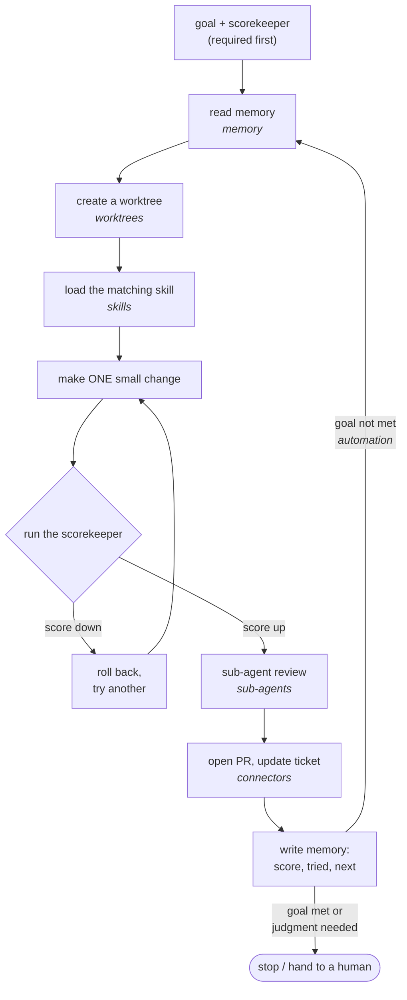

# 4 — Building Blocks

> The six parts that surround the goal and scorekeeper. Each one fixes a specific failure, so add it when you see that failure.

---

## The inventory

Osmani and the KodeKloud course list the same six parts. Goal and scorekeeper ([01](01-what-a-loop-is.md), [03](03-the-scorekeeper.md)) are the foundation; these make the loop safer, more focused and able to reach further.

| Part | Role | Fixes this failure | Osmani's name |
|---|---|---|---|
| **Automations** | The engine: repeat, check, act | You are still the one pressing go | the heartbeat |
| **Worktrees** | Isolated copy to experiment in | A bad try breaks the main branch; parallel agents collide | parallel safety |
| **Skills** | Packaged steps loaded on demand | The agent re-guesses your conventions every pass | intent preservation |
| **Connectors / plugins** | Reach into external tools | The loop can only edit local files | environmental integration |
| **Sub-agents** | Fresh helpers for one job | Main context floods; the maker grades itself | separation of concerns |
| **Memory** | Notes that survive the session | Each restart forgets what was done | the spine |

---

## Automations: the engine

An automation repeats the same task, checks the result and acts on it until a stop signal appears. One pass:

1. Run the test (or produce the output).
2. Read the score.
3. Fix **one** small failing thing, not everything at once.
4. Save the good work, then start the next pass.

Two styles: a **timer loop** (on a schedule, for monitoring) and a **run-until-done loop** (repeat until the finish signal, for a concrete goal). Choosing between them and the Claude Code commands for each: [note 06](06-triggers-and-schedules.md). The guardrails that keep a repeating engine from doing damage: [note 09](09-failure-modes-and-guardrails.md#the-two-ratchet-rules).

---

## Worktrees: parallel safety

A git worktree is a separate working copy of the same repository: its own folder and checked-out files, sharing the one history in the main `.git`. Creating one is fast and cheap, and a failed try costs one `remove`.

| Command | Purpose |
|---|---|
| `git worktree add ../try-login -b try-login` | New worktree on a new branch |
| `git worktree list` | Show all worktrees and their branches |
| `git worktree remove ../try-login` | Delete it. **Refuses** if there are uncommitted changes |
| `git worktree remove --force ../try-login` | Discard a messy try on purpose |
| `git worktree prune` | Clear stale entries after deleting a folder by hand |

Why it matters for loops: experiments become **disposable** and **concurrent**. Several sub-agents can each work in their own worktree without file clashes. The main checkout stays clean until a validated change is merged.

---

## Skills: intent preservation

A skill is packaged know-how the agent loads **only when the task matches**: a short `SKILL.md` with a name, a description that acts as the trigger, and the steps.

```markdown
---
name: write-commit-message
description: Write a commit message for staged changes. Use when committing.
---
1. Run the test suite; stop if anything fails.
2. Summarize the change in one line (≤ 50 chars).
3. Explain *why* in the body; note any migration steps.
4. Reference related issues or PRs.
```

Rules that matter inside a loop:

- **Steps, not essays.** An agent skims prose but follows and checks a numbered sequence. Each step should be testable ("run tests and fail if any fail").
- **One job per skill**, with a specific description so it loads at the right time.
- **Point at helpers** (scripts, cheat sheets) rather than pasting them in.

Why not one giant prompt? **Consistency**: the same steps every pass, so behavior doesn't drift. **Clarity**: the base prompt stays small and know-how is pulled in only when needed (Anthropic calls this *progressive disclosure*). Osmani's name for the cost of skipping skills is **intent debt**: agents confidently guessing your conventions.

The evidence for short skills is observational but consistent. Across SkillsBench's 87 tasks, compact and standard-length Skills gained 19.0 and 21.5 points of pass rate, against 0.7 for comprehensive documentation, and tasks given four or more Skills gained 10.1 against 18.0 for one ([arXiv:2602.12670](https://arxiv.org/abs/2602.12670) (Li et al., 2026-02, v4 2026-06, preprint); compact 22 tasks, standard 22, comprehensive only 5, and the largest bucket, detailed (38 tasks), gained 14.5; tasks weren't randomised to a length, and baselines differ by bucket). Don't let the agent write its own and assume it helps: self-generated Skills scored 8.1 to 11.5 points below no Skills on the three setups tested, partly because agents often never opened them. Details in [eval 06](../../../generative-ai/08-eval/notes/06-evaluating-agents.md#scoring-tool-calls).

---

## Connectors and plugins: reach

A **connector** links the loop to one external tool (GitHub, Slack, a tracker). A **plugin** is an installable bundle of connectors, skills and tools. Many connectors speak **MCP** (Model Context Protocol), a shared standard so one connector works with any agent that supports it.

Connectors are what turn a loop from "here's the fix" into "PR opened, ticket linked, Slack notified." More reach also means more ways things can go wrong. Grant the least privilege that does the job:

| Privilege | Typical actions | Guidance |
|---|---|---|
| **Read-only** | View issues, comments, metadata | Default for triage and analysis loops |
| **Limited change** | Comment, update status, create branches | Scope to specific repos or projects |
| **Full access** | Merge, delete, manage permissions | Avoid. If you need it, put a human approval in front of it and audit every use |

Keep secrets out of code and prompts; use scoped, short-lived credentials from a secret store. Every connector you enable should have a written reason. Deeper treatment: [harness note 04](../../03-harness-engineering/notes/04-execution-boundaries.md#a-role-label-is-not-a-sandbox).

---

## Sub-agents: separation of concerns

A sub-agent is a helper the main loop starts for **one** well-defined job. It starts fresh (clean context, its own instructions, minimal tools), does the work, and returns **only the result**. The main loop never sees the messy middle.

```json
{
  "task": "search_codebase",
  "scope": "src/",
  "query": "parseToken",
  "max_results": 10,
  "access": "read-only"
}
```

| Use | Example | What it buys |
|---|---|---|
| Heavy scanning | Find every caller across thousands of files | Main context gets "3 call sites: …", not the files |
| Maker / checker | One agent writes the patch, a fresh one reviews it | Catches what the maker's bias misses ([note 03](03-the-scorekeeper.md#maker-and-checker)) |
| Parallel work | Several independent fixes at once, one worktree each | Wall-clock time |

Give each one a bounded scope, the minimal permissions, and a distilled return format (a list, a summary, a yes/no). Osmani's common shape is **explorer → implementer → verifier**, with a different model or effort level per role.

---

## Memory: the spine

The model forgets between runs, so state lives in files outside the conversation: what's done, what was found, what's next. Memory is what makes many sessions add up to one continuous piece of work. Tiers, the five fields and context drift: [note 05](05-long-running-loops.md#memory-three-tiers-five-fields).

---

## The whole loop in motion

How the six parts fit into one pass (KodeKloud's sequence). Each box is labelled with the block that supplies it:



The same pass as a checklist:

```
0. goal + scorekeeper defined        ← required before anything runs
1. read memory                       ← where did I leave off?
2. create a worktree                 ← safe place to try
3. load the matching skill           ← the steps for this kind of job
4. make ONE small change
5. run the scorekeeper               ← up: save · down: roll back, try another
6. sub-agent review (if needed)      ← fresh eyes on the change
7. connector (if needed)             ← open PR, update ticket, notify
8. write memory                      ← score, what was tried, what's next
9. automation repeats until the goal is met
10. stop and hand to a human whenever a choice needs judgment
```

### Osmani's morning loop

The same parts in a real daily setup: an **automation** fires the triage **skill** → reads CI failures, new issues and recent commits → writes findings to **memory** (markdown) → opens isolated **worktrees** → a **sub-agent** drafts each fix → a second **sub-agent** verifies it → **connectors** open the PR and update the ticket → anything it couldn't handle lands in a triage inbox for a human.

---

## Add them in order, and only when needed

The design order from [note 01](01-what-a-loop-is.md#green-first): get one green, saved result first, then add a part when a real failure calls for it.

| You see this | Add |
|---|---|
| You're re-running the loop by hand | Automation |
| A bad try damaged the main checkout, or two agents collided | Worktrees |
| The same mistake about your conventions, every pass | A skill (or a guard check) |
| The useful output needs to land outside the repo | A connector, read-only first |
| The context fills with search output, or the maker approves its own bugs | A sub-agent |
| Runs span sessions and redo finished work | Memory |

Adding parts "just in case" makes the loop harder to debug without fixing anything you have observed.

---

## Pitfalls

- **Installing all six parts at once.** Symptom: a complex setup with no failure to justify any of it. Fix: each part exists to fix a specific failure, so add it when you see that failure.
- **Fixing everything in one pass.** Symptom: a big diff and a score change you can't attribute. Fix: step 3 of the automation is to fix **one** small failing thing, then save.
- **A skill written as an essay.** Symptom: the agent skims it and skips a step. Fix: numbered, testable steps ("run tests and fail if any fail"), one job per skill, with helpers pointed to rather than pasted.
- **Full-access connectors by default.** Symptom: a triage loop that can merge and delete. Fix: read-only for triage and analysis, limited change scoped to specific repos, and a human approval plus audit for anything full access.
- **Parallel agents in one checkout.** Symptom: file clashes, and a bad try breaks main. Fix: a worktree per agent, with the main checkout clean until a validated change is merged.
- **Sub-agents out of habit.** Symptom: cost multiplies without context savings. Fix: use them for jobs that would cost more in the main context, with a bounded scope and a distilled return format.
- **Force-removing a worktree blindly.** Symptom: `git worktree remove --force` throws away a passing try. Fix: a plain `remove` refuses when there are uncommitted changes, so keep `--force` for messes you meant to discard.

## Try it

1. Name the missing part from each symptom: (a) the agent re-guesses your commit format each pass; (b) a restart forgets what was done; (c) the loop can fix the bug but can't open a PR; (d) you're still the one pressing go.

   <details><summary>Answer</summary>

   (a) Skills. (b) Memory. (c) Connectors. (d) Automations. The inventory table's "fixes this failure" column maps each one.

   </details>

2. Write the commands that create a disposable try on a new branch, list it, and discard it when it failed with uncommitted changes.

   <details><summary>Answer</summary>

   `git worktree add ../try-login -b try-login`, then `git worktree list`, then `git worktree remove --force ../try-login`, because plain `remove` refuses when changes are uncommitted. If you deleted the folder by hand, `git worktree prune` clears the stale entry.

   </details>

3. Draw one pass of your own loop against the checklist in [the whole loop in motion](#the-whole-loop-in-motion), labelling which block supplies each step. Then cut one block and say what failure returns.

   <details><summary>What to look for</summary>

   A good drawing starts with the goal and scorekeeper and reads memory before acting. If you cut memory, each restart redoes work. If you cut worktrees, a bad try breaks main, and if you cut sub-agents, the maker grades itself and the main context floods. If nothing fails when you cut a block, you can leave it out.

   </details>

## Interview checklist

| Prompt | Answer in one line |
|---|---|
| What are the six building blocks? | Automations, worktrees, skills, connectors and plugins, sub-agents, and memory. Goal and scorekeeper are the foundation beneath them. |
| Why do worktrees matter to a loop? | They make experiments disposable and concurrent: an isolated copy sharing one history, where a failed try costs one `remove` and parallel agents don't clash. |
| Why a skill rather than one large prompt? | Consistency, since the same steps run every pass, and clarity, since the base prompt stays small and know-how loads only on a matching task. |
| What privilege do you give a connector? | The least that does the job. Read-only for triage, limited change scoped to specific repos, and avoid full access, or put a human approval in front of it and audit it. |
| A main loop's context keeps flooding. What do you change? | Push heavy scanning to a sub-agent that returns "3 call sites: …" instead of the files. Keep its scope bounded, its permissions minimal and its return format distilled. |

## Next

[05-long-running-loops.md](05-long-running-loops.md): keeping a loop coherent across many context windows.
