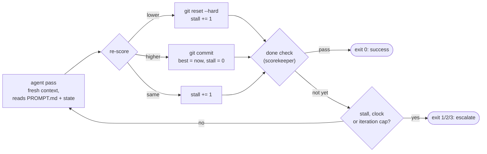

# 5 — Long-Running Loops

> Context is a budget, not a bucket. A loop that runs for hours must forget on purpose and remember on disk.

---

## The problem

Every pass adds tool output, errors and reasoning to the transcript. Left alone, the loop hits one of three walls:

1. **Context rot.** Working memory degrades as the transcript grows; the agent loses the thread.
2. **Context anxiety.** Near the limit, models wrap up early and declare done ([harness note 06](../../03-harness-engineering/notes/06-long-horizon-execution.md#the-problem)).
3. **Session end.** The process stops, and the next one starts blank.

All three have the same fix: **progress lives in files, not in the context window.**

---

## Context is a budget

Anthropic's *Effective Context Engineering* treats context as a finite resource with diminishing returns: every token you add competes for the model's attention. The loop move:

> **Feed each pass the smallest set of high-signal tokens the next step needs.**

In practice:

- **Just-in-time retrieval.** Keep paths and IDs in context; load the file when the step needs it, not before.
- **Compact inside the loop**, not after it. Each pass ends by distilling what it learned and dropping raw output that has been acted on (the `compact context` line in the [skeleton](02-loop-shapes.md#the-canonical-skeleton)).
- **Offload big outputs.** Keep the head and tail of a long log in context and write the rest to a file.
- **Push heavy reads into sub-agents** so only their summaries come back ([note 04](04-building-blocks.md#sub-agents-separation-of-concerns)).

Depth: [02-context-engineering/notes/03 budgeting](../../02-context-engineering/notes/03-budgeting-the-window.md), [05 compaction](../../02-context-engineering/notes/05-compression-compaction.md).

---

## Memory: three tiers, five fields

Memory is the set of notes the loop reads at the start of every session so it can resume without redoing work or repeating mistakes. Keep it **small**. A few precise notes beat a transcript.

**Three tiers** (KodeKloud), closest first:

| Tier | Holds | Read |
|---|---|---|
| **Now** | Current goal and current task | Every pass |
| **Recent** | The last few steps and their outcomes | Every pass |
| **Archive** | Full history | Only when needed |

**Five fields** for the "now" and "recent" tiers:

| Field | Purpose | Example |
|---|---|---|
| **Goal** | What done looks like, so the aim doesn't drift | `All tests in tests/auth/ pass` |
| **Last score** | Latest scorekeeper result | `41/47 passing` |
| **What was tried** | Recent attempts, *especially failures* | `Mocking the clock in test_expiry: no change` |
| **What is next** | The very next step, so the next pass starts fast | `Check token refresh path in auth/session.py` |
| **Waiting for a human** | Items that need a decision or sign-off | `Approve dropping the legacy cookie` |

The fields fit in one short file, `loop-state.md`, that every pass reads first and rewrites last. Keep it to "now" and "recent"; older entries move to the archive section at the bottom:

```markdown
# Loop state
Updated: 2026-10-30 14:05 · Pass: 7 · Status: in progress   # in progress / done / blocked / stopped

## Goal
All tests in tests/auth/ pass      # copied from the loop contract; if they differ, the contract wins
## Last score
41/47 passing · held-out: not run
## What was tried
- pass 7: mock the clock in test_expiry → no change → rolled back
- pass 6: fix refresh-token TTL → 38 → 41 → kept
## What is next
Check the token refresh path in auth/session.py
## Waiting for a human
- Approve dropping the legacy cookie (breaks sessions older than 30 days)

| Passes | Saved | Rolled back | Checker fails | Human interventions | Cost so far |
|---|---|---|---|---|---|
| 7 | 4 | 3 | 1 | 0 | $2.10 |

## Archive
<older "what was tried" entries; delete anything that no longer reflects the code>
```

The run-stats row is what the evolve loop reads later ([note 08](08-self-improving-loops.md#cadence-and-inputs)), and what tells you a loop is rolling back more than it saves.

"What was tried" earns its place. Without it, a fresh pass reruns the attempt that failed an hour ago.

### Context drift

Memory must stay current. If the code, schema or goal changed and the notes didn't, the loop acts on a stale picture with full confidence. That failure is **context drift**. Fix it by updating or invalidating the affected notes whenever the world changes, and by recording *when* each note was written so stale ones are visible.

---

## The Ralph loop

Geoffrey Huntley's original, in its smallest form:

```bash
while :; do cat PROMPT.md | claude -p; done
```

Each run starts with a fresh context. The prompt tells the agent to read the plan and progress files, do the next item, update the files and exit. The filesystem carries everything between runs. That one-liner is the whole idea of re-entrant loops.

What it lacks: a stop condition, a budget and a scorekeeper. A production version adds:

- an **iteration cap** and a **wall-clock or cost cap**
- a **done check** that runs the scorekeeper, not the agent's own claim
- a **stall check**: stop if the score hasn't moved in N passes
- a log line per pass

The core of it is the ratchet: run the agent, re-score, then roll back, save or count a stall.



A complete, guarded script (save it as `ralph.sh`; Lab 4 uses it):

```bash
#!/usr/bin/env bash
# Usage: SCORE_CMD='pytest -q | tail -1' ./ralph.sh PROMPT.md
#   SCORE_CMD prints one number (higher is better) as its last line.
#   DONE_CMD (optional) exits 0 when the goal is met; defaults to SCORE_CMD.
set -euo pipefail
PROMPT_FILE="${1:?usage: ralph.sh PROMPT.md}"
MAX_ITERS="${MAX_ITERS:-20}"; MAX_MINUTES="${MAX_MINUTES:-60}"; STALL_LIMIT="${STALL_LIMIT:-3}"
SCORE_CMD="${SCORE_CMD:?set SCORE_CMD}"; DONE_CMD="${DONE_CMD:-$SCORE_CMD}"
AGENT_CMD="${AGENT_CMD:-claude -p}"; LOG="${LOG:-ralph.log}"

score() { bash -c "$SCORE_CMD" 2>/dev/null | tail -1 | grep -Eo '[0-9]+(\.[0-9]+)?' | tail -1 || echo 0; }
log()   { echo "$(date -u +%FT%TZ) $*" | tee -a "$LOG"; }

deadline=$(( $(date +%s) + MAX_MINUTES * 60 ))
best=$(score); stall=0; log "start score=$best"
for ((i = 1; i <= MAX_ITERS; i++)); do
  (( $(date +%s) > deadline )) && { log "STOP wall-clock cap"; exit 2; }
  $AGENT_CMD < "$PROMPT_FILE" >> "$LOG" 2>&1 || true   # fresh context every pass
  now=$(score)
  if awk "BEGIN{exit !($now < $best)}"; then           # worse: undo the pass
    git reset --hard -q HEAD && git clean -fdq; stall=$((stall + 1))
    log "pass=$i score=$now < $best ROLLED BACK"
  elif awk "BEGIN{exit !($now > $best)}"; then         # better: commit it
    git add -A && git commit -qm "ralph pass $i: $best -> $now" || true
    log "pass=$i score=$now SAVED"; best=$now; stall=0
  else
    stall=$((stall + 1)); log "pass=$i score=$now no change"   # no movement
  fi
  bash -c "$DONE_CMD" >/dev/null 2>&1 && { log "DONE"; exit 0; }   # scorekeeper, not the agent
  (( stall >= STALL_LIMIT )) && { log "STOP stalled; escalate"; exit 3; }
done
log "STOP iteration cap; escalate"; exit 1             # a cap is not success
```

The bare one-liner keeps running after the work is finished; this one stops on the scorekeeper's word or a cap, and its `git log` is a list of validated improvements. Each exit has its own code, so whatever wraps the script can tell success (0) from a cap (1), the clock (2) and a stall (3).

Harnesses now ship this pattern: hooks catch the agent's attempt to finish and re-inject the prompt into a fresh context ([harness note 06](../../03-harness-engineering/notes/06-long-horizon-execution.md#ralph-loops)), and `/goal` does it as a built-in ([note 06](06-triggers-and-schedules.md#claude-code)).

---

## Initializer and worker

Anthropic's *Effective Harnesses for Long-Running Agents* splits long work into two roles:

- An **initializer** runs once: turns the task into files (a feature list, a progress log, scaffolding, an `init` script) and commits them.
- A **worker** runs every session: reads the progress log and git history, picks **one** unfinished item, implements and tests it, commits, updates the log, and exits cleanly.

Two rules from the essay that apply to any long loop:

- **One item per session.** Trying to do everything at once is how a session runs out of context halfway through a change and leaves the repo broken.
- **Leave the repo clean.** Every session ends in a state the next one can start from: committed, tests run, progress noted.

---

## Compaction vs reset

| | Compaction | Reset |
|---|---|---|
| How | Summarize the transcript in place | Clear the window; hand off through files |
| Good for | One long session | Multi-session or multi-day work |
| Risk | Summary-of-a-summary drift | Anything not written down is lost |

Loops lean toward **reset**, because the Ralph and initializer/worker patterns already keep state on disk. Details and the model-dependence of this choice: [harness note 06](../../03-harness-engineering/notes/06-long-horizon-execution.md#compaction-vs-context-reset).

---

## Working reference

`~/.claude/refs/agent-context.md` — compaction triggers and what must survive them; `~/.claude/refs/agent-memory.md` — durable state and memory hygiene.

---

→ Next: [06-triggers-and-schedules.md](06-triggers-and-schedules.md) — what starts a loop when you don't.
