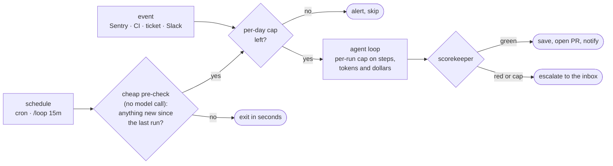

# 6 — Triggers and Schedules

> Capability level 3: the event-driven loop. The agent stops being something you invoke and becomes a component that runs on its own.

Once nobody is pressing go, the trigger becomes the most expensive line in the system. A timer that wakes an agent to find nothing burns money all day, an error storm can start a thousand runs, and a `/loop` that re-runs "keep implementing" starts from scratch each time. This chapter covers capability level 3, the event-driven loop: choosing between run-until-done and timer, between manual, event and schedule, and the ceilings to set before you turn any of them on.

---

## What changes at level 3

LangChain's framing: *"The agent isn't something you invoke manually; it's a component running continuously."* Schedules, webhooks and messages start runs. Their running example, a docs agent, fires on every Slack message in a channel.

The trigger is a separate design decision from the loop inside it. Pick it on purpose.

---

## Two ways a loop decides to run again

| Style | Runs | Stops when | Best for |
|---|---|---|---|
| **Run-until-done** | Immediately, pass after pass | The finish signal appears (scorekeeper green) or a cap trips | A concrete goal: "all checks pass" |
| **Timer** | On an interval or cron | Never by itself. Each run is short; the schedule continues | Monitoring, polling, maintenance |

A run-until-done loop needs a precise "done." A timer loop needs each run to be **cheap when there's nothing to do**, or it burns money finding nothing (see the trigger fix in [note 08](08-self-improving-loops.md#the-four-edit-targets)).

---

## Three ways a run starts

| Trigger | Fires on | Examples (Pragmatic Engineer) |
|---|---|---|
| **Manual** | You | Interactive work you're watching |
| **Event** | Something happened: Sentry error, new ticket, failing CI, Slack message | Incident response that investigates the alert and opens a PR; flaky-test agent that reproduces and proposes a fix |
| **Schedule** | The clock | Nightly test-babysitting that separates real regressions from noise; a React → React Native migration running in 30-minute cycles |

**Prefer events to polling** when the source can notify you. A schedule that wakes up to find nothing is the most common waste in level-3 loops. When you must poll, put a **cheap deterministic pre-check** in front of the agent (fetch updates since the last run; wake the agent only if there's work).



Events go straight to the caps; a clock-driven run has to earn the model call through the pre-check first. Every unattended path ends at either the scorekeeper or a human.

The arithmetic behind "cheap when there's nothing to do" and the per-day cap fits in a short script. The prices are illustrative, so replace them with your own run cost and rates.

```python
# Illustrative prices, not measurements. Swap in your own run cost and rates.
AGENT_WAKE = 0.40       # dollars for one agent run that reads context and decides
PRECHECK = 0.0          # a fetch and a comparison, rounded to zero
WAKES_PER_DAY = 4 * 24  # a 15-minute timer
WORK_PER_DAY = 3        # wakes that actually find something to do

def daily(with_precheck):
    if with_precheck:
        return WAKES_PER_DAY * PRECHECK + WORK_PER_DAY * AGENT_WAKE
    return WAKES_PER_DAY * AGENT_WAKE

print(f"agent on every tick:   ${daily(False):7.2f} a day, ${daily(False) * 30:8.2f} a month")
print(f"pre-check, then agent: ${daily(True):7.2f} a day, ${daily(True) * 30:8.2f} a month")
print(f"wakes that found work: {WORK_PER_DAY / WAKES_PER_DAY:.1%}")

def admit(events, per_day_cap):
    """A per-day cap on the trigger, plus de-duplication by fingerprint."""
    seen, ran, dropped, dupes = set(), 0, 0, 0
    for fingerprint in events:
        if fingerprint in seen:
            dupes += 1
        elif ran >= per_day_cap:
            dropped += 1
        else:
            seen.add(fingerprint)
            ran += 1
    return ran, dupes, dropped

# An error storm: 1,000 alerts, of which 80 are distinct.
storm = [f"error-{i % 80}" for i in range(1000)]
ran, dupes, dropped = admit(storm, per_day_cap=50)
print(f"storm of {len(storm)} events: ran {ran}, deduplicated {dupes}, "
      f"held back {dropped}, cost ${ran * AGENT_WAKE:.2f}")
print(f"same storm with no cap or dedupe: cost ${len(storm) * AGENT_WAKE:.2f}")
```

Output:

```text
agent on every tick:   $  38.40 a day, $ 1152.00 a month
pre-check, then agent: $   1.20 a day, $   36.00 a month
wakes that found work: 3.1%
storm of 1000 events: ran 50, deduplicated 590, held back 360, cost $20.00
same storm with no cap or dedupe: cost $400.00
```

The first block is the pre-check's case: with 3 wakes in 96 finding work, about 97% of the unfiltered spend buys nothing. The second is the case for a cap and a fingerprint on the trigger. Held-back events aren't lost if you record them. A human or the next day's quota can pick them up, while the bill stays bounded during the storm.

Superdesign's support triage loop ([note 08](08-self-improving-loops.md#the-four-edit-targets)) arrived at the same fix: a small script fetches support-platform updates from the last 30 minutes and wakes the agent only when real work exists.

---

## Claude Code

The harness now ships the patterns that used to be bash wrappers:

| Command | Shape | Ends when | Autonomy rung ([07](07-autonomy-ladder.md)) |
|---|---|---|---|
| `/goal` | Run-until-done: keeps working toward a stated condition | The condition is verified, or you stop it | 2: goal-based |
| `/loop 5m <prompt>` | Timer: re-runs a prompt or slash command on an interval, inside your session | You stop it or close the session | 3: time-based |
| `/loop <prompt>` (no interval) | Self-paced: the model picks the delay before its next pass | Same | 3: time-based |
| `/schedule` | Cloud routine: runs on a cron schedule (or once at a set time) with no session open | You delete the routine | 4: proactive |

**Which one: does this thing have an end?** Yes → `/goal`. No, it's ongoing watching → `/loop`. The common mistake is `/loop 10m "keep implementing the payment system"`. Each `/loop` pass runs the same instruction from scratch and **doesn't remember where the last one stopped**, so you get the same starting point over and over. A timer loop that has to make progress needs a state file it reads first ([note 05](05-long-running-loops.md#memory-three-tiers-five-fields)).

Codex and Hermes ship equivalents of `/loop` and `/goal`. The mapping to the autonomy ladder matters more than the syntax. `/loop` runs inside your session with your permissions; `/schedule` runs without you, so it needs a verifier you already trust and its own scoped credentials.

---

## Cost ceilings

An unattended trigger multiplies whatever a single run costs. Before turning one on:

- **Per-run cap**: steps, tokens or dollars. Vercel's `stopWhen: stepCountIs(25)` is the pattern ([note 10](10-framework-bindings.md)).
- **Per-day cap** on the trigger itself, so an event storm can't start a thousand runs.
- **No-op path**: a run that finds nothing to do should exit in seconds, before calling the model.
- **Alert on spend**, not just on failure.

Full treatment: [harness note 04: cost envelope](../../03-harness-engineering/notes/04-execution-boundaries.md#cost-envelope) and [note 09](09-failure-modes-and-guardrails.md#budgets-and-cost).

---

## A skeptical note

Engineer Oded Messer, in Pragmatic Engineer: a repeatable workflow "becomes tactical if the AI is capable enough or it's just a high level old-school automation I can set up like a cron or a trigger."

He's mostly right. Much of level 3 is automation rediscovered. What's new is that the thing on the cron is **nondeterministic**, which is exactly why the scorekeeper and stop rules carry the weight. If a run's output can't be checked automatically, a cron trigger just schedules unverified work.

---

## Pitfalls

- **`/loop 10m "keep implementing the payment system"`.** Symptom: each pass starts from the same point, because it doesn't remember where the last stopped. Fix: if the work has an end, use `/goal`. A timer loop that must make progress needs a state file it reads first.
- **Polling when the source can notify you.** Symptom: a schedule keeps waking up to find nothing, the note's most common waste at level 3. Fix: prefer events, and when you must poll, put a cheap deterministic pre-check in front of the agent.
- **A timer with an expensive no-op.** Symptom: quiet days cost the same as busy ones. Fix: a run with nothing to do exits in seconds, before calling the model.
- **A per-run cap but no per-day cap.** Symptom: each run is bounded and an event storm still starts a thousand. Fix: add a per-day cap on the trigger itself, and alert on spend as well as on failure.
- **`/schedule` on a verifier you haven't proved.** Symptom: an unattended run with nothing checking it. Fix: `/loop` runs in your session with your permissions, and `/schedule` runs without you. Earn the second with a verifier you already trust.
- **Agent where a cron job would do.** Symptom: a nondeterministic step in a repeatable workflow whose output nobody can check. Fix: as Oded Messer says, much of this is old-school automation, so use the agent only when a scorekeeper and stop rules can govern it.

## Try it

1. Change the script's `WORK_PER_DAY` to 48. Is the pre-check still worth having at these prices, and what share of spend does it save?

   <details><summary>Answer</summary>

   Half the wakes now find work, so the pre-check costs $19.20 a day against $38.40, a 50% saving. It is still worthwhile. If the source can notify you, an event trigger removes the wasted wakes without any polling.

   </details>

2. Pick the Claude Code command: (a) make all checks in `tests/auth/` pass; (b) watch a deploy for the next hour and report when it finishes; (c) triage overnight CI failures with no session open.

   <details><summary>Answer</summary>

   (a) `/goal`, because it has an end. (b) `/loop 5m <prompt>`, since it's ongoing watching in your session. (c) `/schedule`, a cloud routine, once the verifier has been proved at a lower rung.

   </details>

3. Write the ceilings for a Sentry-triggered incident agent: per-run, per-day, no-op path, alerting.

   <details><summary>One good answer</summary>

   Per-run: a step ceiling like Vercel's `stopWhen: stepCountIs(25)`, and a dollar cap. Per-day: a cap on started runs, with duplicates dropped by error fingerprint. No-op: exit in seconds if the error is already known or has an open PR. Alert on spend, not just on failure, and end every unattended path at the scorekeeper or a human.

   </details>

## Interview checklist

| Prompt | Answer in one line |
|---|---|
| What changes at capability level 3? | The agent stops being invoked by hand and becomes a component that schedules, webhooks and messages start. The trigger is a separate design decision from the loop inside it. |
| Run-until-done or timer? | Run-until-done for a concrete goal, stopped by a finish signal or a cap. A timer for monitoring, where each run is short and has to be cheap when there's nothing to do. |
| Your scheduled agent mostly finds nothing. What do you do? | Prefer events if the source can notify you. Otherwise add a deterministic pre-check, such as fetching updates since the last run, and wake the agent only if there's work. |
| Which ceilings go on an unattended trigger? | A per-run cap, a per-day cap on the trigger, a no-op path that exits in seconds, and alerts on spend. A trigger multiplies whatever one run costs. |
| `/loop` or `/schedule`? | `/loop` runs in your session with your permissions. `/schedule` is a cloud routine with no session open, so it needs a verifier you already trust. |
| Is this just cron? | Mostly, as Messer says. What's new is that the thing on the cron is nondeterministic, which is why the scorekeeper and stop rules carry the weight. |

## Next

[07-autonomy-ladder.md](07-autonomy-ladder.md): how much of the operator's job to hand off, and in what order.
