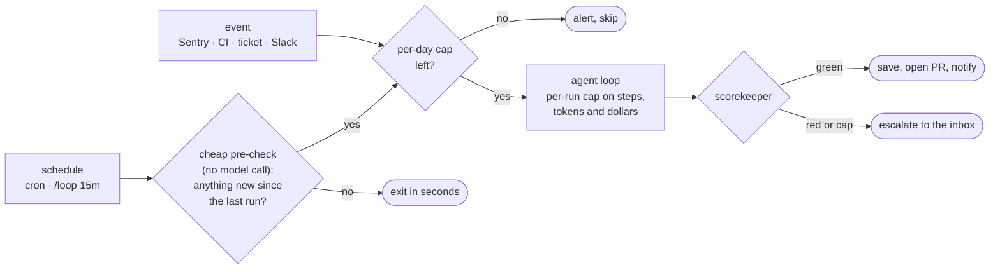

# 6 — Triggers and Schedules

> Capability level 3: the event-driven loop. The agent stops being something you invoke and becomes a component that runs on its own.

---

## What changes at level 3

LangChain's framing: *"The agent isn't something you invoke manually; it's a component running continuously."* Schedules, webhooks and messages start runs. Their running example, a docs agent, fires on every Slack message in a channel.

The trigger is a separate design decision from the loop inside it. Pick it on purpose.

---

## Two ways a loop decides to run again

| Style | Runs | Stops when | Best for |
|---|---|---|---|
| **Run-until-done** | Immediately, pass after pass | The finish signal appears (scorekeeper green) or a cap trips | A concrete goal: "all checks pass" |
| **Timer** | On an interval or cron | Never by itself. Each run is short; the schedule continues | Monitoring, polling, maintenance |

A run-until-done loop needs a precise "done." A timer loop needs each run to be **cheap when there's nothing to do**, or it burns money finding nothing (see the trigger fix in [note 08](08-self-improving-loops.md#the-four-edit-targets)).

---

## Three ways a run starts

| Trigger | Fires on | Examples (Pragmatic Engineer) |
|---|---|---|
| **Manual** | You | Interactive work you're watching |
| **Event** | Something happened: Sentry error, new ticket, failing CI, Slack message | Incident response that investigates the alert and opens a PR; flaky-test agent that reproduces and proposes a fix |
| **Schedule** | The clock | Nightly test-babysitting that separates real regressions from noise; a React → React Native migration running in 30-minute cycles |

**Prefer events to polling** when the source can notify you. A schedule that wakes up to find nothing is the most common waste in level-3 loops. When you must poll, put a **cheap deterministic pre-check** in front of the agent (fetch updates since the last run; wake the agent only if there's work).

Events go straight to the caps; a clock-driven run has to earn the model call through the pre-check first. Every unattended path ends at either the scorekeeper or a human.

---

## Claude Code

The harness now ships the patterns that used to be bash wrappers:

| Command | Shape | Ends when | Autonomy rung ([07](07-autonomy-ladder.md)) |
|---|---|---|---|
| `/goal` | Run-until-done: keeps working toward a stated condition | The condition is verified, or you stop it | 2: goal-based |
| `/loop 5m <prompt>` | Timer: re-runs a prompt or slash command on an interval, inside your session | You stop it or close the session | 3: time-based |
| `/loop <prompt>` (no interval) | Self-paced: the model picks the delay before its next pass | Same | 3: time-based |
| `/schedule` | Cloud routine: runs on a cron schedule (or once at a set time) with no session open | You delete the routine | 4: proactive |

**Which one: does this thing have an end?** Yes → `/goal`. No, it's ongoing watching → `/loop`. The common mistake is `/loop 10m "keep implementing the payment system"`. Each `/loop` pass runs the same instruction from scratch and **doesn't remember where the last one stopped**, so you get the same starting point over and over. A timer loop that has to make progress needs a state file it reads first ([note 05](05-long-running-loops.md#memory-three-tiers-five-fields)).

Codex and Hermes ship equivalents of `/loop` and `/goal`. The mapping to the autonomy ladder matters more than the syntax. `/loop` runs inside your session with your permissions; `/schedule` runs without you, so it needs a verifier you already trust and its own scoped credentials.

---

## Cost ceilings

An unattended trigger multiplies whatever a single run costs. Before turning one on:

- **Per-run cap**: steps, tokens or dollars. Vercel's `stopWhen: stepCountIs(25)` is the pattern ([note 10](10-framework-bindings.md)).
- **Per-day cap** on the trigger itself, so an event storm can't start a thousand runs.
- **No-op path**: a run that finds nothing to do should exit in seconds, before calling the model.
- **Alert on spend**, not just on failure.

Full treatment: [harness note 04: cost envelope](../../03-harness-engineering/notes/04-execution-boundaries.md#cost-envelope) and [note 09](09-failure-modes-and-guardrails.md#budgets-and-cost).

---

## A skeptical note

Engineer Oded Messer, in Pragmatic Engineer: a repeatable workflow "becomes tactical if the AI is capable enough or it's just a high level old-school automation I can set up like a cron or a trigger."

He's mostly right. Much of level 3 is automation rediscovered. What's new is that the thing on the cron is **nondeterministic**, which is exactly why the scorekeeper and stop rules carry the weight. If a run's output can't be checked automatically, a cron trigger just schedules unverified work.

---

## Working reference

`~/.claude/refs/agent-runtime.md` — hosted vs session-scoped execution; `~/.claude/refs/agent-safety.md` — credentials for unattended runs.

---

→ Next: [07-autonomy-ladder.md](07-autonomy-ladder.md) — how much of the operator's job to hand off, and in what order.
