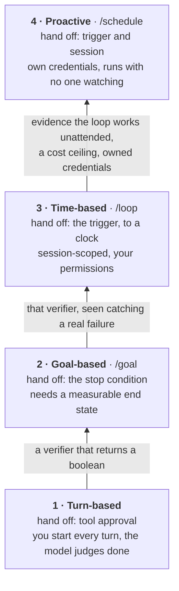

# 7 — The Autonomy Ladder

> The second axis. LangChain's four capability levels ([note 01](01-what-a-loop-is.md#the-map-of-this-pillar))
> ask *what the loop automates*; this ladder asks *how much of the operator's job has been handed off*.

---

## The framing

Every loop starts with a human doing four things: approving each tool call, judging when
the work is done, deciding when to start a run, and holding a session open while it runs.
The ladder is the order in which you hand those four off.

> **Climb one rung at a time, and earn each handoff with a verifier.**

The rungs are cumulative — rung 3 still needs rung 2's verifier. Skipping rungs is how you
get a doom loop: an agent running unattended on a schedule with nothing but model judgment
deciding when to stop.

| Rung | What you hand off | What must exist first |
|---|---|---|
| 1 — Turn-based | Tool approval *within* a turn | Nothing — this is the entry point |
| 2 — Goal-based | The **stop condition** | A measurable end state |
| 3 — Time-based | The **trigger** (to a clock) | Rung 2's verifier |
| 4 — Proactive | The trigger *and* the session | A verifier you trust unattended |

In Claude Code: rung 2 is `/goal`, rung 3 is `/loop`, rung 4 is `/schedule` ([note 06](06-triggers-and-schedules.md#claude-code)).

The label on each arrow is the evidence you need before you climb.

---

## 1 — Turn-based: hand off tool approval

You approve tool calls inside a turn, but every turn starts manually. The agent stops when
**it judges** the work is done.

Use it for interactive work you are watching. Its value is diagnostic: this is the rung
where you learn where your tasks actually fail, which is the raw material for the verifier
you need at rung 2.

Its weakness is exactly that stop condition — model judgment alone. That is tolerable only
because you are present.

## 2 — Goal-based: hand off the stop condition

After each turn, a small fast model (or a deterministic check) tests whether the end
condition holds. The loop closes itself when the verifier confirms completion.

**This is the pivotal rung** — your first unattended loop. Climb it only once you can
write a *measurable* end state: tests pass, queue empty, lint clean, file exists. If the
end state is only expressible as "looks right," you are not ready to leave rung 1.

Everything above this rung inherits this verifier. A weak verifier here silently becomes a
weak verifier at rungs 3 and 4, where nobody is watching it fail.

## 3 — Time-based: hand off the trigger to a clock

The loop re-runs on an interval. Use it to poll external state that changes on its own
schedule — deploy progress, PR review status, a queue draining.

Two properties worth noting: it is **session-scoped** (your terminal stays open), and it
**inherits your permissions** rather than needing its own credential grant. That makes it
meaningfully cheaper and safer than rung 4, and it is why time-based is the right resting
place for most loops. Do not climb to proactive just because you can.

## 4 — Proactive: hand off the trigger to a schedule or event

Runs with no open session — on a schedule or in response to an event, on your machine or
on hosted infrastructure. Overnight work and event-driven automation live here.

The prerequisite is not technical, it is evidential: **prove the loop works at rung 2 or 3
with a verifier you trust** before removing the session. A proactive loop with an
unproven verifier is an unattended, credentialed process with no stop condition — see
[03-harness-engineering/notes/04-execution-boundaries.md](../../03-harness-engineering/notes/04-execution-boundaries.md)
for the credential and cost-ceiling consequences.

---

## How this maps to the capability levels

The two taxonomies are independent — a loop has a position on each axis:

| | Autonomy rung | Capability level ([note 01](01-what-a-loop-is.md#the-map-of-this-pillar)) |
|---|---|---|
| Asks | How much has the human handed off? | What does the loop automate? |
| Rung/level 1 | Turn-based (approve tools) | Agent loop (automates work) |
| Rung/level 2 | Goal-based (stop condition) | Verification loop (automates quality) |
| Rung/level 3 | Time-based (trigger→clock) | Event-driven (automates invocation) |
| Rung/level 4 | Proactive (trigger + session) | Hill-climbing (automates improvement) |

The rungs and levels look parallel at 3 and 4 but are not the same claim: capability level 3
is about *what triggers a run*, autonomy rung 3 is about *who holds the session*. A
hill-climbing loop (level 4) can perfectly well run at autonomy rung 1 — a human sitting
there approving each rewrite of the config. That combination is in fact the recommended
starting point for the [evolve loop](08-self-improving-loops.md#the-evolve-loop).

### A third view: the adoption ladder

*learn-harness-engineering* (lecture 13) gives a practical adoption order that cuts across both axes:

| Level | Name | What it adds | Rung / capability |
|---|---|---|---|
| 1 | Goal runner | `/goal` with a stop condition | rung 2 |
| 2 | Scheduled single task | One automation on a timer (e.g. morning CI check) | rung 3–4 |
| 3 | Multi-agent loop | Maker/checker split, a worktree per finding | capability 2 |
| 4 | Self-feeding loop | Finds its own next task in external state (issues, feature list) | capability 3 |
| 5 | Fleet orchestration | Several loops in parallel, sharing a memory layer | — |

Most teams sit between 2 and 3. Level 1 pays off fastest.

---

## Design checklist

- [ ] Which rung is this loop on *today*?
- [ ] Can I state the stop condition as a check that returns a boolean? (Gate for rung 2.)
- [ ] Has the verifier been observed catching a real failure — not just passing?
- [ ] For rung 3+: what is the cost ceiling per run, and what happens when it trips?
- [ ] For rung 4: whose credentials does this run under, and who owns them?

---

## Working reference

`~/.claude/refs/agent-runtime.md` — topology variants and what each forces on loop state;
`~/.claude/refs/agent-architecture.md` — turn termination control.

---

→ Next: [08-self-improving-loops.md](08-self-improving-loops.md) — loops that rewrite themselves.
