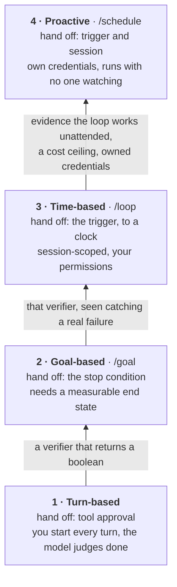
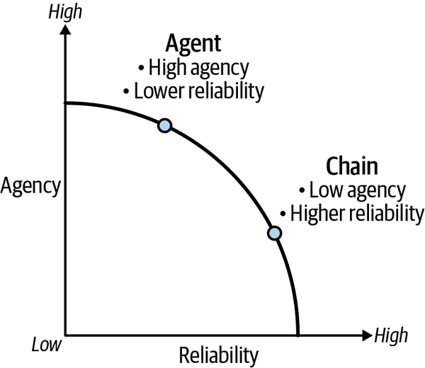
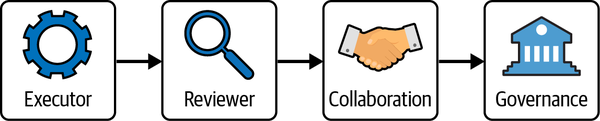

# 7 — The Autonomy Ladder

> The second axis. LangChain's four capability levels ([note 01](01-what-a-loop-is.md#the-map-of-this-pillar))
> ask *what the loop automates*; this ladder asks *how much of the operator's job has been handed off*.

---

## The framing

Every loop starts with a human doing four things: approving each tool call, judging when
the work is done, deciding when to start a run, and holding a session open while it runs.
The ladder is the order in which you hand those four off.

> **Climb one rung at a time, and earn each handoff with a verifier.**

The rungs are cumulative — rung 3 still needs rung 2's verifier. Skipping rungs is how you
get a doom loop: an agent running unattended on a schedule with nothing but model judgment
deciding when to stop.

| Rung | What you hand off | What must exist first |
|---|---|---|
| 1 — Turn-based | Tool approval *within* a turn | Nothing — this is the entry point |
| 2 — Goal-based | The **stop condition** | A measurable end state |
| 3 — Time-based | The **trigger** (to a clock) | Rung 2's verifier |
| 4 — Proactive | The trigger *and* the session | A verifier you trust unattended |

In Claude Code: rung 2 is `/goal`, rung 3 is `/loop`, rung 4 is `/schedule` ([note 06](06-triggers-and-schedules.md#claude-code)).

The label on each arrow is the evidence you need before you climb.

---

## 1 — Turn-based: hand off tool approval

You approve tool calls inside a turn, but every turn starts manually. The agent stops when
**it judges** the work is done.

Use it for interactive work you are watching. Its value is diagnostic: this is the rung
where you learn where your tasks actually fail, which is the raw material for the verifier
you need at rung 2.

Its weakness is exactly that stop condition — model judgment alone. That is tolerable only
because you are present.

Don't expect the model's own sense of "done" or "confident" to replace the verifier. A survey of
LLM metacognition ([arXiv:2607.11881](https://arxiv.org/abs/2607.11881) (Liu et al., 2026-07))
finds that models predict their own task success better than chance, but that "even when
predictive metacognitive information is present, it often fails to lead to effective monitoring
and behavior adaptation". Models also struggle "to decide when to persist (e.g., continue
searching) or move on", which is the stop decision itself. The survey concludes that "LLMs are
not yet capable of robust metacognition".

## 2 — Goal-based: hand off the stop condition

After each turn, a small fast model (or a deterministic check) tests whether the end
condition holds. The loop closes itself when the verifier confirms completion.

**This is the pivotal rung** — your first unattended loop. Climb it only once you can
write a *measurable* end state: tests pass, queue empty, lint clean, file exists. If the
end state is only expressible as "looks right," you are not ready to leave rung 1.

Everything above this rung inherits this verifier. A weak verifier here silently becomes a
weak verifier at rungs 3 and 4, where nobody is watching it fail.

## 3 — Time-based: hand off the trigger to a clock

The loop re-runs on an interval. Use it to poll external state that changes on its own
schedule — deploy progress, PR review status, a queue draining.

Two properties worth noting: it is **session-scoped** (your terminal stays open), and it
**inherits your permissions** rather than needing its own credential grant. That makes it
meaningfully cheaper and safer than rung 4, and it is why time-based is the right resting
place for most loops. Do not climb to proactive just because you can.

## 4 — Proactive: hand off the trigger to a schedule or event

Runs with no open session — on a schedule or in response to an event, on your machine or
on hosted infrastructure. Overnight work and event-driven automation live here.

The prerequisite is not technical, it is evidential: **prove the loop works at rung 2 or 3
with a verifier you trust** before removing the session. A proactive loop with an
unproven verifier is an unattended, credentialed process with no stop condition — see
[03-harness-engineering/notes/04-execution-boundaries.md](../../03-harness-engineering/notes/04-execution-boundaries.md)
for the credential and cost-ceiling consequences.

---

## How this maps to the capability levels

The two taxonomies are independent — a loop has a position on each axis:

| | Autonomy rung | Capability level ([note 01](01-what-a-loop-is.md#the-map-of-this-pillar)) |
|---|---|---|
| Asks | How much has the human handed off? | What does the loop automate? |
| Rung/level 1 | Turn-based (approve tools) | Agent loop (automates work) |
| Rung/level 2 | Goal-based (stop condition) | Verification loop (automates quality) |
| Rung/level 3 | Time-based (trigger→clock) | Event-driven (automates invocation) |
| Rung/level 4 | Proactive (trigger + session) | Hill-climbing (automates improvement) |

The rungs and levels look parallel at 3 and 4 but are not the same claim: capability level 3
is about *what triggers a run*, autonomy rung 3 is about *who holds the session*. A
hill-climbing loop (level 4) can perfectly well run at autonomy rung 1 — a human sitting
there approving each rewrite of the config. That combination is in fact the recommended
starting point for the [evolve loop](08-self-improving-loops.md#the-evolve-loop).

### A third view: the adoption ladder

*learn-harness-engineering* (lecture 13) gives a practical adoption order that cuts across both axes:

| Level | Name | What it adds | Rung / capability |
|---|---|---|---|
| 1 | Goal runner | `/goal` with a stop condition | rung 2 |
| 2 | Scheduled single task | One automation on a timer (e.g. morning CI check) | rung 3–4 |
| 3 | Multi-agent loop | Maker/checker split, a worktree per finding | capability 2 |
| 4 | Self-feeding loop | Finds its own next task in external state (issues, feature list) | capability 3 |
| 5 | Fleet orchestration | Several loops in parallel, sharing a memory layer | — |

Most teams sit between 2 and 3. Level 1 pays off fastest.

---

## Why each rung costs reliability

*Image Source: Oshin & Campos, *Learning LangChain* (O'Reilly, 2025), Fig. 8-1*

Oshin and Campos draw the trade-off underneath the ladder as a frontier (*Learning LangChain*, ch. 8). Every point on the curve is an optimal architecture for *some* application. A chain sits at low agency and high reliability; an agent at high agency and lower reliability. They add three more objectives that pull against each other: **latency** (time to the final answer), **autonomy** (fewer interruptions for human input) and **variance** (less variation between runs). The easiest route to more reliability costs either latency or autonomy, which is exactly the trade a rung makes.

Climbing a rung moves you along the curve. The engineering goal is to **push the curve outward**: more agency at the same reliability. Their four levers are streaming intermediate output (so latency is easier to accept), structured output, human-in-the-loop controls, and a deliberate policy for input that arrives mid-run ([harness note 07](../../03-harness-engineering/notes/07-orchestration.md#double-texting-the-same-problem-in-a-chat-app)). The verifier this note keeps insisting on is a fifth: it buys reliability without taking autonomy away.

### The controls a human needs while a loop runs

At rungs 1 and 2 the human is still in the loop, and the harness has to give them more than approve or deny. *Learning LangChain* (ch. 8) lists six controls, all of which need a checkpointer and a thread ID:

| Control | What the human does |
|---|---|
| **Interrupt** | Stop a running loop from outside |
| **Authorize** | Pause before chosen steps (usually tool calls) and wait for a decision |
| **Resume** | Continue from the pause as if nothing happened |
| **Restart** | Send new input; pending steps are cancelled and the loop restarts with the merged state |
| **Edit state** | Change the saved state, then resume from the edit |
| **Fork** | Go back to any earlier checkpoint and run again from there |

The LangGraph calls for each are in [note 10](10-framework-bindings.md#langchain--langgraph). The design point is that "approve each tool call" (rung 1) is only one of six. A loop that can't be edited or forked mid-run pushes humans toward approving whatever is in front of them.

### Who chooses the rung

Albada's version of the same idea is Karpathy's **autonomy slider**: Manual, Ask (the agent proposes, the human accepts each change) and Agent (it acts and notifies) (*Building Applications with AI Agents*, ch. 3). The difference from this note is who decides. The slider is a per-task setting the **user** moves, depending on stakes, familiarity and workload. The ladder is the operator's decision about a loop. A product can expose both: the loop's rung caps how far the slider can go.

---

## The human side of the ladder

*Image Source: Albada, *Building Applications with AI Agents* (O'Reilly, 2025), Fig. 13-1*

As the agent climbs, the human's job changes, and each new job needs a different interface (*Building Applications with AI Agents*, ch. 13):

| Human role | Human does | Agent autonomy | Interface it needs |
|---|---|---|---|
| **Executor** | Starts tasks, reviews every output | Minimal | Step-by-step guidance, tight feedback loops |
| **Reviewer** | Spot-checks key outputs | Handles routine work | Dashboards, exception flags, confidence scores |
| **Collaborator** | Sets priorities, annotates jointly | Drafts and executes with oversight | Shared planning UI, contextual annotation |
| **Governor** | Sets policy, audits, owns escalation | Autonomous within the rules | Policy configuration, audit logs, explainability |

Roughly, executor is rung 1, reviewer is rungs 2–3 and governor is rung 4. The table shows what the ladder leaves out: **climbing a rung means building the next role's interface.** A rung-4 loop whose owner has no audit log and no policy screen is unattended, not governed.

**Delegate progressively, and plan the way back down.** Albada's examples of progressive delegation: a team agent drafts status reports before it is trusted to send them, and a finance agent starts read-only and later submits transactions under supervision. His trust-repair mechanisms are to reset the behaviour, retrain, or restrict capabilities. That is descending a rung, and it should be a configuration change, not a rebuild.

**Set escalation thresholds as policy, and send context with each escalation.** Thresholds are decision types, risk levels or confidence bounds. His example is a procurement agent that auto-approves purchases under $1,000 and needs multi-party sign-off above that. The person receiving an escalation needs what the agent attempted, why it escalated, and what information it needs to proceed. Their resolutions are training data for the next threshold ([note 08](08-self-improving-loops.md#verify-before-you-learn)).

**Scope sets the governance bar.** Albada sorts agents by scope: personal, team, project, functional, organizational. Risk and governance needs rise with each step. Personal agents can inherit their user's permissions; wider ones need role-based access control, audit logs and, at the top, a governance board for behaviour and updates. A rung-4 loop on a personal inbox and a rung-4 loop on a shared ledger are not the same decision.

His case studies are press and vendor reports, so treat them as illustrations. ZoomInfo widened a Copilot pilot from 50 engineers to 400+ only after it hit preset thresholds (33% suggestion acceptance, 72% developer satisfaction), which is evidence-gated climbing at organizational scale. Klarna replaced roughly 700 customer-service roles with a chatbot in 2024 and was rehiring human agents by mid-2025 after complaints rose, which is a rung skipped with no route back down.

---

## Design checklist

- [ ] Which rung is this loop on *today*?
- [ ] Can I state the stop condition as a check that returns a boolean? (Gate for rung 2.)
- [ ] Has the verifier been observed catching a real failure — not just passing?
- [ ] For rung 3+: what is the cost ceiling per run, and what happens when it trips?
- [ ] For rung 4: whose credentials does this run under, and who owns them?
- [ ] Does the human at this rung have the interface their role needs (dashboard, audit log, policy screen)?
- [ ] What are the escalation thresholds, and what context does each escalation carry?
- [ ] How do I move this loop back down a rung if trust breaks?

---

## Working reference

`~/.claude/refs/agent-runtime.md` — topology variants and what each forces on loop state;
`~/.claude/refs/agent-architecture.md` — turn termination control.

---

→ Next: [08-self-improving-loops.md](08-self-improving-loops.md) — loops that rewrite themselves.
