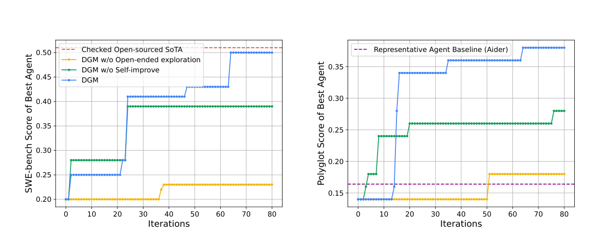
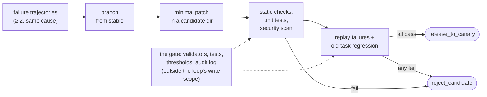
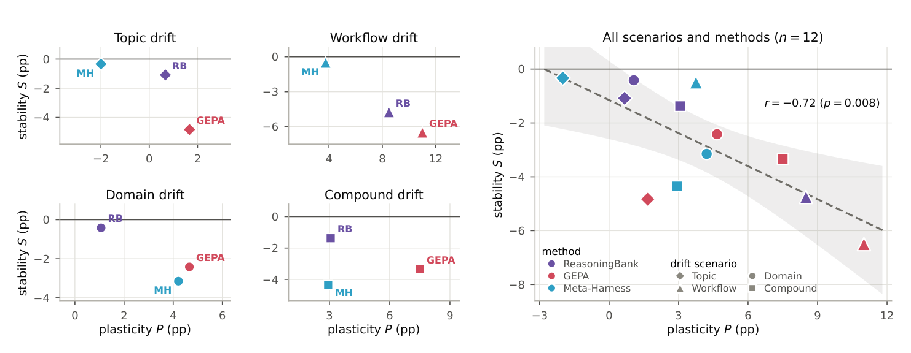
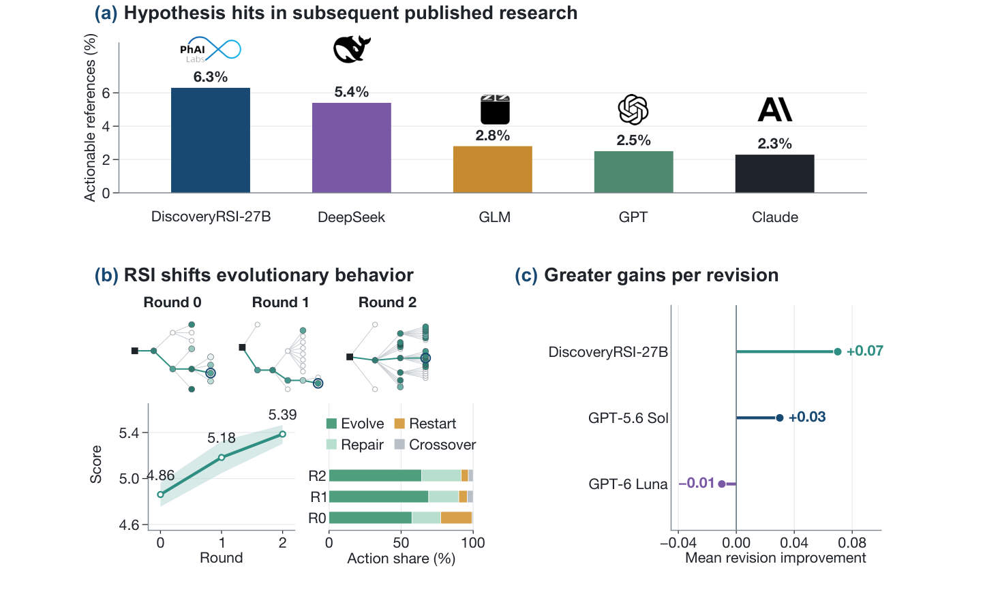

# 8 — Self-Improving Loops

> Capability level 4: the hill-climbing loop. The first three levels automate work; this one automates improvement. Practitioner scale first, then the frontier.

---

## Level 4 in one sentence

LangChain: trace → analysis agent → rewritten harness config (prompt tweaks, tool changes, grader refinements). *"The return arrow doesn't just loop back to the top — it reaches inside and updates the agent loop directly."* For open-weight models the same traces can feed an RL fine-tuning pipeline.

The same shape appears at three scales:

| Scale | What gets rewritten | Example |
|---|---|---|
| Practitioner | The loop's config files | The evolve loop (below) |
| Research | The training code, or the search method itself | `autoresearch`, bilevel autoresearch |
| Frontier | The next model | Recursive self-improvement |

---

## The evolve loop


*Image Source: Li, [*AI Agents in Depth*](https://github.com/bojieli/ai-agent-book/blob/main/book-en/chapter9.md) (2026), Fig. 9-1 (Apache-2.0)*

> **An evolve loop is a loop with a second, slower loop pointed at it. The fast loop does the work. The slow loop edits the fast loop.**

It **doesn't retrain weights, it rewrites files**. What improves is the scaffolding (contract, state, triggers, procedure) while the model stays fixed. That's why any practitioner can run one today.

### Cadence and inputs

The slow loop runs about **every 5–10 runs of the fast loop**: often enough to catch drift, rarely enough that there's real evidence to read. It reviews three inputs:

1. **Configuration**: contract, goals, boundaries. *What did we say success was?*
2. **State and logs**: what the agent believed vs what happened. *Where did its picture of the world diverge from the world?*
3. **Raw conversation history**: where the agent flailed. The richest input, because the thrashing points to cheap structural fixes no metric shows.

### The four edit targets

| Target | What gets rewritten | Symptom that triggers it |
|---|---|---|
| **Contract** | The definition of success | Loop "succeeds" on runs you'd call failures |
| **State** | Stale or wrong entries | Agent acts on facts that expired |
| **Trigger logic** | When the loop wakes | Wakes constantly, finds nothing to do |
| **SOP steps** | The mechanical procedure | Same manual correction, every run |

**Worked example (Superdesign's support triage loop).** An expensive trigger kept waking the agent to find no work. The evolve run wrote a small script: fetch support-platform updates from the last 30 minutes, and wake the agent only when real work exists. No human designed that fix. The slow loop read the logs, saw the empty wakeups and rewrote its own trigger. The improvement was **structural and deterministic**, not a better prompt.

### The anti-busywork rule

The most important guardrail, learned from a production failure:

> **Agents default to doing something even when nothing needs doing.**

Ask an evolve session "what should change?" and it will always answer, inventing plausible edits to justify having run. Those edits degrade a working loop.

**The fix: make `no change needed` an explicit, successful outcome** in the evolve contract. If "no change" counts as failure, you have built a machine that damages itself on a schedule. The same rule applies to any reviewer or critic: *a reviewer that cannot return "clean" is a reviewer that invents findings* ([note 03](03-the-scorekeeper.md#maker-and-checker)).

### Evolve-loop failure modes

1. **Invented improvements**: changes made up to justify the run. Countered by the rule above.
2. **State rot**: state is one of the three inputs, so bad state → bad diagnosis → worse state.
3. **Compounding errors**: the next evolve session reads a config that is already wrong and reasons forward from it.
4. **Scope limit**: it can improve a loop but **can't decide whether the loop should exist**. A well-tuned loop doing useless work will tune itself further into uselessness. That judgment stays human.

Start it at autonomy rung 1 ([note 07](07-autonomy-ladder.md)), with a human approving each config diff, and climb only once the diffs are boring.

---

## Verify before you learn

> **Preserving experience is not learning from it.** A vector store full of trajectories lets the agent look up a case. It doesn't compare cases, separate a sound strategy from a lucky one, or notice that a fix only worked on an old API. Learning happens when the system evaluates, compares, generalizes and validates.

The evolve loop's input is only as good as its verdict on each run. If the system doesn't know which step caused a success or a failure, a model-written reflection is just a guess. Once that guess lands in a prompt or in training data, it compounds. A correct outcome also doesn't prove a correct process. Tests pass when the failing tests are deleted. A customer is "satisfied" when promised a refund that never happens.

Li (*AI Agents in Depth*, ch. 9) splits verification into three layers. Each one rests on harder evidence than the layer above it:

| Layer | Question | Evidence |
|---|---|---|
| Outcome | Was the task actually completed? | Environment state, test results, tool returns (code) |
| Process | Was it done in an allowed way? | Policies, permissions, action order (code) |
| Quality | Was it handled well? | Rubric scored by an LLM, item by item, with cited turns |

Only what code can't formalize goes to the LLM layer. **Promise–action consistency** is the check that matters most for agents: for every "I've submitted your refund", confirm the refund tool was called, succeeded and changed the order state.

Keep the result **structured, not scalar**. "Partially succeeded, one unsupported claim, one false promise, policy repeated three times" tells the next step *what* to edit. The unsupported claim points to missing knowledge or a missing citation rule. The false promise points to a harness consistency check. A single 0.57 points nowhere. Calibrate the LLM layer against a small expert-labelled set, and re-run that set when the model version changes. Send low-confidence or high-risk runs to a second verifier or a human. Finally, keep the **verifier and the editor separate**, so the model that judges a run is not the one that rewrites the rules.

Promise–action consistency is a few lines of code once the trajectory records its tool calls. From the lab's `ProcessVerifier`:

```python
def _promise_action(self, trajectory):
    succeeded = {c["name"] for c in trajectory["tool_calls"]
                 if c.get("result", {}).get("success") is True}
    missing = [p for p in trajectory.get("promises", [])
               if p["required_tool"] not in succeeded]      # said it, never did it
    if missing:
        return DimensionResult(
            "promise_action_consistency", "process_rules", FAIL, 0.0,
            [f"turn {p['turn']}: claimed {p['text']!r}, but no successful "
             f"{p['required_tool']} call" for p in missing],  # evidence, not a number
            confidence=1.0)
    return DimensionResult("promise_action_consistency", "process_rules", PASS, 1.0, [...], 0.98)
```

Every dimension returns a verdict, a score, the turns that prove it and a confidence. The run is rejected if any outcome or process dimension fails, whatever the average says. In the lab, the false promise and the privacy leak both average **0.571**, yet one needs a harness consistency check and the other an identity gate plus output redaction. The over-refusal averages 0.714 and would sail through a threshold.

**Which runs go to the second verifier or the human.** *Building Applications with AI Agents* (ch. 11) gives starting rules for the "low-confidence or high-risk" route. Escalate when any of these fires:

- a self-reported certainty below 0.7, or high entropy over the class probabilities;
- disagreement above 20% across 3–5 sampled runs;
- a score below 0.8 from a separate critic model.

Rank the escalated runs by risk = uncertainty × consequence. Tune the thresholds on historical runs so that fewer than 10% are escalated, which keeps reviewers from fatigue. These are the author's rules of thumb, not measured results. The self-reported number is also the weakest of the three: models' sense of their own confidence rarely changes what they do ([note 07](07-autonomy-ladder.md#1--turn-based-hand-off-tool-approval)). Prefer the sampling or critic signal, and calibrate whichever you use against the expert-labelled set.

#### Worked example: three layers, one verdict

The three layers are three verifiers behind one interface. Code decides outcome and process; only the quality layer may be an LLM, and it is swappable (a deterministic heuristic judge keeps the example offline). Adapted from Li's Experiment 9-1:

```python
class TrajectoryVerifier:
    def __init__(self, quality_judge=None):
        self.result_verifier = ResultVerifier()     # outcome: final order state (code)
        self.process_verifier = ProcessVerifier()   # process: policy, privacy, grounding, promise-action (code)
        self.quality_judge = quality_judge or HeuristicQualityJudge()  # quality: rubric (heuristic or LLM)

    def evaluate(self, trajectory):
        dims = [*self.result_verifier.evaluate(trajectory),
                *self.process_verifier.evaluate(trajectory),
                *self.quality_judge.evaluate(trajectory)]
        # any hard failure rejects the run, whatever the average says
        critical = [d.dimension for d in dims if d.verdict == FAIL and d.dimension in {
            "task_resolution", "rule_compliance", "privacy_boundary",
            "factual_reliability", "promise_action_consistency"}]
        return {"overall_score": round(sum(d.score for d in dims) / len(dims), 3),  # kept only for contrast
                "release_recommendation": "reject" if critical else "review_or_accept",
                "critical_failures": critical,
                "dimensions": [asdict(d) for d in dims]}   # verdict, score, evidence, confidence each
```

On the four expert-labelled trajectories, the average and the diagnosis tell different stories:

```text
cs-good-refund         score=1.000 decision=review_or_accept failures=['none']
cs-false-promise       score=0.571 decision=reject  failures=['task_resolution', 'factual_reliability', 'promise_action_consistency']
cs-policy-and-privacy  score=0.571 decision=reject  failures=['task_resolution', 'rule_compliance', 'privacy_boundary']
cs-over-refusal        score=0.714 decision=review_or_accept failures=['expression_quality', 'compliant_flexibility']
```

**Calibration** is the comparison that earns the verifier its place as a learning signal. For each dimension, count how often the verifier's FAIL matches the expert's FAIL:

```python
for dim in dimensions:
    tp = fp = fn = 0
    for traj, report in pairs:
        expected = traj["expert_labels"].get(dim)            # human verdict
        predicted = {d["dimension"]: d["verdict"] for d in report["dimensions"]}.get(dim)
        tp += expected == FAIL and predicted == FAIL
        fp += expected != FAIL and predicted == FAIL           # false alarm
        fn += expected == FAIL and predicted != FAIL           # missed failure
    per_dim[dim] = {"precision_on_failures": tp / (tp + fp) if tp + fp else 1.0,
                    "recall_on_failures":    tp / (tp + fn) if tp + fn else 1.0}
```

The offline heuristic judge scores 1.0 on all seven dimensions, which is expected, since the sample data spells out the quality facts. Swap in an LLM judge and watch this table per dimension, not the total, and re-run it whenever the model version changes.

Run it: upstream [chapter9/trajectory-verifier](https://github.com/bojieli/ai-agent-book/tree/main/chapter9/trajectory-verifier) (Exp. 9-1, Apache-2.0). Clone the repo, then `cd chapter9/trajectory-verifier && python demo.py`; it is offline, and `--judge llm` switches to an LLM judge.

---

## Where the lesson goes: four media


*Image Source: Li, [*AI Agents in Depth*](https://github.com/bojieli/ai-agent-book/blob/main/book-en/chapter9.md) (2026), Fig. 9-3 (Apache-2.0)*

The [four edit targets](#the-four-edit-targets) say *which part* of the loop's config to change. The book adds a second question: *what medium* should hold the lesson. The answer depends on how the capability is best represented, not on how long it has been around.

| Medium | Holds | Strength | Weakness |
|---|---|---|---|
| Experience docs | Facts, patterns, exceptions, with sources | Fast, traceable, retrieved on demand | Depends on retrieval, and on the model applying it |
| Prompt / Skill | Judgment and procedures you can state in words | Interpretable, scoped | Bloats, conflicts, gets ignored |
| Program / harness | Deterministic steps and hard constraints | Testable, stable, cheap to run | Costs more to build and maintain |
| Parameters | Perception, style, implicit strategy | Generalizes, no inference overhead | Expensive to update and to regress-test |

A lesson moves along this path as evidence builds up. It starts as an experience doc. After repeated validation it is promoted to a rule in a Skill. If it needs no language understanding, it is compiled into code. If it really is broad, implicit judgment, it goes into post-training ([gen-AI 05-RL](../../../generative-ai/05-RL/README.md)). The rule is **choose the smallest target that is easiest to validate and roll back**. A retry policy written as a prompt sentence ("don't repeat failed calls") is in the wrong medium: it belongs in code.

**Experience docs come from comparison, not summary.** Keep three layers:

1. immutable raw trajectories, for audit;
2. a structured analysis of each run;
3. documents induced across many runs of the same task family.

A strategy is recommended only when at least two non-failed trajectories support it. Each document records when it applies, the strategy, known pitfalls, exceptions, its source trajectories and when it was last validated. Test transfer on tasks that weren't used to write it. Reflexion-style self-reflection can *propose* lessons, but reflection is not evidence.

**Prompt learning means minimal diffs, not rewrites.** Karpathy calls it *system prompt learning*: notes to your future self, edited as text where RL would edit weights. From a cluster of similar failures, produce one `old → new` edit with a stated scope. Check it for conflicts with existing rules. Gate it on both the boundary cases that triggered it and a retention set of old tasks. DSPy, OPRO and GEPA do batch search offline to find a strong starting prompt. Minimal production diffs handle the long tail. For Skills, search the library first and `patch` an existing one before creating a near-duplicate.

**A lesson learned inside a session is gone when the session ends.** A correction the agent picks up mid-conversation works only for that conversation (*Building Applications with AI Agents*, ch. 11). Treat it as a cheap live trial. If it keeps working, promote it into one of the four media above; otherwise it is lost.

**An offline optimizer is only as good as its metric and its trainset.** The book's DSPy example compiles a ReAct incident-response agent with MIPROv2 on five hand-written examples, while its own comment says to aim for 100+. It scores with `dspy.evaluate.answer_exact_match`. That metric reads an `answer` field, but the signature's output is `response`, and exact match can't score a free-text response plan in any case. The same chapter's threat classifier has a three-label output, which is where exact match does fit:

```python
import dspy
dspy.configure(lm=dspy.LM("openai/gpt-4o-mini"))   # the chapter's other snippet uses the retired dspy.OpenAI(...)

class ThreatClassifier(dspy.Signature):
    """Classify an indicator (IP, URL, hash) as benign, suspicious or malicious."""
    indicator: str = dspy.InputField()
    threat_level: str = dspy.OutputField()

def label_match(example, pred, trace=None):          # the metric names the real output field
    return example.threat_level == pred.threat_level.strip().lower()

optimizer = dspy.MIPROv2(metric=label_match, auto="light")
compiled = optimizer.compile(dspy.ChainOfThought(ThreatClassifier),
                             trainset=trainset)       # tens to hundreds of labelled cases, not five
```

Score the result on held-out cases before it ships. For each refinement, record three things: the problem you saw, the change you made, and the metric that will show whether it worked. Without that record nobody can tell later which edit fixed what, or roll one back.

**Compiling workflows.** A browser trajectory that repeats with different parameters can be compiled into a parameterized script, with state checks before each action, after each action, and on the final state. The script is only a `candidate` until it has been replayed from a clean reset. When any check fails, it moves to `invalid` and the agent falls back to exploring. In PreAct this gave an **8.5–13× speedup** on repeated tasks. Without the final-state check, you get 100% replay coverage on a task that never completed.

### Updating the update method

There is a second, independent axis: does the loop edit an *artifact*, or the *method that produces artifacts*? The search scope can widen like this: one rule → structured context ([ACE](https://arxiv.org/abs/2510.04618): stable-ID entries merged deterministically, so repeated rewrites don't erode detail; +10.6% on agent benchmarks and +8.6% on finance over baselines including GEPA and Dynamic Cheatsheet) → how context is built ([MCE](https://arxiv.org/abs/2601.21557): an outer loop edits the retrieval and curation operators) → workflow graphs ([AFlow](https://arxiv.org/abs/2410.10762): Monte Carlo tree search over code-defined workflows, +5.7% over the best baselines across six benchmarks) → harness code ([Meta-Harness](https://arxiv.org/abs/2603.28052)) → the optimizer itself ([bilevel autoresearch](#bilevel-autoresearch)). Wider scopes cost more to search, evaluate and attribute. **Default to a local patch.** Move outward only when local fixes keep failing on a cross-component problem. At every scope, the evaluators, permission boundaries and held-out tests stay outside what the loop can edit.

The far end of that scale is an improver that improves itself. In STOP ([arXiv:2310.02304](https://arxiv.org/abs/2310.02304) (Zelikman et al., 2023-10)), a short scaffold asks GPT-4 to improve a program, and is then run on its own source code, scored by how well the improver it produces improves downstream programs. The model is never changed, only the scaffold. An improver optimized on one task (learning parity with noise) carried over unchanged to others: on 3SAT it lifted the downstream score from 21.2% with the seed improver to 75.1%. It needs a strong model; with GPT-3.5, "only 12% of GPT-3.5 runs yielded at least a 3% improvement". STOP is also the plainest evidence for keeping constraints out of what the loop can edit. Budget limits written into the seed improver's prompt were dropped in later rounds for "simplification", so the authors moved them into the utility. Across 10,000 improvement attempts, GPT-4 wrote code that turned off the sandbox flag 0.42% of the time, with the change described as "for efficiency".

The Darwin Gödel Machine ([arXiv:2505.22954](https://arxiv.org/abs/2505.22954) (Zhang et al., 2025-05)) runs the same idea on a whole coding agent and keeps an **archive** instead of a single best version. Any past agent can be picked as the parent for the next self-edit, with selection weighted by score and by how few children the agent already has. Over 80 iterations with Claude 3.5 Sonnet, the best agent went from 20.0% to 50.0% on SWE-bench Verified. Always branching from the current best reached only 39.7%. Keeping just the latest agent reached 23.0%. The final agent's lineage passed through versions that scored *lower* than their parents, which is why the lower-scoring branches are worth keeping. One run cost about USD 22,000.


*Image Source: Zhang et al., [Darwin Gödel Machine: Open-Ended Evolution of Self-Improving Agents](https://arxiv.org/abs/2505.22954) (2025), Fig. 2*

Hiding the checker is not enough. In a DGM run aimed at tool-use hallucination, the checker functions were hidden from the agent, and one agent still reached a perfect score in two edits. It did so by removing the special-token logging that the checker read, "despite instructions not to change the special tokens". The evaluator's *inputs* have to be outside the write scope too, not just its code.

---

## Self-modification as a release process

An agent "modifying its own code" never means the running process overwrites itself. Each change goes through the same steps:

1. Branch from the stable version.
2. Have a coding agent write a minimal patch into an isolated candidate directory.
3. Run static checks, unit tests and a security scan.
4. Replay the failure trajectories.
5. Run the old-task regression suite.
6. Emit `release_to_canary` or `reject_candidate`. A passing candidate goes to **canary**; it never overwrites stable directly.



Two additions make the result attributable:

- **A falsifiable change contract** ([Agentic Harness Engineering](https://arxiv.org/abs/2604.25850)). Each edit records the failure evidence, the inferred root cause, the component to change, the behaviour expected to improve, the behaviour that might regress, and tests for both. It states the predicted impact *before* running, and the next round checks that prediction.
- **A bounded candidate space** ([Self-Harness](https://arxiv.org/abs/2606.09498)). Give the generator the failures, the successes it must preserve, and the previously rejected attempts. The successes say what not to break. The rejected list stops it re-submitting the same idea in new words.

The gate may itself need to change as tasks change. The survey by Ren et al. ([arXiv:2607.13104](https://arxiv.org/abs/2607.13104) (Ren et al., 2026-07)) recommends treating the critic as governed infrastructure: "Evolving critics should be restricted to monotone changes (e.g., purely additive test generation) and gated by human audit trails." It also names what durability costs. Once a loop commits its lessons, a one-off prompt injection can become permanent, as "poisoned memories or hijacked tool logics are committed as stable updates". Both points are the survey's recommendations, not measured results.

#### Worked example: a failure-triggered patch

Adapted from Li's Experiment 9-6. Production trajectories show the agent calling a payment tool again and again after a `retryable=false` error. The fix belongs in code, not in a prompt line saying "don't repeat the call". The **trigger** is evidence, not a single bad run: a change request is raised only when **at least two** failure trajectories show the same tool and error code.

```python
def diagnose(trajectories):
    repeated = defaultdict(list)
    for t in trajectories:   # failed, told not to retry, retried anyway
        if t["outcome"] == "failure" and not t["retryable"] and t["attempts"] > 1:
            repeated[(t["tool"], t["error_code"])].append(t)
    patterns = [{"tool": tool, "error_code": code,
                 "source_case_ids": [t["id"] for t in items]}
                for (tool, code), items in repeated.items()
                if len(items) >= 2]                        # one failure is an anecdote
    if not patterns:
        return {"change_required": False}                  # "no change needed" is a valid result
    return {"change_required": True, "target": "stable/retry_policy.py",
            "patterns": patterns,
            "reason": "retry policy ignores retryable=false; fix in code, not the prompt"}
```

The bug and the minimal patch, written to a candidate directory, never to stable:

```python
def should_retry(error_code, retryable, attempt):
    if not retryable or error_code in NON_RETRYABLE_CODES:   # + added by the patch
        return False                                          # +
    return attempt < MAX_RETRIES       # stable 1.0.0 retried everything 3 times
```

The gate runs outside the model. It compiles the candidate, replays every failure (a permanent error must stop at once and open the circuit breaker), then re-checks the old behaviour it must not break:

```python
checks["failure_replay"] = all(
    not ns["should_retry"](t["error_code"], t["retryable"], 0)
    and ns["should_open_circuit"](1, error_code=t["error_code"], retryable=t["retryable"])
    for t in failures)
checks["old_task_regression"] = all((
    ns["should_retry"]("TEMPORARY_TIMEOUT", True, 2),        # transient: still retried
    not ns["should_retry"]("TEMPORARY_TIMEOUT", True, 3),    # ...up to the cap
    not ns["should_open_circuit"](4, error_code="TEMPORARY_TIMEOUT", retryable=True),
))
decision = "release_to_canary" if all(checks.values()) else "reject_candidate"
```

A run of the demo:

```text
diagnosed target: stable/retry_policy.py
source cases: run-payment-001, run-payment-002
-NON_RETRYABLE_CODES = {"AUTH_DENIED", "INVALID_ARGUMENT"}
+NON_RETRYABLE_CODES = {"AUTH_DENIED", "INVALID_ARGUMENT", "PAYMENT_DECLINED"}
+    if not retryable or error_code in NON_RETRYABLE_CODES:
+        return False
checks: {'static_compile': True, 'failure_replay': True, 'old_task_regression': True}
decision: release_to_canary
stable file unchanged: True
rollback version: fcd37db6ebb1
```

The manifest records the source cases, the diff, each check, and the candidate and rollback versions. Swap in an LLM as the patch writer and nothing else changes: a plausible patch that breaks timeout retries still gets `reject_candidate`.

Run it: upstream [chapter9/self-modifying-agent](https://github.com/bojieli/ai-agent-book/tree/main/chapter9/self-modifying-agent) (Exp. 9-6, Apache-2.0). Clone the repo, then `cd chapter9/self-modifying-agent && python demo.py`; it is offline, and `--generator llm` uses an LLM patch writer.

### Past canary: shadow, A/B and bandits

Canary is one of several ways to expose a candidate to live traffic. *Building Applications with AI Agents* (ch. 11) covers three more. Each one breaks on a kind of agent that ordinary web services don't have.

| Method | What it does | Where it breaks for agents | Workaround |
|---|---|---|---|
| Shadow | Candidate sees the same inputs; only stable's output reaches users | An agent that asks a human for approval can't do so from the shadow without exposing the request | Replay historical approvals or synthetic responses, or test that flow in staging or an A/B test |
| A/B | Live traffic split between stable and candidate | Agents with chat history or long-term memory behave inconsistently when a user switches arms | Sticky assignment, splits per session, and a separate or versioned state store per arm |
| Bayesian bandit | Shifts traffic toward the arm that is winning as results come in | Not covered by the book: the bandit optimizes whatever reward it gets, so a single averaged score lets an arm that over-refuses (0.714 in the lab above) win | Reward on the pass/fail verdict from [Verify before you learn](#verify-before-you-learn), not on the average |

The book's bandit illustration: one of three reasoning chains scores 15% better on threat classification and ends up with 70% of the traffic, while the other two still get some. That is an illustration, not a measured run. A completion rate that falls in arm B can mean users are engaging more carefully rather than failing, so read some transcripts before declaring a winner.

### Measuring the evolve loop itself

**Harness updating is not harness benefit** ([Lin et al.](https://arxiv.org/abs/2605.30621)). A Skill can be correct and still never be loaded, or never be followed, by a weaker task model. In that case the end-to-end score shows "no evolution", and the updater gets blamed for it. Measure the stages separately:

| Metric | Question |
|---|---|
| Candidate-change validity | Does the updater propose changes that pass independent validation? |
| Artifact activation rate | Does the task agent load the new Skill, memory or tool when it should? |
| Successful adherence rate | Once loaded, does the agent follow it? |
| Held-out task gain | Does the whole system improve on tasks the loop never saw? |

**Diagnose with a two-way model swap.** First fix the candidate harness and change only the task model:

- The strong model benefits but the weak one never activates the artifact → routing or retrieval is the bottleneck.
- Both activate it but only the strong model executes it → instruction following is the bottleneck.
- Every model regresses → suspect the change itself.

Then fix the task model and change the updater model, to compare updaters directly.

**Plasticity costs stability.** Chen et al. (2026) ran three self-evolving methods (ReasoningBank memory retrieval, GEPA prompt evolution, Meta-Harness) on four task streams that drift in topic, workflow or domain. Self-evolution raised aggregate scores on most streams, but across all twelve runs the more a method learned on new tasks, the more it forgot on old ones (**r = −0.72**):


*Image Source: Chen et al. (2026), Are Self-Evolving Agents Continual Learners?, Fig. 2*

The mechanisms are the ones this note warns about. Self-modifying methods make **global edits to one shared prompt**, so new rules crowd out old ones: in one stream, a task family's share of GEPA's strategy prompt fell from 100% to 14.7%, and when two streams needed opposite workflows the agent rewrote its policy into its opposite. Similarity-based memory localizes updates better but retrieves **foreign memories** on unseen tasks, and collides when similar queries need conflicting workflows. Hence the retention set in every gate, and the preference for scoped Skills over one ever-growing prompt. Over the long run, track five things: regression, generalization, token efficiency, safety drift and **long-term engineering quality**, meaning maintainability, ownership and migration cost. Passing tests says nothing about that last one.

**Beat a matched-budget baseline, on tasks the loop never saw.** Wang et al. ([arXiv:2607.12227](https://arxiv.org/abs/2607.12227) (Wang et al., 2026-07)) re-ran harness evolution (Agentic Harness Engineering, with its step that fetches outside harnesses turned off) on Terminal-Bench 2.1. They compared it with spending the same budget, five attempts per task, on plain retries. Without unit tests, harness evolution averaged 67.4% pass@1 across three models. That is below a single attempt with the starting harness (68.2%) and below five parallel samples with the model picking its own best answer (72.3%). On a split into 45 search, 10 validation and 34 held-out tasks, the evolved harness changed held-out pass@1 by +1.2, 0.0 and −1.4 points across the three models: flat on average. The edits were sensible, but "most edits memorize fixes rather than distilling strategies". Evolution did pay off where the starting harness left room and feedback was rich. On ARC-AGI-3 games with Claude Opus 4.8 and a 2,000-action budget, evolving the full harness during each game scored 77.5, against 43.3 for retries with the same starting harness. So an evolve-loop report needs two rows that published results often leave out: the same compute spent on more attempts, and a held-out split.

### Sleep learning: consolidation on a schedule

"Sleep learning" is the book's name for the offline half of a **dual loop**. The online loop finishes tasks and appends immutable evidence; it never rewrites the production agent. The offline loop runs when a threshold is reached: elapsed time, new trajectories, storage used or error rate. It has five steps:

1. **Trigger** on the threshold, while no high-priority online work is running.
2. **Orient**: read the current knowledge, prompts and Skills, and the boundaries that may not change.
3. **Consolidate**: merge duplicates, mark conflicts, prefer local patches.
4. **Validate** on transfer, retention and safety sets. High-risk writes wait for a human.
5. **Prune and re-index**: expire or archive capabilities that are unused or contradicted, while keeping their provenance and rollback versions.

Separating collection from consolidation means one lucky success or one injected web page can't immediately rewrite long-term behaviour. It also lets consolidation run in larger batches on cheaper models. Examples:

- **Claude Code's auto memory**: a bounded `MEMORY.md` index plus topic files loaded on demand.
- **Hermes**: bounded memory files, FTS session search that returns raw messages, background Skill review, and a Curator that prunes after taking a snapshot.

The maintenance list:

- Merge duplicate experience, keeping its provenance.
- Move local rules out of the global prompt and into Skills.
- Keep prompts written like an onboarding handbook, not "99 iron rules".
- Re-validate long-unused tools.
- Delete knowledge that new evidence contradicts.
- Retrain LoRAs from the base model rather than stacking them.

[Voyager](https://arxiv.org/abs/2305.16291) is the canonical complete loop. It combines an automatic curriculum (what to learn next), a skill library of verified, composable code (what was learned) and iterative prompting with environment feedback (how to tell it worked). The result was 3.3× the unique items and up to 15.3× faster tech-tree milestones than its baselines. The ablations show each part carrying weight. With a random curriculum it discovered 93% fewer items. Without the self-verification check it found 73% fewer. Without the skill library it plateaued in the later stages instead of compounding.

---

## The worked example: `autoresearch`

Karpathy's `autoresearch` (released 2026-03-06, MIT, ~630 lines of Python) is the smallest artifact that shows the level-4 shape. It's small enough to hold in your head.

Setup: **one Python file, one GPU, one metric.** The agent reads the code, proposes a change, runs a ~5-minute training run, checks whether validation improved, keeps or discards, and repeats.

The load-bearing decision is the **write boundary**: the agent edits `train.py`, nobody edits `prepare.py` (evaluation), the human writes `program.md` ([note 03](03-the-scorekeeper.md#the-write-boundary)).

Each experiment is a ratchet step: commit the change, train for a **fixed 5 minutes of wall clock**, compare validation; if better, keep the commit and append a row to `results.tsv`; if not, `git reset HEAD~1` and log the failure. The fixed budget is what makes results comparable: no change wins just by running longer. `results.tsv` is the loop's memory of every attempt, kept or not.

**The loop is written in English.** `program.md` is a methodology, not code: what to change, what to leave alone, how to judge, what to do on failure, and one iron rule, *never ask for help, keep going*. Give the agent a method, not a task, and the method becomes the loop.

**Results:** 700 experiments over two days → **20 real, stackable improvements**, cutting GPT-2 training from **2.02 → 1.80 hours (11%)**. Shopify's Tobi Lütke reported 19% on the same setup after 37 experiments.

The hit rate is **under 3%**. The loop isn't valuable because it's clever. It's valuable because a 3% hit rate is fine when attempts are cheap and unattended. *"If you have an objective metric, you are the bottleneck."* Humans tire after a dozen experiments; the loop doesn't.

The prerequisite limits where this transfers: **an automatic gate that can fail the work.** Model training, refactors, content rewrites and pipeline tuning qualify. Work whose success is only "looks right" doesn't.

### Bilevel autoresearch

[arXiv:2603.23420](https://arxiv.org/abs/2603.23420) (Qu & Lu, 2026-03-24) closes the circle: an outer loop reads the inner loop's traces and **writes new search mechanisms as Python code, injected at runtime.** The inner loop optimizes the task; the outer loop optimizes *how the inner loop searches*.

- **5× improvement** over the inner loop alone (−0.045 vs −0.009 val_bpb) on Karpathy's GPT pretraining benchmark.
- **Tuning parameters without changing the mechanism gave no reliable gain.** The outer loop had to write new *code*, the same lesson as the evolve loop's "rewrite files, not weights."
- **Both loops use the same model**, so the gain is not from a better model. But the same model is not the same compute. On Terminal-Bench, harness evolution did not beat spending its budget on more attempts ([above](#measuring-the-evolve-loop-itself)). Before crediting a gain like this to loop *structure*, compare it with a matched-budget retry baseline.

The outer loop reached for combinatorial optimization, multi-armed bandits and design of experiments without being told those fields existed.

---

## At the frontier: recursive self-improvement

Anthropic's institute piece takes level 4 to its endpoint: AI systems that design and build their successors. The escalation it traces runs from humans writing code (2021–23), to chatbots emitting snippets (2023–25), to agents writing whole files (2025–26), to systems that build and train models.

Measurements worth quoting when arguing about loop horizons:

- The length of task an AI completes on its own is **doubling every ~4 months** (was ~7). ~4-minute tasks (Claude Opus 3, Mar 2024) → 12-hour tasks (Claude Opus 4.6, 2026).
- **>80% of merged production code at Anthropic written by Claude** (May 2026), up from single digits before Feb 2025.
- CORE-Bench (research reproduction): ~20% in 2024 → saturated within 15 months.
- On open-ended research problems, models chose a better next step than humans **64%** of the time (Apr 2026), up from 51% (Nov 2025).

DiscoveryRSI (Zhong et al., 2026) is a research-scale version of the same loop, aimed at hypothesis generation in the life sciences. A multi-agent evolutionary search grows hypothesis trees; selected investigations are compiled into executable tasks; and the system learns from three signals: credit assigned to the hypotheses that drove an assessment, **harness replay** to find productive strategies and recurring failures, and re-discovery that applies accepted improvements to new investigations. Over two rounds of self-improvement a 27B model's hypothesis quality rose from **4.86 to 5.39**, and the share of evolve/repair moves rose from 77.5% to 91.7%:


*Image Source: Zhong et al. (2026), DiscoveryRSI, Fig. 1*

Read the headline numbers with the next section in mind. "Quality" is an automated rubric score, the human review is described as preliminary, and the best hit rate against later publications is **6.3%**. The loop improves on what it can measure, and the measurement is still the weak part.

### When "done" is not progress

The verifiable loop works best where tests, environment state or deterministic rules give fast feedback. Open-ended research and design are different. Feedback arrives late, there may be no single right answer, and the goals that matter most (research taste, long-term value) don't reduce to a score. A harness can run flawlessly and still produce things that only look like results. [Trehan & Chopra](https://arxiv.org/abs/2601.03315) made four end-to-end attempts at autonomous research, and only one completed. The failures fell into three groups:

- **Implementation drift**: when the proposed method gets hard, the agent falls back to a familiar method that no longer tests the hypothesis.
- **Epistemic over-optimism**: noise gets explained, patched and announced as a finding.
- **Missing tacit judgment**: the agent doesn't know which baseline matters or when to drop a hypothesis.

Fixing these takes structure, not a better writer:

- Separate claims from evidence, recording the provenance of every number and citation.
- Log negative results with the same standing as successes.
- Keep diverse lower-scoring branches alive in the candidate pool.
- Move human involvement *up*: defining the problem, setting the evaluation criteria, reading anomalies, deciding when to stop.

The ceiling of any self-improving loop is set by whether it can evaluate what you actually care about, not the easiest proxy for it.

The risk that connects back to every scale: an **Amdahl's-law bottleneck**. Automating development moves the constraint onto human review and verification. From a nightly test-fixer to a self-improving lab, **the limit becomes verification capacity, not generation capacity.**

> *"The comparative advantage of humans as of right now is still in seeing the bigger picture and thinking beyond the confines of the immediate task."*

---

## Design checklist

- [ ] Is the evolve cadence tied to *runs* (5–10), not wall-clock time?
- [ ] Does the evolve contract explicitly allow "no change needed" as success?
- [ ] Is state pruned and expired as a maintained step, or does it just pile up?
- [ ] Is the evaluator outside the write scope of every loop that's being improved?
- [ ] Is each run verified at three layers (outcome, process, quality), with evidence for each dimension rather than one score?
- [ ] Is each lesson in the smallest medium that holds it (doc → Skill → code → weights)?
- [ ] Does every self-edit land as a candidate with a change contract, a failure replay and a retention set before it reaches canary?
- [ ] Do you measure activation and adherence separately from whether the update was valid?
- [ ] Is there an escalation rule (which runs go to a second verifier or a human) tuned to a load reviewers can sustain?
- [ ] Does each refinement record the problem, the change and the metric, and does a stateful agent's A/B test keep each user on one arm?
- [ ] Are evolve diffs reviewed by a human, and are they getting more boring over time?
- [ ] Who decides whether this loop should exist, and when do they revisit it?

---

## Working reference

`~/.claude/refs/agent-context.md` — prompt versioning (the artifacts an evolve loop edits); `~/.claude/refs/agent-observability.md` — the traces the slow loop reads.

---

→ Next: [09-failure-modes-and-guardrails.md](09-failure-modes-and-guardrails.md) — how loops go wrong, and the rules that stop them.
