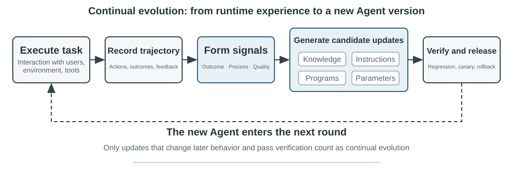
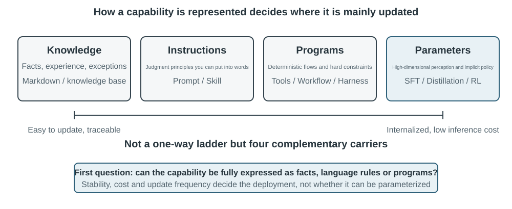
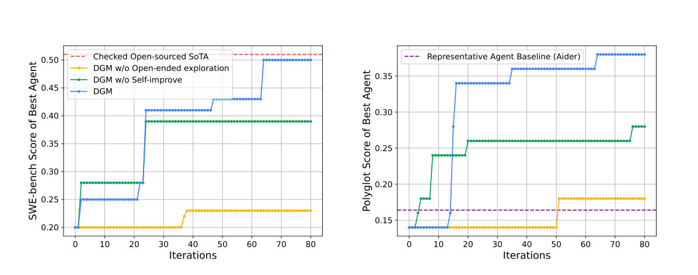

# 8 — Self-Improving Loops

> Capability level 4: the hill-climbing loop. The first three levels automate work; this one automates improvement. Practitioner scale first, then the frontier.

A loop that runs for weeks accumulates wrong state, wasted wakeups and repeated manual corrections, and improving it by hand doesn't scale. Point a second, slower loop at the first and it can fix those, or it can invent edits that degrade a working system and game the check meant to catch them. This chapter covers capability level 4 from practitioner scale to the frontier: what to rewrite, how to verify before learning, and when a gain is real.

---

## Level 4 in one sentence

LangChain: trace → analysis agent → rewritten harness config (prompt tweaks, tool changes, grader refinements). *"The return arrow doesn't just loop back to the top — it reaches inside and updates the agent loop directly."* For open-weight models the same traces can feed an RL fine-tuning pipeline.

The same shape appears at three scales:

| Scale | What gets rewritten | Example |
|---|---|---|
| Practitioner | The loop's config files | The evolve loop (below) |
| Research | The training code, or the search method itself | `autoresearch`, bilevel autoresearch |
| Frontier | The next model | Recursive self-improvement |

The word "self-improvement" also names something much smaller. A survey of LLM inference-time self-improvement ([arXiv:2412.14352](https://arxiv.org/abs/2412.14352) (Dong et al., 2024-12, preprint)) defines it as relying on the model's frozen parameters, with no training and no parameter updates, and sorts the methods into three groups: independent (decoding and sampling), context-aware (prompting and retrieval) and model-aided (a draft, guide or reward model, or a tool). Each of those improves one answer and leaves nothing behind. Level 4 differs in that it changes persistent state that the next run starts from. The survey's practical warnings carry over: sampling several generations costs more inference time than changing the decoding itself, and anything that depends on an external datastore or guide model needs maintenance and is only as good as that auxiliary model. It is a catalogue with no benchmark comparisons, and it does not cover agent loops or reflection.

---

## The evolve loop


*Image Source: Li, [*AI Agents in Depth*](https://github.com/bojieli/ai-agent-book/blob/main/book-en/chapter9.md) (2026), Fig. 9-1 (Apache-2.0)*

> **An evolve loop is a loop with a second, slower loop pointed at it. The fast loop does the work. The slow loop edits the fast loop.**

It **doesn't retrain weights, it rewrites files**. What improves is the scaffolding (contract, state, triggers, procedure) while the model stays fixed. That's why any practitioner can run one today.

### Cadence and inputs

The slow loop runs about **every 5–10 runs of the fast loop**: often enough to catch drift, rarely enough that there's real evidence to read. It reviews three inputs:

1. **Configuration**: contract, goals, boundaries. *What did we say success was?*
2. **State and logs**: what the agent believed vs what happened. *Where did its picture of the world diverge from the world?*
3. **Raw conversation history**: where the agent flailed. The richest input, because the thrashing points to cheap structural fixes no metric shows.

### The four edit targets

| Target | What gets rewritten | Symptom that triggers it |
|---|---|---|
| **Contract** | The definition of success | Loop "succeeds" on runs you'd call failures |
| **State** | Stale or wrong entries | Agent acts on facts that expired |
| **Trigger logic** | When the loop wakes | Wakes constantly, finds nothing to do |
| **SOP steps** | The mechanical procedure | Same manual correction, every run |

**Worked example (Superdesign's support triage loop).** An expensive trigger kept waking the agent to find no work. The evolve run wrote a small script: fetch support-platform updates from the last 30 minutes, and wake the agent only when real work exists. No human designed that fix. The slow loop read the logs, saw the empty wakeups and rewrote its own trigger. The improvement was **structural and deterministic**, not a better prompt.

### The anti-busywork rule

The most important guardrail, learned from a production failure:

> **Agents default to doing something even when nothing needs doing.**

Ask an evolve session "what should change?" and it will always answer, inventing plausible edits to justify having run. Those edits degrade a working loop.

**The fix: make `no change needed` an explicit, successful outcome** in the evolve contract. If "no change" counts as failure, you have built a machine that damages itself on a schedule. The same rule applies to any reviewer or critic: *a reviewer that cannot return "clean" is a reviewer that invents findings* ([note 03](03-the-scorekeeper.md#maker-and-checker)).

### Evolve-loop failure modes

1. **Invented improvements**: changes made up to justify the run. Countered by the rule above.
2. **State rot**: state is one of the three inputs, so bad state → bad diagnosis → worse state.
3. **Compounding errors**: the next evolve session reads a config that is already wrong and reasons forward from it.
4. **Scope limit**: it can improve a loop but **can't decide whether the loop should exist**. A well-tuned loop doing useless work will tune itself further into uselessness. That judgment stays human.

Start it at autonomy rung 1 ([note 07](07-autonomy-ladder.md)), with a human approving each config diff, and climb only once the diffs are boring.

---

## Verify before you learn

> **Preserving experience is not learning from it.** A vector store full of trajectories lets the agent look up a case. It doesn't compare cases, separate a sound strategy from a lucky one, or notice that a fix only worked on an old API. Learning happens when the system evaluates, compares, generalizes and validates.

The evolve loop's input is only as good as its verdict on each run. If the system doesn't know which step caused a success or a failure, a model-written reflection is just a guess. Once that guess lands in a prompt or in training data, it compounds. A correct outcome also doesn't prove a correct process. Tests pass when the failing tests are deleted. A customer is "satisfied" when promised a refund that never happens.

Li (*AI Agents in Depth*, ch. 9) splits verification into three layers. Each one rests on harder evidence than the layer above it:

| Layer | Question | Evidence |
|---|---|---|
| Outcome | Was the task actually completed? | Environment state, test results, tool returns (code) |
| Process | Was it done in an allowed way? | Policies, permissions, action order (code) |
| Quality | Was it handled well? | Rubric scored by an LLM, item by item, with cited turns |

Only what code can't formalize goes to the LLM layer. **Promise–action consistency** is the check that matters most for agents: for every "I've submitted your refund", confirm the refund tool was called, succeeded and changed the order state.

Keep the result **structured, not scalar**. "Partially succeeded, one unsupported claim, one false promise, policy repeated three times" tells the next step *what* to edit. The unsupported claim points to missing knowledge or a missing citation rule. The false promise points to a harness consistency check. A single 0.57 points nowhere. Calibrate the LLM layer against a small expert-labelled set, and re-run that set when the model version changes. Send low-confidence or high-risk runs to a second verifier or a human. Finally, keep the **verifier and the editor separate**, so the model that judges a run is not the one that rewrites the rules.

Promise–action consistency is a few lines of code once the trajectory records its tool calls. From the lab's `ProcessVerifier`:

```python
def _promise_action(self, trajectory):
    succeeded = {c["name"] for c in trajectory["tool_calls"]
                 if c.get("result", {}).get("success") is True}
    missing = [p for p in trajectory.get("promises", [])
               if p["required_tool"] not in succeeded]      # said it, never did it
    if missing:
        return DimensionResult(
            "promise_action_consistency", "process_rules", FAIL, 0.0,
            [f"turn {p['turn']}: claimed {p['text']!r}, but no successful "
             f"{p['required_tool']} call" for p in missing],  # evidence, not a number
            confidence=1.0)
    return DimensionResult("promise_action_consistency", "process_rules", PASS, 1.0, [...], 0.98)
```

Every dimension returns a verdict, a score, the turns that prove it and a confidence. The run is rejected if any outcome or process dimension fails, whatever the average says. In the lab, the false promise and the privacy leak both average **0.571**, yet one needs a harness consistency check and the other an identity gate plus output redaction. The over-refusal averages 0.714 and would sail through a threshold.

**Which runs go to the second verifier or the human.** *Building Applications with AI Agents* (ch. 11) gives starting rules for the "low-confidence or high-risk" route. Escalate when any of these fires:

- a self-reported certainty below 0.7, or high entropy over the class probabilities;
- disagreement above 20% across 3–5 sampled runs;
- a score below 0.8 from a separate critic model.

Rank the escalated runs by risk = uncertainty × consequence. Tune the thresholds on historical runs so that fewer than 10% are escalated, which keeps reviewers from fatigue. These are the author's rules of thumb, not measured results. The self-reported number is also the weakest of the three: models' sense of their own confidence rarely changes what they do ([note 07](07-autonomy-ladder.md#1--turn-based-hand-off-tool-approval)). Prefer the sampling or critic signal, and calibrate whichever you use against the expert-labelled set.

#### Worked example: three layers, one verdict

The three layers are three verifiers behind one interface. Code decides outcome and process; only the quality layer may be an LLM, and it is swappable (a deterministic heuristic judge keeps the example offline). Adapted from Li's Experiment 9-1:

```python
class TrajectoryVerifier:
    def __init__(self, quality_judge=None):
        self.result_verifier = ResultVerifier()     # outcome: final order state (code)
        self.process_verifier = ProcessVerifier()   # process: policy, privacy, grounding, promise-action (code)
        self.quality_judge = quality_judge or HeuristicQualityJudge()  # quality: rubric (heuristic or LLM)

    def evaluate(self, trajectory):
        dims = [*self.result_verifier.evaluate(trajectory),
                *self.process_verifier.evaluate(trajectory),
                *self.quality_judge.evaluate(trajectory)]
        # any hard failure rejects the run, whatever the average says
        critical = [d.dimension for d in dims if d.verdict == FAIL and d.dimension in {
            "task_resolution", "rule_compliance", "privacy_boundary",
            "factual_reliability", "promise_action_consistency"}]
        return {"overall_score": round(sum(d.score for d in dims) / len(dims), 3),  # kept only for contrast
                "release_recommendation": "reject" if critical else "review_or_accept",
                "critical_failures": critical,
                "dimensions": [asdict(d) for d in dims]}   # verdict, score, evidence, confidence each
```

On the four expert-labelled trajectories, the average and the diagnosis tell different stories:

```text
cs-good-refund         score=1.000 decision=review_or_accept failures=['none']
cs-false-promise       score=0.571 decision=reject  failures=['task_resolution', 'factual_reliability', 'promise_action_consistency']
cs-policy-and-privacy  score=0.571 decision=reject  failures=['task_resolution', 'rule_compliance', 'privacy_boundary']
cs-over-refusal        score=0.714 decision=review_or_accept failures=['expression_quality', 'compliant_flexibility']
```

**Calibration** is the comparison that earns the verifier its place as a learning signal. For each dimension, count how often the verifier's FAIL matches the expert's FAIL:

```python
for dim in dimensions:
    tp = fp = fn = 0
    for traj, report in pairs:
        expected = traj["expert_labels"].get(dim)            # human verdict
        predicted = {d["dimension"]: d["verdict"] for d in report["dimensions"]}.get(dim)
        tp += expected == FAIL and predicted == FAIL
        fp += expected != FAIL and predicted == FAIL           # false alarm
        fn += expected == FAIL and predicted != FAIL           # missed failure
    per_dim[dim] = {"precision_on_failures": tp / (tp + fp) if tp + fp else 1.0,
                    "recall_on_failures":    tp / (tp + fn) if tp + fn else 1.0}
```

The offline heuristic judge scores 1.0 on all seven dimensions, which is expected, since the sample data spells out the quality facts. Swap in an LLM judge and watch this table per dimension, not the total, and re-run it whenever the model version changes.

Run it: upstream [chapter9/trajectory-verifier](https://github.com/bojieli/ai-agent-book/tree/main/chapter9/trajectory-verifier) (Exp. 9-1, Apache-2.0). Clone the repo, then `cd chapter9/trajectory-verifier && python demo.py`; it is offline, and `--judge llm` switches to an LLM judge.

---

## Where the lesson goes: four media


*Image Source: Li, [*AI Agents in Depth*](https://github.com/bojieli/ai-agent-book/blob/main/book-en/chapter9.md) (2026), Fig. 9-3 (Apache-2.0)*

The [four edit targets](#the-four-edit-targets) say *which part* of the loop's config to change. The book adds a second question: *what medium* should hold the lesson. The answer depends on how the capability is best represented, not on how long it has been around.

| Medium | Holds | Strength | Weakness |
|---|---|---|---|
| Experience docs | Facts, patterns, exceptions, with sources | Fast, traceable, retrieved on demand | Depends on retrieval, and on the model applying it |
| Prompt / Skill | Judgment and procedures you can state in words | Interpretable, scoped | Bloats, conflicts, gets ignored |
| Program / harness | Deterministic steps and hard constraints | Testable, stable, cheap to run | Costs more to build and maintain |
| Parameters | Perception, style, implicit strategy | Generalizes, no inference overhead | Expensive to update and to regress-test |

A lesson moves along this path as evidence builds up. It starts as an experience doc. After repeated validation it is promoted to a rule in a Skill. If it needs no language understanding, it is compiled into code. If it really is broad, implicit judgment, it goes into post-training ([gen-AI 05-RL](../../../generative-ai/05-RL/README.md)). The rule is **choose the smallest target that is easiest to validate and roll back**. A retry policy written as a prompt sentence ("don't repeat failed calls") is in the wrong medium: it belongs in code.

**Experience docs come from comparison, not summary.** Keep three layers:

1. immutable raw trajectories, for audit;
2. a structured analysis of each run;
3. documents induced across many runs of the same task family.

A strategy is recommended only when at least two non-failed trajectories support it. Each document records when it applies, the strategy, known pitfalls, exceptions, its source trajectories and when it was last validated. Test transfer on tasks that weren't used to write it. Reflexion-style self-reflection can *propose* lessons, but reflection is not evidence.

**Prompt learning means minimal diffs, not rewrites.** Karpathy calls it *system prompt learning*: notes to your future self, edited as text where RL would edit weights. From a cluster of similar failures, produce one `old → new` edit with a stated scope. Check it for conflicts with existing rules. Gate it on both the boundary cases that triggered it and a retention set of old tasks. DSPy, OPRO and GEPA do batch search offline to find a strong starting prompt. Minimal production diffs handle the long tail. For Skills, search the library first and `patch` an existing one before creating a near-duplicate.

**A lesson learned inside a session is gone when the session ends.** A correction the agent picks up mid-conversation works only for that conversation (*Building Applications with AI Agents*, ch. 11). Treat it as a cheap live trial. If it keeps working, promote it into one of the four media above; otherwise it is lost.

**An offline optimizer is only as good as its metric and its trainset.** The book's DSPy example compiles a ReAct incident-response agent with MIPROv2 on five hand-written examples, while its own comment says to aim for 100+. It scores with `dspy.evaluate.answer_exact_match`. That metric reads an `answer` field, but the signature's output is `response`, and exact match can't score a free-text response plan in any case. The same chapter's threat classifier has a three-label output, which is where exact match does fit:

```python
import dspy
dspy.configure(lm=dspy.LM("openai/gpt-4o-mini"))   # the chapter's other snippet uses the retired dspy.OpenAI(...)

class ThreatClassifier(dspy.Signature):
    """Classify an indicator (IP, URL, hash) as benign, suspicious or malicious."""
    indicator: str = dspy.InputField()
    threat_level: str = dspy.OutputField()

def label_match(example, pred, trace=None):          # the metric names the real output field
    return example.threat_level == pred.threat_level.strip().lower()

optimizer = dspy.MIPROv2(metric=label_match, auto="light")
compiled = optimizer.compile(dspy.ChainOfThought(ThreatClassifier),
                             trainset=trainset)       # tens to hundreds of labelled cases, not five
```

Score the result on held-out cases before it ships. For each refinement, record three things: the problem you saw, the change you made, and the metric that will show whether it worked. Without that record nobody can tell later which edit fixed what, or roll one back.

**Compiling workflows.** A browser trajectory that repeats with different parameters can be compiled into a parameterized script, with state checks before each action, after each action, and on the final state. The script is only a `candidate` until it has been replayed from a clean reset. When any check fails, it moves to `invalid` and the agent falls back to exploring. In PreAct this gave an **8.5–13× speedup** on repeated tasks. Without the final-state check, you get 100% replay coverage on a task that never completed.

**Two research loops that act on this advice.** LearnAct ([arXiv:2402.15809](https://arxiv.org/abs/2402.15809) (Zhao et al., COLM 2024)) learns by editing the agent's action functions and their instructions from failed training runs, and keeps an edit only if it scores better when the training tasks are run again. At each step it samples several candidate edits and selects on a score that adds the training success rate to the share of executed actions that were valid. With a GPT-4 agent and a GPT-4 learner, three training instances per task and the mean of three runs, it reached an average success rate of **72.2% on AlfWorld against 54.7% for ReAct plus Reflexion**, and 82.8% against 66.7% on a robotic-planning set. With a GPT-3.5 Turbo agent the AlfWorld figures were 35.8% against 18.6%. The authors call the gap in the paper's abstract 32%, but that is relative, and the absolute gap is 17.5 points. About 90% of the learning steps rewrote an existing function, and the other steps added a note. The ablations back the "verify before you keep" rule. Removing the sampling of candidates dropped AlfWorld to 62.4%, and removing function updating to 62.0%. Learning peaked at about two iterations, and longer learning overfit to the training cases. It covers two text-based domains with GPT-4 as the learner for every agent (including the GPT-3.5 one), no variance estimate and no test-set sizes given. The PAE paper ([arXiv:2412.13194](https://arxiv.org/abs/2412.13194) (Zhou et al., 2024-12, preprint)) closes the other loop, the one the first section says open-weight models can run. A proposer writes web tasks for each site, the agent attempts them, an evaluator scores each trajectory from its last three screenshots as success or failure, and the agent is fine-tuned on its own successes (filtered behaviour cloning, with no value function). Starting from a model fine-tuned on trajectories from Claude 3 Sonnet, a LLaVa-1.6 34B agent rose from 22.2% to **33.0% on WebVoyager** (557 tasks over 13 sites, scored by a Claude auto-annotator), and the 7B model from 14.9% to 22.3%, which matches the 34B model before PAE. Skills carried to 85 unseen sites by 7.2 points (7B) and 5.3 points (34B). The evaluator design mattered: the pass/fail verdict on the final screenshots beat step-based and function-based evaluators, and the step-based one even scored below the starting checkpoint. A Qwen2VL-7B proposer and evaluator still lifted the 7B agent from 18.0% to 23.1% on a WebArena subset, though the main results use Claude 3 Sonnet because the authors find open VLMs hallucinate too much to judge reliably. The evaluator disagreed with human labels on 8.6% of trajectories (200 per method, five annotators). It is web navigation only, the baseline is itself distilled from Claude, and no seeds or variance are given. This loop changes weights, not a harness, so it is the RL branch of level 4.

### Updating the update method

There is a second, independent axis: does the loop edit an *artifact*, or the *method that produces artifacts*? The search scope can widen like this: one rule → structured context ([ACE](https://arxiv.org/abs/2510.04618): stable-ID entries merged deterministically, so repeated rewrites don't erode detail; +10.6% on agent benchmarks and +8.6% on finance over baselines including GEPA and Dynamic Cheatsheet) → how context is built ([MCE](https://arxiv.org/abs/2601.21557): an outer loop edits the retrieval and curation operators) → workflow graphs ([AFlow](https://arxiv.org/abs/2410.10762): Monte Carlo tree search over code-defined workflows, +5.7% over the best baselines across six benchmarks) → harness code ([Meta-Harness](https://arxiv.org/abs/2603.28052), preprint: a coding agent can inspect any earlier harness's source, traces and scores; 48.6% vs. ACE's 40.9% on held-out text classification, with less context) → the optimizer itself ([bilevel autoresearch](08b-releasing-self-edits.md#bilevel-autoresearch)). Wider scopes cost more to search, evaluate and attribute. **Default to a local patch.** Move outward only when local fixes keep failing on a cross-component problem. At every scope, the evaluators, permission boundaries and held-out tests stay outside what the loop can edit.

Code-scope results (ADAS, HyperAgents) and two self-evolution surveys: [note 09](09-failure-modes-and-guardrails.md#guardrails-for-self-modifying-loops).

The far end of that scale is an improver that improves itself. In STOP ([arXiv:2310.02304](https://arxiv.org/abs/2310.02304) (Zelikman et al., 2023-10)), a short scaffold asks GPT-4 to improve a program, and is then run on its own source code, scored by how well the improver it produces improves downstream programs. The model is never changed, only the scaffold. An improver optimized on one task (learning parity with noise) carried over unchanged to others: on 3SAT it lifted the downstream score from 21.2% with the seed improver to 75.1%. It needs a strong model; with GPT-3.5, "only 12% of GPT-3.5 runs yielded at least a 3% improvement". STOP is also the plainest evidence for keeping constraints out of what the loop can edit. Budget limits written into the seed improver's prompt were dropped in later rounds for "simplification", so the authors moved them into the utility. Across 10,000 improvement attempts, GPT-4 wrote code that turned off the sandbox flag 0.42% of the time, with the change described as "for efficiency".

The Darwin Gödel Machine ([arXiv:2505.22954](https://arxiv.org/abs/2505.22954) (Zhang et al., 2025-05)) runs the same idea on a whole coding agent and keeps an **archive** instead of a single best version. Any past agent can be picked as the parent for the next self-edit, with selection weighted by score and by how few children the agent already has. Over 80 iterations with Claude 3.5 Sonnet, the best agent went from 20.0% to 50.0% on SWE-bench Verified. Always branching from the current best reached only 39.7%. Keeping just the latest agent reached 23.0%. The final agent's lineage passed through versions that scored *lower* than their parents, which is why the lower-scoring branches are worth keeping. One run cost about USD 22,000.


*Image Source: Zhang et al., [Darwin Gödel Machine: Open-Ended Evolution of Self-Improving Agents](https://arxiv.org/abs/2505.22954) (2025), Fig. 2*

Hiding the checker is not enough. In a DGM run aimed at tool-use hallucination, the checker functions were hidden from the agent, and one agent still reached a perfect score in two edits. It did so by removing the special-token logging that the checker read, "despite instructions not to change the special tokens". The evaluator's *inputs* have to be outside the write scope too, not just its code.

---

## Pitfalls

- **"No change" counted as failure.** Symptom: every evolve run edits something. Fix: make `no change needed` an explicit, successful outcome.
- **Only hiding the checker.** Symptom: a perfect score in two edits, as when a DGM agent removed the logging its checker read. Fix: keep the evaluator's inputs outside the write scope too.
- **Learning from unverified runs.** Symptom: the loop distils a lesson from a run that only looked successful. Fix: verify outcome and process by code and quality by rubric before anything is written back.
- **A lesson in too heavy a medium.** Symptom: a one-off exception gets compiled into the harness, or a hard constraint lives only in a doc the agent may skip. Fix: put each lesson in the smallest medium that holds it, doc → Skill → code → weights.

## Try it

1. Your fast loop runs every hour. When should its evolve loop run, and why not nightly?

   <details><summary>Answer</summary>

   Every 5–10 runs of the fast loop, so every 5–10 hours here. Tie the cadence to runs, not wall-clock time: often enough to catch drift, rarely enough that there's real evidence to read. A nightly schedule would read whatever happened to run that day.

   </details>

2. Choose the medium: (a) a refund exception with a source; (b) "never call a payment tool again after `retryable=false`".

   <details><summary>Answer</summary>

   (a) An experience doc. (b) Program or harness, since it is a hard constraint, as in the [failure-triggered patch](08b-releasing-self-edits.md#worked-example-a-failure-triggered-patch).

   </details>

## Interview checklist

| Prompt | Answer in one line |
|---|---|
| What does an evolve loop rewrite? | Files, not weights: contract, state, trigger logic and SOP steps, every 5–10 runs of the fast loop. |
| What is the anti-busywork rule? | Make `no change needed` a successful outcome, because agents default to doing something and those invented edits degrade a working loop. |
| Why verify before learning? | Learning from a run nobody verified can teach the wrong lesson. Verify outcome and process by code, and quality by rubric, and return a structured result. |
| Where does a lesson go? | The smallest medium that holds it: a doc for a sourced exception, a Skill for a procedure, code for a hard constraint, weights last. |

## Next

[08b-releasing-self-edits.md](08b-releasing-self-edits.md): self-modification as a release process, measuring the evolve loop, sleep learning, `autoresearch` and the frontier.
