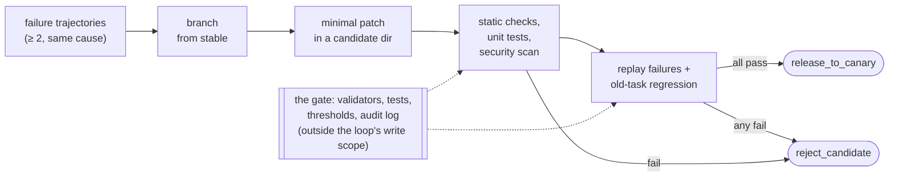
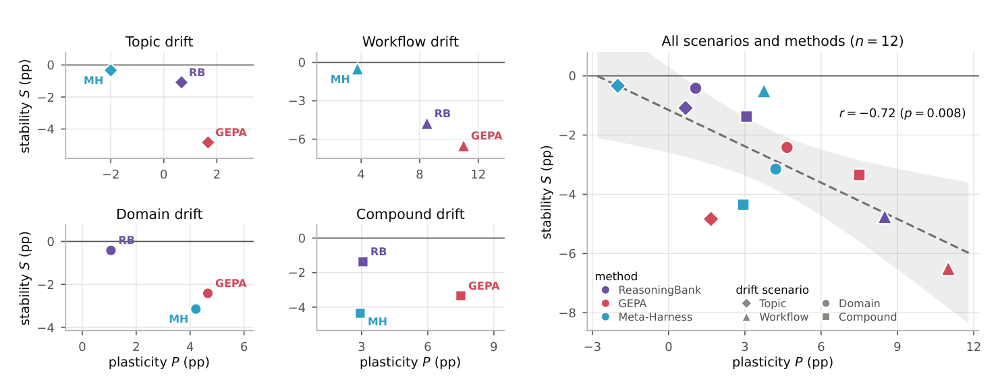
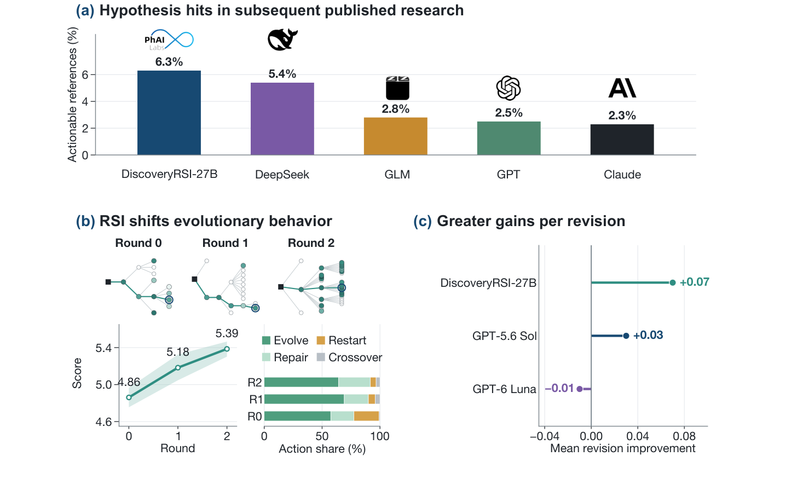

# 8b — Releasing and Measuring Self-Edits

> Part two of capability level 4: how a self-edit reaches production without breaking stable, and how to tell whether the evolve loop is paying for itself.

[Part one](08-self-improving-loops.md) covered what the evolve loop rewrites, how to verify a run before learning from it, and which medium a lesson belongs in. This part treats every self-edit as a release: a candidate with a change contract, a failure replay and a canary. It then covers how to measure the evolve loop itself, consolidation on a schedule, Karpathy's `autoresearch` as the worked example, and recursive self-improvement at the frontier.

---

## Self-modification as a release process

An agent "modifying its own code" never means the running process overwrites itself. Each change goes through the same steps:

1. Branch from the stable version.
2. Have a coding agent write a minimal patch into an isolated candidate directory.
3. Run static checks, unit tests and a security scan.
4. Replay the failure trajectories.
5. Run the old-task regression suite.
6. Emit `release_to_canary` or `reject_candidate`. A passing candidate goes to **canary**; it never overwrites stable directly.



Two additions make the result attributable:

- **A falsifiable change contract** ([Agentic Harness Engineering](https://arxiv.org/abs/2604.25850), preprint). Each edit records the failure evidence, the inferred root cause, the component to change, the tasks it expects to fix, and the tasks it flags as at risk of regression. It states the predicted impact *before* running, and the next round checks that prediction. Checking is what the contract buys, not foresight. Over nine rounds on Terminal-Bench 2, fix predictions had 51.4% recall and regression predictions only 11.1%, with 40 regressions unforeseen, so the regression suite still has to catch what breaks.
- **A bounded candidate space** ([Self-Harness](https://arxiv.org/abs/2606.09498)). Give the generator the failures, the successes it must preserve, and summaries of previously attempted edits. The successes say what not to break. On our reading the summaries stop it re-submitting the same idea; the paper does not test this.

The gate may itself need to change as tasks change. The survey by Ren et al. ([arXiv:2607.13104](https://arxiv.org/abs/2607.13104) (Ren et al., 2026-07)) recommends treating the critic as governed infrastructure: "Evolving critics should be restricted to monotone changes (e.g., purely additive test generation) and gated by human audit trails." It also names what durability costs. Once a loop commits its lessons, a one-off prompt injection can become permanent, as "poisoned memories or hijacked tool logics are committed as stable updates". Both points are the survey's recommendations, not measured results.

#### Worked example: a failure-triggered patch

Adapted from Li's Experiment 9-6. Production trajectories show the agent calling a payment tool again and again after a `retryable=false` error. The fix belongs in code, not in a prompt line saying "don't repeat the call". The **trigger** is evidence, not a single bad run: a change request is raised only when **at least two** failure trajectories show the same tool and error code.

```python
def diagnose(trajectories):
    repeated = defaultdict(list)
    for t in trajectories:   # failed, told not to retry, retried anyway
        if t["outcome"] == "failure" and not t["retryable"] and t["attempts"] > 1:
            repeated[(t["tool"], t["error_code"])].append(t)
    patterns = [{"tool": tool, "error_code": code,
                 "source_case_ids": [t["id"] for t in items]}
                for (tool, code), items in repeated.items()
                if len(items) >= 2]                        # one failure is an anecdote
    if not patterns:
        return {"change_required": False}                  # "no change needed" is a valid result
    return {"change_required": True, "target": "stable/retry_policy.py",
            "patterns": patterns,
            "reason": "retry policy ignores retryable=false; fix in code, not the prompt"}
```

The bug and the minimal patch, written to a candidate directory, never to stable:

```python
def should_retry(error_code, retryable, attempt):
    if not retryable or error_code in NON_RETRYABLE_CODES:   # + added by the patch
        return False                                          # +
    return attempt < MAX_RETRIES       # stable 1.0.0 retried everything 3 times
```

The gate runs outside the model. It compiles the candidate, replays every failure (a permanent error must stop at once and open the circuit breaker), then re-checks the old behaviour it must not break:

```python
checks["failure_replay"] = all(
    not ns["should_retry"](t["error_code"], t["retryable"], 0)
    and ns["should_open_circuit"](1, error_code=t["error_code"], retryable=t["retryable"])
    for t in failures)
checks["old_task_regression"] = all((
    ns["should_retry"]("TEMPORARY_TIMEOUT", True, 2),        # transient: still retried
    not ns["should_retry"]("TEMPORARY_TIMEOUT", True, 3),    # ...up to the cap
    not ns["should_open_circuit"](4, error_code="TEMPORARY_TIMEOUT", retryable=True),
))
decision = "release_to_canary" if all(checks.values()) else "reject_candidate"
```

A run of the demo:

```text
diagnosed target: stable/retry_policy.py
source cases: run-payment-001, run-payment-002
-NON_RETRYABLE_CODES = {"AUTH_DENIED", "INVALID_ARGUMENT"}
+NON_RETRYABLE_CODES = {"AUTH_DENIED", "INVALID_ARGUMENT", "PAYMENT_DECLINED"}
+    if not retryable or error_code in NON_RETRYABLE_CODES:
+        return False
checks: {'static_compile': True, 'failure_replay': True, 'old_task_regression': True}
decision: release_to_canary
stable file unchanged: True
rollback version: fcd37db6ebb1
```

The manifest records the source cases, the diff, each check, and the candidate and rollback versions. Swap in an LLM as the patch writer and nothing else changes: a plausible patch that breaks timeout retries still gets `reject_candidate`.

Run it: upstream [chapter9/self-modifying-agent](https://github.com/bojieli/ai-agent-book/tree/main/chapter9/self-modifying-agent) (Exp. 9-6, Apache-2.0). Clone the repo, then `cd chapter9/self-modifying-agent && python demo.py`; it is offline, and `--generator llm` uses an LLM patch writer.

### Past canary: shadow, A/B and bandits

Canary is one of several ways to expose a candidate to live traffic. *Building Applications with AI Agents* (ch. 11) covers three more. Each one breaks on a kind of agent that ordinary web services don't have.

| Method | What it does | Where it breaks for agents | Workaround |
|---|---|---|---|
| Shadow | Candidate sees the same inputs; only stable's output reaches users | An agent that asks a human for approval can't do so from the shadow without exposing the request | Replay historical approvals or synthetic responses, or test that flow in staging or an A/B test |
| A/B | Live traffic split between stable and candidate | Agents with chat history or long-term memory behave inconsistently when a user switches arms | Sticky assignment, splits per session, and a separate or versioned state store per arm |
| [Bayesian bandit](../../../data-analytics/04-bayesian-analysis/notes/03-priors-and-bandits.md#bayesian-bandits-thompson-sampling) | Shifts traffic toward the arm that is winning as results come in | Not covered by the book: the bandit optimizes whatever reward it gets, so a single averaged score lets an arm that over-refuses (0.714 in the lab above) win | Reward on the pass/fail verdict from [Verify before you learn](08-self-improving-loops.md#verify-before-you-learn), not on the average |

The book's bandit illustration: one of three reasoning chains scores 15% better on threat classification and ends up with 70% of the traffic, while the other two still get some. That is an illustration, not a measured run. A completion rate that falls in arm B can mean users are engaging more carefully rather than failing, so read some transcripts before declaring a winner.

### Measuring the evolve loop itself

**Harness updating is not harness benefit** ([Lin et al.](https://arxiv.org/abs/2605.30621)). A Skill can be correct and still never be loaded, or never be followed, by a weaker task model. In that case the end-to-end score shows "no evolution", and the updater gets blamed for it. Measure the stages separately:

| Metric | Question |
|---|---|
| Candidate-change validity | Does the updater propose changes that pass independent validation? |
| Artifact activation rate | Does the task agent load the new Skill, memory or tool when it should? |
| Successful adherence rate | Once loaded, does the agent follow it? |
| Held-out task gain | Does the whole system improve on tasks the loop never saw? |

**Diagnose with a two-way model swap.** First fix the candidate harness and change only the task model:

- The strong model benefits but the weak one never activates the artifact → routing or retrieval is the bottleneck.
- Both activate it but only the strong model executes it → instruction following is the bottleneck.
- Every model regresses → suspect the change itself.

Then fix the task model and change the updater model, to compare updaters directly.

**Plasticity costs stability.** Chen et al. ([arXiv:2610.25858](https://arxiv.org/abs/2610.25858), 2026-10, preprint) ran three self-evolving methods (ReasoningBank memory retrieval, GEPA prompt evolution, Meta-Harness) with Gemini 3.6 Flash on four task streams, built from BIRD, BFCL and ScienceWorld, that drift in topic, workflow, domain or all three. Self-evolution raised aggregate scores on most streams, but across all twelve method–stream pairs the more a method gained on the task group it was training on, the more it lost on the others, both earlier groups (forgetting) and groups not yet seen (interference) (**r = −0.72**):


*Image Source: Chen et al., [Are Self-Evolving Agents Continual Learners?](https://arxiv.org/abs/2610.25858) (2026), Fig. 2*

The mechanisms are the ones this note warns about. Self-modifying methods make **global edits to one shared prompt**, so new rules crowd out old ones: in one stream, a task family's share of GEPA's strategy prompt fell from 100% to 14.7%, and when consecutive task groups in a stream needed opposite workflows the agent rewrote its policy into its opposite. Similarity-based memory localizes updates better but retrieves **foreign memories** on unseen tasks, and collides when similar queries need conflicting workflows. Hence the retention set in every gate, and the preference for scoped Skills over one ever-growing prompt. Over the long run, track five things: regression, generalization, token efficiency, safety drift and **long-term engineering quality**, meaning maintainability, ownership and migration cost. Passing tests says nothing about that last one.

A retention set works best with a small regression budget rather than zero tolerance. Kang et al. ([arXiv:2608.19013](https://arxiv.org/abs/2608.19013) (Kang et al., 2026-08, preprint)) commit a candidate harness only if it gains on the current task and fails at most *b* of the sampled anchor cases (80 per earlier task) that the current harness solves. They tested it on a frozen DeepSeek-V4-Flash across four sequential text tasks, with no variance reported. A budget of **b = 1 gave the best final accuracy (63.46%, 1.22% forgetting)**, b = 0 gave the least forgetting (61.25%, 0.39%), and no budget at all was worse on both (60.13%, 3.45%). On ALFWorld with Qwen3.5-9B, the ungated profile scored 62.98% but forgot 10.94%, while the gated one scored 61.74% and forgot 2.64%. The anchors are a sample, so even b = 0 does not guarantee zero forgetting on the test set.

**Beat a matched-budget baseline, on tasks the loop never saw.** Wang et al. ([arXiv:2607.12227](https://arxiv.org/abs/2607.12227) (Wang et al., 2026-07)) re-ran harness evolution (Agentic Harness Engineering, with its step that fetches outside harnesses turned off) on Terminal-Bench 2.1. They compared it with spending the same budget, five attempts per task, on plain retries. Without unit tests, harness evolution averaged 67.4% pass@1 across three models. That is below a single attempt with the starting harness (68.2%) and below five parallel samples with the model picking its own best answer (72.3%). On a split into 45 search, 10 validation and 34 held-out tasks, the evolved harness changed held-out pass@1 by +1.2, 0.0 and −1.4 points across the three models: flat on average. The edits were sensible, but "most edits memorize fixes rather than distilling strategies". Evolution did pay off where the starting harness left room and feedback was rich. On ARC-AGI-3 games with Claude Opus 4.8 and a 2,000-action budget, evolving the full harness during each game scored 77.5, against 43.3 for retries with the same starting harness. So an evolve-loop report needs two rows that published results often leave out: the same compute spent on more attempts, and a held-out split.

**Run it more than once, in more than one order.** Ye et al. ([arXiv:2608.18066](https://arxiv.org/abs/2608.18066) (Ye et al., 2026-08, preprint)) re-ran two memory-based methods, Agent Workflow Memory and ReasoningBank, with a GPT-5-mini agent on WebArena, VisualWebArena and SCUBA, three runs per setting. In WebArena's default order, ReasoningBank's **+1.5-point gain over no memory was not significant (p = 0.23)**. Shuffling the task order turned it into a loss: the abstract puts the average at −4.5 points, and in 6 of 8 cases the drop was significant. The default order turned out to be an easy-to-hard curriculum, and the no-memory pass rate fell from about 75% to under 40% after the first 150 tasks. Memory also raised run-to-run variance in 17 of 24 domain cases, because early random outcomes shape everything the loop writes later. On reading, the stored lessons were unverified hypotheses. In one case a travel-time task passed with a straight-line Haversine estimate, and the earlier that lesson entered memory, the more often later tasks retrieved it. Giving the memory writer rubrics, environment feedback and a list of forbidden strategies closed only 31% of the shuffled-order loss. These results come from web tasks, mostly with one model, and the memory builder was given the true reward. A noisy judge would likely do worse, but the paper does not test that.

### Sleep learning: consolidation on a schedule

"Sleep learning" is the book's name for the offline half of a **dual loop**. The online loop finishes tasks and appends immutable evidence; it never rewrites the production agent. The offline loop runs when a threshold is reached: elapsed time, new trajectories, storage used or error rate. It has five steps:

1. **Trigger** on the threshold, while no high-priority online work is running.
2. **Orient**: read the current knowledge, prompts and Skills, and the boundaries that may not change.
3. **Consolidate**: merge duplicates, mark conflicts, prefer local patches.
4. **Validate** on transfer, retention and safety sets. High-risk writes wait for a human.
5. **Prune and re-index**: expire or archive capabilities that are unused or contradicted, while keeping their provenance and rollback versions.

Separating collection from consolidation means one lucky success or one injected web page can't immediately rewrite long-term behaviour. It also lets consolidation run in larger batches on cheaper models. Examples:

- **Claude Code's auto memory**: a bounded `MEMORY.md` index plus topic files loaded on demand.
- **Hermes**: bounded memory files, FTS session search that returns raw messages, background Skill review, and a Curator that prunes after taking a snapshot.

The maintenance list:

- Merge duplicate experience, keeping its provenance.
- Move local rules out of the global prompt and into Skills.
- Keep prompts written like an onboarding handbook, not "99 iron rules".
- Re-validate long-unused tools.
- Delete knowledge that new evidence contradicts.
- Retrain LoRAs from the base model rather than stacking them.

[Voyager](https://arxiv.org/abs/2305.16291) is the canonical complete loop. It combines an automatic curriculum (what to learn next), a skill library of verified, composable code (what was learned) and iterative prompting with environment feedback (how to tell it worked). The result was 3.3× the unique items and up to 15.3× faster tech-tree milestones than its baselines. The ablations show each part carrying weight. With a random curriculum it discovered 93% fewer items. Without the self-verification check it found 73% fewer. Without the skill library it plateaued in the later stages instead of compounding.

---

## The worked example: `autoresearch`

Karpathy's `autoresearch` (released 2026-03-06, MIT, ~630 lines of Python) is the smallest artifact that shows the level-4 shape. It's small enough to hold in your head.

Setup: **one Python file, one GPU, one metric.** The agent reads the code, proposes a change, runs a ~5-minute training run, checks whether validation improved, keeps or discards, and repeats.

The load-bearing decision is the **write boundary**: the agent edits `train.py`, nobody edits `prepare.py` (evaluation), the human writes `program.md` ([note 03](03-the-scorekeeper.md#the-write-boundary)).

Each experiment is a ratchet step: commit the change, train for a **fixed 5 minutes of wall clock**, compare validation; if better, keep the commit and append a row to `results.tsv`; if not, `git reset HEAD~1` and log the failure. The fixed budget is what makes results comparable: no change wins just by running longer. `results.tsv` is the loop's memory of every attempt, kept or not.

**The loop is written in English.** `program.md` is a methodology, not code: what to change, what to leave alone, how to judge, what to do on failure, and one iron rule, *never ask for help, keep going*. Give the agent a method, not a task, and the method becomes the loop.

**Results:** 700 experiments over two days → **20 real, stackable improvements**, cutting GPT-2 training from **2.02 → 1.80 hours (11%)**. Shopify's Tobi Lütke reported 19% on the same setup after 37 experiments.

The hit rate is **under 3%**. The loop isn't valuable because it's clever. It's valuable because a 3% hit rate is fine when attempts are cheap and unattended. *"If you have an objective metric, you are the bottleneck."* Humans tire after a dozen experiments; the loop doesn't.

The prerequisite limits where this transfers: **an automatic gate that can fail the work.** Model training, refactors, content rewrites and pipeline tuning qualify. Work whose success is only "looks right" doesn't.

### Bilevel autoresearch

[arXiv:2603.23420](https://arxiv.org/abs/2603.23420) (Qu & Lu, 2026-03-24) closes the circle: an outer loop reads the inner loop's traces and **writes new search mechanisms as Python code, injected at runtime.** The inner loop optimizes the task; the outer loop optimizes *how the inner loop searches*.

- **5× improvement** over the inner loop alone (−0.045 vs −0.009 val_bpb) on Karpathy's GPT pretraining benchmark.
- **Tuning parameters without changing the mechanism gave no reliable gain.** The outer loop had to write new *code*, the same lesson as the evolve loop's "rewrite files, not weights."
- **Both loops use the same model**, so the gain is not from a better model. But the same model is not the same compute. On Terminal-Bench, harness evolution did not beat spending its budget on more attempts ([above](#measuring-the-evolve-loop-itself)). Before crediting a gain like this to loop *structure*, compare it with a matched-budget retry baseline.
- **The same move with a coding agent as the outer loop.** AEvo ([arXiv:2605.13821](https://arxiv.org/abs/2605.13821) (Zhang et al., 2026-05, preprint)) has a meta-agent (Claude Code or Codex) edit the procedure that produces candidates, through a harness. In that harness the evaluator stays isolated, every candidate is logged with its score and trace, and the meta-agent may not touch the candidates or call the evaluator. Over 20 rounds with Gemini-3-Flash running the candidates (Avg@3), it scored **53.8 on Terminal-Bench against 44.3 for the best fixed procedure, and 47.0 against 36.0 on ARC-AGI-2**, at about three times the cost per round. Neither result has a matched-budget baseline. In the kernel-optimization ablation (three runs), **removing the harness let two of three runs reward-hack**, so they produced no valid score. Removing the meta-agent's skills only made the search weaker.
- **Freeze the improver, grow what it reads.** Meta^n ([arXiv:2608.24735](https://arxiv.org/abs/2608.24735) (Kim et al., 2026-08, preprint)) keeps one improvement operator fixed and stacks layers. Each layer sees the traces of the stack below plus the code that produced them, and depth stops when the gain levels off, at 3 to 6 layers in practice. On CO-Bench with Gemma 4 31B, **cutting the recursion to one layer dropped archive-best validation from 0.845 to 0.714**. About 72% of that drop came from removing the plain-text context passed between layers. Deeper layers often regressed tasks: 41% of chain–task pairs scored lower at depth 3 than at depth 2, and rollbacks appeared only from depth 3 on. The gains vanished where the seed was already strong. The ablation scores are validation, not held-out, and full-budget runs spent many times the baselines' tokens.

The outer loop reached for combinatorial optimization, multi-armed bandits and design of experiments without being told those fields existed.

---

## At the frontier: recursive self-improvement

Anthropic's institute piece takes level 4 to its endpoint: AI systems that design and build their successors. The escalation it traces runs from humans writing code (2021–23), to chatbots emitting snippets (2023–25), to agents writing whole files (2025–26), to systems that build and train models.

Measurements worth quoting when arguing about loop horizons:

- The length of task an AI completes on its own is **doubling every ~4 months** (was ~7). ~4-minute tasks (Claude Opus 3, Mar 2024) → 12-hour tasks (Claude Opus 4.6, 2026).
- **>80% of merged production code at Anthropic written by Claude** (May 2026), up from single digits before Feb 2025.
- CORE-Bench (research reproduction): ~20% in 2024 → saturated within 15 months.
- On open-ended research problems, models chose a better next step than humans **64%** of the time (Apr 2026), up from 51% (Nov 2025).

DiscoveryRSI ([arXiv:2610.23839](https://arxiv.org/abs/2610.23839) (Zhong et al., 2026-10, preprint)) is a research-scale version of the same loop, aimed at hypothesis generation in the life sciences. A multi-agent evolutionary search grows hypothesis trees; selected investigations are compiled into executable tasks; and the system learns from three signals: credit assigned to the hypotheses that drove an assessment, **harness replay** to find productive strategies and recurring failures, and re-discovery that applies accepted improvements to new investigations. Over two rounds of self-improvement a 27B model's hypothesis quality rose from **4.86 to 5.39**, and the share of evolve/repair moves rose from 77.5% to 91.7%:


*Image Source: Zhong et al., [DiscoveryRSI: Recursively Learning to Discover Valuable Hypotheses](https://arxiv.org/abs/2610.23839) (2026), Fig. 1*

Read the headline numbers with the next section in mind. "Quality" is an automated rubric score, with GPT-5.6 Sol as the judge. The gain is in how testable the hypotheses are (falsifiability 4.00 → 6.20), while the same grader's importance and novelty scores fell (6.48 → 6.04 and 4.87 → 4.58). The human review is described as preliminary, and the best hit rate against later publications is **6.3%**. The loop improves on what it can measure, and the measurement is still the weak part.

### When "done" is not progress

The verifiable loop works best where tests, environment state or deterministic rules give fast feedback. Open-ended research and design are different. Feedback arrives late, there may be no single right answer, and the goals that matter most (research taste, long-term value) don't reduce to a score. A harness can run flawlessly and still produce things that only look like results. [Trehan & Chopra](https://arxiv.org/abs/2601.03315) made four end-to-end attempts at autonomous research, and only one completed. The failures fell into three groups:

- **Implementation drift**: when the proposed method gets hard, the agent falls back to a familiar method that no longer tests the hypothesis.
- **Epistemic over-optimism**: noise gets explained, patched and announced as a finding.
- **Missing tacit judgment**: the agent doesn't know which baseline matters or when to drop a hypothesis.

The same pattern shows up when the task is post-training a model. In the open-ended loop, the execution loop closes and the strategy loop stays open. Across 1,338 PostTrainBench runs, each 10 hours on one H100, **only 74 of 3,557 consecutive training runs (2.1%) switched method** ([arXiv:2608.19072](https://arxiv.org/abs/2608.19072) (Lim et al., 2026-09, preprint)). The method came from the agent, not the task: Claude Code chose full SFT 71.9% of the time, and Codex CLI chose PEFT 89.5% of the time. In controlled runs on Qwen3-1.7B-Base, the agent took all 22 of an evaluator's suggestions about execution and none of its 21 about strategy. In one branched run, a single instruction after the first SFT run to switch to GRPO reached 65.2% on GSM8K within the remaining budget, against 47.8% for the run the agent actually continued with five more SFT runs. That is one case, not a sweep. So the strategy switch has to come from outside the agent, and it can be as small as one instruction.

Fixing these takes structure, not a better writer:

- Separate claims from evidence, recording the provenance of every number and citation.
- Log negative results with the same standing as successes.
- Keep diverse lower-scoring branches alive in the candidate pool.
- Move human involvement *up*: defining the problem, setting the evaluation criteria, reading anomalies, deciding when to stop.

The ceiling of any self-improving loop is set by whether it can evaluate what you actually care about, not the easiest proxy for it.

The risk that connects back to every scale: an **Amdahl's-law bottleneck**. Automating development moves the constraint onto human review and verification. From a nightly test-fixer to a self-improving lab, **the limit becomes verification capacity, not generation capacity.**

> *"The comparative advantage of humans as of right now is still in seeing the bigger picture and thinking beyond the confines of the immediate task."*

---

## Design checklist

- [ ] Is the evolve cadence tied to *runs* (5–10), not wall-clock time?
- [ ] Does the evolve contract explicitly allow "no change needed" as success?
- [ ] Is state pruned and expired as a maintained step, or does it just pile up?
- [ ] Is the evaluator outside the write scope of every loop that's being improved?
- [ ] Is each run verified at three layers (outcome, process, quality), with evidence for each dimension rather than one score?
- [ ] Is each lesson in the smallest medium that holds it (doc → Skill → code → weights)?
- [ ] Does every self-edit land as a candidate with a change contract, a failure replay and a retention set before it reaches canary?
- [ ] Do you measure activation and adherence separately from whether the update was valid?
- [ ] Is there an escalation rule (which runs go to a second verifier or a human) tuned to a load reviewers can sustain?
- [ ] Does each refinement record the problem, the change and the metric, and does a stateful agent's A/B test keep each user on one arm?
- [ ] Are evolve diffs reviewed by a human, and are they getting more boring over time?
- [ ] Who decides whether this loop should exist, and when do they revisit it?

## Pitfalls

- **Crediting evolution without a baseline.** Symptom: a gain that plain retries match. Fix: Wang et al. compared at a matched budget of five attempts per task, so beat that on unseen tasks.
- **Global edits to one shared prompt.** Symptom: old tasks regress. In Chen et al., a task family's share of GEPA's prompt fell from 100% to 14.7%. Fix: scope rules locally, and test old-task retention.
- **Patching stable directly.** Symptom: a plausible patch breaks old behaviour in production. Fix: candidate directory, failure replay, regression suite, then canary.

## Try it

1. `autoresearch` ran 700 experiments for 20 real improvements. What's the hit rate, and why is it acceptable?

   <details><summary>Answer</summary>

   20/700 is about 2.9%. It's fine because attempts are cheap and unattended and an automatic gate rejects the rest.

   </details>

2. Put these release steps in order: canary, regression suite, candidate patch, failure replay, branch from stable.

   <details><summary>Answer</summary>

   Branch from stable, candidate patch, failure replay, regression suite, canary. Stable is never overwritten directly, and the gate that decides runs outside the model.

   </details>

## Interview checklist

| Prompt | Answer in one line |
|---|---|
| How does an agent safely modify itself? | As a release: branch from stable, patch a candidate, run checks, replay failures, run regressions, then canary. It never overwrites stable. |
| A skill passes validation and task scores don't move. Why? | It may never be loaded or followed. Measure activation and adherence, then use a two-way model swap to find the bottleneck. |
| How do you know an evolve loop's gain is real? | Compare against plain retries at a matched budget on unseen tasks, as Wang et al. did with five attempts per task, and replay old tasks to catch forgetting. |
| Why does `autoresearch` work with a hit rate under 3%? | Attempts are cheap and unattended, the metric is objective and the evaluator is outside the agent's write scope, so 700 tries yielded 20 real improvements. |

## Next

[09-failure-modes-and-guardrails.md](09-failure-modes-and-guardrails.md): how loops go wrong, and the rules that stop them.
