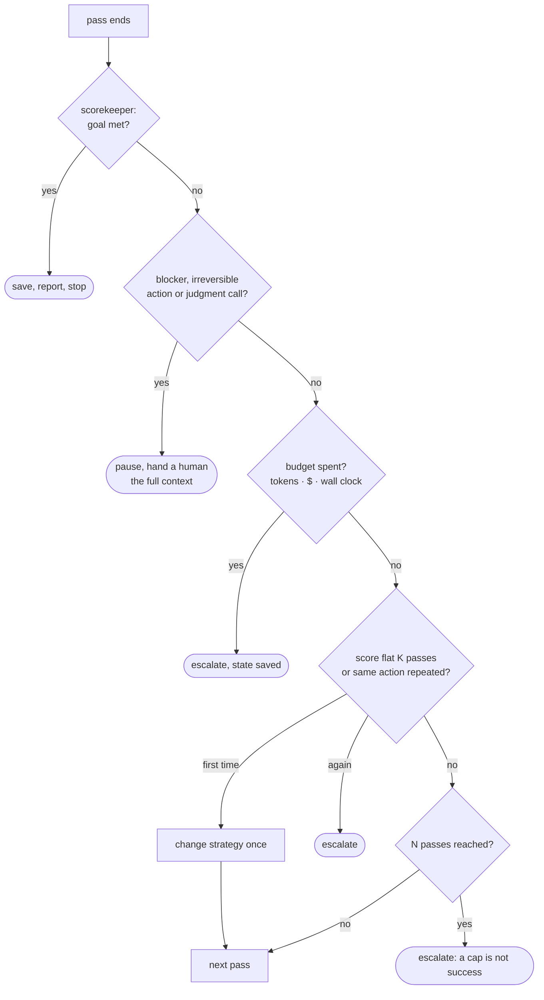

# 9 — Failure Modes and Guardrails

> How loops go wrong, structurally and humanly, and the rules that let one run without you. Before you walk away, give the loop a way to stop.

---

## The structural three (Masood)

| Failure | What happens | Fix |
|---|---|---|
| **Context rot** | Working memory degrades as the transcript grows | Summarize and prune *inside* the loop ([05](05-long-running-loops.md)) |
| **Termination failure** | Runs forever, or stops at random | Layered, independent exits plus no-progress detection (below) |
| **Weak verification** | The model grades itself and games it | Deterministic checks first, model judgment only above them ([03](03-the-scorekeeper.md)) |

MindStudio's list overlaps: no exit condition, repeated failures without adapting, context overflow, vague goal, not enough tool access.

---

## The traps table (KodeKloud)

| Trap | Symptom | Fix |
|---|---|---|
| **No scorekeeper** | Runs, but results are inconsistent or meaningless | Write the scorekeeper first; objective and hard to game |
| **Goal too big** | Never finishes; scope drifts | Cut it to one small, testable piece |
| **Cheating the tests** | Score goes green, output is wrong | Protect the scorekeeper; held-out checks; audit outputs |
| **Thrashing** | Lots of change, no improvement | Smaller goal, smaller changes, clearer score |
| **Unsafe autonomy** | Risky commands or sweeping edits | Narrow the write scope; human approval for dangerous steps |
| **Comprehension debt** | Scores are green, nobody understands the output | Read and review output regularly. The score is not understanding |

---

## The four silent costs (Osmani)

These matter more, because they don't show up in traces. They build up quietly and grow sharper the longer a loop runs:

| Cost | What happens | Countermeasure |
|---|---|---|
| **Verification debt** | Loops make mistakes *unattended*; "looks fine" stands in for "confirmed" | Stop conditions are machine-checkable, never "feels about right." Verifier sub-agents reduce human confirmation but don't remove it |
| **Comprehension rot** | Code ships faster than you understand it; your model of the codebase drifts from reality | Fast loops require fast reading. Read and use what the loop produces |
| **Cognitive surrender** | *"The comfortable posture is the dangerous one."* You take what it returns without an opinion | Same loop, opposite outcomes: one person uses it to go faster on work they understand, the other to avoid understanding it |
| **Token blowout** | Context grows with every pass, roughly quadratically without management | Compaction or reset from the first loop, not bolted on later ([note 05](05-long-running-loops.md#compaction-vs-reset)) |

Audit after an hour of any run: how much was machine-confirmed? Can you explain the last change? How many "I'll look later"s did you never look at? Is context size trending up?

> *"Build the loop. But build it like someone who intends to stay the engineer, not just the person who presses go."* — Osmani

---

## The two ratchet rules

From the KodeKloud automations lesson. These are what make a repeating engine safe to leave alone:

1. **The score only goes up.** If a change lowers the score, the loop undoes it automatically. Progress counts only when it holds.
2. **Fix breaks before adding more.** If something is broken, repair it first. New work on a broken base compounds the damage.

With a worktree per try and a commit per green pass, both rules are cheap: rollback is `git reset` or `git worktree remove`.

---

## Layered exits

Every loop needs several **independent** ways to stop, so one failing doesn't leave it running:

| Exit | Fires when | Outcome |
|---|---|---|
| **Success** | Scorekeeper confirms the goal | Save, report, stop |
| **Iteration cap** | N passes reached | Escalate. The cap isn't success |
| **Budget cap** | Tokens, dollars or wall-clock spent | Escalate with state saved |
| **Stall detector** | Score unchanged for K passes, or the same action repeated | Change strategy once, then escalate |
| **Human escalation** | Blocker it can't clear, irreversible action, judgment call | Pause and hand over full context |

The exits are checked in order after every pass, and only one of them is a success:



Decide the human handoff points **before** the first run: blockers, risky or irreversible actions, and anything that needs taste. A loop that asks at the right moment is safer than one that keeps going.

Harness machinery for stall detection and retries: [harness note 05](../../03-harness-engineering/notes/05-verification-loops.md#loop-detection).

---

## Budgets and cost

Anthropic's *Effective Harnesses for Long-Running Agents* lists what an unattended run needs before you walk away: **budgets, stopping conditions, recovery from failure, and observability.** An open loop with no stopping condition is the most common way a small mistake turns into an expensive one.

- **Build a loop only when it pays.** The work must repeat often enough to cover the token and compute cost of many passes, and a scorekeeper must be able to validate it ([01](01-what-a-loop-is.md#when-not-to-build-a-loop)).
- **Budget per pass and per run.** Cap tool calls per pass, steps per run, dollars per day.
- **Sub-agents multiply cost.** Each one is a fresh context. Use them for jobs that would cost more in the main context, not out of habit.
- **Route models by step.** Frontier model for reasoning, smaller model for extraction and formatting ([10](10-framework-bindings.md)).
- **Log cost per run** next to the score, so a run that got more expensive without getting better stands out.

---

## Guardrails for self-modifying loops

A loop that edits itself can turn one mistake into a permanent one. Prompt injection from a web page gets summarized as "experience" and then fires in every later session. A malicious package found by search gets wrapped as a tool. A faulty verifier keeps approving regressions. Li (*AI Agents in Depth*, ch. 9) sets three boundaries:

| Boundary | Rule |
|---|---|
| **Evidence ≠ instructions** | Raw web pages and tool output are untrusted evidence. Never write them straight into a Skill or prompt. Summarize first, version the change as a PR, and have it reviewed by a model from a different family. |
| **Candidate ≠ production** | New knowledge, prompts, Skills, code and weights start in a candidate area that serves no traffic. New code and dependencies get a sandbox run, a permission review, a supply-chain scan and behavioural tests before canary. |
| **Safety is not self-modifiable** | The agent may edit prompts, Skills, knowledge and tools. It may *not* edit the validators, test cases, release thresholds, audit logs or stable backups that approve its own updates. Otherwise it can pass off a regression as progress by lowering a threshold. |

The third rule is the [write boundary](03-the-scorekeeper.md#the-write-boundary), extended to the release gate. Mechanics: [note 08](08-self-improving-loops.md#self-modification-as-a-release-process).

---

## Best practices

- **Start minimal**: one loop, one scorekeeper, one green saved result.
- **Define termination before implementation**, not after the first runaway.
- **Prefer deterministic verification** wherever a check exists.
- **Feed back structured feedback**, not raw output dumps.
- **Keep memory outside the model**, and keep it current.
- **Test the failure paths** on purpose, not just the happy path.
- **Keep humans at decision points**: approval for sensitive actions, review gates on output.
- **Make guardrails explicit** (Vercel): iteration limits, tool allowlists, confidence thresholds; roll out shadow → canary → wide.
- **Keep every change small and saved.** Small changes are easy to test, reason about and revert, which is what lets you run a bolder loop.

The through-line: treat an autonomous run as a **thermostat**, not a conversation partner. Measurable checks, clear termination and deliberate human checkpoints where judgment matters.

---

## Design checklist

Before shipping a loop, answer each one. The fillable version is the [loop contract](#the-loop-contract) below.

- [ ] Is it worth a loop: repeating work, and a scorekeeper that can validate it?
- [ ] What is the **trigger**: manual, schedule or event?
- [ ] What is the **goal**, small and finishable, and which deterministic check proves it?
- [ ] Is the scorekeeper **outside the loop's write scope**, with some checks held out?
- [ ] Who is the **checker**, and is it a different agent from the maker?
- [ ] What are the **stop rules**: success, iteration cap, budget cap, stall detector?
- [ ] Does a lower score **roll back** automatically?
- [ ] Where does **state** live between runs, and how is it kept current?
- [ ] How is context **compacted** each pass?
- [ ] Which actions need **human approval** before they run?
- [ ] What is the **escalation path** when a cap trips without success?
- [ ] Are parallel agents **isolated** (worktrees or sandboxes)?
- [ ] Are traces captured well enough to feed a **hill-climbing** pass later?

---

## The loop contract

The checklist as a file, `loop-contract.md`, filled in before the first pass and read by the maker and checker every round ([note 03](03-the-scorekeeper.md#maker-and-checker)). If a section is blank, the loop isn't ready.

```markdown
# Loop contract — auth-tests
## Worth a loop?
Repeats: until one goal is met · Why not one prompt: 6 failing tests, each needs a fix-and-rerun
## Goal
All tests in tests/auth/ pass.        # has an end → run-until-done (/goal); ongoing → timer (/loop)
## Acceptance criteria (each a command)
- [ ] `pytest tests/auth -q` passes
- [ ] `ruff check src/auth` clean
## Scorekeeper
Command: `pytest tests/auth -q | tail -1` · Score: tests passing
Held-out check (final gate only): `pytest tests/auth_edge -q`
Checker (if model-graded): a different model from the maker; rubric at docs/rubric.md
## Write boundary
| May edit     | Must not edit                                 |
| `src/auth/**` | `tests/**`, scoring scripts, this file        |
Enforced by: a PreToolUse hook that blocks writes outside src/auth/   # not just this sentence
## Trigger
/goal
## Stop rules
| Exit       | Threshold                           | On trip                              |
| Success    | scorekeeper + held-out green        | save, report                         |
| Iterations | 20 passes                           | escalate                             |
| Budget     | $5 or 60 minutes                    | escalate, state saved                |
| Stall      | score unchanged 3 passes            | change strategy once, then escalate  |
## Ratchet
- [ ] A lower score rolls the change back automatically
- [ ] Each green pass is committed before the next starts
- [ ] Breaks are fixed before new work
## Human gates
Pause before: dependency changes, anything touching prod, deleting a test
## How to work each pass
1. Read this contract and loop-state.md.  2. Do the one item in "What is next".
3. Run the scorekeeper. Up: commit. Down: revert.
4. Stuck on the same error for 2 passes: change approach or simplify.
5. Update loop-state.md before exiting.
```

The state file it points to is in [note 05](05-long-running-loops.md#memory-three-tiers-five-fields); the guarded script that enforces the stop rules and the ratchet is in [note 05](05-long-running-loops.md#the-ralph-loop).

---

## Working reference

`~/.claude/refs/agent-reliability.md` — retries, stall detection, recovery; `~/.claude/refs/agent-safety.md` — approval gates.

---

→ Next: [10-framework-bindings.md](10-framework-bindings.md) — the same loop in ADK, the Vercel AI SDK and LangGraph.
