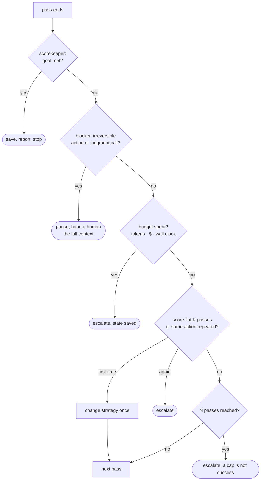

# 9 — Failure Modes and Guardrails

> How loops go wrong, structurally and humanly, and the rules that let one run without you. Before you walk away, give the loop a way to stop.

---

## The structural three (Masood)

| Failure | What happens | Fix |
|---|---|---|
| **Context rot** | Working memory degrades as the transcript grows | Summarize and prune *inside* the loop ([05](05-long-running-loops.md)) |
| **Termination failure** | Runs forever, or stops at random | Layered, independent exits plus no-progress detection (below) |
| **Weak verification** | The model grades itself and games it | Deterministic checks first, model judgment only above them ([03](03-the-scorekeeper.md)) |

MindStudio's list overlaps: no exit condition, repeated failures without adapting, context overflow, vague goal, not enough tool access.

---

## The four silent costs (Osmani)

These matter more, because they don't show up in traces. They build up quietly and grow sharper the longer a loop runs:

| Cost | What happens | Countermeasure |
|---|---|---|
| **Verification debt** | Loops make mistakes *unattended*; "looks fine" stands in for "confirmed" | Stop conditions are machine-checkable, never "feels about right." Verifier sub-agents reduce human confirmation but don't remove it |
| **Comprehension rot** | Code ships faster than you understand it; your model of the codebase drifts from reality | Fast loops require fast reading. Read and use what the loop produces |
| **Cognitive surrender** | *"The comfortable posture is the dangerous one."* You take what it returns without an opinion | Same loop, opposite outcomes: one person uses it to go faster on work they understand, the other to avoid understanding it |
| **Token blowout** | Context grows with every pass, roughly quadratically without management | Compaction or reset from the first loop, not bolted on later ([note 05](05-long-running-loops.md#compaction-vs-reset)) |

Audit after an hour of any run: how much was machine-confirmed? Can you explain the last change? How many "I'll look later"s did you never look at? Is context size trending up?

> *"Build the loop. But build it like someone who intends to stay the engineer, not just the person who presses go."* — Osmani

---

## The two ratchet rules

From the KodeKloud automations lesson. These are what make a repeating engine safe to leave alone:

1. **The score only goes up.** If a change lowers the score, the loop undoes it automatically. Progress counts only when it holds.
2. **Fix breaks before adding more.** If something is broken, repair it first. New work on a broken base compounds the damage.

With a worktree per try and a commit per green pass, both rules are cheap: rollback is `git reset` or `git worktree remove`.

A loop that regenerates whole files keeps neither rule, and it also loses attribution. AIRA ([arXiv:2605.15871](https://arxiv.org/abs/2605.15871) (Pepe et al., 2026-05, preprint)), from FAIR at Meta, ran greedy draft-debug-improve tree search on Karpathy's autoresearch task (5-minute nanochat training, one H200, 10 seeds per agent). Only 34.1% of the 11,530 steps in the 70 base runs produced a valid score. The agent rewrote the whole `train.py` each step, "branching from the current best solution with minimal context on past explorations". **Of 156 improvement steps across all runs, about 13% (21) changed a single feature**, so most gains cannot be traced to one edit. Two seeds ended worse than the 1.012 bits-per-byte script they started from (1.846 and 1.166), which the paper does not explain. The headline 0.968 is one seed of one literature-augmented agent, out of the 97 runs with data.

---

## Layered exits

Every loop needs several **independent** ways to stop, so one failing doesn't leave it running:

| Exit | Fires when | Outcome |
|---|---|---|
| **Success** | Scorekeeper confirms the goal | Save, report, stop |
| **Iteration cap** | N passes reached | Escalate. The cap isn't success |
| **Budget cap** | Tokens, dollars or wall-clock spent | Escalate with state saved |
| **Stall detector** | Score unchanged for K passes, or the same action repeated | Change strategy once, then escalate |
| **Human escalation** | Blocker it can't clear, irreversible action, judgment call | Pause and hand over full context |

The exits are checked in order after every pass, and only one of them is a success:



Decide the human handoff points **before** the first run: blockers, risky or irreversible actions, and anything that needs taste. A loop that asks at the right moment is safer than one that keeps going.

Harness machinery for stall detection and retries: [harness note 05](../../03-harness-engineering/notes/05-verification-loops.md#loop-detection).

---

## Budgets and cost

Anthropic's *Effective Harnesses for Long-Running Agents* lists what an unattended run needs before you walk away: **budgets, stopping conditions, recovery from failure, and observability.** An open loop with no stopping condition is the most common way a small mistake turns into an expensive one.

- **Build a loop only when it pays.** The work must repeat often enough to cover the token and compute cost of many passes, and a scorekeeper must be able to validate it ([01](01-what-a-loop-is.md#when-not-to-build-a-loop)).
- **Budget per pass and per run.** Cap tool calls per pass, steps per run, dollars per day.
- **Sub-agents multiply cost.** Each one is a fresh context. Use them for jobs that would cost more in the main context, not out of habit.
- **Route models by step.** Frontier model for reasoning, smaller model for extraction and formatting ([10](10-framework-bindings.md)). A router can itself be a small loop that writes each verified outcome back into memory. ACRouter ([arXiv:2606.22902](https://arxiv.org/abs/2606.22902) (Zhou et al., 2026-06, preprint)) picks one of eight models per coding task, using a fine-tuned 0.8B policy, a kNN memory of past outcomes and a verifier. On 2,919 in-distribution tasks it scored **49.98% at $13.21, against 43.83% at $34.02 for always using Opus 4.6**. On 176 out-of-distribution agentic tasks, the four classifier routers trained once on a probing set fell below random (8.9–21.4% against 31.3%); a fine-tuned 0.8B router baseline held 55.4%. Two caveats: the regret is an offline replay over a fixed outcome matrix, and a later single-model GPT-5.4 run solved 75.0% of the out-of-distribution set, against the router's 62.5%. Inside one evolutionary loop, AdaptEvolve ([arXiv:2602.11931](https://arxiv.org/abs/2602.11931) (Ray et al., 2026-02, preprint)) keeps the small model's mutation unless a classifier on that model's token-level confidence says to escalate. With Qwen3-4B and Qwen3-32B in OpenEvolve, it reached **73.6% on LiveCodeBench against 75.2% for 32B-only, at 34.4% lower cost**. The cost is a call count weighted by model size, not dollars. Escalating only on failure, cascade-style, got the same accuracy at a higher cost (2.81 against 2.08). The loop ran for 8 iterations with one seed. The method needs token logprobs, which many APIs hide.
- **Log cost per run** next to the score, so a run that got more expensive without getting better stands out.

---

## Guardrails for self-modifying loops

A loop that edits itself can turn one mistake into a permanent one. Prompt injection from a web page gets summarized as "experience" and then fires in every later session. A malicious package found by search gets wrapped as a tool. A faulty verifier keeps approving regressions. Li (*AI Agents in Depth*, ch. 9) sets three boundaries:

| Boundary | Rule |
|---|---|
| **Evidence ≠ instructions** | Raw web pages and tool output are untrusted evidence. Never write them straight into a Skill or prompt. Summarize first, version the change as a PR, and have it reviewed by a model from a different family. |
| **Candidate ≠ production** | New knowledge, prompts, Skills, code and weights start in a candidate area that serves no traffic. New code and dependencies get a sandbox run, a permission review, a supply-chain scan and behavioural tests before canary. |
| **Safety is not self-modifiable** | The agent may edit prompts, Skills, knowledge and tools. It may *not* edit the validators, test cases, release thresholds, audit logs or stable backups that approve its own updates. Otherwise it can pass off a regression as progress by lowering a threshold. |

Versioning is the plumbing under the second boundary, but it is not a safety property. Autogenesis ([arXiv:2604.15034](https://arxiv.org/abs/2604.15034) (Zhang et al., 2026-04, preprint)) is a protocol for this. Prompts, agents, tools, environments and memory are versioned resources. A candidate is proposed and assessed without touching the active version, and only an accepted commit publishes a new one. Publishing a version does not switch consumers that are already running. Its gate is a separate call to the same backbone, with no reference labels, and it checks consistency and format, not correctness. The authors concede that "a satisfaction gate can be wrong and does not enforce true-performance monotonicity". They also concede that version histories "do not guarantee behavioral safety or monotonic improvement". Their cases show only accepted updates, so rollback is never exercised, and restoring a version does not undo external effects. The headline GPQA-Diamond gain with GPT-4o (59.09% against 54.04% for plain reflection, three runs) costs about 61% more output tokens, which the authors call a higher-accuracy operating point, not an advantage at equal compute.

Self-edits that change weights carry their own cost. SEAL ([arXiv:2506.10943](https://arxiv.org/abs/2506.10943) (Zweiger et al., NeurIPS 2025)) trains a model to write its own finetuning data and rewards it by the updated model's accuracy: Qwen2.5-7B on no-passage SQuAD, one passage per update, went from 33.5% (finetuning on the passage alone; frozen base 32.7%) to 47.0% after two rounds (GPT-4.1 data: 46.3%). Every reward needs a finetune plus an evaluation, about 30 to 45 seconds per self-edit and about 6 hours per round on 2 H100s, and the authors report that accuracy on earlier passages declines as edits accumulate, a forgetting they did not treat. A lighter variant keeps the model frozen and puts reflection in a small adapter. ParamMem ([arXiv:2602.23320](https://arxiv.org/abs/2602.23320) (Yao et al., 2026-02, preprint)) LoRA-tunes an 8B model on synthetic reflection data, so it generates more varied hints for a Reflexion-style retry loop. With Llama-3.1-8B over 5 retries, HumanEval rose to **82.93% against 76.22% for Reflexion**. The adapter is trained offline and is not learned from the agent's own failures. On HotpotQA it used about five times Reflexion's prompt tokens (Llama-3.1-8B; the ratio ranged from 2.4× to 7.5× across backbones). The paper reports no variance and has no equal-token baseline.

Editing code rather than text was opened by ADAS ([arXiv:2408.08435](https://arxiv.org/abs/2408.08435) (Hu et al., ICLR 2025)). Its Meta Agent Search has a meta agent (GPT-4) write each new agent as a Python function, test it on a validation set, keep it in an archive, and use the archive as context for the next design. After 30 iterations per domain, with discovered agents running on gpt-3.5-turbo, the best found agent scored 79.4 F1 on DROP against 65.8 for the best hand-designed one, and 53.4% against 39.0% on MGSM math; a prompt-only optimizer (OPRO) reached 69.1 and 30.6. The gains were smaller on MMLU (69.6 vs 65.9) and GPQA (34.6 vs 31.6), inside the confidence intervals, and transfer was uneven: MGSM-searched agents gained 25.9 points on GSM8K, but on MMLU two of three transferred agents fell below the best baseline. It was tested only on single-step QA, with one search run per domain (about USD 300 each), and a fixed meta agent. HyperAgents (below) removes that last limit.

The Darwin Gödel Machine's ([note 08](08-self-improving-loops.md#updating-the-update-method)) improvement step is handcrafted for coding. HyperAgents ([arXiv:2603.19461](https://arxiv.org/abs/2603.19461) (Zhang et al., 2026-03, preprint)) puts the task agent and the meta agent that edits it in one editable program, so the editing procedure can itself change. Over 100 iterations (medians of 5 runs, held-out tasks), it lifted paper-review accuracy from 0.0 to 0.710 and robotics reward design from 0.060 to 0.372, where the original DGM stayed at 0.0 on both; a DGM with a handcrafted prompt for each domain reached 0.590 and 0.348, a difference the authors report as not significant. Removing self-modification of the meta agent left it at 0.0 on paper review and 0.213 on robotics. Meta agents evolved on those two domains and moved to math grading (IMO-GradingBench, 50 iterations, meta agent then frozen) reached 0.630 against 0.0 for the initial one. Compounding across runs was only suggestive (0.640 vs 0.610, not significant). The agent invented its own performance tracker and memory tool, but those are single-run anecdotes with no ablation. The task distribution, parent selection and evaluation stay outside the editable program, and a 100-iteration run costs about 88.6M tokens.

Two surveys add what to require of such a loop. Gao et al. ([arXiv:2507.21046](https://arxiv.org/abs/2507.21046) (Gao et al., TMLR 2026)) find that most benchmarks reset agent state between tasks, so they cannot measure accumulation or degradation, and list a deployment checklist: an immutable audit trail of every self-modification, versioned state with a tested rollback, and pre-update validation against a golden dataset. Fang et al. ([arXiv:2508.07407](https://arxiv.org/abs/2508.07407) (Fang et al., 2025-08, preprint)) propose ordering the goals (stay safe, then keep existing performance, then improve) and call longitudinal, evolution-aware benchmarks an open challenge. Both are taxonomies with no experiments of their own, and neither covers the evolve loop's cadence or the "no change needed" rule.

Weight-level loops need the same gating. RoboCat ([arXiv:2306.11706](https://arxiv.org/abs/2306.11706) (Bousmalis et al., TMLR 2023)) fine-tunes a generalist on 500 or 1000 demonstrations of a new task, deploys it to collect more data, and retrains a fresh generalist on the pooled data. The authors stress that the loop is not autonomous: humans start and stop collection with frozen models, and learning is a separate supervised step. The self-generated data is mostly failure (for inverted-pyramid building, 1,081 successes against 11,155 failures, from the paper's data table), kept through hindsight goal relabelling. The learned success detector is only about 90% accurate, so the authors counted reported results by hand. Only one round was run and each result is a single model, so the paper shows nothing about repeated rounds or drift.

A model can also build its own curriculum, if a programmatic checker grades it. LADDER ([arXiv:2503.00735](https://arxiv.org/abs/2503.00735) (Simonds & Yoshiyama, 2025-03, preprint)) has the model generate a tree of easier variants of each integration problem and trains it with GRPO on them. The checker evaluates the answer numerically at five random points. With 10 training problems and about 500 variants each, Llama 3.2 3B went from **1% to 82% on 100 held-out integrals**. RL on the 10 raw problems without variants never passed 3% and collapsed to 0% within 30 steps, so the difficulty gradient is what carried the gain. The checker had to be hardened mid-run, because the model "could exploit verification weaknesses by outputting trivial solutions (like the integration symbol itself)". About 8% of generated variants were unsolvable. A 7B model's 73% on the 20-question 2025 MIT Integration Bee qualifier rose to 90% with per-question RL at test time, but there "solved" meant correct at any point in 100 steps, as judged by the same checker, so it is not a pass@1 score. It is one domain, with test sets of 100 and 20 questions.

A judge that screens candidates before they run can fail as the loop succeeds. Rehearse ([arXiv:2607.27687](https://arxiv.org/abs/2607.27687) (Ji & Ding, 2026-07, preprint)) measures this "confidence cliff" on 366 candidate pairs from 39 autoresearch tasks. A judge with no memory picked the change that worked **82.8% of the time at the start, but 56.9% once three or more improvements were in place**, while committing just as often. Showing it one line per similar past attempt (the change, and whether it worked) restored 83.5%. A full history dump got 70.8%, and adding the recorded failure reasons made it worse. In a live nanochat loop (100 experiments, 5 seeds), the remembered judge reached a 10.7% improvement against 8.4% for the judge alone and 7.1% for the plain one-idea loop (6.9% for running the first of several proposals). The depth effect is observational, the budget counts training runs but not the 20 judge calls per step, and each loop used one model.

A judge that shares the optimizer's weights can grade itself up while some task scores stall. MASS ([arXiv:2610.12176](https://arxiv.org/abs/2610.12176) (Lee et al., 2026-10, preprint)) runs one model, Qwen3.6-27B, as agent, optimizer and evaluator. It alternates workflow search with fine-tuning on its own multi-agent traces. Over two cycles, **the self-evaluator's agreement with external frontier judges rose from 0.73 to 0.93**, yet over 3 trials the coding benchmarks did not improve: Terminal-Bench 2.0 went from 37.5±2.2% to 35.2±1.7% and SWE-bench Verified from 62.6±1.4% to 61.1±0.6%, within about one trial SD. The 1.2–1.6× per-token gains on research benchmarks came mostly from finishing more tasks (MLR-Bench papers delivered: 31/60 → 50/60), while the mean score of delivered papers fell (3.07 → 2.88, over different sets of completed tasks). On MLR-Bench a paired sign test across 12 tasks gave p=0.23 where a Welch test on trial means gave p=0.005, and the authors say the evidence "depends on the aggregation unit". In one synthetic test episode a revision changed the simulator so that success meant something else, and still won 5 of 6 favourable judgments. Keep a scorer the loop does not train, and check that a passing revision still solves the original task.

What a search keeps is partly fitted to its training set, and an ablation on held-out cases shows which parts. Li et al. ([arXiv:2602.16928](https://arxiv.org/abs/2602.16928) (Li et al., 2026-02, preprint)), from Google DeepMind, evolved game-solving algorithms with AlphaEvolve and Gemini 2.5 Pro, tuned and scored on 4 training games. They then removed discovered mechanisms one at a time and measured the change on the 4 training games and on 14 held-out games. Removing two secondary features hurt the training fit badly (−0.84 and −0.95 in log-exploitability IQM) but barely moved the held-out score (−0.03 and −0.20). Removing any of three structural pieces collapsed the held-out score. **A version distilled to those three pieces beat the raw discovery on held-out games (+0.12) while doing worse on training (−0.80).** It is one evolution run, most test games come from the training families, and a human did the distilling. The authors call the search "a proposal mechanism embedded in a human-in-the-loop pipeline".

The third rule is the [write boundary](03-the-scorekeeper.md#the-write-boundary), extended to the release gate. Mechanics: [note 08](08-self-improving-loops.md#self-modification-as-a-release-process).

---

## Best practices

- **Start minimal**: one loop, one scorekeeper, one green saved result.
- **Define termination before implementation**, not after the first runaway.
- **Prefer deterministic verification** wherever a check exists.
- **Feed back structured feedback**, not raw output dumps.
- **Keep memory outside the model**, and keep it current.
- **Test the failure paths** on purpose, not just the happy path.
- **Keep humans at decision points**: approval for sensitive actions, review gates on output.
- **Make guardrails explicit** (Vercel): iteration limits, tool allowlists, confidence thresholds; roll out shadow → canary → wide.
- **Keep every change small and saved.** Small changes are easy to test, reason about and revert, which is what lets you run a bolder loop.

The through-line: treat an autonomous run as a **thermostat**, not a conversation partner. Measurable checks, clear termination and deliberate human checkpoints where judgment matters.

---

## Design checklist

Before shipping a loop, answer each one. The fillable version is the [loop contract](#the-loop-contract) below.

- [ ] Is it worth a loop: repeating work, and a scorekeeper that can validate it?
- [ ] What is the **trigger**: manual, schedule or event?
- [ ] What is the **goal**, small and finishable, and which deterministic check proves it?
- [ ] Is the scorekeeper **outside the loop's write scope**, with some checks held out?
- [ ] Who is the **checker**, and is it a different agent from the maker?
- [ ] What are the **stop rules**: success, iteration cap, budget cap, stall detector?
- [ ] Does a lower score **roll back** automatically?
- [ ] Where does **state** live between runs, and how is it kept current?
- [ ] How is context **compacted** each pass?
- [ ] Which actions need **human approval** before they run?
- [ ] What is the **escalation path** when a cap trips without success?
- [ ] Are parallel agents **isolated** (worktrees or sandboxes)?
- [ ] Are traces captured well enough to feed a **hill-climbing** pass later?

---

## The loop contract

The checklist as a file, `loop-contract.md`, filled in before the first pass and read by the maker and checker every round ([note 03](03-the-scorekeeper.md#maker-and-checker)). If a section is blank, the loop isn't ready.

```markdown
# Loop contract — auth-tests
## Worth a loop?
Repeats: until one goal is met · Why not one prompt: 6 failing tests, each needs a fix-and-rerun
## Goal
All tests in tests/auth/ pass.        # has an end → run-until-done (/goal); ongoing → timer (/loop)
## Acceptance criteria (each a command)
- [ ] `pytest tests/auth -q` passes
- [ ] `ruff check src/auth` clean
## Scorekeeper
Command: `pytest tests/auth -q | tail -1` · Score: tests passing
Held-out check (final gate only): `pytest tests/auth_edge -q`
Checker (if model-graded): a different model from the maker; rubric at docs/rubric.md
## Write boundary
| May edit     | Must not edit                                 |
| `src/auth/**` | `tests/**`, scoring scripts, this file        |
Enforced by: a PreToolUse hook that blocks writes outside src/auth/   # not just this sentence
## Trigger
/goal
## Stop rules
| Exit       | Threshold                           | On trip                              |
| Success    | scorekeeper + held-out green        | save, report                         |
| Iterations | 20 passes                           | escalate                             |
| Budget     | $5 or 60 minutes                    | escalate, state saved                |
| Stall      | score unchanged 3 passes            | change strategy once, then escalate  |
## Ratchet
- [ ] A lower score rolls the change back automatically
- [ ] Each green pass is committed before the next starts
- [ ] Breaks are fixed before new work
## Human gates
Pause before: dependency changes, anything touching prod, deleting a test
## How to work each pass
1. Read this contract and loop-state.md.  2. Do the one item in "What is next".
3. Run the scorekeeper. Up: commit. Down: revert.
4. Stuck on the same error for 2 passes: change approach or simplify.
5. Update loop-state.md before exiting.
```

The state file it points to is in [note 05](05-long-running-loops.md#memory-three-tiers-five-fields); the guarded script that enforces the stop rules and the ratchet is in [note 05](05-long-running-loops.md#the-ralph-loop).

---

## Pitfalls

KodeKloud's six traps, with two more from this note's exit and self-modification sections.

| Trap | Symptom | Fix |
|---|---|---|
| **No scorekeeper** | Runs, but results are inconsistent or meaningless | Write the scorekeeper first; objective and hard to game |
| **Goal too big** | Never finishes; scope drifts | Cut it to one small, testable piece |
| **Cheating the tests** | Score goes green, output is wrong | Protect the scorekeeper; held-out checks; audit outputs |
| **Thrashing** | Lots of change, no improvement | Smaller goal, smaller changes, clearer score |
| **Unsafe autonomy** | Risky commands or sweeping edits | Narrow the write scope; human approval for dangerous steps |
| **Comprehension debt** | Scores are green, nobody understands the output | Read and review output regularly. The score is not understanding |
| **Treating a cap as success** | The run stops at N passes and reports done | The iteration cap escalates; only the scorekeeper confirms the goal |
| **Letting tool output become instructions** | An injected web page, summarized as "experience", fires in every later session | Treat raw output as evidence, and keep changes in a candidate area that serves no traffic until reviewed |

## Try it

1. Run the note's one-hour audit on any loop you have: how much was machine-confirmed, can you explain the last change, how many "I'll look later"s went unread, is context size trending up?

   <details><summary>What to look for</summary>

   Each answer maps to a silent cost: verification debt, comprehension rot, cognitive surrender and token blowout. These don't appear in traces, so a poor answer is the only signal you get. Pick the worst and apply its countermeasure.

   </details>

2. A loop's score is unchanged for K passes, then the action repeats. Which exit fires, and what happens next? Compare with a budget trip.

   <details><summary>Answer</summary>

   The stall detector: change strategy once, then escalate. A budget cap escalates with state saved. Neither is a success, since only the scorekeeper confirming the goal is.

   </details>

3. Fill in the [loop contract](#the-loop-contract) for a loop you run. Any blank section means it isn't ready. Then test a failure path in [loop-scorekeeper-py](../practice/loop-scorekeeper-py/README.md), which has one scripted maker per way a loop ends.

   <details><summary>What to check</summary>

   Check that the run stops with the expected reason, not just that it stops. Best practices call for testing failure paths on purpose. Change a limit in the lab and confirm a different exit fires.

   </details>

## Interview checklist

| Prompt | Answer in one line |
|---|---|
| What are Masood's three structural failures? | Context rot, termination failure and weak verification, fixed by pruning inside the loop, layered exits with no-progress detection, and deterministic checks first. |
| What are Osmani's four silent costs? | Verification debt, comprehension rot, cognitive surrender and token blowout. They don't show up in traces and grow the longer a loop runs. |
| What are the two ratchet rules? | The score only goes up, so a lower score is undone automatically, and fix breaks before adding more. A worktree per try and a commit per green pass make both cheap. |
| How many ways should a loop stop? | Several independent ones: success, iteration cap, budget cap, stall detector and human escalation. Only one of them is a success. |
| What can a self-modifying loop never edit? | The validators, test cases, release thresholds, audit logs and stable backups that approve its own updates. It may edit prompts, Skills, knowledge and tools. |
| Green scores but nobody understands the code. Is that a problem? | Yes, comprehension debt: the score isn't understanding, and a fast loop requires fast reading. Osmani's point is to stay the engineer rather than the person who presses go. |

## Next

[10-framework-bindings.md](10-framework-bindings.md): the same loop in ADK, the Vercel AI SDK and LangGraph.
