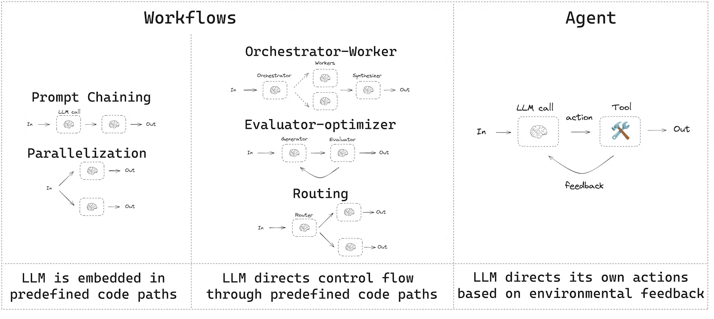

# 1 — Graph vs. Loop

> What graph engineering is, how it contains loop engineering rather than replacing it, the rule for when to add a node, and the map of this pillar.

When an agent stops converging, the instinct is to draw more boxes. That usually makes things worse: each new box inherits the loop's failures and adds mis-routing, deadlocks and double-writes on top, and the real fault is often a single verifier judging too many things. This chapter defines a graph, shows that a loop is its one-node case, and sets the test a new node has to pass.

---

## The definition

> **Graph engineering is designing the topology of a multi-agent system: which nodes exist, which transitions between them are permitted, and what state they carry across those transitions.**

Loop engineering asks *"what cycle re-prompts this agent and decides when it quits?"* Graph engineering asks *"who is allowed to hand work to whom, under what condition, carrying what state?"*

Three framings worth holding together:

- **LangChain (control):** graphs let you *"impose your preconceptions of how the system should work into more constrained paths, not relying solely on the judgement of the LLM."* You *"more tightly control behavior when you want the agent to follow specific paths."*
- **TrueFoundry (structure):** the topology is *"which nodes exist (agents, deterministic functions, routers, human checkpoints), which transitions are permitted, and how runtime work graphs form and mutate."*
- **Eigent (control theory):** *"the craft of wiring many feedback loops (metrics, evals, audits, policies, and workflows) into a network where they watch, constrain, and correct one another."*

The first is the one to build on. TrueFoundry and Eigent are vendor blogs; their framings are useful, but LangChain's comes from three years of running LangGraph in production.

Anthropic's *Building Effective Agents* draws the same line from the other side. **Workflows** are systems where models and tools are orchestrated through predefined code paths; **agents** are systems where the model directs its own process. A graph is how you write a workflow down, and it is also how you mix the two: fixed paths where you know the route, an agent node where you don't.


*Image Source: LangGraph docs, "Workflows and agents" (LangChain), after Anthropic's Building Effective Agents (2024)*

Every box on the left is a graph you write down in advance. The box on the right is a loop. Most production graphs are the left-hand shapes with one or two right-hand boxes inside them.

---

## Containment, not replacement

LangChain's sharpest line from three years of LangGraph:

> **"A loop is just a directed, cyclic graph."**

So a loop is a graph with **one node and an edge back to itself**. Graph engineering is not a rival to loop engineering; it is the same system with more nodes. The Medium framing ("forget loop engineering") overstates the break. TrueFoundry's is closer: loop and graph engineering are *"complementary layers, not substitutes."*

The containment is literal. The runner below knows nothing about loops or graphs. It calls a node, takes back new state and the name of the next node, and stops on `None`. The loop is one entry in the node table, and generate-then-verify is two entries. The third call shows what every back-edge needs: without a bound, a node that keeps routing to itself never exits.

```python
# A graph runner in 12 lines. No framework and no model: the stubs show the shape.
def run(nodes, start, state, bound=10):
    node, trace = start, []
    for _ in range(bound):
        trace.append(node)
        state, node = nodes[node](state)
        if node is None:
            return state, trace
    raise RuntimeError(f"no exit after {bound} steps: {trace}")

# A loop: one node and an edge back to itself.
def agent(s):
    s = {**s, "tries": s["tries"] + 1}
    return s, (None if s["tries"] == 3 else "agent")

# Generate-then-verify: the same runner with two nodes. The check moved out of the worker.
def generate(s):
    return {**s, "tries": s["tries"] + 1, "draft": "ok" if s["tries"] == 1 else "bad"}, "verify"

def verify(s):
    return s, (None if s["draft"] == "ok" else "generate")

print(run({"agent": agent}, "agent", {"tries": 0}))
print(run({"generate": generate, "verify": verify}, "generate", {"tries": 0}))
try:
    run({"spin": lambda s: (s, "spin")}, "spin", {}, bound=3)
except RuntimeError as e:
    print(e)
```

Output:

```text
({'tries': 3}, ['agent', 'agent', 'agent'])
({'tries': 2, 'draft': 'ok'}, ['generate', 'verify', 'generate', 'verify'])
no exit after 3 steps: ['spin', 'spin', 'spin']
```

What changes at the boundary is the **failure mode** you engineer against:

| Layer | Fails by |
|---|---|
| Loop | Not converging: spinning, quitting early, gaming the scorekeeper |
| Graph | Mis-routing, deadlocking, double-writing shared state, losing accountability for a decision |

> **Inherits the weaknesses of loop engineering.** A graph routing between unreliable loops inherits every loop failure at organisational scale, and adds coordination failures on top. Fix the loop first.

Gao Dalie's diagnosis of why teams hit the wall: *"It's not that the agents aren't smart enough, but rather that the organizational structure isn't clear enough."*

---

## Production agents are not DAGs

The most load-bearing lesson from LangChain:

> **"Production agents need cycles: retrying failed tool calls, asking users for missing information, revising answers after validation, calling tools repeatedly until they have enough context."**

This is why the Airflow-style DAG model imported from data engineering breaks on agents. A DAG is acyclic by definition. A production agent must be able to go A → B, discover B failed, return to A, and only then reach C. **Graph engineering for agents is cyclic-graph engineering.** Anything that forbids cycles is a workflow engine, not an agent framework.

The second lesson: **static edges are not enough.** Real systems mix *"known structure with runtime variability"*. The set of nodes to run is often unknown until runtime: one reviewer per changed file, one worker per retrieved document. That is what LangGraph's Send API is for ([03](03-state-and-reducers.md#dynamic-fan-out-the-send-api)).

---

## Where loop ends and graph begins

You are in graph territory once you need **more than one agent collaborating, with conditional handoffs and shared state across that collaboration.** One agent with a tool loop is loop engineering. Several agents with routing logic between them is graph engineering.

A narrower rule of thumb from [flowtivity](https://flowtivity.ai/blog/graph-engineering-2026-guide-openclaw-codex/) (a vendor blog, so treat it as a heuristic): reach for a graph when the task has **three or more independent verification or research steps**. Below that, a sequential loop is cheaper and simpler. The full situation-to-choice lookup is in [06](06-when-not-to-build-a-graph.md#quick-reference).

### The default plus an escalation rule

> **Start with a loop. Add a node only when a specific signal forces it.**

Escalation is a cost you justify, not a maturity level you graduate to. Five signals justify a node, and each names something a single loop structurally cannot do:

| Signal | Why the loop fails |
|---|---|
| **Distinct specialties**: roles needing different instructions, context, tools | One agent context-switches between jobs, carrying each role's baggage into the next |
| **Parallel fan-out + join**: process many items, then merge | A loop is sequential; the wall-clock cost is unnecessary |
| **Per-step model or tool variation**: a different model or a restricted toolset per stage | One agent enforces one model and one tool policy |
| **Auditable control flow**: regulated work needing explicit path tracing | Emergent loop paths are hard to reconstruct afterwards |
| **Overloaded verifier**: one check judging several criteria | A dedicated reviewer node removes the criteria confusion |

### The 30-second decision tree

Start with a loop, then ask in order:

1. Does the work split into **distinct specialties** with different needs?
2. Do you need **true parallelism** (fan-out, then join)?
3. Do different steps need **different models or tools**, or **auditable** branching?
4. Is **one verifier failing** because it judges too many criteria at once?

Yes to any → add a node. No to all → **strengthen the verifier and ship the loop.**

That last clause is the one people skip. The most common "we need a graph" is really an overloaded verifier ([04-loop note 03](../../04-loop-engineering/notes/03-the-scorekeeper.md)), and splitting the verifier is far cheaper than splitting the system. [06](06-when-not-to-build-a-graph.md) develops the negative case.

---

## Two things called "graph"

This pillar uses the word in two senses. Keep them apart:

| | Agent graph (Track A) | Knowledge graph (Track B) |
|---|---|---|
| Nodes are | Units of computation | Entities |
| Edges are | Permitted transitions | Typed relationships |
| The graph is | Execution topology | Data structure for retrieval |
| Runtime concern | Routing, state, cost | Traversal, entity resolution |

They meet in [note 12](12-kg-as-shared-agent-memory.md): in a multi-agent system the knowledge graph is often the shared state layer the execution graph coordinates through.

---

## The map of this pillar

| # | Note | Track | Question it answers |
|---|---|---|---|
| 01 | Graph vs. loop (this note) | A | When does a loop become a graph? |
| 02 | [Graph primitives](02-graph-primitives.md) | A | What are nodes and edges, and how much agency goes in each node? |
| 03 | [State and reducers](03-state-and-reducers.md) | A | What do nodes share, and what happens when two write at once? |
| 04 | [Durable execution and interrupts](04-durable-execution-and-interrupts.md) | A | How does a graph pause, resume, and survive a crash? |
| 05 | [Topology patterns](05-topology-patterns.md) | A | Which shapes recur, and how do they map onto Claude Code? |
| 06 | [When not to build a graph](06-when-not-to-build-a-graph.md) | A | When is the graph overhead not worth it? |
| 07 | [Failure modes at scale](07-failure-modes-at-scale.md) | A | How do graphs fail where single loops don't? |
| 08 | [Governance and production](08-governance-and-production.md) | A | How do you operate a graph, not just demo one? |
| 09 | [KG fundamentals and Cypher](09-kg-fundamentals-and-cypher.md) | B | What is a knowledge graph and how do you query it? |
| 10 | [Building KGs with LLMs](10-building-kgs-with-llms.md) | B | How do you turn text into a graph you can trust? |
| 10b | [Assembling and maintaining KGs](10b-assembling-and-maintaining-kgs.md) | B | How do you load the graph and keep it correct? |
| 11 | [KG-RAG and text-to-Cypher](11-kg-rag-and-text-to-cypher.md) | B | How do you retrieve from a graph in natural language? |
| 11b | [A text-to-Cypher QA agent](11b-text-to-cypher-qa-agent.md) | A + B | What does text-to-Cypher look like as a bounded graph? |
| 12 | [KG as shared agent memory](12-kg-as-shared-agent-memory.md) | A + B | How does a KG become a swarm's memory? |
| 13 | [Learning on graphs: tasks and features](13-graph-ml-and-gnns.md) | B | What can you predict from structure, and with which hand-built features? |
| 13b | [Learning on graphs: embeddings and GNNs](13b-representation-learning-and-gnns.md) | B | When do learned vectors beat those features, and how do predictions enter the graph? |


---

## Where it sits

prompt → context → harness → loop → **graph**. The harness ([03-harness](../../03-harness-engineering/README.md)) supplies tools, state and guardrails. The loop ([04-loop](../../04-loop-engineering/README.md)) decides how many times to use them and when to stop. The graph decides *which loop runs next and who is accountable for it*. Each layer presumes the one below: you cannot graph-engineer well without loop-engineering fluency. [The Eval pillar](../../../generative-ai/08-eval/README.md) measures whether the whole thing is correct.

---

## Working reference

`~/.claude/refs/agent-architecture.md` — when to use a subagent, orchestrator responsibilities, dynamic fan-out.

---

## Pitfalls

- **Graphing over a loop that doesn't converge.** Symptom: the same spinning or early quitting, now inside three nodes, with routing errors on top. Fix: fix the loop first, because a graph inherits every loop failure and adds coordination failures ([04-loop](../../04-loop-engineering/README.md)).
- **Reading an overloaded verifier as a missing node.** Symptom: one check judges several criteria, its verdicts get less reliable, and someone proposes specialist agents. Fix: split the verifier into per-criterion checks inside the loop and measure again ([06](06-when-not-to-build-a-graph.md#split-the-verifier-not-the-system)).
- **Forcing agents onto a DAG.** Symptom: a failed tool call or a missing piece of user input can only be handled by rerunning from the top, because the Airflow-style model forbids going back to A. Fix: use a cyclic graph and put a bound on each back-edge.
- **Hard-coding the set of nodes.** Symptom: a fixed three reviewers whether the change touches one file or forty. Fix: derive the workers at runtime with `Send`, one per changed file ([03](03-state-and-reducers.md#dynamic-fan-out-the-send-api)).
- **Treating escalation as a maturity level.** Symptom: nobody can say which of the five signals a node answers. Fix: require a named signal for each node, and delete the node if there isn't one.
- **Mixing up the two graphs.** Symptom: a discussion of "our graph" where one person means routing and the other means Neo4j. Fix: say agent graph or knowledge graph; in the first, nodes are units of computation, and in the second they are entities.

## Try it

1. In the runner above, change `"ok" if s["tries"] == 1` to `"ok" if s["tries"] == 99`, and predict the result before you run it.

   <details><summary>Answer</summary>

   `RuntimeError: no exit after 10 steps: ['generate', 'verify', 'generate', 'verify', ...]`. The verifier never passes, so the back-edge fires until `bound=10` stops it. Generate-then-verify without that bound is the oscillation failure in [07](07-failure-modes-at-scale.md#mechanical-failures).

   </details>

2. Run the 30-second decision tree on three requests: (a) a support bot's single check scores accuracy, tone and policy together, and its pass rate is falling; (b) a code review that has to cover every changed file; (c) a loan decision where a regulator wants the path of each case reconstructed.

   <details><summary>Answer</summary>

   (a) No node yet: question 4 says a verifier is failing on too many criteria, and the cheaper first move is to split it inside the loop. (b) Parallel fan-out plus a join, question 2, with `Send` because the number of files is known only at runtime. (c) Auditable control flow, question 3: emergent loop paths are hard to reconstruct afterwards.

   </details>

3. Take a multi-agent diagram you have drawn or inherited, and write the signal next to each node. How many nodes survive?

   <details><summary>How to read the result</summary>

   A node with no signal from the five is a candidate for merging back into its neighbour. If only one node survives, what you have is a loop.

   </details>

## Interview checklist

| Prompt | Answer in one line |
|---|---|
| What is graph engineering? | Designing a multi-agent system's topology: which nodes exist, which transitions are permitted, and what state they carry across those transitions. |
| Does graph engineering replace loop engineering? | No. A loop is a directed cyclic graph with one node and an edge to itself, and a graph routing between unreliable loops inherits every loop failure and adds coordination failures. |
| How do the failure modes differ? | A loop fails by not converging: spinning, quitting early, gaming the scorekeeper. A graph fails by mis-routing, deadlocking, double-writing shared state or losing accountability for a decision. |
| Why doesn't an Airflow-style DAG fit agents? | A production agent has to go A → B, find that B failed, return to A and only then reach C. A DAG forbids that cycle, so agent graphs are cyclic graphs with bounds. |
| What justifies adding a node? | One of five signals: distinct specialties, parallel fan-out plus join, per-step model or tool variation, auditable control flow, or an overloaded verifier. |
| A team's eval pass rate is low and they propose four specialist agents. What do you do first? | Run the decision tree. If one verifier is judging several criteria, split it inside the loop and re-measure, because that is far cheaper than splitting the system. |
| How is an agent graph different from a knowledge graph? | Agent graph nodes are computation and its edges are permitted transitions; a knowledge graph's nodes are entities and its edges are typed relationships. They meet when the KG becomes the shared state agents coordinate through. |

## Next

[02-graph-primitives.md](02-graph-primitives.md): nodes, edges, and how much agency to spend per node.
