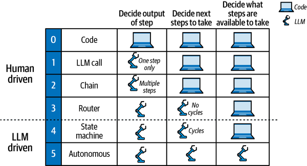
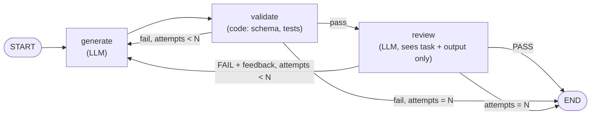

# 2 — Graph Primitives

> Nodes, edges, and the smallest LangGraph program. The design skill is deciding how much agency each node gets.

Most graphs waste their first decision. A step that could be a function call becomes an agent, and the team pays tokens and variance for a parse. A router whose label nothing checks then sends a question down the wrong branch and returns a confident answer with no error anywhere. This chapter sets out what a node can be, how to budget agency per node, and how to make edges fail loudly.

---

## Nodes do work

> **"Nodes do work. A node can be deterministic code, a single LLM call, a tool call, or a full agent with its own internal loop."** (LangChain)

The mix is the point, not an implementation detail. One graph can hold all four kinds, and should, because each costs differently:

| Node kind | Purpose | Determinism | Cost |
|---|---|---|---|
| **Deterministic function** | Parsing, validation, formatting, API calls | Total | Compute only |
| **Router** | Classify and dispatch | Medium (rules or one LLM call) | One call at most |
| **Single LLM call** | One bounded transformation: summarise, extract, draft | Medium | One call |
| **Agent** | Open-ended reasoning with its own tool loop | Low | Many calls, variable |
| **Human checkpoint** | Approval before a consequential action | External | Latency |

The table extends TrueFoundry's four-kind taxonomy with LangChain's "single LLM call" row, and it is the one teams forget exists between "code" and "agent".

---

## Spend agency per node

> **Every node that could be deterministic code and isn't is a node you pay tokens and variance for.**

LangChain's docs agent is the worked example. It deliberately mixes:

1. a **fixed API call** to fetch the relevant docs (no model),
2. a **single LLM call with no tools** to draft from them,
3. a **full agent node** only for the open-ended part.

The result is, in their words, *"predictable, powerful, and efficient."* Each node got the least agency that could do its job.

The design move, applied to any graph you draw: for each node, ask *"could this be code?"*, then *"could this be one call?"*, and only then make it an agent. An agent node is where you accept variance; put it where the work is genuinely open-ended and nowhere else.

### The autonomy ladder

Oshin & Campos make "how much agency" measurable (*Learning LangChain*, ch. 5). Ask which of three decisions the LLM makes and which stay in code:

1. **The output of a step**: draft the reply.
2. **The next step to take**: archive, reply, or flag this email.
3. **Which steps exist at all**: write and run code for an action nobody pre-programmed.

Each recipe that answers those questions is a *cognitive architecture*, a term the authors trace to CoALA (Sumers et al., [arXiv:2309.02427](https://arxiv.org/abs/2309.02427)).


*Image Source: Mayo Oshin & Nuno Campos, *Learning LangChain* (O'Reilly, 2025), Fig. 5-1*

| Level | Architecture | LLM decides | Graph shape |
|---|---|---|---|
| 0 | Code | Nothing | No model |
| 1 | LLM call | One step's output | One node |
| 2 | Chain | Several steps' outputs, in a fixed order ("flow engineering", after AlphaCodium) | Static edges only |
| 3 | Router | Also the next step, **without cycles** | Conditional edges, acyclic |
| 4 | State machine | The next step, **with cycles** | Conditional edges + back-edges |
| 5 | Autonomous | Also which steps exist | Agent writes its own tools |

The line under level 3 matters most. Up to the router, a human still decides what can happen and the graph is a DAG. From the state machine down, the LLM decides when to stop. The book frames the whole ladder as a trade-off between **agency** and **reliability**, using an email assistant with two constraints that pull against each other: interrupt the user as little as possible, and never send a reply the user wouldn't have sent. Write the constraints down first, then pick the lowest rung that meets them. Their level-2 text-to-SQL chain also shows agency tuned per node without changing the topology: temperature 0.1 for the SQL step and 0.7 for the explanation.

---

## Edges choose what runs after a node

Edges define which node executes next.

- **Static edges** always go A → B.
- **Conditional edges** read the node's result or the accumulated state and pick a target.

In LangGraph: `add_conditional_edges(source, routing_function, {result: target, ...})`. The routing function is ordinary code over state; it can call a model, but it doesn't have to.

Conditional edges are what buy you:

| Use | Example |
|---|---|
| **Adaptive branching** | Route to a specialist based on an intent classification |
| **Error paths** | Route to a retry or repair node when a tool fails |
| **Approval gates** | Route to a human checkpoint before an irreversible action ([04](04-durable-execution-and-interrupts.md)) |
| **Early exit** | Route straight to `END` when a stopping condition is met |
| **Cycles** | Route back to an earlier node to revise ([01](01-graph-vs-loop.md#production-agents-are-not-dags)) |

A cycle without a bound is an infinite loop. Every back-edge needs a counter in state or a recursion limit ([07](07-failure-modes-at-scale.md)).

### A router fails silently unless you make it fail loudly

An LLM router can stand in for a trained intent classifier with no labelled dataset, and *Learning LangChain* (ch. 5) frames it exactly that way. The book's example routes a medical assistant's question to one of two retrievers: patient records or insurance FAQs. Its wiring is the common way to get routing wrong:

```python
# As in the book: free-text label, typed but not enforced
router_prompt = SystemMessage("... Output only the domain name.")
def router_node(state):
    res = model_low_temp.invoke([router_prompt, ...])
    return {"domain": res.content}          # "Records", "records." and "medical" all land here

def pick_retriever(state):
    if state["domain"] == "records":
        return "retrieve_medical_records"
    else:                                    # every other string means insurance
        return "retrieve_insurance_faqs"
```

`domain: Literal["records", "insurance"]` in the `TypedDict` is a type hint only, so nothing checks it at runtime. Any reply other than exactly `records`, whether capitalised, punctuated or rephrased, silently goes to insurance. `generate_answer` repeats the same `else`, so the answer is written with the insurance prompt too. Nothing errors and nothing shows in the output, only a confident answer from the wrong index. The fix:

```python
from typing import Literal
from pydantic import BaseModel

class Route(BaseModel):
    domain: Literal["records", "insurance", "unclear"]

router = model_low_temp.with_structured_output(Route)

def router_node(state):
    return {"domain": router.invoke([router_prompt, ...]).domain}

def pick_retriever(state) -> Literal["retrieve_medical_records", "retrieve_insurance_faqs", "clarify"]:
    return {"records": "retrieve_medical_records",
            "insurance": "retrieve_insurance_faqs"}.get(state["domain"], "clarify")
```

Three changes. Constrain the output with a schema. Give the router a way to say "unclear". Make the fallback a real node, such as one that asks a clarifying question, instead of quietly reusing one of the branches. Then eval the router on a labelled set as a classifier ([07](07-failure-modes-at-scale.md#mechanical-failures)).

---

## The minimal program

```python
from langgraph.graph import StateGraph, MessagesState, START, END

def node_a(state: MessagesState) -> dict:
    # read state, do work, return only the keys you changed
    return {"messages": [...]}

def router(state: MessagesState) -> str:
    # ordinary code over state → name of the next node
    return "node_b" if needs_more_work(state) else END

builder = StateGraph(MessagesState)
builder.add_node("node_a", node_a)
builder.add_node("node_b", node_b)
builder.add_edge(START, "node_a")
builder.add_conditional_edges("node_a", router)
builder.add_edge("node_b", "node_a")      # the cycle
graph = builder.compile()

graph.invoke({"messages": [("user", "...")]})
```

Four things to notice:

1. **Nodes return updates, not the whole state.** The framework merges them, using reducers where a key has one ([03](03-state-and-reducers.md)).
2. **The router is just a function.** It returns a node name or `END`.
3. **The compiled graph is callable like a function.** `invoke`, `stream`, and `ainvoke` all work.
4. **`compile(checkpointer=...)`** is the one-line change that gives you pause, resume and replay ([04](04-durable-execution-and-interrupts.md)).

A node can also return `Command(goto="node_b", update={...})` to combine a state update and a routing decision in one place. Use it when the node that does the work is the only one that knows where to go next; prefer a separate router when the routing logic should be testable on its own.

---

## The first graph: generate-then-verify

The highest-yield first graph is a job that **splits into a produce step and an independent check step**: draft-then-review, research-then-write, build-then-test.



The separation is what creates the value; any parallelism is a bonus. Note the agency budget: the validator is code, so it catches what code can catch before you pay for the LLM reviewer.

A copy-ready version (`pip install langgraph langchain-anthropic`). Two writers append to `feedback`, so it carries a reducer; every other key has one writer:

```python
from typing import Annotated, TypedDict
import operator
from langchain_anthropic import ChatAnthropic
from langgraph.checkpoint.memory import InMemorySaver
from langgraph.graph import StateGraph, START, END

MAX_ATTEMPTS = 3
model = ChatAnthropic(model="claude-sonnet-5-5", temperature=0)

class State(TypedDict):
    task: str
    draft: str                                    # one writer: generate
    feedback: Annotated[list[str], operator.add]  # validate and review both append
    attempts: int
    verdict: str                                  # one writer per step: validate or review

def generate(state: State) -> dict:
    notes = "\n".join(state.get("feedback", [])) or "none"
    prompt = f"Task:\n{state['task']}\n\nFeedback on earlier attempts:\n{notes}"
    return {"draft": model.invoke(prompt).content,
            "attempts": state.get("attempts", 0) + 1}

def validate(state: State) -> dict:
    # Deterministic checks first: a schema check, a test run, a linter.
    problems = [] if state["draft"].strip() else ["validator: draft is empty"]
    return {"feedback": problems, "verdict": "fail" if problems else ""}

def review(state: State) -> dict:
    # The reviewer sees the task and the output, not the generator's reasoning (note 07).
    reply = model.invoke(f"Task:\n{state['task']}\n\nOutput:\n{state['draft']}\n\n"
                         "Reply PASS, or FAIL followed by one line saying what to fix.").content.strip()
    if reply.startswith("PASS"):
        return {"verdict": "pass"}
    return {"verdict": "fail", "feedback": [f"reviewer: {reply}"]}

def after_validate(state: State) -> str:
    if state["verdict"] != "fail":
        return "review"
    return "generate" if state["attempts"] < MAX_ATTEMPTS else END

def after_review(state: State) -> str:
    if state["verdict"] == "pass" or state["attempts"] >= MAX_ATTEMPTS:
        return END
    return "generate"

builder = StateGraph(State)
builder.add_node("generate", generate)
builder.add_node("validate", validate)
builder.add_node("review", review)
builder.add_edge(START, "generate")
builder.add_edge("generate", "validate")
builder.add_conditional_edges("validate", after_validate)
builder.add_conditional_edges("review", after_review)
graph = builder.compile(checkpointer=InMemorySaver())   # pause/resume/replay, note 04

result = graph.invoke({"task": "Write a haiku about state machines."},
                      {"configurable": {"thread_id": "gtv-1"}})
```

The bound lives in the two routers, not in the model: after `MAX_ATTEMPTS` the graph ends with `verdict == "fail"` and the caller decides what to do ([07](07-failure-modes-at-scale.md)).

---

## Tooling, briefly

| Tool | Graph primitive it offers |
|---|---|
| **LangGraph** | `StateGraph`, reducers, Send, checkpointers, interrupts: the reference implementation |
| **Google ADK** | Workflow agents (sequential, parallel, loop) as composable topology |
| **Claude Code / Agent SDK** | Subagents as nodes, hooks as deterministic edges ([05](05-topology-patterns.md#the-same-patterns-in-claude-code)) |

flowtivity also lists OpenClaw "Code Mode" (the model writes a small program instead of choosing from a long tool list) and an OpenAI Codex "graph-max" workflow. Neither is confirmed by first-party docs yet; treat them as examples of the idea that topology can be written as code, not as recommendations.

---

## Working reference

`~/.claude/refs/agent-architecture.md` — when a subagent is warranted; orchestrator responsibilities.

---

## Pitfalls

- **Making an agent of a node that could be code.** Symptom: token cost and output variance on a step such as fetching docs or formatting a reply. Fix: ask "could this be code?", then "could this be one call?", and only then make it an agent, as LangChain's docs agent does.
- **Trusting a `Literal` in a `TypedDict`.** Symptom: `domain: Literal["records", "insurance"]` looks enforced, yet "Records." goes to insurance and nothing errors. Fix: it is only a type hint, so constrain the reply with a schema.
- **Using one branch as the fallback.** Symptom: an `else` quietly gives every unrecognised label the insurance retriever and the insurance prompt. Fix: let the router say "unclear", and make the fallback a real node, such as one that asks a clarifying question.
- **A back-edge with no bound.** Symptom: the run ends only at `GraphRecursionError`, or doesn't end at the point you wanted. Fix: put a counter in state and check it in the router, as `MAX_ATTEMPTS` does in generate-then-verify ([07](07-failure-modes-at-scale.md#mechanical-failures)).
- **Paying the LLM reviewer for what code can catch.** Symptom: the reviewer spends a call on an empty draft or a schema failure. Fix: put a deterministic validator on the edge before the reviewer.
- **Crossing the line under level 3 without noticing.** Symptom: a router gains a back-edge, and now the LLM decides when to stop, but no one added a bound or an eval. Fix: treat the step from level 3 to level 4 as a design change, because the graph has stopped being a DAG.

## Try it

1. Place each on the autonomy ladder: (a) a fixed chain that extracts, then summarises; (b) a classifier that picks one of three retrievers and never comes back; (c) a draft that is revised until a reviewer passes it; (d) an agent that writes and runs code for an action nobody pre-programmed.

   <details><summary>Answer</summary>

   (a) Level 2, chain. (b) Level 3, router: conditional edges, no cycles. (c) Level 4, state machine: the back-edge means the LLM decides when to stop. (d) Level 5, autonomous: it also decides which steps exist.

   </details>

2. Feed `"records"`, `"Records"`, `"records."` and `"medical"` to the book's `pick_retriever` above. Which reach the records retriever?

   <details><summary>Answer</summary>

   Only `"records"`. The other three reach `retrieve_insurance_faqs`, with no error. In the fixed version the schema rejects anything outside the allowed values and `unclear` has its own node.

   </details>

3. In the generate-then-verify program, trace a draft that the reviewer fails every time. How many times does `generate` run, and what does the caller see?

   <details><summary>Answer</summary>

   Three times, because `attempts` reaches `MAX_ATTEMPTS = 3` and `after_review` returns `END`. The caller gets `verdict == "fail"` and three reviewer lines in `feedback`, and it decides what to do next.

   </details>

4. Run the pillar lab, a support-triage graph that uses these primitives with a stub model: `uv run run.py` in [practice/langgraph-graph](../practice/langgraph-graph/README.md). Find one node that is code, one that is a router and one human checkpoint.

   <details><summary>Answer</summary>

   In `graph.py`, `gather` is plain code, `classify` is one model call that a conditional edge routes on, and `approve` calls `interrupt`. The README's "Things to try" list continues the exercise.

   </details>

## Interview checklist

| Prompt | Answer in one line |
|---|---|
| What can a node be? | Deterministic code, a router, a single LLM call, an agent with its own tool loop, or a human checkpoint. Each costs differently, and one graph should mix them. |
| What does "spend agency per node" mean? | Give each node the least agency that can do its job, since every node that could be code and isn't costs tokens and variance. LangChain's docs agent is a fixed API call, one LLM call with no tools, and one agent node for the open-ended part. |
| Where is the important line on the autonomy ladder? | Under level 3. Up to the router a human decides what can happen and the graph is a DAG; from the state machine down, back-edges let the LLM decide when to stop. |
| Why is `Literal` in a `TypedDict` not enough for a router? | It is a type hint that nothing checks at runtime, so any other string falls through to the `else` branch without an error. Use a schema, an "unclear" value and a real fallback node. |
| A router occasionally gives a confident wrong answer and logs show no errors. Where do you look? | At what its unrecognised labels fall through to, and at the route distribution. Then evaluate the router alone on a labelled set, as a classifier. |
| When do you use `Command(goto=, update=)` rather than a separate router? | Use `Command` when the node doing the work is the only one that knows where to go next, and a separate router when the routing logic should be testable on its own. |

## Next

[03-state-and-reducers.md](03-state-and-reducers.md): what nodes share, and what happens when two write the same key.
