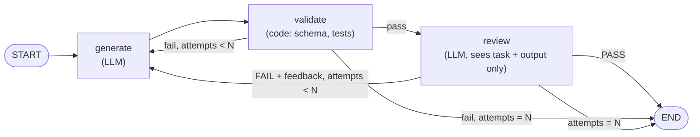

# 2 — Graph Primitives

> Nodes, edges, and the smallest LangGraph program. The design skill is deciding how much agency each node gets.

---

## Nodes do work

> **"Nodes do work. A node can be deterministic code, a single LLM call, a tool call, or a full agent with its own internal loop."** (LangChain)

The mix is the point, not an implementation detail. One graph can hold all four kinds, and should, because each costs differently:

| Node kind | Purpose | Determinism | Cost |
|---|---|---|---|
| **Deterministic function** | Parsing, validation, formatting, API calls | Total | Compute only |
| **Router** | Classify and dispatch | Medium (rules or one LLM call) | One call at most |
| **Single LLM call** | One bounded transformation: summarise, extract, draft | Medium | One call |
| **Agent** | Open-ended reasoning with its own tool loop | Low | Many calls, variable |
| **Human checkpoint** | Approval before a consequential action | External | Latency |

The table extends TrueFoundry's four-kind taxonomy with LangChain's "single LLM call" row, and it is the one teams forget exists between "code" and "agent".

---

## Spend agency per node

> **Every node that could be deterministic code and isn't is a node you pay tokens and variance for.**

LangChain's docs agent is the worked example. It deliberately mixes:

1. a **fixed API call** to fetch the relevant docs (no model),
2. a **single LLM call with no tools** to draft from them,
3. a **full agent node** only for the open-ended part.

The result is, in their words, *"predictable, powerful, and efficient."* Each node got the least agency that could do its job.

The design move, applied to any graph you draw: for each node, ask *"could this be code?"*, then *"could this be one call?"*, and only then make it an agent. An agent node is where you accept variance; put it where the work is genuinely open-ended and nowhere else.

---

## Edges choose what runs next

Edges define which node executes next.

- **Static edges** always go A → B.
- **Conditional edges** read the node's result or the accumulated state and pick a target.

In LangGraph: `add_conditional_edges(source, routing_function, {result: target, ...})`. The routing function is ordinary code over state; it can call a model, but it doesn't have to.

Conditional edges are what buy you:

| Use | Example |
|---|---|
| **Adaptive branching** | Route to a specialist based on an intent classification |
| **Error paths** | Route to a retry or repair node when a tool fails |
| **Approval gates** | Route to a human checkpoint before an irreversible action ([04](04-durable-execution-and-interrupts.md)) |
| **Early exit** | Route straight to `END` when a stopping condition is met |
| **Cycles** | Route back to an earlier node to revise ([01](01-graph-vs-loop.md#production-agents-are-not-dags)) |

A cycle without a bound is an infinite loop. Every back-edge needs a counter in state or a recursion limit ([07](07-failure-modes-at-scale.md)).

---

## The minimal program

```python
from langgraph.graph import StateGraph, MessagesState, START, END

def node_a(state: MessagesState) -> dict:
    # read state, do work, return only the keys you changed
    return {"messages": [...]}

def router(state: MessagesState) -> str:
    # ordinary code over state → name of the next node
    return "node_b" if needs_more_work(state) else END

builder = StateGraph(MessagesState)
builder.add_node("node_a", node_a)
builder.add_node("node_b", node_b)
builder.add_edge(START, "node_a")
builder.add_conditional_edges("node_a", router)
builder.add_edge("node_b", "node_a")      # the cycle
graph = builder.compile()

graph.invoke({"messages": [("user", "...")]})
```

Four things to notice:

1. **Nodes return updates, not the whole state.** The framework merges them, using reducers where a key has one ([03](03-state-and-reducers.md)).
2. **The router is just a function.** It returns a node name or `END`.
3. **The compiled graph is callable like a function.** `invoke`, `stream`, and `ainvoke` all work.
4. **`compile(checkpointer=...)`** is the one-line change that gives you pause, resume and replay ([04](04-durable-execution-and-interrupts.md)).

A node can also return `Command(goto="node_b", update={...})` to combine a state update and a routing decision in one place. Use it when the node that does the work is the only one that knows where to go next; prefer a separate router when the routing logic should be testable on its own.

---

## The first graph: generate-then-verify

The highest-yield first graph is a job that **splits into a produce step and an independent check step**: draft-then-review, research-then-write, build-then-test.



The separation is what creates the value; any parallelism is a bonus. Note the agency budget: the validator is code, so it catches what code can catch before you pay for the LLM reviewer.

A copy-ready version (`pip install langgraph langchain-anthropic`). Two writers append to `feedback`, so it carries a reducer; every other key has one writer:

```python
from typing import Annotated, TypedDict
import operator
from langchain_anthropic import ChatAnthropic
from langgraph.checkpoint.memory import InMemorySaver
from langgraph.graph import StateGraph, START, END

MAX_ATTEMPTS = 3
model = ChatAnthropic(model="claude-sonnet-5-5", temperature=0)

class State(TypedDict):
    task: str
    draft: str                                    # one writer: generate
    feedback: Annotated[list[str], operator.add]  # validate and review both append
    attempts: int
    verdict: str                                  # one writer per step: validate or review

def generate(state: State) -> dict:
    notes = "\n".join(state.get("feedback", [])) or "none"
    prompt = f"Task:\n{state['task']}\n\nFeedback on earlier attempts:\n{notes}"
    return {"draft": model.invoke(prompt).content,
            "attempts": state.get("attempts", 0) + 1}

def validate(state: State) -> dict:
    # Deterministic checks first: a schema check, a test run, a linter.
    problems = [] if state["draft"].strip() else ["validator: draft is empty"]
    return {"feedback": problems, "verdict": "fail" if problems else ""}

def review(state: State) -> dict:
    # The reviewer sees the task and the output, not the generator's reasoning (note 07).
    reply = model.invoke(f"Task:\n{state['task']}\n\nOutput:\n{state['draft']}\n\n"
                         "Reply PASS, or FAIL followed by one line saying what to fix.").content.strip()
    if reply.startswith("PASS"):
        return {"verdict": "pass"}
    return {"verdict": "fail", "feedback": [f"reviewer: {reply}"]}

def after_validate(state: State) -> str:
    if state["verdict"] != "fail":
        return "review"
    return "generate" if state["attempts"] < MAX_ATTEMPTS else END

def after_review(state: State) -> str:
    if state["verdict"] == "pass" or state["attempts"] >= MAX_ATTEMPTS:
        return END
    return "generate"

builder = StateGraph(State)
builder.add_node("generate", generate)
builder.add_node("validate", validate)
builder.add_node("review", review)
builder.add_edge(START, "generate")
builder.add_edge("generate", "validate")
builder.add_conditional_edges("validate", after_validate)
builder.add_conditional_edges("review", after_review)
graph = builder.compile(checkpointer=InMemorySaver())   # pause/resume/replay, note 04

result = graph.invoke({"task": "Write a haiku about state machines."},
                      {"configurable": {"thread_id": "gtv-1"}})
```

The bound lives in the two routers, not in the model: after `MAX_ATTEMPTS` the graph ends with `verdict == "fail"` and the caller decides what to do ([07](07-failure-modes-at-scale.md)).

---

## Tooling, briefly

| Tool | Graph primitive it offers |
|---|---|
| **LangGraph** | `StateGraph`, reducers, Send, checkpointers, interrupts: the reference implementation |
| **Google ADK** | Workflow agents (sequential, parallel, loop) as composable topology |
| **Claude Code / Agent SDK** | Subagents as nodes, hooks as deterministic edges ([05](05-topology-patterns.md#the-same-patterns-in-claude-code)) |

flowtivity also lists OpenClaw "Code Mode" (the model writes a small program instead of choosing from a long tool list) and an OpenAI Codex "graph-max" workflow. Neither is confirmed by first-party docs yet; treat them as examples of the idea that topology can be written as code, not as recommendations.

---

## Working reference

`~/.claude/refs/agent-architecture.md` — when a subagent is warranted; orchestrator responsibilities.

---

→ Next: [03-state-and-reducers.md](03-state-and-reducers.md) — what nodes share, and what happens when two write the same key.
