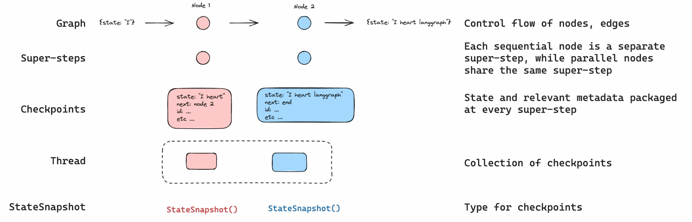
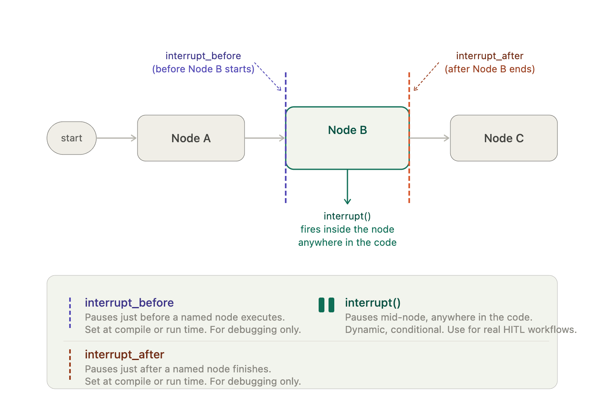
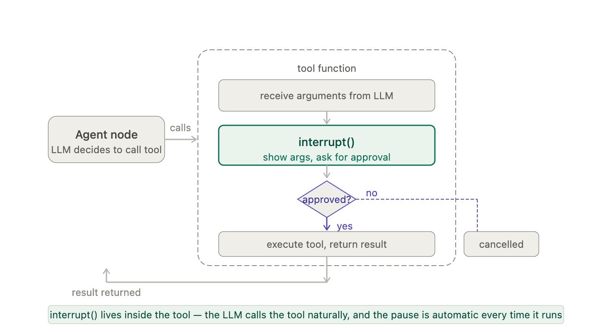

# 4 — Durable Execution and Interrupts

> A checkpointer saves state after every step. That one mechanism gives you human-in-the-loop pauses, resume after a crash, and time-travel debugging.

An agent asks for approval on Friday, the process restarts over the weekend, and on Monday there is nothing to approve because the run lived on the call stack. Or it does resume, and the email that sat above the approval line goes out a second time. This chapter covers the checkpoint mechanism that makes pausing, crash recovery and time travel one feature, what re-runs on resume, and where a gate belongs.

---

## Why a loop can't pause

A plain agent loop keeps its progress on the call stack and in a message list in memory. If it stops to wait for a human, or the process dies, that stack is gone. A loop that pauses *has nowhere to put its stack.*

The harness answer is to externalise state to files ([03-harness note 06](../../03-harness-engineering/notes/06-long-horizon-execution.md); [04-loop note 05](../../04-loop-engineering/notes/05-long-running-loops.md)). The graph answer is the same idea built into the runtime: because state is explicit and steps are discrete, the framework can save a complete snapshot after every step.

---

## Checkpointers

```python
from langgraph.checkpoint.memory import InMemorySaver
# production: SqliteSaver / PostgresSaver (langgraph-checkpoint-sqlite / -postgres)

graph = builder.compile(checkpointer=InMemorySaver())

config = {"configurable": {"thread_id": "review-42"}}
graph.invoke({"task": "..."}, config)
```

| Term | Meaning |
|---|---|
| **Checkpoint** | A snapshot of the full state, saved at the end of every super-step |
| **Thread** | The sequence of checkpoints for one run, keyed by `thread_id` |
| **Resume** | Invoke again with the same `thread_id`; execution continues from the latest checkpoint |


*Image Source: LangGraph docs, persistence (LangChain), via sources/langgraph_extended.pptx*

The `thread_id` is the run's identity. Pick it deliberately (a ticket ID, a session key, `workflow-{id}-user-{id}`), because resuming means knowing it.

> **Rule: if a run can outlive the process that started it, compile with a persistent checkpointer.** `InMemorySaver` is for tests; it dies with the process.

---

## Three features, one mechanism

| Feature | What it does with checkpoints |
|---|---|
| **Human-in-the-loop** | Stop at a node, save, wait any length of time, resume with the human's input |
| **Resume after crash** | Restart with the same `thread_id`; continue from the last saved step |
| **Time travel** | List past checkpoints, inspect any of them, or fork a new run from one |

### Human-in-the-loop with `interrupt`

```python
from langgraph.types import interrupt, Command

def publish(state):
    decision = interrupt({"question": "Publish this?", "draft": state["draft"]})
    if decision != "approve":
        return {"status": "rejected"}
    send_to_cms(state["draft"])
    return {"status": "published"}

graph.invoke({"task": "..."}, config)              # runs until the interrupt, then returns
graph.invoke(Command(resume="approve"), config)    # later, maybe days later
```

While paused you can read the state with `graph.get_state(config)`, and **edit** it with `graph.update_state(config, {"draft": fixed})` before resuming. The human isn't limited to yes or no; they can correct the work.

There is also a static form, `compile(interrupt_before=["publish"])`, which pauses before a node runs. It's useful for debugging. Prefer `interrupt()` in production, because the node can pass the human exactly what they need to decide.


*Image Source: LangGraph docs, human-in-the-loop (LangChain), via sources/langgraph_extended.pptx*

The same call works inside a **tool**. The model calls the tool as usual, the tool pauses to show the human its arguments, and approval or rejection decides whether it executes. The gate then travels with the tool to every graph that uses it.


*Image Source: LangGraph docs, human-in-the-loop (LangChain), via sources/langgraph_extended.pptx*

> **Gotcha: on resume, the interrupted node runs again from its first line.** Anything before `interrupt()` executes twice. Keep side effects after the interrupt, or make them idempotent.

### Time travel

`graph.get_state_history(config)` lists every checkpoint in the thread, newest first. Each has its own `checkpoint_id`. Invoking with that ID in the config replays from that point; calling `update_state` on an old checkpoint and then invoking creates a fork. This is the debugger: find the step where the run went wrong, change the state there, and rerun from that point instead of from the start.

### All of it in one run

This runs offline with no model (`uv run --with langgraph python gate.py`). It pauses at a gate, edits the draft while paused, resumes, and then forks from the pause to take the other decision. The counters make the gotcha above visible. `gate` runs twice for one decision, because the line before `interrupt()` runs again on resume, while `send`, which sits after the gate, runs once.

```python
from typing import TypedDict
from langgraph.checkpoint.memory import InMemorySaver
from langgraph.graph import END, START, StateGraph
from langgraph.types import Command, interrupt

runs = {"gate": 0, "send": 0}   # counts executions; a real side effect would be an email

class State(TypedDict):
    draft: str
    status: str

def write(state):
    return {"draft": "Refund approved for order 41."}

def gate(state):
    runs["gate"] += 1                      # before interrupt(): runs again on resume
    decision = interrupt({"draft": state["draft"]})
    return {"status": decision}

def send(state):
    runs["send"] += 1                      # after the gate: runs once
    return {"status": f"sent: {state['draft']}"}

def route(state):
    return "send" if state["status"] == "approve" else END

b = StateGraph(State)
b.add_node("write", write); b.add_node("gate", gate); b.add_node("send", send)
b.add_edge(START, "write"); b.add_edge("write", "gate")
b.add_conditional_edges("gate", route, ["send", END]); b.add_edge("send", END)
graph = b.compile(checkpointer=InMemorySaver())

config = {"configurable": {"thread_id": "ticket-41"}}
graph.invoke({"draft": "", "status": ""}, config)
print("paused before:", graph.get_state(config).next, "| gate runs:", runs["gate"])

graph.update_state(config, {"draft": "Refund approved for order 41, minus shipping."})
result = graph.invoke(Command(resume="approve"), config)
print("resumed:", result["status"])
print("gate runs:", runs["gate"], "| send runs:", runs["send"])

history = list(graph.get_state_history(config))
print("checkpoints, newest first:", [h.next for h in history])

# Fork: rewind to the pause, reject this time. The original thread's history is kept.
paused = next(h for h in history if h.next == ("gate",) and h.values["draft"].endswith("41."))
forked = graph.invoke(Command(resume="reject"), paused.config)
print("fork status:", forked["status"], "| send runs:", runs["send"])
```

Output:

```text
paused before: ('gate',) | gate runs: 1
resumed: sent: Refund approved for order 41, minus shipping.
gate runs: 2 | send runs: 1
checkpoints, newest first: [(), ('send',), ('gate',), ('gate',), ('write',), ('__start__',)]
fork status: reject | send runs: 1
```

The history shows two checkpoints waiting at `gate`: the original pause and the one that `update_state` wrote. The fork starts from the first of them, with the unedited draft, and takes the reject branch, so `send` doesn't run again. `InMemorySaver` is fine here because the script is a test; a run that has to survive a restart needs a persistent one.

---

## Where approval gates go

TrueFoundry's observation is the one to keep: *"human approval checkpoints before configured sensitive tool calls at exactly the edges where consequence concentrates."*

Consequence is not spread evenly across a graph. It concentrates at a few edges: sending, publishing, paying, deleting, deploying. Put the gate **there**, not on every node. A gate everywhere trains the human to click approve without reading, which is worse than no gate.

| Gate before | Why |
|---|---|
| Irreversible actions (send, pay, delete, deploy) | Can't be undone, so check first |
| Actions crossing a trust boundary (external API, another tenant) | Someone else bears the cost |
| Low-confidence router decisions | Cheap for a human, expensive to mis-route |

n8n's workflow builder puts its one gate after the **Planner**, before any build work starts ([08](08-governance-and-production.md#case-study-n8ns-ai-workflow-builder)). The plan is the cheapest thing to correct.

---

## Checkpoint contents

Graph state checkpoints are only as useful as the state schema. To resume cleanly, state must hold everything the next step needs: the plan, which steps are complete, intermediate outputs, and run metadata (attempt counts, budget used). If a node depends on something held only in a Python variable or an open connection, a resume will lose it.

This matches a standing checkpoint rule: checkpoint after each plan step, and include plan state, completed steps, intermediate outputs and run metadata.

---

## Pitfalls

- **`InMemorySaver` in production.** Symptom: every paused run disappears on deploy. Fix: if a run can outlive its process, compile with `SqliteSaver` or `PostgresSaver`.
- **A side effect above `interrupt()`.** Symptom: the customer gets two emails, or a counter reads two for one decision (see `gate` in the script above). Fix: keep side effects after the interrupt or make them idempotent, because the node runs again from its first line.
- **A `thread_id` nobody can reconstruct.** Symptom: the run is saved, but no one can resume it because the ID was a random value in a lost log line. Fix: choose it deliberately, such as a ticket ID or `workflow-{id}-user-{id}`.
- **A gate on every node.** Symptom: approvals take seconds and nobody reads them. Fix: gate only where consequence concentrates (send, pay, delete, deploy, cross a trust boundary), because a gate everywhere is worse than no gate.
- **Resume state held outside the schema.** Symptom: the run resumes and then fails because a Python variable or an open connection is gone. Fix: put the plan, completed steps, intermediate outputs and attempt counts in state, and reopen connections inside the node.
- **Only offering yes or no.** Symptom: a reviewer rejects a nearly right draft and the run starts again. Fix: use `update_state` so the human can correct the work while it is paused.

## Try it

1. Move `runs["send"] += 1` into `gate`, above `interrupt()`, and run the script. What does `send runs` print after the resume, and what does this mean for a real email?

   <details><summary>Answer</summary>

   It prints 2: one before the pause and one on resume. A real email would go out before the human had decided anything, and again when they did.

   </details>

2. Why does the script's fork leave `send runs` at 1, and what would change if it resumed with `"approve"`?

   <details><summary>Answer</summary>

   The fork resumes the first pause with `"reject"`, and `route` returns `END`. With `"approve"` it would run `send` on the unedited draft and the counter would reach 2, while the original thread's history stays as it was.

   </details>

3. For a claims graph with the nodes read claim, look up policy, draft decision, pay out and log, say where the gate goes and how many gates you need.

   <details><summary>Answer</summary>

   One, before pay out: it is irreversible and external. A second gate on low-confidence claims is defensible, since mis-routing is expensive and a human check is cheap. Reading, looking up and logging don't earn gates.

   </details>

4. In the [pillar lab](../practice/langgraph-graph/README.md), do its "Things to try" step 4: swap the lab's in-memory saver (`MemorySaver`, the older name of `InMemorySaver`) for `SqliteSaver`, and split the pause and the resume into two runs of the program.

   <details><summary>Answer</summary>

   The state survives because the resume reads the saved checkpoint with the same `thread_id`. The command is `uv run --with langgraph-checkpoint-sqlite run.py`.

   </details>

## Interview checklist

| Prompt | Answer in one line |
|---|---|
| Why can't a plain loop pause? | Its progress is on the call stack and in an in-memory message list, so there is nowhere to put it when it stops or the process dies. |
| What is the one mechanism behind human-in-the-loop, crash recovery and time travel? | A snapshot of the full state at the end of every super-step, keyed by `thread_id`. Each feature is a different use of those checkpoints. |
| What happens on resume after `interrupt()`? | The interrupted node runs again from its first line, so anything above `interrupt()` executes twice. Put side effects after it or make them idempotent. |
| `interrupt()` or `interrupt_before`? | `interrupt_before` pauses before a node and is useful for debugging. Prefer `interrupt()` in production, because the node can give the human exactly what they need to decide. |
| Where do approval gates go, and why not everywhere? | At the edges where consequence concentrates: irreversible actions, trust boundaries and low-confidence routes. A gate everywhere trains people to click approve without reading. |
| A bad decision at step 6 of a 10-step run wasted an hour. How do you debug it? | Use `get_state_history` to find the checkpoint, `update_state` to change the state there, and invoke from that `checkpoint_id` to fork, so you don't rerun from the start. |
| What must a checkpoint hold for a clean resume? | Everything the next step needs: the plan, completed steps, intermediate outputs and run metadata such as attempts and budget used. A live connection or a local variable won't survive. |

## Next

[05-topology-patterns.md](05-topology-patterns.md): supervisor, fan-out, subgraphs, and how they look in Claude Code.
