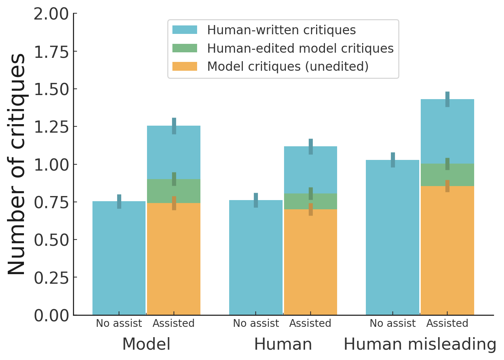

# 5 — Topology Patterns

> The handful of shapes that recur, what each costs, how each fails, and how the same shapes look in Claude Code.

Teams pick a topology by reputation. They reach for a supervisor or a debate and find out in production that a substring match routed a tool result back into the loop, or that a self-review ratified a hallucination. Only a handful of shapes recur, and each has a known cost and a known way to fail. This chapter names them, shows them in Claude Code, asks when collaboration brings in anything new, and shows how teams of agents fail. [Note 05b](05b-running-multi-agent-systems.md) covers running them.

---

## The catalogue

| Pattern | Shape | Use when | Costs | Fails by |
|---|---|---|---|---|
| **Generate-then-verify** | produce → check → back-edge | The job splits into a produce step and an independent check | One extra node per cycle | Checker sees the producer's reasoning and agrees with it |
| **Supervisor** | router → specialists → router | Work arrives in several kinds that need different handling | A routing call per turn | Mis-routing; the supervisor becomes a bottleneck |
| **Fan-out / fan-in** | split → N parallel workers → merge | Many independent items, then one combined result | Tokens scale with N | Missing reducer; redundant findings; correlated errors |
| **Hierarchical** | a subgraph as one node of a parent | A sub-topology is reused or owned by another team | State mapping at the boundary | Hidden cost; failures inside the subgraph are hard to see from outside |
| **Handoff** | agent writes status → edge reads it | Agents should pass control without knowing each other | A status key in the schema | Status values drift; nobody handles an unexpected one |

### Generate-then-verify

The highest-yield first graph ([02](02-graph-primitives.md#the-first-graph-generate-then-verify)). Draft-then-review, research-then-write, build-then-test. **The separation creates the value; parallelism is a bonus.** Put deterministic checks before the LLM checker, and bound the back-edge.

**Not every "actor-critic" loop qualifies.** Albada presents actor-critic as a lightweight quality gate: an actor proposes three candidate plans, a critic scores them 1–10 on a rubric (feasibility, cost, risk), and anything under 8 goes back with feedback. He recommends it when "evaluation is easier than generation", and calls it test-time compute that needs "no learning" (*Building Applications with AI Agents*, ch. 8). The trade-off he names, more inference cost for better output, is real. But in his example the critic is the same `llm` with the same history and no tools, so it is self-review. By the evidence [below](#when-multi-agent-beats-single-agent), self-review without new information is often neutral or harmful (Huang et al., ICLR 2024). The rubric only pays off when at least one of its criteria can be checked against something the actor didn't write: a cost computed in code, a constraint looked up, a simulation run.

Albada's code also shows three wiring faults to avoid when you copy the pattern:

- **Unbounded back-edge.** The critic routes back whenever the last message contains `"regenerate"`, and nothing counts the attempts. The only stop is `recursion_limit`.
- **A substring router.** Routing on `"regenerate" in content` turns any tool output that happens to contain the word into another loop. Route on a structured field (`verdict: Literal["accept", "revise"]`) instead.
- **Off-schema state.** The actor writes `state["candidates"]`, but `AgentState` only declares `operation` and `messages`, so there is no channel for it. Both nodes also return `history + new` into a key whose reducer is `operator.add`, which appends the whole history a second time on every pass. Declare every key you write, and return only the delta ([03](03-state-and-reducers.md#reducers-decide-merges)).

### Supervisor

A coordinator node classifies each incoming task and dispatches it to a specialist, then decides whether the work is done or needs another specialist. It is the settled baseline for most multi-agent work: the orchestrator holds the plan, and the workers run in isolated contexts. n8n's AI Workflow Builder is a production example: a supervisor routing to five specialist subgraphs ([08](08-governance-and-production.md#case-study-n8ns-ai-workflow-builder)).

Specialise by prompt first. n8n runs every specialist on the same model at temperature 0, and the roles differ only by system prompt. A separate model per node is an optimisation you justify with measurements, not the starting point. LLMSelector (Chen et al., [arXiv:2502.14815](https://arxiv.org/abs/2502.14815), Microsoft Research, Stanford, Princeton and Berkeley, 2025-02, preprint) shows what the measurement can buy and what it costs. On fixed 2–6-module pipelines (self-refine, debate, locate-then-solve) with 10 candidate models, it picks a model per module. Each module is scored by an LLM judge that sees the gold answer, which matters because, in the TableArithmetic case study, end-to-end accuracy alone left greedy search stuck at a local optimum. On four real tasks, it **beat the best single model used everywhere by 5–9 points** (the paper's own gains row prints 5–11) (e.g. LiveCodeBench 95% vs. 89%, SimpleQA 28% vs. 21%). The 56–70-point gains are on two synthetic 100-question tasks built so that no one model can do both steps. Its worked examples show the mechanism: same-model debaters repeat one wrong answer, and a model reviewing its own draft agrees with its own mistake. It needs a labelled half of each dataset to search on. It reports no variance and no token or latency cost, and it covers static pipelines only.

A router over models only means something if the models behave differently. Huot, Kaisers & Lapata ([arXiv:2607.09197](https://arxiv.org/abs/2607.09197), Google DeepMind, 2026-07, preprint) measured behavioural diversity from which questions each model gets right. In EmbedLLM's pool of 112 models (36,054 questions), **9 well-chosen models captured most of the pool's diversity**, and in RouterBench's 11, four did. They also checked whether a router sends a query and its paraphrases or typo'd variants to the same model. Embedding-KNN routers gained clean accuracy on specialist societies but fell to near-random routing on perturbed queries. On the paper's synthetic specialist society, a prompted LLM router (Gemini 3.1 Flash-Lite) stayed within five points of its clean accuracy under perturbation. The tests are single-turn and use model pools, not prompt-specialised roles inside an agent graph. Before adding a model per node, check that the candidates fail on different inputs, and that the router gives the same answer for a reworded query.

**A coordinator in the prompt is not a supervisor in the graph.** Destefanis & Aste ([arXiv:2608.16801](https://arxiv.org/abs/2608.16801), 2026-08, preprint) logged every message and file read and write in 1,902 graded runs of Claude Code agent teams (claude-sonnet-4-6, two synthetic Python tasks, 1 to 8 agents, with a 16-agent arm on one task). Naming one agent "coordinator" in the prompt produced no hub: **at eight agents, 0 of 1,170 channels carried a disproportionate share of traffic**, so no agent became a centre. In a replication where the grading tests were moved out of the agents' reach, flat and coordinator teams succeeded equally often (for example 26/31 vs. 23/31, p = 0.53). The task set the shape instead. A shared-spec task grew a dense mesh, and a pipeline task a sparse neighbour-to-neighbour chain. Two more findings bear on design. **Splitting work creates interfaces nobody owns**: an 8-step chain succeeded 9/10 with two or four agents and 0/10 with eight agents of one step each, every failure on the same rounding hand-off, which the agents had discussed in all ten runs. And **mandating shared files over messages cut output tokens by about 42% at eight agents** on the message-heavy task, but raised them 10–17% on the pipeline. What it does not test is an enforced supervisor that routes, so it is evidence against a coordinator by label, not against the pattern. Ten runs per cell gives about ±30 points, and identical prompts in two sessions gave different message-growth exponents (1.76 vs. 2.44), so judge a configuration by a distribution of runs, not one.

**How a supervisor mis-routes in practice.** Albada's supply-chain supervisor routes to inventory, transportation or supplier specialists. It asks the model to "Output ONLY the selected member's name … nothing else". The router then lower-cases the reply and compares it to the three names, with `else: return END` as the fallback (*Building Applications with AI Agents*, ch. 8). Two things go wrong:

- **Silent ending.** Any reply that isn't exactly a name ("Inventory.", "the inventory specialist") ends the run. The user's answer is then the supervisor's one-word label.
- **Crash instead of fallback.** The conditional edge's path map lists only the three specialists. LangGraph raises on a return value the map doesn't list, so the "fallback" crashes instead of ending.

The fix is a schema, not a firmer prompt ([02 has the code](02-graph-primitives.md#a-router-fails-silently-unless-you-make-it-fail-loudly)). Use `with_structured_output` over a `Literal["inventory", "transportation", "supplier", "unknown"]`, and route `unknown` to a clarify or escalate node that exists in the graph. Albada's prose also describes the supervisor routing a disruption to transportation "while the inventory specialist concurrently scales" the warehouse. Its code can't do that: it picks exactly one specialist, and every specialist edge goes to `END`. Concurrent specialists need fan-out ([below](#fan-out--fan-in)), not a supervisor.

When the specialists outgrow one agent's tool list, Albada gives two remedies to try before splitting into agents: **hierarchical tool selection** (group tools behind a few coarse tools) and **semantic tool selection** (embed the tool descriptions and retrieve the top k per query). The supervisor split only pays once the tool count or the roles' prompts actually conflict.

### Fan-out / fan-in

Several workers run at once on independent branches, and a synthesiser merges their results into shared state. It wins on wall-clock time and costs tokens. Use `Send` when N is only known at runtime, and give the merge key a reducer ([03](03-state-and-reducers.md#dynamic-fan-out-the-send-api)).

**The parallel review graph** is the canonical fan-out: a planner sets objectives, a worker produces, then security, logic and style reviewers run **in parallel**, a synthesiser collects their findings, and a pass/fail gate routes feedback back to the worker. [flowtivity](https://flowtivity.ai/blog/graph-engineering-2026-guide-openclaw-codex/) reports it as ~3× faster than the sequential version on code review. That is a vendor figure: build the graph as a subgraph, time it against the sequential version on your own repo, and quote your number instead.

**Mixture-of-Agents** ([arXiv:2406.04692](https://arxiv.org/abs/2406.04692), Wang et al., 2024-06, preprint) stacks fan-out/fan-in in layers: every agent reads all of the previous layer's answers, and one aggregator writes the last. With 6 open-source proposers, 3 layers and Qwen1.5-110B-Chat aggregating, it reached **65.1 vs. 57.5 for GPT-4o** on AlpacaEval 2.0 (length-controlled win rate, automatic judge). The gain on MT-Bench is small (9.25 vs. 9.19), it spends 6 proposer calls per layer where GPT-4o spends one, and no token appears until every layer has finished. Rethinking it ([arXiv:2502.00674](https://arxiv.org/abs/2502.00674), Li et al., 2025-02, preprint), **6 samples of one model (WizardLM-2-8x22B) scored 65.7 vs. 59.1** for the mixed 2-layer MoA on AlpacaEval 2.0 with the same aggregator; mixing paid only for similar-quality models with different strengths, by at most 0.35 points over one-model Self-MoA (7B models, mixed MMLU, CRUX and MATH task).

### Hierarchical: subgraphs

A compiled graph can be added as a node in another graph. That gives you nested orchestration and reusable sub-topologies: build the review graph once, then drop it into any pipeline that needs review.

```python
review = review_builder.compile()          # a whole graph
parent.add_node("review", review)          # used as one node
```

How state crosses the boundary:

| Parent and child schemas | What to do |
|---|---|
| **Share keys** | Add the compiled subgraph directly; shared keys flow in and out |
| **Differ** | Call the subgraph inside a wrapper node that maps parent state → child input and child output → parent update |


*Image Source: LangGraph docs, subgraphs (LangChain), via sources/langgraph_extended.pptx*

The wrapper is more code, and usually worth it: it makes the subgraph's contract explicit, and it stops a child from writing parent keys it shouldn't touch.

### Handoff

An agent signals completion by writing a designated state key; a conditional edge reads that key and picks the next agent ([03](03-state-and-reducers.md#handoffs-live-in-state)). Coupling lives in state, not in code. Always route unknown status values to an explicit error node rather than letting the router throw.

---

## The same patterns in Claude Code

The concepts already exist in Claude Code under different names:

| Graph concept | Claude Code |
|---|---|
| **Node** | A subagent: *"a separate agent instance with its own context window, its own system prompt, and scoped tool access"* |
| **Edge** | The main session's decision about which subagent to spawn, when, and with what brief |
| **State** | Return values: *"a subagent's final output flows back to the orchestrator, which passes the relevant piece to the next node"* |
| **Deterministic edge** | A hook: when probabilistic routing isn't good enough, a hook *guarantees* the transition |
| **Programmatic topology** | The Claude Agent SDK: define the graph in code, so it can run unattended and be tested |

Three implementation levels, in increasing order of determinism:

1. **Markdown subagents** in `.claude/agents/`: the fastest way to stand up a multi-node graph.
2. **Hooks as deterministic edges**: a pass/fail gate that runs code, not a model.
3. **Agent SDK**: a programmatic graph for unattended operation.

What you lose compared with LangGraph: there is no typed shared state, no reducers, and no checkpoints. State is whatever the orchestrator chooses to pass along, which is a context firewall when you want one ([03-harness note 07](../../03-harness-engineering/notes/07-orchestration.md)) and a liability when you need resume.

This repo's `/review` skill has the same shape: it sends a target to independent reviewers and merges what they report.

---

## Choosing a pattern

1. Is there a produce step and an independent check? → **generate-then-verify**. Start here.
2. Do tasks arrive in different kinds? → **supervisor** over specialists.
3. Are there many independent items? → **fan-out / fan-in** with a reducer.
4. Is a sub-topology reused, or owned by someone else? → **subgraph** with a wrapper node.

Patterns compose. A supervisor can dispatch to a fan-out subgraph whose workers each run generate-then-verify. Add each layer only when one of the five signals in [01](01-graph-vs-loop.md#the-default-plus-an-escalation-rule) forces it.

---

## Two design dimensions

Li's *AI Agents in Depth* ([ch. 10](https://github.com/bojieli/ai-agent-book/blob/main/book-en/chapter10.md)) separates two questions that the catalogue above blurs: **does the context get shared**, and **who decides what happens next**.

### Shared vs. isolated context


*Image Source: Li, AI Agents in Depth, ch. 10, Fig. 10-1 (Apache-2.0)*

The analogy is threads vs. processes. Agents with shared context see one trajectory, like threads sharing memory; nothing is lost in transfer, but everything accumulates. Isolated agents each have their own window, like processes, and communicate only through what they explicitly pass.

| Criterion | Share context | Isolate context |
|---|---|---|
| Subtasks | Tightly coupled; each needs the earlier reasoning | Separable; each needs only a brief |
| Window | Cumulative trajectory fits comfortably | Cumulative trajectory would blow the window |
| Parallelism | Sequential is fine | Workers must run at once |
| Isolation | Roles can see each other's work | A role must not see another's (e.g. a verifier) |
| Cost | One cache-friendly trajectory | N contexts, each paying its own prefix |

Rule of thumb: **if the cumulative context would exceed about half the window, don't share; if the task demands zero information loss, share.** Hybrid systems often share early (requirements and design in one trajectory) and switch to an explicit handoff once the work splits.

Two shared-context mechanisms from Li's labs:

- **Staged system prompts.** One agent, one trajectory, but the system prompt and tool set change by stage: requirements → implementation → review. Transitions are tool calls (`complete_requirements_analysis`, `submit_for_review`, then `approve_code` or `request_revision`), so the stage machine is explicit and can roll back.
- **Role transfer.** `transfer_to_agent(target_role, reason)` swaps the active role over the same history: triage → research → data analysis → writing → back to triage. Guard against circular handoffs with a counter.

### Topology: peer, manager, decentralised

| Topology | Who decides next | Maps to |
|---|---|---|
| **Peer** | Two or more agents of equal standing, usually proposer + reviewer | Generate-then-verify |
| **Manager** | One agent plans and calls the others as tools | Supervisor; fan-out / fan-in |
| **Decentralised** | Each agent picks its successor | Handoff |

Li treats topology as the multi-agent subset of graph engineering ([01](01-graph-vs-loop.md)). Communication runs over three channels: **tool parameters** (the brief and the return value), a **shared file system**, and a **message bus**. The first two are the two classic IPC paradigms, message passing and shared memory. Go's maxim applies: *"don't communicate by sharing memory; share memory by communicating."*

---

## When multi-agent beats single-agent

Li's test (*AI Agents in Depth*, ch. 10, Table 10-1) is one question: **does the collaboration introduce information the single agent didn't have?**

| Collaboration | New information? | Evidence |
|---|---|---|
| **Self-review** (same model reviews its own output, no tools) | No | Often neutral or harmful: Huang et al. (ICLR 2024); the TACL self-correction survey ([arXiv:2406.01297](https://arxiv.org/abs/2406.01297)). CRITIC's gains vanish when the tools are removed. |
| **Debate** among copies of one model | No | On multi-hop QA (FRAMES, MuSiQue) at matched thinking-token budgets, a single agent was best or statistically tied at every budget above 100 tokens, across Qwen3, DeepSeek-R1 and Gemini 2.5 (Tran & Kiela, [arXiv:2604.02460](https://arxiv.org/abs/2604.02460)); debate was the strongest multi-agent variant but still didn't beat it. The argument is the data-processing inequality: recombining the same information can't add any |
| **Execution, tool or visual feedback** | Yes | Large gains. RLEF ([arXiv:2410.02089](https://arxiv.org/abs/2410.02089)) trains on execution feedback; WebGen-Agent's screenshot feedback took Claude 3.5 Sonnet from 26.4% to 51.9% |

The data-processing argument assumes the single agent uses its context perfectly, and Tran & Kiela flag that as its boundary. When they degraded the context (Qwen3-30B on MuSiQue 4-hop at a 1,000-token thinking budget, with 70% of the context tokens masked or swapped for random tokens), a sequential multi-agent pipeline beat the single agent; at 30% the single agent still led. Splitting can pay when one context is too long or too noisy to use well, which is a context problem, not new information.

Ao, Gao & Simchi-Levi ([arXiv:2603.26993](https://arxiv.org/abs/2603.26993), MIT, 2026-03, preprint) prove the argument for any acyclic graph of agents. If no node receives a signal from outside, **the network can do no better than one Bayes-optimal decision maker who sees the same evidence**, whatever the roles, messages or rounds. What a pipeline loses is exactly how far each hand-off distorts the posterior. Transcript length, role count and round count are the wrong proxies, and an extra stage costs nothing if it passes the posterior on intact. A verifier can only help if its signal is not redundant given what it reads, so self-critique that rereads the draft cannot raise the ceiling, while executable tests can. Their MMLU experiments are deliberately worst-case, because the relay stages never see the question. On 200 questions, gpt-4.1-mini fell **from 90.7% alone to 41.2% with two agents and 22.5% with five**, below chance. On a 50-question subset, relaying a probability vector instead of prose held a 3-stage chain at 75.2% vs. 58.1%. A redundant second Wikipedia specialist added nothing, while a tool over a knowledge base the model had never seen took accuracy from 24.3% to 82.7%. The theorem stops at private signals. Once agents hold different evidence, the problem becomes a team-decision problem, where the reduction fails. Two OpenAI models were tested, and some figures in the paper disagree with its tables, so use it for the shape of the argument and not for the percentages.

Kim et al. ([arXiv:2512.08296](https://arxiv.org/abs/2512.08296), 2025-12) add a second test from 260 controlled configurations: once a single agent already scores above about 45% on a task, adding agents had negative returns ([06](06-when-not-to-build-a-graph.md#what-fan-out-costs)).

Hold the information fixed and topology mostly moves the bill. Nechepurenko & Shuvalov ([arXiv:2605.03310](https://arxiv.org/abs/2605.03310), 2026-05, preprint) gave five topologies the same model (claude-opus-4-6), tools, prompt scaffold and 100 prediction-market questions with web search off. Brier scores ran **from 0.153 for a sequential pipeline to 0.181 for consensus alignment, and no pair differed after Bonferroni correction** (smallest uncorrected p = 0.075). Cost differed far more: an independent ensemble at $0.10 per question (Brier 0.159) beat an orchestrator with specialists at $0.31 (0.162) and peer-critique debate at $0.23 (0.170) on both axes. No configuration beat the market price (0.152), which is the point of the setup. With no new information the agents had nothing to add, so the result is the new-information test run as an experiment. It covers one model and one task family, and the authors estimate that about 500 questions would separate only the four pairs involving consensus alignment, about 2,500 most of the rest, and that one pair cannot be told apart at all.

So a reviewer earns its node when it can **run something**: tests, a browser, a search, a type checker. A reviewer that only rereads the text is the same model a second time.

A critic that reports to a **person** is a different case, because the person did not have its critique. Saunders et al. ([arXiv:2206.05802](https://arxiv.org/abs/2206.05802)) (OpenAI, 2022-06, preprint) fine-tuned one model to critique topic-based summaries (trained on passages under ~2,000 tokens, tested as an assistant on passages of 2,048–3,840). **Labelers shown eight model critiques found about 50% more flaws, and found a deliberately planted flaw 45% of the time against 27% unassisted**, in about the same time per task. Three limits come with that result. Labelers edited only 15.3% of the critiques they used, so people mostly take the critic's word. Refining an answer with the model's own critique helped only the largest models, and beat plain refinement only when the critique was picked best-of-N. And the model could tell an answer was flawed more often than it could say why, a gap that did not close with scale. These are 2022 supervised-only models on a task humans finish in about ten minutes, so the 50% figure is a starting point for your own measurement, not a constant.


*Image Source: Saunders et al., [Self-critiquing models for assisting human evaluators](https://arxiv.org/abs/2206.05802) (2022), Fig. 1*

More steps alone also plateau. Budget-aware tool-use work (Google, 2025; BAVT, 2026) finds that agents spend steps poorly unless told their budget, so the manager should **allocate step budgets per worker** rather than let each run until it feels done. And the bill is real: Anthropic's research system uses about 15× the tokens of chat, and token usage explains about 80% of the performance variance ([06](06-when-not-to-build-a-graph.md#what-fan-out-costs)).

---

## How multi-agent systems fail

Cemri et al. ([arXiv:2503.13657](https://arxiv.org/abs/2503.13657), 2025) found 40–80% of tasks fail in the multi-agent systems they studied, and sorted 14 failure modes into three groups:

| Category | Examples |
|---|---|
| Specification issues | ignoring the role or task spec, repeating steps, losing context, not recognising completion |
| Inter-agent misalignment | conversation resets, not asking for clarification, derailment, withholding information, ignoring other agents, reasoning that does not match action |
| Task verification | missing or weak checks, premature termination |

The taxonomy comes from expert annotation of about 150 conversation traces, each averaging over 15,000 lines. No single cause dominates: failures spread across all three categories, and they are correlated. A bad architecture, for example, causes inefficient communication downstream, so fixing one mode rarely fixes the system (*Building AI Agents with LLMs, RAG, and Knowledge Graphs*, ch. 11).

Four named problems come specifically from orchestration:

| Failure | Shape | Mitigation |
|---|---|---|
| **Loop oscillation** | Two nodes bounce work between them indefinitely | Iteration counters on cyclic edges; forced escalation |
| **Context pollution** | Nested workflows leak state upward, defeating isolation | Explicit boundary schemas; return summaries only |
| **Concurrency collision** | Parallel branches write the same state or file | JoinNode barriers; per-branch ownership of state keys |
| **Consensus deadlock** | Reviewer agents never agree, blocking progress | Tie-break rule, majority threshold, or a final arbiter |

The opposite fault is stopping too early. A majority can form in one refinement round and dissolve in the next, once agents have read each other's reasoning. Aegean (Ruan et al., [arXiv:2512.20184](https://arxiv.org/abs/2512.20184), NUS, 2025-12, preprint) borrows from crash-fault consensus (Paxos, Lamport, ACM TOCS 1998; Raft, Ongaro & Ousterhout, USENIX ATC 2014). It finalises only when a quorum of α agents agrees **and** that answer has held for β consecutive rounds, and an overturned candidate resets the count. With 3 agents on GSM8K, β = 1 (stop at the first majority) scored 85% and β = 2 about 98%, and larger β only added time. Raising the quorum above a majority bought no accuracy on IMO and cost 17–26% more latency. Against a barrier-synchronised baseline with a fixed round cap, latency fell 1.2–20× (the 20× is AIME at 1 request/s against a 6-round cap) with accuracy within 2.5 points. Its failure model is fail-stop only, so a stable majority that is wrong still finalises. The tasks are maths and multiple-choice, with no error bars. The design lesson carries over: end on stability, not on a round count.

A deadlock is not always a fault to break. Wawer & Chudziak ([arXiv:2606.04223](https://arxiv.org/abs/2606.04223), 2026-06, preprint) argue that on value-laden tasks the aggregator should route on *how* agents disagree rather than force a vote. It compares the similarity of the agents' reasoning traces with whether their decisions agree. Similar reasoning with split decisions is a conflict of values, so it escalates to a person. Divergent reasoning signals ambiguity, so it fetches more context. In a check on 600 items from the Measuring Hate Speech corpus, with five prompt-differentiated copies of one model, the two disagreement states had higher human-annotator disagreement than the two agreement states (Cohen's d = 0.80). As an escalation flag it reached F1 0.548, against 0.503 for trace divergence alone and 0.401 for random. It is a position paper: the routing policy is never run end to end, the base model and thresholds aren't reported, and it makes no claim for factual tasks, where such a split more plausibly signals inconsistency.

Two more problems are specific to many agents. **Hallucinations amplify**: one agent's invention becomes the next agent's input, so cross-validate claims that cross a handoff. **Failures are hard to attribute.** The fix is to **evaluate each component and the end-to-end result separately**. If the end-to-end eval fails while every component eval passes, the bug is in a handoff or integration. If one component eval fails, you know which agent to fix. Per-step traces (each agent's plan, prompt, tool calls and results) make that analysis fast.

---

## Pitfalls

- **Routing on a substring.** Symptom: any tool output containing "regenerate" triggers another pass of Albada's actor-critic loop. Fix: route on a structured field such as `verdict: Literal["accept", "revise"]`, and count attempts, since `recursion_limit` is that listing's only stop.
- **Writing keys the schema doesn't declare.** Symptom: the actor writes `candidates` with no channel for it, or `history + new` into an `operator.add` key appends the whole history again on each pass. Fix: declare every key you write and return only the new items.
- **A supervisor that can't say "unknown".** Symptom: a reply such as "Inventory." ends the run with the label as the user's answer, or a return value missing from the path map crashes the run. Fix: use `with_structured_output` over a `Literal` that includes `unknown`, and route it to a clarify node that exists.
- **A model per specialist from day one.** Symptom: several configurations to tune before you know any of them is needed. Fix: specialise by prompt first, as n8n does with every specialist on one model at temperature 0.
- **A reviewer that can only read.** Symptom: reviews agree with the producer and the score doesn't move, since self-review and debate add no new information. Fix: give the reviewer something to run; execution feedback is what earns the node.
- **Shared context past half the window.** Symptom: worker quality drops as a shared transcript grows. Fix: when cumulative context would pass about half the window, isolate workers and pass paths, not contents.

## Try it

1. Match each to a pattern, using the "Choosing a pattern" questions: (a) one reviewer per changed file, then one merged report; (b) billing, refunds and technical tickets that need different tools; (c) a security review another team owns and you reuse in three pipelines; (d) a draft checked by a test suite.

   <details><summary>Answer</summary>

   (a) Fan-out / fan-in with a reducer. (b) Supervisor over specialists. (c) A subgraph behind a wrapper node, so the contract is explicit. (d) Generate-then-verify, where the test suite is the deterministic check, and the place to start.

   </details>

2. You share a subgraph with a parent whose schema differs. What does the wrapper do, and what does it prevent?

   <details><summary>Answer</summary>

   It maps parent state to the child's input and the child's output to a parent update. That makes the contract explicit, and it stops the child from writing parent keys it shouldn't touch.

   </details>

## Interview checklist

| Prompt | Answer in one line |
|---|---|
| Name the five recurring topologies and how each fails. | Generate-then-verify (the checker agrees with reasoning it can see), supervisor (mis-routing, bottleneck), fan-out (missing reducer, correlated errors), hierarchical (failures hidden inside the subgraph), handoff (status values drift). |
| What is the fix for a supervisor that mis-routes? | A schema rather than a firmer prompt: `with_structured_output` over a `Literal` with an `unknown` value, routed to a clarify or escalate node that exists in the graph. |
| What do you lose building a graph with Claude Code subagents instead of LangGraph? | Typed shared state, reducers and checkpoints. State is whatever the orchestrator passes along, which is a context firewall when you want one and a liability when you need resume. |
| When should agents share context and when should it be isolated? | Li's rule is not to share when cumulative context would pass about half the window. Isolated agents then pass paths rather than contents, as threads versus processes would suggest. |
| Should you add a second LLM to review the first? | Ask if the collaboration brings in information. Self-review is often neutral or harmful and debate doesn't help much, but a reviewer that can run something gets execution feedback and earns its node. |
| A single agent passes 60% of your task set. Does adding a team help? | Probably not on those numbers: Kim et al. found negative returns from extra agents above about 45% single-agent performance. Measure on your own tasks before adding any. |
| Does debate among copies of one model beat a single agent? | Not at matched budgets. On multi-hop QA at matched thinking-token budgets, Tran & Kiela found a single agent best or statistically tied at every budget above 100 tokens. Copies of one model add no new information; execution or tool feedback does. |

## Next

[05b-running-multi-agent-systems.md](05b-running-multi-agent-systems.md): running a team of agents, from the runtime to transport.
