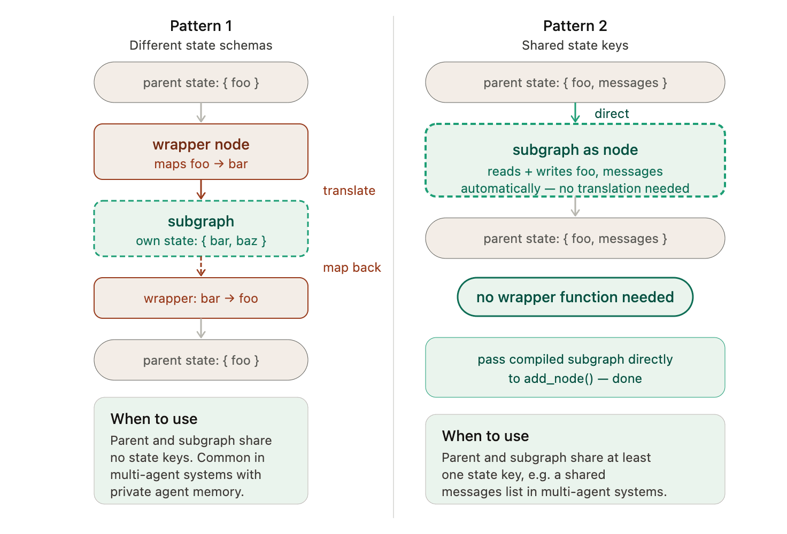
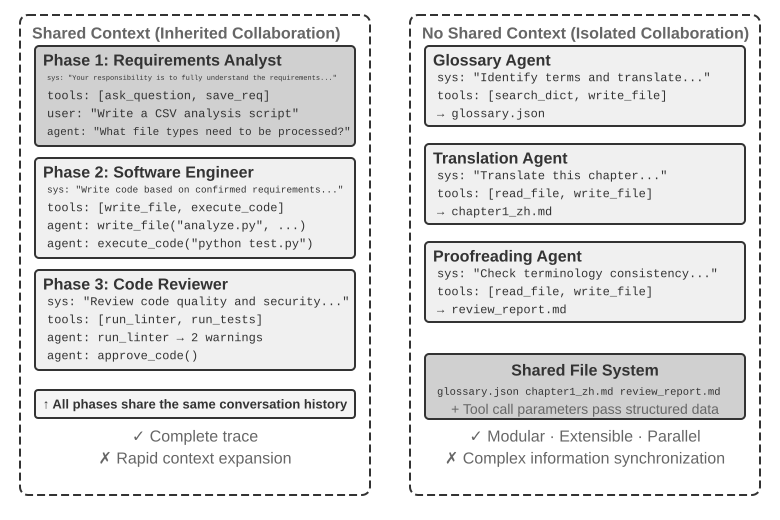
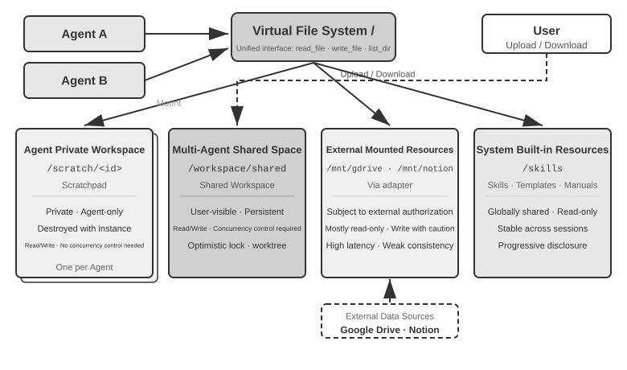
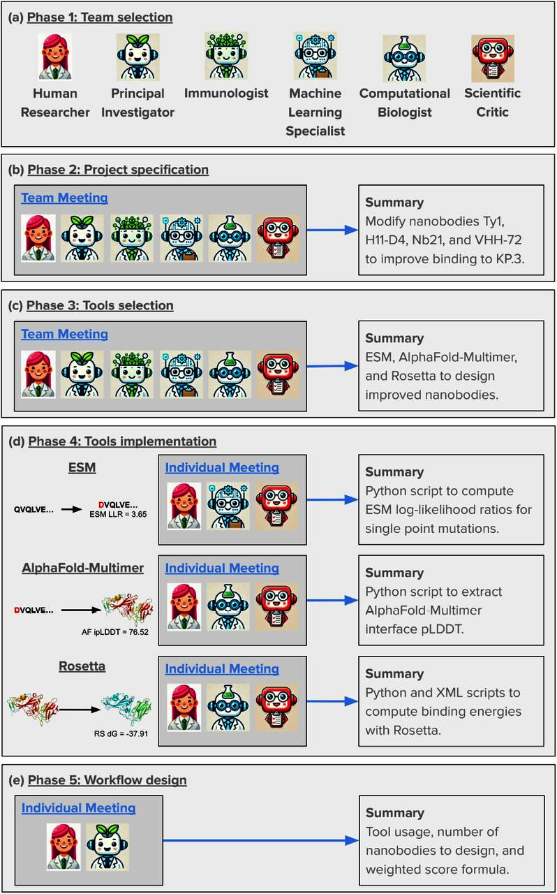
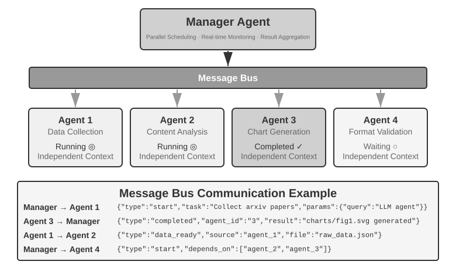
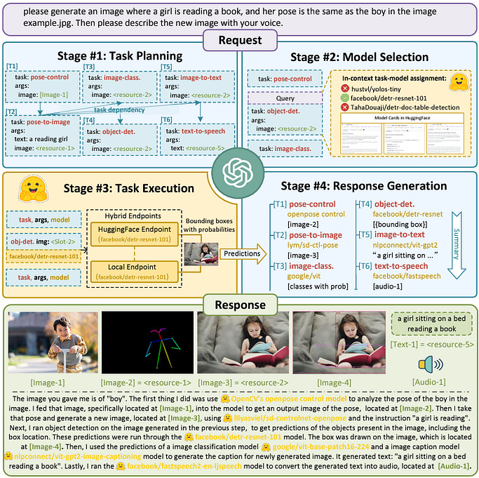
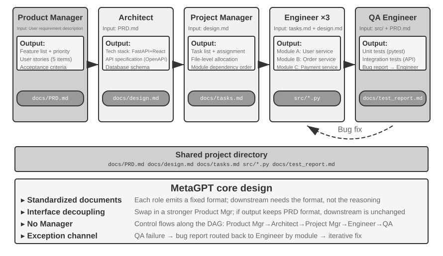
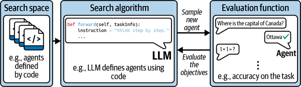

# 5 — Topology Patterns

> The handful of shapes that recur, what each costs, how each fails, and how the same shapes look in Claude Code.

Teams pick a topology by reputation. They reach for a supervisor or a debate and find out in production that a substring match routed a tool result back into the loop, or that a self-review ratified a hallucination. Only a handful of shapes recur, and each has a known cost and a known way to fail. This chapter names them, shows them in Claude Code, and asks when collaboration brings in anything new.

---

## The catalogue

| Pattern | Shape | Use when | Costs | Fails by |
|---|---|---|---|---|
| **Generate-then-verify** | produce → check → back-edge | The job splits into a produce step and an independent check | One extra node per cycle | Checker sees the producer's reasoning and agrees with it |
| **Supervisor** | router → specialists → router | Work arrives in several kinds that need different handling | A routing call per turn | Mis-routing; the supervisor becomes a bottleneck |
| **Fan-out / fan-in** | split → N parallel workers → merge | Many independent items, then one combined result | Tokens scale with N | Missing reducer; redundant findings; correlated errors |
| **Hierarchical** | a subgraph as one node of a parent | A sub-topology is reused or owned by another team | State mapping at the boundary | Hidden cost; failures inside the subgraph are hard to see from outside |
| **Handoff** | agent writes status → edge reads it | Agents should pass control without knowing each other | A status key in the schema | Status values drift; nobody handles an unexpected one |

### Generate-then-verify

The highest-yield first graph ([02](02-graph-primitives.md#the-first-graph-generate-then-verify)). Draft-then-review, research-then-write, build-then-test. **The separation creates the value; parallelism is a bonus.** Put deterministic checks before the LLM checker, and bound the back-edge.

**Not every "actor-critic" loop qualifies.** Albada presents actor-critic as a lightweight quality gate: an actor proposes three candidate plans, a critic scores them 1–10 on a rubric (feasibility, cost, risk), and anything under 8 goes back with feedback. He recommends it when "evaluation is easier than generation", and calls it test-time compute that needs "no learning" (*Building Applications with AI Agents*, ch. 8). The trade-off he names, more inference cost for better output, is real. But in his example the critic is the same `llm` with the same history and no tools, so it is self-review. By the evidence [below](#when-multi-agent-beats-single-agent), self-review without new information is often neutral or harmful (Huang et al., ICLR 2024). The rubric only pays off when at least one of its criteria can be checked against something the actor didn't write: a cost computed in code, a constraint looked up, a simulation run.

Albada's code also shows three wiring faults to avoid when you copy the pattern:

- **Unbounded back-edge.** The critic routes back whenever the last message contains `"regenerate"`, and nothing counts the attempts. The only stop is `recursion_limit`.
- **A substring router.** Routing on `"regenerate" in content` turns any tool output that happens to contain the word into another loop. Route on a structured field (`verdict: Literal["accept", "revise"]`) instead.
- **Off-schema state.** The actor writes `state["candidates"]`, but `AgentState` only declares `operation` and `messages`, so there is no channel for it. Both nodes also return `history + new` into a key whose reducer is `operator.add`, which appends the whole history a second time on every pass. Declare every key you write, and return only the delta ([03](03-state-and-reducers.md#reducers-decide-merges)).

### Supervisor

A coordinator node classifies each incoming task and dispatches it to a specialist, then decides whether the work is done or needs another specialist. It is the settled baseline for most multi-agent work: the orchestrator holds the plan, and the workers run in isolated contexts. n8n's AI Workflow Builder is a production example: a supervisor routing to five specialist subgraphs ([08](08-governance-and-production.md#case-study-n8ns-ai-workflow-builder)).

Specialise by prompt first. n8n runs every specialist on the same model at temperature 0, and the roles differ only by system prompt. A separate model per node is an optimisation you justify with measurements, not the starting point. LLMSelector (Chen et al., [arXiv:2502.14815](https://arxiv.org/abs/2502.14815), Microsoft Research, Stanford, Princeton and Berkeley, 2025-02, preprint) shows what the measurement can buy and what it costs. On fixed 2–6-module pipelines (self-refine, debate, locate-then-solve) with 10 candidate models, it picks a model per module. Each module is scored by an LLM judge that sees the gold answer, which matters because, in the TableArithmetic case study, end-to-end accuracy alone left greedy search stuck at a local optimum. On four real tasks, it **beat the best single model used everywhere by 5–9 points** (the paper's own gains row prints 5–11) (e.g. LiveCodeBench 95% vs. 89%, SimpleQA 28% vs. 21%). The 56–70-point gains are on two synthetic 100-question tasks built so that no one model can do both steps. Its worked examples show the mechanism: same-model debaters repeat one wrong answer, and a model reviewing its own draft agrees with its own mistake. It needs a labelled half of each dataset to search on. It reports no variance and no token or latency cost, and it covers static pipelines only.

A router over models only means something if the models behave differently. Huot, Kaisers & Lapata ([arXiv:2607.09197](https://arxiv.org/abs/2607.09197), Google DeepMind, 2026-07, preprint) measured behavioural diversity from which questions each model gets right. In EmbedLLM's pool of 112 models (36,054 questions), **9 well-chosen models captured most of the pool's diversity**, and in RouterBench's 11, four did. They also checked whether a router sends a query and its paraphrases or typo'd variants to the same model. Embedding-KNN routers gained clean accuracy on specialist societies but fell to near-random routing on perturbed queries. On the paper's synthetic specialist society, a prompted LLM router (Gemini 3.1 Flash-Lite) stayed within five points of its clean accuracy under perturbation. The tests are single-turn and use model pools, not prompt-specialised roles inside an agent graph. Before adding a model per node, check that the candidates fail on different inputs, and that the router gives the same answer for a reworded query.

**A coordinator in the prompt is not a supervisor in the graph.** Destefanis & Aste ([arXiv:2608.16801](https://arxiv.org/abs/2608.16801), 2026-08, preprint) logged every message and file read and write in 1,902 graded runs of Claude Code agent teams (claude-sonnet-4-6, two synthetic Python tasks, 1 to 8 agents, with a 16-agent arm on one task). Naming one agent "coordinator" in the prompt produced no hub: **at eight agents, 0 of 1,170 channels carried a disproportionate share of traffic**, so no agent became a centre. In a replication where the grading tests were moved out of the agents' reach, flat and coordinator teams succeeded equally often (for example 26/31 vs. 23/31, p = 0.53). The task set the shape instead. A shared-spec task grew a dense mesh, and a pipeline task a sparse neighbour-to-neighbour chain. Two more findings bear on design. **Splitting work creates interfaces nobody owns**: an 8-step chain succeeded 9/10 with two or four agents and 0/10 with eight agents of one step each, every failure on the same rounding hand-off, which the agents had discussed in all ten runs. And **mandating shared files over messages cut output tokens by about 42% at eight agents** on the message-heavy task, but raised them 10–17% on the pipeline. What it does not test is an enforced supervisor that routes, so it is evidence against a coordinator by label, not against the pattern. Ten runs per cell gives about ±30 points, and identical prompts in two sessions gave different message-growth exponents (1.76 vs. 2.44), so judge a configuration by a distribution of runs, not one.

**How a supervisor mis-routes in practice.** Albada's supply-chain supervisor routes to inventory, transportation or supplier specialists. It asks the model to "Output ONLY the selected member's name … nothing else". The router then lower-cases the reply and compares it to the three names, with `else: return END` as the fallback (*Building Applications with AI Agents*, ch. 8). Two things go wrong:

- **Silent ending.** Any reply that isn't exactly a name ("Inventory.", "the inventory specialist") ends the run. The user's answer is then the supervisor's one-word label.
- **Crash instead of fallback.** The conditional edge's path map lists only the three specialists. LangGraph raises on a return value the map doesn't list, so the "fallback" crashes instead of ending.

The fix is a schema, not a firmer prompt ([02 has the code](02-graph-primitives.md#a-router-fails-silently-unless-you-make-it-fail-loudly)). Use `with_structured_output` over a `Literal["inventory", "transportation", "supplier", "unknown"]`, and route `unknown` to a clarify or escalate node that exists in the graph. Albada's prose also describes the supervisor routing a disruption to transportation "while the inventory specialist concurrently scales" the warehouse. Its code can't do that: it picks exactly one specialist, and every specialist edge goes to `END`. Concurrent specialists need fan-out ([below](#fan-out--fan-in)), not a supervisor.

When the specialists outgrow one agent's tool list, Albada gives two remedies to try before splitting into agents: **hierarchical tool selection** (group tools behind a few coarse tools) and **semantic tool selection** (embed the tool descriptions and retrieve the top k per query). The supervisor split only pays once the tool count or the roles' prompts actually conflict.

### Fan-out / fan-in

Several workers run at once on independent branches, and a synthesiser merges their results into shared state. It wins on wall-clock time and costs tokens. Use `Send` when N is only known at runtime, and give the merge key a reducer ([03](03-state-and-reducers.md#dynamic-fan-out-the-send-api)).

**The parallel review graph** is the canonical fan-out: a planner sets objectives, a worker produces, then security, logic and style reviewers run **in parallel**, a synthesiser collects their findings, and a pass/fail gate routes feedback back to the worker. [flowtivity](https://flowtivity.ai/blog/graph-engineering-2026-guide-openclaw-codex/) reports it as ~3× faster than the sequential version on code review. That is a vendor figure: build the graph as a subgraph, time it against the sequential version on your own repo, and quote your number instead.

**Mixture-of-Agents** ([arXiv:2406.04692](https://arxiv.org/abs/2406.04692), Wang et al., 2024-06, preprint) stacks fan-out/fan-in in layers: every agent reads all of the previous layer's answers, and one aggregator writes the last. With 6 open-source proposers, 3 layers and Qwen1.5-110B-Chat aggregating, it reached **65.1 vs. 57.5 for GPT-4o** on AlpacaEval 2.0 (length-controlled win rate, automatic judge). The gain on MT-Bench is small (9.25 vs. 9.19), it spends 6 proposer calls per layer where GPT-4o spends one, and no token appears until every layer has finished. Rethinking it ([arXiv:2502.00674](https://arxiv.org/abs/2502.00674), Li et al., 2025-02, preprint), **6 samples of one model (WizardLM-2-8x22B) scored 65.7 vs. 59.1** for the mixed 2-layer MoA on AlpacaEval 2.0 with the same aggregator; mixing paid only for similar-quality models with different strengths, by at most 0.35 points over one-model Self-MoA (7B models, mixed MMLU, CRUX and MATH task).

### Hierarchical: subgraphs

A compiled graph can be added as a node in another graph. That gives you nested orchestration and reusable sub-topologies: build the review graph once, then drop it into any pipeline that needs review.

```python
review = review_builder.compile()          # a whole graph
parent.add_node("review", review)          # used as one node
```

How state crosses the boundary:

| Parent and child schemas | What to do |
|---|---|
| **Share keys** | Add the compiled subgraph directly; shared keys flow in and out |
| **Differ** | Call the subgraph inside a wrapper node that maps parent state → child input and child output → parent update |


*Image Source: LangGraph docs, subgraphs (LangChain), via sources/langgraph_extended.pptx*

The wrapper is more code, and usually worth it: it makes the subgraph's contract explicit, and it stops a child from writing parent keys it shouldn't touch.

### Handoff

An agent signals completion by writing a designated state key; a conditional edge reads that key and picks the next agent ([03](03-state-and-reducers.md#handoffs-live-in-state)). Coupling lives in state, not in code. Always route unknown status values to an explicit error node rather than letting the router throw.

---

## The same patterns in Claude Code

The concepts already exist in Claude Code under different names:

| Graph concept | Claude Code |
|---|---|
| **Node** | A subagent: *"a separate agent instance with its own context window, its own system prompt, and scoped tool access"* |
| **Edge** | The main session's decision about which subagent to spawn, when, and with what brief |
| **State** | Return values: *"a subagent's final output flows back to the orchestrator, which passes the relevant piece to the next node"* |
| **Deterministic edge** | A hook: when probabilistic routing isn't good enough, a hook *guarantees* the transition |
| **Programmatic topology** | The Claude Agent SDK: define the graph in code, so it can run unattended and be tested |

Three implementation levels, in increasing order of determinism:

1. **Markdown subagents** in `.claude/agents/`: the fastest way to stand up a multi-node graph.
2. **Hooks as deterministic edges**: a pass/fail gate that runs code, not a model.
3. **Agent SDK**: a programmatic graph for unattended operation.

What you lose compared with LangGraph: there is no typed shared state, no reducers, and no checkpoints. State is whatever the orchestrator chooses to pass along, which is a context firewall when you want one ([03-harness note 07](../../03-harness-engineering/notes/07-orchestration.md)) and a liability when you need resume.

This repo's `/review` skill has the same shape: it sends a target to independent reviewers and merges what they report.

---

## Choosing a pattern

1. Is there a produce step and an independent check? → **generate-then-verify**. Start here.
2. Do tasks arrive in different kinds? → **supervisor** over specialists.
3. Are there many independent items? → **fan-out / fan-in** with a reducer.
4. Is a sub-topology reused, or owned by someone else? → **subgraph** with a wrapper node.

Patterns compose. A supervisor can dispatch to a fan-out subgraph whose workers each run generate-then-verify. Add each layer only when one of the five signals in [01](01-graph-vs-loop.md#the-default-plus-an-escalation-rule) forces it.

---

## Two design dimensions

Li's *AI Agents in Depth* ([ch. 10](https://github.com/bojieli/ai-agent-book/blob/main/book-en/chapter10.md)) separates two questions that the catalogue above blurs: **does the context get shared**, and **who decides what happens next**.

### Shared vs. isolated context


*Image Source: Li, AI Agents in Depth, ch. 10, Fig. 10-1 (Apache-2.0)*

The analogy is threads vs. processes. Agents with shared context see one trajectory, like threads sharing memory; nothing is lost in transfer, but everything accumulates. Isolated agents each have their own window, like processes, and communicate only through what they explicitly pass.

| Criterion | Share context | Isolate context |
|---|---|---|
| Subtasks | Tightly coupled; each needs the earlier reasoning | Separable; each needs only a brief |
| Window | Cumulative trajectory fits comfortably | Cumulative trajectory would blow the window |
| Parallelism | Sequential is fine | Workers must run at once |
| Isolation | Roles can see each other's work | A role must not see another's (e.g. a verifier) |
| Cost | One cache-friendly trajectory | N contexts, each paying its own prefix |

Rule of thumb: **if the cumulative context would exceed about half the window, don't share; if the task demands zero information loss, share.** Hybrid systems often share early (requirements and design in one trajectory) and switch to an explicit handoff once the work splits.

Two shared-context mechanisms from Li's labs:

- **Staged system prompts.** One agent, one trajectory, but the system prompt and tool set change by stage: requirements → implementation → review. Transitions are tool calls (`complete_requirements_analysis`, `submit_for_review`, then `approve_code` or `request_revision`), so the stage machine is explicit and can roll back.
- **Role transfer.** `transfer_to_agent(target_role, reason)` swaps the active role over the same history: triage → research → data analysis → writing → back to triage. Guard against circular handoffs with a counter.

### Topology: peer, manager, decentralised

| Topology | Who decides next | Maps to |
|---|---|---|
| **Peer** | Two or more agents of equal standing, usually proposer + reviewer | Generate-then-verify |
| **Manager** | One agent plans and calls the others as tools | Supervisor; fan-out / fan-in |
| **Decentralised** | Each agent picks its successor | Handoff |

Li treats topology as the multi-agent subset of graph engineering ([01](01-graph-vs-loop.md)). Communication runs over three channels: **tool parameters** (the brief and the return value), a **shared file system**, and a **message bus**. The first two are the two classic IPC paradigms, message passing and shared memory. Go's maxim applies: *"don't communicate by sharing memory; share memory by communicating."*

---

## When multi-agent beats single-agent

Li's test (*AI Agents in Depth*, ch. 10, Table 10-1) is one question: **does the collaboration introduce information the single agent didn't have?**

| Collaboration | New information? | Evidence |
|---|---|---|
| **Self-review** (same model reviews its own output, no tools) | No | Often neutral or harmful: Huang et al. (ICLR 2024); the TACL self-correction survey ([arXiv:2406.01297](https://arxiv.org/abs/2406.01297)). CRITIC's gains vanish when the tools are removed. |
| **Debate** among copies of one model | No | On multi-hop QA (FRAMES, MuSiQue) at matched thinking-token budgets, a single agent was best or statistically tied at every budget above 100 tokens, across Qwen3, DeepSeek-R1 and Gemini 2.5 (Tran & Kiela, [arXiv:2604.02460](https://arxiv.org/abs/2604.02460)); debate was the strongest multi-agent variant but still didn't beat it. The argument is the data-processing inequality: recombining the same information can't add any |
| **Execution, tool or visual feedback** | Yes | Large gains. RLEF ([arXiv:2410.02089](https://arxiv.org/abs/2410.02089)) trains on execution feedback; WebGen-Agent's screenshot feedback took Claude 3.5 Sonnet from 26.4% to 51.9% |

The data-processing argument assumes the single agent uses its context perfectly, and Tran & Kiela flag that as its boundary. When they degraded the context (Qwen3-30B on MuSiQue 4-hop at a 1,000-token thinking budget, with 70% of the context tokens masked or swapped for random tokens), a sequential multi-agent pipeline beat the single agent; at 30% the single agent still led. Splitting can pay when one context is too long or too noisy to use well, which is a context problem, not new information.

Ao, Gao & Simchi-Levi ([arXiv:2603.26993](https://arxiv.org/abs/2603.26993), MIT, 2026-03, preprint) prove the argument for any acyclic graph of agents. If no node receives a signal from outside, **the network can do no better than one Bayes-optimal decision maker who sees the same evidence**, whatever the roles, messages or rounds. What a pipeline loses is exactly how far each hand-off distorts the posterior. Transcript length, role count and round count are the wrong proxies, and an extra stage costs nothing if it passes the posterior on intact. A verifier can only help if its signal is not redundant given what it reads, so self-critique that rereads the draft cannot raise the ceiling, while executable tests can. Their MMLU experiments are deliberately worst-case, because the relay stages never see the question. On 200 questions, gpt-4.1-mini fell **from 90.7% alone to 41.2% with two agents and 22.5% with five**, below chance. On a 50-question subset, relaying a probability vector instead of prose held a 3-stage chain at 75.2% vs. 58.1%. A redundant second Wikipedia specialist added nothing, while a tool over a knowledge base the model had never seen took accuracy from 24.3% to 82.7%. The theorem stops at private signals. Once agents hold different evidence, the problem becomes a team-decision problem, where the reduction fails. Two OpenAI models were tested, and some figures in the paper disagree with its tables, so use it for the shape of the argument and not for the percentages.

Kim et al. ([arXiv:2512.08296](https://arxiv.org/abs/2512.08296), 2025-12) add a second test from 260 controlled configurations: once a single agent already scores above about 45% on a task, adding agents had negative returns ([06](06-when-not-to-build-a-graph.md#what-fan-out-costs)).

Hold the information fixed and topology mostly moves the bill. Nechepurenko & Shuvalov ([arXiv:2605.03310](https://arxiv.org/abs/2605.03310), 2026-05, preprint) gave five topologies the same model (claude-opus-4-6), tools, prompt scaffold and 100 prediction-market questions with web search off. Brier scores ran **from 0.153 for a sequential pipeline to 0.181 for consensus alignment, and no pair differed after Bonferroni correction** (smallest uncorrected p = 0.075). Cost differed far more: an independent ensemble at $0.10 per question (Brier 0.159) beat an orchestrator with specialists at $0.31 (0.162) and peer-critique debate at $0.23 (0.170) on both axes. No configuration beat the market price (0.152), which is the point of the setup. With no new information the agents had nothing to add, so the result is the new-information test run as an experiment. It covers one model and one task family, and the authors estimate that about 500 questions would separate only the four pairs involving consensus alignment, about 2,500 most of the rest, and that one pair cannot be told apart at all.

So a reviewer earns its node when it can **run something**: tests, a browser, a search, a type checker. A reviewer that only rereads the text is the same model a second time.

A critic that reports to a **person** is a different case, because the person did not have its critique. Saunders et al. ([arXiv:2206.05802](https://arxiv.org/abs/2206.05802)) (OpenAI, 2022-06, preprint) fine-tuned one model to critique topic-based summaries (trained on passages under ~2,000 tokens, tested as an assistant on passages of 2,048–3,840). **Labelers shown eight model critiques found about 50% more flaws, and found a deliberately planted flaw 45% of the time against 27% unassisted**, in about the same time per task. Three limits come with that result. Labelers edited only 15.3% of the critiques they used, so people mostly take the critic's word. Refining an answer with the model's own critique helped only the largest models, and beat plain refinement only when the critique was picked best-of-N. And the model could tell an answer was flawed more often than it could say why, a gap that did not close with scale. These are 2022 supervised-only models on a task humans finish in about ten minutes, so the 50% figure is a starting point for your own measurement, not a constant.

More steps alone also plateau. Budget-aware tool-use work (Google, 2025; BAVT, 2026) finds that agents spend steps poorly unless told their budget, so the manager should **allocate step budgets per worker** rather than let each run until it feels done. And the bill is real: Anthropic's research system uses about 15× the tokens of chat, and token usage explains about 80% of the performance variance ([06](06-when-not-to-build-a-graph.md#what-fan-out-costs)).

---

## How multi-agent systems fail

Cemri et al. ([arXiv:2503.13657](https://arxiv.org/abs/2503.13657), 2025) found 40–80% of tasks fail in the multi-agent systems they studied, and sorted 14 failure modes into three groups:

| Category | Examples |
|---|---|
| Specification issues | ignoring the role or task spec, repeating steps, losing context, not recognising completion |
| Inter-agent misalignment | conversation resets, not asking for clarification, derailment, withholding information, ignoring other agents, reasoning that does not match action |
| Task verification | missing or weak checks, premature termination |

The taxonomy comes from expert annotation of about 150 conversation traces, each averaging over 15,000 lines. No single cause dominates: failures spread across all three categories, and they are correlated. A bad architecture, for example, causes inefficient communication downstream, so fixing one mode rarely fixes the system (*Building AI Agents with LLMs, RAG, and Knowledge Graphs*, ch. 11).

Four named problems come specifically from orchestration:

| Failure | Shape | Mitigation |
|---|---|---|
| **Loop oscillation** | Two nodes bounce work between them indefinitely | Iteration counters on cyclic edges; forced escalation |
| **Context pollution** | Nested workflows leak state upward, defeating isolation | Explicit boundary schemas; return summaries only |
| **Concurrency collision** | Parallel branches write the same state or file | JoinNode barriers; per-branch ownership of state keys |
| **Consensus deadlock** | Reviewer agents never agree, blocking progress | Tie-break rule, majority threshold, or a final arbiter |

The opposite fault is stopping too early. A majority can form in one refinement round and dissolve in the next, once agents have read each other's reasoning. Aegean (Ruan et al., [arXiv:2512.20184](https://arxiv.org/abs/2512.20184), NUS, 2025-12, preprint) borrows from crash-fault consensus (Paxos, Lamport, ACM TOCS 1998; Raft, Ongaro & Ousterhout, USENIX ATC 2014). It finalises only when a quorum of α agents agrees **and** that answer has held for β consecutive rounds, and an overturned candidate resets the count. With 3 agents on GSM8K, β = 1 (stop at the first majority) scored 85% and β = 2 about 98%, and larger β only added time. Raising the quorum above a majority bought no accuracy on IMO and cost 17–26% more latency. Against a barrier-synchronised baseline with a fixed round cap, latency fell 1.2–20× (the 20× is AIME at 1 request/s against a 6-round cap) with accuracy within 2.5 points. Its failure model is fail-stop only, so a stable majority that is wrong still finalises. The tasks are maths and multiple-choice, with no error bars. The design lesson carries over: end on stability, not on a round count.

A deadlock is not always a fault to break. Wawer & Chudziak ([arXiv:2606.04223](https://arxiv.org/abs/2606.04223), 2026-06, preprint) argue that on value-laden tasks the aggregator should route on *how* agents disagree rather than force a vote. It compares the similarity of the agents' reasoning traces with whether their decisions agree. Similar reasoning with split decisions is a conflict of values, so it escalates to a person. Divergent reasoning signals ambiguity, so it fetches more context. In a check on 600 items from the Measuring Hate Speech corpus, with five prompt-differentiated copies of one model, the two disagreement states had higher human-annotator disagreement than the two agreement states (Cohen's d = 0.80). As an escalation flag it reached F1 0.548, against 0.503 for trace divergence alone and 0.401 for random. It is a position paper: the routing policy is never run end to end, the base model and thresholds aren't reported, and it makes no claim for factual tasks, where such a split more plausibly signals inconsistency.

Two more problems are specific to many agents. **Hallucinations amplify**: one agent's invention becomes the next agent's input, so cross-validate claims that cross a handoff. **Failures are hard to attribute.** The fix is to **evaluate each component and the end-to-end result separately**. If the end-to-end eval fails while every component eval passes, the bug is in a handoff or integration. If one component eval fails, you know which agent to fix. Per-step traces (each agent's plan, prompt, tool calls and results) make that analysis fast.

---

## The runtime as an operating system

Li maps a multi-agent runtime onto an OS (ch. 10, Table 10-2):

| OS | Agent runtime |
|---|---|
| Program | Static prefix: system prompt + tool definitions |
| Process memory | The trajectory |
| CPU | The LLM |
| Kernel | The agent runtime |
| System call | Tool call |
| `fork` / `kill` / `ps` | `spawn_subagent` / `cancel_subagent` / `list_agents` |
| Exit code | The structured summary a sub-agent returns |

The Actor model (Hewitt, 1973) is the precedent: isolated actors that share nothing and communicate only by message. The analogy breaks in one place: **agents pass meaning, not bytes.** A message can be misread, so every interface needs a contract the receiver can check.

### A virtual file system with four areas


*Image Source: Li, AI Agents in Depth, ch. 10, Fig. 10-2 (Apache-2.0)*

| Area | Example | Access | Concurrency |
|---|---|---|---|
| **Private scratchpad** | `/scratch/<agent>` | One agent | None needed |
| **Shared workspace** | `/workspace` | All agents | Optimistic lock, or one worktree per agent |
| **Mounted external** | `/mnt/gdrive` | External permissions apply | Eventually consistent; mostly read-only |
| **Built-in read-only** | `/skills` | Everyone reads, no one writes | None needed |

**Pass file paths, not file contents.** The manager in Li's book-translation lab keeps only a file index; the chapters themselves never enter its context.

### The control plane

- **Message envelope:** sender, target, type (`task_assigned`, `status_update`, `result`, `terminate`) and a JSON payload.
- **Status.** Polling each agent is a poor fit. Have agents write status: an append-only **JSONL trajectory**, which works like a database write-ahead log and gives resume, audit and handoff for free (it is how Claude Code's resume works), or an agreed `progress.md`. A file's mtime that stops moving flags a stuck agent.
- **Termination.** Graceful (like SIGTERM: stop at a safe point, clean up, acknowledge) vs. forced. When two workers succeed at once, settle the race with a lock or idempotent writes. Cancel in cascade, like Go's `context`: when a parent is cancelled, its children see `ctx.Done()`; an agent meant to outlive its parent starts from a detached context.
- **Scheduling.** Token and step budgets, model tiering (a strong planner, cheaper workers), concurrency caps and preemption.

---

## Peer, manager and decentralised in practice

### Peer: proposer and reviewer

Peer collaboration exists mostly to stop **premature termination**, which comes in three forms: the lazy fake "done", the premature give-up, and the false claim of success. The cure is verification, which is why Loop Engineering puts it bluntly: *"the bottleneck of the loop is the verifier"* ([04-loop](../../04-loop-engineering/README.md)). Debate, brainstorm and panel formats are peer variants; by the new-information test they help only when the panellists bring different tools or sources.

**A worked peer system: the Virtual Lab** (Swanson et al., 2024, via *Building AI Agents with LLMs, RAG, and Knowledge Graphs*, ch. 9). A human sets the question. A Principal Investigator agent writes the role, expertise and goal prompts for a team of scientist agents (GPT-4), plus an optional critic. Work then happens in two kinds of meeting:

- **Team meetings.** All agents take part over a fixed number of **rounds**. The PI opens, every scientist and the critic respond, and the PI summarises, decides and asks follow-ups. It writes a final summary for the human.
- **Individual meetings.** One agent does a task such as writing code, usually with the critic, for a few rounds. Optionally the same task runs as several parallel meetings, which the PI then merges.

Every meeting has the same input contract: agenda, agenda questions, optional rules, summaries of earlier meetings, extra context, and the round count. The round count is the bound on the back-edge.


*Image Source: Salvatore Raieli & Gabriele Iuculano, *Building AI Agents with LLMs, RAG, and Knowledge Graphs* (Packt, 2025), Fig. 9.26*

On nanobodies against the SARS-CoV-2 KP.3 spike, the lab built a design workflow whose candidates were then validated in the wet lab. Three design choices make it more than debate. **Summaries, not transcripts**, cross meeting boundaries, which is the handoff package [below](#decentralised-orchestration-vs-choreography). **The critic is a separate role.** **The individual meetings run tools.** Raieli & Iuculano are candid about the limits. Agents suggest out-of-date tools because of their training cut-off (add RAG or search). The agenda and prompts are hand-crafted. Without a human pushing, agents "may give vague answers or not make decisions", or drift off task. This is human-led multi-agent work, not autonomy.

### Manager: agents as tools


*Image Source: Li, AI Agents in Depth, ch. 10, Fig. 10-6 (Apache-2.0)*

To the manager, each sub-agent is a tool call that returns a structured summary. The weak point is the **planner**: a bad plan sinks every worker. Plan-and-Act ([arXiv:2503.09572](https://arxiv.org/abs/2503.09572)) invests in the planner rather than the workers. It fine-tunes a dedicated LLaMA-3.3-70B planner on synthetic plans written back onto successful trajectories, and it **replans after every executor step** instead of committing to the first plan. Dynamic replanning took web-navigation success to 53.9%, and adding chain-of-thought to 57.6% on WebArena-Lite. That doesn't contradict the advice to give a reviewer roughly the same capability as the agent it reviews; planner and reviewer are different roles.

Baidu's AI Search blueprint (Li et al., [arXiv:2506.17188](https://arxiv.org/abs/2506.17188), 2025-06, preprint) takes the opposite bet. Its planner commits to the whole plan in one pass and repairs it locally. A Master agent judges how complex a query is and picks a team: a Writer only, an Executor plus Writer, or a Planner in front of both for complex queries. The Planner emits the full task DAG at once, with each node bound to at most one tool. The Executor runs it layer by layer in topological order, with each layer in parallel, and passes outputs along edges into the next node's arguments. When a node fails, the Planner rolls back and replans only the affected subgraph, and the Master adds nodes when results come back incomplete. In blind side-by-side human ratings against Baidu's legacy search, the gain was **0 on simple queries, +5% on moderately complex ones and +13% on complex ones** (net win rate, p < 0.05, sample size not given). An online A/B test on 1% of traffic moved four engagement metrics by 0.5–1.9% (change-query rate down 1.45%; page views, daily active users and dwell time up). The paper is a design blueprint. It has no ablation of the DAG planner against ReAct-style replanning or against a single agent, and no token or latency data behind its claim that one-pass planning saves tokens. What it does show is a working team-by-complexity router, with the planner reserved for the queries that need one.

**The ancestor: HuggingGPT** (Shen et al., 2023, [arXiv:2303.17580](https://arxiv.org/abs/2303.17580), via *Building AI Agents with LLMs, RAG, and Knowledge Graphs*, ch. 9). It is the manager pattern with models instead of agents as the workers. ChatGPT is the controller, and hundreds of Hugging Face models are the tools.


*Image Source: Salvatore Raieli & Gabriele Iuculano, *Building AI Agents with LLMs, RAG, and Knowledge Graphs* (Packt, 2025), Fig. 9.7*

Three of its mechanisms still carry over:

- **Plans as a dependency graph.** Each subtask carries an id and a list of the ids it depends on. A `<resource>` placeholder stands for an upstream output and is replaced once that task completes. Tasks with no dependencies run in parallel.
- **Retrieve, then choose.** All the model descriptions won't fit in context, so model selection filters by task type, ranks by download count (a popularity proxy for quality), and gives only the top k descriptions to the LLM for a single choice. This is tool selection by retrieval before it had a name, though it ranks by popularity and not by embedding.
- **Hybrid execution.** Remote inference endpoints are tried first, with local inference as the fallback.

Its listed limits are the manager pattern's limits. **Efficiency:** three of the four stages are LLM calls. **Planning** is only as good as the controller. **Context** runs out (the paper says even 32K tokens falls short for connecting many models). **Instability:** the controller ignores instructions and breaks the program flow.

Li's labs show the two shapes:

- **Sequential:** the book translation lab runs Glossary → Translation → Proofreading under a manager that holds only the file index.
- **Parallel:** workers report over a message bus. Redis Pub/Sub has no persistence, so a worker that is down misses messages; RabbitMQ persists them. The parallel-search lab runs 10 searchers that broadcast `target_found`; the manager takes a lock, sends `terminate` to the rest, and times out any worker after 2 minutes.
- **Cross-modal:** a computer agent and a phone agent cooperate. The computer agent calls `initiate_phone_call_agent(purpose, required_info)`; the phone agent asks for one missing field at a time and reports each with `{"type": "info_collected", ...}`; messages crossing over are tagged `[FROM_COMPUTER_AGENT]` so the voice model doesn't read them aloud.


A manager tree needs rules for when it is done. OneManCompany (Yu, Fu et al., [arXiv:2604.22446](https://arxiv.org/abs/2604.22446), Huawei Noah's Ark and UCL, 2026-04, preprint) states its rules outright. A supervisor agent decomposes work into a tree whose leaves each go to one agent. Dependency edges may cross branches, and the union must stay acyclic, which is checked by cycle detection whenever a task is inserted. A parent resolves only when all its children do, so no subtask is dropped silently. A finished task unblocks its dependents only after the supervisor accepts it, and a rejection sends it back for decomposition under the same parent. Three review rounds escalate to a higher-level supervisor, a task times out after an hour, and a cost budget pauses the run. The project fails if every node is finished or blocked and the root is still open. When a skill is missing, an HR agent recruits a new agent, and a human approves the hire. On PRDBench's 50 project-level coding tasks (one-shot, no feedback) it reported **84.67% success against 69.19% for the best baseline**, at about $6.91 per task. The baselines are numbers copied from the benchmark paper, with no cost data, no single-agent control on the same Claude Sonnet 4.6 + Gemini 3.1 Flash Lite backend and no ablation, so take the rules from it, not the margin.

### Decentralised: orchestration vs. choreography


*Image Source: Li, AI Agents in Depth, ch. 10, Fig. 10-9 (Apache-2.0)*

Orchestration has a conductor; choreography has each agent know its next step. Choreography removes the bottleneck and the single point of failure, and makes the whole flow harder to see.

What each agent gets to see may matter more than who is in charge. Dochkina ([arXiv:2603.28990](https://arxiv.org/abs/2603.28990), 2026-03, preprint) compared four protocols on synthetic tasks scored by an LLM judge. In **Coordinator**, one agent plans and the rest work in parallel. In **Sequential**, agents run in a fixed order and each sees its predecessors' finished outputs and picks its own role. In **Broadcast**, agents announce intentions and then act. In **Shared**, all run in parallel over a common history. With 16 agents on the harder (L3) tasks, **Sequential beat Coordinator by 12–14% on all three models tried** (Claude Sonnet 4.6 0.875 vs. 0.767; DeepSeek v3.2 and GLM-5 similar, p < 0.001). In an 8-agent pilot with GPT-4.1-mini (L3 and L4 tasks averaged) it beat fully parallel Shared by 44%. Of the two models tested, letting agents organise freely helped Claude Sonnet 4.6 (+3.5%) and hurt GLM-5 (−9.6%). The author's reading is that completed outputs are better input than a plan or a stale history, but that mechanism is not ablated. The Coordinator's workers never see each other's work, so the comparison is partly sequential vs. parallel. The judge changed between series, and Sequential's latency grows with N. Quality stayed flat from 64 to 256 agents, but on easy tasks already near ceiling.

Anemoi (Ren et al., [arXiv:2508.17068](https://arxiv.org/abs/2508.17068), Coral Protocol, 2025-08, preprint) sits halfway between the two styles. A planner writes the initial plan. After that, the planner, the workers, a critic and an answer agent talk to each other directly in threads on an agent-to-agent MCP server, and they vote on the final answer. On GAIA validation (pass@3, GPT-4.1-mini planner, GPT-4o workers, OWL's tools) it scored **52.73% against 43.64% for OWL re-run by the authors** with the same models. The authors' own breakdown weakens that. Anemoi alone solved 25 tasks, and they attribute 40% of those to random variation between workers. OWL alone solved 10, and they attribute 90% of those to the same cause. It did worse than the original OWL on Level 3 tasks. A GPT-4o-mini planner could not use the protocol's tools at all, so direct messaging has a minimum capability of its own. 10.3% of the remaining errors came from agents waiting on a busy web agent that could not answer. There are no ablations and no cost numbers, and the authors are the protocol's vendor.

AutoScientists (Gao, Fang & Zitnik, [arXiv:2605.28655](https://arxiv.org/abs/2605.28655), Harvard, 2026-05, preprint) has no orchestrator at all, and its details are the useful part. Agents coordinate only through shared state: the current best result, an experiment log, a forum, a queue per team and a register of dead ends. They form teams by discussion and a majority vote, and they reorganise when a team stalls (for example, no gain in 10 experiments). Queue claims use optimistic locking. A new result replaces the champion only if it beats it by more than 2σ, where σ is measured from repeated seeds, and a smaller gain must be confirmed on a second seed. With 9 Claude Sonnet 4.6 agents, it reached the same nanochat validation loss in **34 experiments against 65 for a single-agent loop**. It averaged the 74th vs. the 66th leaderboard percentile on 24 BioML-Bench tasks (4 h on one H100 each, 16 h for the imaging tasks; standard errors of 6–7 points). The ablations show what each part is for. Without the shared state, 5 of 6 independent agents found the same first improvement within two experiments, spending about a third of the budget on duplicates. **Fourteen agents did worse than nine on all three tasks in the team-size sweep** (single runs), and on one assay the smallest crew won. The run cost about 4.4× the single-agent baseline ($3,985 vs. $910 across the 24 tasks). The ablations and most comparisons are single runs on one model, there is no centrally planned team of the same size to compare against, and the speed-ups count experiments, not wall-clock time, because the agents shared one GPU.

GitSwarm (Shah et al., [arXiv:2610.04862](https://arxiv.org/abs/2610.04862), Meta and Mila, 2026-10, preprint) makes the shared state a Git repository. Identical workers, with no planner, run asynchronously in their own worktrees. Each commit names its Git parent plus an `informed_by=` list of the commits it drew on, so a worker can build on one branch and use findings from others without merging. Two read-only views (the remaining budget and a log where each worker states its scope before editing) report state but assign no work. Workers end each episode by contributing, nominating a candidate or abstaining, and the commit with the most nominations wins. On a 50-task subset of ProgramBench with GPT-5.5 Codex workers, it scored **79.4% against 65.1% for one agent repeatedly told to continue**, at a comparable budget. The gains shrank at larger budgets, while input tokens grew with the repository. The winning solution's declared ancestry covered 82–93% of the graph, where Git parents alone reached about a quarter. About one ProgramBench worker in six abstained as redundant, which avoided duplicate commits but not the 6–7% of tokens already spent. On nine ProgramBench development tasks at 50 workers and three seeds, a central selector scored slightly higher than decentralised nomination (64.4% vs. 62.1%, within the noise; the paper does not claim equivalence), and a central aggregator scored lower (58.2%). There is no matched-compute or causal test of what the repository adds. Its headline research run assigned roles explicitly, and its parameter and token counts are not matched, so the evidence is the ProgramBench result and the reuse traces, not a proof that decentralisation is better.

> **A handoff package carries the task and its acceptance criteria, the confirmed facts and constraints, and paths to the artifacts. Never the full trajectory.**

That is design by contract applied to agents. How existing frameworks sit on the spectrum:

| Framework | Mechanism | How decentralised really |
|---|---|---|
| **MetaGPT** | A fixed SOP pipeline; a shared message pool that roles subscribe to; executable feedback | Communication is decentralised, control flow is not |
| **AutoGen group chat** | Shared history; a central speaker selector | Centralised selection; risks livelock (agents politely deferring forever) |
| **Swarm / OpenAI Agents SDK** | Each agent can hand off to others | Truly decentralised; needs a max-handoff guard against cycles |
| **A2A** | Agent Cards advertise capabilities; tasks move through `submitted` → `in-progress` → `needs-input` → `completed` / `failed`; agents stay opaque to each other | A protocol, not a topology |

**MCP connects an agent to tools; A2A connects an agent to other agents.**

Albada's A2A walkthrough (*Building Applications with AI Agents*, ch. 8) shows the moving parts. An Agent Card lists identity, capabilities with input and output schemas, an endpoint, auth methods and a version. Discovery goes through a registry, then a handshake settles protocol version, timeouts and payload limits. Calls are JSON-RPC 2.0 over HTTPS, with `-32601 Method not found` for unknown methods. Two cautions. Albada serves the card at `/.well-known/agent.json`; the well-known path has changed between spec versions, so check the current A2A spec before hard-coding one. And Albada calls the protocol "still in its infancy": authentication is pluggable, but authorisation, rate limiting, trust establishment and abuse resistance are "far from solved". Treat a remote agent's output as untrusted input.

### Agent societies

At the far end, there's no task at all, only agents living together. Smallville's generative agents keep a memory stream scored by importance, recency and relevance, plus reflection and planning; a Valentine's party emerged from one seeded intention. Agentopia ([arXiv:2606.07513](https://arxiv.org/abs/2606.07513) (Wang et al., 2026-06, preprint)) runs three worlds of 100 agents each for ten simulated years on a weekly Plan → Contact → Activity → Review loop. Fine-tuning Qwen3.5-397B on the yearly trajectories of the top 25% of agents by return gain (from years 1–4) raised the number of peers who respect an agent by 24.2% and who like it by 15.9%, averaged over four-year runs in two worlds. Mutual liking rose only 5.9%, skill advances fell 29.6% and material fulfillment fell 14.8%, the gains were absent in year 1, and no repeated runs or variance are reported. Vending-Bench Arena showed price wars and collusion between competing agents. For games like Werewolf, the book's lesson is to make the **judge code, not a model**, and to enforce who can see what in the runtime rather than in prompts.

Coordination can emerge without a single message. Riedl ([arXiv:2510.05174](https://arxiv.org/abs/2510.05174), ICLR 2026) gave groups of 10 GPT-4.1 agents a number-guessing game in which they saw only the group's "too high / too low" signal (200 groups per condition). He used information-theoretic measures of synergy (partial information decomposition, Williams & Beer, 2010) to separate a mere aggregate from a group that acts as one. With plain prompts the group behaved as an aggregate. Personas made agents differentiate in stable, identity-linked ways. Adding "think about what the other agents might do" produced complementary roles and was **the only condition whose group-level alignment (triplet mutual information and stability) differed significantly from zero (p ≈ 3×10⁻¹⁴)**. That is a pairwise-aligned, redundant state, not extra irreducible synergy; plain and persona groups also showed temporal synergy. **Success rates did not differ significantly across the three prompts.** Success improved only when synergy and redundancy were both present (interaction β = 0.24, p = 0.014). Which personas were used did not matter, only that there were some, and in a separate 7,150-run sweep over group sizes 3–15, each extra member cut the odds of success by about 8%. It is one minimal task, with no topology and no comparison against a single agent, so read it as evidence that prompts change how a group is organised, not that they make it better.

---

## Searching for the topology: ADAS

Everything above is hand-designed. **Automated Design of Agentic Systems** (Hu, Lu & Clune, ICLR 2025, [arXiv:2408.08435](https://arxiv.org/abs/2408.08435), via *Building Applications with AI Agents*, ch. 8) treats the topology itself as something to search. An agent is a Python `forward()` function. A meta-agent writes new ones, and an evaluation function scores them.


*Image Source: Michael Albada, *Building Applications with AI Agents* (O'Reilly, 2025), Fig. 8-1*

**Meta Agent Search** loops for about 25–30 generations:

1. Condition the meta-agent on an archive of earlier agents and their scores.
2. Draft a design, then implement it as code.
3. Run two self-reflection passes, one for novelty and one for correctness.
4. Evaluate on validation data, allowing up to five debugging retries on errors.
5. Archive the result with a bootstrap confidence interval as its fitness.

Reported results against hand-designed baselines:

| Benchmark | MAS-discovered agent | Margin over best baseline |
|---|---|---|
| DROP (F1) | 79.4 ± 0.8 | +13.6 over Role Assignment |
| MGSM | 53.4% ± 3.5 | +14.4 over LLM-Debate |
| MMLU | 69.6% ± 3.2 | +2.0 over OPRO |
| GPQA | 34.6% ± 3.2 | +1.7 over OPRO |

Read the table with its error bars. On DROP and MGSM the gain is far outside the interval. On MMLU and GPQA the margin is smaller than the ±3.2 interval, so on those two the discovered agents are not distinguishable from prompt optimisation. Albada also reports that discovered agents transferred across domains (ARC agents applied to MMLU) and across models (GPT-3.5 to GPT-4).

Two practical points:

- **The evaluator is the attack surface.** Albada's `evaluate_forward_fn` runs each generated agent with `exec(forward_str, globals(), namespace)`, which is model-written code in your process with your globals. Run it in a sandbox ([03-harness note 04](../../03-harness-engineering/notes/04-execution-boundaries.md)).
- **The search optimises whatever the evaluator measures.** Keep a held-out test set the search never sees. It is the anchor of [07](07-failure-modes-at-scale.md#anchors).

**MaAS** (Zhang et al., ICML 2025, [arXiv:2502.04180](https://arxiv.org/abs/2502.04180)) searches for a distribution over layered topologies of eight operators (CoT, debate, self-consistency, refine, ReAct and others) and samples one per query, with early exit for easy queries. On gpt-4o-mini it averaged **83.59 on five math and code benchmarks vs. 82.25 for AFlow and 77.50 for one call**, and on MATH cost $0.42 to run vs. $1.66 (accuracy 51.82 vs. 51.28). A fully connected MacNet mesh averaged 75.00, below the single call, so denser is not better. These are single runs on small test sets, and removing the textual-gradient prompt tuning cost the most accuracy, so not all the gain is topology.

How much is topology worth once you search for it? **Codebook Agent** ([arXiv:2609.02264](https://arxiv.org/abs/2609.02264), Yu et al., 2026-09, preprint) learns a small codebook of good communication graphs from 300 logged runs per benchmark, then picks one per query with a single MLP call instead of LLM calls (2.4 ms vs. 301–396 ms). With 4-agent gpt-4o-mini teams it averaged **84.62 vs. 83.02 for the GTD graph-diffusion designer** on six math and code sets. Its side findings matter more for design. The topologies that score well collapse to about six distinct graphs, and **the best fixed graph (fully connected, chain or star) came within 1.4 accuracy points of every generated topology** the authors measured. Which fixed graph won varied by task (fully connected on MATH, star on HumanEval, and chain on MMLU in a 3-agent Qwen-3-8B transfer run, gaps up to 4.3 points). And **edge count correlated with measured tokens at r ≈ −0.4**: sparse graphs got longer completions, so the chain was the most token-expensive graph on every math benchmark, and a cost proxy that minimises edges maximises the bill. These are single runs on mostly homogeneous small teams, and the causal story for the sparse-graph cost is the authors', not tested. Try the three fixed graphs on your own tasks before you train a topology generator.

BIGMAS ([arXiv:2603.15371](https://arxiv.org/abs/2603.15371), Hao et al., CASIA, 2026-03, preprint) designs a graph per problem and joins it to a blackboard. It is modelled on Global Workspace Theory (Baars, 1988). A designer call writes the nodes and a read/write contract for each one. Nodes never message each other. They post validated structured writes (append, update or replace) to one workspace with read-only, working, system and answer areas, and a failed write never changes it. An LLM orchestrator routes only where a node has more than one successor. On 100-instance runs of three combinatorial puzzles (Game 24, Six Fives, Tower of London), it **raised accuracy for all six models tried**: Claude 4.5 Sonnet with thinking went from 57% to 93% on Tower of London, and DeepSeek-V3.2 from 25% to 36% on Game 24, against 30% for Tree of Thoughts. The designed graphs grew with difficulty, from about 3 nodes on Game 24 to about 5 on Tower of London. The price is that designing the graph took 19–37% of tokens and routing another 17–25%. Read the result with Codebook's in mind. BIGMAS has no ablation that separates the designed graph from the shared workspace, no fixed-graph control, no cost-matched baseline and no variance, so the gain may belong to the blackboard and the validated writes rather than to designing a graph per query.

Skill-MAS (Lin, Yang & Qin, [arXiv:2606.18837](https://arxiv.org/abs/2606.18837), Ant Group, 2026-06, preprint) evolves the instructions instead of the graph. A frozen meta-agent writes a multi-agent system from a SKILL.md-style document covering decomposition, agent roles and workflow topology. Each round rolls out every validation task five times, reflects on the tasks with the most uncertain and lowest scores, and edits the skill. Across four small or mid-size models (Gemini 3.1 Flash, GPT-5.4 Nano, Qwen3.5-Plus, DeepSeek-V4-Flash) on DeepResearchBench, HLE-Math, BrowseComp-Plus and VitaBench, the evolved skill **raised average scores to 27.6–41.1 against 21.3–35.7 for the best of five automatic-design baselines**. The starting skill was distilled from a vendor guide on building multi-agent systems, and it already matched the baselines on two of the four models. The rules it converged on read like this note: move from a linear chain to at most four parallel branches with one synthesis node, verify links between branches before merging, and let the merge node search for itself. Most of the change is prose, though. The "parallel" branches ran sequentially by contract. The node limits it wrote were not always obeyed, and one evolved skill told agents to give "plausible estimated values" instead of reporting missing data. Validation sets were 16–32 items, with no variance, and $9–59 of evolution cost is left out of the headline comparison.

Every search above pays for real LLM runs to score each candidate graph. Zhang et al. ([arXiv:2503.11301](https://arxiv.org/abs/2503.11301), 2025-03, preprint position paper) try to replace those runs with a GNN that predicts whether a workflow will succeed on a task. Each node is an embedding of its agent's system prompt, and the graph embedding is joined with the task embedding. The training set has 600k workflow–task pairs, from G-Designer and AFlow runs of about six nodes, labelled with GPT-4o-mini. Within one domain the predictors averaged **0.78 accuracy** on a binary label. A GCN beat an MLP on the raw prompt text by about 7 points, so the structure carries signal. Used as AFlow's reward, the GCN made the search **about 120× faster (19 s vs. 2,327 s) but lost about 0.1 in average score** (0.67 vs. 0.77 over HumanEval, MMLU and MBPP; MMLU alone 0.55 vs. 0.73). Trained on one domain and tested on another, accuracy fell to 0.33–0.68, some cells below chance. A surrogate is cheap only on the workload it was trained on, and labelling that workload means paying for the runs anyway. No variance or seeds are reported, and that labelling cost is left out of the speed-up.

---

## Transport: when agents leave the process

The graphs in this pillar pass state in memory. Albada's chapter traces what happens as agents spread across processes and machines (*Building Applications with AI Agents*, ch. 8). Each step up buys decoupling and costs consistency.

| Layer | Examples | Buys | Costs |
|---|---|---|---|
| **In-process** | Function calls, graph edges, in-memory routers (AutoGen) | Simplicity, low latency | Doesn't survive distribution or a crash |
| **Message broker / event bus** | Kafka (durable, partitioned, consumer groups, replayable), Redis Streams and RabbitMQ (lighter, lower latency; Redis durability is limited), NATS (+ JetStream for durable replay) | Senders and receivers decoupled; scale specialists independently; replay | Eventual consistency; error handling moves into every consumer |
| **Actor framework** | Ray (`@ray.remote`), Orleans (virtual actors), Akka | Per-agent state and identity; one message at a time per actor, so no races inside an agent; supervision and restart | Cluster operations; Albada's threshold is beyond roughly 10–20 agents or under tight latency |
| **Workflow engine** | Temporal; Airflow for batch DAGs; Dagger for local-to-CI | Durable steps, retries, resume after a crash without rerunning finished steps | Framework lock-in; activities must be idempotent |

What Albada's examples skip, and you shouldn't:

- **Redis Streams consumer.** Each specialist calls `xread` from `last_id = '0'` and filters on `task['agent']`. Every consumer reads every task, and a restarted consumer replays the whole stream from the beginning. Use consumer groups (`XREADGROUP` plus `XACK`) so each task is delivered to one worker and acknowledged. Make handlers idempotent, keyed on `task_id`, because a crash between doing the work and acking redelivers it.
- **Temporal retries.** `RetryPolicy(maximum_attempts=3)` reruns an activity that failed *after* its side effect, so a logistics message gets sent twice. Albada's specialists end by calling `send_logistics_response`. Put the side effect in its own activity with an idempotency key.
- **Actors per session.** One actor per (session, specialist), created lazily by a `SessionManager` actor, isolates state between sessions and serialises calls within one. But that manager is itself a single actor holding every handle, which makes it a bottleneck and a single point of failure.

LangGraph's checkpointer already gives in-graph durability ([04](04-durable-execution-and-interrupts.md#checkpointers)). Reach for a broker or a workflow engine when steps span services, days, or human approvals outside the graph runtime, not by default.

---

## Labs

From *AI Agents in Depth* ch. 10. All are linked upstream: the first three and 10-5 need API keys, and 10-6 and 10-8 run offline but their code and data are in Chinese.

| Lab | What it shows | Link |
|---|---|---|
| 10-1 Staged system prompt | One agent, three stages, tool-call transitions | [staged-system-prompt](https://github.com/bojieli/ai-agent-book/tree/main/chapter10/staged-system-prompt) |
| 10-2 Multi-role transfer | `transfer_to_agent` over a shared history | [multi-role-transfer](https://github.com/bojieli/ai-agent-book/tree/main/chapter10/multi-role-transfer) |
| 10-3 Book translation | Sequential manager; file index only | [book-translation](https://github.com/bojieli/ai-agent-book/tree/main/chapter10/book-translation) |
| 10-4/10-5 Phone + computer agents | Cross-modal manager; ask-one-fill-one | [TalkAct](https://github.com/19PINE-AI/TalkAct) |
| 10-6 Parallel web research | Fan-out over a message bus; lock and terminate | [parallel-web-research](https://github.com/bojieli/ai-agent-book/tree/main/chapter10/parallel-web-research) |
| 10-7 Generative agents | Smallville memory stream and reflection | [generative_agents](https://github.com/joonspk-research/generative_agents) |
| 10-8 Voice Werewolf | Code judge; information access control | [voice-werewolf](https://github.com/bojieli/ai-agent-book/tree/main/chapter10/voice-werewolf) |

---

## Pitfalls

- **Routing on a substring.** Symptom: any tool output containing "regenerate" triggers another pass of Albada's actor-critic loop. Fix: route on a structured field such as `verdict: Literal["accept", "revise"]`, and count attempts, since `recursion_limit` is that listing's only stop.
- **Writing keys the schema doesn't declare.** Symptom: the actor writes `candidates` with no channel for it, or `history + new` into an `operator.add` key appends the whole history again on each pass. Fix: declare every key you write and return only the new items.
- **A supervisor that can't say "unknown".** Symptom: a reply such as "Inventory." ends the run with the label as the user's answer, or a return value missing from the path map crashes the run. Fix: use `with_structured_output` over a `Literal` that includes `unknown`, and route it to a clarify node that exists.
- **A model per specialist from day one.** Symptom: several configurations to tune before you know any of them is needed. Fix: specialise by prompt first, as n8n does with every specialist on one model at temperature 0.
- **A reviewer that can only read.** Symptom: reviews agree with the producer and the score doesn't move, since self-review and debate add no new information. Fix: give the reviewer something to run; execution feedback is what earns the node.
- **Shared context past half the window.** Symptom: worker quality drops as a shared transcript grows. Fix: when cumulative context would pass about half the window, isolate workers and pass paths, not contents.
- **Trusting choreography to end itself.** Symptom: agents hand off in cycles or defer politely forever. Fix: add a max-handoff guard, and carry a handoff package with the task, acceptance criteria, confirmed facts and artifact paths, never the full trajectory.
- **Running a searched agent in your process.** Symptom: ADAS's `exec(forward_str, globals(), namespace)` runs model-written code with your globals. Fix: sandbox the evaluator, and keep a held-out test set the search never sees.

## Try it

1. Match each to a pattern, using the "Choosing a pattern" questions: (a) one reviewer per changed file, then one merged report; (b) billing, refunds and technical tickets that need different tools; (c) a security review another team owns and you reuse in three pipelines; (d) a draft checked by a test suite.

   <details><summary>Answer</summary>

   (a) Fan-out / fan-in with a reducer. (b) Supervisor over specialists. (c) A subgraph behind a wrapper node, so the contract is explicit. (d) Generate-then-verify, where the test suite is the deterministic check, and the place to start.

   </details>

2. You share a subgraph with a parent whose schema differs. What does the wrapper do, and what does it prevent?

   <details><summary>Answer</summary>

   It maps parent state to the child's input and the child's output to a parent update. That makes the contract explicit, and it stops the child from writing parent keys it shouldn't touch.

   </details>

3. Read the ADAS table with its error bars. On which benchmarks can you say the discovered agent beat the best baseline?

   <details><summary>Answer</summary>

   DROP (+13.6 with ±0.8) and MGSM (+14.4 with ±3.5). On MMLU (+2.0 with ±3.2) and GPQA (+1.7 with ±3.2) the margin is inside the interval, so those two are not distinguishable from prompt optimisation.

   </details>

4. Pick one lab from the table above and draw its topology, naming who holds the plan and what crosses each edge. For offline work, 10-6 and 10-8 need no key, though their code and data are in Chinese.

   <details><summary>What to check</summary>

   For 10-3, book translation, you should have a sequential manager holding only the file index, so files rather than text cross the edges. If your drawing shows contents crossing every edge, compare it with the "pass paths, not contents" rule.

   </details>

## Interview checklist

| Prompt | Answer in one line |
|---|---|
| Name the five recurring topologies and how each fails. | Generate-then-verify (the checker agrees with reasoning it can see), supervisor (mis-routing, bottleneck), fan-out (missing reducer, correlated errors), hierarchical (failures hidden inside the subgraph), handoff (status values drift). |
| What is the fix for a supervisor that mis-routes? | A schema rather than a firmer prompt: `with_structured_output` over a `Literal` with an `unknown` value, routed to a clarify or escalate node that exists in the graph. |
| What do you lose building a graph with Claude Code subagents instead of LangGraph? | Typed shared state, reducers and checkpoints. State is whatever the orchestrator passes along, which is a context firewall when you want one and a liability when you need resume. |
| When should agents share context and when should it be isolated? | Li's rule is not to share when cumulative context would pass about half the window. Isolated agents then pass paths rather than contents, as threads versus processes would suggest. |
| Should you add a second LLM to review the first? | Ask if the collaboration brings in information. Self-review is often neutral or harmful and debate doesn't help much, but a reviewer that can run something gets execution feedback and earns its node. |
| A single agent passes 60% of your task set. Does adding a team help? | Probably not on those numbers: Kim et al. found negative returns from extra agents above about 45% single-agent performance. Measure on your own tasks before adding any. |
| Orchestration or choreography? | Orchestration has a conductor, which is a bottleneck and a single point of failure. Choreography removes both and makes the flow harder to see, so it needs a max-handoff guard. |
| Ten parallel workers search and one finds the target. How do the rest stop? | In the parallel-search lab, the finder broadcasts `target_found`; the manager takes a lock, sends `terminate` to the rest and times out any worker after 2 minutes. |
| Does debate among copies of one model beat a single agent? | Not at matched budgets. On multi-hop QA at matched thinking-token budgets, Tran & Kiela found a single agent best or statistically tied at every budget above 100 tokens. Copies of one model add no new information; execution or tool feedback does. |
| What is the weak point of a manager with sub-agents? | The planner, because a bad plan sinks every worker. Plan-and-Act invests there: it fine-tunes a dedicated planner and replans after every executor step instead of committing to the first plan. |

## Next

[06-when-not-to-build-a-graph.md](06-when-not-to-build-a-graph.md): the negative case, and what fan-out really costs.
