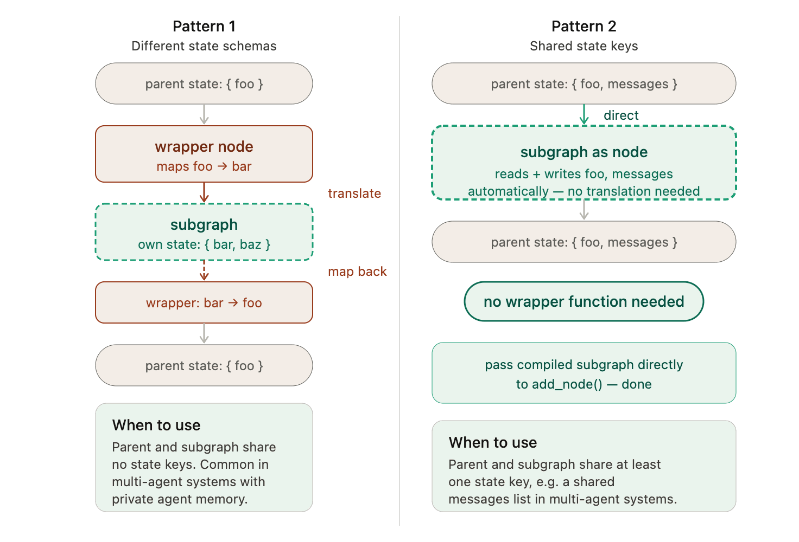
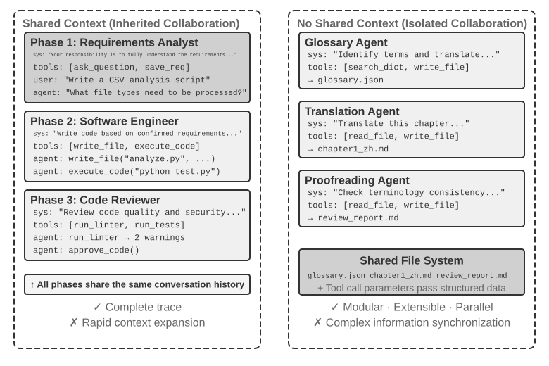
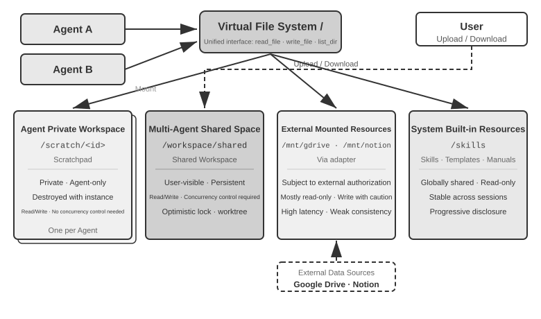
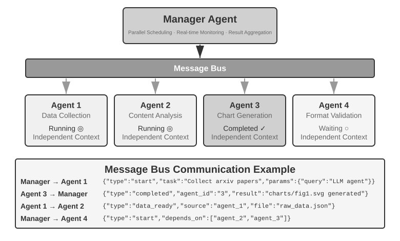
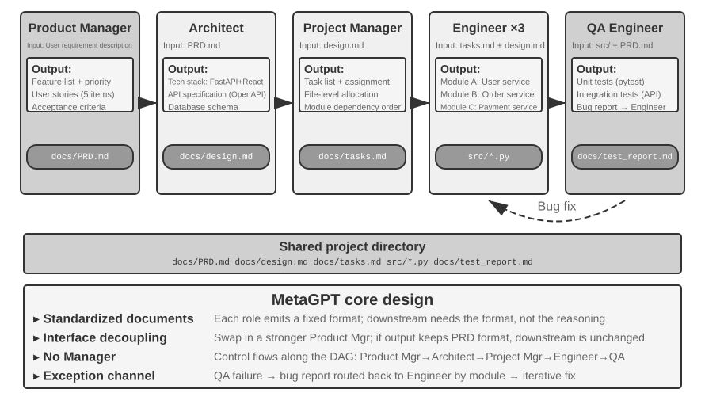

# 5 — Topology Patterns

> The handful of shapes that recur, what each costs, how each fails, and how the same shapes look in Claude Code.

---

## The catalogue

| Pattern | Shape | Use when | Costs | Fails by |
|---|---|---|---|---|
| **Generate-then-verify** | produce → check → back-edge | The job splits into a produce step and an independent check | One extra node per cycle | Checker sees the producer's reasoning and agrees with it |
| **Supervisor** | router → specialists → router | Work arrives in several kinds that need different handling | A routing call per turn | Mis-routing; the supervisor becomes a bottleneck |
| **Fan-out / fan-in** | split → N parallel workers → merge | Many independent items, then one combined result | Tokens scale with N | Missing reducer; redundant findings; correlated errors |
| **Hierarchical** | a subgraph as one node of a parent | A sub-topology is reused or owned by another team | State mapping at the boundary | Hidden cost; failures inside the subgraph are hard to see from outside |
| **Handoff** | agent writes status → edge reads it | Agents should pass control without knowing each other | A status key in the schema | Status values drift; nobody handles an unexpected one |

### Generate-then-verify

The highest-yield first graph ([02](02-graph-primitives.md#the-first-graph-generate-then-verify)). Draft-then-review, research-then-write, build-then-test. **The separation creates the value; parallelism is a bonus.** Put deterministic checks before the LLM checker, and bound the back-edge.

### Supervisor

A coordinator node classifies each incoming task and dispatches it to a specialist, then decides whether the work is done or needs another specialist. It is the settled baseline for most multi-agent work: the orchestrator holds the plan, and the workers run in isolated contexts. n8n's AI Workflow Builder is a production example: a supervisor routing to five specialist subgraphs ([08](08-governance-and-production.md#case-study-n8ns-ai-workflow-builder)).

Specialise by prompt first. n8n runs every specialist on the same model at temperature 0, and the roles differ only by system prompt. A separate model per node is an optimisation you justify with measurements, not the starting point.

### Fan-out / fan-in

Several workers run at once on independent branches, and a synthesiser merges their results into shared state. It wins on wall-clock time and costs tokens. Use `Send` when N is only known at runtime, and give the merge key a reducer ([03](03-state-and-reducers.md#dynamic-fan-out-the-send-api)).

**The parallel review graph** is the canonical fan-out: a planner sets objectives, a worker produces, then security, logic and style reviewers run **in parallel**, a synthesiser collects their findings, and a pass/fail gate routes feedback back to the worker. [flowtivity](https://flowtivity.ai/blog/graph-engineering-2026-guide-openclaw-codex/) reports it as ~3× faster than the sequential version on code review. That is a vendor figure: build the graph as a subgraph, time it against the sequential version on your own repo, and quote your number instead.

### Hierarchical: subgraphs

A compiled graph can be added as a node in another graph. That gives you nested orchestration and reusable sub-topologies: build the review graph once, then drop it into any pipeline that needs review.

```python
review = review_builder.compile()          # a whole graph
parent.add_node("review", review)          # used as one node
```

How state crosses the boundary:

| Parent and child schemas | What to do |
|---|---|
| **Share keys** | Add the compiled subgraph directly; shared keys flow in and out |
| **Differ** | Call the subgraph inside a wrapper node that maps parent state → child input and child output → parent update |


*Image Source: LangGraph docs, subgraphs (LangChain), via sources/langgraph_extended.pptx*

The wrapper is more code, and usually worth it: it makes the subgraph's contract explicit, and it stops a child from writing parent keys it shouldn't touch.

### Handoff

An agent signals completion by writing a designated state key; a conditional edge reads that key and picks the next agent ([03](03-state-and-reducers.md#handoffs-live-in-state)). Coupling lives in state, not in code. Always route unknown status values to an explicit error node rather than letting the router throw.

---

## The same patterns in Claude Code

The concepts already exist in Claude Code under different names:

| Graph concept | Claude Code |
|---|---|
| **Node** | A subagent: *"a separate agent instance with its own context window, its own system prompt, and scoped tool access"* |
| **Edge** | The main session's decision about which subagent to spawn, when, and with what brief |
| **State** | Return values: *"a subagent's final output flows back to the orchestrator, which passes the relevant piece to the next node"* |
| **Deterministic edge** | A hook: when probabilistic routing isn't good enough, a hook *guarantees* the transition |
| **Programmatic topology** | The Claude Agent SDK: define the graph in code, so it can run unattended and be tested |

Three implementation levels, in increasing order of determinism:

1. **Markdown subagents** in `.claude/agents/`: the fastest way to stand up a multi-node graph.
2. **Hooks as deterministic edges**: a pass/fail gate that runs code, not a model.
3. **Agent SDK**: a programmatic graph for unattended operation.

What you lose compared with LangGraph: there is no typed shared state, no reducers, and no checkpoints. State is whatever the orchestrator chooses to pass along, which is a context firewall when you want one ([03-harness note 07](../../03-harness-engineering/notes/07-orchestration.md)) and a liability when you need resume.

This workspace already runs the fan-out pattern: `/akira` (parallel haiku scanners), `/workflow-research fan-out` (parallel scouts) and `/workflow-review` (a multi-reporter pipeline). Each is a parallel review graph with a synthesiser node.

---

## Choosing a pattern

1. Is there a produce step and an independent check? → **generate-then-verify**. Start here.
2. Do tasks arrive in different kinds? → **supervisor** over specialists.
3. Are there many independent items? → **fan-out / fan-in** with a reducer.
4. Is a sub-topology reused, or owned by someone else? → **subgraph** with a wrapper node.

Patterns compose. A supervisor can dispatch to a fan-out subgraph whose workers each run generate-then-verify. Add each layer only when one of the five signals in [01](01-graph-vs-loop.md#the-default-plus-an-escalation-rule) forces it.

---

## Two design dimensions

Li's *AI Agents in Depth* ([ch. 10](https://github.com/bojieli/ai-agent-book/blob/main/book-en/chapter10.md)) separates two questions that the catalogue above blurs: **does the context get shared**, and **who decides what happens next**.

### Shared vs. isolated context


*Image Source: Li, AI Agents in Depth, ch. 10, Fig. 10-1 (Apache-2.0)*

The analogy is threads vs. processes. Agents with shared context see one trajectory, like threads sharing memory; nothing is lost in transfer, but everything accumulates. Isolated agents each have their own window, like processes, and communicate only through what they explicitly pass.

| Criterion | Share context | Isolate context |
|---|---|---|
| Subtasks | Tightly coupled; each needs the earlier reasoning | Separable; each needs only a brief |
| Window | Cumulative trajectory fits comfortably | Cumulative trajectory would blow the window |
| Parallelism | Sequential is fine | Workers must run at once |
| Isolation | Roles can see each other's work | A role must not see another's (e.g. a verifier) |
| Cost | One cache-friendly trajectory | N contexts, each paying its own prefix |

Rule of thumb: **if the cumulative context would exceed about half the window, don't share; if the task demands zero information loss, share.** Hybrid systems often share early (requirements and design in one trajectory) and switch to an explicit handoff once the work splits.

Two shared-context mechanisms from the book's labs:

- **Staged system prompts.** One agent, one trajectory, but the system prompt and tool set change by stage: requirements → implementation → review. Transitions are tool calls (`complete_requirements_analysis`, `submit_for_review`, then `approve_code` or `request_revision`), so the stage machine is explicit and can roll back.
- **Role transfer.** `transfer_to_agent(target_role, reason)` swaps the active role over the same history: triage → research → data analysis → writing → back to triage. Guard against circular handoffs with a counter.

### Topology: peer, manager, decentralised

| Topology | Who decides next | Maps to |
|---|---|---|
| **Peer** | Two or more agents of equal standing, usually proposer + reviewer | Generate-then-verify |
| **Manager** | One agent plans and calls the others as tools | Supervisor; fan-out / fan-in |
| **Decentralised** | Each agent picks its successor | Handoff |

The book treats topology as the multi-agent subset of graph engineering ([01](01-graph-vs-loop.md)). Communication runs over three channels: **tool parameters** (the brief and the return value), a **shared file system**, and a **message bus**. The first two are the two classic IPC paradigms, message passing and shared memory. Go's maxim applies: *"don't communicate by sharing memory; share memory by communicating."*

---

## When multi-agent beats single-agent

The book's test is one question: **does the collaboration introduce information the single agent didn't have?**

| Collaboration | New information? | Evidence |
|---|---|---|
| **Self-review** (same model reviews its own output, no tools) | No | Often neutral or harmful: Huang et al. (ICLR 2024); the TACL self-correction survey ([arXiv:2406.01297](https://arxiv.org/abs/2406.01297)). CRITIC's gains vanish when the tools are removed. |
| **Debate** among copies of one model | No | Matches a single agent given the same compute (Tran & Kiela, [arXiv:2604.02460](https://arxiv.org/abs/2604.02460)): by the data-processing inequality, recombining the same information can't add any |
| **Execution, tool or visual feedback** | Yes | Large gains. RLEF ([arXiv:2410.02089](https://arxiv.org/abs/2410.02089)) trains on execution feedback; WebGen-Agent's screenshot feedback took Claude 3.5 Sonnet from 26.4% to 51.9% |

So a reviewer earns its node when it can **run something**: tests, a browser, a search, a type checker. A reviewer that only rereads the text is the same model a second time.

More steps alone also plateau. Budget-aware tool-use work (Google, 2025; BAVT, 2026) finds that agents spend steps poorly unless told their budget, so the manager should **allocate step budgets per worker** rather than let each run until it feels done. And the bill is real: Anthropic's research system uses about 15× the tokens of chat, and token usage explains about 80% of the performance variance ([06](06-when-not-to-build-a-graph.md#what-fan-out-costs)).

---

## The runtime as an operating system

The book maps a multi-agent runtime onto an OS:

| OS | Agent runtime |
|---|---|
| Program | Static prefix: system prompt + tool definitions |
| Process memory | The trajectory |
| CPU | The LLM |
| Kernel | The agent runtime |
| System call | Tool call |
| `fork` / `kill` / `ps` | `spawn_subagent` / `cancel_subagent` / `list_agents` |
| Exit code | The structured summary a sub-agent returns |

The Actor model (Hewitt, 1973) is the precedent: isolated actors that share nothing and communicate only by message. The analogy breaks in one place: **agents pass meaning, not bytes.** A message can be misread, so every interface needs a contract the receiver can check.

### A virtual file system with four areas


*Image Source: Li, AI Agents in Depth, ch. 10, Fig. 10-2 (Apache-2.0)*

| Area | Example | Access | Concurrency |
|---|---|---|---|
| **Private scratchpad** | `/scratch/<agent>` | One agent | None needed |
| **Shared workspace** | `/workspace` | All agents | Optimistic lock, or one worktree per agent |
| **Mounted external** | `/mnt/gdrive` | External permissions apply | Eventually consistent; mostly read-only |
| **Built-in read-only** | `/skills` | Everyone reads, no one writes | None needed |

**Pass file paths, not file contents.** The manager in the book's translation lab keeps only a file index; the chapters themselves never enter its context.

### The control plane

- **Message envelope:** sender, target, type (`task_assigned`, `status_update`, `result`, `terminate`) and a JSON payload.
- **Status.** Polling each agent is a poor fit. Have agents write status: an append-only **JSONL trajectory**, which works like a database write-ahead log and gives resume, audit and handoff for free (it is how Claude Code's resume works), or an agreed `progress.md`. A file's mtime that stops moving flags a stuck agent.
- **Termination.** Graceful (like SIGTERM: stop at a safe point, clean up, acknowledge) vs. forced. When two workers succeed at once, settle the race with a lock or idempotent writes. Cancel in cascade, like Go's `context`: when a parent is cancelled, its children see `ctx.Done()`; an agent meant to outlive its parent starts from a detached context.
- **Scheduling.** Token and step budgets, model tiering (a strong planner, cheaper workers), concurrency caps and preemption.

---

## Peer, manager and decentralised in practice

### Peer: proposer and reviewer

Peer collaboration exists mostly to stop **premature termination**, which comes in three forms: the lazy fake "done", the premature give-up, and the false claim of success. The cure is verification, which is why Loop Engineering puts it bluntly: *"the bottleneck of the loop is the verifier"* ([04-loop](../../04-loop-engineering/README.md)). Debate, brainstorm and panel formats are peer variants; by the new-information test they help only when the panellists bring different tools or sources.

### Manager: agents as tools


*Image Source: Li, AI Agents in Depth, ch. 10, Fig. 10-6 (Apache-2.0)*

To the manager, each sub-agent is a tool call that returns a structured summary. The weak point is the **planner**: a bad plan sinks every worker. Plan-and-Act ([arXiv:2503.09572](https://arxiv.org/abs/2503.09572); 54% on WebArena-Lite) puts the strongest model on planning. That doesn't contradict the advice to give a reviewer roughly the same capability as the agent it reviews; planner and reviewer are different roles.

- **Sequential:** the book translation lab runs Glossary → Translation → Proofreading under a manager that holds only the file index.
- **Parallel:** workers report over a message bus. Redis Pub/Sub has no persistence, so a worker that is down misses messages; RabbitMQ persists them. The parallel-search lab runs 10 searchers that broadcast `target_found`; the manager takes a lock, sends `terminate` to the rest, and times out any worker after 2 minutes.
- **Cross-modal:** a computer agent and a phone agent cooperate. The computer agent calls `initiate_phone_call_agent(purpose, required_info)`; the phone agent asks for one missing field at a time and reports each with `{"type": "info_collected", ...}`; messages crossing over are tagged `[FROM_COMPUTER_AGENT]` so the voice model doesn't read them aloud.

### Decentralised: orchestration vs. choreography


*Image Source: Li, AI Agents in Depth, ch. 10, Fig. 10-9 (Apache-2.0)*

Orchestration has a conductor; choreography has each agent know its next step. Choreography removes the bottleneck and the single point of failure, and makes the whole flow harder to see.

> **A handoff package carries the task and its acceptance criteria, the confirmed facts and constraints, and paths to the artifacts. Never the full trajectory.**

That is design by contract applied to agents. How existing frameworks sit on the spectrum:

| Framework | Mechanism | How decentralised really |
|---|---|---|
| **MetaGPT** | A fixed SOP pipeline; a shared message pool that roles subscribe to; executable feedback | Communication is decentralised, control flow is not |
| **AutoGen group chat** | Shared history; a central speaker selector | Centralised selection; risks livelock (agents politely deferring forever) |
| **Swarm / OpenAI Agents SDK** | Each agent can hand off to others | Truly decentralised; needs a max-handoff guard against cycles |
| **A2A** | Agent Cards advertise capabilities; tasks move through `submitted` → `in-progress` → `needs-input` → `completed` / `failed`; agents stay opaque to each other | A protocol, not a topology |

**MCP connects an agent to tools; A2A connects an agent to other agents.**

### Agent societies

At the far end, there's no task at all, only agents living together. Smallville's generative agents keep a memory stream scored by importance, recency and relevance, plus reflection and planning; a Valentine's party emerged from one seeded intention. Agentopia ([arXiv:2606.07513](https://arxiv.org/abs/2606.07513)) runs 100 agents for ten simulated years on a weekly Plan → Contact → Activity → Review loop, and fine-tuning on the top 25% of trajectories improved social metrics by 15–24%. Vending-Bench Arena showed price wars and collusion between competing agents. For games like Werewolf, the book's lesson is to make the **judge code, not a model**, and to enforce who can see what in the runtime rather than in prompts.

---

## Labs

From *AI Agents in Depth* ch. 10. All are linked upstream: the first three and 10-5 need API keys, and 10-6 and 10-8 run offline but their code and data are in Chinese.

| Lab | What it shows | Link |
|---|---|---|
| 10-1 Staged system prompt | One agent, three stages, tool-call transitions | [staged-system-prompt](https://github.com/bojieli/ai-agent-book/tree/main/chapter10/staged-system-prompt) |
| 10-2 Multi-role transfer | `transfer_to_agent` over a shared history | [multi-role-transfer](https://github.com/bojieli/ai-agent-book/tree/main/chapter10/multi-role-transfer) |
| 10-3 Book translation | Sequential manager; file index only | [book-translation](https://github.com/bojieli/ai-agent-book/tree/main/chapter10/book-translation) |
| 10-4/10-5 Phone + computer agents | Cross-modal manager; ask-one-fill-one | [TalkAct](https://github.com/19PINE-AI/TalkAct) |
| 10-6 Parallel web research | Fan-out over a message bus; lock and terminate | [parallel-web-research](https://github.com/bojieli/ai-agent-book/tree/main/chapter10/parallel-web-research) |
| 10-7 Generative agents | Smallville memory stream and reflection | [generative_agents](https://github.com/joonspk-research/generative_agents) |
| 10-8 Voice Werewolf | Code judge; information access control | [voice-werewolf](https://github.com/bojieli/ai-agent-book/tree/main/chapter10/voice-werewolf) |

---

## Working reference

`~/.claude/refs/agent-architecture.md` — subagent criteria, orchestrator-holds-plan baseline, dynamic fan-out.

---

→ Next: [06-when-not-to-build-a-graph.md](06-when-not-to-build-a-graph.md) — the negative case, and what fan-out really costs.
