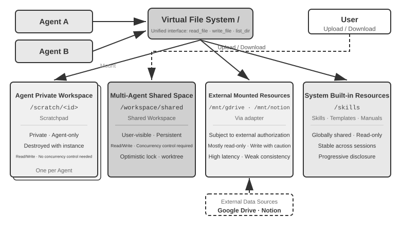
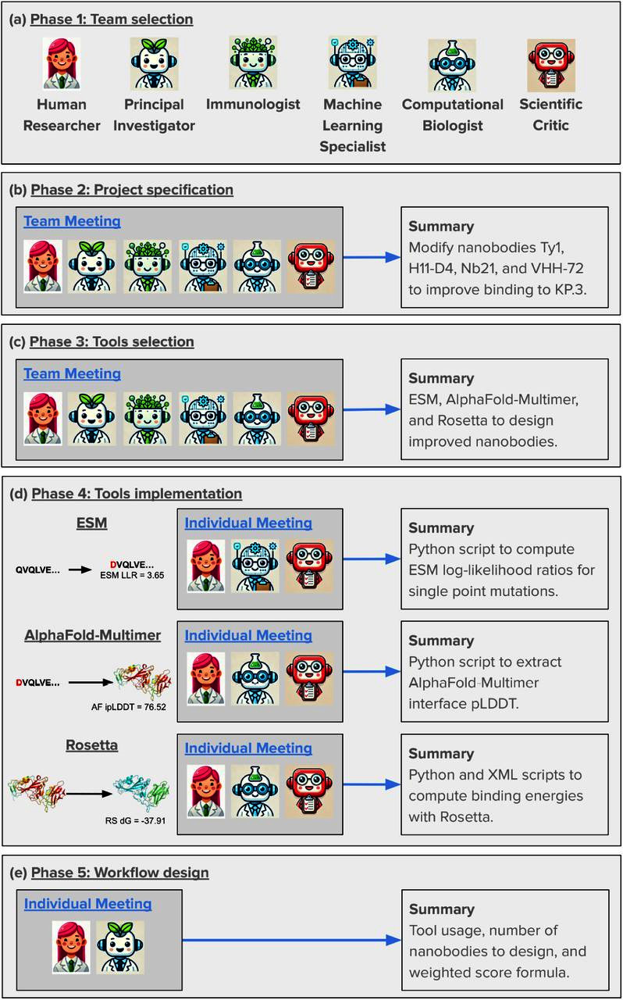
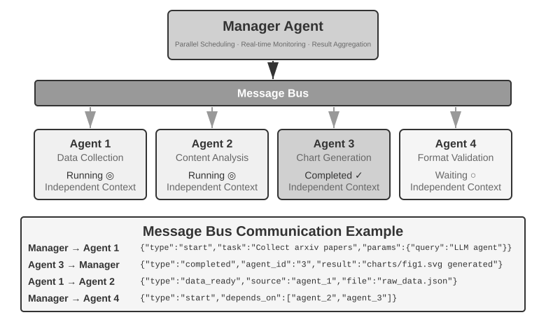
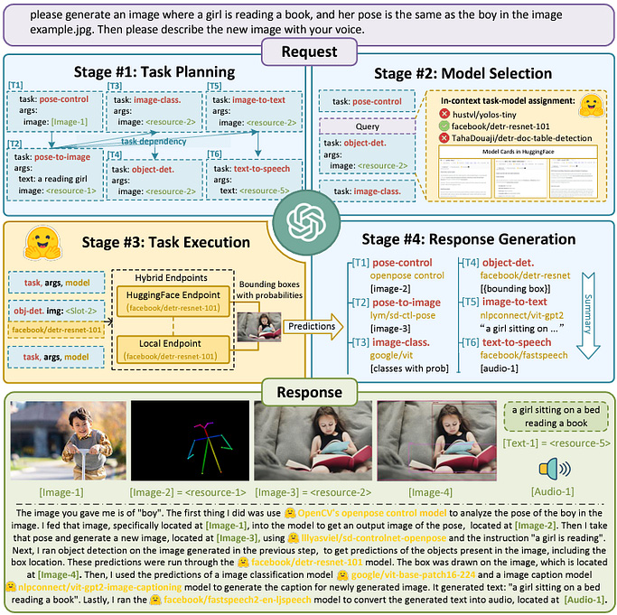
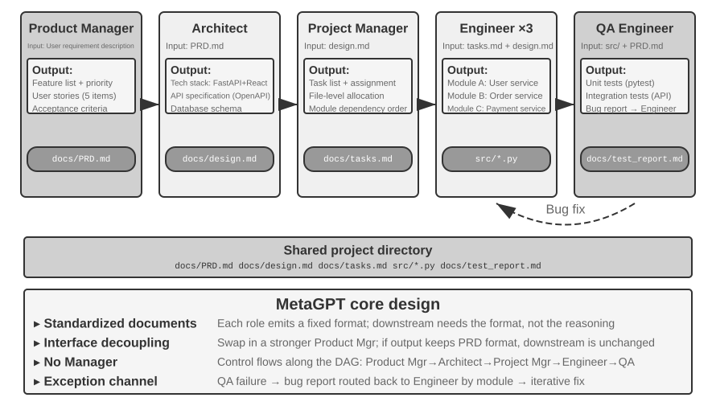
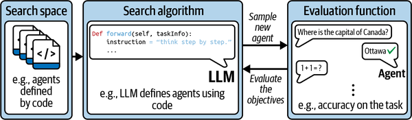

# 5b — Running Multi-Agent Systems

> A topology on a whiteboard becomes a runtime: processes, a file system, a control plane, and messages that can be misread.

[Note 05](05-topology-patterns.md) named the shapes that recur and asked when a team beats one agent. Running a team is a separate problem. A manager has to hold the plan without holding every file. Ten parallel workers have to stop when one of them finds the target. A choreographed system has to end without a conductor, and a workflow engine's retry can send the same logistics message twice. This chapter maps the runtime onto an operating system, works through peer, manager and decentralised systems in practice, reads the evidence on searching for a topology automatically, and covers transport once agents leave the process.

---

## The runtime as an operating system

Li maps a multi-agent runtime onto an OS (ch. 10, Table 10-2):

| OS | Agent runtime |
|---|---|
| Program | Static prefix: system prompt + tool definitions |
| Process memory | The trajectory |
| CPU | The LLM |
| Kernel | The agent runtime |
| System call | Tool call |
| `fork` / `kill` / `ps` | `spawn_subagent` / `cancel_subagent` / `list_agents` |
| Exit code | The structured summary a sub-agent returns |

The Actor model (Hewitt, 1973) is the precedent: isolated actors that share nothing and communicate only by message. The analogy breaks in one place: **agents pass meaning, not bytes.** A message can be misread, so every interface needs a contract the receiver can check.

### A virtual file system with four areas


*Image Source: Li, AI Agents in Depth, ch. 10, Fig. 10-2 (Apache-2.0)*

| Area | Example | Access | Concurrency |
|---|---|---|---|
| **Private scratchpad** | `/scratch/<agent>` | One agent | None needed |
| **Shared workspace** | `/workspace` | All agents | Optimistic lock, or one worktree per agent |
| **Mounted external** | `/mnt/gdrive` | External permissions apply | Eventually consistent; mostly read-only |
| **Built-in read-only** | `/skills` | Everyone reads, no one writes | None needed |

**Pass file paths, not file contents.** The manager in Li's book-translation lab keeps only a file index; the chapters themselves never enter its context.

### The control plane

- **Message envelope:** sender, target, type (`task_assigned`, `status_update`, `result`, `terminate`) and a JSON payload.
- **Status.** Polling each agent is a poor fit. Have agents write status: an append-only **JSONL trajectory**, which works like a database write-ahead log and gives resume, audit and handoff for free (it is how Claude Code's resume works), or an agreed `progress.md`. A file's mtime that stops moving flags a stuck agent.
- **Termination.** Graceful (like SIGTERM: stop at a safe point, clean up, acknowledge) vs. forced. When two workers succeed at once, settle the race with a lock or idempotent writes. Cancel in cascade, like Go's `context`: when a parent is cancelled, its children see `ctx.Done()`; an agent meant to outlive its parent starts from a detached context.
- **Scheduling.** Token and step budgets, model tiering (a strong planner, cheaper workers), concurrency caps and preemption.

A message in that envelope, for illustration (the field values are made up, not from Li's labs):

```json
{"sender": "manager", "target": "worker-3", "type": "task_assigned",
 "payload": {"task_id": "t-17", "goal": "translate chapter 4",
             "inputs": ["/workspace/ch04.md", "/workspace/glossary.md"],
             "output_path": "/workspace/ch04.translated.md"}}
```

The payload carries paths, not file contents, and the `task_id` is what makes a redelivered message safe to handle twice.

---

## Peer, manager and decentralised in practice

### Peer: proposer and reviewer

Peer collaboration exists mostly to stop **premature termination**, which comes in three forms: the lazy fake "done", the premature give-up, and the false claim of success. The cure is verification, which is why Loop Engineering puts it bluntly: *"the bottleneck of the loop is the verifier"* ([04-loop](../../04-loop-engineering/README.md)). Debate, brainstorm and panel formats are peer variants; by the [new-information test](05-topology-patterns.md#when-multi-agent-beats-single-agent) they help only when the panellists bring different tools or sources.

**A worked peer system: the Virtual Lab** (Swanson et al., 2024, via *Building AI Agents with LLMs, RAG, and Knowledge Graphs*, ch. 9). A human sets the question. A Principal Investigator agent writes the role, expertise and goal prompts for a team of scientist agents (GPT-4), plus an optional critic. Work then happens in two kinds of meeting:

- **Team meetings.** All agents take part over a fixed number of **rounds**. The PI opens, every scientist and the critic respond, and the PI summarises, decides and asks follow-ups. It writes a final summary for the human.
- **Individual meetings.** One agent does a task such as writing code, usually with the critic, for a few rounds. Optionally the same task runs as several parallel meetings, which the PI then merges.

Every meeting has the same input contract: agenda, agenda questions, optional rules, summaries of earlier meetings, extra context, and the round count. The round count is the bound on the back-edge.


*Image Source: Salvatore Raieli & Gabriele Iuculano, *Building AI Agents with LLMs, RAG, and Knowledge Graphs* (Packt, 2025), Fig. 9.26*

On nanobodies against the SARS-CoV-2 KP.3 spike, the lab built a design workflow whose candidates were then validated in the wet lab. Three design choices make it more than debate. **Summaries, not transcripts**, cross meeting boundaries, which is the handoff package [below](#decentralised-orchestration-vs-choreography). **The critic is a separate role.** **The individual meetings run tools.** Raieli & Iuculano are candid about the limits. Agents suggest out-of-date tools because of their training cut-off (add RAG or search). The agenda and prompts are hand-crafted. Without a human pushing, agents "may give vague answers or not make decisions", or drift off task. This is human-led multi-agent work, not autonomy.

### Manager: agents as tools


*Image Source: Li, AI Agents in Depth, ch. 10, Fig. 10-6 (Apache-2.0)*

To the manager, each sub-agent is a tool call that returns a structured summary. The weak point is the **planner**: a bad plan sinks every worker. Plan-and-Act ([arXiv:2503.09572](https://arxiv.org/abs/2503.09572)) invests in the planner rather than the workers. It fine-tunes a dedicated LLaMA-3.3-70B planner on synthetic plans written back onto successful trajectories, and it **replans after every executor step** instead of committing to the first plan. Dynamic replanning took web-navigation success to 53.9%, and adding chain-of-thought to 57.6% on WebArena-Lite. That doesn't contradict the advice to give a reviewer roughly the same capability as the agent it reviews; planner and reviewer are different roles.

Baidu's AI Search blueprint (Li et al., [arXiv:2506.17188](https://arxiv.org/abs/2506.17188), 2025-06, preprint) takes the opposite bet. Its planner commits to the whole plan in one pass and repairs it locally. A Master agent judges how complex a query is and picks a team: a Writer only, an Executor plus Writer, or a Planner in front of both for complex queries. The Planner emits the full task DAG at once, with each node bound to at most one tool. The Executor runs it layer by layer in topological order, with each layer in parallel, and passes outputs along edges into the next node's arguments. When a node fails, the Planner rolls back and replans only the affected subgraph, and the Master adds nodes when results come back incomplete. In blind side-by-side human ratings against Baidu's legacy search, the gain was **0 on simple queries, +5% on moderately complex ones and +13% on complex ones** (net win rate, p < 0.05, sample size not given). An online A/B test on 1% of traffic moved four engagement metrics by 0.5–1.9% (change-query rate down 1.45%; page views, daily active users and dwell time up). The paper is a design blueprint. It has no ablation of the DAG planner against ReAct-style replanning or against a single agent, and no token or latency data behind its claim that one-pass planning saves tokens. What it does show is a working team-by-complexity router, with the planner reserved for the queries that need one.

**The ancestor: HuggingGPT** (Shen et al., 2023, [arXiv:2303.17580](https://arxiv.org/abs/2303.17580), via *Building AI Agents with LLMs, RAG, and Knowledge Graphs*, ch. 9). It is the manager pattern with models instead of agents as the workers. ChatGPT is the controller, and hundreds of Hugging Face models are the tools.


*Image Source: Salvatore Raieli & Gabriele Iuculano, *Building AI Agents with LLMs, RAG, and Knowledge Graphs* (Packt, 2025), Fig. 9.7*

Three of its mechanisms still carry over:

- **Plans as a dependency graph.** Each subtask carries an id and a list of the ids it depends on. A `<resource>` placeholder stands for an upstream output and is replaced once that task completes. Tasks with no dependencies run in parallel.
- **Retrieve, then choose.** All the model descriptions won't fit in context, so model selection filters by task type, ranks by download count (a popularity proxy for quality), and gives only the top k descriptions to the LLM for a single choice. This is tool selection by retrieval before it had a name, though it ranks by popularity and not by embedding.
- **Hybrid execution.** Remote inference endpoints are tried first, with local inference as the fallback.

Its listed limits are the manager pattern's limits. **Efficiency:** three of the four stages are LLM calls. **Planning** is only as good as the controller. **Context** runs out (the paper says even 32K tokens falls short for connecting many models). **Instability:** the controller ignores instructions and breaks the program flow.

Li's labs show the two shapes:

- **Sequential:** the book translation lab runs Glossary → Translation → Proofreading under a manager that holds only the file index.
- **Parallel:** workers report over a message bus. Redis Pub/Sub has no persistence, so a worker that is down misses messages; RabbitMQ persists them. The parallel-search lab runs 10 searchers that broadcast `target_found`; the manager takes a lock, sends `terminate` to the rest, and times out any worker after 2 minutes.
- **Cross-modal:** a computer agent and a phone agent cooperate. The computer agent calls `initiate_phone_call_agent(purpose, required_info)`; the phone agent asks for one missing field at a time and reports each with `{"type": "info_collected", ...}`; messages crossing over are tagged `[FROM_COMPUTER_AGENT]` so the voice model doesn't read them aloud.


A manager tree needs rules for when it is done. OneManCompany (Yu, Fu et al., [arXiv:2604.22446](https://arxiv.org/abs/2604.22446), Huawei Noah's Ark and UCL, 2026-04, preprint) states its rules outright. A supervisor agent decomposes work into a tree whose leaves each go to one agent. Dependency edges may cross branches, and the union must stay acyclic, which is checked by cycle detection whenever a task is inserted. A parent resolves only when all its children do, so no subtask is dropped silently. A finished task unblocks its dependents only after the supervisor accepts it, and a rejection sends it back for decomposition under the same parent. Three review rounds escalate to a higher-level supervisor, a task times out after an hour, and a cost budget pauses the run. The project fails if every node is finished or blocked and the root is still open. When a skill is missing, an HR agent recruits a new agent, and a human approves the hire. On PRDBench's 50 project-level coding tasks (one-shot, no feedback) it reported **84.67% success against 69.19% for the best baseline**, at about $6.91 per task. The baselines are numbers copied from the benchmark paper, with no cost data, no single-agent control on the same Claude Sonnet 4.6 + Gemini 3.1 Flash Lite backend and no ablation, so take the rules from it, not the margin.

### Decentralised: orchestration vs. choreography


*Image Source: Li, AI Agents in Depth, ch. 10, Fig. 10-9 (Apache-2.0)*

Orchestration has a conductor; choreography has each agent know its next step. Choreography removes the bottleneck and the single point of failure, and makes the whole flow harder to see.

What each agent gets to see may matter more than who is in charge. Dochkina ([arXiv:2603.28990](https://arxiv.org/abs/2603.28990), 2026-03, preprint) compared four protocols on synthetic tasks scored by an LLM judge. In **Coordinator**, one agent plans and the rest work in parallel. In **Sequential**, agents run in a fixed order and each sees its predecessors' finished outputs and picks its own role. In **Broadcast**, agents announce intentions and then act. In **Shared**, all run in parallel over a common history. With 16 agents on the harder (L3) tasks, **Sequential beat Coordinator by 12–14% on all three models tried** (Claude Sonnet 4.6 0.875 vs. 0.767; DeepSeek v3.2 and GLM-5 similar, p < 0.001). In an 8-agent pilot with GPT-4.1-mini (L3 and L4 tasks averaged) it beat fully parallel Shared by 44%. Of the two models tested, letting agents organise freely helped Claude Sonnet 4.6 (+3.5%) and hurt GLM-5 (−9.6%). The author's reading is that completed outputs are better input than a plan or a stale history, but that mechanism is not ablated. The Coordinator's workers never see each other's work, so the comparison is partly sequential vs. parallel. The judge changed between series, and Sequential's latency grows with N. Quality stayed flat from 64 to 256 agents, but on easy tasks already near ceiling.

Anemoi (Ren et al., [arXiv:2508.17068](https://arxiv.org/abs/2508.17068), Coral Protocol, 2025-08, preprint) sits halfway between the two styles. A planner writes the initial plan. After that, the planner, the workers, a critic and an answer agent talk to each other directly in threads on an agent-to-agent MCP server, and they vote on the final answer. On GAIA validation (pass@3, GPT-4.1-mini planner, GPT-4o workers, OWL's tools) it scored **52.73% against 43.64% for OWL re-run by the authors** with the same models. The authors' own breakdown weakens that. Anemoi alone solved 25 tasks, and they attribute 40% of those to random variation between workers. OWL alone solved 10, and they attribute 90% of those to the same cause. It did worse than the original OWL on Level 3 tasks. A GPT-4o-mini planner could not use the protocol's tools at all, so direct messaging has a minimum capability of its own. 10.3% of the remaining errors came from agents waiting on a busy web agent that could not answer. There are no ablations and no cost numbers, and the authors are the protocol's vendor.

AutoScientists (Gao, Fang & Zitnik, [arXiv:2605.28655](https://arxiv.org/abs/2605.28655), Harvard, 2026-05, preprint) has no orchestrator at all, and its details are the useful part. Agents coordinate only through shared state: the current best result, an experiment log, a forum, a queue per team and a register of dead ends. They form teams by discussion and a majority vote, and they reorganise when a team stalls (for example, no gain in 10 experiments). Queue claims use optimistic locking. A new result replaces the champion only if it beats it by more than 2σ, where σ is measured from repeated seeds, and a smaller gain must be confirmed on a second seed. With 9 Claude Sonnet 4.6 agents, it reached the same nanochat validation loss in **34 experiments against 65 for a single-agent loop**. It averaged the 74th vs. the 66th leaderboard percentile on 24 BioML-Bench tasks (4 h on one H100 each, 16 h for the imaging tasks; standard errors of 6–7 points). The ablations show what each part is for. Without the shared state, 5 of 6 independent agents found the same first improvement within two experiments, spending about a third of the budget on duplicates. **Fourteen agents did worse than nine on all three tasks in the team-size sweep** (single runs), and on one assay the smallest crew won. The run cost about 4.4× the single-agent baseline ($3,985 vs. $910 across the 24 tasks). The ablations and most comparisons are single runs on one model, there is no centrally planned team of the same size to compare against, and the speed-ups count experiments, not wall-clock time, because the agents shared one GPU.

GitSwarm (Shah et al., [arXiv:2610.04862](https://arxiv.org/abs/2610.04862), Meta and Mila, 2026-10, preprint) makes the shared state a Git repository. Identical workers, with no planner, run asynchronously in their own worktrees. Each commit names its Git parent plus an `informed_by=` list of the commits it drew on, so a worker can build on one branch and use findings from others without merging. Two read-only views (the remaining budget and a log where each worker states its scope before editing) report state but assign no work. Workers end each episode by contributing, nominating a candidate or abstaining, and the commit with the most nominations wins. On a 50-task subset of ProgramBench with GPT-5.5 Codex workers, it scored **79.4% against 65.1% for one agent repeatedly told to continue**, at a comparable budget. The gains shrank at larger budgets, while input tokens grew with the repository. The winning solution's declared ancestry covered 82–93% of the graph, where Git parents alone reached about a quarter. About one ProgramBench worker in six abstained as redundant, which avoided duplicate commits but not the 6–7% of tokens already spent. On nine ProgramBench development tasks at 50 workers and three seeds, a central selector scored slightly higher than decentralised nomination (64.4% vs. 62.1%, within the noise; the paper does not claim equivalence), and a central aggregator scored lower (58.2%). There is no matched-compute or causal test of what the repository adds. Its headline research run assigned roles explicitly, and its parameter and token counts are not matched, so the evidence is the ProgramBench result and the reuse traces, not a proof that decentralisation is better.

> **A handoff package carries the task and its acceptance criteria, the confirmed facts and constraints, and paths to the artifacts. Never the full trajectory.**

That is design by contract applied to agents. How existing frameworks sit on the spectrum:

| Framework | Mechanism | How decentralised really |
|---|---|---|
| **MetaGPT** | A fixed SOP pipeline; a shared message pool that roles subscribe to; executable feedback | Communication is decentralised, control flow is not |
| **AutoGen group chat** | Shared history; a central speaker selector | Centralised selection; risks livelock (agents politely deferring forever) |
| **Swarm / OpenAI Agents SDK** | Each agent can hand off to others | Truly decentralised; needs a max-handoff guard against cycles |
| **A2A** | Agent Cards advertise capabilities; tasks move through `submitted` → `in-progress` → `needs-input` → `completed` / `failed`; agents stay opaque to each other | A protocol, not a topology |

**MCP connects an agent to tools; A2A connects an agent to other agents.**

Albada's A2A walkthrough (*Building Applications with AI Agents*, ch. 8) shows the moving parts. An Agent Card lists identity, capabilities with input and output schemas, an endpoint, auth methods and a version. Discovery goes through a registry, then a handshake settles protocol version, timeouts and payload limits. Calls are JSON-RPC 2.0 over HTTPS, with `-32601 Method not found` for unknown methods. Two cautions. Albada serves the card at `/.well-known/agent.json`; the well-known path has changed between spec versions, so check the current A2A spec before hard-coding one. And Albada calls the protocol "still in its infancy": authentication is pluggable, but authorisation, rate limiting, trust establishment and abuse resistance are "far from solved". Treat a remote agent's output as untrusted input.

### Agent societies

At the far end, there's no task at all, only agents living together. Smallville's generative agents keep a memory stream scored by importance, recency and relevance, plus reflection and planning; a Valentine's party emerged from one seeded intention. Agentopia ([arXiv:2606.07513](https://arxiv.org/abs/2606.07513) (Wang et al., 2026-06, preprint)) runs three worlds of 100 agents each for ten simulated years on a weekly Plan → Contact → Activity → Review loop. Fine-tuning Qwen3.5-397B on the yearly trajectories of the top 25% of agents by return gain (from years 1–4) raised the number of peers who respect an agent by 24.2% and who like it by 15.9%, averaged over four-year runs in two worlds. Mutual liking rose only 5.9%, skill advances fell 29.6% and material fulfillment fell 14.8%, the gains were absent in year 1, and no repeated runs or variance are reported. Vending-Bench Arena showed price wars and collusion between competing agents. For games like Werewolf, the book's lesson is to make the **judge code, not a model**, and to enforce who can see what in the runtime rather than in prompts.

Coordination can emerge without a single message. Riedl ([arXiv:2510.05174](https://arxiv.org/abs/2510.05174), ICLR 2026) gave groups of 10 GPT-4.1 agents a number-guessing game in which they saw only the group's "too high / too low" signal (200 groups per condition). He used information-theoretic measures of synergy (partial information decomposition, Williams & Beer, 2010) to separate a mere aggregate from a group that acts as one. With plain prompts the group behaved as an aggregate. Personas made agents differentiate in stable, identity-linked ways. Adding "think about what the other agents might do" produced complementary roles and was **the only condition whose group-level alignment (triplet mutual information and stability) differed significantly from zero (p ≈ 3×10⁻¹⁴)**. That is a pairwise-aligned, redundant state, not extra irreducible synergy; plain and persona groups also showed temporal synergy. **Success rates did not differ significantly across the three prompts.** Success improved only when synergy and redundancy were both present (interaction β = 0.24, p = 0.014). Which personas were used did not matter, only that there were some, and in a separate 7,150-run sweep over group sizes 3–15, each extra member cut the odds of success by about 8%. It is one minimal task, with no topology and no comparison against a single agent, so read it as evidence that prompts change how a group is organised, not that they make it better.

---

## Searching for the topology: ADAS

Everything above is hand-designed. **Automated Design of Agentic Systems** (Hu, Lu & Clune, ICLR 2025, [arXiv:2408.08435](https://arxiv.org/abs/2408.08435), via *Building Applications with AI Agents*, ch. 8) treats the topology itself as something to search. An agent is a Python `forward()` function. A meta-agent writes new ones, and an evaluation function scores them.


*Image Source: Michael Albada, *Building Applications with AI Agents* (O'Reilly, 2025), Fig. 8-1*

**Meta Agent Search** loops for about 25–30 generations:

1. Condition the meta-agent on an archive of earlier agents and their scores.
2. Draft a design, then implement it as code.
3. Run two self-reflection passes, one for novelty and one for correctness.
4. Evaluate on validation data, allowing up to five debugging retries on errors.
5. Archive the result with a bootstrap confidence interval as its fitness.

Reported results against hand-designed baselines:

| Benchmark | MAS-discovered agent | Margin over best baseline |
|---|---|---|
| DROP (F1) | 79.4 ± 0.8 | +13.6 over Role Assignment |
| MGSM | 53.4% ± 3.5 | +14.4 over LLM-Debate |
| MMLU | 69.6% ± 3.2 | +2.0 over OPRO |
| GPQA | 34.6% ± 3.2 | +1.7 over OPRO |

Read the table with its error bars. On DROP and MGSM the gain is far outside the interval. On MMLU and GPQA the margin is smaller than the ±3.2 interval, so on those two the discovered agents are not distinguishable from prompt optimisation. Albada also reports that discovered agents transferred across domains (ARC agents applied to MMLU) and across models (GPT-3.5 to GPT-4).

Two practical points:

- **The evaluator is the attack surface.** Albada's `evaluate_forward_fn` runs each generated agent with `exec(forward_str, globals(), namespace)`, which is model-written code in your process with your globals. Run it in a sandbox ([03-harness note 04](../../03-harness-engineering/notes/04-execution-boundaries.md)).
- **The search optimises whatever the evaluator measures.** Keep a held-out test set the search never sees. It is the anchor of [07](07-failure-modes-at-scale.md#anchors).

**MaAS** (Zhang et al., ICML 2025, [arXiv:2502.04180](https://arxiv.org/abs/2502.04180)) searches for a distribution over layered topologies of eight operators (CoT, debate, self-consistency, refine, ReAct and others) and samples one per query, with early exit for easy queries. On gpt-4o-mini it averaged **83.59 on five math and code benchmarks vs. 82.25 for AFlow and 77.50 for one call**, and on MATH cost $0.42 to run vs. $1.66 (accuracy 51.82 vs. 51.28). A fully connected MacNet mesh averaged 75.00, below the single call, so denser is not better. These are single runs on small test sets, and removing the textual-gradient prompt tuning cost the most accuracy, so not all the gain is topology.

How much is topology worth once you search for it? **Codebook Agent** ([arXiv:2609.02264](https://arxiv.org/abs/2609.02264), Yu et al., 2026-09, preprint) learns a small codebook of good communication graphs from 300 logged runs per benchmark, then picks one per query with a single MLP call instead of LLM calls (2.4 ms vs. 301–396 ms). With 4-agent gpt-4o-mini teams it averaged **84.62 vs. 83.02 for the GTD graph-diffusion designer** on six math and code sets. Its side findings matter more for design. The topologies that score well collapse to about six distinct graphs, and **the best fixed graph (fully connected, chain or star) came within 1.4 accuracy points of every generated topology** the authors measured. Which fixed graph won varied by task (fully connected on MATH, star on HumanEval, and chain on MMLU in a 3-agent Qwen-3-8B transfer run, gaps up to 4.3 points). And **edge count correlated with measured tokens at r ≈ −0.4**: sparse graphs got longer completions, so the chain was the most token-expensive graph on every math benchmark, and a cost proxy that minimises edges maximises the bill. These are single runs on mostly homogeneous small teams, and the causal story for the sparse-graph cost is the authors', not tested. Try the three fixed graphs on your own tasks before you train a topology generator.

BIGMAS ([arXiv:2603.15371](https://arxiv.org/abs/2603.15371), Hao et al., CASIA, 2026-03, preprint) designs a graph per problem and joins it to a blackboard. It is modelled on Global Workspace Theory (Baars, 1988). A designer call writes the nodes and a read/write contract for each one. Nodes never message each other. They post validated structured writes (append, update or replace) to one workspace with read-only, working, system and answer areas, and a failed write never changes it. An LLM orchestrator routes only where a node has more than one successor. On 100-instance runs of three combinatorial puzzles (Game 24, Six Fives, Tower of London), it **raised accuracy for all six models tried**: Claude 4.5 Sonnet with thinking went from 57% to 93% on Tower of London, and DeepSeek-V3.2 from 25% to 36% on Game 24, against 30% for Tree of Thoughts. The designed graphs grew with difficulty, from about 3 nodes on Game 24 to about 5 on Tower of London. The price is that designing the graph took 19–37% of tokens and routing another 17–25%. Read the result with Codebook's in mind. BIGMAS has no ablation that separates the designed graph from the shared workspace, no fixed-graph control, no cost-matched baseline and no variance, so the gain may belong to the blackboard and the validated writes rather than to designing a graph per query.

Skill-MAS (Lin, Yang & Qin, [arXiv:2606.18837](https://arxiv.org/abs/2606.18837), Ant Group, 2026-06, preprint) evolves the instructions instead of the graph. A frozen meta-agent writes a multi-agent system from a SKILL.md-style document covering decomposition, agent roles and workflow topology. Each round rolls out every validation task five times, reflects on the tasks with the most uncertain and lowest scores, and edits the skill. Across four small or mid-size models (Gemini 3.1 Flash, GPT-5.4 Nano, Qwen3.5-Plus, DeepSeek-V4-Flash) on DeepResearchBench, HLE-Math, BrowseComp-Plus and VitaBench, the evolved skill **raised average scores to 27.6–41.1 against 21.3–35.7 for the best of five automatic-design baselines**. The starting skill was distilled from a vendor guide on building multi-agent systems, and it already matched the baselines on two of the four models. The rules it converged on read like this note: move from a linear chain to at most four parallel branches with one synthesis node, verify links between branches before merging, and let the merge node search for itself. Most of the change is prose, though. The "parallel" branches ran sequentially by contract. The node limits it wrote were not always obeyed, and one evolved skill told agents to give "plausible estimated values" instead of reporting missing data. Validation sets were 16–32 items, with no variance, and $9–59 of evolution cost is left out of the headline comparison.

Every search above pays for real LLM runs to score each candidate graph. Zhang et al. ([arXiv:2503.11301](https://arxiv.org/abs/2503.11301), 2025-03, preprint position paper) try to replace those runs with a GNN that predicts whether a workflow will succeed on a task. Each node is an embedding of its agent's system prompt, and the graph embedding is joined with the task embedding. The training set has 600k workflow–task pairs, from G-Designer and AFlow runs of about six nodes, labelled with GPT-4o-mini. Within one domain the predictors averaged **0.78 accuracy** on a binary label. A GCN beat an MLP on the raw prompt text by about 7 points, so the structure carries signal. Used as AFlow's reward, the GCN made the search **about 120× faster (19 s vs. 2,327 s) but lost about 0.1 in average score** (0.67 vs. 0.77 over HumanEval, MMLU and MBPP; MMLU alone 0.55 vs. 0.73). Trained on one domain and tested on another, accuracy fell to 0.33–0.68, some cells below chance. A surrogate is cheap only on the workload it was trained on, and labelling that workload means paying for the runs anyway. No variance or seeds are reported, and that labelling cost is left out of the speed-up.

---

## Transport: when agents leave the process

The graphs in this pillar pass state in memory. Albada's chapter traces what happens as agents spread across processes and machines (*Building Applications with AI Agents*, ch. 8). Each step up buys decoupling and costs consistency.

| Layer | Examples | Buys | Costs |
|---|---|---|---|
| **In-process** | Function calls, graph edges, in-memory routers (AutoGen) | Simplicity, low latency | Doesn't survive distribution or a crash |
| **Message broker / event bus** | Kafka (durable, partitioned, consumer groups, replayable), Redis Streams and RabbitMQ (lighter, lower latency; Redis durability is limited), NATS (+ JetStream for durable replay) | Senders and receivers decoupled; scale specialists independently; replay | Eventual consistency; error handling moves into every consumer |
| **Actor framework** | Ray (`@ray.remote`), Orleans (virtual actors), Akka | Per-agent state and identity; one message at a time per actor, so no races inside an agent; supervision and restart | Cluster operations; Albada's threshold is beyond roughly 10–20 agents or under tight latency |
| **Workflow engine** | Temporal; Airflow for batch DAGs; Dagger for local-to-CI | Durable steps, retries, resume after a crash without rerunning finished steps | Framework lock-in; activities must be idempotent |

What Albada's examples skip, and you shouldn't:

- **Redis Streams consumer.** Each specialist calls `xread` from `last_id = '0'` and filters on `task['agent']`. Every consumer reads every task, and a restarted consumer replays the whole stream from the beginning. Use consumer groups (`XREADGROUP` plus `XACK`) so each task is delivered to one worker and acknowledged. Make handlers idempotent, keyed on `task_id`, because a crash between doing the work and acking redelivers it.
- **Temporal retries.** `RetryPolicy(maximum_attempts=3)` reruns an activity that failed *after* its side effect, so a logistics message gets sent twice. Albada's specialists end by calling `send_logistics_response`. Put the side effect in its own activity with an idempotency key.
- **Actors per session.** One actor per (session, specialist), created lazily by a `SessionManager` actor, isolates state between sessions and serialises calls within one. But that manager is itself a single actor holding every handle, which makes it a bottleneck and a single point of failure.

LangGraph's checkpointer already gives in-graph durability ([04](04-durable-execution-and-interrupts.md#checkpointers)). Reach for a broker or a workflow engine when steps span services, days, or human approvals outside the graph runtime, not by default.

---

## Labs

From *AI Agents in Depth* ch. 10. All are linked upstream: the first three and 10-5 need API keys, and 10-6 and 10-8 run offline but their code and data are in Chinese.

| Lab | What it shows | Link |
|---|---|---|
| 10-1 Staged system prompt | One agent, three stages, tool-call transitions | [staged-system-prompt](https://github.com/bojieli/ai-agent-book/tree/main/chapter10/staged-system-prompt) |
| 10-2 Multi-role transfer | `transfer_to_agent` over a shared history | [multi-role-transfer](https://github.com/bojieli/ai-agent-book/tree/main/chapter10/multi-role-transfer) |
| 10-3 Book translation | Sequential manager; file index only | [book-translation](https://github.com/bojieli/ai-agent-book/tree/main/chapter10/book-translation) |
| 10-4/10-5 Phone + computer agents | Cross-modal manager; ask-one-fill-one | [TalkAct](https://github.com/19PINE-AI/TalkAct) |
| 10-6 Parallel web research | Fan-out over a message bus; lock and terminate | [parallel-web-research](https://github.com/bojieli/ai-agent-book/tree/main/chapter10/parallel-web-research) |
| 10-7 Generative agents | Smallville memory stream and reflection | [generative_agents](https://github.com/joonspk-research/generative_agents) |
| 10-8 Voice Werewolf | Code judge; information access control | [voice-werewolf](https://github.com/bojieli/ai-agent-book/tree/main/chapter10/voice-werewolf) |

---

## Pitfalls

- **Trusting choreography to end itself.** Symptom: agents hand off in cycles or defer politely forever. Fix: add a max-handoff guard, and carry a handoff package with the task, acceptance criteria, confirmed facts and artifact paths, never the full trajectory.
- **Running a searched agent in your process.** Symptom: ADAS's `exec(forward_str, globals(), namespace)` runs model-written code with your globals. Fix: sandbox the evaluator, and keep a held-out test set the search never sees.
- **Retrying a side effect.** Symptom: a workflow engine reruns an activity that failed *after* sending a message, so the message goes out twice. Fix: put the side effect in its own activity, keyed on an idempotency key.

## Try it

1. Read the ADAS table with its error bars. On which benchmarks can you say the discovered agent beat the best baseline?

   <details><summary>Answer</summary>

   DROP (+13.6 with ±0.8) and MGSM (+14.4 with ±3.5). On MMLU (+2.0 with ±3.2) and GPQA (+1.7 with ±3.2) the margin is inside the interval, so those two are not distinguishable from prompt optimisation.

   </details>

2. Pick one lab from the table above and draw its topology, naming who holds the plan and what crosses each edge. For offline work, 10-6 and 10-8 need no key, though their code and data are in Chinese.

   <details><summary>What to check</summary>

   For 10-3, book translation, you should have a sequential manager holding only the file index, so files rather than text cross the edges. If your drawing shows contents crossing every edge, compare it with the "pass paths, not contents" rule.

   </details>

## Interview checklist

| Prompt | Answer in one line |
|---|---|
| Orchestration or choreography? | Orchestration has a conductor, which is a bottleneck and a single point of failure. Choreography removes both and makes the flow harder to see, so it needs a max-handoff guard. |
| Ten parallel workers search and one finds the target. How do the rest stop? | In the parallel-search lab, the finder broadcasts `target_found`; the manager takes a lock, sends `terminate` to the rest and times out any worker after 2 minutes. |
| What is the weak point of a manager with sub-agents? | The planner, because a bad plan sinks every worker. Plan-and-Act invests there: it fine-tunes a dedicated planner and replans after every executor step instead of committing to the first plan. |
| Ten workers share one transcript, or pass file contents in their messages. What do you change? | Pass paths, not contents. Give each agent a private scratchpad, a shared workspace with a lock or a worktree each, and a read-only area for skills, so the manager holds an index rather than the files. |

## Next

[06-when-not-to-build-a-graph.md](06-when-not-to-build-a-graph.md): the negative case, and what fan-out really costs.
