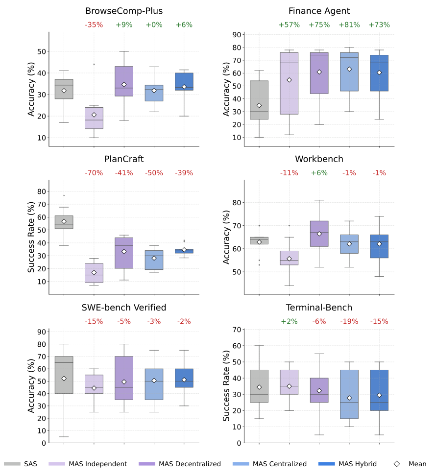
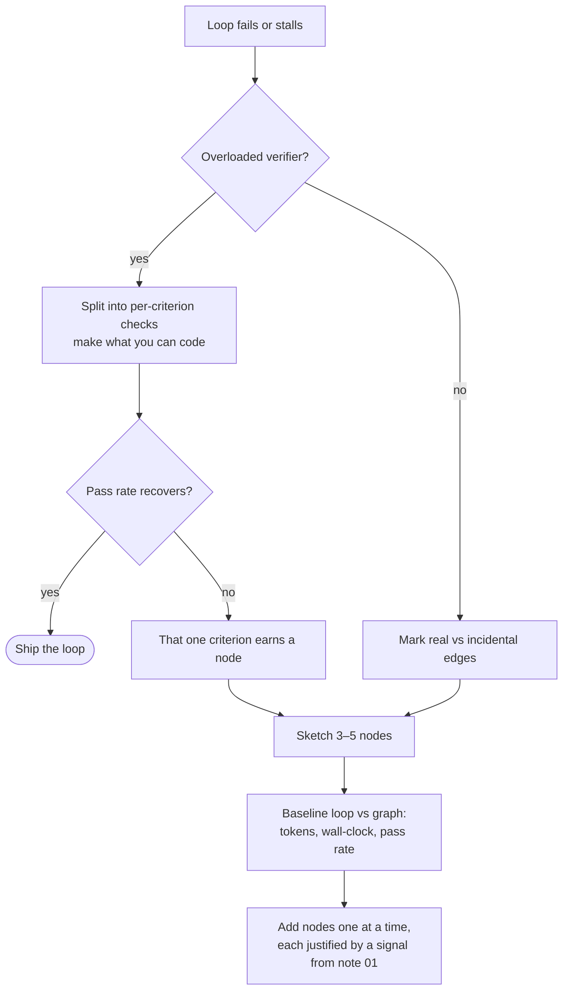

# 6 — When Not to Build a Graph

> Structure what you know; leave agency where you don't. A graph is overhead you justify with a signal and a measurement.

---

## Work you can't name ahead of time

LangChain is explicit that some work is too fluid to pin down:

> Generic deep research *"requires planning and delegation in ways that are hard to pin down ahead of time."* Forcing agentic tasks *"into deterministic paths is the wrong move."* Use an agent harness instead.

> **Structure what you know, leave agency where you don't.**

The test: can you name the nodes before the run starts? If not, can `Send` derive them from a step you do know (one worker per document the retriever returns)? If neither, you want a harness with a good loop ([03-harness](../../03-harness-engineering/README.md), [04-loop](../../04-loop-engineering/README.md)), not a graph. A graph drawn over work you don't understand yet just fixes your first guess in place.

---

## What fan-out costs

Anthropic's multi-agent research system is the first-party anchor. In their write-up, agents use about **4× the tokens of a chat interaction**, and multi-agent systems about **15×**. In exchange, the multi-agent version beat a single agent by a wide margin on their research eval, and token usage alone explained most of the variance in performance. Their conclusion: multi-agent systems pay off for tasks whose value is high enough to cover the tokens, and that **parallelise well**. Tasks where every agent needs the same context, or with many dependencies between agents, are a poor fit.

Kim et al. ([arXiv:2512.08296](https://arxiv.org/abs/2512.08296), 2025-12) tested that conclusion under controlled conditions: 260 configurations across six agentic benchmarks, five architectures and three model families (GPT-5, Gemini 2.x, Claude Sonnet 3.7–4.5), with compute matched. The spread was enormous. A centralized team scored 80.8% higher than a single agent on Finance Agent, where the work decomposes into parallel subtasks; every multi-agent variant lost 39–70% on PlanCraft, where each step constrains the next; and the mean change across all multi-agent configurations was −0.3% (95% CI [−58.7%, +77.2%]). The one predictor that held up under their most conservative statistics was the single agent's own score: once it was above about 45%, adding agents had negative returns. Multi-agent runs spent 1.6–6.2× the tokens of a single agent at matched performance. Their caveats: only 20 tasks per cell on SWE-bench Verified and Terminal-Bench, and prompts were not tuned per model. Tran & Kiela ([arXiv:2604.02460](https://arxiv.org/abs/2604.02460), 2026-04) get the same answer from the other side: on multi-hop QA at matched thinking-token budgets, a single agent was best or tied with every multi-agent variant ([05](05-topology-patterns.md#when-multi-agent-beats-single-agent)).

*Image Source: Kim et al., [Towards a Science of Scaling Agent Systems](https://arxiv.org/abs/2512.08296) (2025), Fig. 2*

flowtivity puts the trade-off as a table. Its numbers are vendor estimates, so use them as a shape to test rather than as constants:

| Metric | Loop | Graph (fan-out) |
|---|---|---|
| Wall-clock time | Higher | Lower |
| Tokens per cycle | Lower | ~3× higher (flowtivity) |
| Break-even pass rate | — | ~50% (flowtivity) |

The logic behind the break-even is sound even if the number isn't: when most cycles fail and get redone, you pay the fan-out cost for work that gets thrown away. Fan-out pays when per-cycle success is high and the branches are genuinely independent. Find your own break-even: run the same task set through the loop and through the graph, and record tokens, wall-clock time and pass rate for each.

> **Rule: a graph needs genuine job separation to justify its overhead.** If the branches share most of their context, you're paying N times for the same reading.

---

## The cost of a premature graph

Beyond tokens, every node you add brings:

- **More prompts to maintain**, each of which can drift.
- **State synchronisation** across nodes: schema, reducers, single-writer discipline ([03](03-state-and-reducers.md)).
- **Coordination latency**: routing calls, waiting at joins.
- **Harder debugging**: a wrong answer now has N places it could have come from.

All of that is pure overhead when the problem had one specialty to begin with.

---

## Split the verifier, not the system

The most common "we need a graph" is really an **overloaded verifier**: one check judging correctness, style, safety and completeness at once, and doing all four badly.

Before adding nodes:

1. Split the verifier into **per-criterion checks** inside the existing loop.
2. Make the ones that can be code into code ([04-loop note 03](../../04-loop-engineering/notes/03-the-scorekeeper.md)).
3. Measure again.

If pass rate recovers, ship the loop. If one criterion still fails because it needs a different model, tools or context, that criterion has earned its own node, and now you know exactly which node to add.

---

## Adopting incrementally

When a graph is justified, grow it in this order:

1. **Find the bottleneck.** Write down the current workflow and where it stalls or fails.
2. **Find the real edges.** Mark each step "reads the previous output" or "incidental" ([03](03-state-and-reducers.md#which-edges-are-real)). Only the incidental ones can parallelise.
3. **Sketch 3–5 nodes.** Not twelve.
4. **Measure a baseline** with the loop you have, then with the graph: tokens, wall-clock time, pass rate.
5. **Add nodes one at a time**, each justified by a signal from [01](01-graph-vs-loop.md#the-default-plus-an-escalation-rule).

This is [flowtivity](https://flowtivity.ai/blog/graph-engineering-2026-guide-openclaw-codex/)'s AUDIT → IDENTIFY → DESIGN → IMPLEMENT sequence, with "measure" made explicit. Their fifth stage, **TYPE**, comes last on purpose: once the topology is stable, give the relationships it records explicit types (`DEPENDS_ON`, `SUPERSEDES`, `DECIDED_BY` …) so later runs can reason over why things are connected, not only that they are. That is the knowledge-graph side of the pillar; the edge-type list and its caveats are in [09](09-kg-fundamentals-and-cypher.md#typed-edges-the-edge-type-is-the-knowledge). A 3–5 node graph with one honest verification step beats a twelve-node topology whose failure modes you can't reason about.

---

## Quick reference

| Situation | Use |
|---|---|
| Single agent, tool-augmented reasoning | Loop |
| Open-ended research with unknowable steps | Harness + loop, **not** a graph |
| Simple task, low per-cycle pass rate | Loop: fan-out cost isn't recovered |
| Single agent already passes more than ~45% | Loop: extra agents had negative returns (Kim et al.) |
| Verifier failing on several criteria | Split the verifier first |
| Several agents with conditional handoffs | Graph |
| 3+ independent verification or research steps | Graph (parallel review) |
| Long-running work needing resume, or human approval mid-run | Graph (checkpointer + interrupts) |
| Parallel specialists merging results | Graph (fan-out with reducers) |

---

## Working reference

`~/.claude/refs/agent-architecture.md` — "dynamic fan-out: do not default to it".

---

→ Next: [07-failure-modes-at-scale.md](07-failure-modes-at-scale.md) — how graphs fail where single loops don't.
