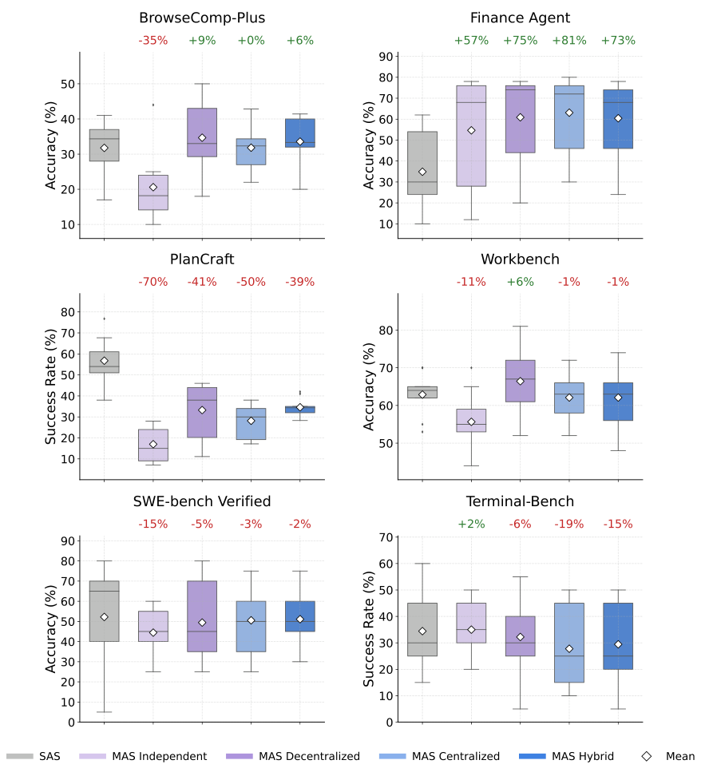
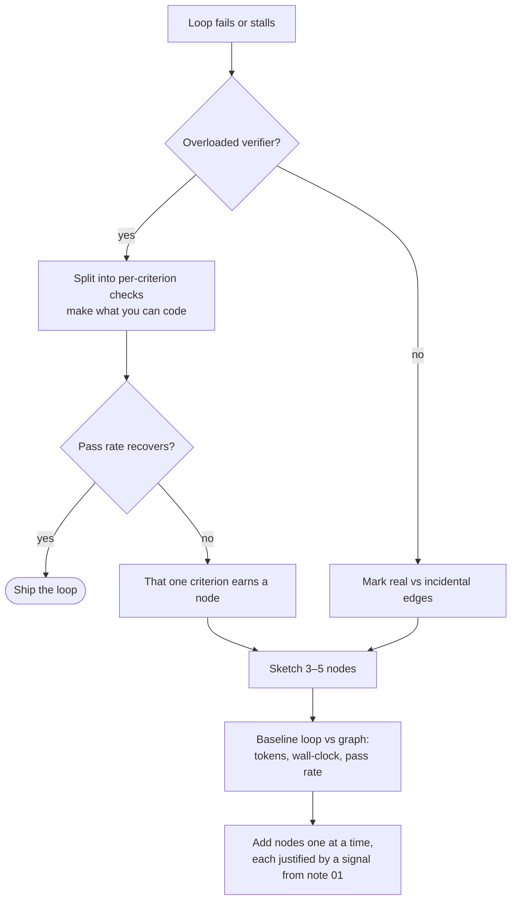

# 6 — When Not to Build a Graph

> Structure what you know; leave agency where you don't. A graph is overhead you justify with a signal and a measurement.

A graph drawn over work nobody understands yet fixes the first guess in place, and then charges for it: Anthropic reports multi-agent systems at about 15× a chat turn's tokens, with more prompts to drift and more places for a wrong answer to come from. This chapter is the negative case: the test for work you can't name in advance, the arithmetic of fan-out, and what to try before adding a node.

---

## Work you can't name ahead of time

LangChain is explicit that some work is too fluid to pin down:

> Generic deep research *"requires planning and delegation in ways that are hard to pin down ahead of time."* Forcing agentic tasks *"into deterministic paths is the wrong move."* Use an agent harness instead.

> **Structure what you know, leave agency where you don't.**

The test: can you name the nodes before the run starts? If not, can `Send` derive them from a step you do know (one worker per document the retriever returns)? If neither, you want a harness with a good loop ([03-harness](../../03-harness-engineering/README.md), [04-loop](../../04-loop-engineering/README.md)), not a graph. A graph drawn over work you don't understand yet just fixes your first guess in place.

Research on when structure can be decided at run time points the same way. A survey of 77 workflow-optimisation works (Yue et al., [arXiv:2603.22386](https://arxiv.org/abs/2603.22386), 2026-03, preprint; it runs no experiments, so its advice is the authors' synthesis) separates a **static** template, fixed after training or search, from a **dynamic** graph that is selected, generated or edited per input. It advises the least plasticity the workload needs: a constrained static scaffold first, graph search only when traces show structural failures, runtime selection or pruning before generating a graph, and editing only where observations change what should happen next. A pruning policy cannot add a verifier the super-graph never had, so if the wrong node ran or the right one never existed, inspect traces before tuning prompts.

Two systems show the dynamic end. **MindSearch** ([arXiv:2407.20183](https://arxiv.org/abs/2407.20183), Chen et al., ICLR 2025) has a planner grow a search DAG by writing Python (`add_node`, `add_edge`); each new node triggers a searcher, nodes with no dependency between them run in parallel, and Python exceptions go back to the planner. With InternLM2.5-7B and the searcher held fixed on HotpotQA, graph-by-code scored **64.0 vs. 61.3 for CodeAct and 58.0 for ReAct**. That swaps the action space and the interface together, so it doesn't isolate the graph. On Musique with GPT-4o the DAG stayed shallow: depth 1.1, 1.2 and 1.6 for 2, 3 and 4 hops. The **Conductor** ([arXiv:2512.04388](https://arxiv.org/abs/2512.04388), Nielsen et al., ICLR 2026) is a 7B model trained with GRPO to write a whole workflow in natural language: up to five steps, each a subtask, a worker id from a pool of seven (GPT-5, Claude Sonnet 4, Gemini 2.5 Pro and others) and an access list of earlier steps to show. In the paper's constrained setting (4,096 output tokens, math, QA and code sets) it averaged **72.35 vs. 62.13 for Mixture-of-Agents and 64.14 for the best single worker**, using about three steps, with more steps on harder problems. It trained on 960 problems from four families, has no cost term in its reward, and was not the cheapest of the routing baselines.

Sakana AI's **Fugu** report ([arXiv:2606.21228](https://arxiv.org/abs/2606.21228), Sakana AI, 2026-06, preprint, vendor technical report) productises the Conductor. Fugu-Ultra writes the same kind of up-to-five-step workflow over a pool that includes three frontier models (Gemini 3.1 Pro, Claude Opus 4.8, GPT-5.5). It reports **73.7 on SWE-Bench Pro against 69.2 for the best single model, and 82.1 against 78.2 on Terminal Bench 2.1**, with minimal harnesses. A lighter variant routes each input to one worker, using a selection head on the orchestrator's hidden state, and still reached 80.2 on Terminal Bench. The design detail worth keeping is about state. If every agent in a workflow sees every other agent's tool calls, the report describes "orchestration collapse": the first agent to touch the environment sets the path, and the rest add nothing. So each agent sees only its own tool trajectory plus the outputs its access list names, while a memory shared *across* workflows stops repeated tool calls. The trajectories it shows have the orchestrator pick a different aggregator per query (Gemini for trivia, GPT for maths), which a fixed-synthesiser design can't do. None of this is ablated. The baselines are mostly provider-reported rather than re-run, there are no cost or latency measurements and no variance on the benchmark table (only a three-seed AutoResearch run), and the topologies are hand-picked examples. On SciCode, long-context and τ³ banking Fugu-Ultra matched or trailed the best single model; the lighter Fugu edged it by 0.4 to 1.2 points.

**AgentConductor** ([arXiv:2602.17100](https://arxiv.org/abs/2602.17100), Wang et al., 2026-02, preprint) trains a 3B orchestrator (SFT on 4,500 GPT-4o-written YAML topologies (the appendix says GPT-4o-mini), then GRPO) to emit a layered DAG per problem and regenerate it for up to two turns from execution feedback, with per-turn node caps of 4, 7 and 10 for easy, medium and hard problems. With gpt-4o-mini workers and pass@1 over three runs it scored **58.8 on APPS, 46.3 on LiveCodeBench v4 and 38.8 on CodeContests**. The paper's text claims margins of 14.6, 3.1 and 1.1 points over the second best, but its Table 2 gives MetaGPT 51.3 on APPS (a 7.5-point gap) and Chain-of-Agents 44.9 on LiveCodeBench (1.4). Its overall average (the mean of the contest-level and basic-code group averages) of 72.1 beat the fixed MetaGPT pipeline's 68.7. The paper's own account is that the learned-topology baselines (GPTSwarm, AgentPrune, MacNet, G-Designer, 63.7–66.0) scored below MetaGPT because their topologies stay rigid, which is the survey's static-versus-dynamic split on one task family. Limits: one orchestrator size and one worker model, baselines re-run under the authors' roles and capped at 20 nodes, the density metric and caps are the authors' own, and ADAS and MaAS were not run as baselines.

**Archon** ([arXiv:2409.15254](https://arxiv.org/abs/2409.15254), Saad-Falcon et al., 2024, preprint v6 2025-06) searches instead of training, and over a deliberately narrow space: a linear stack of generate, critique, rank, fuse, verify and unit-test layers, 9,576 valid configurations, found by Bayesian optimisation on a 20% dev split. On seven benchmarks (held-out 80%) its task-specific architectures used 39–44 calls against 52 for ADAS and 48 for AFlow and scored higher (CodeContests 41.4% vs. ADAS 23.7% and AFlow 21.1%; MT-Bench 79.5% vs. 66.3% and 62.4%). A generalised architecture kept 91.7–94.2% of its task-specific score on unseen tasks, against 66.8–73.8% for generalised ADAS and AFlow. How those two baselines were run and tuned is not detailed, the judges were GPT-4-class models, and the main text and appendix disagree on some component gains. It costs up to 5x a single call and helps little with 7B models, so a constrained search space is a cheap first step before generating topologies.

---

## What fan-out costs

Anthropic's multi-agent research system is the first-party anchor. In their write-up, agents use about **4× the tokens of a chat interaction**, and multi-agent systems about **15×**. In exchange, the multi-agent version beat a single agent by a wide margin on their research eval, and token usage alone explained most of the variance in performance. Their conclusion: multi-agent systems pay off for tasks whose value is high enough to cover the tokens, and that **parallelise well**. Tasks where every agent needs the same context, or with many dependencies between agents, are a poor fit.

Kim et al. ([arXiv:2512.08296](https://arxiv.org/abs/2512.08296), 2025-12) tested that conclusion under controlled conditions: 260 configurations across six agentic benchmarks, five architectures and three model families (GPT-5, Gemini 2.x, Claude Sonnet 3.7–4.5), with compute matched. The spread was enormous. A centralized team scored 80.8% higher than a single agent on Finance Agent, where the work decomposes into parallel subtasks; every multi-agent variant lost 39–70% on PlanCraft, where each step constrains the next; and the mean change across all multi-agent configurations was −0.3% (95% CI [−58.7%, +77.2%]). The one predictor that held up under their most conservative statistics was the single agent's own score: once it was above about 45%, adding agents had negative returns. Multi-agent runs spent 1.6–6.2× the tokens of a single agent at matched performance. Their caveats: only 20 tasks per cell on SWE-bench Verified and Terminal-Bench, and prompts were not tuned per model. Tran & Kiela ([arXiv:2604.02460](https://arxiv.org/abs/2604.02460), 2026-04) get the same answer from the other side: on multi-hop QA at matched thinking-token budgets, a single agent was best or tied with every multi-agent variant ([05](05-topology-patterns.md#when-multi-agent-beats-single-agent)).

Adding copies of one model has a peak, not a slope. Li et al. ([arXiv:2606.00655](https://arxiv.org/abs/2606.00655), 2026-05, preprint) ran 1 to 8 same-model agents with different personas in a sequential chain for three rounds, on six MMLU subjects (17 questions each, 3 repeats). With Llama-3.1-70B and Qwen2.5-72B on subjects such as college physics, **accuracy rose to a peak at two to four agents and then fell**; on the logic subjects it fell from the start, while tokens grew roughly with the square of the agent count. Padding the history to a fixed length kept the same shape, so the authors put the decline down to coordination, not context length. The 7B and 8B models only got worse as agents were added. On formal logic, Llama-3.1-70B fell from 58.8% with one agent to 25.5% with eight. AutoGen's group chat delayed the drop but did not remove it. The samples are small, each question is about 5.9 points, the models are 2024-era open models with no tools, and no DAG or hierarchical topology was tested. Treat the agent count as a parameter you tune, starting from one.


*Image Source: Kim et al., [Towards a Science of Scaling Agent Systems](https://arxiv.org/abs/2512.08296) (2025), Fig. 2*

flowtivity puts the trade-off as a table. Its numbers are vendor estimates, so use them as a shape to test rather than as constants:

| Metric | Loop | Graph (fan-out) |
|---|---|---|
| Wall-clock time | Higher | Lower |
| Tokens per cycle | Lower | ~3× higher (flowtivity) |
| Break-even pass rate | — | ~50% (flowtivity) |

The logic behind the break-even is sound even if the number isn't: when most cycles fail and get redone, you pay the fan-out cost for work that gets thrown away. Fan-out pays when per-cycle success is high and the branches are genuinely independent. Find your own break-even: run the same task set through the loop and through the graph, and record tokens, wall-clock time and pass rate for each.

Tokens per accepted result make the arithmetic concrete. A graph that costs three times as much per cycle has to pass three times as often to tie, so past a certain loop pass rate it can't tie at all, and the case for it has to rest on wall-clock time:

```python
# Cost per accepted result = tokens per cycle / pass rate per cycle.
# The 3x multiplier is flowtivity's vendor estimate; the pass rates are inputs you measure.
def cost_per_accept(tokens, pass_rate):
    return tokens / pass_rate

loop_tokens, graph_tokens = 1, 3
print("loop_pass  loop_cost  graph_pass_needed_to_tie")
for p in (0.2, 0.3, 1 / 3, 0.5):
    needed = p * graph_tokens / loop_tokens
    print(f"{p:<10.2f} {cost_per_accept(loop_tokens, p):<10.2f} "
          f"{needed:.2f}{'  impossible' if needed > 1 else ''}")
```

Output:

```text
loop_pass  loop_cost  graph_pass_needed_to_tie
0.20       5.00       0.60
0.30       3.33       0.90
0.33       3.00       1.00
0.50       2.00       1.50  impossible
```

> **Rule: a graph needs genuine job separation to justify its overhead.** If the branches share most of their context, you're paying N times for the same reading.

---

## The cost of a premature graph

Beyond tokens, every node you add brings:

- **More prompts to maintain**, each of which can drift.
- **State synchronisation** across nodes: schema, reducers, single-writer discipline ([03](03-state-and-reducers.md)).
- **Coordination latency**: routing calls, waiting at joins.
- **Harder debugging**: a wrong answer now has N places it could have come from.

All of that is pure overhead when the problem had one specialty to begin with.

**A "multi-agent system" that is a pipeline.** Raieli & Iuculano's travel planner (*Building AI Agents with LLMs, RAG, and Knowledge Graphs*, ch. 9) has four "agents":

- a random-forest weather model that picks the best month;
- an embedding search over hotel descriptions (top k = 5 by cosine similarity);
- a GPT-2 itinerary writer;
- a GPT-2 email writer.

A controller calls them in a fixed order. No step decides anything, so no edge is conditional and nothing loops. That makes it a four-stage pipeline, and it is better for it: each stage can be tested on its own, and the cheapest model that works is used per stage. The one design choice worth copying is that the trip price (`price × nights + $100 × days`) is computed in code, because "LLMs are not good at arithmetic". Before calling something multi-agent, check whether any node chooses what runs next ([02](02-graph-primitives.md#edges-choose-what-runs-after-a-node)). If none does, build a function chain and skip the graph runtime.

---

## Split the verifier, not the system

The most common "we need a graph" is really an **overloaded verifier**: one check judging correctness, style, safety and completeness at once, and doing all four badly.

Before adding nodes:

1. Split the verifier into **per-criterion checks** inside the existing loop.
2. Make the ones that can be code into code ([04-loop note 03](../../04-loop-engineering/notes/03-the-scorekeeper.md)).
3. Measure again.

If pass rate recovers, ship the loop. If one criterion still fails because it needs a different model, tools or context, that criterion has earned its own node, and now you know exactly which node to add.

---

## Adopting incrementally

When a graph is justified, grow it in this order:

1. **Find the bottleneck.** Write down the current workflow and where it stalls or fails.
2. **Find the real edges.** Mark each step "reads the previous output" or "incidental" ([03](03-state-and-reducers.md#which-edges-are-real)). Only the incidental ones can parallelise.
3. **Sketch 3–5 nodes.** Not twelve.
4. **Measure a baseline** with the loop you have, then with the graph: tokens, wall-clock time, pass rate.
5. **Add nodes one at a time**, each justified by a signal from [01](01-graph-vs-loop.md#the-default-plus-an-escalation-rule).



This is [flowtivity](https://flowtivity.ai/blog/graph-engineering-2026-guide-openclaw-codex/)'s AUDIT → IDENTIFY → DESIGN → IMPLEMENT sequence, with "measure" made explicit. Their fifth stage, **TYPE**, comes last on purpose: once the topology is stable, give the relationships it records explicit types (`DEPENDS_ON`, `SUPERSEDES`, `DECIDED_BY` …) so later runs can reason over why things are connected, not only that they are. That is the knowledge-graph side of the pillar; the edge-type list and its caveats are in [09](09-kg-fundamentals-and-cypher.md#typed-edges-the-edge-type-is-the-knowledge). A 3–5 node graph with one honest verification step beats a twelve-node topology whose failure modes you can't reason about.

---

## Quick reference

| Situation | Use |
|---|---|
| Single agent, tool-augmented reasoning | Loop |
| Open-ended research with unknowable steps | Harness + loop, **not** a graph |
| Simple task, low per-cycle pass rate | Loop: fan-out cost isn't recovered |
| Single agent already passes more than ~45% | Loop: extra agents had negative returns (Kim et al.) |
| Verifier failing on several criteria | Split the verifier first |
| Several agents with conditional handoffs | Graph |
| 3+ independent verification or research steps | Graph (parallel review) |
| Long-running work needing resume, or human approval mid-run | Graph (checkpointer + interrupts) |
| Parallel specialists merging results | Graph (fan-out with reducers) |

---

## Pitfalls

- **Graphing unknowable work.** Symptom: generic deep research forced onto fixed nodes, which get rewritten every time the task changes. Fix: if you can't name the nodes and `Send` can't derive them from a step you do know, use a harness with a good loop.
- **Adding agents to a task that already works.** Symptom: the token bill grows and the pass rate stays flat or falls. Fix: stay with the loop when a single agent passes more than about 45%, the point past which Kim et al. saw negative returns.
- **Quoting vendor multipliers as constants.** Symptom: a design doc says "3× tokens, 50% break-even" with no measurement behind it. Fix: those are flowtivity's estimates, so run the same task set through both and record tokens, wall-clock time and pass rate.
- **Branches that share most of their context.** Symptom: N workers read the same documents and return overlapping findings. Fix: without genuine job separation you are paying N times for one reading, so don't fan out.
- **Calling a pipeline a multi-agent system.** Symptom: Raieli & Iuculano's four-"agent" travel planner has no conditional edge and no loop. Fix: call it a pipeline and test each stage on its own; that is cheaper and easier to reason about.
- **Letting the model do arithmetic that code can do.** Symptom: a wrong trip price in otherwise fine prose. Fix: compute it in code, as that planner does with `price × nights + $100 × days`.
- **Sketching twelve nodes.** Symptom: a first design nobody can debug, where a wrong answer has twelve places to come from. Fix: sketch 3–5, and add nodes one at a time, each with a signal.

## Try it

1. Your loop costs 10,000 tokens per cycle and passes 25%. A fan-out graph at 3× tokens would pass 70%. Which is cheaper per accepted result, and which pass rate would make them tie?

   <details><summary>Answer</summary>

   Loop: 10,000 / 0.25 = 40,000 tokens. Graph: 30,000 / 0.70 ≈ 42,857 tokens. The loop is slightly cheaper, and they tie at a graph pass rate of 75%. If the graph is also faster and time matters, you may still choose it, but that is a decision about wall-clock time, not tokens.

   </details>

2. Test each with "can you name the nodes before the run starts?": (a) summarise each document a retriever returns; (b) find out why a competitor's revenue fell; (c) classify, draft, then review a support ticket.

   <details><summary>Answer</summary>

   (a) Not by name, but `Send` can derive them from the retriever: a graph. (b) No, and nothing derives them, because the steps depend on what turns up: a harness and a loop. (c) Yes: a graph, and if every ticket takes the same path, a pipeline.

   </details>

3. One check judges correctness, style, safety and completeness, and pass rate has fallen. Write the next three steps in order.

   <details><summary>Answer</summary>

   Split it into per-criterion checks inside the existing loop. Turn the checks that can be code into code. Measure again. Only a criterion that still fails because it needs a different model, tools or context has earned its own node.

   </details>

## Interview checklist

| Prompt | Answer in one line |
|---|---|
| How do you decide if work is too fluid for a graph? | Ask if you can name the nodes before the run starts, or if `Send` can derive them from a step you know. If neither, use a harness with a good loop. |
| What does fan-out cost, per Anthropic? | In their write-up, agents use about 4× the tokens of a chat interaction and multi-agent systems about 15×, so it pays only for tasks whose value justifies that. |
| What did Kim et al. add to that? | 260 configurations across six benchmarks showed an enormous spread: a centralized team scored 80.8% above a single agent on Finance Agent, where work decomposes, and extra agents had negative returns once a single agent passed about 45%. |
| A vendor says fan-out breaks even at a 50% pass rate. How do you treat that? | As a shape to test, not a constant. Run the same task set through the loop and the graph, and compare tokens, wall-clock time and pass rate. |
| Your verifier is failing. Do you add a node? | First split it into per-criterion checks in the loop, make what can be code into code, and measure. A criterion that still fails because it needs a different model, tools or context has earned a node. |
| What does a premature graph cost besides tokens? | More prompts that can drift, state synchronisation, coordination latency and harder debugging, since a wrong answer now has N places it could have come from. |
| How do you adopt a graph once it is justified? | Find the bottleneck, mark which edges are real, sketch 3–5 nodes, baseline the loop against the graph, and add nodes one at a time, each with a signal. |

## Next

[07-failure-modes-at-scale.md](07-failure-modes-at-scale.md): how graphs fail where single loops don't.
