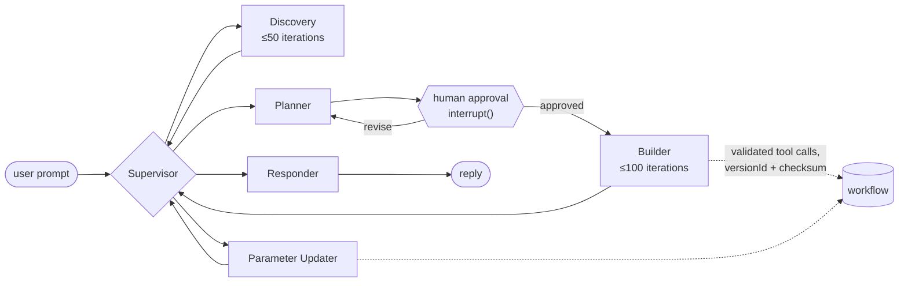

# 8 — Governance and Production

> Once work fans out across nodes, "the graph did it" is not an audit answer. Attribute every call, budget per node, gate the consequential edges.

"The graph did it" is not an answer when the bill triples or a tool breaks production. One run can spawn fifty nodes, so a per-run total tells you it went wrong and nothing about which node did it. This chapter covers the identifiers every call has to carry, budgets at three levels, gates, model aliases, and how n8n's workflow builder applies them with published constants.

---

## Attribution is the whole problem

A single loop has one identity and one bill. A graph run can spawn fifty nodes, each calling models and tools. Without attribution you can't answer the basic questions: which node spent the money, which node made the decision, which node called the tool that broke production.

### Identity and tracing

Every model call and tool call should carry stable identifiers:

| ID | Identifies | Why |
|---|---|---|
| `graph_id` | Which topology (and version) | Compare versions; roll back |
| `run_id` / `thread_id` | One execution | Group every call in a run; resume ([04](04-durable-execution-and-interrupts.md)) |
| `node_id` | The node that made the call | Per-node cost, latency, error rate |

Carry them as span attributes in your tracing. OpenTelemetry's GenAI semantic conventions define the standard attributes for model and agent spans (model, token counts, operation), so tools agree on what a span means; LangSmith and LangGraph's built-in tracing record node-level spans for you. TrueFoundry frames this as correlating orchestration traces with gateway records, which is a useful setup if you run a model gateway, but the identifiers matter with or without one.

> **Record the actual runtime work graph, not just the declared one.** With `Send` and conditional edges, the graph that ran is not the graph you drew. Your traces are the only record of which nodes executed, how many times, and in what order.

### Cost control

Graphs amplify spend through fan-out, retries and dynamically spawned subtasks. A per-run cap isn't enough when one run can spawn fifty nodes. Budget at three levels:

| Level | Guards against |
|---|---|
| **Per node** | One node looping or fanning out too far |
| **Per run** | A whole run going wrong |
| **Per tenant or team** | One customer or team consuming the shared budget |

Per-node attribution is what makes the first one possible. Without `node_id` on every call, you only learn that a run was expensive, not why.

The script below runs one graph with a misbehaving `discovery` node under two budgets. The costs are made up; the difference between the two lines is the point. With a per-run cap alone, the loop eats almost the whole budget before anything stops it. A per-node cap stops it at a third of that, and in both cases the ledger says exactly who spent what.

```python
# Same run, two budgets. The ledger rows carry graph_id, run_id and node_id, so spend has an owner.
from collections import Counter

PLAN = ["planner"] + ["discovery"] * 40 + ["builder", "reviewer"]   # discovery has gone wrong
COST = {"planner": 1_000, "discovery": 800, "builder": 2_000, "reviewer": 500}

def run(run_cap, node_caps):
    ledger, spent = [], Counter()
    for node in PLAN:
        if sum(spent.values()) + COST[node] > run_cap:
            return ledger, f"run cap hit at {node}"
        if spent[node] + COST[node] > node_caps.get(node, run_cap):
            return ledger, f"node cap hit at {node}"
        spent[node] += COST[node]
        ledger.append({"graph_id": "triage@v3", "run_id": "r-1", "node_id": node, "tokens": COST[node]})
    return ledger, "finished"

for name, caps in [("per-run only", {}), ("per-run + per-node", {"discovery": 8_000})]:
    ledger, why = run(30_000, caps)
    by_node = Counter()
    for row in ledger:
        by_node[row["node_id"]] += row["tokens"]
    print(f"{name}: {why}; spent {sum(by_node.values())}; {dict(by_node)}")
```

Output:

```text
per-run only: run cap hit at discovery; spent 29800; {'planner': 1000, 'discovery': 28800}
per-run + per-node: node cap hit at discovery; spent 9000; {'planner': 1000, 'discovery': 8000}
```

The tenant level is the one a run-scoped framework can't enforce on its own, because the limit has to hold across many concurrent runs. [TrueFoundry](https://www.truefoundry.com/blog/graph-engineering-enterprise-guide) puts it in the gateway: each team or tenant gets a virtual account (or a metadata tag on every call), and the budget rule is keyed on that, with separate limits per account. That is a vendor selling a gateway, but the shape holds with any proxy: the budget key has to be something every call carries, which is one more reason to propagate the IDs above.

### Approval checkpoints

Put human approval at the edges where consequence concentrates: irreversible, external, or expensive actions ([04](04-durable-execution-and-interrupts.md#where-approval-gates-go)). TrueFoundry calls this *"human approval checkpoints before configured sensitive tool calls at exactly the edges where consequence concentrates."*

### Model isolation

Route model calls through a named alias ("reviewer-model"), not a hard-coded model ID, so a model change is a config change you can roll out and roll back per node.

### One agent core, many tenants

When one agent serves several clients, keep one code path and put everything that differs into validated per-tenant configuration: prompt, rubric, enabled tools, knowledge scopes, model alias and limits. Each tenant then gets its own config versions and its own canary, and a rollback moves that tenant and no other. A run pins its version at the start, so a rollback changes new runs and not one already halfway through.

The controls that keep tenants apart only hold if they sit below the model and below the graph, where calls converge. Each row has an obvious version that fails.

| Control | Obvious version, and how it fails | Version that holds |
|---|---|---|
| **Tenant budget** | A shared counter checked before the model call and written after it. Every run in flight passes the same check. | A ledger that reserves the worst case before the call in one atomic statement, then settles to the actual. |
| **Knowledge** | Rank everyone's documents, then filter. The top-k is spent before the filter, so small tenants starve, and anything downstream of ranking has seen the foreign text. | The scope predicate is part of the query ([permissions at the retrieval layer](../../02-context-engineering/notes/04-retrieval.md)). |
| **Tools** | The allowlist is a sentence in the prompt. | The executor checks it, and takes the tenant from the run rather than from the model's arguments. |
| **Capacity** | One queue, so one client's bulk import sits in front of everyone. | A rate limit at admission, then a fair queue per tenant that shares by request cost and leaves no capacity idle. |
| **Traces** | The tenant lives in one ambient slot, which the next overlapping run overwrites. | Each span is stamped from the run's own context, and each read names the caller. |
| **Quality** | A pass rate across the fleet, weighted by traffic. | A pass rate per tenant, with too few runs reported as too few runs rather than as a pass. |

The [multi-tenant lab](../practice/multi-tenant-agents/README.md) runs each pair on generated traffic with a stub model. In its setup, 60 overlapping runs against a 6,000-token cap bill 11,291 tokens through the shared counter and 5,688 through the ledger. A model alias change takes one small tenant's pass rate from 86.0% to 49.0% while the fleet rate rises from 89.3% to 93.3%. Those numbers describe the lab's planted faults; the direction is what carries over.

---

## Production checklist

Adapted from TrueFoundry's seven questions:

1. Does every independently governed caller (agent, service, tenant) have a resolved identity?
2. Do model and tool calls carry stable graph, run and node identifiers?
3. Does the orchestrator record the **actual runtime work graph**, not just the declared one?
4. Can traces be joined with cost, policy, latency and tool records?
5. Are budgets set per node and per tenant, not only per run?
6. Are sensitive tool actions protected by explicit approval checkpoints?
7. Are model changes isolated behind an alias you can roll back?

Production readiness, in TrueFoundry's phrase, needs *"explicit ownership across orchestration, identity, policy, budgets, approvals, and evidence."*

---

## Case study: n8n's AI Workflow Builder

A shipped supervisor-pattern graph, useful because its operating constants are published rather than guessed. The builder (the n8n feature that generates workflows from a prompt) is LangGraph with a **supervisor routing to five specialist subgraphs**.

> **Source caution.** These details come from a third-party teardown ([Rathod, Medium](https://medium.com/@rajveer.rathod1301/inside-n8ns-ai-workflow-builder-a-complete-architecture-deep-dive-f2eeb2d57ec8)), not from n8n. The builder's code is in the n8n repository; check the constants there before relying on them.



| Node | Role | Bound |
|---|---|---|
| Supervisor | Routes each message to a subgraph | — |
| Discovery | Explores the node registry | max 50 iterations |
| Planner | Builds a structured plan; pauses for approval | — |
| Builder | Executes tool calls | max 100 iterations per session |
| Responder | Renders the user-facing reply | — |
| Parameter Updater | Surgical edits to existing node parameters | — |

What transfers:

- **Specialisation is prompt-only.** Every agent runs the same model (Claude Sonnet 4.5, temperature 0); roles differ only by system prompt. The cheapest kind of specialisation, and a good default ([05](05-topology-patterns.md#supervisor)).
- **Every looping node is bounded.** Discovery at 50, Builder at 100: per-node bounds, not just a graph-wide limit ([07](07-failure-modes-at-scale.md#mechanical-failures)).
- **One approval gate, after planning.** The plan is the cheapest artifact to correct ([04](04-durable-execution-and-interrupts.md#where-approval-gates-go)).
- **Checkpointed, keyed sessions.** `MemorySaver` or DB-persisted messages; session key `workflow-{workflowId}-user-{userId}` with a 24-hour TTL.
- **Optimistic locking.** Concurrent edits must carry the `versionId` and `expectedChecksum` they read: the single-writer rule enforced by compare-and-swap ([03](03-state-and-reducers.md#parallel-writes-without-a-reducer-race)).
- **Validation at the tool boundary.** Seven tools (`add_nodes`, `update_parameters`, `connect_nodes`, `get_node_details`, `get_execution_logs`, `get_expression_data_mapping`, `get_node_context`); *"every mutation is validated before it's applied"*. The workflow being built is typed, so malformed edges are rejected at write time instead of discovered at run time.

### Published context budgets

| Constant | Value |
|---|---|
| Context window | 200K tokens |
| Auto-compact threshold | 150K tokens (75% of the window) |
| Max workflow JSON | 30K tokens |
| Max prompt length | 5,000 chars |
| Frontend payload cap | 400 KB |
| Request timeout | 180 s |
| Rate limit | 100 requests per period, per IP |

The transferable idea: compaction triggers at 75% of the window, and **the artifact under construction is capped at 30K tokens**. The agent is never allowed to fill its own context with the thing it is editing.

### Deployment

n8n self-hosts via npm, Docker or Docker Compose, with provider guides for AWS, Azure, GCP, DigitalOcean, Hetzner, Heroku and OpenShift. Every installation runs the same core: without a licence key it is the free Community edition, and a Business or Enterprise key unlocks those editions on the same install ([docs](https://docs.n8n.io/deploy/host-n8n)). That is the shape of a graph system you operate rather than demo: a runtime, a persistence layer for checkpoints, and a deployment surface.

---

## What governance leaves open

Governance tells you what ran and what it cost. It doesn't tell you whether the answer was right. That is [the Eval pillar](../../../generative-ai/08-eval/README.md): measuring graph correctness, router accuracy, and coordination quality across runs.

---

## Pitfalls

- **Tracing the graph you drew.** Symptom: the diagram shows four nodes and the bill shows fifty calls, and no one can say which ran. Fix: with `Send` and conditional edges the graph that ran isn't the one you drew, so record the actual runtime work graph.
- **Only a per-run cap.** Symptom: one looping node uses almost the whole run budget, and the run dies before the nodes that matter get to go. Fix: budget per node as well, using `node_id` on every call.
- **Expecting a run-scoped framework to hold a tenant limit.** Symptom: each run is within budget and one customer still consumes the shared budget across concurrent runs. Fix: enforce it where calls converge, such as a gateway keyed on a virtual account or a metadata tag.
- **A shared counter as the tenant budget.** Symptom: the limit is checked on every call and the bill still passes it during a burst. Fix: reserve before the await in one atomic statement, because a check and a later write leave a gap every run in flight fits through.
- **A fleet mean as the quality alert.** Symptom: the dashboard improves after a model change while one small client's answers get worse. Fix: alert per tenant, and treat too few runs as unknown.
- **Hard-coded model IDs.** Symptom: a model change means a code change everywhere and has no per-node rollback. Fix: route through a named alias such as "reviewer-model".
- **Taking a teardown's numbers as fact.** Symptom: n8n's constants copied into a design as if n8n had published them. Fix: they come from Rathod's third-party teardown, so check them against the n8n repository first.
- **Letting the artifact fill the context.** Symptom: an agent editing a large workflow spends its window reading it. Fix: cap the artifact under construction, as n8n's builder does at 30K tokens in a 200K window, with compaction at 150K.

## Try it

1. In the budget script, set the `discovery` cap to 4,000 and raise the run cap to 100,000. What is spent in each mode, and does the per-run-only run finish?

   <details><summary>Answer</summary>

   Per-run only finishes, spending 35,500: planner 1,000, discovery 32,000, builder 2,000, reviewer 500. So a loose run cap hides the fault, and 90% of the spend sits in one node. With the node cap, the run stops at 5,000 spent: planner 1,000, discovery 4,000.

   </details>

2. Score a graph of your own, or the [pillar lab](../practice/langgraph-graph/README.md), against the seven-question production checklist. Which questions can you answer yes to, with evidence?

   <details><summary>What to look for</summary>

   The lab has a run identity (`thread_id`) and an approval checkpoint, so those two can be yes. It is a lab, with no tenant budgets or gateway records, so don't tick those. The honest result is a list of gaps with an owner for each.

   </details>

3. n8n's builder compacts at 150K of a 200K window. Compute the threshold for a 1M window using the same ratio, and say what the 30K artifact cap would become if you kept the same share.

   <details><summary>Answer</summary>

   75% of 1M is 750K. 30K of 200K is 15%, which is 150K. The ratio is a starting point rather than a rule: the idea worth keeping is that the agent can't fill its own context with what it is editing.

   </details>

4. Run the [multi-tenant lab](../practice/multi-tenant-agents/README.md) (`uv run run.py`). In section 2, why does the shared counter still overspend, and why does the ledger that refuses whenever money is held use only half the budget?

   <details><summary>Answer</summary>

   The shared counter bills 11,291 against the 6,000 cap because every run in flight checks it before the await and writes it after, so they all pass the same check. The refusing ledger bills 3,005 because it reserves each call's worst case and turns runs away while that money is merely held, and most of a hold comes back at settlement. Waiting for holds to settle bills 5,688, or 95% of the cap. All of this is the lab's generated traffic and stub model.

   </details>

## Interview checklist

| Prompt | Answer in one line |
|---|---|
| Which identifiers should every call carry, and why? | `graph_id` to compare and roll back topology versions, `run_id` or `thread_id` to group and resume a run, and `node_id` for per-node cost, latency and error rate. |
| Why record the actual runtime work graph? | With `Send` and conditional edges, the graph that ran isn't the one you drew. Traces are the only record of which nodes ran, how many times and in what order. |
| At what levels do you budget, and what does each guard against? | Per node for one node looping or fanning out, per run for a whole run going wrong, per tenant for one customer consuming shared budget. |
| Why can't the framework enforce a tenant budget? | The limit must hold across many concurrent runs, and a run-scoped framework only sees one. TrueFoundry's answer, which is also what it sells, is a gateway rule keyed on a virtual account or metadata tag. |
| A tenant budget is checked on every call and still overspends. Why? | The check and the write sit either side of an await, so concurrent runs all pass the same check. Reserve the worst case atomically before the call and settle after it. |
| Why filter by tenant in the query rather than after it? | After it, the top-k is already spent, so small tenants starve, and any step before the filter has seen foreign text. Over-fetching eases the first and worsens the second. |
| What does a model alias buy you? | A model change becomes a config change you can roll out and roll back per node, rather than a code edit. |
| What is the transferable lesson from n8n's context budget? | Compaction starts at 75% of the window (150K of 200K), and the artifact under construction is capped at 30K tokens, so the agent can't fill its context with what it is editing. These come from a third-party teardown. |
| A run's cost doubled overnight. How do you find out why? | Group the trace by `node_id` and compare it with the prior `graph_id`. Without `node_id` on every call, you only learn that the run was expensive. |

## Next

[09-kg-fundamentals-and-cypher.md](09-kg-fundamentals-and-cypher.md): Track B, knowledge graphs. Track A ends here, and [the Eval pillar](../../../generative-ai/08-eval/README.md) picks up the question governance leaves open, whether the answer was right.
