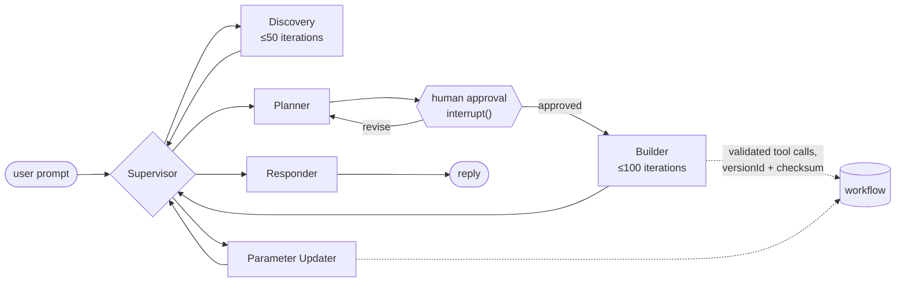

# 8 — Governance and Production

> Once work fans out across nodes, "the graph did it" is not an audit answer. Attribute every call, budget per node, gate the consequential edges.

---

## Attribution is the whole problem

A single loop has one identity and one bill. A graph run can spawn fifty nodes, each calling models and tools. Without attribution you can't answer the basic questions: which node spent the money, which node made the decision, which node called the tool that broke production.

### Identity and tracing

Every model call and tool call should carry stable identifiers:

| ID | Identifies | Why |
|---|---|---|
| `graph_id` | Which topology (and version) | Compare versions; roll back |
| `run_id` / `thread_id` | One execution | Group every call in a run; resume ([04](04-durable-execution-and-interrupts.md)) |
| `node_id` | The node that made the call | Per-node cost, latency, error rate |

Carry them as span attributes in your tracing. OpenTelemetry's GenAI semantic conventions define the standard attributes for model and agent spans (model, token counts, operation), so tools agree on what a span means; LangSmith and LangGraph's built-in tracing record node-level spans for you. TrueFoundry frames this as correlating orchestration traces with gateway records, which is a useful setup if you run a model gateway, but the identifiers matter with or without one.

> **Record the actual runtime work graph, not just the declared one.** With `Send` and conditional edges, the graph that ran is not the graph you drew. Your traces are the only record of which nodes executed, how many times, and in what order.

### Cost control

Graphs amplify spend through fan-out, retries and dynamically spawned subtasks. A per-run cap isn't enough when one run can spawn fifty nodes. Budget at three levels:

| Level | Guards against |
|---|---|
| **Per node** | One node looping or fanning out too far |
| **Per run** | A whole run going wrong |
| **Per tenant or team** | One customer or team consuming the shared budget |

Per-node attribution is what makes the first one possible. Without `node_id` on every call, you only learn that a run was expensive, not why.

### Approval checkpoints

Put human approval at the edges where consequence concentrates: irreversible, external, or expensive actions ([04](04-durable-execution-and-interrupts.md#where-approval-gates-go)). TrueFoundry calls this *"human approval checkpoints before configured sensitive tool calls at exactly the edges where consequence concentrates."*

### Model isolation

Route model calls through a named alias ("reviewer-model"), not a hard-coded model ID, so a model change is a config change you can roll out and roll back per node.

---

## Production checklist

Adapted from TrueFoundry's seven questions:

1. Does every independently governed caller (agent, service, tenant) have a resolved identity?
2. Do model and tool calls carry stable graph, run and node identifiers?
3. Does the orchestrator record the **actual runtime work graph**, not just the declared one?
4. Can traces be joined with cost, policy, latency and tool records?
5. Are budgets set per node and per tenant, not only per run?
6. Are sensitive tool actions protected by explicit approval checkpoints?
7. Are model changes isolated behind an alias you can roll back?

Production readiness, in TrueFoundry's phrase, needs *"explicit ownership across orchestration, identity, policy, budgets, approvals, and evidence."*

---

## Case study: n8n's AI Workflow Builder

A shipped supervisor-pattern graph, useful because its operating constants are published rather than guessed. The builder (the n8n feature that generates workflows from a prompt) is LangGraph with a **supervisor routing to five specialist subgraphs**.

> **Source caution.** These details come from a third-party teardown (Rathod, Medium), not from n8n. The builder's code is in the n8n repository; check the constants there before relying on them.

| Node | Role | Bound |
|---|---|---|
| Supervisor | Routes each message to a subgraph | — |
| Discovery | Explores the node registry | max 50 iterations |
| Planner | Builds a structured plan; pauses for approval | — |
| Builder | Executes tool calls | max 100 iterations per session |
| Responder | Renders the user-facing reply | — |
| Parameter Updater | Surgical edits to existing node parameters | — |

What transfers:

- **Specialisation is prompt-only.** Every agent runs the same model (Claude Sonnet 4.5, temperature 0); roles differ only by system prompt. The cheapest kind of specialisation, and a good default ([05](05-topology-patterns.md#supervisor)).
- **Every looping node is bounded.** Discovery at 50, Builder at 100: per-node bounds, not just a graph-wide limit ([07](07-failure-modes-at-scale.md#mechanical-failures)).
- **One approval gate, after planning.** The plan is the cheapest artifact to correct ([04](04-durable-execution-and-interrupts.md#where-approval-gates-go)).
- **Checkpointed, keyed sessions.** `MemorySaver` or DB-persisted messages; session key `workflow-{workflowId}-user-{userId}` with a 24-hour TTL.
- **Optimistic locking.** Concurrent edits must carry the `versionId` and `expectedChecksum` they read: the single-writer rule enforced by compare-and-swap ([03](03-state-and-reducers.md#parallel-writes-without-a-reducer-race)).
- **Validation at the tool boundary.** Seven tools (`add_nodes`, `update_parameters`, `connect_nodes`, `get_node_details`, `get_execution_logs`, `get_expression_data_mapping`, `get_node_context`); *"every mutation is validated before it's applied"*. The workflow being built is typed, so malformed edges are rejected at write time instead of discovered at run time.

### Published context budgets

| Constant | Value |
|---|---|
| Context window | 200K tokens |
| Auto-compact threshold | 150K tokens (75% of the window) |
| Max workflow JSON | 30K tokens |
| Max prompt length | 5,000 chars |
| Frontend payload cap | 400 KB |
| Request timeout | 180 s |

The transferable idea: compaction triggers at 75% of the window, and **the artifact under construction is capped at 30K tokens**. The agent is never allowed to fill its own context with the thing it is editing.

### Deployment

n8n self-hosts via npm, Docker or Docker Compose, with guides for the major clouds; without a licence key it runs as the free Community edition ([docs](https://docs.n8n.io/deploy/host-n8n)). That is the shape of a graph system you operate rather than demo: a runtime, a persistence layer for checkpoints, and a deployment surface (`~/.claude/refs/agent-runtime.md`).

---

## Next layer

Governance tells you what ran and what it cost. It doesn't tell you whether the answer was right. That is [06-eval](../../06-eval/README.md): measuring graph correctness, router accuracy, and coordination quality across runs.

---

## Working reference

`~/.claude/refs/agent-runtime.md` — deployment and runtime. `~/.claude/refs/agent-architecture.md` — trust boundaries.

---

→ Next: [09-kg-fundamentals-and-cypher.md](09-kg-fundamentals-and-cypher.md) — Track B: knowledge graphs.
