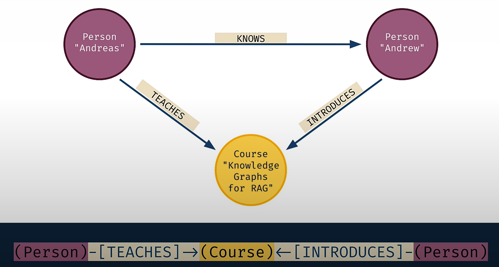

# 9 — KG Fundamentals and Cypher

> A knowledge graph stores typed entities and named relationships for one domain. It gives an LLM facts it can traverse and cite, rather than text it has to guess from. Neo4j and Cypher are enough to start.

---

## Where it sits

Track A treated the graph as *execution topology*: nodes compute, edges route. Track B uses the same word for a different object.

| | Agent graph (notes 01–08) | Knowledge graph (notes 09–13) |
|---|---|---|
| Nodes are | Units of computation | Entities |
| Edges are | Permitted transitions | Typed relationships |
| The graph is | Execution topology | Data structure for retrieval |
| Runtime concern | Routing, state, cost | Traversal, entity resolution |

Keep these apart until [note 12](12-kg-as-shared-agent-memory.md), where the knowledge graph becomes the shared state the execution graph coordinates through.

---

## What a knowledge graph is

The book's definition: an **ever-evolving graph of typed entities, their attributes and the named relationships between them, built for a specific domain** (ch1). It rests on four pillars:

| Pillar | Means |
|---|---|
| **Evolution** | The graph changes as facts arrive. It's never "done". |
| **Semantics** | Types and relationship names carry meaning, often from an ontology. |
| **Integration** | Several sources fused onto shared entities. |
| **Learning** | The structure supports inference and graph ML ([note 13](13-graph-ml-and-gnns.md)). |

### Why it pairs with LLMs

Each side covers a weakness of the other (ch1 §1.3).

| LLM drawback | What the KG contributes |
|---|---|
| Hallucination | Explicit facts to ground answers in |
| Staleness (training cutoff) | A store you update without retraining |
| Opacity | Paths and edges you can show as the reason for an answer |
| Private data | Domain facts the model never saw |

It also works the other way: LLMs help **build** KGs (extraction, [note 10](10-building-kgs-with-llms.md)), **query** them (text-to-Cypher, [note 11](11-kg-rag-and-text-to-cypher.md)) and **summarise** what comes back.

**Consider a KG when** the questions are relational or multi-hop ("who funded the people who worked with X?"), the answers need to be traced back to sources, data comes from several systems that share entities, or the domain already has an ontology. If your questions are "find the paragraph that talks about Y", a vector index is cheaper ([02-context note 04](../../02-context-engineering/notes/04-retrieval.md)).

### Two kinds of knowledge, two kinds of reasoning

Ch2 frames the pairing as a question of how each side holds knowledge and reasons with it:

| | KG | LLM |
|---|---|---|
| Knowledge is acquired | Explicitly: modelled, often by domain experts | Implicitly: statistical patterns from training text |
| It's good at | Interpretability, exact facts, auditing | Language, ambiguity, filling gaps |
| Natural reasoning | **Deductive**: sound, but only as complete as the knowledge base | **Inductive and probabilistic**: generalises from incomplete data, and can reach false conclusions from true premises |

Real knowledge bases are never complete, so purely deductive engines stall. Inductive methods, whether graph ML ([note 13](13-graph-ml-and-gnns.md)) or an LLM, fill the gaps. A hybrid reasons more robustly under uncertainty, though neither side supplies common sense. The book aims all of this at **intelligent advisory systems**: systems that support a human decision rather than act on their own.

### Purpose-driven, not bottom-up

Ch2's construction rule: **start from the question the graph must answer, not from the data you happen to have.** Bottom-up integration ("load every source and see what connects") usually fails, because sources are heterogeneous and most of their content is irrelevant to any one task. The book runs construction as a CRISP-DM cycle: business understanding → data understanding → modelling the schema → building → evaluating against the original questions. It is the same advice as appendix C's "curate before you scale" ([note 10](10-building-kgs-with-llms.md#stage-5-assembly-with-the-course-as-worked-example)), and [KG Lab 2](../practice/02-knowledge-graph-labs.md#lab-2--model-this-repo-as-a-kg) has you fix the questions before adding edge types.

---

## Graph basics

From appendix A, kept to what you need:

- **Node** (vertex) and **relationship** (edge). Edges can be directed or undirected.
- **Degree**: the number of edges on a node. **Hubs** are nodes with very high degree. Hubs matter later because they create spurious short paths ([note 10](10-building-kgs-with-llms.md)).
- **Path**: a sequence of edges. **Shortest path** and **variable-length path** are the core traversal operations.
- **Connected component**: a set of nodes that can all reach each other. Weakly connected components (WCC) do the clustering step in graph-based entity resolution.

---

## Two data models: LPG vs. RDF

| | Labelled property graph (LPG) | RDF |
|---|---|---|
| Unit | Nodes and relationships, each with properties | Triples (subject, predicate, object) |
| Identity | Internal IDs plus your own keys | Global IRIs |
| Edge properties | Native (`[:FUNDED {amount, year, source}]`) | Need a workaround: n-ary relation nodes, RDF-star, or named graphs |
| Schema and inference | Optional; constraints and indexes | Ontologies (RDFS/OWL), with reasoning over subclass hierarchies |
| Query language | Cypher / GQL | SPARQL |
| Typical store | Neo4j | Triple stores (GraphDB, Jena) |

**Choose by goal, not ideology** (ch3). Use RDF and OWL when standard ontologies, interchange and formal inference are the point. Use LPG when you need provenance, confidence and timestamps on edges. That covers most LLM-extracted graphs, because every extracted edge should record where it came from. You can have both: ch3 imports OWL ontologies into Neo4j with **Neosemantics (n10s)** and keeps the subclass hierarchy as edges you can traverse.


*Image Source: Knowledge Graphs for RAG, DeepLearning.AI × Neo4j (Kollegger, 2024)*

The figure is the LPG argument in one picture: `since`, `year` and `section` sit on the edges themselves. In RDF each of those would need a workaround.

This track uses LPG and Neo4j.

---

## Typed edges: the edge type is the knowledge

A graph whose edges are all `RELATED_TO` tells you that two things are connected but not how, and "how" is what reasoning needs. Name edges by meaning:

| Edge type | Meaning |
|---|---|
| `SUPERSEDES` | This replaces that |
| `DEPENDS_ON` | This needs that |
| `DECIDED_BY` | This was chosen because |
| `CAUSED` | This created that |
| `IMPLEMENTS` | This realises that |
| `REFERENCES` | This mentions that |

That list comes from a vendor blog (flowtivity), which also claims typed edges improve reasoning accuracy by ~18%. **That number is unverified.** No primary source is cited, so don't quote it. The principle stands without it: a query can only filter on distinctions the schema records. The book makes the same point with different examples: the miRNA graph keeps `RELATED_TO` and `REGULATES` separate so that each source dataset's meaning stays visible (appendix C).

---

## Neo4j and Cypher

Cypher draws patterns in ASCII: `(n:Label {prop: value})-[r:TYPE]->(m)`.


*Image Source: Knowledge Graphs for RAG, DeepLearning.AI × Neo4j (Kollegger, 2024)*

The pattern under the picture, `(Person)-[TEACHES]->(Course)<-[INTRODUCES]-(Person)`, is the Cypher you'd write to find it. You draw the shape you want and Neo4j finds every match.

From Python, the course wraps the driver in LangChain's `Neo4jGraph`, which returns each row as a dict:

```python
from langchain_neo4j import Neo4jGraph   # course used langchain_community.graphs (deprecated)

kg = Neo4jGraph(url=NEO4J_URI, username=NEO4J_USERNAME, password=NEO4J_PASSWORD)

# Co-actors: walk out along ACTED_IN and back in to the other actors
cypher = """
MATCH (tom:Person {name: $name})-[:ACTED_IN]->(m:Movie)<-[:ACTED_IN]-(co:Person)
RETURN co.name AS coActor, m.title AS movie
"""
rows = kg.query(cypher, params={"name": "Tom Hanks"})   # list[dict]

kg.refresh_schema(); print(kg.schema)   # the schema string text-to-Cypher prompts use (note 11)
```

The LangChain Neo4j integrations moved out of `langchain_community` into the `langchain-neo4j` package; the class names are unchanged.

### Cheat sheet

```cypher
// Read: pattern match with a filter
MATCH (p:Person)-[:ACTED_IN]->(m:Movie)
WHERE m.released > 2000
RETURN p.name, m.title LIMIT 10

// Parameters, never string concatenation (safety, plan caching)
MATCH (p:Person {name: $name}) RETURN p

// Write idempotently: MERGE matches or creates
MERGE (c:Company {cik: $cik})
  ON CREATE SET c.name = $name
MERGE (m:Manager {name: $mgr})
MERGE (m)-[r:OWNS_STOCK_IN {reportDate: $date}]->(c)
SET r.value = $value

// Uniqueness: MERGE alone is not safe under concurrent writers
CREATE CONSTRAINT company_cik IF NOT EXISTS
FOR (c:Company) REQUIRE c.cik IS UNIQUE

// Variable-length path: 1 to 3 hops
MATCH path = (a:Note {id: '12'})-[:DEPENDS_ON*1..3]->(b:Note)
RETURN [n IN nodes(path) | n.id]

// Shortest path
MATCH p = shortestPath((a:Person {name:$a})-[*..6]-(b:Person {name:$b}))
RETURN p

// Aggregate
MATCH (m:Manager)-[r:OWNS_STOCK_IN]->(c:Company)
RETURN c.name, sum(r.value) AS total ORDER BY total DESC

// Indexes used by retrieval (note 11)
CREATE FULLTEXT INDEX names IF NOT EXISTS FOR (n:Entity) ON EACH [n.name]
CREATE VECTOR INDEX chunk_emb IF NOT EXISTS FOR (c:Chunk) ON (c.embedding)
  OPTIONS {indexConfig: {`vector.dimensions`: 1536, `vector.similarity_function`: 'cosine'}}

// Inspect the schema (input for text-to-Cypher)
CALL db.schema.visualization()

// Check a query without running it (the validator in note 11)
EXPLAIN MATCH (n:Company) RETURN n
```

### Habits worth forming

- **Always bound variable-length paths** (`*1..3`, not `*`). Unbounded traversal over a hub can visit the whole graph.
- **Pair `MERGE` with a uniqueness constraint.** The course (L6) shows `MERGE` creating duplicates when writers race. The constraint turns that into an error you can see. This is the single-writer rule from [note 03](03-state-and-reducers.md), applied at the database.
- **`MERGE` on the identity key only, then `SET` the rest.** `MERGE (c:Company {cik:$cik, name:$name})` makes a new node whenever the name is spelled differently.
- **Put provenance on edges**, such as `source`, `run_id` and `extracted_at`. You'll need it for rollback in [note 12](12-kg-as-shared-agent-memory.md).
- **APOC** (appendix B) is the utility library: batching (`apoc.periodic.iterate`), schema introspection (`apoc.meta.schema`) and import helpers.

---

## Working reference

`~/.claude/refs/agent-memory.md`: semantic memory (facts and entities) is the tier a KG implements.

Depth: [appendix A](../sources/kg-and-llms-in-action/appendix-a-intro-to-graphs.md) (graph theory), [appendix B](../sources/kg-and-llms-in-action/appendix-b-neo4j.md) (Neo4j, Cypher, APOC), [ch1](../sources/kg-and-llms-in-action/01-kg-llm-killer-combination.md), [ch2](../sources/kg-and-llms-in-action/02-intelligent-systems-hybrid.md) (KG vs. LLM reasoning, purpose-driven construction), [ch3](../sources/kg-and-llms-in-action/03-first-kg-from-ontologies.md) (RDF vs. LPG, n10s). Practice: [KG Lab 1](../practice/02-knowledge-graph-labs.md#lab-1--cypher-on-the-movies-graph) and [KG Lab 2](../practice/02-knowledge-graph-labs.md#lab-2--model-this-repo-as-a-kg).

---

→ Next: [10-building-kgs-with-llms.md](10-building-kgs-with-llms.md): turning unstructured text into a graph you can trust.
