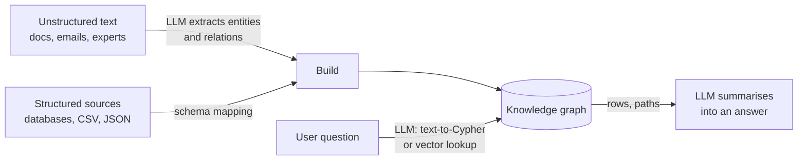
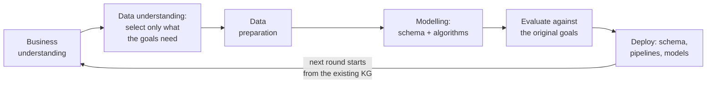
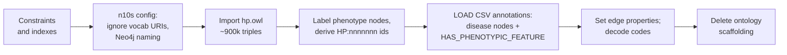

# 9 — KG Fundamentals and Cypher

> A knowledge graph stores typed entities and named relationships for one domain. It gives an LLM facts it can traverse and cite, rather than text it has to guess from. Neo4j and Cypher are enough to start.

Book citations in this note refer to Negro et al., *Knowledge Graphs and LLMs in Action* (Manning, 2025), shortened to *KG & LLMs in Action* after this line.

---

## Where it sits

Track A treated the graph as *execution topology*: nodes compute, edges route. Track B uses the same word for a different object.

| | Agent graph (notes 01–08) | Knowledge graph (notes 09–13) |
|---|---|---|
| Nodes are | Units of computation | Entities |
| Edges are | Permitted transitions | Typed relationships |
| The graph is | Execution topology | Data structure for retrieval |
| Runtime concern | Routing, state, cost | Traversal, entity resolution |

Keep these apart until [note 12](12-kg-as-shared-agent-memory.md), where the knowledge graph becomes the shared state the execution graph coordinates through.

---

## What a knowledge graph is

The book's definition: an **ever-evolving graph of typed entities, their attributes and the named relationships between them, built for a specific domain**, fusing structured and unstructured data for both people and machines (Negro et al., *KG & LLMs in Action*, ch. 1; [ch. 1 PDF](../sources/kg-and-llms-in-action/ch01-kg-llm-killer-combination.pdf)). Three building blocks: **nodes** (real-world entities), **relationships** (meaningful connections between them) and **properties** (the context on either: dates, coordinates, descriptions). The definition rests on four pillars:

| Pillar | Means | In practice |
|---|---|---|
| **Evolution** | The graph changes as facts arrive. It's never "done". | New node and edge types extend it without a rebuild |
| **Semantics** | Types and relationship names carry meaning, often from an ontology. | Identity, transitive and inverse relations; consistency checks; explanations |
| **Integration** | Several sources fused onto shared entities. | One reference point regardless of source format or provenance |
| **Learning** | The structure supports inference and graph ML ([note 13](13-graph-ml-and-gnns.md)). | Centrality for influential nodes, shortest paths, community detection, inference rules |

The business case the book leans on is integration. It cites McKinsey's estimate that addressing data fragmentation can cut annual data spending by 5–15% in the short term (*KG & LLMs in Action*, ch. 1 §1.4). That is a consultancy figure for fixing fragmentation in general, not a measured result for KGs.

### Why KGs stalled, and what LLMs change

KGs have been around for years without wide adoption. The book gives three reasons: they're **expensive to build and maintain**, answering a question means **navigating several hops**, which needs schema and query-language knowledge, and the answer comes back **scattered across many nodes and edges** that a non-expert can't read (*KG & LLMs in Action*, ch. 1). The early adopters show the ceiling: Google used a KG to search for "things, not strings", but only for search, and analysts use KGs for investigative questions, but the querying effort keeps that to a small user base. Structured sources are the easy part: their items are already identified and typed, so mapping them onto a graph schema is predictable work. Text is the hard part, because of multiple languages and scripts, typos, coreference ("John saw Bob and he waved": who waved?), varied writing styles, and domain jargon.

Those three blockers line up with three jobs an LLM can do:



LLMs **build** KGs (extraction, [note 10](10-building-kgs-with-llms.md)), **query** them (text-to-Cypher, [note 11](11-kg-rag-and-text-to-cypher.md)) and **summarise** what comes back, turning a table of paths into prose (*KG & LLMs in Action*, ch. 1, fig. 1.4).

### Why it pairs with LLMs

It works the other way too: each side covers a weakness of the other (*KG & LLMs in Action*, ch. 1 §1.3). The chapter's text names three LLM drawbacks a KG mitigates: hallucination, stale information and explainability. The fourth row below comes from fig. 1.5's "lack domain-specific / new knowledge".

| LLM drawback | What the KG contributes |
|---|---|
| Hallucination | Explicit facts to ground answers in |
| Staleness (training cutoff) | A store you update without retraining |
| Opacity | Paths and edges you can show as the reason for an answer |
| Private data | Domain facts the model never saw |

The book's summary figure (fig. 1.5) lists the KG's own weaknesses as **incompleteness**, **no language understanding** and **complex querying**: exactly the gaps the LLM fills, with its general knowledge, language processing and generalisability. The KG's strengths are accuracy, interpretability, domain knowledge and knowledge that keeps evolving, which answer the LLM's hallucination, black-box opacity and missing domain or recent knowledge.

### When to use a KG, and when to add an LLM

The book's checklist, condensed (*KG & LLMs in Action*, ch. 1 §1.5.3). A "yes" in the left column argues for a KG; a single "yes" in the right column means the KG solution needs an LLM layered on it.

| Consider a KG if you need to… | Add an LLM if you need to… |
|---|---|
| Harmonise data silos into one consistent view | Extract entities and relations from unstructured text |
| Connect structured and unstructured sources meaningfully | Interpret complex user questions |
| Let the structure evolve as requirements change | Offer a conversational interface |
| Track provenance and consistency through a pipeline | Summarise large results as text |
| Power search and recommendation | |
| Visualise communities and interdependencies | |
| Run ML that benefits from relational structure | |

The book's two running use cases show the split. In **drug discovery** the KG connects genes, diseases and drugs with typed, rule-bearing relationships that support transitive inference, while LLMs mine papers and clinical reports to extend it. In **customer-support assistants** the KG grounds the conversation in concepts and their relations, so the LLM's answers stop being generic (the book cites Zhang et al.'s observation that conversations develop around knowledge).

**The short version for this course:** consider a KG when the questions are relational or multi-hop ("who funded the people who worked with X?"), the answers need to be traced back to sources, data comes from several systems that share entities, or the domain already has an ontology. If your questions are "find the paragraph that talks about Y", a vector index is cheaper ([02-context note 04](../../02-context-engineering/notes/04-retrieval.md)).

### Two kinds of knowledge, two kinds of reasoning

Ch2 frames the pairing as a question of how each side holds knowledge and reasons with it (*KG & LLMs in Action*, ch. 2; [ch. 2 PDF](../sources/kg-and-llms-in-action/ch02-intelligent-systems-hybrid.pdf)). An intelligent system splits into **knowledge representation** and **reasoning**, and the two constrain each other: the more expressive a representation, the more expensive it usually is to reason over.

| | KG | LLM |
|---|---|---|
| Knowledge is acquired | Explicitly: modelled, often by domain experts, against a schema or ontology | Implicitly: statistical patterns from training text, mostly unsupervised |
| Access | Nodes and edges people and programs can both read | Billions of parameters nobody can inspect |
| Updating a fact | Add, change or delete a node or edge | Retrain or fine-tune |
| It's good at | Interpretability, exact facts, auditing | Language, ambiguity, filling gaps |
| Natural reasoning | **Deductive**: sound, but only as complete as the knowledge base | **Inductive and probabilistic**: generalises from incomplete data, and can reach false conclusions from true premises |

A deductive engine "requires a highly complete and accurate knowledge base, which is rarely available", so on real data it stalls. It also mostly only reads: in the book's diagram (fig. 2.11) communication runs one way "in most cases", and the deductive reasoner doesn't store its results back in the knowledge base. Inductive methods, whether graph ML ([note 13](13-graph-ml-and-gnns.md)) or an LLM, fill the gaps, generalise under uncertainty and **extend the knowledge base** with what they learn. The book's general reasoning engine is a loop: read the KG, suggest, observe the result, write new knowledge back (*KG & LLMs in Action*, ch. 2, fig. 2.10). In the book's medical example, a patient with vague symptoms and an incomplete record stalls a rule engine, while an LLM can weigh several diagnoses and propose a prioritised set of tests.

**Pitfall: fluent is not the same as reasoning.** The authors gave Claude 3.5 Sonnet a stripped-down river-crossing puzzle (a farmer and a sheep, no wolf or lettuce). It answered with the shuttle pattern of the full puzzle, "the smallest number of trips required is 3" (across with the sheep, back alone, across alone), when the first crossing already solves it: the solution closest to its training data, not one fitted to the stated constraints (fig. 2.9). Wu et al. found the same across 11 tasks, from coding and drawing to chess and arithmetic: performance "substantially and consistently degraded" on counterfactual variants of familiar tasks, which the book reads as LLMs often relying on "narrow, non-transferable procedures" (*KG & LLMs in Action*, ch. 2). The authors expect newer models to do better on this specific puzzle, but the lesson stands: give the precise, rule-bound part of a task to the KG, and the ambiguous, pattern-matching part to the LLM. Neither supplies common sense.

The book aims all of this at **intelligent advisory systems** (IAS): systems that support a human decision rather than act on their own.

| | Autonomous system | Advisory system (the book's focus) |
|---|---|---|
| Role | Acts in the user's place | Informs and recommends; a human decides |
| Needs | Full automation, real-time decisions, adaptability | Decision support, context awareness, explanations on demand |
| Examples | Self-driving car | Differential diagnosis, fraud flagging, crime hotspot forecasting |

The book takes Geoff Hulten's definition: an intelligent system connects users to AI to achieve meaningful objectives, and its intelligence "evolves and improves over time, particularly when it improves by watching how users interact with the system". Four characteristics follow: a specific, **meaningful objective** that drives the whole build; an **intelligent experience**, an interface where correct outputs pay off, mistakes are cheap, and implicit and explicit feedback gets collected; **knowledge creation and update**, done continuously; and **orchestration** of several algorithms, the output of one feeding the next. For its own design the book adds: suggest rather than act, build on an established domain knowledge base (papers, ontologies, curated data) rather than generic knowledge, and feed the results of suggested actions back into that knowledge base.

### Purpose-driven, not bottom-up

Ch2's construction rule: **start from the question the graph must answer, not from the data you happen to have** (*KG & LLMs in Action*, ch. 2). Bottom-up integration ("load every source, fix the schema afterwards, see what connects") "often leads to the failure of KG adoption" in the authors' experience, for three reasons: too many sources with different structures and identifiers, a large normalisation effort, and most of the content is specific to some other task.

The book runs construction as a CRISP-DM cycle with the KG at the centre:



Later rounds work **by difference and extension**: add node and relationship types without breaking what earlier rounds built. A graph database's near-schemaless storage is what makes that cheap. It is the same advice as appendix C's "curate before you scale" ([note 10](10-building-kgs-with-llms.md#stage-5-assembly-with-the-course-as-worked-example)): fix the questions before you add edge types.

---

## Graph basics

From appendix A (*KG & LLMs in Action*, app. A; [appendix A PDF](../sources/kg-and-llms-in-action/appendix-a-intro-to-graphs.pdf)), kept to what you need. Hubs, shortest and variable-length paths and connected components are not in the appendix; they are added because later notes lean on them.

- **Graph** `G = (V, E)`: a set of vertices (nodes) and a set of edges (relationships), each edge a pair of vertices. Graph theory starts with Euler's 1736 proof that Königsberg's seven bridges can't each be crossed exactly once.
- **Directed or undirected.** A directed edge runs from its *tail* (start node) to its *head* (end node). **Weighted** edges carry a number. The two properties are independent.
- **Adjacent** vertices share an edge; an edge is **incident** on its two endpoints. A **complete** graph has every pair of vertices adjacent.
- **Degree**: the number of edges on a node. Directed graphs split it into **in-degree** and **out-degree**; average degree is the sum of degrees over the node count. **Hubs** are nodes with very high degree. Hubs matter later because they create spurious short paths ([note 10](10-building-kgs-with-llms.md)).
- **Path**: a sequence of vertices joined by edges. A **simple path** repeats no vertex; a **cycle** returns to its start. **Shortest path** and **variable-length path** are the core traversal operations.
- **Connected component**: a set of nodes that can all reach each other. Weakly connected components (WCC) do the clustering step in graph-based entity resolution.

**Graph vs. network.** A network is a graph whose nodes and edges have been given meaning. The same structure can be a social, citation, communication or transport network depending only on those semantics. Networks also sit inside **surrounding contexts**, forces outside the graph that shape how it grows. The main one in social data is **homophily**: similar people link to each other, and linked people grow similar. Recommenders use it to guess what a new user likes from their connections. The appendix's case studies are the ICIJ's Panama Papers network (people, companies and intermediaries linked as shareholder, director or beneficiary) and Krebs's Amazon "also bought" graph of US political books. In 2008 it had three non-overlapping clusters (Obama biographies, Democratic, Republican) with no books bridging red and blue; by 2012 many books bridged the clusters and none was isolated.

### Representing a graph in memory

| | Adjacency list | Adjacency matrix |
|---|---|---|
| Structure | Per node, the list of its neighbours | A `\|V\| × \|V\|` grid; cell `(u, v)` is 1 (or the weight) if the edge exists |
| Memory | Proportional to `\|V\| + \|E\|` (an undirected edge is stored twice) | Proportional to `\|V\|²`, whatever the edge count; halve it for undirected graphs |
| "Is there an edge u→v?" | Scan `u`'s list | One lookup |
| Choose when | The graph is sparse (most real KGs) | The graph is dense (`\|E\|` close to `\|V\|²`), or small enough that simplicity wins |

In a directed matrix, rows give outgoing edges and columns give incoming ones. An unweighted matrix needs only one bit per cell. Neo4j's **index-free adjacency** is the list idea taken to storage: each node record points straight at its relationships, so a hop costs the same no matter how large the graph is (*KG & LLMs in Action*, app. B, which points back to app. A for the representations).

---

## Taxonomies, ontologies and "just enough semantics"

Structure alone doesn't make a graph a knowledge graph; the meaning layered on it does (*KG & LLMs in Action*, ch. 1 §1.6.1):

| | Taxonomy | Ontology |
|---|---|---|
| Captures | Broader/narrower hierarchy | Hierarchy plus identity, difference and richer constraints |
| Example | Vehicle ⊃ Car ⊃ Sedan | "Car" ≡ "Automobile"; "Car" and "Bicycle" are disjoint |
| Expressive features | Parent/child | Classes defined by union, complement, disjointness, cardinality |

Raieli & Iuculano draw the same line and add a second axis: **domain-independent** (upper) ontologies give a few high-level concepts that let several domains integrate, and **domain ontologies** (medicine, finance) sit below them as subclasses carrying the terminology (*Building AI Agents with LLMs, RAG, and Knowledge Graphs*, ch. 7). Their example of a property rule needs a fix: they say that if `married_to` is transitive you can infer facts nobody stated. Marriage is *symmetric* (A married to B implies B married to A), not transitive. Declaring a relationship with the wrong property makes the reasoner infer false facts with full confidence, so check each one.

Without an ontology, a vocabulary stays vague, because nothing records how its terms relate. But full, rigid ontologies are costly and age badly. The book's recommendation is **just enough semantics**: model the subset of ontology features the current questions need, scoped to one subdomain (say, cardiology in a healthcare KG), and extend it as the system grows.

Ontologies also do integration work (*KG & LLMs in Action*, ch. 3; [ch. 3 PDF](../sources/kg-and-llms-in-action/ch03-first-kg-from-ontologies.pdf)). Sources differ in format (XML, CSV, JSON), storage (relational, document), syntax (`2022-08-09` vs. `9 August 2022`) and, hardest, meaning. Healthcare examples: two names for one concept (type 2 diabetes and ketosis-resistant diabetes), one acronym for two concepts (PE as physical examination or pulmonary embolism) and different granularity (necrosis vs. lobular necrosis). The fix is to adopt an ontology as the **reference schema and vocabulary**, then write a **mapping** from each source's local schema to it. Data from different sources meets on the ontology's concepts.

---

## Two data models: LPG vs. RDF

| | Labelled property graph (LPG) | RDF |
|---|---|---|
| Unit | Nodes and relationships, each with properties | Triples (subject, predicate, object) |
| Identity | Internal IDs plus your own keys; every edge is its own record | Global IRIs; a predicate is global and reused across statements |
| Edge properties | Native (`[:FUNDED {amount, year, source}]`) | Need a workaround (below) |
| Schema and inference | Optional; constraints and indexes | Ontologies (RDFS/OWL), with reasoning over subclass hierarchies |
| Strong at | Traversal and path queries | Interchange, federation, standard vocabularies |
| Query language | Cypher / GQL (also Gremlin on other LPG stores) | SPARQL |
| Typical store | Neo4j | Triple stores (GraphDB, Jena) |

(*KG & LLMs in Action*, ch. 1 §1.6 and ch. 3.)

**Choose by goal, not ideology** (*KG & LLMs in Action*, ch. 3). Use RDF and OWL when standard ontologies, interchange and formal inference are the point. The authors add an LLM-era reason to keep OWL around: it is widely used, and models such as GPT and Claude have seen a lot of it in training, which makes OWL-based data easier for them to interpret. Use LPG when you need provenance, confidence and timestamps on edges. That covers most LLM-extracted graphs, because every extracted edge should record where it came from. You can have both: ch3 imports OWL ontologies into Neo4j with **Neosemantics (n10s)** and keeps the subclass hierarchy as edges you can traverse (worked example below). Going the other way, Amazon Neptune can run Cypher over RDF data.


*Image Source: Knowledge Graphs for RAG, DeepLearning.AI × Neo4j (Kollegger, 2024)*

The figure is the LPG argument in one picture: `since`, `year` and `section` sit on the edges themselves. In RDF each of those would need a workaround.

### Edge metadata in RDF: the workarounds

Because an RDF predicate is global, you can't hang "this source, this date" on one particular `hasPhenotypicFeature` statement directly. Ch3 compares the options on one fact: disease `OMIM:222100` has phenotype `HP:0410050`, per PubMed `9357814`, curated in 2018 (*KG & LLMs in Action*, ch. 3).

| Approach | Idea | Cost |
|---|---|---|
| **N-ary relation** | Turn the fact into a node (often a blank node, `_:a a :Annotation`) linking disease, phenotype, source, curator, date | Extra node per fact; the schema grows and gets harder to keep backward compatible |
| **Named graph** | Put the triple in a named subgraph (a fourth element, TriG syntax) and describe the graph | Many tiny graphs are inefficient to store and exchange; editing one statement is awkward |
| **RDF-star** | Quote the triple and attach properties to it: `<< :d :hasPhenotype :p >> :source :pmid` | Closest to LPG and the most readable SPARQL, but needs engines that implement the extension, and the book says its query performance "must be improved" |
| **Reification, singleton properties** | Older encodings of a statement about a statement | Rarely used in practice |
| **LPG** | Properties on the relationship itself | None for this need |

The LPG version is one pattern, written and read the same way:

```cypher
// write: one edge, provenance on it
MERGE (d:Disease {id: 'OMIM:222100'})
MERGE (p:Phenotype {id: 'HP:0410050'})
MERGE (d)-[r:HAS_PHENOTYPIC_FEATURE {source: 'PMID:9357814'}]->(p)
SET r.curator = 'HPO curator', r.date = date('2018-02-23')

// read: the provenance comes back with the match
MATCH (:Disease {id: $d})-[r:HAS_PHENOTYPIC_FEATURE]->(:Phenotype {id: $p})
RETURN r.source, r.curator, r.date
```

This track uses LPG and Neo4j.

---

## Typed edges: the edge type is the knowledge

A graph whose edges are all `RELATED_TO` tells you that two things are connected but not how, and "how" is what reasoning needs. Name edges by meaning:

| Edge type | Meaning |
|---|---|
| `SUPERSEDES` | This replaces that |
| `DEPENDS_ON` | This needs that |
| `DECIDED_BY` | This was chosen because |
| `CAUSED` | This created that |
| `IMPLEMENTS` | This realises that |
| `REFERENCES` | This mentions that |

That list comes from a vendor blog (flowtivity), which also claims typed edges improve reasoning accuracy by ~18%. **That number is unverified.** No primary source is cited, so don't quote it. The principle stands without it: a query can only filter on distinctions the schema records. The book makes the same point with different examples: the miRNA graph keeps `RELATED_TO` and `REGULATES` separate so that each source dataset's meaning stays visible (*KG & LLMs in Action*, app. C; [appendix C PDF](../sources/kg-and-llms-in-action/appendix-c-kgs-from-structured-sources.pdf)). Its ch1 healthcare sketch does the same with `HAS_SUBCLASS`, `CAUSES` and `USED_FOR_TREAT` between diseases, complications and drugs.

---

## Neo4j and Cypher

Neo4j is a **native** LPG database: storage and query planning are built for graphs rather than layered on tables (*KG & LLMs in Action*, app. B; [appendix B PDF](../sources/kg-and-llms-in-action/appendix-b-neo4j.pdf)). It is fully **ACID** (a failed write rolls back the whole transaction; committed data survives a crash, because recovery replays the transaction log), which sets it apart from many NoSQL stores. Clients connect over HTTP or the binary **Bolt** protocol. The Community Edition is free (GPLv3) and the appendix says the book's code "works perfectly" with it; Enterprise adds backup and clustering. One exception: ch3 starts with `CREATE DATABASE hpo`, and Community supports only the default `neo4j` database, so on Community skip that line and load into `neo4j`. Run it as a server, through Neo4j Desktop (which bundles a free developer licence for Enterprise), in Docker, or on Aura Free in the cloud. The book recommends a local instance while learning. Versions: Neo4j moved to calendar versions after the 5.x line; the appendix was tested on 2025.x and its server install needs Java 21 or later, while ch3's listings were tested on 5.20 Enterprise.

Cypher draws patterns in ASCII: `()` is a node, `-[]->` a directed relationship, so `(n:Label {prop: value})-[r:TYPE]->(m)` reads as it looks. It is declarative, like the SQL that inspired it: you describe the pattern and the planner decides how to find it. **openCypher** publishes the language spec for other vendors.


*Image Source: Knowledge Graphs for RAG, DeepLearning.AI × Neo4j (Kollegger, 2024)*

The pattern under the picture, `(Person)-[TEACHES]->(Course)<-[INTRODUCES]-(Person)`, is the Cypher you'd write to find it. You draw the shape you want and Neo4j finds every match.

Formally, every piece of that picture is a record. **Nodes** carry a **label** that groups them (`Person`, `Course`) and key/value **properties** (`name: "Andreas"`). **Relationships** are records too: they always have a **type** and a **direction**, and can carry properties of their own. Graph types are composable, so a new label or edge type extends the graph without a migration.

The course practises Cypher on Neo4j's sample **movies graph**: 171 nodes (`Movie`, `Person`) and 253 relationships (`ACTED_IN`, `DIRECTED`, `PRODUCED`, `WROTE`, `REVIEWED`, `FOLLOWS`), with properties such as `title`, `released`, `tagline`, `name` and `born`. Load it into any Neo4j instance (Aura Free or Desktop) by running `:play movies` in Neo4j Browser and executing its `CREATE` statement. The course's `neo4j_L2.dump` import is still in git history at commit `6ee939f` if you'd rather restore that.

From Python, the course wraps the driver in LangChain's `Neo4jGraph`, which returns each row as a dict:

```python
from langchain_neo4j import Neo4jGraph   # course used langchain_community.graphs (deprecated)

kg = Neo4jGraph(url=NEO4J_URI, username=NEO4J_USERNAME, password=NEO4J_PASSWORD)

# Co-actors: walk out along ACTED_IN and back in to the other actors
cypher = """
MATCH (tom:Person {name: $name})-[:ACTED_IN]->(m:Movie)<-[:ACTED_IN]-(co:Person)
RETURN co.name AS coActor, m.title AS movie
"""
rows = kg.query(cypher, params={"name": "Tom Hanks"})   # list[dict]

kg.refresh_schema(); print(kg.schema)   # the schema string text-to-Cypher prompts use (note 11)
```

The LangChain Neo4j integrations moved out of `langchain_community` into the `langchain-neo4j` package; the class names are unchanged.

### Cheat sheet

```cypher
// Read: pattern match with a filter
MATCH (p:Person)-[:ACTED_IN]->(m:Movie)
WHERE m.released > 2000
RETURN p.name, m.title LIMIT 10

// Parameters, never string concatenation (safety, plan caching)
MATCH (p:Person {name: $name}) RETURN p

// Write idempotently: MERGE matches or creates
MERGE (c:Company {cik: $cik})
  ON CREATE SET c.name = $name
MERGE (m:Manager {name: $mgr})
MERGE (m)-[r:OWNS_STOCK_IN {reportDate: $date}]->(c)
SET r.value = $value

// Uniqueness: MERGE alone is not safe under concurrent writers
CREATE CONSTRAINT company_cik IF NOT EXISTS
FOR (c:Company) REQUIRE c.cik IS UNIQUE

// Variable-length path: 1 to 3 hops
MATCH path = (a:Note {id: '12'})-[:DEPENDS_ON*1..3]->(b:Note)
RETURN [n IN nodes(path) | n.id]

// Shortest path
MATCH p = shortestPath((a:Person {name:$a})-[*..6]-(b:Person {name:$b}))
RETURN p

// Aggregate
MATCH (m:Manager)-[r:OWNS_STOCK_IN]->(c:Company)
RETURN c.name, sum(r.value) AS total ORDER BY total DESC

// Bulk-load a file (header-less TSV here; rows are lists)
LOAD CSV FROM $url AS row FIELDTERMINATOR '\t'
MERGE (d:Disease {id: row[0]}) ON CREATE SET d.label = row[1]

// Indexes used by retrieval (note 11)
CREATE FULLTEXT INDEX names IF NOT EXISTS FOR (n:Entity) ON EACH [n.name]
CREATE VECTOR INDEX chunk_emb IF NOT EXISTS FOR (c:Chunk) ON (c.embedding)
  OPTIONS {indexConfig: {`vector.dimensions`: 1536, `vector.similarity_function`: 'cosine'}}

// Inspect the schema (input for text-to-Cypher)
CALL db.schema.visualization()

// Check a query without running it (the validator in note 11)
EXPLAIN MATCH (n:Company) RETURN n
```

### Plugins and housekeeping

The book uses two plugins throughout (*KG & LLMs in Action*, app. B), plus Neosemantics for ch3:

| Plugin | What it's for | Smoke test |
|---|---|---|
| **APOC** | Utility library: batching (`apoc.periodic.iterate`), schema introspection (`apoc.meta.schema`), text and regex helpers, import | `SHOW PROCEDURES YIELD name WHERE name STARTS WITH 'apoc' RETURN name` |
| **GDS** (Graph Data Science) | Graph algorithms and ML at scale: centrality, communities, embeddings ([note 13](13-graph-ml-and-gnns.md)) | `RETURN gds.version()` |
| **Neosemantics (n10s)** | Import RDF/OWL into the LPG; ontology-aware inference | `CALL n10s.graphconfig.show()` |

On a server install, drop each plugin's jar into `$NEO4J_HOME/plugins` and allow its procedures in `conf/neo4j.conf` (`dbms.security.procedures.unrestricted=apoc.*,gds.*` and the same for `allowlist`); in Desktop, use the instance's Plugins panel. Match the plugin version to the Neo4j version. The appendix's APOC check uses `CALL dbms.procedures()`, which Neo4j 5 removed; the `SHOW PROCEDURES` form above replaces it.

Resetting a database between exercises:

```cypher
// delete everything, in batches so one huge transaction doesn't exhaust memory
CALL apoc.periodic.iterate('MATCH (n) RETURN n', 'DETACH DELETE n', {batchSize: 1000})

// drop all indexes and constraints
CALL apoc.schema.assert({}, {})
```

### Habits worth forming

- **Always bound variable-length paths** (`*1..3`, not `*`). Unbounded traversal over a hub can visit the whole graph.
- **Pair `MERGE` with a uniqueness constraint.** The course (L6) shows `MERGE` creating duplicates when writers race. The constraint turns that into an error you can see. This is the single-writer rule from [note 03](03-state-and-reducers.md), applied at the database.
- **`MERGE` on the identity key only, then `SET` the rest.** `MERGE (c:Company {cik:$cik, name:$name})` makes a new node whenever the name is spelled differently.
- **Read with `MATCH`, not `MERGE`.** `MERGE` creates the pattern when nothing matches, so a "query" written with it quietly writes to the graph. (Ch3's listing 3.21 inspects its results with a `MERGE`.)
- **Put provenance on edges**, such as `source`, `run_id` and `extracted_at`. You'll need it for rollback in [note 12](12-kg-as-shared-agent-memory.md).
- **Batch big writes** with `apoc.periodic.iterate` (or `CALL { … } IN TRANSACTIONS`) instead of one giant transaction.

---

## Worked example: a rare-disease KG from an ontology

Ch3 builds a first KG end to end, and it shows nearly every idea above on real data (*KG & LLMs in Action*, ch. 3; [ch. 3 PDF](../sources/kg-and-llms-in-action/ch03-first-kg-from-ontologies.pdf)). It follows the CRISP-DM loop: business understanding, data understanding, preparation, then the KG model.

**The question.** A clinician is trying to identify a rare disease from a patient's symptoms. They need two things: phenotypic abnormalities organised by context (anomalies of the same organ system linked together), and disease–phenotype links whose source they can check. They don't need a model of all of medicine.

**The ambiguity that drives the design.** Type 1 diabetes is both a disease and a phenotypic feature of other syndromes, so it carries two IDs: `OMIM:222100` (the disease) and `HP:0100651` (the phenotype). The graph keeps both rather than merging them, because the role depends on context.

**The data.** Two files from the Human Phenotype Ontology (HPO):

| File | Format | Contents |
|---|---|---|
| `hp.owl` | OWL in RDF/XML | Phenotype classes: label, definition, synonyms, cross-references to MeSH/SNOMED/UMLS, curator, and `subClassOf` parents |
| `phenotype.hpoa` | TSV | One row per disease–phenotype annotation: disease ID and name, HPO ID, reference (e.g. a PubMed ID), evidence code, onset, frequency (`30/30` = 30 of 30 patients), sex, aspect, biocuration (curator and date) |

The rows hold the evidence, so they become **edge properties** on `HAS_PHENOTYPIC_FEATURE`. That choice is why the chapter picks LPG over RDF.

**The pipeline:**



A minimal version of the ontology half:

```cypher
CREATE CONSTRAINT n10s_unique_uri IF NOT EXISTS FOR (r:Resource) REQUIRE r.uri IS UNIQUE;
CALL n10s.graphconfig.init({handleVocabUris: 'IGNORE', applyNeo4jNaming: true});
CALL n10s.rdf.import.fetch('http://purl.obolibrary.org/obo/hp.owl', 'RDF/XML');

// OWL classes arrive as :Resource nodes keyed by URI; give phenotypes a label and a short id
MATCH (n:Resource) WHERE n.uri STARTS WITH 'http://purl.obolibrary.org/obo/HP_'
SET n:HpoPhenotype, n.id = replace(split(n.uri, '/obo/')[1], '_', ':');
```

`handleVocabUris: 'IGNORE'` drops namespace prefixes from property and type names; `applyNeo4jNaming` upper-cases relationship types, so `rdfs:subClassOf` becomes `SUBCLASSOF`. In the authors' run the import loaded **899,558 statements** (HPO as of February 2025, Neo4j 5.20 Enterprise in Desktop 1.6.1, with APOC and n10s 5.20). The chapter also makes `id` unique on `Resource` and indexes `id` on `HpoPhenotype` and `HpoDisease` before loading.

The annotation half reads the TSV twice: once to `MERGE` disease nodes, once to `MATCH` disease and phenotype by ID and `MERGE` the edge between them. Then it copies columns onto the edge **without overwriting with nulls**. The book does this with a `FOREACH (_ IN CASE WHEN row[i] IS NOT NULL THEN [1] ELSE [] END | SET …)` per column; `coalesce` is shorter:

```cypher
LOAD CSV FROM $hpoa AS row FIELDTERMINATOR '\t'
WITH row SKIP 5                                   // the file starts with metadata lines
MATCH (d:HpoDisease {id: row[0]})-[r:HAS_PHENOTYPIC_FEATURE]->(p:HpoPhenotype {id: row[3]})
SET r.source    = coalesce(row[4], r.source),
    r.evidence  = coalesce(row[5], r.evidence),
    r.frequency = coalesce(row[7], r.frequency)
```

A second batched pass (`apoc.periodic.iterate`, 1,000 edges per batch) adds readable fields: it pulls the curator and date out of `biocuration` with a regex, expands codes (`PCS` = published clinical study, `IEA` = inferred from electronic annotation, `TAS` = traceable author statement; aspect `P` = phenotypic abnormality, `I` = inheritance), and builds a PubMed or OMIM URL from the source ID. The last step deletes every imported `Resource` node that is neither a phenotype nor a disease, which removes the OWL scaffolding the clinician doesn't need. The book's listing 3.24 keys that batch on `id(n)`, which Neo4j 5 deprecates; use `elementId(n)` instead.

**Pitfall: one edge per pair loses provenance.** The edge is merged on (disease, phenotype) alone, but a pair can have several annotation rows with different sources, and each later row overwrites the earlier one's properties. That runs against the chapter's own case for LPG, which says this modelling "lets us create multiple relationships, each potentially representing a specific annotation characterized by a provenance and date". If every source should stay visible, put the source in the merge key, `MERGE (d)-[r:HAS_PHENOTYPIC_FEATURE {source: row[4]}]->(p)`, or keep a list. A second, smaller loss: the `reference` column can hold several `;`-separated IDs (`PMID:9357814;PMID:17659063;PMID:16731998` in the chapter's own sample), and the URL step's greedy `apoc.text.replace(rel.source, '(.*)PMID:', '')` keeps only the last one. (Both are our reading of the listings, not points the book makes.)

**Query 1: rank candidate diseases by matched symptoms.** The patient has type 1 diabetes plus four findings not linked to it: growth delay, large knee, sensorineural hearing impairment and pruritus.

```cypher
MATCH (d:HpoDisease)-[:HAS_PHENOTYPIC_FEATURE]->(p:HpoPhenotype)
WHERE p.label IN $observed
RETURN d.id, d.label, collect(p.label) AS matched, count(p) AS n
ORDER BY n DESC, d.label LIMIT 5
```

The top hit matches all five: `OMIM:619269`, odontochondrodysplasia 2 with hearing loss and diabetes. The next candidates match three or fewer. The clinician then reads the frequency and source on those edges to decide what to test next (*KG & LLMs in Action*, ch. 3, table 3.2). Matching on exact labels is fragile; in production match on HPO IDs, and consider letting an observed term also match its descendants.

**Query 2: inference over the hierarchy.** "Which diseases involve an abnormality of the endocrine system?" Some annotations use that general term (`HP:0000818`) directly, but a clinician also wants the specific ones underneath it, such as goitre, hypothyroidism or abnormal T4 levels. The subclass edges imported from the ontology bridge the gap:

```cypher
// diseases annotated with the category or anything up to 3 levels below it
MATCH (cat:HpoPhenotype {id: 'HP:0000818'})<-[:SUBCLASSOF*0..3]-(p:HpoPhenotype)
      <-[:HAS_PHENOTYPIC_FEATURE]-(d:HpoDisease)
RETURN d.label, collect(DISTINCT p.label) AS endocrine_features

// or let n10s walk the whole hierarchy
MATCH (cat:HpoPhenotype {id: 'HP:0000818'})
CALL n10s.inference.nodesInCategory(cat,
     {inCatRel: 'HAS_PHENOTYPIC_FEATURE', subCatRel: 'SUBCLASSOF'})
YIELD node RETURN node.label
```

This finds congenital atransferrinemia through hypothyroidism and an autosomal recessive deafness through goitre, even though neither is annotated with "abnormality of the endocrine system" (*KG & LLMs in Action*, ch. 3, table 3.3). Answers like these are what an ontology-grounded graph gets you over a flat annotation table: deductive reasoning over structure you imported rather than wrote.

---

## Working reference

`~/.claude/refs/agent-memory.md`: semantic memory (facts and entities) is the tier a KG implements.

Depth (book PDFs): [ch. 1](../sources/kg-and-llms-in-action/ch01-kg-llm-killer-combination.pdf) (definition, four pillars, when to use a KG), [ch. 2](../sources/kg-and-llms-in-action/ch02-intelligent-systems-hybrid.pdf) (KG vs. LLM reasoning, advisory systems, purpose-driven construction), [ch. 3](../sources/kg-and-llms-in-action/ch03-first-kg-from-ontologies.pdf) (RDF vs. LPG, n10s, the HPO graph), [appendix A](../sources/kg-and-llms-in-action/appendix-a-intro-to-graphs.pdf) (graph theory, representations), [appendix B](../sources/kg-and-llms-in-action/appendix-b-neo4j.pdf) (Neo4j, Cypher, APOC, GDS). The book's code for ch. 3: <https://github.com/alenegro81/knowledge-graphs-and-llms-in-action/tree/main/chapters/ch03>.

---

→ Next: [10-building-kgs-with-llms.md](10-building-kgs-with-llms.md): turning unstructured text into a graph you can trust.
