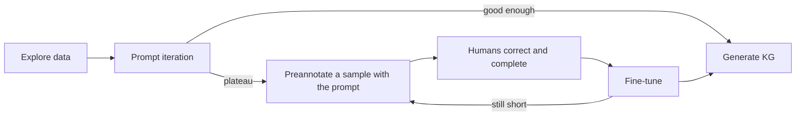
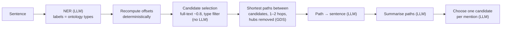
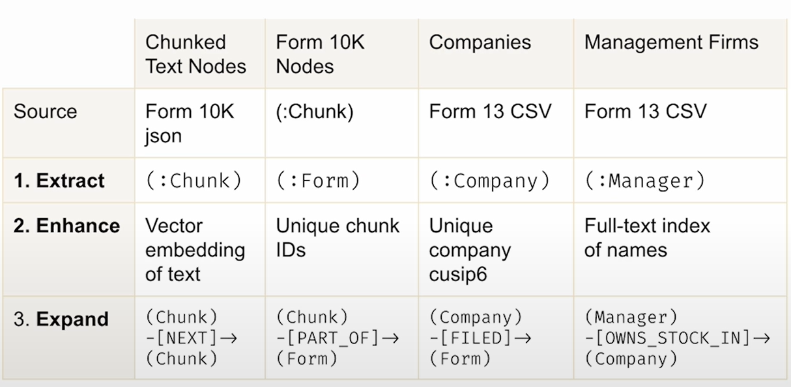
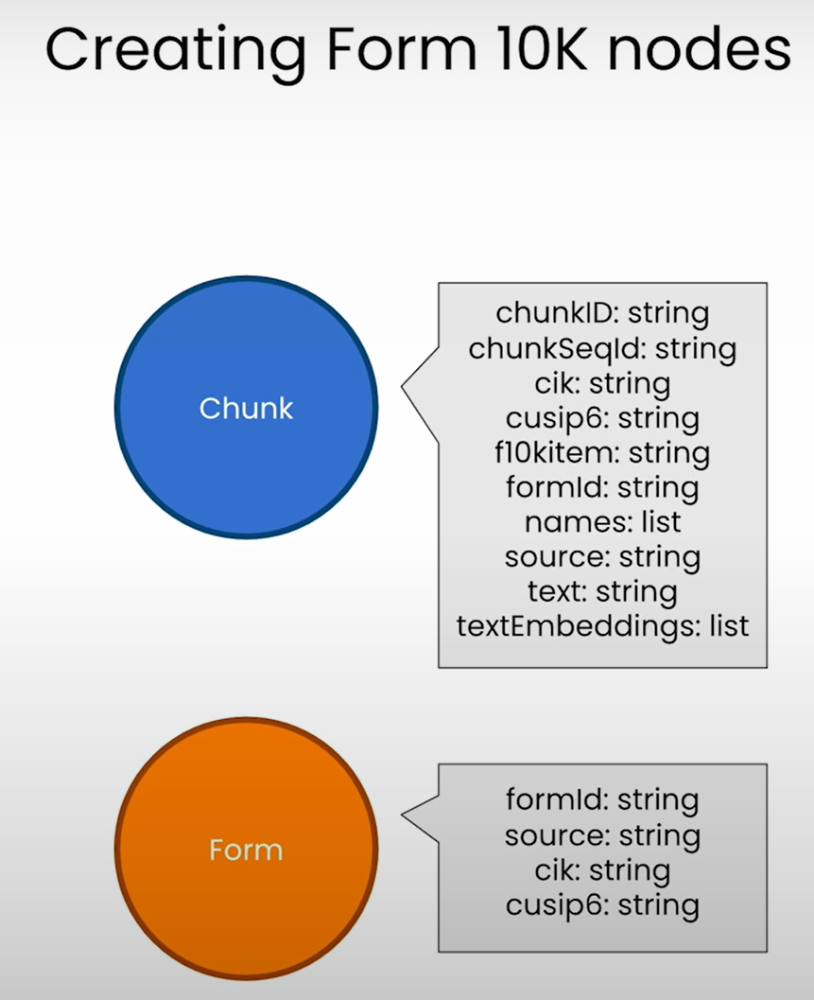
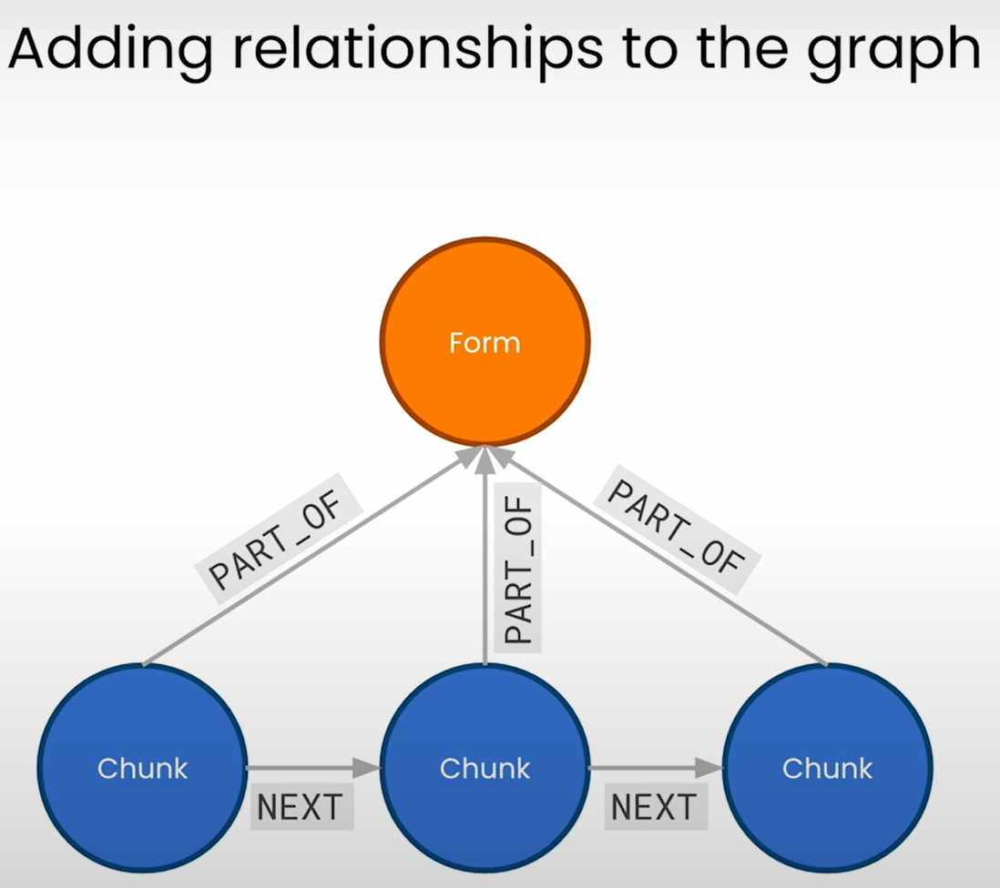
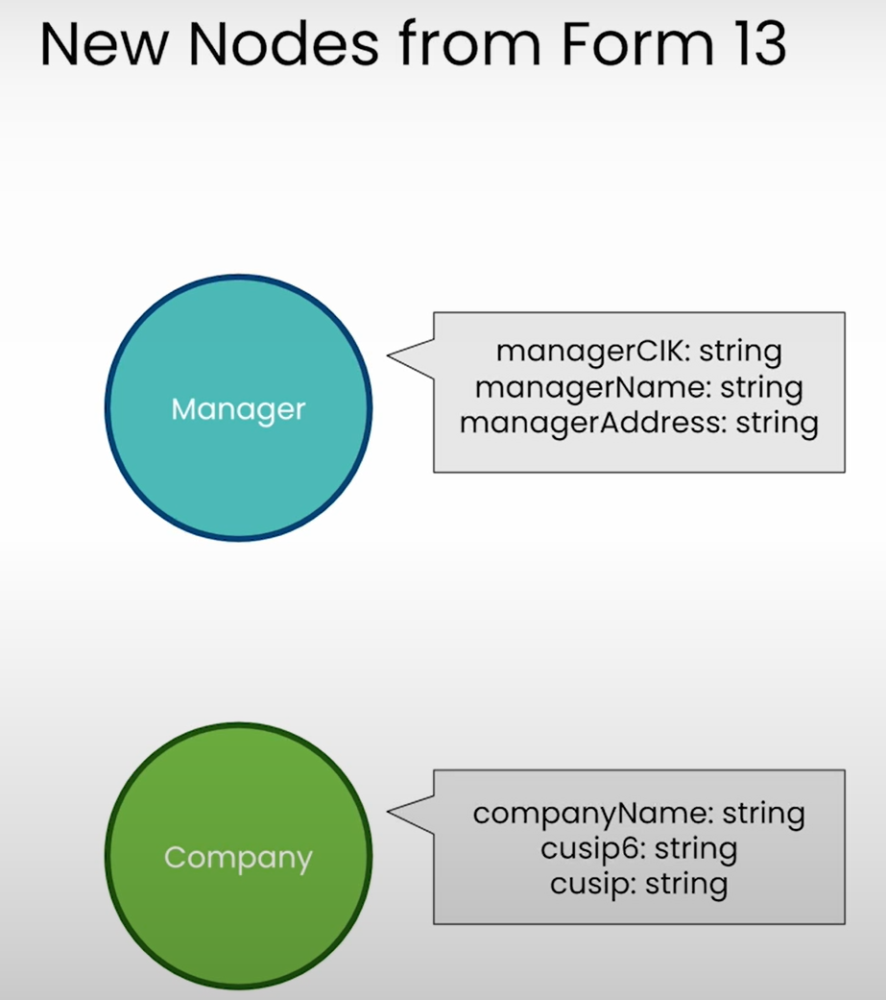
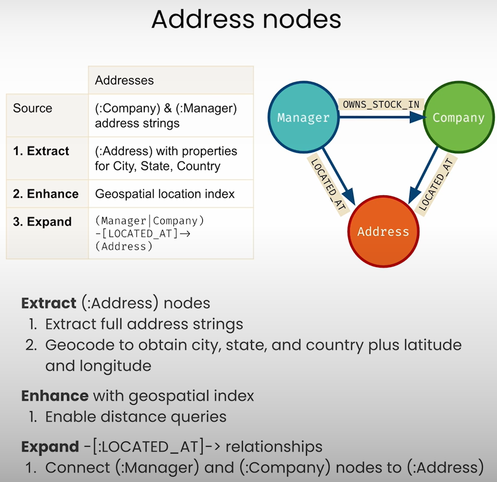

# 10 — Building KGs with LLMs: Extraction and Resolution

> Extraction is the easy part. The graph is only as good as its entity resolution: one false merge silently joins two people, and every multi-hop answer that passes through the join is wrong.

---

## Where it sits

[Note 09](09-kg-fundamentals-and-cypher.md) gave you a graph to query. This note covers how one gets built from text. [Note 11](11-kg-rag-and-text-to-cypher.md) covers asking it questions. The pipeline here is itself a Track A graph: fixed stages, a model tier per stage, and a verifier at the end.

---

## Why resolution is the load-bearing step

Treat each hop of a traversal as independently correct with probability *p*. Then an *n*-hop answer is correct with probability *pⁿ*:

| Per-hop accuracy | 2 hops | 3 hops | 5 hops |
|---|---|---|---|
| 95% | 90% | 86% | 77% |
| 85% | 72% | 61% | **44%** |
| 70% | 49% | 34% | 17% |

This is arithmetic, not a measurement. Hops aren't really independent, but the shape holds: **errors compound with depth**. A graph is only worth traversing deeply when resolution is good. Most per-hop errors are resolution errors: two different entities merged, or one entity split across several nodes.

---

## The pipeline

```
 documents
    │
    ▼
 1. Chunk ────────── split, keep doc/page/offset         (L3–L4: Chunk nodes + NEXT links)
    │
    ▼
 2. Extract ──────── NER + relation extraction            cheap model, schema-constrained output
    │                into MENTIONS, not entities
    ▼
 3. Normalise ────── strip titles, case, punctuation      deterministic
    │
    ▼
 4. Resolve ──────── cluster mentions → canonical          stronger model and/or graph signals
    │                (ER) and/or link to an ontology (NED)
    ▼
 5. Assemble ─────── MERGE nodes/edges + provenance       deterministic
    │
    ▼
 6. Evaluate ─────── P/R on entities and edges,           gold set; blocks the load if it regresses
    │                false-merge rate
    ▼
 7. Load / query
```

This is the same shape as Anthropic's KG construction cookbook ([`capabilities/knowledge_graph/guide.ipynb`](https://platform.claude.com/cookbook/capabilities-knowledge-graph-guide)). The cookbook extracts with `claude-haiku-4-5` into Pydantic models, resolves and queries with `claude-sonnet-4-6`, assembles a NetworkX `MultiDiGraph` that keeps `source_docs` on nodes and `source_doc` on edges, and scores entity precision and recall against a gold set. In short:

| Stage | Model tier | Output |
|---|---|---|
| Extract | Small/fast (Haiku-class) | Schema-constrained mentions and relations |
| Resolve | Stronger (Sonnet-class) | Clusters: canonical name and aliases |
| Assemble | None (deterministic) | Graph with provenance |
| Query | Stronger | Bounded subgraph, cited edges ([note 11](11-kg-rag-and-text-to-cypher.md)) |

This is the "spend agency per node" rule from [note 02](02-graph-primitives.md): use the model only where judgement is needed.

---

## Stage 2: extraction

Extraction is two tasks: **NER** (find the mentions and assign types) and **relation extraction** (a typed edge between two mentions). The book's running example is the Rockefeller Archive Center: program officers' typewritten diaries from the 1930s, full of shorthand, mined for who talked with whom about which research (Negro et al., *Knowledge Graphs and LLMs in Action*, Manning 2025, ch. 5; [ch. 5 PDF](../sources/kg-and-llms-in-action/ch05-extracting-domain-knowledge.pdf)). Generic NER types (`Person`, `Organization`, `Location`) are not enough there: the valuable entity is the research topic, which no off-the-shelf model or dictionary recognises (*KG & LLMs in Action*, ch. 5).

Lessons from ch. 5:

- **Explore the data before writing the prompt.** In the diaries a person is named in full once and then appears as a surname or a bare initial ("R."). That convention has to be in the prompt (*KG & LLMs in Action*, ch. 5).
- **If you don't know the schema yet, build an explorative KG first.** Run a generic "extract everything" prompt over a sample, load the unnormalised result and browse it for the entity and edge types worth keeping. Then start the real prompt (*KG & LLMs in Action*, ch. 5).
- **Define entity types for the domain, and name them carefully.** Renaming the type "Topic" to "Occupation" gave more complete and more stable extraction with an otherwise identical prompt. The type name works as an instruction to the model (*KG & LLMs in Action*, ch. 5).
- **Use schema-constrained output.** Structured outputs, tool schemas or Pydantic models ([01-prompt note 04](../../01-prompt-engineering/notes/04-controlling-output.md)). Free-text extraction then needs a parser, and the parser becomes another place for errors. JSON also lets an edge carry properties: the book's final prompt stored the sentiment of each `TALKED_ABOUT` and the job title on `WORKS_FOR` (*KG & LLMs in Action*, ch. 5).
- **Pick one direction per relation and keep it.** `(person)-[:WORKS_FOR]->(org)` and `(org)-[:EMPLOYS]->(person)` are both fine; mixing them across documents is not (*KG & LLMs in Action*, ch. 5).
- **Set temperature to 0, then test stability.** Run the same document several times and compare the outputs. The book's rule of thumb: high temperature for creative text, about 0.2 for code, 0 for fact extraction. Instability tells you the prompt is ambiguous (*KG & LLMs in Action*, ch. 5).
- **Write prompt unit tests.** Keep a list of (snippet, expected triples), run it in bulk on every prompt change, and read the failures. This stops a fix for one case from silently breaking an earlier one (*KG & LLMs in Action*, ch. 5).
- **Look at a mini-KG at each milestone.** Build the graph from a few dozen pages and look at it before scaling up. Missing edge types and junk hubs are easy to spot in a picture and easy to miss in JSON (*KG & LLMs in Action*, ch. 5).
- **Don't trust LLM character offsets.** Recompute span positions deterministically ([NED, step 1](#ned-against-an-ontology-ch78)).
- **Fine-tune only when prompting plateaus**, and only once you have the labelled data the evaluation section below would produce anyway.

The LLM also does two jobs a classic pipeline needs separate models for. It resolves coreference within a page ("he", "Mayer" → *J. B. Mayer*), and it expands abbreviations ("Prof. Chem." → *Professor of Chemistry*). That is why LLM extraction needs less clean-up afterwards, though still some ([graph-based ER](#graph-based-er-ch6)) (*KG & LLMs in Action*, ch. 5–6).

**Chunking.** The book chunks by page, which keeps provenance simple. A diary entry can run over a page break, so the full project first used a cheap model to find entry boundaries (entries are usually under three pages) and extracted per entry (*KG & LLMs in Action*, ch. 6; [ch. 6 PDF](../sources/kg-and-llms-in-action/ch06-building-kgs-with-llms.pdf)).

### Iterating the extraction prompt (ch5)

Ch. 5 runs three prompt versions over the same diary paragraph with GPT-4o mini. What went wrong at each step generalises:

| Version | Prompt | What went wrong | Fix in the next version |
|---|---|---|---|
| v1 | "Extract all entities and relations" + one worked example | **Relation fragmentation**: `specializes in`, `is measuring`, `is interested in`, `demonstrates` for one concept. **Label fragmentation**: `field`, `research`, `theory` for what is one type. **Instability**: a second identical run dropped two topics | List the allowed entity and relation types |
| v2 | Allowed types, each relation with a one-line gloss, plus notes on how people and organisations are abbreviated | Mostly normalised; a few off-list relations still leaked and one topic was still missed | Enrich the worked example |
| v3 | Worked example now shows every relation the model got wrong (`student of`, `works on` twice) | Stable classes, all target relations, long-form organisation names | Switch to JSON so edges carry properties |

Source: *KG & LLMs in Action*, ch. 5. With a fragmented schema, a Cypher question such as "who works on organic chemistry?" has to list every synonym of `works on`. At thousands of pages that is not workable, so normalising at the prompt is cheaper than normalising afterwards.

The book lists the important types rather than pasting the full schema, so the model can still surface types nobody anticipated (*KG & LLMs in Action*, ch. 5). A minimal version of the v2/v3 shape:

```python
from typing import Literal
from pydantic import BaseModel

EntityType = Literal["person", "organization", "location", "date", "occupation"]
Predicate = Literal["works_for", "works_on", "works_with", "student_of",
                    "talked_about", "talked_with"]

class Triple(BaseModel):
    subject: str
    subject_type: EntityType
    predicate: Predicate
    object: str
    object_type: EntityType
    sentiment: Literal["positive", "neutral", "negative"] | None = None  # talked_about only
    title: str | None = None                                             # works_for only

SYSTEM = """Extract (subject, predicate, object) triples from one diary page.
Use only the listed types and predicates; direction matters.
works_on = a person's field, method, technology or disease of study.
People appear in full once, then as surname or initials ("J. K. Doe" -> "Doe", "JKD", "D.").
Always output the full name. Expand abbreviated organisations ("U. Cal." -> "University of California")."""
# Then: one user/assistant example pair that exercises every predicate the model gets wrong.
```

**Know when to stop.** One worked example cannot cover every edge case in a large corpus. The book's advice is a couple of quick iterations, a mini-KG check, and then a switch to fine-tuning rather than endless prompt tweaks (*KG & LLMs in Action*, ch. 5):



Preannotation is worth having even when an LLM can't run in production: the same loop bootstraps training data for a traditional NER/RE model (*KG & LLMs in Action*, ch. 5).

### Traditional NLP or LLM?

| | spaCy/scispaCy-style pipeline | LLM extraction |
|---|---|---|
| Setup | Needs a trained model for the domain, plus in-house data science | A prompt and a schema |
| Pipeline | NER, RE, coreference and ER chained as separate models | One pass does most of it |
| Labelled data | Several annotated sets per domain; RE results not guaranteed | A few examples; more only for fine-tuning |
| Cost per doc | Very low; fast on CPU | Model calls; GPUs if self-hosted; can cost more than NLP on very large corpora |
| New entity types | Retrain | Edit the prompt |
| Relation extraction | Weak without custom training | Strong |
| Determinism | High | Needs temperature 0 and stability tests |
| On-prem / isolated deployment | Simple | Harder, unless a cloud provider hosts the model in your boundary |
| Domain IDs (UMLS CUIs, etc.) | Built in when a linker exists | Not by itself (ch7: ChatGPT can't assign UMLS IDs) |

Source: *KG & LLMs in Action*, ch. 5 and 7. The book's view is that traditional NLP keeps a real place where security, cost at scale or streaming latency rule an LLM out (*KG & LLMs in Action*, ch. 5). A common hybrid uses a traditional linker where a domain knowledge base exists and an LLM for relations and long-tail types.

---

## Stages 3–4: normalisation, resolution, disambiguation

There are two related problems:

- **Entity resolution (ER):** which mentions are the same thing? ("E. O. Lawrence", "Ernest Lawrence", "Dr. Lawrence").
- **Named-entity disambiguation (NED):** which entry in a reference knowledge base does a mention refer to? ("Zika" → the virus, the disease, or congenital Zika syndrome in UMLS or SNOMED.)

### Keep mentions, never merge at extraction time

The book's three-layer model (ch6):

```
(:Document)-[:HAS_PAGE]->(:Page)-[:MENTIONS]->(:Entity)        ← metagraph: raw mentions
(:Entity)-[:META_SIMILAR]->(:Entity)                            ← resolution evidence
(:Entity)-[:RESOLVES_TO]->(:Canonical)                          ← the KG proper
```

Extraction writes **mentions**. Resolution writes **similarity edges and canonical nodes** on top of them. Nothing is deleted, so the KG can be rebuilt from the metagraph whenever resolution changes. Ch7 does the same thing with `EntityMention` and `MedicalEntity` nodes joined by `DISAMBIGUATED_TO`, and appendix C with a `REPRESENTS` edge to a `NormalizedDisease` node. In all three, **resolution is reversible**. That property is what [note 12](12-kg-as-shared-agent-memory.md) depends on.

In the book the layers are a document layer (`File` and `Page` nodes holding the OCR text), a metagraph (one unmerged `Entity` per mention, linked to its page) and the KG layer (`Person`, `Organization`, `Occupation` with `WORKS_ON`, `WORKS_FOR` and so on). The book's rule is that an LLM cannot write the KG layer directly. Keeping the metagraph gives three things: provenance for every edge, a UI that can show the source snippet behind any node, and the ability to re-tune resolution and regenerate the KG (*KG & LLMs in Action*, ch. 6; [ch. 6 PDF](../sources/kg-and-llms-in-action/ch06-building-kgs-with-llms.pdf)).

### Normalise before you resolve (ch6)

Look at the metagraph's statistics first (top entities per type, top relation types), then turn what you see into rules (*KG & LLMs in Action*, ch. 6):

- **Lowercase** where case carries no meaning (topics, occupations).
- **Strip titles** that leaked into names. GPT sometimes returned "Prof. X" even when told to keep title and name apart, and without clean-up that is a second node for the same person.

Write the result to a separate property and keep the raw `name`:

```cypher
// Normalised name alongside the raw one; titles list is domain-specific
MATCH (e:Entity {label: 'Person'})
WITH e, [w IN split(e.name, ' ') | toLower(w)] AS words
SET e.name_normalized = CASE WHEN words[0] IN $titles      // ['dr.', 'prof.', 'mr.', ...]
                             THEN apoc.text.join(split(e.name, ' ')[1..], ' ')
                             ELSE e.name END;
MATCH (e:Entity {label: 'Occupation'}) SET e.name_normalized = toLower(e.name);
```

### Graph-based ER (ch6)

1. **Normalise** names (strip titles, lowercase, remove punctuation).
2. **Collect evidence** that two mentions are the same entity:
   - **String similarity**, the obvious signal and also the risky one. Encode the domain's naming rules: a surname match alone gives many false positives, while surname plus a compatible first name or initial is much safer. Build a stop-word list for generic tokens first, otherwise every organisation with "Foundation" in its name looks similar (*KG & LLMs in Action*, ch. 6);
   - **Relational signals**: same employer, same topics, same Louvain community over the `TALKED_WITH`/`TALKED_ABOUT` network (a John Doe in Antarctic maritime research and a John Doe in cosmology sit in different conversation clusters), close in embedding space (*KG & LLMs in Action*, ch. 6).
3. Write a `META_SIMILAR` edge wherever the evidence is strong enough.
4. Run **weakly connected components** over `META_SIMILAR`. Each component becomes one canonical entity, named after its longest name.
5. Send borderline clusters to a **human review queue**. Ch6 found **Laurence Irving**, a physiologist, inside the cyclotron subgraph. GPT had spelled his name "Lawrence" because Ernest Lawrence appeared on the same page. That was an extraction error, and only a person looking at the graph caught it. The book's conclusion: build a feedback loop so analysts can confirm or reject graph content (*KG & LLMs in Action*, ch. 6).

A sketch of steps 3–4, for person mentions (labels and properties are illustrative):

```cypher
// 3. Evidence edge: compatible name AND at least one shared relational fact
MATCH (a:PersonMention), (b:PersonMention)
WHERE elementId(a) < elementId(b)
  AND a.surname = b.surname
  AND (a.first IS NULL OR b.first IS NULL OR left(a.first, 1) = left(b.first, 1))
  AND EXISTS { MATCH (a)-[:WORKS_FOR|WORKS_ON]->(x), (b)-[:WORKS_FOR|WORKS_ON]->(y)
               WHERE x.name_normalized = y.name_normalized }
MERGE (a)-[:META_SIMILAR]->(b);

// 4. Components become canonical entities; the mention nodes stay
CALL gds.graph.project('er', 'PersonMention', {META_SIMILAR: {orientation: 'UNDIRECTED'}});
CALL gds.wcc.write('er', {writeProperty: 'clusterId'});
MATCH (m:PersonMention)
WITH m.clusterId AS cid, collect(m) AS ms
WITH ms, reduce(best = ms[0], x IN ms |
       CASE WHEN size(x.name_normalized) > size(best.name_normalized) THEN x ELSE best END) AS rep
MERGE (p:Person {clusterKey: rep.name_normalized})
FOREACH (m IN ms | MERGE (m)-[:RESOLVES_TO]->(p));
```

The book's worked example is three mentions of Ernest Lawrence, on pages 26, 99 and 126: *Ernest Orlando Lawrence*, *Ernest O. Lawrence* and plain *Lawrence*. The first two share the University of California as employer. The bare surname joins them through `WORKS_ON` edges to two similar occupations (*cyclotron* and a high-voltage cyclotron). The first and third mentions are six hops apart in the metagraph, a join that is awkward to find in a relational database (*KG & LLMs in Action*, ch. 6).

The opposite error shows up too. *Irving Langmuir* and *Langmuir* stayed as two nodes, because the bare-surname mention sat on a page with no relations to use as evidence (*KG & LLMs in Action*, ch. 6). That is a false split. It is cheap, and it's the one the evaluation below should tolerate.

String similarity alone causes false merges, and a misspelled extraction gives it more to match on. Relational evidence is what tells two Lawrences apart.

**Topics need semantic, not string, resolution.** Occupations vary in granularity (*nuclear physics* ⊃ *isotopes* ⊃ *heavy nitrogen*) and can be related with zero string overlap (*fertility*, *human ovulation*). The book's best results came from embedding them (SentenceBERT or GPT embeddings) and clustering with agglomerative hierarchical clustering. Each cluster then gives a `META_SIMILAR` or `SIMILAR_OCCUPATION` edge, so a query can follow a topic's whole history (*KG & LLMs in Action*, ch. 6).

### LLM-based ER (cookbook)

Give the model the unique names of one type *together with their extraction descriptions*, and ask for clusters of the form `{canonical, aliases[]}`. The descriptions are what stop two different people named Armstrong from being merged. The failure modes are **dropped names** (a name that appears in no cluster; fall back to a singleton cluster) and **over-merging** (the cookbook's example folds "Gemini 12" into "Project Gemini").

Appendix C weighs the same choice for normalisation against a domain linker. An LLM recognises equivalences with no surface pattern ("gastric adenocarcinoma" ≈ "stomach cancer"), works in domains that have no scispaCy (legal, finance), and needs no knowledge base for common entities. The costs: mappings can change between runs, which makes the build hard to reproduce, and it needs far more compute than a small linker (*KG & LLMs in Action*, appendix C; [appendix C PDF](../sources/kg-and-llms-in-action/appendix-c-kgs-from-structured-sources.pdf)). If you use one, cache its decisions as edges so a rebuild replays them instead of re-asking.

### NED against an ontology (ch7–8)

**NED** links a mention to a *ground entity* in a reference knowledge base, using the mention's context. In the book's ECDC bulletin example, "Zika" occurs three times with three meanings: the virus, congenital Zika syndrome and Zika virus infection. Each is a separate UMLS concept with its own CUI (concept unique identifier), semantic type and definitions (*KG & LLMs in Action*, ch. 7; [ch. 7 PDF](../sources/kg-and-llms-in-action/ch07-named-entity-disambiguation.pdf)). Ambiguity runs both ways: one string can mean several entities ("Zika"), and several strings can mean one entity ("AIDS", "Acquired Immunodeficiency Syndrome"). A `DISAMBIGUATED_TO` edge from mention to entity handles both (*KG & LLMs in Action*, ch. 7).

**A general LLM is not a linker.** Asked to disambiguate the Zika passage, ChatGPT returned surface terms without separating virus from infection. Asked for UMLS IDs, it said it couldn't assign them. The knowledge base isn't in the model, so high-precision domains need an ontology in the loop (*KG & LLMs in Action*, ch. 7).

Three phases:

1. **Candidate selection.** Look up the ontology for possible matches, using a full-text index search in Neo4j with fuzzy terms (`~0.8`), filtered by the entity types NER returned. **No LLM here**: candidates must come from the ontology, not from what the model remembers, and the ontology won't fit in a prompt anyway.
2. **Candidate ranking and disambiguation.** Choose the candidate that fits the context. Ch8 does this by finding **shortest paths** between candidate concepts and the other entities in the document (dropping **hub** nodes such as "Infectious process", which connect everything to everything), turning the paths into sentences, summarising them, and then asking the LLM to choose. That is how "Zika" next to "microcephaly" resolves to *congenital Zika virus infection*.
3. **Ontology integration.** The resolved entity gains its ontology neighbourhood: synonyms, parents and related concepts.

Use NED when a reference ontology exists (medicine, law, finance identifiers). Use ER when it doesn't.

**Baseline: a domain linker (ch7).** scispaCy with its UMLS linker does all three phases in a few lines, and on the ECDC passage it gives each "Zika" the right CUI (*KG & LLMs in Action*, ch. 7):

```python
import spacy
from scispacy.linking import EntityLinker  # noqa: F401  (registers the pipe)

nlp = spacy.load("en_core_sci_md")
nlp.add_pipe("scispacy_linker", config={"linker_name": "umls", "resolve_abbreviations": True})
kb = nlp.get_pipe("scispacy_linker").kb

for ent in nlp(text).ents:
    best = ent._.kb_ents[:1]                       # [(cui, score)], ranked
    print(ent.text, [(cui, kb.cui_to_entity[cui].canonical_name) for cui, _ in best])
```

Ch. 8 names its limits: it is tied to one domain, the knowledge base is hard to extend, and it ranks on nearby words, not on the relations in the ontology. Give it a passage without the cue words "congenital" or "syndrome" and it falls back to *Zika Virus Infection* for every "Zika", and finds no candidate at all for "Zika disease" (*KG & LLMs in Action*, ch. 8; [ch. 8 PDF](../sources/kg-and-llms-in-action/ch08-ned-open-llms-ontologies.pdf)).

**Open LLM + ontology (ch8).** The replacement runs locally: Llama 3.1 8B served by Ollama, which speaks the OpenAI Chat Completions API, so the client code only changes `base_url` (*KG & LLMs in Action*, ch. 8). The ontology is used at every stage:



- **Ontology ingest.** SNOMED CT (over 450,000 concepts) goes in as `SnomedEntity` nodes. Its hundreds of relation types collapse into one `SNOMED_RELATION` edge with a `type` property, plus an explicit `SNOMED_IS_A` for the hierarchy. The children of the SNOMED root (*Disease*, *Body structure*, *Substance*, *Pharmaceutical product*, ...) are the archetypal types. A traversal down `SNOMED_IS_A` copies each one onto every descendant, so even a deep concept carries a type (*KG & LLMs in Action*, ch. 7–8).
- **NER.** Those propagated types are the label set in the NER prompt, so NER labels match the ontology by construction. The model outputs JSON per sentence (`id`, `mention`, `label`) (*KG & LLMs in Action*, ch. 8). Offsets are recomputed, not trusted:

  ```python
  def spans(text: str, mention: str) -> list[tuple[int, int]]:
      """Every [start, end) of mention in text. The model's own offsets are unreliable."""
      out, i = [], text.find(mention)
      while i != -1:
          out.append((i, i + len(mention)))
          i = text.find(mention, i + len(mention))
      return out
  ```

- **Candidate selection** is a filtered full-text lookup. For "Zika" labelled *Organism*, it returns *Zika virus*, *Zika virus disease* and *Congenital Zika virus infection*. The book notes vector search could add candidates that string matching misses (*KG & LLMs in Action*, ch. 8).

  ```cypher
  // $q is the mention with fuzzy terms, e.g. "zika~0.8"; $labels come from NER
  CALL db.index.fulltext.queryNodes('snomedNames', $q, {limit: 20}) YIELD node, score
  WHERE any(t IN node.type WHERE t IN $labels)
  RETURN node.id AS id, node.name AS name, score;
  ```

- **Disambiguation.** Find shortest paths (1–2 hops) between the candidates of different mentions in the same sentence. Drop any path through the **350 highest-degree** nodes, which are generic concepts that connect everything. Have the LLM turn each surviving path into a sentence, then summarise the sentences into one short context, then choose. Fewer tokens of cleaner context make the final choice easier (*KG & LLMs in Action*, ch. 8).

  ```cypher
  CALL gds.degree.stream('snomed') YIELD nodeId, score
  WITH nodeId ORDER BY score DESC LIMIT 350
  WITH collect(gds.util.asNode(nodeId)) AS hubs
  MATCH (a:SnomedEntity {id: $candA}), (b:SnomedEntity {id: $candB})
  MATCH p = allShortestPaths((a)-[:SNOMED_RELATION*1..2]-(b))
  WHERE none(n IN nodes(p)[1..-1] WHERE n IN hubs)
  RETURN [n IN nodes(p) | n.name] AS names, [r IN relationships(p) | r.type] AS types;
  ```

Results: for "Severe outcomes of Zika ... causing microcephaly and congenital malformations", the paths from *Congenital Zika virus infection* to the microcephaly candidates (through a shared *Congenital* occurrence node) select that concept. This is exactly the case where scispaCy failed. Given nine asthma candidates (*Mild asthma*, *Intrinsic asthma*, *Asthma attack*, ...) in a sentence about treating asthma and allergic rhinitis together, it chooses plain *Asthma* rather than a qualified variant (*KG & LLMs in Action*, ch. 8). Both are single worked examples, not a benchmark.

**Ontology integration: the schema ch7 builds.** UMLS is the crosswalk: each SNOMED and HPO concept lists its UMLS IDs, so a disambiguated `MedicalEntity` (keyed by CUI) links to them with a plain `MERGE` (*KG & LLMs in Action*, ch. 7).

```
(:File)-[:CONTAINS_PAGE]->(:Page)-[:MENTIONS]->(:EntityMention)-[:DISAMBIGUATED_TO {score}]->(:MedicalEntity)
(:Page)-[:MENTIONS_ENTITY {sentence_index, start_chars, end_chars}]->(:MedicalEntity)
(:MedicalEntity)-[:IS_SNOMED_ENTITY]->(:SnomedEntity)-[:SNOMED_RELATION {type}]->(:SnomedEntity)
(:MedicalEntity)-[:IS_HPO_ENTITY|IS_DISEASE_ENTITY]->(:HpoEntity|HpoDiseaseEntity)
(:MedicalEntity)-[:COOCCUR {count, sentences}]-(:MedicalEntity)      ← same-sentence pairs
```

HPO comes in as OWL through the n10s plugin. `COOCCUR` connects every pair of entities mentioned in the same sentence and counts how often. On the SoHO corpus (EU regulatory documents, EDQM guides and ECDC bulletins on blood, tissues, cells and organs) this gave over 25,000 edges (*KG & LLMs in Action*, ch. 7).

### What a disambiguated graph buys you (ch7)

| Use | How | Book's result |
|---|---|---|
| **Conceptual search** | Match the query against entity *aliases*, then return pages that mention the entity, with the matched span | "breakbone fever" (a dengue synonym) never appears literally; full-text search latched onto "fever". The full-text top hit ranked only 19th by entity mentions. Also separates "islets of Langerhans" from "islands" |
| **Structured search** | Follow ontology edges from a start entity, then back to pages | `FINDING_SITE` from *Islets of Langerhans* found a *Hyperglycemia* mention in an organ-donor protocol; three `CAUSATIVE_AGENT` hops from *Zika virus* reach yellow fever, dengue, chikungunya, rubella |
| **Interpretability** | Ontology path between two co-occurring entities explains why they co-occur | Zika co-occurs with dengue and chikungunya; SNOMED links them via shared flavivirus parents |
| **Discovery / new knowledge** | A frequent co-occurrence with **no** meaningful ontology path is a candidate fact | Zika + Guillain-Barré: 195 co-occurrences. Removing hub paths took 11,185 paths down to 9, all through generic nodes such as *Viral disease*. So SNOMED lacks the causal link that the text supports |

Source: *KG & LLMs in Action*, ch. 7. The last row reverses the usual direction: here the text-built graph proposes edits to the ontology. Any such candidate is an `INFERRED` claim for a domain expert to review, not a fact (see [note 12](12-kg-as-shared-agent-memory.md) on writing claims vs. facts).

### Measure what normalisation did

Appendix C compares the graph before and after normalisation using WCC counts and all-pairs shortest-path distributions. After normalisation, related nodes sit closer together. Three spellings of Burkitt lymphoma had been splitting one disease into three nodes. Do the same with your own graph. If resolution has no measurable effect on structure, it probably isn't doing anything.

The normaliser behind those numbers is a short recipe worth copying (*KG & LLMs in Action*, appendix C):

1. Reverse comma-inverted names ("leukemia, lymphocytic, chronic, b-cell" → "b-cell chronic lymphocytic leukemia").
2. Run the UMLS linker and accept a link only if exactly one entity is found and its semantic type is plausible. Some types are **banned** outright (*Human*, *Body Part*, *Qualitative Concept*, *Spatial Concept*, ...). Others (*Finding*, *Tissue*, ...) are accepted only when the match covers the whole string.
3. Otherwise **fall back** to a title-cased name with no ID. Unlinked is better than mislinked.
4. Write `(:Disease)-[:REPRESENTS]->(:NormalizedDisease {umls_id})`, keeping the source nodes so the step can be reviewed and rerun.

What it measured on the miRNA graph:

| Shortest-path distance between miRNA pairs | Before | After | Change |
|---|---|---|---|
| 1 | 5,911,305 | 6,179,329 | +4.5% |
| 2 | 1,244,305 | 1,010,851 | −18.7% |
| 3 | 35,795 | 25,888 | −27.6% |
| 5 | 46 | 22 | −52.1% |
| 6 | 1 | 0 | −100% |

Source: *KG & LLMs in Action*, appendix C. WCC barely moved: the giant component went from 5,010 to 6,033 nodes, partly because the new `NormalizedDisease` nodes are counted too. The graph was already one dominant component, so WCC is the weaker check here and the path-length shift is the useful one. The book's reason it matters downstream is that message-passing embeddings ([note 13](13-graph-ml-and-gnns.md#message-passing)) improve when related nodes are fewer hops apart (*KG & LLMs in Action*, appendix C). For measurements like this, build the projection with `gds.graph.project.cypher`, which can define a miRNA–miRNA edge through shared diseases. It is slower than a native projection but more flexible (*KG & LLMs in Action*, appendix C).

---

## Stage 6: evaluating extraction

The hop table above is the reason this stage exists. Hand-label a gold set (50–100 mentions is enough to start), then measure:

| Metric | Over | Catches |
|---|---|---|
| **Entity precision / recall** | Extracted entities vs. gold | Missed and hallucinated entities |
| **Edge precision / recall** | (subject, type, object) triples vs. gold | Wrong or missing relations; wrong edge type |
| **False-merge rate** | Pairs in one canonical cluster that are actually different | Over-merging (the expensive error) |
| **False-split rate** | Gold entities spread over more than one canonical | Under-merging (cheaper: lowers recall, doesn't corrupt) |
| **Stability** | Same input, repeated runs | Prompt ambiguity |

**Weight false merges more heavily than false splits.** A split loses a connection. A merge creates connections that don't exist, and traversal then follows them confidently. Gate the load step on these metrics the way [06-eval note 10](../../06-eval/notes/10-evals-in-ci.md) gates a deploy, and see [06-eval note 03](../../06-eval/notes/03-eval-datasets.md) for building the gold set.

The book's evaluation recipe for extraction: process a few dozen pages, have a QA reviewer mark each prediction correct, incorrect or missing, and report precision, recall and F1 **per entity and relation class**. A reviewer sees systematic failures that a handful of examples hide. An LLM judge can stand in for the reviewer, imperfectly. The scores also become the baseline for spotting drift when the model or prompt changes later (*KG & LLMs in Action*, ch. 5).

**Try it.** Take 10–20 documents rich in people and organisations and hand-label 50 mentions with their gold canonical entity. Extract mentions with descriptions using a small model under a JSON schema. Resolve them two ways: string similarity + WCC, and LLM clustering over names with descriptions. Write the result as `RESOLVES_TO {evidence, confidence}`, compare the two on the metrics above, then delete one `RESOLVES_TO` edge and check the graph returns to its earlier state. If it doesn't, resolution isn't reversible yet.

---

## Stage 5: assembly, with the course as worked example

The Neo4j course builds an SEC filings graph one stage at a time:

| Lesson | Builds |
|---|---|
| L3 | Vector index and embeddings with `genai.vector.encode` |
| L4 | 10-K text split into `Chunk` nodes with embeddings, so Neo4j is also the vector store |
| L5 | `NEXT` links between chunks (a linked list), `PART_OF` to the form; window retrieval over neighbours |
| L6 | A second source (Form 13 investment managers) merged onto the same `Company` nodes; uniqueness constraints; full-text index |
| L7 | `Address` nodes geocoded from the company and manager address strings, a point index, `LOCATED_AT` edges |

L6 is appendix C's lesson at small scale: **`MERGE` on a shared identity key is how sources are fused**, and it only works if identities have been resolved first.

The course names its build loop **extract, enhance, expand**: pull out nodes from a source, give them an index or a unique key, then connect them. Its advice is to start with a **minimum viable graph** and grow it one source at a time.


*Image Source: Knowledge Graphs for RAG, DeepLearning.AI × Neo4j (Kollegger, 2024)*

**Before the graph: clean the source.** The 10-K filings come from SEC EDGAR as text files with embedded XML. The course's JSON was produced by regex clean-up, parsing the XML with Beautiful Soup, pulling out the company's CIK (the SEC's company identifier) and keeping four sections: Items 1, 1A, 7 and 7A. The instructor's prep code is public at [neo4j-product-examples/data-prep-sec-edgar](https://github.com/neo4j-product-examples/data-prep-sec-edgar). Its plan of attack for L4 is five steps: split each section into chunks, make each chunk a node with its metadata as properties, create a vector index, embed every chunk into it, then search by similarity. At that point Neo4j is only a vector store; the graph starts in L5.


*Image Source: Knowledge Graphs for RAG, DeepLearning.AI × Neo4j (Kollegger, 2024)*

**L3–L4: chunks as nodes, with a key and an embedding.** Each 10-K section is split (`RecursiveCharacterTextSplitter(chunk_size=2000, chunk_overlap=200)`) and every chunk gets a deterministic ID, so reloading is idempotent:

```cypher
// The constraint first: it makes MERGE safe and indexes the key
CREATE CONSTRAINT unique_chunk IF NOT EXISTS
FOR (c:Chunk) REQUIRE c.chunkId IS UNIQUE;

// chunkId = "{formId}-{item}-chunk{seq:04d}": same input, same node
MERGE (c:Chunk {chunkId: $chunk.chunkId})
  ON CREATE SET c.text = $chunk.text, c.formId = $chunk.formId,
                c.f10kItem = $chunk.f10kItem, c.chunkSeqId = $chunk.chunkSeqId;

// Neo4j as the vector store: embed in the database, then index
MATCH (c:Chunk) WHERE c.textEmbedding IS NULL
WITH c, genai.vector.encode(c.text, "OpenAI", {token: $openAiApiKey}) AS v
CALL db.create.setNodeVectorProperty(c, "textEmbedding", v);
```

`genai.vector.encode` was the GenAI plugin's API when the course was recorded. Check your Neo4j version's GenAI docs before reusing it, because the embedding functions have since been renamed. One bug to avoid if you run the L4 notebook: `split_form10k_data_from_file` loops over `item1_text_chunks[:20]` instead of the current item's chunks, so every item's chunks contain Item 1 text.

**L5: structure between chunks.** Chunks of one section become a linked list, and each chunk points to its form:


*Image Source: Knowledge Graphs for RAG, DeepLearning.AI × Neo4j (Kollegger, 2024)*

```cypher
// Order a section's chunks and link neighbours with NEXT (APOC)
MATCH (c:Chunk {formId: $formId, f10kItem: $item})
WITH c ORDER BY c.chunkSeqId ASC
WITH collect(c) AS section
CALL apoc.nodes.link(section, "NEXT", {avoidDuplicates: true})
RETURN size(section);

// Every chunk belongs to its form
MATCH (c:Chunk), (f:Form) WHERE c.formId = f.formId
MERGE (c)-[:PART_OF]->(f);
```

The `NEXT` links are what make window retrieval possible in [note 11](11-kg-rag-and-text-to-cypher.md#retrieval-modes). The course also adds a `SECTION` edge from the form to the first chunk of each item (`chunkSeqId = 0`).

**L6: fuse a second source on a shared key.** Form 13 is filed by institutional investment managers to report the companies they hold. It adds `Manager` nodes and attaches them to the **same** `Company` nodes, matched on the CUSIP:


*Image Source: Knowledge Graphs for RAG, DeepLearning.AI × Neo4j (Kollegger, 2024)*


```cypher
CREATE CONSTRAINT unique_manager IF NOT EXISTS
FOR (m:Manager) REQUIRE m.managerCik IS UNIQUE;

MERGE (com:Company {cusip6: $row.cusip6})
  ON CREATE SET com.companyName = $row.companyName
MERGE (mgr:Manager {managerCik: $row.managerCik})
  ON CREATE SET mgr.managerName = $row.managerName
// The quarter is part of the edge's identity; value and shares are data on it
MERGE (mgr)-[o:OWNS_STOCK_IN {reportCalendarOrQuarter: $row.quarter}]->(com)
  ON CREATE SET o.value = toFloat($row.value), o.shares = toInteger($row.shares);

// Full-text index so "royal bank" finds "Royal Bank of Canada"
CREATE FULLTEXT INDEX fullTextManagerNames IF NOT EXISTS
FOR (m:Manager) ON EACH [m.managerName];
```

Why a constraint when `MERGE` already matches on `managerCik`? The Cypher manual is explicit: *"Under concurrent updates, `MERGE` only guarantees the existence of the `MERGE` pattern, but not uniqueness."* The constraint is what guarantees one node per key. After L6 the course graph holds 643 nodes (`Chunk`, `Form`, `Company`, `Manager`) and 722 relationships (`NEXT`, `PART_OF`, `SECTION`, `FILED`, `OWNS_STOCK_IN`).

Notice that `value` and `shares` live on the **edge**, not on `Company`. That detail is what trips text-to-Cypher up in [note 11](11-kg-rag-and-text-to-cypher.md#the-failure-to-expect).

**L7: one more extract, enhance, expand round.** Both `Company` and `Manager` carry an address string. The course turns them into nodes: **extract** the full address strings and geocode them to city, state, country and latitude/longitude; **enhance** with a geospatial index on `Address.location` so distance queries are cheap; **expand** with `(:Manager|:Company)-[:LOCATED_AT]->(:Address)`. Queries then read location from the `Address` node, not from the old string properties. The location questions this answers are in [note 11](11-kg-rag-and-text-to-cypher.md#structured-lookups-by-name-and-by-place).


*Image Source: Knowledge Graphs for RAG, DeepLearning.AI × Neo4j (Kollegger, 2024)*

The course's list of where to grow next is a useful default: cross-link companies that mention each other (suppliers, competitors), extract people, places and topics from the text, add more form types or related sources, and add users so feedback can refine relevance.

**Try it on the course graph.** Add the uniqueness constraint *before* the L6 manager import, run it again without the constraint, and count the duplicate `Company` nodes the constraint prevented. On the L5 chunks, compare top-k retrieval with and without the ±1 `NEXT` window on three questions.

**Curate before you scale** (appendix C). Start from a few sources that matter for the task. Every extra loosely related dataset adds reconciliation work and noise (*KG & LLMs in Action*, appendix C; [appendix C PDF](../sources/kg-and-llms-in-action/appendix-c-kgs-from-structured-sources.pdf)). The appendix's miRNA graph shows the moves:

- **Keep source semantics as separate relation types.** HMDD and miR2Disease give a `RELATED_TO` association. dbDEMC gives up/down-regulation in cancer, which becomes `REGULATES`. Collapsing them would lose what each source actually asserts.
- **Label provenance.** Each source adds its own label (or property) to the nodes it touches, so a single query can count the entities two sources agree on. Overlap between independent curated sources is a cheap confidence signal.
- **`MERGE` is the fusion step.** Shared identifiers join the sources on load. After the merge, a single miRNA (hsa-mir-155) connects to brain and heart diseases that came from different datasets.
- **Sanity-check after every load.** Look at node and edge counts, top-degree nodes and median degree. The graph grew from 1,207 miRNAs / 18,732 associations / 849 diseases after HMDD alone to 4,874 / 118,806 / 1,144 after all three sources (*KG & LLMs in Action*, appendix C). The next step is the normalisation [measured above](#measure-what-normalisation-did).

### Integrating structured sources (ch4)

Not every KG starts from text. Ch4 fuses public structured datasets: protein–protein interactions with disease associations (DisGeNET), the pharmacology graph **Hetionet**, and the **Clinical Knowledge Graph** (*KG & LLMs in Action*, ch. 4; [ch. 4 PDF](../sources/kg-and-llms-in-action/ch04-multisource-integration.pdf)). The work moves from extraction to three other steps. They follow the general pattern the chapter takes from Yang et al.: **merge** nodes from many sources, **link** the nodes that are the same concept, **prune** what's irrelevant.

- **Identity mapping.** Every source is mapped onto shared codes (UMLS, Disease Ontology) before `MERGE`. This is entity resolution, made easier because the identifiers are curated. In the PPI case only 290 of 519 DisGeNET diseases mapped to Disease Ontology, so expect a lossy join and report it (*KG & LLMs in Action*, ch. 4).
- **Schema alignment.** Reconcile what each source means by its edge types before they share a graph. The PPI model has two parts: a monopartite `Protein–Protein` interaction graph, and a bipartite `Disease–Protein` association graph on top of it.
- **Validation.** Check counts, orphans and degree distributions after each load. The PPI load gave 342,354 interactions among 21,559 proteins. WCC found 27 components, one of them holding 21,521 proteins, and Louvain found 48 communities with modularity 0.546 (*KG & LLMs in Action*, ch. 4).

Loading pattern: key constraints first, then batched idempotent writes.

```cypher
CREATE CONSTRAINT IF NOT EXISTS FOR (p:Protein) REQUIRE p.id IS NODE KEY;
CREATE CONSTRAINT IF NOT EXISTS FOR (d:Disease) REQUIRE d.id IS NODE KEY;

LOAD CSV WITH HEADERS FROM 'file:///ppi.csv' AS row
CALL (row) {
  MERGE (a:Protein {id: row.protein_a})
  MERGE (b:Protein {id: row.protein_b})
  MERGE (a)-[:INTERACTS_WITH]-(b)
} IN TRANSACTIONS OF 1000 ROWS;
```

Two analysis lessons carry over to any integrated graph:

- **Generic clustering and domain subgraph metrics answer different questions.** WCC and Louvain show the global community structure, but they treat every node alike. A meaningful subgraph (one disease's pathway, say) needs its own metrics, such as largest component, density and conductance.
- **Raw path counts favour hubs.** DWPC discounts paths through high-degree nodes ([note 13](13-graph-ml-and-gnns.md#dwpc-discount-the-hubs)).

The three subgraph metrics, for a disease pathway with node set V_d, internal edges E_d and boundary edges B_d (one end inside, one outside):

```python
import networkx as nx

def pathway_metrics(G: nx.Graph, proteins: set) -> dict:
    H = G.subgraph(proteins)
    e = H.number_of_edges()
    boundary = sum(1 for u, v in G.edges(proteins) if (u in proteins) != (v in proteins))
    return {
        "largest_cc_frac": max(map(len, nx.connected_components(H)), default=0) / max(len(H), 1),
        "density": nx.density(H),                                   # 2|E| / (|V|(|V|-1))
        "conductance": boundary / (boundary + 2 * e) if boundary + e else 0.0,  # low = self-contained
    }
```

| Metric, across all disease pathways | Median | What it says |
|---|---|---|
| Fraction of proteins in the largest component | 21% (16 components per pathway) | Pathways are fragmented in the PPI network |
| Density | 0.07 (whole network: 0.0015) | Denser than the background, but sparse internally |
| Conductance | 0.96 | Pathways connect mostly *outward* |

Source: *KG & LLMs in Action*, ch. 4. Run the same metrics on the Louvain clusters and the picture flips: nearly all proteins sit in one component and conductance is much lower. A disease pathway is a different object from a topological community, so don't use one as a proxy for the other.

The other two sources show what mature integrated KGs look like. **Hetionet** combines 29 resources into 47,031 nodes of 11 types and 2,250,197 edges of 24 types, and stores the supporting references on the edges. **CKG** links 33 node labels with 51 relationship types to support queries such as finding altered functions, suggesting drugs for regulated proteins and surfacing possible confounders (*KG & LLMs in Action*, ch. 4). For patient data the chapter gives two privacy-preserving options. One is to load only statistical relationships (diseases, symptoms, outcomes and their weights) and leave out patient records. The other is a de-identified generic clinical KG, with patient EHR data added only when strictly necessary and with consent.

The LLM's role here is to **interpret** the quantitative output (a DWPC ranking, a set of protein–disease links) as a domain narrative. It doesn't replace expert judgement, which matters most in the clinical case. The prompt shape the chapter uses (with Claude Sonnet 4) has four parts: a domain-expert role, the raw result rows, a statement of how each metric was computed, and numbered questions (which hits are known, which are plausible, what to validate next). The output is a hypothesis list for a human to check, not a finding (*KG & LLMs in Action*, ch. 4).

---

## Domain examples in the book (one paragraph each)

- **Archives (ch6).** Rockefeller Archive Center documents: people, institutions and funding. This is the source of the Ernest Lawrence ER example. Three mentions on different pages were resolved to one person using string similarity, a shared employer and related `Occupation`s. Two of the mentions were six hops apart in the graph, which a relational database would make hard to find.
- **Biomedical NED (ch7–8).** ECDC bulletins linked to UMLS (scispaCy) and SNOMED (open LLM with graph paths). Co-occurrence edges are checked against ontology paths. A co-occurrence with no ontology path is a candidate new fact.
- **Biomedical integration (ch4).** PPI and disease networks, Hetionet (a celiac-disease case study using metapaths and DWPC) and the Clinical Knowledge Graph, with LLM-assisted interpretation of pathway analyses.
- **miRNA (appendix C).** A KG built from structured sources: curated datasets, disease-ontology normalisation and DWPC path scoring to rank disease–target hypotheses.

---

## Working reference

`~/.claude/refs/agent-eval.md`: gold sets and gating. `~/.claude/refs/agent-memory.md`: semantic memory writes.

Depth: [ch. 4 PDF](../sources/kg-and-llms-in-action/ch04-multisource-integration.pdf) (multisource integration, DWPC), [ch. 5 PDF](../sources/kg-and-llms-in-action/ch05-extracting-domain-knowledge.pdf), [ch. 6 PDF](../sources/kg-and-llms-in-action/ch06-building-kgs-with-llms.pdf), [ch. 7 PDF](../sources/kg-and-llms-in-action/ch07-named-entity-disambiguation.pdf), [ch. 8 PDF](../sources/kg-and-llms-in-action/ch08-ned-open-llms-ontologies.pdf), [appendix C PDF](../sources/kg-and-llms-in-action/appendix-c-kgs-from-structured-sources.pdf).

---

→ Next: [11-kg-rag-and-text-to-cypher.md](11-kg-rag-and-text-to-cypher.md): asking the graph questions in natural language.
