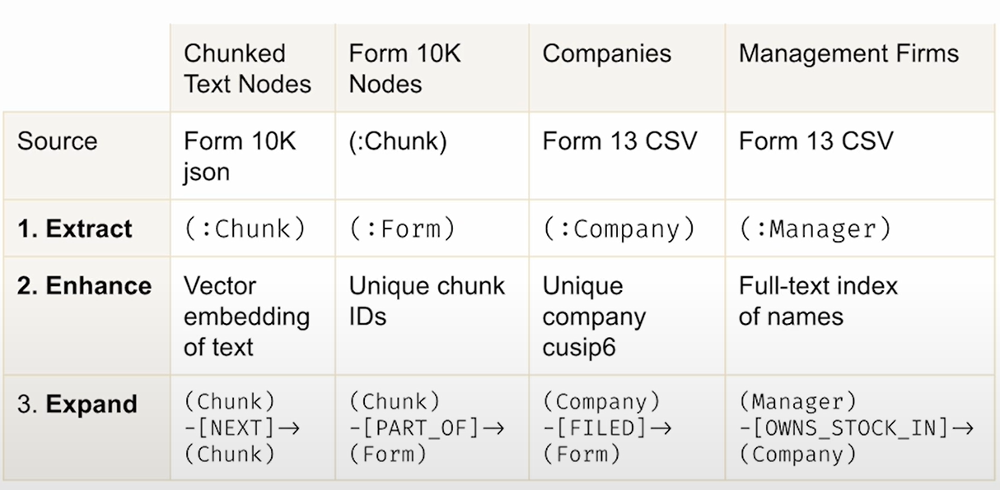
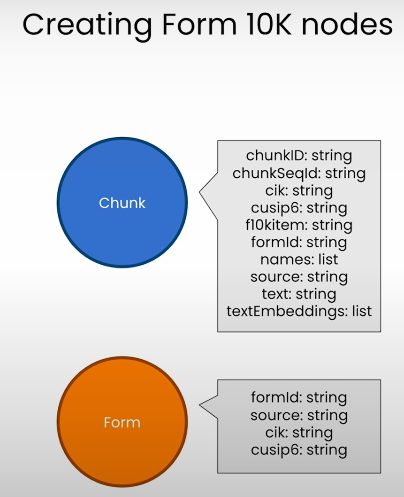
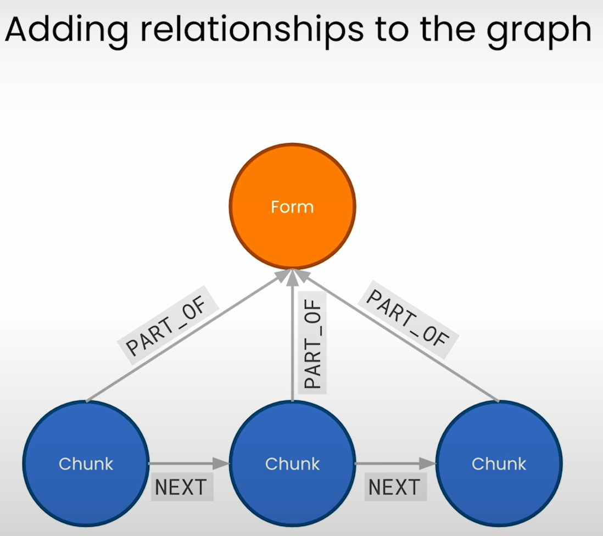
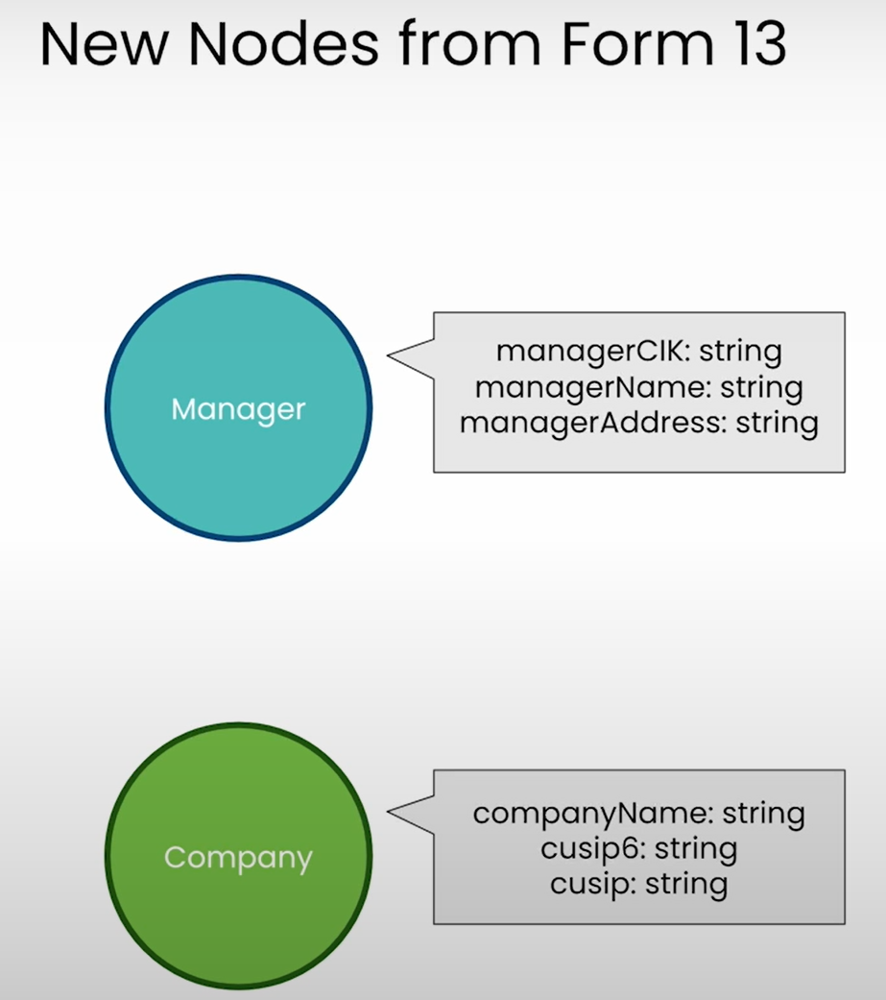
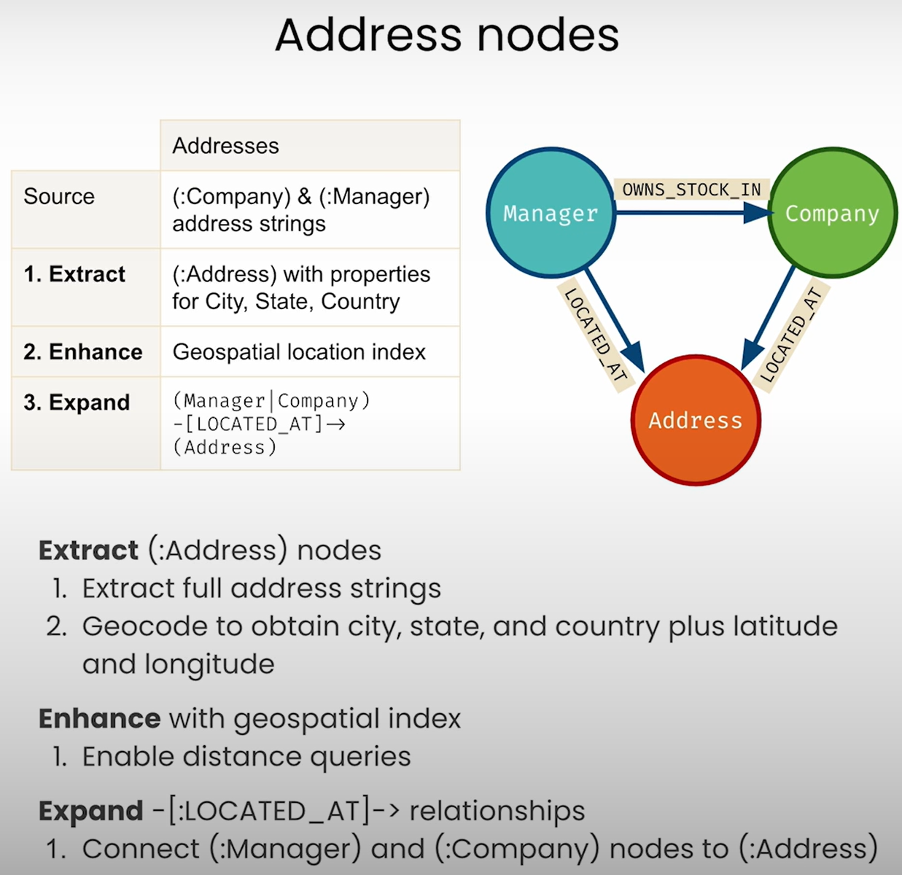

# 10b — Assembling and Maintaining KGs

> Assembly is deterministic on purpose: `MERGE` on a shared key, under a constraint, with provenance. The model's judgement stopped at resolution, and everything after the load is the work of keeping the result correct.

Resolved mentions still aren't a graph. A load without a constraint duplicates nodes, a value stored on the wrong element breaks every later query, and a graph left alone goes stale and keeps facts you may be legally required to remove. This chapter assembles a graph deterministically, integrates structured sources with their counts checked, then assesses, cleans, enriches and retires what is there.

---

## Where it sits

[Note 10](10-building-kgs-with-llms.md) took text to resolved mentions and scored the result. This note is the pipeline's stage 5 and everything after it: loading, fusing structured sources, and the assess, clean, enrich and retire cycle. [Note 11](11-kg-rag-and-text-to-cypher.md) reads from what gets built here.

---

## Stage 5: assembly, with the course as worked example

The Neo4j course builds an SEC filings graph one stage at a time:

| Lesson | Builds |
|---|---|
| L3 | Vector index and embeddings with `genai.vector.encode` |
| L4 | 10-K text split into `Chunk` nodes with embeddings, so Neo4j is also the vector store |
| L5 | `NEXT` links between chunks (a linked list), `PART_OF` to the form; window retrieval over neighbours |
| L6 | A second source (Form 13 investment managers) merged onto the same `Company` nodes; uniqueness constraints; full-text index |
| L7 | `Address` nodes geocoded from the company and manager address strings, a point index, `LOCATED_AT` edges |

L6 is appendix C's lesson at small scale: **`MERGE` on a shared identity key is how sources are fused**, and it only works if identities have been resolved first.

The course names its build loop **extract, enhance, expand**: pull out nodes from a source, give them an index or a unique key, then connect them. Its advice is to start with a **minimum viable graph** and grow it one source at a time.


*Image Source: Knowledge Graphs for RAG, DeepLearning.AI × Neo4j (Kollegger, 2024)*

**Before the graph: clean the source.** The 10-K filings come from SEC EDGAR as text files with embedded XML. The course's JSON was produced by regex clean-up, parsing the XML with Beautiful Soup, pulling out the company's CIK (the SEC's company identifier) and keeping four sections: Items 1, 1A, 7 and 7A. The instructor's prep code is public at [neo4j-product-examples/data-prep-sec-edgar](https://github.com/neo4j-product-examples/data-prep-sec-edgar). Its plan of attack for L4 is five steps: split each section into chunks, make each chunk a node with its metadata as properties, create a vector index, embed every chunk into it, then search by similarity. At that point Neo4j is only a vector store; the graph starts in L5.


*Image Source: Knowledge Graphs for RAG, DeepLearning.AI × Neo4j (Kollegger, 2024)*

**L3–L4: chunks as nodes, with a key and an embedding.** Each 10-K section is split (`RecursiveCharacterTextSplitter(chunk_size=2000, chunk_overlap=200)`) and every chunk gets a deterministic ID, so reloading is idempotent:

```cypher
// The constraint first: it makes MERGE safe and indexes the key
CREATE CONSTRAINT unique_chunk IF NOT EXISTS
FOR (c:Chunk) REQUIRE c.chunkId IS UNIQUE;

// chunkId = "{formId}-{item}-chunk{seq:04d}": same input, same node
MERGE (c:Chunk {chunkId: $chunk.chunkId})
  ON CREATE SET c.text = $chunk.text, c.formId = $chunk.formId,
                c.f10kItem = $chunk.f10kItem, c.chunkSeqId = $chunk.chunkSeqId;

// Neo4j as the vector store: embed in the database, then index
MATCH (c:Chunk) WHERE c.textEmbedding IS NULL
WITH c, genai.vector.encode(c.text, "OpenAI", {token: $openAiApiKey}) AS v
CALL db.create.setNodeVectorProperty(c, "textEmbedding", v);
```

`genai.vector.encode` was the GenAI plugin's API when the course was recorded. Check your Neo4j version's GenAI docs before reusing it, because the embedding functions have since been renamed. One bug to avoid if you run the L4 notebook: `split_form10k_data_from_file` loops over `item1_text_chunks[:20]` instead of the current item's chunks, so every item's chunks contain Item 1 text.

**L5: structure between chunks.** Chunks of one section become a linked list, and each chunk points to its form:


*Image Source: Knowledge Graphs for RAG, DeepLearning.AI × Neo4j (Kollegger, 2024)*

```cypher
// Order a section's chunks and link neighbours with NEXT (APOC)
MATCH (c:Chunk {formId: $formId, f10kItem: $item})
WITH c ORDER BY c.chunkSeqId ASC
WITH collect(c) AS section
CALL apoc.nodes.link(section, "NEXT", {avoidDuplicates: true})
RETURN size(section);

// Every chunk belongs to its form
MATCH (c:Chunk), (f:Form) WHERE c.formId = f.formId
MERGE (c)-[:PART_OF]->(f);
```

The `NEXT` links are what make window retrieval possible in [note 11](11-kg-rag-and-text-to-cypher.md#retrieval-modes). The course also adds a `SECTION` edge from the form to the first chunk of each item (`chunkSeqId = 0`).

**L6: fuse a second source on a shared key.** Form 13 is filed by institutional investment managers to report the companies they hold. It adds `Manager` nodes and attaches them to the **same** `Company` nodes, matched on the CUSIP:


*Image Source: Knowledge Graphs for RAG, DeepLearning.AI × Neo4j (Kollegger, 2024)*


```cypher
CREATE CONSTRAINT unique_manager IF NOT EXISTS
FOR (m:Manager) REQUIRE m.managerCik IS UNIQUE;

MERGE (com:Company {cusip6: $row.cusip6})
  ON CREATE SET com.companyName = $row.companyName
MERGE (mgr:Manager {managerCik: $row.managerCik})
  ON CREATE SET mgr.managerName = $row.managerName
// The quarter is part of the edge's identity; value and shares are data on it
MERGE (mgr)-[o:OWNS_STOCK_IN {reportCalendarOrQuarter: $row.quarter}]->(com)
  ON CREATE SET o.value = toFloat($row.value), o.shares = toInteger($row.shares);

// Full-text index so "royal bank" finds "Royal Bank of Canada"
CREATE FULLTEXT INDEX fullTextManagerNames IF NOT EXISTS
FOR (m:Manager) ON EACH [m.managerName];
```

Why a constraint when `MERGE` already matches on `managerCik`? The Cypher manual is explicit: *"Under concurrent updates, `MERGE` only guarantees the existence of the `MERGE` pattern, but not uniqueness."* The constraint is what guarantees one node per key. After L6 the course graph holds 643 nodes (`Chunk`, `Form`, `Company`, `Manager`) and 722 relationships (`NEXT`, `PART_OF`, `SECTION`, `FILED`, `OWNS_STOCK_IN`).

Notice that `value` and `shares` live on the **edge**, not on `Company`. That detail is what trips text-to-Cypher up in [note 11](11-kg-rag-and-text-to-cypher.md#the-failure-to-expect).

**L7: one more extract, enhance, expand round.** Both `Company` and `Manager` carry an address string. The course turns them into nodes: **extract** the full address strings and geocode them to city, state, country and latitude/longitude; **enhance** with a geospatial index on `Address.location` so distance queries are cheap; **expand** with `(:Manager|:Company)-[:LOCATED_AT]->(:Address)`. Queries then read location from the `Address` node, not from the old string properties. The location questions this answers are in [note 11](11-kg-rag-and-text-to-cypher.md#structured-lookups-by-name-and-by-place).


*Image Source: Knowledge Graphs for RAG, DeepLearning.AI × Neo4j (Kollegger, 2024)*

The course's list of where to grow next is a useful default: cross-link companies that mention each other (suppliers, competitors), extract people, places and topics from the text, add more form types or related sources, and add users so feedback can refine relevance.

**Curate before you scale** (appendix C). Start from a few sources that matter for the task. Every extra loosely related dataset adds reconciliation work and noise (*KG & LLMs in Action*, appendix C). The appendix's miRNA graph shows the moves:

- **Keep source semantics as separate relation types.** HMDD gives an experiment-supported association, loaded as `RELATED_TO` with category, description and PubMed ID. dbDEMC (up/down-regulation in cancer) and miR2Disease (deregulation in disease) both load as `REGULATES`, with the direction as a property. Collapsing them would lose what each source actually asserts.
- **Label provenance.** Each source adds its own label (`MiRNA_HMDD`, `MiRNA_dbDEMC`, `MiRNA_miR2Disease`) to the nodes it touches, so a single query can count the entities sources agree on. In the appendix 328 miRNAs are in all three sources and 2,550 only in dbDEMC. Overlap between independent curated sources is a cheap confidence signal.
- **`MERGE` is the fusion step.** Shared identifiers join the sources on load. After the merge, a single miRNA (hsa-mir-155) connects to brain and heart diseases that came from different datasets.
- **Sanity-check after every load.** Look at node and edge counts, top-degree nodes and median degree. The graph grew from 1,207 miRNAs / 18,732 associations / 849 diseases after HMDD alone to 4,874 / 118,806 / 1,144 after all three sources (*KG & LLMs in Action*, appendix C). The book's own overlap table sums to 3,872 miRNAs, not 4,874, which is the kind of mismatch these checks exist to catch. The next step is the normalisation [measured in note 10](10-building-kgs-with-llms.md#measure-what-normalisation-did).

### Integrating structured sources (ch4)

Not every KG starts from text. Ch4 fuses public structured datasets: protein–protein interactions with disease associations (DisGeNET), the pharmacology graph **Hetionet**, and the **Clinical Knowledge Graph** (*KG & LLMs in Action*, ch. 4). The work moves from extraction to three other steps. They follow the general pattern the chapter takes from Yang et al.: **merge** nodes from many sources, **link** the nodes that are the same concept, **prune** what's irrelevant.

- **Identity mapping.** Every source is mapped onto shared codes (UMLS, Disease Ontology) before `MERGE`. This is entity resolution, made easier because the identifiers are curated. In the PPI case only 290 of 519 DisGeNET diseases mapped to Disease Ontology, so expect a lossy join and report it (*KG & LLMs in Action*, ch. 4).
- **Schema alignment.** Reconcile what each source means by its edge types before they share a graph. The PPI model has two parts: a monopartite `Protein–Protein` interaction graph, and a bipartite `Disease–Protein` association graph on top of it.
- **Validation.** Check counts, orphans and degree distributions after each load. The PPI load gave 342,354 interactions among 21,559 proteins. WCC found 27 components, one of them holding 21,521 proteins, and Louvain found 48 communities with modularity 0.546 (*KG & LLMs in Action*, ch. 4, Table 4.2; the prose nearby says "around 0.40", which contradicts the table).

Loading pattern: key constraints first, then batched idempotent writes.

```cypher
CREATE CONSTRAINT IF NOT EXISTS FOR (p:Protein) REQUIRE p.id IS NODE KEY;
CREATE CONSTRAINT IF NOT EXISTS FOR (d:Disease) REQUIRE d.id IS NODE KEY;

LOAD CSV WITH HEADERS FROM 'file:///ppi.csv' AS row
CALL (row) {
  MERGE (a:Protein {id: row.protein_a})
  MERGE (b:Protein {id: row.protein_b})
  MERGE (a)-[:INTERACTS_WITH]-(b)
} IN TRANSACTIONS OF 1000 ROWS;
```

Two analysis lessons carry over to any integrated graph:

- **Generic clustering and domain subgraph metrics answer different questions.** WCC and Louvain show the global community structure, but they treat every node alike. A meaningful subgraph (one disease's pathway, say) needs its own metrics, such as largest component, density and conductance.
- **Raw path counts favour hubs.** DWPC discounts paths through high-degree nodes ([note 13](13-graph-ml-and-gnns.md#dwpc-discount-the-hubs)).

The three subgraph metrics, for a disease pathway with node set V_d, internal edges E_d and boundary edges B_d (one end inside, one outside):

```python
import networkx as nx

def pathway_metrics(G: nx.Graph, proteins: set) -> dict:
    H = G.subgraph(proteins)
    e = H.number_of_edges()
    boundary = sum(1 for u, v in G.edges(proteins) if (u in proteins) != (v in proteins))
    return {
        "largest_cc_frac": max(map(len, nx.connected_components(H)), default=0) / max(len(H), 1),
        "density": nx.density(H),                                   # 2|E| / (|V|(|V|-1))
        "conductance": boundary / (boundary + 2 * e) if boundary + e else 0.0,  # low = self-contained
    }
```

| Metric, across all disease pathways | Median | What it says |
|---|---|---|
| Fraction of proteins in the largest component | 21% (16 components per pathway) | Pathways are fragmented in the PPI network |
| Density | 0.07 (whole network: 0.0015) | Denser than the background, but sparse internally |
| Conductance | 0.96 | Pathways connect mostly *outward* |

Source: *KG & LLMs in Action*, ch. 4. Two more points on the distributions show how fragmented pathways are: only about 10% of pathways have more than 60% of their proteins in their largest component, and 90% of diseases have a density below 0.17. Run the same metrics on the Louvain clusters and the picture flips: most proteins sit in one large component and conductance improves, so clusters are better connected inside than outside. A disease pathway is a different object from a topological community, so don't use one as a proxy for the other.

The other two sources show what mature integrated KGs look like. **Hetionet** combines 29 resources into 47,031 nodes of 11 types and 2,250,197 edges of 24 types. Some edge types carry their provenance: each of the 11,571 Compound–binds–Gene edges stores its reference as a relationship property. **CKG** links 33 node labels with 51 relationship types to support queries such as finding altered functions, suggesting drugs for regulated proteins and surfacing possible confounders (*KG & LLMs in Action*, ch. 4). For patient data the chapter gives two privacy-preserving options. One is to load only statistical relationships (diseases, symptoms, outcomes and their weights) and leave out patient records. The other is a de-identified generic clinical KG, with patient EHR data added only when strictly necessary and with consent.

The LLM's role here is to **interpret** the quantitative output (a DWPC ranking, a set of protein–disease links) as a domain narrative. It doesn't replace expert judgement, which matters most in the clinical case. The prompt the chapter uses (with Claude.ai Sonnet 4.0) has four parts: a biomedical-assistant role, the raw result rows (pathway, DWPC, PC, gene count), one line of context on what DWPC means, and five numbered asks: biological significance, relation to pathogenesis, therapeutic implications, unexpected findings, follow-up questions. The output is a hypothesis list for a human to check, not a finding. The book's words: "We do not suggest using results from LLMs without proper interpretation by physicians and researchers" (*KG & LLMs in Action*, ch. 4). Check the rows before you send them. The book's prompt mixes DWPC scores from two different metapath queries (four rows from the disease–gene–process query, the glycoprotein row from the query with an extra gene–gene hop) under one label, and the model then interprets them side by side. DWPC values are only comparable within one metapath and one damping exponent.

---

## After the load: assess, clean, enrich, retire

The pipeline ends at load. Raieli and Iuculano draw the longer cycle: **creation → assessment → cleaning → enrichment → deployment**, with assessment and cleaning often run as one pass (*Building AI Agents with LLMs, RAG, and Knowledge Graphs*, ch. 7, Fig. 7.7). Stage 6 measures one extraction run against a gold set. Once the graph is live, the questions change. Is it still right, is it complete enough for the task, and can a fact be taken out again?

**Assess along named dimensions.** The chapter's list (ch. 7):

| Dimension | Asks | Check it with |
|---|---|---|
| **Accuracy** | Are entities and edges syntactically and semantically right? | [Stage 6](10-building-kgs-with-llms.md#stage-6-evaluating-extraction) metrics, re-run on a fresh sample |
| **Completeness** | Does the graph hold the entities and relations the task needs? | Coverage against a gold KG or a list of must-answer questions |
| **Conciseness** | Is it filling up with junk? The book's example is blank nodes, which stand in for unnamed entities and multiply if extraction isn't controlled | Count nodes with no name or a single edge; watch hub growth |
| **Timeliness** | How old is each fact, and how often is it refreshed? | An `extracted_at` property on nodes and edges; a refresh schedule per source |
| **Accessibility, understandability** | Can the people and systems that need it query it and read the schema? | The LLM-ready schema in [note 11](11-kg-rag-and-text-to-cypher.md#give-the-model-an-llm-ready-schema) |
| **Security, privacy, traceability** | Who can read it, and where did each fact come from? | Access control on the store; provenance on every node and edge |

The book connects traceability to privacy: if every fact links to its source document, you can **delete a user's data on request** and remove whatever came from a document later found to be wrong. That is the practical reason for the text-paired graph in [note 11](11-kg-rag-and-text-to-cypher.md#what-a-graph-adds) and for keeping mentions separate from entities. The deletion pass removes the mentions from that source, then re-resolves the entities they supported. An entity left with no mentions goes too.

**Clean by error type.** The chapter separates syntactic errors, ontology errors (a type or property that doesn't exist, or the wrong one), semantic errors, and **knowledge errors** carried in from the sources ("person x is not the CEO of company y"). Three ways to find them, from cheap to costly: statistical outlier detection, which the book calls "not particularly accurate"; rule-based checks from the ontology (nothing can be both a `Person` and a `Place`); and an LLM asked to judge each fact, as when it catches `(Vienna, CapitalOf, Hungary)` (ch. 7). The LLM check only works for facts the model already knows, such as capitals. On private or domain data, which is why most teams build a KG, the model's opinion isn't evidence. There it can flag implausible triples for a person to review, but it shouldn't delete them. Rule checks are the ones to run on every load, since they are deterministic and can block the load the way Stage 6 does.

**Enrich, knowing it costs cleaning.** KGs are "notoriously incomplete", and the usual first fix is another source: another database, another corpus, then other formats (CSV, XML, JSON, images). The chapter's warning is that each added source makes cleaning, alignment and entity resolution matter more (ch. 7). The alternative is to **infer** missing triples with a model, which is link prediction under another name ([note 13](13-graph-ml-and-gnns.md#the-task-map)). The chapter lists four ways to use an LLM for it:

| Approach | Input → output | Trade-off |
|---|---|---|
| Joint encoding | The whole triple (h, r, t) → probability it's valid, or a linear classifier on the final hidden state | One model call per candidate triple |
| Masked (MLM) encoding | (h, r, ?) → the predicted tail | Fills a gap directly |
| Separated encoding | Encode (h, r) and t apart, then score their similarity | The book calls it more accurate but at risk of combinatorial explosion |
| Prompting | Few-shot prompt with the triple plus entity and relation descriptions | Can use context the encoders can't see; costs most per call |

Whatever the method, an inferred triple is a prediction. It goes in flagged, with a confidence score, and stays out of default traversals until confirmed ([note 13](13b-representation-learning-and-gnns.md#predictions-in-a-shared-graph)).

**Plan the pipelines that run after deployment.** "Deployment is the last step in the pipeline. That doesn't mean it's the end of the story" (ch. 7). A live KG needs four standing pipelines: updates as sources change, assessment of every write so that new data doesn't add errors or conflicts, cleaning for facts that are outdated or must be deleted for legal or privacy reasons, and access and security control. The book doesn't connect these to the earlier stages, but they are the same stages run again. An update pipeline is chunk → extract → resolve → assemble on the changed documents, gated by the same Stage 6 metrics. If the first build was a one-off notebook, none of this can be done.

On hosting, the chapter's survey is short: relational tables, document stores, graph databases (Neo4j with Cypher) and RDF triple stores, or a KG layer over an existing database (ch. 7). The choice that matters for an LLM-built graph, labelled property graph or RDF, is in [note 09](09-kg-fundamentals-and-cypher.md#two-data-models-lpg-vs-rdf).

---

## Domain examples in the book (one paragraph each)

- **Archives (ch6).** Rockefeller Archive Center documents: people, institutions and funding. This is the source of the Ernest Lawrence ER example. Three mentions on different pages were resolved to one person using string similarity, a shared employer and related `Occupation`s. Two of the mentions were six hops apart in the graph, which a relational database would make hard to find. The resolved graph then supports network questions: centrality over `TALKED_WITH`, `TALKED_ABOUT`, `WORKS_WITH` and `STUDENT_OF` picks out influencers and bridges (Bohr, Lawrence), and the sentiment stored on `TALKED_ABOUT` shows who was critical of whom.
- **Biomedical NED (ch7–8).** ECDC bulletins linked to UMLS (scispaCy) and SNOMED (open LLM with graph paths). Co-occurrence edges are checked against ontology paths. A co-occurrence with no ontology path is a candidate new fact.
- **Biomedical integration (ch4).** PPI and disease networks, Hetionet (a celiac-disease case study using metapaths and DWPC) and the Clinical Knowledge Graph, with LLM-assisted interpretation of pathway analyses.
- **miRNA (appendix C).** A KG built from structured sources: curated datasets, disease-ontology normalisation and DWPC path scoring to rank disease–target hypotheses. The DWPC query runs disease → miRNA → target on the raw `Disease` name "celiac disease", not the normalised node, with damping 0.4, PC ≥ 2 and targets with at least 5 miRNAs. The top hit, NM_080601 (PTPN11), has DWPC 0.00417 from only 2 paths and 25 miRNAs, against 111 or more for most of the rest. Validation is a literature check on the first few hits; for the others the book found no supporting articles.

---

## Working reference

Depth: *KG & LLMs in Action* ch. 4 and appendix C; the chapter files are listed in [references.md](../references.md). Raieli & Iuculano, *Building AI Agents with LLMs, RAG, and Knowledge Graphs*, ch. 7, for the full lifecycle (assessment, cleaning, enrichment).

---

## Pitfalls

- **`MERGE` before the constraint.** Symptom: duplicate `Company` nodes after a second import. Fix: create the uniqueness constraint first, as L3–L6 do, since it also indexes the key.
- **Facts on the wrong element.** Symptom: text-to-Cypher writes `Company.value`, which doesn't exist. Fix: keep `value` and `shares` on the edge whose identity includes the quarter, and tell the query layer so.
- **Adding sources before knowing the task.** Symptom: reconciliation work and noise from loosely related datasets. Fix: curate first, starting from a few sources that matter.
- **Skipping count checks.** Symptom: an unexplained mismatch, like the appendix's overlap table summing to 3,872 miRNAs against 4,874 loaded. Fix: check node and edge counts, top-degree nodes and median degree after every load.
- **Global metrics for a local question.** Symptom: WCC reports a giant component of 21,521 of 21,559 proteins, and says nothing about a pathway. Fix: add per-subgraph metrics, such as density against the background and conductance.
- **Comparing DWPC across metapaths.** Symptom: scores from different metapaths ranked in one list. Fix: compare only within one metapath and one exponent.
- **Loading inferred triples as fact.** Symptom: a prediction reappears as evidence for later predictions. Fix: load it flagged with a confidence score, and keep it out of default traversals until confirmed.

## Try it

1. **Try it on the course graph.** Add the uniqueness constraint *before* the L6 manager import, run it again without the constraint, and count the duplicate `Company` nodes the constraint prevented. On the L5 chunks, compare top-k retrieval with and without the ±1 `NEXT` window on three questions.


   <details><summary>What to look for</summary>

   Without the constraint you should see duplicates only if a write misses the key or writers race. Compare `count(c)` against `count(DISTINCT c.cik)`. For retrieval, the ±1 window should help questions whose answer crosses a chunk boundary and add noise to those that don't, so judge per question and not by average.

   </details>

2. The appendix's overlap table sums to 3,872 miRNAs and the load reports 4,874. How large is the gap, and what would you query to explain it?

   <details><summary>Answer</summary>

   1,002 miRNAs. Count `MiRNA` nodes by combination of source labels (`MiRNA_HMDD`, `MiRNA_dbDEMC`, `MiRNA_miR2Disease`), then compare the sum with the total. Nodes with no source label, or a table that left out one combination, would explain it. The book doesn't say which.

   </details>

3. A pathway subgraph has density 0.07 against 0.0015 for the whole network, with conductance 0.96. Is it a self-contained module?

   <details><summary>Answer</summary>

   No. It is about 47× denser than the background, and still sparse inside, while conductance near 1 means nearly all of its edge endpoints lead outward. That is what the chapter means when it says pathways connect mostly outward.

   </details>

## Interview checklist

| Prompt | Answer in one line |
|---|---|
| Why is assembly deterministic when extraction isn't? | The model's judgement stops at resolution. After that, `MERGE` on a shared key under a constraint means the same input gives the same graph, and you can replay it. |
| Where do `value` and `shares` go in the SEC graph, and why? | On the ownership edge, since a value belongs to a manager's stake in a quarter. The quarter is part of the edge's identity. |
| You are merging a second source. What is your validation? | Map onto shared codes before `MERGE`, label provenance per source, then check counts, orphans and degree distributions after each load. |
| Why is DWPC better than path count? | It damps paths through hubs. For celiac disease, T cell costimulation (10 paths) outranks a generic immune process (21 paths) with DWPC 0.0335 vs 0.0272. |
| How do you handle a request to delete a user's data? | If every fact links to its source document, you can remove what came from it. The book connects traceability to privacy for this reason. |
| What keeps running after deployment? | Four pipelines: updates as sources change, assessment of every write, cleaning for outdated or legally removed facts, and access control. |

## Next

[11-kg-rag-and-text-to-cypher.md](11-kg-rag-and-text-to-cypher.md): asking the graph questions in natural language.
