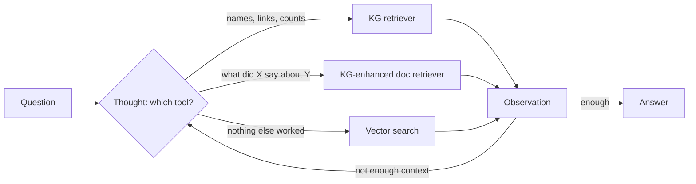
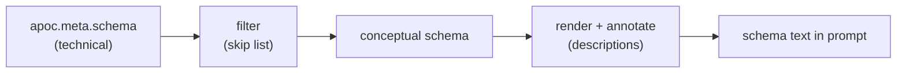

# 11 — KG-Powered RAG and Text-to-Cypher

> Vector search finds text that sounds like the question. A graph finds things connected to the answer. Text-to-Cypher reaches the graph from natural language, and it is reliable only as a generate-then-verify loop.

Vector RAG can rank three chunks at 0.906, 0.903 and 0.902 for a question about Lauritsen when only one of them mentions him. A graph fixes that class of failure and brings others: triples drop the condition in a plan, and generated Cypher can run cleanly and return nothing. This chapter covers what a graph adds, how to choose a retrieval mode, and the prompt behind reliable text-to-Cypher.

---

## Where it sits

[Note 10](10-building-kgs-with-llms.md) built the graph. This note reads from it. Retrieval in general is covered in [02-context note 04](../../02-context-engineering/notes/04-retrieval.md) and evaluating it in [Eval chapter 07](../../../generative-ai/08-eval/notes/07-evaluating-rag-and-grounding.md). This note adds what a graph changes. It ends back in Track A: the book's QA agent is a LangGraph pipeline with a retry edge.

---

## Where vector RAG breaks

Ch13 of Negro et al.'s *Knowledge Graphs and LLMs in Action* (Manning, 2025) lists the failure modes of chunk-and-embed retrieval:

| Failure | What happens |
|---|---|
| **Context fragmentation** | Chunks are retrieved independently. A fact split across chunks or documents needs every piece retrieved, in order, near the top. |
| **Embedding compression** | One vector per chunk loses entity-level detail. Rare domain terms embed poorly. |
| **Noise (distraction)** | Loosely related chunks dilute the context and degrade the answer. |
| **Misses** | Similarity optimises for closeness, not coverage, so aggregate questions ("what are the main themes?") get partial answers. |
| **Static vectors** | Embeddings are computed once. New or shifting terminology isn't reflected until you re-embed. |
| **Scale** | Exact nearest-neighbour search gets expensive, so large stores fall back to approximate search and lose some recall. |

The ch13 worked example: for "How is Lauritsen related to cyclotron research?", the three top results scored 0.906, 0.903 and 0.902 by cosine similarity, and **only the first mentioned Lauritsen at all**. Embeddings encode overall meaning. They don't guarantee that a named entity is present. A second query in the chapter ("What is known about cyclotron research?") shows the same thing from the other side: the top hit (0.918) is a relevant 1939 diary entry on cyclotron costs, and the runner-up (0.916) reads like a sales pitch for a competing machine (*KG & LLMs in Action*, ch. 13). Score gaps in the third decimal place say nothing about relevance.

Ch14 shows the consequence. Given five witness statements and the question "Is the perpetrator left-handed?", the model leans on Witness C (phone held to the ear with the left hand, "strong evidence"), notes that a bandaged left index finger "doesn't necessarily imply" anything, and concludes "likely left-handed" with sensible hedging. Remove Witness C's statement from the retrieved context and the model builds the opposite case from what remains (wallet taken out with the right hand, a bag carried in the right hand), dismisses the bandage as possibly unrelated, and **reverses its conclusion**: "the absence of a single witness statement is enough to lead the model to the opposite conclusion" (*KG & LLMs in Action*, §14.2.2). RAG output is bounded by retrieval completeness, and the model can't tell that something is missing. Grounding narrows what the model draws on; it doesn't make the model deterministic. The book's conclusion is to keep a person reviewing the answers (ch. 13).

---

## What a graph adds

| Capability | How |
|---|---|
| **Multi-hop** | Traverse typed edges instead of hoping the hops co-occur in one chunk |
| **Entity-exact retrieval** | "Documents that mention *all* of these entities", or only documents that mention a given *relationship* between them, which vector search can't promise |
| **Aggregation** | `count`, `sum` and `collect` over the whole graph instead of over a top-k sample |
| **Metadata routing** | Filter by date, source or author as graph properties ("the latest version of this regulation") |
| **Traceable answers** | Return the path. A person can check each edge. |
| **Composed retrieval** | Resolve "the head of group X" in the KG, then search a document store for that name |

The book's design advice: make the graph **text-attributed** (nodes and edges carry descriptive text) and **text-paired** (every node and edge links back to its source documents). Then it can serve as a structured store and also as a more precise document retriever (*KG & LLMs in Action*, ch. 13). A graph is also something a domain expert can read and correct directly, which a vector index is not.

### The evidence

The primary source is Microsoft Research's GraphRAG paper, Edge et al., *From Local to Global: A Graph RAG Approach to Query-Focused Summarization* ([arXiv 2404.16130](https://arxiv.org/abs/2404.16130)). It builds an entity graph, detects communities and pre-summarises them, then answers **global sensemaking** questions over corpora of about 1M tokens. Against vector RAG it reports:

- **Comprehensiveness** win rates of 72–83% (podcast transcripts) and 72–80% (news).
- **Diversity** win rates of 75–82% and 62–71%.
- Vector RAG **wins on directness** (concise answers).

The judge was an LLM in head-to-head comparisons, not people and not a ground-truth accuracy measure. So the result is "graph community summaries help whole-corpus questions". It does not show that graphs are more accurate than vectors in general.

A figure you will see quoted is **53.4% vs. 42.9%** multi-hop accuracy for graph over vector retrieval. It comes from a vendor post, flowtivity.ai's [graph engineering 2026 guide](https://flowtivity.ai/blog/graph-engineering-2026-guide-openclaw-codex/), which gives no dataset, method or judge. **Vendor number, unverified** (see the [Source quality](../references.md#source-quality) table in references.md): don't quote it as evidence. To get a number for your own data, write 20 multi-hop questions with gold answers *and gold paths*, and score vector-only, hybrid and text-to-Cypher on answer correctness, path validity and tokens.

Raieli and Iuculano's account of where GraphRAG stands points the same way (*Building AI Agents with LLMs, RAG, and Knowledge Graphs*, ch. 7). There is "a lack of benchmark standards" for comparing GraphRAG methods, so published wins rarely carry over from one paper to the next. GraphRAG "underperforms in abstractive question-answering tasks or when there is no explicit entity mentioned in the question", because extraction drops the nuance of the text. And a growing graph returns more redundant facts, which then have to be compressed at the risk of losing information. Their prediction is **HybridRAG**: both stores in one system, with a router choosing between them or a step that merges their results. They cite Sarmah et al. ([arXiv 2408.04948](https://arxiv.org/abs/2408.04948), not yet read for this course), whose hybrid did better on financial documents. That matches the default order below, and it adds a test: if a question names no entity, send it to vector search first.

The chapter's headline application is MedGraphRAG (Wu et al., [arXiv 2408.04187](https://arxiv.org/abs/2408.04187), not yet read for this course). It builds a three-level graph. The top level holds the user's own documents (hospital medical reports). Their entities link down to a level built from medical textbooks and papers, which links down to a level of standard medical terms and relations from curated sources. That is the ontology-linking idea from [note 10](10-building-kgs-with-llms.md#ned-against-an-ontology-ch78) used for retrieval: a private fact comes with its accepted definition attached. By the book's account the system reaches state-of-the-art results on the main medical QA benchmarks, beating fine-tuned models. That is the paper's own claim, as the book reports it. Read the paper before quoting it.

---

## Retrieval modes

| Mode | How it retrieves | Use when | Fails when |
|---|---|---|---|
| **Vector** | Embed the question, top-k chunks | Local lookups: "find the passage about X" | Multi-hop, aggregates, exact entity constraints |
| **Graph traversal (canned)** | Fixed Cypher templates keyed by entities from the question (shortest paths, k-hop neighbourhood) | Known question shapes; production paths | A question shape you didn't template |
| **Text-to-Cypher** | LLM writes Cypher from the schema | Open-ended structured questions over a well-described schema | Schema is large or badly named; no validator |
| **Hybrid** | Vector to find entry chunks or entities, then expand through the graph (L5's `NEXT` window, entity neighbourhoods) | Text-heavy corpora where the graph adds context to found passages | Entry points are wrong, so expansion makes things worse |
| **Global (GraphRAG communities)** | Pre-summarised communities, then map-reduce | "What are the themes across everything?" | Specific factual lookups; high indexing cost |

**Triples lose meaning.** "If it rains next week I'll cancel the beach trip and go to the museum" becomes `(user, plans, beach trip)` and `(user, backup, museum)`, and the condition is gone. Extraction errors also contaminate the graph. Li's recommendation (*AI Agents in Depth*, ch. 3): keep the core record in natural language, and use the graph as an *index* for the domains that need multi-hop and disambiguation (medical, legal, family relationships). For "drill from concept to detail" questions, a RAPTOR summary tree fits better than a graph ([02-context 04](../../02-context-engineering/notes/04-retrieval.md#distill-at-index-time-beyond-flat-chunks)).

**Default order:** start with vector. Add canned traversals for the multi-hop question shapes you can name. Add text-to-Cypher only for the long tail, and only with a validator. Ch13 takes a similar position, but more narrowly. Its KG retriever tool *does* generate Cypher from the schema; only the document retriever is a **precanned query**, because generating that query "would introduce another possible point of failure when the Cypher queries are complex". The book adds that production Graph RAG systems carry many KG tools, "many of which are based on precanned Cypher queries for types of questions that are frequently repeated" (§13.4.3). This is the agency rule from [note 02](02-graph-primitives.md) again.

### What to retrieve, and how to hand it over

Raieli and Iuculano split GraphRAG into **G-indexing, G-retrieval and G-generation**, following Peng et al.'s survey ([arXiv 2408.08921](https://arxiv.org/abs/2408.08921), not yet read for this course) (*Building AI Agents with LLMs, RAG, and Knowledge Graphs*, ch. 7). Two of the chapter's distinctions are useful when you build one.

**Granularity is the graph's chunk size.** In vector RAG you set granularity when you chunk. In a graph you set it at query time by choosing the unit you return (ch. 7):


*Image Source: Salvatore Raieli & Gabriele Iuculano, *Building AI Agents with LLMs, RAG, and Knowledge Graphs* (Packt, 2025), Fig. 7.20*

| Unit | Returns | Fits | Watch for |
|---|---|---|---|
| **Node** | An entity and its properties | Targeted lookups ("when was X founded?") | Nothing about how it relates to anything |
| **Triplet** | Entity, edge, neighbour | Questions about one relationship | Loses conditions, as the beach-trip example above shows |
| **Path** | A chain of edges from X to Y | "How is X related to Y?" | Paths grow exponentially with graph size, so restrict them by rule, use shortest paths, or score them with a GNN |
| **Subgraph** | A connected region, from a pattern or by merging paths | Complex questions over several entities | Context bloat, the easiest way to fill the window with irrelevant edges |
| **Hybrid / adaptive** | Picks the unit per query | Mixed traffic | Needs a classifier you can test |

The chapter's rule is to match the unit to the question: small units for simple queries, larger ones only where the question needs them, because a saturated context hurts the answer ([02-context note 04](../../02-context-engineering/notes/04-retrieval.md#how-much-to-retrieve)). Canned traversals make this concrete. Each template returns one unit, so you choose the granularity when you write the template.

**Three kinds of retriever, with a cost gradient.** *Non-parametric* retrievers take the entities in the query and expand k hops by rule. They are the fastest and the least accurate. *GNN-based* retrievers learn to find subgraphs similar to the query. *LLM-based* retrievers read the query and search, sometimes as an agent with graph tools. The book says the last two "significantly improve retrieval accuracy but at a high computational cost", and that systems mix them, for example a cheap first pass refined by an LLM (ch. 7). Everything from vector RAG carries over too: query rewriting and decomposition, iterative or adaptive retrieval (one round for simple queries, several for complex ones), compression of the retrieved knowledge, and **reranking** of candidate subgraphs to keep the top k ([02-context note 05](../../02-context-engineering/notes/05-compression-compaction.md)). The chapter names two problems specific to graphs. The number of candidate subgraphs grows exponentially with the graph, and a text query has to be compared with structure, which plain embedding similarity does poorly.

**The retrieved graph has to become text.** The chapter lists the formats in use (ch. 7):

| Format | Looks like | Note |
|---|---|---|
| Raw node and edge lists | `(Lauritsen)-[:WORKS_ON]->(cyclotron)` | Simplest; what the agent tools above return |
| Adjacency or edge table | One row per edge | Compact, and keeps the relational structure clearer |
| Node sequence | Nodes in an order set by a fixed rule | Compact; keeps the order |
| Natural-language template | "X works on Y. Y is funded by Z." Templates can separate 1-hop from 2-hop neighbours | Easiest for the model to read; an LLM can write the description instead of a template |
| Syntax tree | The graph flattened into a hierarchy | Keeps topological order |
| Code-like | GraphML | Structured and textual at once |

The chapter's own conclusion is that no format is settled: the result has to be concise, complete and readable by the model, and should keep the structure. Treat the format as a parameter and test it on your questions. The book also notes that LLMs read graphs as linear text and pay more attention to node labels than to topology ([note 13](13b-representation-learning-and-gnns.md#gnns-and-llms-together)). So write the edges the answer depends on explicitly, and don't expect the model to infer them from an adjacency list.

### A Graph RAG agent: three tools under ReAct

Ch13's agent over the Rockefeller Archive Center graph (1930s grant diaries: who talked with whom about what) has three tools and a ReAct loop that chooses among them (*KG & LLMs in Action*, ch. 13):

| Tool | What it does | Typical question |
|---|---|---|
| **KG retriever** | Answers from nodes and edges directly: a Cypher query, or the subgraph connecting the named entities (e.g. all shortest paths) | "Who talked about Dorothy Wrinch?", aggregates across documents |
| **KG-enhanced document retriever** | A canned query that returns only the pages paired with a specific relationship between two named entities | "What did X say about Y?" |
| **Vector search** | Plain similarity search | Fallback when neither KG tool returns anything useful |



The document retriever is a parametrised template. The model fills in arguments; it never writes Cypher. Listing the allowed classes and relationship types in the argument schema keeps it inside the graph. A minimal version (simplified schema, not the book's listing):

```python
from typing import Literal
from pydantic import BaseModel, Field

class RelationDocsArgs(BaseModel):
    source: str = Field(description="Person named in the question as the speaker")
    target: str = Field(description="Entity the question asks about")
    target_class: Literal["Person", "Organization", "Occupation", "Title"]
    relationship: Literal["TALKED_ABOUT", "TALKED_WITH", "WORKS_WITH"]

# Labels and relationship types can't be Cypher parameters, so they are
# spliced in from the whitelist above; entity names go in as $parameters.
TEMPLATE = (
    "MATCH (s:Person {{name: $source}})-[r:{rel}]->(t:{cls} {{name: $target}}) "
    "MATCH (p:Page) WHERE p.id IN r.source_pages "   # text-paired: the edge lists its pages
    "RETURN DISTINCT p.text AS text LIMIT 3"
)

def relation_docs(**kwargs) -> list[str]:
    a = RelationDocsArgs(**kwargs)                      # rejects unknown types
    cypher = TEMPLATE.format(rel=a.relationship, cls=a.target_class)
    rows = graph.query(cypher, params={"source": a.source, "target": a.target})
    return [r["text"] for r in rows]
```

The book's listing differs in ways worth knowing. Its arguments are plain `str` fields whose descriptions list the allowed values (source class "only one, 'Person'"; relationship one of `TALKED_ABOUT`, `TALKED_WITH`, `WORKS_WITH`, ...), so nothing rejects an off-list value; the `Literal` above does. The query reaches documents through `(p:Page)-[:MENTIONS_ENTITY]->` rather than a page list on the edge, keeps the first three results, and returns an empty list on any exception, which the agent sees as "no documents". The document selector's tool description embeds the full KG schema (`Full KG schema:\n{KG_SCHEMA}`), so the agent picks arguments against the real labels. And it builds the whole query with `str.format`, entity names included. Pass names as parameters instead: a name containing a quote breaks the query, and string-built Cypher is an injection path.

How the loop behaved (ch13):

- **"What did her fellow researchers say about Dorothy M. Wrinch?"** The agent first asked the KG retriever who talked about her (three names came back: Eric Ponder, Pascu and Irving Langmuir), then called the document retriever once per name and composed a grounded answer. Four thought-action-observation rounds, in an order the agent chose.
- **A question naming two people** ("What did August Krogh say about Lawrence Irving?") went straight to the document retriever, with no KG lookup first. The book notes that an LLM without retrieval would say it has no information, or make something up.
- **"Are there shared research topics between Harvard and Johns Hopkins?"** No single diary entry compares the two, so vector search would have to stuff many documents into context and hope. The KG retriever wrote a clumsy but correct query and answered "astronomy and climatology". This is the aggregate case where a graph wins outright, with a much smaller context as a bonus.

Practical lessons from the chapter: tool names and descriptions decide which tool gets picked, so write them carefully, and override the framework's default agent prompt if behaviour is unstable. Run the same question several times, because the variation shows you where to improve. The next steps it names are re-ranking after vector search and a self-correction loop for generated Cypher. In ch13 that loop is the LLM double-checking its own query ("generates the Cypher query first and then asks the LLM to double-check it"). Ch15 replaces the self-review with the database's error message, which is the version the rest of this note builds. The chapter's agent is LangChain's `create_structured_chat_agent` and `AgentExecutor` on `gpt-4o-mini` at temperature 0, both legacy now (LangGraph's prebuilt ReAct agent replaces them).

### Vector search inside the graph

The vector mode doesn't need a separate store. Course L3 puts a vector index on a node property of the movies graph and queries it with Cypher, so the hit comes back as a node you can keep walking from:

```cypher
// 1. Index a property (1536 = OpenAI embedding size)
CREATE VECTOR INDEX movie_tagline_embeddings IF NOT EXISTS
FOR (m:Movie) ON (m.taglineEmbedding)
OPTIONS {indexConfig: {`vector.dimensions`: 1536, `vector.similarity_function`: 'cosine'}};

// 2. Embed each tagline in the database and store it on the node
MATCH (movie:Movie) WHERE movie.tagline IS NOT NULL
WITH movie, genai.vector.encode(movie.tagline, "OpenAI", {token: $openAiApiKey}) AS vector
CALL db.create.setNodeVectorProperty(movie, "taglineEmbedding", vector);

// 3. Similarity search: embed the question, ask the index for top-k nodes
WITH genai.vector.encode($question, "OpenAI", {token: $openAiApiKey}) AS q
CALL db.index.vector.queryNodes('movie_tagline_embeddings', $top_k, q)
  YIELD node AS movie, score
RETURN movie.title, movie.tagline, score
```

`SHOW VECTOR INDEXES` lists what exists. The index is approximate k-nearest-neighbour search over an HNSW graph. As in [note 10](10b-assembling-and-maintaining-kgs.md#stage-5-assembly-with-the-course-as-worked-example), `genai.vector.encode` is the course-era name of the GenAI plugin function; check your Neo4j version before reusing it.

### Hybrid in practice: a `retrieval_query`

LangChain's `Neo4jVector` runs the vector search, then hands each hit (`node`, `score`) to a Cypher fragment you supply. That fragment is where the graph adds context. Course L5 widens each hit to its `NEXT` neighbours:

```cypher
// node and score come from the vector index
MATCH window = (:Chunk)-[:NEXT*0..1]->(node)-[:NEXT*0..1]->(:Chunk)
WITH node, score, window ORDER BY length(window) DESC LIMIT 1  // longest = both sides
WITH nodes(window) AS chunks, node, score
UNWIND chunks AS c
WITH collect(c.text) AS texts, node, score
RETURN apoc.text.join(texts, " \n ") AS text, score, node {.source} AS metadata
```

L6 goes further and walks from the chunk to its company and on to the managers holding it, so the retrieved text starts with facts no paragraph contains:

```cypher
MATCH (node)-[:PART_OF]->(f:Form)<-[:FILED]-(com:Company)<-[o:OWNS_STOCK_IN]-(mgr:Manager)
WITH node, score, mgr, o, com ORDER BY o.shares DESC LIMIT 10
WITH collect(mgr.managerName + " owns " + o.shares + " shares of " + com.companyName)
     AS holdings, node, score
RETURN apoc.text.join(holdings, "\n") + "\n" + node.text AS text,
       score, {source: node.source} AS metadata
```

```python
from langchain_neo4j import Neo4jVector          # was langchain_community.vectorstores
store = Neo4jVector.from_existing_index(
    OpenAIEmbeddings(), url=NEO4J_URI, username=NEO4J_USERNAME, password=NEO4J_PASSWORD,
    index_name="form_10k_chunks", text_node_property="text",
    retrieval_query=investment_retrieval_query)  # the Cypher above
retriever = store.as_retriever()
```

On a question about ransomware protection, the windowed retriever's answer also named NetApp's ONTAP software, which the plain retriever's answer left out. The course wires the retriever into `RetrievalQAWithSourcesChain` and calls it with `chain({"question": q})`; both the class and the call style are deprecated, so use `create_retrieval_chain` or an LCEL pipe with `.invoke`. One more lesson from L4 carries over: the plain chain made up an answer to a question about Apple, which isn't in the NetApp filing, until the prompt said *"If you are unsure about the answer, say you don't know."*

---

## Structured lookups by name and by place

Before reaching for a model, note how many questions are a fixed query with a parameter. Once L7 adds `Address` nodes ([note 10](10b-assembling-and-maintaining-kgs.md#stage-5-assembly-with-the-course-as-worked-example)), two more index types answer them: **full-text** for fuzzy names and **point distance** for "near". Vector search ranks by cosine similarity of embeddings; geospatial search ranks by distance between points.

```cypher
// Full-text: fuzzy name match, then traverse (SHOW FULLTEXT INDEXES lists the names)
CALL db.index.fulltext.queryNodes("fullTextManagerNames", "Royal Bank") YIELD node, score
WITH node AS mgr LIMIT 1
MATCH (mgr:Manager)-[:LOCATED_AT]->(addr:Address)
RETURN mgr.managerName, addr;

// Aggregate over the new edges: which states have the most investment firms?
MATCH (:Manager)-[:LOCATED_AT]->(addr:Address)
RETURN addr.state AS state, count(*) AS numManagers ORDER BY numManagers DESC LIMIT 10;

// Top firms in a city: the value sits on the OWNS_STOCK_IN edge
MATCH (mgr:Manager)-[:LOCATED_AT]->(addr:Address), (mgr)-[owns:OWNS_STOCK_IN]->(:Company)
WHERE addr.city = 'San Francisco'
RETURN mgr.managerName, sum(owns.value) AS totalInvestmentValue
ORDER BY totalInvestmentValue DESC LIMIT 10;

// "Near": point.distance is in metres, so 10 km is 10000
MATCH (sc:Address) WHERE sc.city = 'Santa Clara'
MATCH (com:Company)-[:LOCATED_AT]->(addr:Address)
WHERE point.distance(addr.location, sc.location) < 10000
RETURN com.companyName;

// Both together; full-text tolerates the typo "Palo Aalto"
CALL db.index.fulltext.queryNodes("fullTextCompanyNames", "Palo Aalto Networks") YIELD node AS com
MATCH (com)-[:LOCATED_AT]->(comAddr:Address), (mgr:Manager)-[:LOCATED_AT]->(mgrAddr:Address)
WHERE point.distance(comAddr.location, mgrAddr.location) < 20000
RETURN mgr.managerName,
       toInteger(point.distance(comAddr.location, mgrAddr.location) / 1000) AS distanceKm
ORDER BY distanceKm LIMIT 10;
```

Two cautions from the notebook. One query filters `WHERE addr.city = 'California'`, which returns nothing because California is a state; plausible-looking filter mistakes are not only an LLM problem. And the Palo Alto query in the notebook computes distance from `com.location` rather than `comAddress.location`; the version above uses the address node, which is where the course put location. These canned queries are the "graph traversal (canned)" row of the table above, and they make the best few-shot examples for the next section.

---

## Text-to-Cypher

### Think like the expert: schema first

Ch14's method is to ask what a domain expert would do (*KG & LLMs in Action*, ch. 14). Its thought experiment: force a panel of real experts to work RAG-style, picking a dozen similar-looking paragraphs and answering only from those, and their answers come out shallow. An expert doesn't read paragraphs. They know the **schema** and build a **constrained traversal**:

1. **Parse** the question into entities (`Car {color, model}`), relationships (owns, captured by) and constraints (red, Camaro, this area, this time window).
2. **Map** those onto schema labels and relationship types.
3. **Construct** the Cypher.

```cypher
MATCH path = (v:Vehicle)<-[:PLATE_READ]-(e:CameraEvent)-[:HAS_EVENT]-(c:ANPRCamera)
WHERE v.model = "Camaro" AND v.color = "Red"
  AND e.timestamp >= $startTime AND e.timestamp <= $endTime
  AND point.distance(c.position, $areaCenter) < $areaRadius
RETURN path
```

(The book's text and Fig. 14.2 write the time window as `$startTime >= e.timestamp >= $endTime`. Cypher accepts chained comparisons, so this parses, but it means `$startTime >= e.timestamp AND e.timestamp >= $endTime`: with a normal window (start before end) it matches nothing, and no error tells you so. The version above is the intended filter.)

Constrained traversals compose: one traversal, possibly with an aggregation, picks out a subgraph that seeds the next. That is how a complex question becomes a query. The framing shift matters: classic RAG builds context so the model can *generate an answer*. Here the model's job is to *formulate the question* precisely enough that the database returns the facts, so the answer is retrieved, not written (ch. 14).

### Give the model an LLM-ready schema

Raw `apoc.meta.schema` output is the wrong input. It is the **technical schema**: helper nodes, embeddings, timestamps, redundant labels, relationships nobody queries. What the model needs is the **conceptual schema**, the subset a domain expert would recognise. Less to read means fewer plausible wrong choices, and the result reads like the domain rather than like the database (*KG & LLMs in Action*, ch. 14).



**Format.** A narrative description ("Vehicle: represents a vehicle; properties: ...; example: ...") is pleasant for people but gets harder for a model to parse consistently as the schema grows. Ch14 prefers a compact pattern syntax, one line per relationship, with comments carrying the meaning:

```text
/* A vehicle seen by cameras or owned by a person */
(:Vehicle {
    color: STRING,        /* abbreviated: BLK, GRY, SIL, WHI, ... */
    plate_number: STRING
})
/* Ownership; since = ownership start, ISO date */
(:Vehicle)-[:OWNED_BY {since: DATE}]->(:Person)
```

**Why annotate.** Structure alone produces two silent failures (ch. 14):

| Ambiguity | Example | What goes wrong without a note |
|---|---|---|
| **Value encoding** | Colours stored as `"BLK"` | "Black vehicles" becomes `color = "black"`, returns nothing, and the user concludes no black car was involved |
| **Overlapping relationships** | Both `COMMITTED` and `CO_OFFENDS_WITH` exist | "Suspects involved in crimes with another person" has no basis for choosing; the model guesses |

Annotations are the expert's cheat sheet written down: abbreviations, what each relationship means, units, direction. **Name things well in the first place**, too. A model can't use a relationship called `REL_7`.

**Keep it in config, not code.** Ch14 drives the transformation from a YAML file with two sections, `skip` and `descriptions`; ch15's schema provider applies it in three steps: call `apoc.meta.schema({sample: -1})` (no sampling, so rare labels aren't missed), drop skipped classes, relationships and properties (and any relationship whose endpoint was skipped), then attach descriptions (ch. 15). A compact version of the idea:

```yaml
schema:
  skip:
    classes: [Chunk, __Entity__]
    relationships: [NEXT]
    properties: [embedding, created_at]
  descriptions:
    classes: {Vehicle: "A vehicle seen by cameras or owned by a person"}
    relationships: {OWNED_BY: "Ownership; since = start date"}
    properties: {Vehicle: {color: "abbreviated: BLK, GRY, SIL, WHI"}}
```

```python
def render_schema(meta: dict, cfg: dict) -> str:
    skip, desc = cfg["skip"], cfg["descriptions"]
    out = []
    for label, node in meta.items():
        if node["type"] != "node" or label in skip["classes"]:
            continue
        props = [f"{k}: {v['type']}" + (f" /* {d} */" if (d := desc["properties"].get(label, {}).get(k)) else "")
                 for k, v in sorted(node["properties"].items()) if k not in skip["properties"]]
        head = f"/* {desc['classes'][label]} */\n" if label in desc["classes"] else ""
        out.append(f"{head}(:{label} {{\n    " + ",\n    ".join(props) + "\n})")
        for rel, r in node["relationships"].items():
            if r["direction"] == "out" and rel not in skip["relationships"]:
                for tgt in r["labels"]:
                    if tgt not in skip["classes"]:
                        note = f" /* {desc['relationships'][rel]} */" if rel in desc["relationships"] else ""
                        out.append(f"(:{label})-[:{rel}]->(:{tgt}){note}")
    return "\n".join(out)
```

The YAML is versioned with the prompts, readable by domain experts, and grows with the graph without code changes.

Three differences from the book's provider (listings 15.3–15.4) matter if you copy it. It attaches descriptions to node classes and node properties only, so the relationship descriptions above are an addition. Its property skip list is flat and applies to every class and relationship, so skipping `name` on one label skips it everywhere. And the `schema_extraction` node calls `apoc.meta.schema({sample: -1})`, a full scan, on **every question**, writing into class-level dictionaries (`Node.items`, `Relationship.items`) shared by the whole process. On a large graph, build the rendered schema once and rebuild it when the graph or the YAML changes.

### Prompt shape

The book's prompt has nine parts: task and `<QUESTION>`; `<SCHEMA>` with annotations (rendered under markdown headings such as `### Graph Schema Overview`, with the instruction to "consider the comments as annotations"); requirements that depend on the intent (a map needs coordinates, a graph view needs named relationships); few-shot examples; the user's current selection; KG-specific notes; the question restated; the requirements restated; and the output format.

**Order the output fields so reasoning comes first:**

```json
{
  "relationships": ["..."],   // the edges it intends to traverse, before the query
  "reasoning": "...",         // the plan
  "query": "<Cypher>",        // written last, consistent with the two fields above
  "success": true
}
```

Listing `relationships` first reduces invented relationship types, because the model commits to the schema before writing the query. This is chain-of-thought ordering ([01-prompt note 03](../../01-prompt-engineering/notes/03-core-techniques.md)): an answer written before its reasoning is a guess, and the reasoning that follows only rationalises it. Tokens are generated in order, each conditioned on the ones before, so an early commitment gets defended and an early error propagates. Ch14 illustrates this with a route-finding prompt: answer-first, the model picks a highway and then explains away the construction it mentions; reasoning-first, it lists the routes, weighs them and lands on a different one (*KG & LLMs in Action*, ch. 14).

Tuning the fields: if your model never invents relationships, drop `relationships`; if it commits to them too early, ask for the ones it will "potentially traverse". Few-shot examples must use the same JSON shape; the book says they "must conform to our response format". Its own Jinja2 example template breaks that rule: it renders `"query"` *before* `"reasoning"`, with no comma between them, so every example teaches query-first ordering in malformed JSON. Render examples in the response order (`relationships`, `reasoning`, `query`). Fields the book doesn't want to dictate are filled with `"..."`. To add worked reasoning to an example, first run the example question without a `reasoning` field to see how the model reasons unguided, then add only the critical content "without radically changing the overall response".

**The parts that matter most**, from the nine-part prompt:

| Part | What it does | Why |
|---|---|---|
| Intent-dependent requirements | Graph or map output: return every matched node and **named** relationship (`[r:OWNS]`, not `[:OWNS]`), one `MATCH` pattern where possible. Table output: select and rename properties as columns | The front end needs different shapes; anonymous relationships can't be drawn |
| "Use only the schema; if you can't, say why" | Permission to fail, reported through `success: false`, plus "You must respect relationship types and directions" | Without it the model invents something plausible |
| User selection | Lists the nodes currently selected in the UI. If the question says "the selected X" and the selection is empty, set `success: false` | Lets users say "the older siblings of the selected person"; refuses to guess the referent |
| KG-specific notes | A template variable for per-graph tips ("`location` is a Neo4j point, use `point.distance`") | Keeps the core prompt reusable across graphs |
| Question and requirements restated at the end | The schema can be long and pushes the question far from where generation starts | Recency |
| `information` slot next to the restated question | Empty on the first try; on a retry it carries the failed query and the database's error | This is the self-correction loop |

**The reverse exception.** For *classification*, putting the `reason` after the label is fine and even useful. The point there isn't better reasoning but seeing *why* the model chose a wrong class, which tells you what boundary example to add (ch. 14).

### Intent detection

Ch14 classifies at two levels before generating anything:

1. **Request type:** a data question, a question about the system, or feedback or a complaint. Only data questions go on to Cypher. System questions split again into *documentation* ("can I export to CSV?") and *schema* ("how would I assess a suspect's risk level?"). Complaints ("it keeps freezing") are real user needs that should be logged, not answered with a query.
2. **Output form:** graph, table, chart or map. This changes what the query must `RETURN`.

What makes the classification prompt work (ch. 14):

- **Defined categories with a default.** The book's rule: graph unless the user asks for one explicitly; table for aggregation, ordering or statistics; chart for distributions; map for locations. When unsure, graph, since the system queries a graph.
- **Few-shot examples, including boundary cases.** "Most common types of organised crime involved in human trafficking" needs both aggregation and relationships; the book labels it graph and keeps it as an example precisely because it's borderline.
- **A JSON output with a `reason` field**, used for debugging, not downstream logic.
- **A fallback category** where one applies. The book's checklist is clear instructions, defined categories, examples, boundary cases, output format and fallback. Boundary examples are best harvested, not invented: "The easiest way to obtain high-quality samples on the boundary is to observe misclassification during normal use".

| Question | Output |
|---|---|
| Location of the latest shooting | map |
| Crimes per month, 2020 vs 2019 | chart |
| Main suspects in recent burglaries | graph |
| Traffic fatalities last year vs the year before | table |

**Model size shows up here.** "How often is the knowledge graph updated?" is a question about the system's process. A full-size model classified it as system/documentation; a "smaller or quantized" model called it a data question ("concerns the frequency of updates within the data"). The book's reason the larger model is right: update frequency inferred from node timestamps would reflect how the data happened to be entered, not how updates are scheduled. The `reason` field made the gap visible: the small model needed more background in the task definition (ch. 14).

**One prompt or several?** Start with a single broad classification prompt: less to maintain, faster to ship. Split into stages (request type, then output form) when accuracy on edge cases or frequently changing categories justify it. Waiting also gives you real misclassified questions to build the staged prompts from (ch. 14).

### The failure to expect

In course L7, LangChain's `GraphCypherQAChain` was told to follow the schema and still summed a `value` property on `Company`, which doesn't exist. The property is on the `OWNS_STOCK_IN` relationship. **One few-shot example with the right pattern fixed it.** Text-to-Cypher fails on plausible-looking schema mistakes, and those are exactly what a schema check catches. Worth trying yourself: reproduce the failure, then fix it once with the few-shot example and once with a schema annotation instead (`/* value lives on OWNS_STOCK_IN */`), and see which fix survives five paraphrases of the question.


*Image Source: Knowledge Graphs for RAG, DeepLearning.AI × Neo4j (Kollegger, 2024)*

The L7 chain is the minimal text-to-Cypher setup: the schema string from `kg.schema`, rules, and few-shot examples, each a comment with the question followed by its Cypher. The course grows the example list one failure at a time:

```python
from langchain_neo4j import GraphCypherQAChain   # was langchain.chains (deprecated)

CYPHER_GENERATION_TEMPLATE = """Task: Generate a Cypher statement to query a graph database.
Use only the relationship types and properties in the schema.
Schema:
{schema}
Do not include any text except the generated Cypher statement.
Examples:
# What investment firms are near Santa Clara?
MATCH (address:Address) WHERE address.city = 'Santa Clara'
MATCH (mgr:Manager)-[:LOCATED_AT]->(mgrAddress:Address)
  WHERE point.distance(address.location, mgrAddress.location) < 10000
RETURN mgr.managerName, mgr.managerAddress

The question is:
{question}"""

chain = GraphCypherQAChain.from_llm(
    ChatOpenAI(temperature=0), graph=kg, verbose=True,
    cypher_prompt=PromptTemplate.from_template(CYPHER_GENERATION_TEMPLATE),
    allow_dangerous_requests=True)   # required in current versions: it runs generated Cypher
chain.invoke({"query": "What investment firms are near Santa Clara?"})   # course used .run()
```

`point.distance` is in metres, so "near" had to be taught as a 10 km radius. A second example in the course routes "What does Palo Alto Networks do?" through the company full-text index (which also matches the misspelling "Palo Aalto") to the `SECTION` chunk for Item 1. That query only returns the first chunk of the section, a limitation the course leaves in place. The `allow_dangerous_requests` flag is LangChain's reminder that this chain executes whatever the model writes, which is the case for the `EXPLAIN` validator below. Book examples written before the flag existed leave it out. Raieli and Iuculano's ch. 7 call, `GraphCypherQAChain.from_llm(llm, graph=graph, verbose=True, return_intermediate_steps=True)` imported from `langchain.chains`, raises an error in current versions until you add the flag and import from `langchain_neo4j`. `return_intermediate_steps=True` is worth keeping: it returns the generated Cypher and the rows it got back, which is what you log and evaluate.

---

## Working reference

`~/.claude/refs/agent-context.md`: retrieval and context assembly. `~/.claude/refs/agent-reliability.md`: bounded retries.

Depth: Negro et al., *Knowledge Graphs and LLMs in Action* (Manning, 2025), ch. 13–14. Raieli & Iuculano, *Building AI Agents with LLMs, RAG, and Knowledge Graphs* (Packt, 2025), ch. 7, for the GraphRAG survey view (granularity, retrievers, prompt formats).

---

## Pitfalls

- **Quoting 53.4% vs 42.9% as a result.** Symptom: a slide with a multi-hop figure traced only to a vendor post. Fix: cite Edge et al. for what it did measure, LLM-judged comprehensiveness and diversity, with vector RAG winning directness.
- **Storing only triples.** Symptom: "cancel the beach trip if it rains" survives as `(user, plans, beach trip)`. Fix: keep the source text next to the triple, and return it.
- **Returning subgraphs by default.** Symptom: context fills with loosely related paths. Fix: match the unit to the question, smallest first.
- **A schema with undocumented encodings.** Symptom: `color = "black"` returns nothing over stored `"BLK"`, and the user concludes no black car was involved. Fix: annotate value encodings in an LLM-ready schema.
- **Reading empty as "no".** Symptom: `WHERE addr.city = 'California'` returns nothing, because California is a state. Fix: treat an empty result as something to check, and prefer canned queries for known questions.
- **No way for the model to refuse.** Symptom: plausible Cypher for a question the schema can't answer. Fix: "use only the schema", plus `success: false` with a reason.

## Try it

1. For each, name the retrieval unit: (a) "when was this company founded?"; (b) "how is Lauritsen related to cyclotron research?"; (c) "what are the main themes across these diaries?"

   <details><summary>Answer</summary>

   (a) Node, a targeted lookup. (b) Path, restricted by rule or shortest paths because paths grow exponentially. (c) Community summaries, since similarity gives partial answers to aggregate questions.

   </details>

2. Write the annotation that stops the `"BLK"` failure, in the schema style this chapter uses, and say what else belongs in the KG-specific notes for that graph.

   <details><summary>Answer</summary>

   `color: STRING, /* abbreviated: BLK, GRY, SIL, WHI, ... */` on the vehicle node. In the KG-specific notes, add per-graph tips such as "`location` is a Neo4j point, use `point.distance`", which is in metres.

   </details>

## Interview checklist

| Prompt | Answer in one line |
|---|---|
| Name failures of vector RAG that a graph helps with. | Context fragmentation, embedding compression, and misses on aggregate questions: similarity optimises closeness, not coverage. |
| What did Edge et al. actually show? | GraphRAG won LLM-judged head-to-heads on comprehensiveness (72–83%, 72–80%) and diversity (75–82%, 62–71%), and vector RAG won directness. It wasn't a ground-truth accuracy measure. |
| What do triples lose? | Conditions and nuance, so the beach-trip plan loses "if it rains". Extraction errors also contaminate the graph, so keep the source text. |
| How do you make text-to-Cypher reliable before retries? | An LLM-ready schema with value annotations, a query-writing prompt allowing `success: false`, the question restated last, and an `information` slot for the error on retry. |
| Would you use text-to-Cypher for "firms near Palo Alto"? | No, if it is a known question: a fixed query with a parameter and `point.distance` in metres is cheaper and more reliable. |
| What failure should you expect in L7? | Filtering `value` on the wrong node, which runs without any error from the database. A validator catches it. |

## Next

[11b-text-to-cypher-qa-agent.md](11b-text-to-cypher-qa-agent.md): the same pipeline wired as a LangGraph graph with validation and retries.
