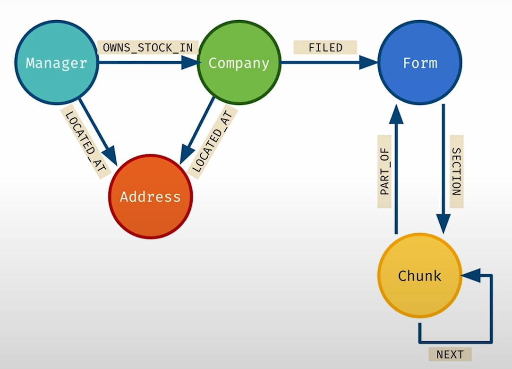

# 11 — KG-Powered RAG and Text-to-Cypher

> Vector search finds text that sounds like the question. A graph finds things connected to the answer. Text-to-Cypher reaches the graph from natural language, and it is reliable only as a generate-then-verify loop.

---

## Where it sits

[Note 10](10-building-kgs-with-llms.md) built the graph. This note reads from it. Retrieval in general is covered in [02-context note 04](../../02-context-engineering/notes/04-retrieval.md) and evaluating it in [06-eval note 07](../../06-eval/notes/07-evaluating-rag-and-grounding.md). This note adds what a graph changes. It ends back in Track A: the book's QA agent is a LangGraph pipeline with a retry edge.

---

## Where vector RAG breaks

Ch13 lists the failure modes of chunk-and-embed retrieval:

| Failure | What happens |
|---|---|
| **Context fragmentation** | Chunks are retrieved independently. A fact split across chunks or documents needs every piece retrieved, in order, near the top. |
| **Embedding compression** | One vector per chunk loses entity-level detail. Rare domain terms embed poorly. |
| **Noise (distraction)** | Loosely related chunks dilute the context and degrade the answer. |
| **Misses** | Similarity optimises for closeness, not coverage, so aggregate questions ("what are the main themes?") get partial answers. |

The ch13 worked example: for "How is Lauritsen related to cyclotron research?", the three top results scored 0.906, 0.903 and 0.902 by cosine similarity, and **only the first mentioned Lauritsen at all**. Embeddings encode overall meaning. They don't guarantee that a named entity is present.

Ch14 shows the consequence. Remove one witness statement from the retrieved context and the model **reverses its conclusion with the same confidence**. RAG output is bounded by retrieval completeness, and the model can't tell that something is missing.

---

## What a graph adds

| Capability | How |
|---|---|
| **Multi-hop** | Traverse typed edges instead of hoping the hops co-occur in one chunk |
| **Entity-exact retrieval** | "Documents that mention *all* of these entities", which vector search can't promise |
| **Aggregation** | `count`, `sum` and `collect` over the whole graph instead of over a top-k sample |
| **Metadata routing** | Filter by date, source or author as graph properties ("the latest version of this regulation") |
| **Traceable answers** | Return the path. A person can check each edge. |
| **Composed retrieval** | Resolve "the head of group X" in the KG, then search a document store for that name |

The book's design advice: make the graph **text-attributed** (nodes and edges carry descriptive text) and **text-paired** (every node and edge links back to its source documents). Then it can serve as a structured store and also as a more precise document retriever.

### The evidence

The primary source is Microsoft Research's GraphRAG paper, Edge et al., *From Local to Global: A Graph RAG Approach to Query-Focused Summarization* ([arXiv 2404.16130](https://arxiv.org/abs/2404.16130)). It builds an entity graph, detects communities and pre-summarises them, then answers **global sensemaking** questions over corpora of about 1M tokens. Against vector RAG it reports:

- **Comprehensiveness** win rates of 72–83% (podcast transcripts) and 72–80% (news).
- **Diversity** win rates of 75–82% and 62–71%.
- Vector RAG **wins on directness** (concise answers).

The judge was an LLM in head-to-head comparisons, not people and not a ground-truth accuracy measure. So the result is "graph community summaries help whole-corpus questions". It does not show that graphs are more accurate than vectors in general.

The 53.4% vs. 42.9% multi-hop figures that the original deep note ([sources/graph-engineering-deep-note.md](../sources/graph-engineering-deep-note.md)) §9 quoted come from a vendor blog with no stated method. They're dropped here. If you want a number for your own data, [lab B6](../practice/exercises.md#b6--text-to-cypher-as-generate-then-verify) measures it.

---

## Retrieval modes

| Mode | How it retrieves | Use when | Fails when |
|---|---|---|---|
| **Vector** | Embed the question, top-k chunks | Local lookups: "find the passage about X" | Multi-hop, aggregates, exact entity constraints |
| **Graph traversal (canned)** | Fixed Cypher templates keyed by entities from the question (shortest paths, k-hop neighbourhood) | Known question shapes; production paths | A question shape you didn't template |
| **Text-to-Cypher** | LLM writes Cypher from the schema | Open-ended structured questions over a well-described schema | Schema is large or badly named; no validator |
| **Hybrid** | Vector to find entry chunks or entities, then expand through the graph (L5's `NEXT` window, entity neighbourhoods) | Text-heavy corpora where the graph adds context to found passages | Entry points are wrong, so expansion makes things worse |
| **Global (GraphRAG communities)** | Pre-summarised communities, then map-reduce | "What are the themes across everything?" | Specific factual lookups; high indexing cost |

**Triples lose meaning.** "If it rains next week I'll cancel the beach trip and go to the museum" becomes `(user, plans, beach trip)` and `(user, backup, museum)`, and the condition is gone. Extraction errors also contaminate the graph. Li's recommendation (*AI Agents in Depth*, ch. 3): keep the core record in natural language, and use the graph as an *index* for the domains that need multi-hop and disambiguation (medical, legal, family relationships). For "drill from concept to detail" questions, a RAPTOR summary tree fits better than a graph ([02-context 04](../../02-context-engineering/notes/04-retrieval.md#distill-at-index-time-beyond-flat-chunks)).

**Default order:** start with vector. Add canned traversals for the multi-hop question shapes you can name. Add text-to-Cypher only for the long tail, and only with a validator. Ch13 takes the same position: its ReAct agent's tools use **precanned Cypher queries** because free-form generation fails too often, with a vector-search tool as a fallback. This is the agency rule from [note 02](02-graph-primitives.md) again.

### Vector search inside the graph

The vector mode doesn't need a separate store. Course L3 puts a vector index on a node property of the movies graph and queries it with Cypher, so the hit comes back as a node you can keep walking from:

```cypher
// 1. Index a property (1536 = OpenAI embedding size)
CREATE VECTOR INDEX movie_tagline_embeddings IF NOT EXISTS
FOR (m:Movie) ON (m.taglineEmbedding)
OPTIONS {indexConfig: {`vector.dimensions`: 1536, `vector.similarity_function`: 'cosine'}};

// 2. Embed each tagline in the database and store it on the node
MATCH (movie:Movie) WHERE movie.tagline IS NOT NULL
WITH movie, genai.vector.encode(movie.tagline, "OpenAI", {token: $openAiApiKey}) AS vector
CALL db.create.setNodeVectorProperty(movie, "taglineEmbedding", vector);

// 3. Similarity search: embed the question, ask the index for top-k nodes
WITH genai.vector.encode($question, "OpenAI", {token: $openAiApiKey}) AS q
CALL db.index.vector.queryNodes('movie_tagline_embeddings', $top_k, q)
  YIELD node AS movie, score
RETURN movie.title, movie.tagline, score
```

`SHOW VECTOR INDEXES` lists what exists. The index is approximate k-nearest-neighbour search over an HNSW graph. As in [note 10](10-building-kgs-with-llms.md#stage-5-assembly-with-the-course-as-worked-example), `genai.vector.encode` is the course-era name of the GenAI plugin function; check your Neo4j version before reusing it.

### Hybrid in practice: a `retrieval_query`

LangChain's `Neo4jVector` runs the vector search, then hands each hit (`node`, `score`) to a Cypher fragment you supply. That fragment is where the graph adds context. Course L5 widens each hit to its `NEXT` neighbours:

```cypher
// node and score come from the vector index
MATCH window = (:Chunk)-[:NEXT*0..1]->(node)-[:NEXT*0..1]->(:Chunk)
WITH node, score, window ORDER BY length(window) DESC LIMIT 1  // longest = both sides
WITH nodes(window) AS chunks, node, score
UNWIND chunks AS c
WITH collect(c.text) AS texts, node, score
RETURN apoc.text.join(texts, " \n ") AS text, score, node {.source} AS metadata
```

L6 goes further and walks from the chunk to its company and on to the managers holding it, so the retrieved text starts with facts no paragraph contains:

```cypher
MATCH (node)-[:PART_OF]->(f:Form)<-[:FILED]-(com:Company)<-[o:OWNS_STOCK_IN]-(mgr:Manager)
WITH node, score, mgr, o, com ORDER BY o.shares DESC LIMIT 10
WITH collect(mgr.managerName + " owns " + o.shares + " shares of " + com.companyName)
     AS holdings, node, score
RETURN apoc.text.join(holdings, "\n") + "\n" + node.text AS text,
       score, {source: node.source} AS metadata
```

```python
from langchain_neo4j import Neo4jVector          # was langchain_community.vectorstores
store = Neo4jVector.from_existing_index(
    OpenAIEmbeddings(), url=NEO4J_URI, username=NEO4J_USERNAME, password=NEO4J_PASSWORD,
    index_name="form_10k_chunks", text_node_property="text",
    retrieval_query=investment_retrieval_query)  # the Cypher above
retriever = store.as_retriever()
```

On a question about ransomware protection, the windowed retriever's answer also named NetApp's ONTAP software, which the plain retriever's answer left out. The course wires the retriever into `RetrievalQAWithSourcesChain` and calls it with `chain({"question": q})`; both the class and the call style are deprecated, so use `create_retrieval_chain` or an LCEL pipe with `.invoke`. One more lesson from L4 carries over: the plain chain made up an answer to a question about Apple, which isn't in the NetApp filing, until the prompt said *"If you are unsure about the answer, say you don't know."*

---

## Structured lookups by name and by place

Before reaching for a model, note how many questions are a fixed query with a parameter. Once L7 adds `Address` nodes ([note 10](10-building-kgs-with-llms.md#stage-5-assembly-with-the-course-as-worked-example)), two more index types answer them: **full-text** for fuzzy names and **point distance** for "near". Vector search ranks by cosine similarity of embeddings; geospatial search ranks by distance between points.

```cypher
// Full-text: fuzzy name match, then traverse (SHOW FULLTEXT INDEXES lists the names)
CALL db.index.fulltext.queryNodes("fullTextManagerNames", "Royal Bank") YIELD node, score
WITH node AS mgr LIMIT 1
MATCH (mgr:Manager)-[:LOCATED_AT]->(addr:Address)
RETURN mgr.managerName, addr;

// Aggregate over the new edges: which states have the most investment firms?
MATCH (:Manager)-[:LOCATED_AT]->(addr:Address)
RETURN addr.state AS state, count(*) AS numManagers ORDER BY numManagers DESC LIMIT 10;

// Top firms in a city: the value sits on the OWNS_STOCK_IN edge
MATCH (mgr:Manager)-[:LOCATED_AT]->(addr:Address), (mgr)-[owns:OWNS_STOCK_IN]->(:Company)
WHERE addr.city = 'San Francisco'
RETURN mgr.managerName, sum(owns.value) AS totalInvestmentValue
ORDER BY totalInvestmentValue DESC LIMIT 10;

// "Near": point.distance is in metres, so 10 km is 10000
MATCH (sc:Address) WHERE sc.city = 'Santa Clara'
MATCH (com:Company)-[:LOCATED_AT]->(addr:Address)
WHERE point.distance(addr.location, sc.location) < 10000
RETURN com.companyName;

// Both together; full-text tolerates the typo "Palo Aalto"
CALL db.index.fulltext.queryNodes("fullTextCompanyNames", "Palo Aalto Networks") YIELD node AS com
MATCH (com)-[:LOCATED_AT]->(comAddr:Address), (mgr:Manager)-[:LOCATED_AT]->(mgrAddr:Address)
WHERE point.distance(comAddr.location, mgrAddr.location) < 20000
RETURN mgr.managerName,
       toInteger(point.distance(comAddr.location, mgrAddr.location) / 1000) AS distanceKm
ORDER BY distanceKm LIMIT 10;
```

Two cautions from the notebook. One query filters `WHERE addr.city = 'California'`, which returns nothing because California is a state; plausible-looking filter mistakes are not only an LLM problem. And the Palo Alto query in the notebook computes distance from `com.location` rather than `comAddress.location`; the version above uses the address node, which is where the course put location. These canned queries are the "graph traversal (canned)" row of the table above, and they make the best few-shot examples for the next section.

---

## Text-to-Cypher

### Think like the expert: schema first

Ch14's method is to ask what a domain expert would do. An expert doesn't read paragraphs. They know the **schema** and build a **constrained traversal**:

1. **Parse** the question into entities (`Car {color, model}`), relationships (owns, captured by) and constraints (red, Camaro, this area, this time window).
2. **Map** those onto schema labels and relationship types.
3. **Construct** the Cypher.

```cypher
MATCH path = (v:Vehicle)<-[:PLATE_READ]-(e:CameraEvent)-[:HAS_EVENT]-(c:ANPRCamera)
WHERE v.model = "Camaro" AND v.color = "Red"
  AND e.timestamp >= $startTime AND e.timestamp <= $endTime
  AND point.distance(c.position, $areaCenter) < $areaRadius
RETURN path
```

### Give the model an LLM-ready schema

Raw `apoc.meta.schema` output is the wrong input. Ch14 transforms it:

- **Filter** with a skip list: drop internal labels, embeddings and housekeeping properties.
- **Annotate** with `/* comments */` on labels, relationship types and properties: value encodings ("`status`: 1 = open"), direction semantics, units.
- **Name things well in the first place.** A model can't use a relationship called `REL_7`.

### Prompt shape

The book's prompt has nine parts: task and `<QUESTION>`; `<SCHEMA>` with annotations; requirements that depend on the intent (a map needs coordinates, a graph view needs named relationships); few-shot examples; the user's current selection; KG-specific notes; the question restated; the requirements restated; and the output format.

**Order the output fields so reasoning comes first:**

```json
{
  "relationships": ["..."],   // the edges it intends to traverse, before the query
  "reasoning": "...",         // the plan
  "query": "<Cypher>",        // written last, consistent with the two fields above
  "success": true
}
```

Listing `relationships` first reduces invented relationship types, because the model commits to the schema before writing the query. This is chain-of-thought ordering ([01-prompt note 03](../../01-prompt-engineering/notes/03-core-techniques.md)): an answer written before its reasoning is a guess, and the reasoning that follows only rationalises it. Few-shot examples have to follow the same format.

### Intent detection

Ch14 classifies at two levels before generating anything:

1. **Request type:** a data question, a question about the system, or feedback or a complaint. Only data questions go on to Cypher.
2. **Output form:** graph, table, chart or map. This changes what the query must `RETURN`.

### The failure to expect

In course L7, LangChain's `GraphCypherQAChain` was told to follow the schema and still summed a `value` property on `Company`, which doesn't exist. The property is on the `OWNS_STOCK_IN` relationship. **One few-shot example with the right pattern fixed it.** Text-to-Cypher fails on plausible-looking schema mistakes, and those are exactly what a schema check catches.


*Image Source: Knowledge Graphs for RAG, DeepLearning.AI × Neo4j (Kollegger, 2024)*

The L7 chain is the minimal text-to-Cypher setup: the schema string from `kg.schema`, rules, and few-shot examples, each a comment with the question followed by its Cypher. The course grows the example list one failure at a time:

```python
from langchain_neo4j import GraphCypherQAChain   # was langchain.chains (deprecated)

CYPHER_GENERATION_TEMPLATE = """Task: Generate a Cypher statement to query a graph database.
Use only the relationship types and properties in the schema.
Schema:
{schema}
Do not include any text except the generated Cypher statement.
Examples:
# What investment firms are near Santa Clara?
MATCH (address:Address) WHERE address.city = 'Santa Clara'
MATCH (mgr:Manager)-[:LOCATED_AT]->(mgrAddress:Address)
  WHERE point.distance(address.location, mgrAddress.location) < 10000
RETURN mgr.managerName, mgr.managerAddress

The question is:
{question}"""

chain = GraphCypherQAChain.from_llm(
    ChatOpenAI(temperature=0), graph=kg, verbose=True,
    cypher_prompt=PromptTemplate.from_template(CYPHER_GENERATION_TEMPLATE),
    allow_dangerous_requests=True)   # required in current versions: it runs generated Cypher
chain.invoke({"query": "What investment firms are near Santa Clara?"})   # course used .run()
```

`point.distance` is in metres, so "near" had to be taught as a 10 km radius. A second example in the course routes "What does Palo Alto Networks do?" through the company full-text index (which also matches the misspelling "Palo Aalto") to the `SECTION` chunk for Item 1. That query only returns the first chunk of the section, a limitation the course leaves in place. The `allow_dangerous_requests` flag is LangChain's reminder that this chain executes whatever the model writes, which is the case for the `EXPLAIN` validator below.

---

## The QA agent as a Track A graph

Ch15 implements the expert pipeline in LangGraph:


*Image Source: Negro et al., Knowledge Graphs and LLMs in Action, Fig. 15.3 (2025)*

The retry edge goes back to `text_to_cypher`, not to schema extraction: the schema doesn't change between attempts, only the query does, now with the database's error in the prompt.

```python
def post_query_execution(state):
    if state["results_error"] is not None:
        return "retry" if state["retries"] < 3 else "END"
    return "summarize" if state["output_type"] in ("map", "graph") else "END"
```

Several Track A patterns appear here:

- **Generate-then-verify** ([note 02](02-graph-primitives.md)). The database is the verifier, and its error message goes back into the prompt through the `information` field.
- **A bounded back-edge** ([note 07](07-failure-modes-at-scale.md)). It stops after three retries.
- **Typed state as the audit trail** ([note 03](03-state-and-reducers.md)). `AgentState` keeps `output_type_reason`, `query_reasoning` and `results_error`, so every intermediate decision can be inspected. The book points out that this also gives you a dataset of failures and few-shot candidates for free.
- **A checkpointer** ([note 04](04-durable-execution-and-interrupts.md)). `graph.compile(checkpointer=self.memory)`.

What the book's version lacks is a validator that runs **before** execution. Use `EXPLAIN` to check that the query parses and plans without running it, and compare the labels and relationship types it uses against the schema. A wrong query is then caught before it reaches a live database, and the repair is cheaper. That is the lab exercise.

### Summarise as a complement

Ch15 summarises only when the output is a graph or a map, and only when the question asked for analysis. A summary should point out what isn't obvious in the visualisation, not repeat it.

---

## Working reference

`~/.claude/refs/agent-context.md`: retrieval and context assembly. `~/.claude/refs/agent-reliability.md`: bounded retries.

Depth: [ch13](../sources/kg-and-llms-in-action/13-kg-powered-rag.md), [ch14](../sources/kg-and-llms-in-action/14-natural-language-kg-questions.md), [ch15](../sources/kg-and-llms-in-action/15-qa-agent-with-langgraph.md). Practice: [lab B5](../practice/exercises.md#b5--chat-with-the-10-k-graph) and [lab B6](../practice/exercises.md#b6--text-to-cypher-as-generate-then-verify).

---

→ Next: [12-kg-as-shared-agent-memory.md](12-kg-as-shared-agent-memory.md): where the two kinds of graph meet.
