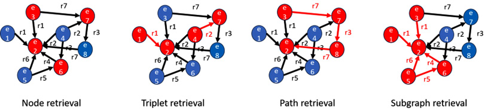
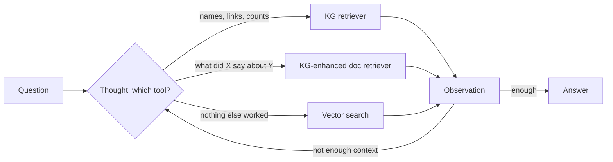

# 11 — KG-Powered RAG

> Vector search finds text that sounds like the question. A graph finds things connected to the answer. Which one to use, and what to hand the model, depends on the question.

Vector RAG can rank three chunks at 0.906, 0.903 and 0.902 for a question about Lauritsen when only one of them mentions him. A graph fixes that class of failure and brings others: triples drop the condition in a plan, and generated Cypher can run cleanly and return nothing. This chapter covers what a graph adds and how to choose a retrieval mode; [note 11a](11a-structured-lookups-and-text-to-cypher.md) covers structured lookups and the prompt behind reliable text-to-Cypher.

---

## Where it sits

[Note 10](10-building-kgs-with-llms.md) built the graph. This note reads from it. Retrieval in general is covered in [02-context note 04](../../02-context-engineering/notes/04-retrieval.md) and evaluating it in [Eval chapter 07](../../../generative-ai/08-eval/notes/07-evaluating-rag-and-grounding.md). This note adds what a graph changes. [Note 11a](11a-structured-lookups-and-text-to-cypher.md) turns natural language into Cypher, and [note 11b](11b-text-to-cypher-qa-agent.md) wires that into a LangGraph pipeline with a retry edge, back in Track A.

---

## Where vector RAG breaks

Ch13 of Negro et al.'s *Knowledge Graphs and LLMs in Action* (Manning, 2025) lists the failure modes of chunk-and-embed retrieval:

| Failure | What happens |
|---|---|
| **Context fragmentation** | Chunks are retrieved independently. A fact split across chunks or documents needs every piece retrieved, in order, near the top. |
| **Embedding compression** | One vector per chunk loses entity-level detail. Rare domain terms embed poorly. |
| **Noise (distraction)** | Loosely related chunks dilute the context and degrade the answer. |
| **Misses** | Similarity optimises for closeness, not coverage, so aggregate questions ("what are the main themes?") get partial answers. |
| **Static vectors** | Embeddings are computed once. New or shifting terminology isn't reflected until you re-embed. |
| **Scale** | Exact nearest-neighbour search gets expensive, so large stores fall back to approximate search and lose some recall. |

The ch13 worked example: for "How is Lauritsen related to cyclotron research?", the three top results scored 0.906, 0.903 and 0.902 by [cosine similarity](../../../generative-ai/01-llm-fundamentals/notes/01-tokens-and-embeddings.md#vectors-dot-products-and-cosine-similarity), and **only the first mentioned Lauritsen at all**. Embeddings encode overall meaning. They don't guarantee that a named entity is present. A second query in the chapter ("What is known about cyclotron research?") shows the same thing from the other side: the top hit (0.918) is a relevant 1939 diary entry on cyclotron costs, and the runner-up (0.916) reads like a sales pitch for a competing machine (*KG & LLMs in Action*, ch. 13). Score gaps in the third decimal place say nothing about relevance.

Ch14 shows the consequence. Given five witness statements and the question "Is the perpetrator left-handed?", the model leans on Witness C (phone held to the ear with the left hand, "strong evidence"), notes that a bandaged left index finger "doesn't necessarily imply" anything, and concludes "likely left-handed" with sensible hedging. Remove Witness C's statement from the retrieved context and the model builds the opposite case from what remains (wallet taken out with the right hand, a bag carried in the right hand), dismisses the bandage as possibly unrelated, and **reverses its conclusion**: "the absence of a single witness statement is enough to lead the model to the opposite conclusion" (*KG & LLMs in Action*, §14.2.2). RAG output is bounded by retrieval completeness, and the model can't tell that something is missing. Grounding narrows what the model draws on; it doesn't make the model deterministic. The book's conclusion is to keep a person reviewing the answers (ch. 13).

---

## What a graph adds

| Capability | How |
|---|---|
| **Multi-hop** | Traverse typed edges instead of hoping the hops co-occur in one chunk |
| **Entity-exact retrieval** | "Documents that mention *all* of these entities", or only documents that mention a given *relationship* between them, which vector search can't promise |
| **Aggregation** | `count`, `sum` and `collect` over the whole graph instead of over a top-k sample |
| **Metadata routing** | Filter by date, source or author as graph properties ("the latest version of this regulation") |
| **Traceable answers** | Return the path. A person can check each edge. |
| **Composed retrieval** | Resolve "the head of group X" in the KG, then search a document store for that name |

The book's design advice: make the graph **text-attributed** (nodes and edges carry descriptive text) and **text-paired** (every node and edge links back to its source documents). Then it can serve as a structured store and also as a more precise document retriever (*KG & LLMs in Action*, ch. 13). A graph is also something a domain expert can read and correct directly, which a vector index is not.

### The evidence

The primary source is Microsoft Research's paper, Edge et al., *From Local to Global: A GraphRAG Approach to Query-Focused Summarization* ([arXiv 2404.16130](https://arxiv.org/abs/2404.16130), 2024, preprint). It pre-summarises the communities of an entity graph and answers **global sensemaking** questions by map-reduce over them. Setup: GPT-4-turbo, podcast (~1M tokens) and news (~1.7M) corpora, 125 questions each, an LLM judging answer pairs. Against vector RAG, GraphRAG reports:

- **Comprehensiveness** win rates of 72–79% on both corpora.
- **Diversity** win rates of 75–81% (podcasts) and 62–71% (news).
- Vector RAG **wins on directness**, and the root-level summaries (C0) lose to it on empowerment, 43% to 57%.

**Most of the win comes from going global, not from the graph.** Its baseline TS map-reduces over raw chunks, no graph, and beats vector RAG about as often (83% and 80% on comprehensiveness). Counting extracted claims instead showed **no significant difference between GraphRAG and TS**. What the graph buys is cost: **C0 uses over 97% fewer context tokens per query than TS and still wins at least 72% (comprehensiveness) and 62% (diversity) against vector RAG**. Indexing the podcasts took 281 minutes.

With no human judge, no ground truth and no local or multi-hop questions, the result is "pre-summarised map-reduce helps whole-corpus questions, cheaply", not "graphs beat vectors".

A figure you will see quoted is **53.4% vs. 42.9%** multi-hop accuracy for graph over vector retrieval. It comes from a vendor post, flowtivity.ai's [graph engineering 2026 guide](https://flowtivity.ai/blog/graph-engineering-2026-guide-openclaw-codex/), which gives no dataset, method or judge. **Vendor number, unverified** (see the [Source quality](../references.md#source-quality) table in references.md): don't quote it as evidence. To get a number for your own data, write 20 multi-hop questions with gold answers *and gold paths*, and score vector-only, hybrid and text-to-Cypher on answer correctness, path validity and tokens.

Raieli and Iuculano's account of where GraphRAG stands points the same way (*Building AI Agents with LLMs, RAG, and Knowledge Graphs*, ch. 7). There is "a lack of benchmark standards" for comparing GraphRAG methods, so published wins rarely carry over from one paper to the next. GraphRAG "underperforms in abstractive question-answering tasks or when there is no explicit entity mentioned in the question", because extraction drops the nuance of the text. And a growing graph returns more redundant facts, which then have to be compressed at the risk of losing information. Their prediction is **HybridRAG**: both stores in one system, with a router choosing between them or a step that merges their results. They cite Sarmah et al. ([arXiv 2408.04948](https://arxiv.org/abs/2408.04948), preprint), whose hybrid beat both stores on answer relevancy (0.96 vs. 0.91 and 0.89) but had the lowest context precision (0.79; earnings calls, GPT-3.5). That matches the default order below, and it adds a test: if a question names no entity, send it to vector search first.

The chapter's headline application is MedGraphRAG (Wu et al., [arXiv 2408.04187](https://arxiv.org/abs/2408.04187), preprint). It builds a three-level graph. The top level holds the user's own documents (hospital medical reports). Their entities link down to a level built from medical textbooks and papers, which links down to a level of standard medical terms and relations from curated sources. That is the ontology-linking idea from [note 10](10-building-kgs-with-llms.md#ned-against-an-ontology-ch78) used for retrieval: a private fact comes with its accepted definition attached. GPT-4 scores 91.3 on MedQA vs. 88.9 with Microsoft GraphRAG (5-shot ensemble). The claim to beat tuned models like Med-PaLM 2 has no comparison table: unverified.

---

## Retrieval modes

| Mode | How it retrieves | Use when | Fails when |
|---|---|---|---|
| **Vector** | Embed the question, top-k chunks | Local lookups: "find the passage about X" | Multi-hop, aggregates, exact entity constraints |
| **Graph traversal (canned)** | Fixed Cypher templates keyed by entities from the question (shortest paths, k-hop neighbourhood) | Known question shapes; production paths | A question shape you didn't template |
| **Text-to-Cypher** | LLM writes Cypher from the schema | Open-ended structured questions over a well-described schema | Schema is large or badly named; no validator |
| **Hybrid** | Vector to find entry chunks or entities, then expand through the graph (L5's `NEXT` window, entity neighbourhoods) | Text-heavy corpora where the graph adds context to found passages | Entry points are wrong, so expansion makes things worse |
| **Global (GraphRAG communities)** | Pre-summarised communities, then map-reduce | "What are the themes across everything?" | Specific factual lookups; high indexing cost |

**Triples lose meaning.** "If it rains next week I'll cancel the beach trip and go to the museum" becomes `(user, plans, beach trip)` and `(user, backup, museum)`, and the condition is gone. Extraction errors also contaminate the graph. Li's recommendation (*AI Agents in Depth*, ch. 3): keep the core record in natural language, and use the graph as an *index* for the domains that need multi-hop and disambiguation (medical, legal, family relationships). For "drill from concept to detail" questions, a RAPTOR summary tree fits better than a graph ([02-context 04](../../02-context-engineering/notes/04-retrieval.md#distill-at-index-time-beyond-flat-chunks)).

**Default order:** start with vector. Add canned traversals for the multi-hop question shapes you can name. Add text-to-Cypher only for the long tail, and only with a validator. Ch13 takes a similar position, but more narrowly. Its KG retriever tool *does* generate Cypher from the schema; only the document retriever is a **precanned query**, because generating that query "would introduce another possible point of failure when the Cypher queries are complex". The book adds that production Graph RAG systems carry many KG tools, "many of which are based on precanned Cypher queries for types of questions that are frequently repeated" (§13.4.3). This is the agency rule from [note 02](02-graph-primitives.md) again.

**A trained middle path: plan a relation path, not a query.** Reasoning on Graphs (RoG; Luo et al., [arXiv:2310.01061](https://arxiv.org/abs/2310.01061), ICLR 2024) has the LLM write only a sequence of relation types (`sports.mascot.team → sports.sports_team.arena_stadium`). A constrained BFS walks it from the question's entities; the LLM answers from the paths found. With LLaMA2-Chat-7B trained jointly on WebQSP and CWQ, **RoG reached 85.7 Hits@1 on WebQSP and 62.6 on CWQ, against 73.9 and 53.5 for the same model fine-tuned on the question–answer pairs alone**, and its paths lifted ChatGPT from 66.8 to 81.5 on WebQSP. But question entities were gold-linked, the planner is fine-tuned per KG (38 hours on two A100s), and "faithful" rests on case studies.

**Untrained, the same walk becomes an agent loop.** ARK-V1 (Klein & Ohnemus, [arXiv:2509.18063](https://arxiv.org/abs/2509.18063), KIT, 2025-09, preprint) has the LLM choose an anchor entity, then one of its outgoing relations, read the triples and reason. An invalid choice is retried, the walk is capped at a set number of steps, and after each step the context is reset to the query plus a running summary. On CoLoTa (200 true/false questions that mix KG facts with commonsense), Qwen3-30B **answered 77% of questions and was right on 91% of those it answered**, about 70% overall over 30 runs at T = 0.7. At T = 0 (single run), Qwen3-235B, Gemini 2.5 Flash, GPT-5 Mini and gpt-oss-125B reached 94.0–96.1% on answered questions and 68.5–73.5% overall. The useful number is the abstention rate: o1 with zero-shot chain of thought and no KG answered 97% of questions and scored about 67% overall, so it guessed where the agent said "not in the graph". The o1 figures come from the CoLoTa paper, not a matched run. There is no ablation, no cost data, and no test on WebQSP or CWQ. The authors' error analysis shows the reverse failure too: the agent can trust a misleading triple over a fact any reader knows.

MIRAGE (Wei et al., [arXiv:2508.18260](https://arxiv.org/abs/2508.18260), AAAI 2026, per the PDF's copyright line) runs several such walks in parallel. A reasoning model splits a multi-entity medical question into at most four entity-grounded sub-questions. Each chain queries the KG in one of two modes: the neighbourhood of one matched entity (a node with its edges, in the granularity table below) or typed paths between two entities (a path). A synthesiser then prefers answers that several chains support and flags contradictions in the KG, such as a drug listed as both treating and causing a symptom. With QwQ-32B on three medical QA sets with curated KGs, it had the best average GPT-4o rank on GenMedGPT-5k and CMCQA and tied MindMap on ExplainCPE (3.1), by a wide margin only on GenMedGPT-5k (1.8 vs. 3.3 for Search-o1). On ExplainCPE its accuracy was 84.8% against 84.6% for the KG baseline MindMap. Splitting into too many sub-questions hurt, and on dialogue-style questions even a split into two could. The judging is mostly GPT-4o, with one 100-example check by two annotators. The paper gives no cost figures despite its test-time-scaling framing, and when the KG has no answer the synthesiser falls back on the model's own medical knowledge.

### What to retrieve, and how to hand it over

Raieli and Iuculano split GraphRAG into **G-indexing, G-retrieval and G-generation**, following Peng et al.'s survey ([arXiv 2408.08921](https://arxiv.org/abs/2408.08921), ACM TOIS 2026 per the readings ledger, the arXiv v2 read for this course) (*Building AI Agents with LLMs, RAG, and Knowledge Graphs*, ch. 7). The survey itself formalises the three stages as a* = argmax p(a|q, G) with one retrieved subgraph G* standing in for the sum over all subgraphs (Sec. 4), and holds that hybrid indexing (graph, text and vector together) is preferred in practice (Sec. 5.2). It runs no experiments, so its guidance is qualitative: non-parametric retrievers are cheap but may be inaccurate, LM- and GNN-based ones more accurate but costly, hence multi-stage hybrids; choice of graph language "can significantly impact" downstream results (Sec. 6.1.4, 7.2.1); and most methods are built for KGs of thousands of entities, not the millions in industrial ones (Sec. 10). Its text-to-Cypher coverage is thin, only UniOQA (generate Cypher and answer from triples, then select) and a mention of Neo4j NaLLM (Sec. 7.3.3). Two of the chapter's distinctions are useful when you build one.

**Granularity is the graph's chunk size.** In vector RAG you set granularity when you chunk. In a graph you set it at query time by choosing the unit you return (ch. 7):


*Image Source: Salvatore Raieli & Gabriele Iuculano, *Building AI Agents with LLMs, RAG, and Knowledge Graphs* (Packt, 2025), Fig. 7.20*

| Unit | Returns | Fits | Watch for |
|---|---|---|---|
| **Node** | An entity and its properties | Targeted lookups ("when was X founded?") | Nothing about how it relates to anything |
| **Triplet** | Entity, edge, neighbour | Questions about one relationship | Loses conditions, as the beach-trip example above shows |
| **Path** | A chain of edges from X to Y | "How is X related to Y?" | Paths grow exponentially with graph size, so restrict them by rule, use shortest paths, or score them with a GNN |
| **Subgraph** | A connected region, from a pattern or by merging paths | Complex questions over several entities | Context bloat, the easiest way to fill the window with irrelevant edges |
| **Hybrid / adaptive** | Picks the unit per query | Mixed traffic | Needs a classifier you can test |

The chapter's rule is to match the unit to the question: small units for simple queries, larger ones only where the question needs them, because a saturated context hurts the answer ([02-context note 04](../../02-context-engineering/notes/04-retrieval.md#how-much-to-retrieve)). Canned traversals make this concrete. Each template returns one unit, so you choose the granularity when you write the template.

**Three kinds of retriever, with a cost gradient.** *Non-parametric* retrievers take the entities in the query and expand k hops by rule. They are the fastest and the least accurate. *GNN-based* retrievers learn to find subgraphs similar to the query. *LLM-based* retrievers read the query and search, sometimes as an agent with graph tools. The book says the last two "significantly improve retrieval accuracy but at a high computational cost", and that systems mix them, for example a cheap first pass refined by an LLM (ch. 7). Everything from vector RAG carries over too: query rewriting and decomposition, iterative or adaptive retrieval (one round for simple queries, several for complex ones), compression of the retrieved knowledge, and **reranking** of candidate subgraphs to keep the top k ([02-context note 05](../../02-context-engineering/notes/05-compression-compaction.md)). The chapter names two problems specific to graphs. The number of candidate subgraphs grows exponentially with the graph, and a text query has to be compared with structure, which plain embedding similarity does poorly.

**The retrieved graph has to become text.** The chapter lists the formats in use (ch. 7):

| Format | Looks like | Note |
|---|---|---|
| Raw node and edge lists | `(Lauritsen)-[:WORKS_ON]->(cyclotron)` | Simplest; what the agent tools above return |
| Adjacency or edge table | One row per edge | Compact, and keeps the relational structure clearer |
| Node sequence | Nodes in an order set by a fixed rule | Compact; keeps the order |
| Natural-language template | "X works on Y. Y is funded by Z." Templates can separate 1-hop from 2-hop neighbours | Easiest for the model to read; an LLM can write the description instead of a template |
| Syntax tree | The graph flattened into a hierarchy | Keeps topological order |
| Code-like | GraphML | Structured and textual at once |

The chapter's own conclusion is that no format is settled: the result has to be concise, complete and readable by the model, and should keep the structure. Treat the format as a parameter and test it on your questions. The book also notes that LLMs read graphs as linear text and pay more attention to node labels than to topology ([note 13](13b-representation-learning-and-gnns.md#gnns-and-llms-together)). So write the edges the answer depends on explicitly, and don't expect the model to infer them from an adjacency list.

### A Graph RAG agent: three tools under ReAct

Ch13's agent over the Rockefeller Archive Center graph (1930s grant diaries: who talked with whom about what) has three tools and a ReAct loop that chooses among them (*KG & LLMs in Action*, ch. 13):

| Tool | What it does | Typical question |
|---|---|---|
| **KG retriever** | Answers from nodes and edges directly: a Cypher query, or the subgraph connecting the named entities (e.g. all shortest paths) | "Who talked about Dorothy Wrinch?", aggregates across documents |
| **KG-enhanced document retriever** | A canned query that returns only the pages paired with a specific relationship between two named entities | "What did X say about Y?" |
| **Vector search** | Plain similarity search | Fallback when neither KG tool returns anything useful |



The document retriever is a parametrised template. The model fills in arguments; it never writes Cypher. Listing the allowed classes and relationship types in the argument schema keeps it inside the graph. A minimal version (simplified schema, not the book's listing):

```python
from typing import Literal
from pydantic import BaseModel, Field

class RelationDocsArgs(BaseModel):
    source: str = Field(description="Person named in the question as the speaker")
    target: str = Field(description="Entity the question asks about")
    target_class: Literal["Person", "Organization", "Occupation", "Title"]
    relationship: Literal["TALKED_ABOUT", "TALKED_WITH", "WORKS_WITH"]

# Labels and relationship types can't be Cypher parameters, so they are
# spliced in from the whitelist above; entity names go in as $parameters.
TEMPLATE = (
    "MATCH (s:Person {{name: $source}})-[r:{rel}]->(t:{cls} {{name: $target}}) "
    "MATCH (p:Page) WHERE p.id IN r.source_pages "   # text-paired: the edge lists its pages
    "RETURN DISTINCT p.text AS text LIMIT 3"
)

def relation_docs(**kwargs) -> list[str]:
    a = RelationDocsArgs(**kwargs)                      # rejects unknown types
    cypher = TEMPLATE.format(rel=a.relationship, cls=a.target_class)
    rows = graph.query(cypher, params={"source": a.source, "target": a.target})
    return [r["text"] for r in rows]
```

The book's listing differs in ways worth knowing. Its arguments are plain `str` fields whose descriptions list the allowed values (source class "only one, 'Person'"; relationship one of `TALKED_ABOUT`, `TALKED_WITH`, `WORKS_WITH`, ...), so nothing rejects an off-list value; the `Literal` above does. The query reaches documents through `(p:Page)-[:MENTIONS_ENTITY]->` rather than a page list on the edge, keeps the first three results, and returns an empty list on any exception, which the agent sees as "no documents". The document selector's tool description embeds the full KG schema (`Full KG schema:\n{KG_SCHEMA}`), so the agent picks arguments against the real labels. And it builds the whole query with `str.format`, entity names included. Pass names as parameters instead: a name containing a quote breaks the query, and string-built Cypher is an injection path.

How the loop behaved (ch13):

- **"What did her fellow researchers say about Dorothy M. Wrinch?"** The agent first asked the KG retriever who talked about her (three names came back: Eric Ponder, Pascu and Irving Langmuir), then called the document retriever once per name and composed a grounded answer. Four thought-action-observation rounds, in an order the agent chose.
- **A question naming two people** ("What did August Krogh say about Lawrence Irving?") went straight to the document retriever, with no KG lookup first. The book notes that an LLM without retrieval would say it has no information, or make something up.
- **"Are there shared research topics between Harvard and Johns Hopkins?"** No single diary entry compares the two, so vector search would have to stuff many documents into context and hope. The KG retriever wrote a clumsy but correct query and answered "astronomy and climatology". This is the aggregate case where a graph wins outright, with a much smaller context as a bonus.

Practical lessons from the chapter: tool names and descriptions decide which tool gets picked, so write them carefully, and override the framework's default agent prompt if behaviour is unstable. Run the same question several times, because the variation shows you where to improve. The next steps it names are re-ranking after vector search and a self-correction loop for generated Cypher. In ch13 that loop is the LLM double-checking its own query ("generates the Cypher query first and then asks the LLM to double-check it"). Ch15 replaces the self-review with the database's error message, which is the version the rest of this note builds. The chapter's agent is LangChain's `create_structured_chat_agent` and `AgentExecutor` on `gpt-4o-mini` at temperature 0, both legacy now (LangGraph's prebuilt ReAct agent replaces them).

### Vector search inside the graph

The vector mode doesn't need a separate store. Course L3 puts a vector index on a node property of the movies graph and queries it with Cypher, so the hit comes back as a node you can keep walking from:

```cypher
// 1. Index a property (1536 = OpenAI embedding size)
CREATE VECTOR INDEX movie_tagline_embeddings IF NOT EXISTS
FOR (m:Movie) ON (m.taglineEmbedding)
OPTIONS {indexConfig: {`vector.dimensions`: 1536, `vector.similarity_function`: 'cosine'}};

// 2. Embed each tagline in the database and store it on the node
MATCH (movie:Movie) WHERE movie.tagline IS NOT NULL
WITH movie, genai.vector.encode(movie.tagline, "OpenAI", {token: $openAiApiKey}) AS vector
CALL db.create.setNodeVectorProperty(movie, "taglineEmbedding", vector);

// 3. Similarity search: embed the question, ask the index for top-k nodes
WITH genai.vector.encode($question, "OpenAI", {token: $openAiApiKey}) AS q
CALL db.index.vector.queryNodes('movie_tagline_embeddings', $top_k, q)
  YIELD node AS movie, score
RETURN movie.title, movie.tagline, score
```

`SHOW VECTOR INDEXES` lists what exists. The index is approximate k-nearest-neighbour search over an HNSW graph. As in [note 10](10b-assembling-and-maintaining-kgs.md#stage-5-assembly-with-the-course-as-worked-example), `genai.vector.encode` is the course-era name of the GenAI plugin function; check your Neo4j version before reusing it.

### Hybrid in practice: a `retrieval_query`

LangChain's `Neo4jVector` runs the vector search, then hands each hit (`node`, `score`) to a Cypher fragment you supply. That fragment is where the graph adds context. Course L5 widens each hit to its `NEXT` neighbours:

```cypher
// node and score come from the vector index
MATCH window = (:Chunk)-[:NEXT*0..1]->(node)-[:NEXT*0..1]->(:Chunk)
WITH node, score, window ORDER BY length(window) DESC LIMIT 1  // longest = both sides
WITH nodes(window) AS chunks, node, score
UNWIND chunks AS c
WITH collect(c.text) AS texts, node, score
RETURN apoc.text.join(texts, " \n ") AS text, score, node {.source} AS metadata
```

L6 goes further and walks from the chunk to its company and on to the managers holding it, so the retrieved text starts with facts no paragraph contains:

```cypher
MATCH (node)-[:PART_OF]->(f:Form)<-[:FILED]-(com:Company)<-[o:OWNS_STOCK_IN]-(mgr:Manager)
WITH node, score, mgr, o, com ORDER BY o.shares DESC LIMIT 10
WITH collect(mgr.managerName + " owns " + o.shares + " shares of " + com.companyName)
     AS holdings, node, score
RETURN apoc.text.join(holdings, "\n") + "\n" + node.text AS text,
       score, {source: node.source} AS metadata
```

```python
from langchain_neo4j import Neo4jVector          # was langchain_community.vectorstores
store = Neo4jVector.from_existing_index(
    OpenAIEmbeddings(), url=NEO4J_URI, username=NEO4J_USERNAME, password=NEO4J_PASSWORD,
    index_name="form_10k_chunks", text_node_property="text",
    retrieval_query=investment_retrieval_query)  # the Cypher above
retriever = store.as_retriever()
```

On a question about ransomware protection, the windowed retriever's answer also named NetApp's ONTAP software, which the plain retriever's answer left out. The course wires the retriever into `RetrievalQAWithSourcesChain` and calls it with `chain({"question": q})`; both the class and the call style are deprecated, so use `create_retrieval_chain` or an LCEL pipe with `.invoke`. One more lesson from L4 carries over: the plain chain made up an answer to a question about Apple, which isn't in the NetApp filing, until the prompt said *"If you are unsure about the answer, say you don't know."*

---

## Pitfalls

- **Quoting 53.4% vs 42.9% as a result.** Symptom: a slide with a multi-hop figure traced only to a vendor post. Fix: cite Edge et al. for what it did measure, LLM-judged comprehensiveness and diversity, with vector RAG winning directness.
- **Storing only triples.** Symptom: "cancel the beach trip if it rains" survives as `(user, plans, beach trip)`. Fix: keep the source text next to the triple, and return it.
- **Returning subgraphs by default.** Symptom: context fills with loosely related paths. Fix: match the unit to the question, smallest first.

## Try it

1. For each, name the retrieval unit: (a) "when was this company founded?"; (b) "how is Lauritsen related to cyclotron research?"; (c) "what are the main themes across these diaries?"

   <details><summary>Answer</summary>

   (a) Node, a targeted lookup. (b) Path, restricted by rule or shortest paths because paths grow exponentially. (c) Community summaries, since similarity gives partial answers to aggregate questions.

   </details>

## Interview checklist

| Prompt | Answer in one line |
|---|---|
| Name failures of vector RAG that a graph helps with. | Context fragmentation, embedding compression, and misses on aggregate questions: similarity optimises closeness, not coverage. |
| What did Edge et al. actually show? | LLM-judged wins over vector RAG on comprehensiveness and diversity (62–81%), with no ground truth. Map-reduce over raw chunks did about as well; the graph mostly cuts tokens. |
| What do triples lose? | Conditions and nuance, so the beach-trip plan loses "if it rains". Extraction errors also contaminate the graph, so keep the source text. |
| A question needs to know how two entities connect. What do you retrieve? | A path, restricted by rule or by shortest paths, because the number of paths grows exponentially with length. Return the smallest unit that answers: node, triplet, path, then subgraph. |

## Next

[11a-structured-lookups-and-text-to-cypher.md](11a-structured-lookups-and-text-to-cypher.md): fixed lookups by name and place, and the schema-first prompt behind reliable text-to-Cypher.
