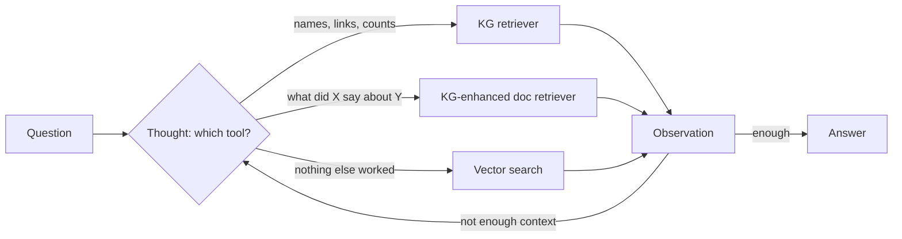
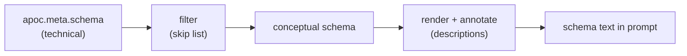

# 11 — KG-Powered RAG and Text-to-Cypher

> Vector search finds text that sounds like the question. A graph finds things connected to the answer. Text-to-Cypher reaches the graph from natural language, and it is reliable only as a generate-then-verify loop.

---

## Where it sits

[Note 10](10-building-kgs-with-llms.md) built the graph. This note reads from it. Retrieval in general is covered in [02-context note 04](../../02-context-engineering/notes/04-retrieval.md) and evaluating it in [06-eval note 07](../../06-eval/notes/07-evaluating-rag-and-grounding.md). This note adds what a graph changes. It ends back in Track A: the book's QA agent is a LangGraph pipeline with a retry edge.

---

## Where vector RAG breaks

Ch13 of Negro et al.'s *Knowledge Graphs and LLMs in Action* (Manning, 2025) lists the failure modes of chunk-and-embed retrieval ([ch. 13 PDF](../sources/kg-and-llms-in-action/ch13-kg-powered-rag.pdf)):

| Failure | What happens |
|---|---|
| **Context fragmentation** | Chunks are retrieved independently. A fact split across chunks or documents needs every piece retrieved, in order, near the top. |
| **Embedding compression** | One vector per chunk loses entity-level detail. Rare domain terms embed poorly. |
| **Noise (distraction)** | Loosely related chunks dilute the context and degrade the answer. |
| **Misses** | Similarity optimises for closeness, not coverage, so aggregate questions ("what are the main themes?") get partial answers. |
| **Static vectors** | Embeddings are computed once. New or shifting terminology isn't reflected until you re-embed. |
| **Scale** | Exact nearest-neighbour search gets expensive, so large stores fall back to approximate search and lose some recall. |

The ch13 worked example: for "How is Lauritsen related to cyclotron research?", the three top results scored 0.906, 0.903 and 0.902 by cosine similarity, and **only the first mentioned Lauritsen at all**. Embeddings encode overall meaning. They don't guarantee that a named entity is present. A second query in the chapter ("What is known about cyclotron research?") shows the same thing from the other side: the top hit (0.918) is a relevant 1939 diary entry on cyclotron costs, and the runner-up (0.916) reads like a sales pitch for a competing machine (*KG & LLMs in Action*, ch. 13). Score gaps in the third decimal place say nothing about relevance.

Ch14 shows the consequence ([ch. 14 PDF](../sources/kg-and-llms-in-action/ch14-natural-language-kg-questions.pdf)). Given five witness statements, the model reasons from a bandaged left finger and a phone held in the left hand to "probably left-handed", with sensible hedging. Remove one witness statement from the retrieved context and the model **reverses its conclusion with the same confidence** (*KG & LLMs in Action*, ch. 14). RAG output is bounded by retrieval completeness, and the model can't tell that something is missing. Grounding narrows what the model draws on; it doesn't make the model deterministic. The book's conclusion is to keep a person reviewing the answers (ch. 13).

---

## What a graph adds

| Capability | How |
|---|---|
| **Multi-hop** | Traverse typed edges instead of hoping the hops co-occur in one chunk |
| **Entity-exact retrieval** | "Documents that mention *all* of these entities", or only documents that mention a given *relationship* between them, which vector search can't promise |
| **Aggregation** | `count`, `sum` and `collect` over the whole graph instead of over a top-k sample |
| **Metadata routing** | Filter by date, source or author as graph properties ("the latest version of this regulation") |
| **Traceable answers** | Return the path. A person can check each edge. |
| **Composed retrieval** | Resolve "the head of group X" in the KG, then search a document store for that name |

The book's design advice: make the graph **text-attributed** (nodes and edges carry descriptive text) and **text-paired** (every node and edge links back to its source documents). Then it can serve as a structured store and also as a more precise document retriever (*KG & LLMs in Action*, ch. 13). A graph is also something a domain expert can read and correct directly, which a vector index is not.

### The evidence

The primary source is Microsoft Research's GraphRAG paper, Edge et al., *From Local to Global: A Graph RAG Approach to Query-Focused Summarization* ([arXiv 2404.16130](https://arxiv.org/abs/2404.16130)). It builds an entity graph, detects communities and pre-summarises them, then answers **global sensemaking** questions over corpora of about 1M tokens. Against vector RAG it reports:

- **Comprehensiveness** win rates of 72–83% (podcast transcripts) and 72–80% (news).
- **Diversity** win rates of 75–82% and 62–71%.
- Vector RAG **wins on directness** (concise answers).

The judge was an LLM in head-to-head comparisons, not people and not a ground-truth accuracy measure. So the result is "graph community summaries help whole-corpus questions". It does not show that graphs are more accurate than vectors in general.

A figure you will see quoted is **53.4% vs. 42.9%** multi-hop accuracy for graph over vector retrieval. It comes from a vendor post, flowtivity.ai's [graph engineering 2026 guide](https://flowtivity.ai/blog/graph-engineering-2026-guide-openclaw-codex/), which gives no dataset, method or judge. **Vendor number, unverified** (see the README's [Source quality](../README.md#source-quality) table): don't quote it as evidence. To get a number for your own data, write 20 multi-hop questions with gold answers *and gold paths*, and score vector-only, hybrid and text-to-Cypher on answer correctness, path validity and tokens.

---

## Retrieval modes

| Mode | How it retrieves | Use when | Fails when |
|---|---|---|---|
| **Vector** | Embed the question, top-k chunks | Local lookups: "find the passage about X" | Multi-hop, aggregates, exact entity constraints |
| **Graph traversal (canned)** | Fixed Cypher templates keyed by entities from the question (shortest paths, k-hop neighbourhood) | Known question shapes; production paths | A question shape you didn't template |
| **Text-to-Cypher** | LLM writes Cypher from the schema | Open-ended structured questions over a well-described schema | Schema is large or badly named; no validator |
| **Hybrid** | Vector to find entry chunks or entities, then expand through the graph (L5's `NEXT` window, entity neighbourhoods) | Text-heavy corpora where the graph adds context to found passages | Entry points are wrong, so expansion makes things worse |
| **Global (GraphRAG communities)** | Pre-summarised communities, then map-reduce | "What are the themes across everything?" | Specific factual lookups; high indexing cost |

**Triples lose meaning.** "If it rains next week I'll cancel the beach trip and go to the museum" becomes `(user, plans, beach trip)` and `(user, backup, museum)`, and the condition is gone. Extraction errors also contaminate the graph. Li's recommendation (*AI Agents in Depth*, ch. 3): keep the core record in natural language, and use the graph as an *index* for the domains that need multi-hop and disambiguation (medical, legal, family relationships). For "drill from concept to detail" questions, a RAPTOR summary tree fits better than a graph ([02-context 04](../../02-context-engineering/notes/04-retrieval.md#distill-at-index-time-beyond-flat-chunks)).

**Default order:** start with vector. Add canned traversals for the multi-hop question shapes you can name. Add text-to-Cypher only for the long tail, and only with a validator. Ch13 takes the same position: its ReAct agent's tools use **precanned Cypher queries** because free-form generation fails too often, with a vector-search tool as a fallback. This is the agency rule from [note 02](02-graph-primitives.md) again.

### A Graph RAG agent: three tools under ReAct

Ch13's agent over the Rockefeller Archive Center graph (1930s grant diaries: who talked with whom about what) has three tools and a ReAct loop that chooses among them (*KG & LLMs in Action*, ch. 13; [ch. 13 PDF](../sources/kg-and-llms-in-action/ch13-kg-powered-rag.pdf)):

| Tool | What it does | Typical question |
|---|---|---|
| **KG retriever** | Answers from nodes and edges directly: a Cypher query, or the subgraph connecting the named entities (e.g. all shortest paths) | "Who talked about Dorothy Wrinch?", aggregates across documents |
| **KG-enhanced document retriever** | A canned query that returns only the pages paired with a specific relationship between two named entities | "What did X say about Y?" |
| **Vector search** | Plain similarity search | Fallback when neither KG tool returns anything useful |



The document retriever is a parametrised template. The model fills in arguments; it never writes Cypher. Listing the allowed classes and relationship types in the argument schema keeps it inside the graph. A minimal version (simplified schema, not the book's listing):

```python
from typing import Literal
from pydantic import BaseModel, Field

class RelationDocsArgs(BaseModel):
    source: str = Field(description="Person named in the question as the speaker")
    target: str = Field(description="Entity the question asks about")
    target_class: Literal["Person", "Organization", "Occupation", "Title"]
    relationship: Literal["TALKED_ABOUT", "TALKED_WITH", "WORKS_WITH"]

# Labels and relationship types can't be Cypher parameters, so they are
# spliced in from the whitelist above; entity names go in as $parameters.
TEMPLATE = (
    "MATCH (s:Person {{name: $source}})-[r:{rel}]->(t:{cls} {{name: $target}}) "
    "MATCH (p:Page) WHERE p.id IN r.source_pages "   # text-paired: the edge lists its pages
    "RETURN DISTINCT p.text AS text LIMIT 3"
)

def relation_docs(**kwargs) -> list[str]:
    a = RelationDocsArgs(**kwargs)                      # rejects unknown types
    cypher = TEMPLATE.format(rel=a.relationship, cls=a.target_class)
    rows = graph.query(cypher, params={"source": a.source, "target": a.target})
    return [r["text"] for r in rows]
```

The book's listing builds the whole query with `str.format`, entity names included. Pass names as parameters instead: a name containing a quote breaks the query, and string-built Cypher is an injection path.

How the loop behaved (ch13):

- **"What did her fellow researchers say about Dorothy M. Wrinch?"** The agent first asked the KG retriever who talked about her (three names came back), then called the document retriever once per name and composed a grounded answer. Four thought-action-observation rounds, in an order the agent chose.
- **"Are there shared research topics between Harvard and Johns Hopkins?"** No single diary entry compares the two, so vector search would have to stuff many documents into context and hope. The KG retriever wrote a clumsy but correct query and answered "astronomy and climatology". This is the aggregate case where a graph wins outright, with a much smaller context as a bonus.

Practical lessons from the chapter: tool names and descriptions decide which tool gets picked, so write them carefully, and override the framework's default agent prompt if behaviour is unstable. Run the same question several times, because the variation shows you where to improve. The next steps it names are re-ranking after vector search and a self-correction loop for generated Cypher. The rest of this note builds that loop.

### Vector search inside the graph

The vector mode doesn't need a separate store. Course L3 puts a vector index on a node property of the movies graph and queries it with Cypher, so the hit comes back as a node you can keep walking from:

```cypher
// 1. Index a property (1536 = OpenAI embedding size)
CREATE VECTOR INDEX movie_tagline_embeddings IF NOT EXISTS
FOR (m:Movie) ON (m.taglineEmbedding)
OPTIONS {indexConfig: {`vector.dimensions`: 1536, `vector.similarity_function`: 'cosine'}};

// 2. Embed each tagline in the database and store it on the node
MATCH (movie:Movie) WHERE movie.tagline IS NOT NULL
WITH movie, genai.vector.encode(movie.tagline, "OpenAI", {token: $openAiApiKey}) AS vector
CALL db.create.setNodeVectorProperty(movie, "taglineEmbedding", vector);

// 3. Similarity search: embed the question, ask the index for top-k nodes
WITH genai.vector.encode($question, "OpenAI", {token: $openAiApiKey}) AS q
CALL db.index.vector.queryNodes('movie_tagline_embeddings', $top_k, q)
  YIELD node AS movie, score
RETURN movie.title, movie.tagline, score
```

`SHOW VECTOR INDEXES` lists what exists. The index is approximate k-nearest-neighbour search over an HNSW graph. As in [note 10](10-building-kgs-with-llms.md#stage-5-assembly-with-the-course-as-worked-example), `genai.vector.encode` is the course-era name of the GenAI plugin function; check your Neo4j version before reusing it.

### Hybrid in practice: a `retrieval_query`

LangChain's `Neo4jVector` runs the vector search, then hands each hit (`node`, `score`) to a Cypher fragment you supply. That fragment is where the graph adds context. Course L5 widens each hit to its `NEXT` neighbours:

```cypher
// node and score come from the vector index
MATCH window = (:Chunk)-[:NEXT*0..1]->(node)-[:NEXT*0..1]->(:Chunk)
WITH node, score, window ORDER BY length(window) DESC LIMIT 1  // longest = both sides
WITH nodes(window) AS chunks, node, score
UNWIND chunks AS c
WITH collect(c.text) AS texts, node, score
RETURN apoc.text.join(texts, " \n ") AS text, score, node {.source} AS metadata
```

L6 goes further and walks from the chunk to its company and on to the managers holding it, so the retrieved text starts with facts no paragraph contains:

```cypher
MATCH (node)-[:PART_OF]->(f:Form)<-[:FILED]-(com:Company)<-[o:OWNS_STOCK_IN]-(mgr:Manager)
WITH node, score, mgr, o, com ORDER BY o.shares DESC LIMIT 10
WITH collect(mgr.managerName + " owns " + o.shares + " shares of " + com.companyName)
     AS holdings, node, score
RETURN apoc.text.join(holdings, "\n") + "\n" + node.text AS text,
       score, {source: node.source} AS metadata
```

```python
from langchain_neo4j import Neo4jVector          # was langchain_community.vectorstores
store = Neo4jVector.from_existing_index(
    OpenAIEmbeddings(), url=NEO4J_URI, username=NEO4J_USERNAME, password=NEO4J_PASSWORD,
    index_name="form_10k_chunks", text_node_property="text",
    retrieval_query=investment_retrieval_query)  # the Cypher above
retriever = store.as_retriever()
```

On a question about ransomware protection, the windowed retriever's answer also named NetApp's ONTAP software, which the plain retriever's answer left out. The course wires the retriever into `RetrievalQAWithSourcesChain` and calls it with `chain({"question": q})`; both the class and the call style are deprecated, so use `create_retrieval_chain` or an LCEL pipe with `.invoke`. One more lesson from L4 carries over: the plain chain made up an answer to a question about Apple, which isn't in the NetApp filing, until the prompt said *"If you are unsure about the answer, say you don't know."*

---

## Structured lookups by name and by place

Before reaching for a model, note how many questions are a fixed query with a parameter. Once L7 adds `Address` nodes ([note 10](10-building-kgs-with-llms.md#stage-5-assembly-with-the-course-as-worked-example)), two more index types answer them: **full-text** for fuzzy names and **point distance** for "near". Vector search ranks by cosine similarity of embeddings; geospatial search ranks by distance between points.

```cypher
// Full-text: fuzzy name match, then traverse (SHOW FULLTEXT INDEXES lists the names)
CALL db.index.fulltext.queryNodes("fullTextManagerNames", "Royal Bank") YIELD node, score
WITH node AS mgr LIMIT 1
MATCH (mgr:Manager)-[:LOCATED_AT]->(addr:Address)
RETURN mgr.managerName, addr;

// Aggregate over the new edges: which states have the most investment firms?
MATCH (:Manager)-[:LOCATED_AT]->(addr:Address)
RETURN addr.state AS state, count(*) AS numManagers ORDER BY numManagers DESC LIMIT 10;

// Top firms in a city: the value sits on the OWNS_STOCK_IN edge
MATCH (mgr:Manager)-[:LOCATED_AT]->(addr:Address), (mgr)-[owns:OWNS_STOCK_IN]->(:Company)
WHERE addr.city = 'San Francisco'
RETURN mgr.managerName, sum(owns.value) AS totalInvestmentValue
ORDER BY totalInvestmentValue DESC LIMIT 10;

// "Near": point.distance is in metres, so 10 km is 10000
MATCH (sc:Address) WHERE sc.city = 'Santa Clara'
MATCH (com:Company)-[:LOCATED_AT]->(addr:Address)
WHERE point.distance(addr.location, sc.location) < 10000
RETURN com.companyName;

// Both together; full-text tolerates the typo "Palo Aalto"
CALL db.index.fulltext.queryNodes("fullTextCompanyNames", "Palo Aalto Networks") YIELD node AS com
MATCH (com)-[:LOCATED_AT]->(comAddr:Address), (mgr:Manager)-[:LOCATED_AT]->(mgrAddr:Address)
WHERE point.distance(comAddr.location, mgrAddr.location) < 20000
RETURN mgr.managerName,
       toInteger(point.distance(comAddr.location, mgrAddr.location) / 1000) AS distanceKm
ORDER BY distanceKm LIMIT 10;
```

Two cautions from the notebook. One query filters `WHERE addr.city = 'California'`, which returns nothing because California is a state; plausible-looking filter mistakes are not only an LLM problem. And the Palo Alto query in the notebook computes distance from `com.location` rather than `comAddress.location`; the version above uses the address node, which is where the course put location. These canned queries are the "graph traversal (canned)" row of the table above, and they make the best few-shot examples for the next section.

---

## Text-to-Cypher

### Think like the expert: schema first

Ch14's method is to ask what a domain expert would do (*KG & LLMs in Action*, ch. 14; [ch. 14 PDF](../sources/kg-and-llms-in-action/ch14-natural-language-kg-questions.pdf)). Its thought experiment: force a panel of real experts to work RAG-style, picking a dozen similar-looking paragraphs and answering only from those, and their answers come out shallow. An expert doesn't read paragraphs. They know the **schema** and build a **constrained traversal**:

1. **Parse** the question into entities (`Car {color, model}`), relationships (owns, captured by) and constraints (red, Camaro, this area, this time window).
2. **Map** those onto schema labels and relationship types.
3. **Construct** the Cypher.

```cypher
MATCH path = (v:Vehicle)<-[:PLATE_READ]-(e:CameraEvent)-[:HAS_EVENT]-(c:ANPRCamera)
WHERE v.model = "Camaro" AND v.color = "Red"
  AND e.timestamp >= $startTime AND e.timestamp <= $endTime
  AND point.distance(c.position, $areaCenter) < $areaRadius
RETURN path
```

(The book's figure writes the time window as `$startTime >= e.timestamp >= $endTime`, which is backwards and isn't valid chained comparison in Cypher anyway; the version above is the intended filter.)

Constrained traversals compose: one traversal, possibly with an aggregation, picks out a subgraph that seeds the next. That is how a complex question becomes a query. The framing shift matters: classic RAG builds context so the model can *generate an answer*. Here the model's job is to *formulate the question* precisely enough that the database returns the facts, so the answer is retrieved, not written (ch. 14).

### Give the model an LLM-ready schema

Raw `apoc.meta.schema` output is the wrong input. It is the **technical schema**: helper nodes, embeddings, timestamps, redundant labels, relationships nobody queries. What the model needs is the **conceptual schema**, the subset a domain expert would recognise. Less to read means fewer plausible wrong choices, and the result reads like the domain rather than like the database (*KG & LLMs in Action*, ch. 14).



**Format.** A narrative description ("Vehicle: represents a vehicle; properties: ...; example: ...") is pleasant for people but gets harder for a model to parse consistently as the schema grows. Ch14 prefers a compact pattern syntax, one line per relationship, with comments carrying the meaning:

```text
/* A vehicle seen by cameras or owned by a person */
(:Vehicle {
    color: STRING,        /* abbreviated: BLK, GRY, SIL, WHI, ... */
    plate_number: STRING
})
/* Ownership; since = ownership start, ISO date */
(:Vehicle)-[:OWNED_BY {since: DATE}]->(:Person)
```

**Why annotate.** Structure alone produces two silent failures (ch. 14):

| Ambiguity | Example | What goes wrong without a note |
|---|---|---|
| **Value encoding** | Colours stored as `"BLK"` | "Black vehicles" becomes `color = "black"`, returns nothing, and the user concludes no black car was involved |
| **Overlapping relationships** | Both `COMMITTED` and `CO_OFFENDS_WITH` exist | "Suspects involved in crimes with another person" has no basis for choosing; the model guesses |

Annotations are the expert's cheat sheet written down: abbreviations, what each relationship means, units, direction. **Name things well in the first place**, too. A model can't use a relationship called `REL_7`.

**Keep it in config, not code.** Ch14 drives the transformation from a YAML file with two sections, `skip` and `descriptions`; ch15's schema provider applies it in three steps: call `apoc.meta.schema({sample: -1})` (no sampling, so rare labels aren't missed), drop skipped classes, relationships and properties (and any relationship whose endpoint was skipped), then attach descriptions ([ch. 15 PDF](../sources/kg-and-llms-in-action/ch15-qa-agent-with-langgraph.pdf)). A compact version of the idea:

```yaml
schema:
  skip:
    classes: [Chunk, __Entity__]
    relationships: [NEXT]
    properties: [embedding, created_at]
  descriptions:
    classes: {Vehicle: "A vehicle seen by cameras or owned by a person"}
    relationships: {OWNED_BY: "Ownership; since = start date"}
    properties: {Vehicle: {color: "abbreviated: BLK, GRY, SIL, WHI"}}
```

```python
def render_schema(meta: dict, cfg: dict) -> str:
    skip, desc = cfg["skip"], cfg["descriptions"]
    out = []
    for label, node in meta.items():
        if node["type"] != "node" or label in skip["classes"]:
            continue
        props = [f"{k}: {v['type']}" + (f" /* {d} */" if (d := desc["properties"].get(label, {}).get(k)) else "")
                 for k, v in sorted(node["properties"].items()) if k not in skip["properties"]]
        head = f"/* {desc['classes'][label]} */\n" if label in desc["classes"] else ""
        out.append(f"{head}(:{label} {{\n    " + ",\n    ".join(props) + "\n})")
        for rel, r in node["relationships"].items():
            if r["direction"] == "out" and rel not in skip["relationships"]:
                for tgt in r["labels"]:
                    if tgt not in skip["classes"]:
                        note = f" /* {desc['relationships'][rel]} */" if rel in desc["relationships"] else ""
                        out.append(f"(:{label})-[:{rel}]->(:{tgt}){note}")
    return "\n".join(out)
```

The YAML is versioned with the prompts, readable by domain experts, and grows with the graph without code changes.

### Prompt shape

The book's prompt has nine parts: task and `<QUESTION>`; `<SCHEMA>` with annotations; requirements that depend on the intent (a map needs coordinates, a graph view needs named relationships); few-shot examples; the user's current selection; KG-specific notes; the question restated; the requirements restated; and the output format.

**Order the output fields so reasoning comes first:**

```json
{
  "relationships": ["..."],   // the edges it intends to traverse, before the query
  "reasoning": "...",         // the plan
  "query": "<Cypher>",        // written last, consistent with the two fields above
  "success": true
}
```

Listing `relationships` first reduces invented relationship types, because the model commits to the schema before writing the query. This is chain-of-thought ordering ([01-prompt note 03](../../01-prompt-engineering/notes/03-core-techniques.md)): an answer written before its reasoning is a guess, and the reasoning that follows only rationalises it. Tokens are generated in order, each conditioned on the ones before, so an early commitment gets defended and an early error propagates. Ch14 illustrates this with a route-finding prompt: answer-first, the model picks a highway and then explains away the construction it mentions; reasoning-first, it lists the routes, weighs them and lands on a different one (*KG & LLMs in Action*, ch. 14).

Tuning the fields: if your model never invents relationships, drop `relationships`; if it commits to them too early, ask for the ones it will "potentially traverse". Few-shot examples must use the same JSON shape. The book fills fields it doesn't want to dictate with `"..."`, so you can add worked reasoning to an example later without changing the format.

**The parts that matter most**, from the nine-part prompt:

| Part | What it does | Why |
|---|---|---|
| Intent-dependent requirements | Graph or map output: return every matched node and **named** relationship (`[r:OWNS]`, not `[:OWNS]`), one `MATCH` pattern where possible. Table output: select and rename properties as columns | The front end needs different shapes; anonymous relationships can't be drawn |
| "Use only the schema; if you can't, say why" | Permission to fail, reported through `success: false` | Without it the model invents something plausible |
| User selection | Lists the nodes currently selected in the UI. If the question says "the selected X" and the selection is empty, set `success: false` | Lets users say "the older siblings of the selected person"; refuses to guess the referent |
| KG-specific notes | A template variable for per-graph tips ("`location` is a Neo4j point, use `point.distance`") | Keeps the core prompt reusable across graphs |
| Question and requirements restated at the end | The schema can be long and pushes the question far from where generation starts | Recency |
| `information` slot next to the restated question | Empty on the first try; on a retry it carries the failed query and the database's error | This is the self-correction loop |

**The reverse exception.** For *classification*, putting the `reason` after the label is fine and even useful. The point there isn't better reasoning but seeing *why* the model chose a wrong class, which tells you what boundary example to add (ch. 14).

### Intent detection

Ch14 classifies at two levels before generating anything:

1. **Request type:** a data question, a question about the system, or feedback or a complaint. Only data questions go on to Cypher. System questions split again into *documentation* ("can I export to CSV?") and *schema* ("how would I assess a suspect's risk level?"). Complaints ("it keeps freezing") are real user needs that should be logged, not answered with a query.
2. **Output form:** graph, table, chart or map. This changes what the query must `RETURN`.

What makes the classification prompt work (ch. 14):

- **Defined categories with a default.** The book's rule: graph unless the user asks for one explicitly; table for aggregation, ordering or statistics; chart for distributions; map for locations. When unsure, graph, since the system queries a graph.
- **Few-shot examples, including boundary cases.** "Most common types of organised crime involved in human trafficking" needs both aggregation and relationships; the book labels it graph and keeps it as an example precisely because it's borderline.
- **A JSON output with a `reason` field**, used for debugging, not downstream logic.

| Question | Output |
|---|---|
| Location of the latest shooting | map |
| Crimes per month, 2020 vs 2019 | chart |
| Main suspects in recent burglaries | graph |
| Traffic fatalities last year vs the year before | table |

**Model size shows up here.** "How often is the knowledge graph updated?" is a question about the system's process. A full-size model classified it as system/documentation; a small quantised model called it a data question ("concerns the frequency of updates within the data"). The `reason` field made the gap visible: the small model needed more background in the task definition (ch. 14).

**One prompt or several?** Start with a single broad classification prompt: less to maintain, faster to ship. Split into stages (request type, then output form) when accuracy on edge cases or frequently changing categories justify it. Waiting also gives you real misclassified questions to build the staged prompts from (ch. 14).

### The failure to expect

In course L7, LangChain's `GraphCypherQAChain` was told to follow the schema and still summed a `value` property on `Company`, which doesn't exist. The property is on the `OWNS_STOCK_IN` relationship. **One few-shot example with the right pattern fixed it.** Text-to-Cypher fails on plausible-looking schema mistakes, and those are exactly what a schema check catches. Worth trying yourself: reproduce the failure, then fix it once with the few-shot example and once with a schema annotation instead (`/* value lives on OWNS_STOCK_IN */`), and see which fix survives five paraphrases of the question.


*Image Source: Knowledge Graphs for RAG, DeepLearning.AI × Neo4j (Kollegger, 2024)*

The L7 chain is the minimal text-to-Cypher setup: the schema string from `kg.schema`, rules, and few-shot examples, each a comment with the question followed by its Cypher. The course grows the example list one failure at a time:

```python
from langchain_neo4j import GraphCypherQAChain   # was langchain.chains (deprecated)

CYPHER_GENERATION_TEMPLATE = """Task: Generate a Cypher statement to query a graph database.
Use only the relationship types and properties in the schema.
Schema:
{schema}
Do not include any text except the generated Cypher statement.
Examples:
# What investment firms are near Santa Clara?
MATCH (address:Address) WHERE address.city = 'Santa Clara'
MATCH (mgr:Manager)-[:LOCATED_AT]->(mgrAddress:Address)
  WHERE point.distance(address.location, mgrAddress.location) < 10000
RETURN mgr.managerName, mgr.managerAddress

The question is:
{question}"""

chain = GraphCypherQAChain.from_llm(
    ChatOpenAI(temperature=0), graph=kg, verbose=True,
    cypher_prompt=PromptTemplate.from_template(CYPHER_GENERATION_TEMPLATE),
    allow_dangerous_requests=True)   # required in current versions: it runs generated Cypher
chain.invoke({"query": "What investment firms are near Santa Clara?"})   # course used .run()
```

`point.distance` is in metres, so "near" had to be taught as a 10 km radius. A second example in the course routes "What does Palo Alto Networks do?" through the company full-text index (which also matches the misspelling "Palo Aalto") to the `SECTION` chunk for Item 1. That query only returns the first chunk of the section, a limitation the course leaves in place. The `allow_dangerous_requests` flag is LangChain's reminder that this chain executes whatever the model writes, which is the case for the `EXPLAIN` validator below.

---

## The QA agent as a Track A graph

Ch15 implements the expert pipeline in LangGraph (*KG & LLMs in Action*, ch. 15; [ch. 15 PDF](../sources/kg-and-llms-in-action/ch15-qa-agent-with-langgraph.pdf)):


*Image Source: Negro et al., Knowledge Graphs and LLMs in Action, Fig. 15.3 (2025)*

### Three supporting pieces

Around the graph sit three components:

- **A configuration provider.** One YAML file holds the prompt templates (Jinja2), the KG notes and the few-shot examples, each example with its question, Cypher and optional reasoning. Prompts and annotations are then tuned and versioned without touching code, and the file is reloaded on every request so edits apply immediately.
- **A schema provider.** The skip-and-describe transformation [above](#give-the-model-an-llm-ready-schema).
- **A question-processing interface.** A generator that turns the pipeline run into an event stream for the front end ([below](#streaming-it-to-a-ui)).

### State, node by node

| Node | Reads | Writes |
|---|---|---|
| `intent_detection` | `question` | `output_type`, `output_type_reason` |
| `schema_extraction` | (the database) | `schema`; resets `retries` to 0 |
| `text_to_cypher` | everything above, plus notes, examples, UI selection and `information` | `query`, `query_reasoning`, `query_message` (the raw JSON, kept for debugging) |
| `query_execution` | `query`, `output_type` | `results_error`, `information` (failed query plus error), `retries` + 1 |
| `generate_summary` | `question`, `query`, records, selection | `summary`, `summary_reason`, `summary_analysis` |

Execution keeps records as a list for graph and map output and converts to a DataFrame for tables. It catches the driver's `ClientError` (syntax errors and schema mismatches) instead of raising, so a failure becomes state that the router can act on. Each LLM node parses its reply leniently: strip a stray `` ```json `` fence, then parse with `json5` (ch. 15).

Two bugs to fix if you copy the listings: the intent node writes `output_reason` while the state declares `output_type_reason`, and the summary node writes `summary_analisys` (misspelt) against `summary_analysis`. A typed state is only an audit trail if node outputs match the declared keys.

### The retry edge

The retry edge goes back to `text_to_cypher`, not to schema extraction: the schema doesn't change between attempts, only the query does, now with the database's error in the prompt.

```python
def post_query_execution(state):
    if state["results_error"] is not None:
        return "retry" if state["retries"] < 3 else "END"
    return "summarize" if state["output_type"] in ("map", "graph") else "END"
```

`retries` is incremented on every execution, so `< 3` means **three executions in total**, i.e. two retries. When the budget runs out the route is a bare `END`, so the user gets only the error; a production version should say plainly that it couldn't answer.

Several Track A patterns appear here:

- **Generate-then-verify** ([note 02](02-graph-primitives.md)). The database is the verifier, and its error message goes back into the prompt through the `information` field.
- **A bounded back-edge** ([note 07](07-failure-modes-at-scale.md)). It stops after three attempts.
- **Typed state as the audit trail** ([note 03](03-state-and-reducers.md)). `AgentState` keeps `output_type_reason`, `query_reasoning` and `results_error`, so every intermediate decision can be inspected. The book points out that this also gives you a dataset of failures and few-shot candidates for free.
- **A checkpointer** ([note 04](04-durable-execution-and-interrupts.md)). `graph.compile(checkpointer=self.memory)`, with a fresh `thread_id` per question.

### Validate before you execute

What the book's version lacks is a validator that runs **before** execution. The database only reports errors it hits; a query that is syntactically fine but semantically wrong (summing `value` on `Company`) runs and returns nothing or nonsense. Put a deterministic node between `text_to_cypher` and `query_execution`:

1. `EXPLAIN <query>` checks that it parses and plans without running it. Neo4j also attaches warnings for label, relationship-type and property names that don't exist anywhere in the database.
2. Check every label and relationship type against the conceptual schema, and every `var.prop` against the properties of the label bound to `var`. This is the check that catches `Company.value`: `value` exists in the database (on `OWNS_STOCK_IN`), so the database-wide warning stays silent.
3. Reject unbounded variable-length paths (`*`, `*2..`).
4. On failure, route back to the generator with the reason in `information`; execute passing queries only, as a read-only database user.

```python
import re

def validate(query: str, schema: dict, session) -> str | None:
    """schema = {"labels": {label: {props}}, "rels": {type: {props}}}. Returns an error or None."""
    try:
        summary = session.run("EXPLAIN " + query).consume()
    except Exception as e:                          # CypherSyntaxError and friends
        return f"does not parse: {e}"
    if summary.notifications:
        return "; ".join(n["description"] for n in summary.notifications)
    bound = dict(re.findall(r"\(\s*(\w+)\s*:\s*`?(\w+)", query))       # var -> label
    for label in set(re.findall(r"\(\s*\w*\s*:\s*`?(\w+)", query)) - schema["labels"].keys():
        return f"unknown label {label}"
    for rel in set(re.findall(r"\[\s*\w*\s*:\s*`?(\w+)", query)) - schema["rels"].keys():
        return f"unknown relationship type {rel}"
    for var, prop in re.findall(r"\b(\w+)\.(\w+)", query):
        if var in bound and prop not in schema["labels"][bound[var]]:
            return f"{bound[var]} has no property {prop}"
    if re.search(r"\*\s*(\d+\s*\.\.\s*|\.\.\s*)?\]", query):    # *, *.., *2.. (not *3 or *1..3)
        return "unbounded variable-length path"
    return None
```

Regexes are a sketch. A Cypher parser does this properly, but even this catches the L7 mistake. To measure the loop, record the first-pass validity rate and the rate after retries.

### Summarise as a complement

Ch15 summarises only graph and map output (tables speak for themselves), and adds analysis only when the question asks for it. The summary node is the only one that sees the actual data, so its prompt rebuilds the whole chain: question, executed query, records, selection. Three instructions do the work (*KG & LLMs in Action*, ch. 14):

- **Complement the view.** The user also sees the graph, so point out what isn't visible there (a detail inside a `description` property, a repeated sighting), rather than repeat it.
- **Filter.** Graph-shaped results return whole paths for drawing; most of that data is irrelevant to the question.
- **Gate analysis.** The output JSON starts with `results_analysis: true|false` ("did the question ask for analysis?"), then `reasoning`, then `summary`. The explicit flag is easy to monitor and shapes the reasoning that follows.

### Streaming it to a UI

`graph.invoke` makes the user wait for the whole run. Ch15 wraps `graph.stream(..., stream_mode="updates")` in a generator that yields `(event_type, payload, state)` triples as each node finishes (ch. 15):

| Event type | Carries | Example |
|---|---|---|
| update | progress text | "generating query..." |
| result | text output | the query reasoning, an error, the summary |
| graph / map / table / chart | structured results | records for the canvas, a DataFrame |
| END | final state | used to persist the turn |

Passing the full state with every event leaves presentation entirely to the front end. The book's front end is Streamlit (chat, a graph canvas, a node-selection column, a history showing reasoning and the query in expanders). It presents Streamlit as a prototyping tool, not a production UI.

### A worked investigation

Ch15's demo chains five questions, each building on the previous selection (ch. 15):

| Step | Question (paraphrased) | What the system did |
|---|---|---|
| 1 | One crime currently under investigation | `MATCH (c:Crime) WHERE c.status = 'investigation' RETURN c LIMIT 1`; the summary pointed out a detail buried in the description: a black car with a plate starting "EB" |
| 2 | ANPR cameras within 1 km of the selected crime | Resolved "selected" from the UI; `point.distance` filter; map and graph shown together |
| 3 | Vehicles that camera saw that day, black, plate starting EB | Combined the selection with explicit constraints; several vehicles |
| 4 | Same, but "compatible with the description … any more likely?" | Took the constraints from the crime node itself; the analysis noticed one plate seen twice around the incident time |
| 5 | "Some may be owned by previous offenders" | Expanded through `OWNS` and `COMMITTED`; the repeat vehicle's owner had a prior conviction for the same offence |

The lesson is the selection mechanism. Refinement works because each turn can point at nodes from the last one instead of restating them.

### Where to take it next

From ch15's closing section:

- **Learn from use.** Cluster complaint-like questions into a pain-point list; keep the reasoning chain of successful queries as new few-shot examples; find question clusters that deserve a narrower schema slice.
- **Enrich the schema the way an expert does.** An agent that runs exploratory queries (value distributions, typical paths) and adds what it finds to the annotations. For large graphs, layered schemas: domain-level views for orientation, the full detail for query generation.
- **Fine-tune.** In-context schemas and examples stop scaling with big graphs. The book cites work finding that in-context learning trails task-specific fine-tuning even with the same examples. Fine-tuned components can replace individual nodes without giving up the observable pipeline.

---

## Working reference

`~/.claude/refs/agent-context.md`: retrieval and context assembly. `~/.claude/refs/agent-reliability.md`: bounded retries.

Depth: Negro et al., *Knowledge Graphs and LLMs in Action*: [ch. 13 PDF](../sources/kg-and-llms-in-action/ch13-kg-powered-rag.pdf), [ch. 14 PDF](../sources/kg-and-llms-in-action/ch14-natural-language-kg-questions.pdf), [ch. 15 PDF](../sources/kg-and-llms-in-action/ch15-qa-agent-with-langgraph.pdf).

---

→ Next: [12-kg-as-shared-agent-memory.md](12-kg-as-shared-agent-memory.md): where the two kinds of graph meet.
