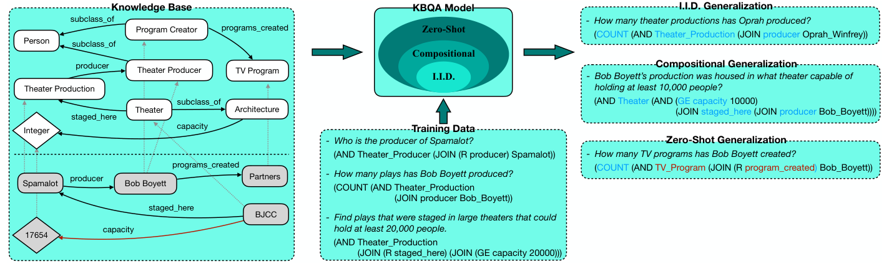
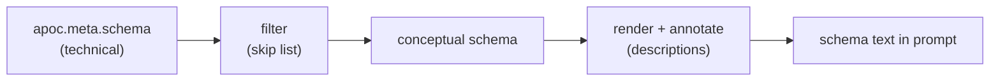
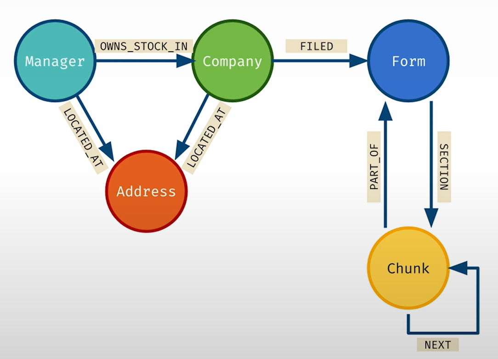

# 11a — Structured Lookups and Text-to-Cypher

> Many graph questions are a fixed query with a parameter. The rest need a model that writes Cypher, and that is reliable only as a generate-then-verify loop.

"Which investment firms are near Palo Alto?" needs no model at all: a canned query with a point and a 10 km radius answers it every time. The long tail of questions needs generated Cypher, and generated Cypher fails quietly. A car recorded as `"BLK"` doesn't match `"black"`, and a sum over `value` on the wrong node runs without error and returns nothing. This chapter covers fixed lookups by name and by place, then the schema-reading expert prompt behind reliable text-to-Cypher, after [note 11](11-kg-rag-and-text-to-cypher.md) chose the retrieval mode.

---

## Structured lookups by name and by place

Before reaching for a model, note how many questions are a fixed query with a parameter. Once L7 adds `Address` nodes ([note 10](10b-assembling-and-maintaining-kgs.md#stage-5-assembly-with-the-course-as-worked-example)), two more index types answer them: **full-text** for fuzzy names and **point distance** for "near". Vector search ranks by cosine similarity of embeddings; geospatial search ranks by distance between points.

```cypher
// Full-text: fuzzy name match, then traverse (SHOW FULLTEXT INDEXES lists the names)
CALL db.index.fulltext.queryNodes("fullTextManagerNames", "Royal Bank") YIELD node, score
WITH node AS mgr LIMIT 1
MATCH (mgr:Manager)-[:LOCATED_AT]->(addr:Address)
RETURN mgr.managerName, addr;

// Aggregate over the new edges: which states have the most investment firms?
MATCH (:Manager)-[:LOCATED_AT]->(addr:Address)
RETURN addr.state AS state, count(*) AS numManagers ORDER BY numManagers DESC LIMIT 10;

// Top firms in a city: the value sits on the OWNS_STOCK_IN edge
MATCH (mgr:Manager)-[:LOCATED_AT]->(addr:Address), (mgr)-[owns:OWNS_STOCK_IN]->(:Company)
WHERE addr.city = 'San Francisco'
RETURN mgr.managerName, sum(owns.value) AS totalInvestmentValue
ORDER BY totalInvestmentValue DESC LIMIT 10;

// "Near": point.distance is in metres, so 10 km is 10000
MATCH (sc:Address) WHERE sc.city = 'Santa Clara'
MATCH (com:Company)-[:LOCATED_AT]->(addr:Address)
WHERE point.distance(addr.location, sc.location) < 10000
RETURN com.companyName;

// Both together; full-text tolerates the typo "Palo Aalto"
CALL db.index.fulltext.queryNodes("fullTextCompanyNames", "Palo Aalto Networks") YIELD node AS com
MATCH (com)-[:LOCATED_AT]->(comAddr:Address), (mgr:Manager)-[:LOCATED_AT]->(mgrAddr:Address)
WHERE point.distance(comAddr.location, mgrAddr.location) < 20000
RETURN mgr.managerName,
       toInteger(point.distance(comAddr.location, mgrAddr.location) / 1000) AS distanceKm
ORDER BY distanceKm LIMIT 10;
```

Two cautions from the notebook. One query filters `WHERE addr.city = 'California'`, which returns nothing because California is a state; plausible-looking filter mistakes are not only an LLM problem. And the Palo Alto query in the notebook computes distance from `com.location` rather than `comAddress.location`; the version above uses the address node, which is where the course put location. These canned queries are the "graph traversal (canned)" row of the table above, and they make the best few-shot examples for the next section.

---

## Text-to-Cypher

The idea is older than LLMs. NLTK's feature grammar `sql0.fcfg` builds a `SEM` value alongside the parse, so "What cities are located in China" comes out as `SELECT City FROM city_table WHERE Country="china"` (*Natural Language Processing with Python*, ch. 10). It breaks in two places: the schema is hard-wired into the grammar rules (`N[SEM='City FROM city_table'] -> 'cities'`, so a renamed table or field makes the SQL unexecutable), and every new question shape, such as adding "and have populations above 1,000,000", needs new rules. An LLM that reads the schema at prompt time replaces both, which is why the schema-first prompt below matters.

### Think like the expert: schema first

Ch14's method is to ask what a domain expert would do (*KG & LLMs in Action*, ch. 14). Its thought experiment: force a panel of real experts to work RAG-style, picking a dozen similar-looking paragraphs and answering only from those, and their answers come out shallow. An expert doesn't read paragraphs. They know the **schema** and build a **constrained traversal**:

1. **Parse** the question into entities (`Car {color, model}`), relationships (owns, captured by) and constraints (red, Camaro, this area, this time window).
2. **Map** those onto schema labels and relationship types.
3. **Construct** the Cypher.


*Image Source: Negro et al., *Knowledge Graphs and LLMs in Action* (Manning, 2025), Fig. 14.2 (the figure's time filter is reversed; see the note after the query below)*

```cypher
MATCH path = (v:Vehicle)<-[:PLATE_READ]-(e:CameraEvent)-[:HAS_EVENT]-(c:ANPRCamera)
WHERE v.model = "Camaro" AND v.color = "Red"
  AND e.timestamp >= $startTime AND e.timestamp <= $endTime
  AND point.distance(c.position, $areaCenter) < $areaRadius
RETURN path
```

(The book's text and Fig. 14.2 write the time window as `$startTime >= e.timestamp >= $endTime`. Cypher accepts chained comparisons, so this parses, but it means `$startTime >= e.timestamp AND e.timestamp >= $endTime`: with a normal window (start before end) it matches nothing, and no error tells you so. The version above is the intended filter.)

Constrained traversals compose: one traversal, possibly with an aggregation, picks out a subgraph that seeds the next. That is how a complex question becomes a query. The framing shift matters: classic RAG builds context so the model can *generate an answer*. Here the model's job is to *formulate the question* precisely enough that the database returns the facts, so the answer is retrieved, not written (ch. 14).

GrailQA (Gu et al., WWW 2021, [arXiv:2011.07743](https://arxiv.org/abs/2011.07743)) is the benchmark that shows why schema grounding is the hard part. It targets Freebase and writes S-expressions that convert to SPARQL, not Cypher, and its models are BERT-base, not LLMs, so read it for the failure structure and not for current accuracy. Its 64,331 questions are split into three generalization levels: **i.i.d.** (schema items and question shapes seen in training), **compositional** (known schema items in a new combination) and **zero-shot** (at least one unseen class or relation). The best model, a ranker over every logical form within two hops of the linked entities, reached EM 50.6 and F1 58.0 overall and 48.6 EM on zero-shot, with candidates covering about 80% of questions. Swapping BERT for GloVe cut the generate-the-form model's F1 by 17.5% (compositional) and 26.2% (zero-shot) by the paper's prose (its Table 3 cells imply larger drops), while the i.i.d. level barely moved, so a model that looks fine on seen schema can fail on new schema. Of 100 wrong ranker answers, 34% were candidate-coverage limits, 33% entity-linking errors and 26% wrong relations. Single runs, no variance. For text-to-Cypher: test on schema items the few-shot examples never used, and expect entity linking to cost as much as query writing.


*Image Source: Gu et al., [Beyond I.I.D.: Three Levels of Generalization for Question Answering on Knowledge Bases](https://arxiv.org/abs/2011.07743) (WWW 2021), Fig. 1*

### Give the model an LLM-ready schema

Raw `apoc.meta.schema` output is the wrong input. It is the **technical schema**: helper nodes, embeddings, timestamps, redundant labels, relationships nobody queries. What the model needs is the **conceptual schema**, the subset a domain expert would recognise. Less to read means fewer plausible wrong choices, and the result reads like the domain rather than like the database (*KG & LLMs in Action*, ch. 14).



**Format.** A narrative description ("Vehicle: represents a vehicle; properties: ...; example: ...") is pleasant for people but gets harder for a model to parse consistently as the schema grows. Ch14 prefers a compact pattern syntax, one line per relationship, with comments carrying the meaning:

```text
/* A vehicle seen by cameras or owned by a person */
(:Vehicle {
    color: STRING,        /* abbreviated: BLK, GRY, SIL, WHI, ... */
    plate_number: STRING
})
/* Ownership; since = ownership start, ISO date */
(:Vehicle)-[:OWNED_BY {since: DATE}]->(:Person)
```

**Why annotate.** Structure alone produces two silent failures (ch. 14):

| Ambiguity | Example | What goes wrong without a note |
|---|---|---|
| **Value encoding** | Colours stored as `"BLK"` | "Black vehicles" becomes `color = "black"`, returns nothing, and the user concludes no black car was involved |
| **Overlapping relationships** | Both `COMMITTED` and `CO_OFFENDS_WITH` exist | "Suspects involved in crimes with another person" has no basis for choosing; the model guesses |

Annotations are the expert's cheat sheet written down: abbreviations, what each relationship means, units, direction. **Name things well in the first place**, too. A model can't use a relationship called `REL_7`.

**Keep it in config, not code.** Ch14 drives the transformation from a YAML file with two sections, `skip` and `descriptions`; ch15's schema provider applies it in three steps: call `apoc.meta.schema({sample: -1})` (no sampling, so rare labels aren't missed), drop skipped classes, relationships and properties (and any relationship whose endpoint was skipped), then attach descriptions (ch. 15). A compact version of the idea:

```yaml
schema:
  skip:
    classes: [Chunk, __Entity__]
    relationships: [NEXT]
    properties: [embedding, created_at]
  descriptions:
    classes: {Vehicle: "A vehicle seen by cameras or owned by a person"}
    relationships: {OWNED_BY: "Ownership; since = start date"}
    properties: {Vehicle: {color: "abbreviated: BLK, GRY, SIL, WHI"}}
```

```python
def render_schema(meta: dict, cfg: dict) -> str:
    skip, desc = cfg["skip"], cfg["descriptions"]
    out = []
    for label, node in meta.items():
        if node["type"] != "node" or label in skip["classes"]:
            continue
        props = [f"{k}: {v['type']}" + (f" /* {d} */" if (d := desc["properties"].get(label, {}).get(k)) else "")
                 for k, v in sorted(node["properties"].items()) if k not in skip["properties"]]
        head = f"/* {desc['classes'][label]} */\n" if label in desc["classes"] else ""
        out.append(f"{head}(:{label} {{\n    " + ",\n    ".join(props) + "\n})")
        for rel, r in node["relationships"].items():
            if r["direction"] == "out" and rel not in skip["relationships"]:
                for tgt in r["labels"]:
                    if tgt not in skip["classes"]:
                        note = f" /* {desc['relationships'][rel]} */" if rel in desc["relationships"] else ""
                        out.append(f"(:{label})-[:{rel}]->(:{tgt}){note}")
    return "\n".join(out)
```

The YAML is versioned with the prompts, readable by domain experts, and grows with the graph without code changes.

Three differences from the book's provider (listings 15.3–15.4) matter if you copy it. It attaches descriptions to node classes and node properties only, so the relationship descriptions above are an addition. Its property skip list is flat and applies to every class and relationship, so skipping `name` on one label skips it everywhere. And the `schema_extraction` node calls `apoc.meta.schema({sample: -1})`, a full scan, on **every question**, writing into class-level dictionaries (`Node.items`, `Relationship.items`) shared by the whole process. On a large graph, build the rendered schema once and rebuild it when the graph or the YAML changes.

### Prompt shape

The book's prompt has nine parts: task and `<QUESTION>`; `<SCHEMA>` with annotations (rendered under markdown headings such as `### Graph Schema Overview`, with the instruction to "consider the comments as annotations"); requirements that depend on the intent (a map needs coordinates, a graph view needs named relationships); few-shot examples; the user's current selection; KG-specific notes; the question restated; the requirements restated; and the output format.

**Order the output fields so reasoning comes first:**

```json
{
  "relationships": ["..."],   // the edges it intends to traverse, before the query
  "reasoning": "...",         // the plan
  "query": "<Cypher>",        // written last, consistent with the two fields above
  "success": true
}
```

Listing `relationships` first reduces invented relationship types, because the model commits to the schema before writing the query. This is chain-of-thought ordering ([01-prompt note 03](../../01-prompt-engineering/notes/03b-chain-of-thought-and-reasoning.md)): an answer written before its reasoning is a guess, and the reasoning that follows only rationalises it. Tokens are generated in order, each conditioned on the ones before, so an early commitment gets defended and an early error propagates. Ch14 illustrates this with a route-finding prompt: answer-first, the model picks a highway and then explains away the construction it mentions; reasoning-first, it lists the routes, weighs them and lands on a different one (*KG & LLMs in Action*, ch. 14).

Tuning the fields: if your model never invents relationships, drop `relationships`; if it commits to them too early, ask for the ones it will "potentially traverse". Few-shot examples must use the same JSON shape; the book says they "must conform to our response format". Its own Jinja2 example template breaks that rule: it renders `"query"` *before* `"reasoning"`, with no comma between them, so every example teaches query-first ordering in malformed JSON. Render examples in the response order (`relationships`, `reasoning`, `query`). Fields the book doesn't want to dictate are filled with `"..."`. To add worked reasoning to an example, first run the example question without a `reasoning` field to see how the model reasons unguided, then add only the critical content "without radically changing the overall response".

**The parts that matter most**, from the nine-part prompt:

| Part | What it does | Why |
|---|---|---|
| Intent-dependent requirements | Graph or map output: return every matched node and **named** relationship (`[r:OWNS]`, not `[:OWNS]`), one `MATCH` pattern where possible. Table output: select and rename properties as columns | The front end needs different shapes; anonymous relationships can't be drawn |
| "Use only the schema; if you can't, say why" | Permission to fail, reported through `success: false`, plus "You must respect relationship types and directions" | Without it the model invents something plausible |
| User selection | Lists the nodes currently selected in the UI. If the question says "the selected X" and the selection is empty, set `success: false` | Lets users say "the older siblings of the selected person"; refuses to guess the referent |
| KG-specific notes | A template variable for per-graph tips ("`location` is a Neo4j point, use `point.distance`") | Keeps the core prompt reusable across graphs |
| Question and requirements restated at the end | The schema can be long and pushes the question far from where generation starts | Recency |
| `information` slot next to the restated question | Empty on the first try; on a retry it carries the failed query and the database's error | This is the self-correction loop |

**The reverse exception.** For *classification*, putting the `reason` after the label is fine and even useful. The point there isn't better reasoning but seeing *why* the model chose a wrong class, which tells you what boundary example to add (ch. 14).

### Intent detection

Ch14 classifies at two levels before generating anything:

1. **Request type:** a data question, a question about the system, or feedback or a complaint. Only data questions go on to Cypher. System questions split again into *documentation* ("can I export to CSV?") and *schema* ("how would I assess a suspect's risk level?"). Complaints ("it keeps freezing") are real user needs that should be logged, not answered with a query.
2. **Output form:** graph, table, chart or map. This changes what the query must `RETURN`.

What makes the classification prompt work (ch. 14):

- **Defined categories with a default.** The book's rule: graph unless the user asks for one explicitly; table for aggregation, ordering or statistics; chart for distributions; map for locations. When unsure, graph, since the system queries a graph.
- **Few-shot examples, including boundary cases.** "Most common types of organised crime involved in human trafficking" needs both aggregation and relationships; the book labels it graph and keeps it as an example precisely because it's borderline.
- **A JSON output with a `reason` field**, used for debugging, not downstream logic.
- **A fallback category** where one applies. The book's checklist is clear instructions, defined categories, examples, boundary cases, output format and fallback. Boundary examples are best harvested, not invented: "The easiest way to obtain high-quality samples on the boundary is to observe misclassification during normal use".

| Question | Output |
|---|---|
| Location of the latest shooting | map |
| Crimes per month, 2020 vs 2019 | chart |
| Main suspects in recent burglaries | graph |
| Traffic fatalities last year vs the year before | table |

**Model size shows up here.** "How often is the knowledge graph updated?" is a question about the system's process. A full-size model classified it as system/documentation; a "smaller or quantized" model called it a data question ("concerns the frequency of updates within the data"). The book's reason the larger model is right: update frequency inferred from node timestamps would reflect how the data happened to be entered, not how updates are scheduled. The `reason` field made the gap visible: the small model needed more background in the task definition (ch. 14).

**One prompt or several?** Start with a single broad classification prompt: less to maintain, faster to ship. Split into stages (request type, then output form) when accuracy on edge cases or frequently changing categories justify it. Waiting also gives you real misclassified questions to build the staged prompts from (ch. 14).

### The failure to expect

In course L7, LangChain's `GraphCypherQAChain` was told to follow the schema and still summed a `value` property on `Company`, which doesn't exist. The property is on the `OWNS_STOCK_IN` relationship. **One few-shot example with the right pattern fixed it.** Text-to-Cypher fails on plausible-looking schema mistakes, and those are exactly what a schema check catches. Worth trying yourself: reproduce the failure, then fix it once with the few-shot example and once with a schema annotation instead (`/* value lives on OWNS_STOCK_IN */`), and see which fix survives five paraphrases of the question.


*Image Source: Knowledge Graphs for RAG, DeepLearning.AI × Neo4j (Kollegger, 2024)*

The L7 chain is the minimal text-to-Cypher setup: the schema string from `kg.schema`, rules, and few-shot examples, each a comment with the question followed by its Cypher. The course grows the example list one failure at a time:

```python
from langchain_neo4j import GraphCypherQAChain   # was langchain.chains (deprecated)

CYPHER_GENERATION_TEMPLATE = """Task: Generate a Cypher statement to query a graph database.
Use only the relationship types and properties in the schema.
Schema:
{schema}
Do not include any text except the generated Cypher statement.
Examples:
# What investment firms are near Santa Clara?
MATCH (address:Address) WHERE address.city = 'Santa Clara'
MATCH (mgr:Manager)-[:LOCATED_AT]->(mgrAddress:Address)
  WHERE point.distance(address.location, mgrAddress.location) < 10000
RETURN mgr.managerName, mgr.managerAddress

The question is:
{question}"""

chain = GraphCypherQAChain.from_llm(
    ChatOpenAI(temperature=0), graph=kg, verbose=True,
    cypher_prompt=PromptTemplate.from_template(CYPHER_GENERATION_TEMPLATE),
    allow_dangerous_requests=True)   # required in current versions: it runs generated Cypher
chain.invoke({"query": "What investment firms are near Santa Clara?"})   # course used .run()
```

`point.distance` is in metres, so "near" had to be taught as a 10 km radius. A second example in the course routes "What does Palo Alto Networks do?" through the company full-text index (which also matches the misspelling "Palo Aalto") to the `SECTION` chunk for Item 1. That query only returns the first chunk of the section, a limitation the course leaves in place. The `allow_dangerous_requests` flag is LangChain's reminder that this chain executes whatever the model writes, which is the case for the `EXPLAIN` validator below. Book examples written before the flag existed leave it out. Raieli and Iuculano's ch. 7 call, `GraphCypherQAChain.from_llm(llm, graph=graph, verbose=True, return_intermediate_steps=True)` imported from `langchain.chains`, raises an error in current versions until you add the flag and import from `langchain_neo4j`. `return_intermediate_steps=True` is worth keeping: it returns the generated Cypher and the rows it got back, which is what you log and evaluate.

---

## Working reference

Depth: Negro et al., *Knowledge Graphs and LLMs in Action* (Manning, 2025), ch. 13–14. Raieli & Iuculano, *Building AI Agents with LLMs, RAG, and Knowledge Graphs* (Packt, 2025), ch. 7, for the GraphRAG survey view (granularity, retrievers, prompt formats).

---

## Pitfalls

- **A schema with undocumented encodings.** Symptom: `color = "black"` returns nothing over stored `"BLK"`, and the user concludes no black car was involved. Fix: annotate value encodings in an LLM-ready schema.
- **Reading empty as "no".** Symptom: `WHERE addr.city = 'California'` returns nothing, because California is a state. Fix: treat an empty result as something to check, and prefer canned queries for known questions.
- **No way for the model to refuse.** Symptom: plausible Cypher for a question the schema can't answer. Fix: "use only the schema", plus `success: false` with a reason.

## Try it

1. Write the annotation that stops the `"BLK"` failure, in the schema style this chapter uses, and say what else belongs in the KG-specific notes for that graph.

   <details><summary>Answer</summary>

   `color: STRING, /* abbreviated: BLK, GRY, SIL, WHI, ... */` on the vehicle node. In the KG-specific notes, add per-graph tips such as "`location` is a Neo4j point, use `point.distance`", which is in metres.

   </details>

## Interview checklist

| Prompt | Answer in one line |
|---|---|
| How do you make text-to-Cypher reliable before retries? | An LLM-ready schema with value annotations, a query-writing prompt allowing `success: false`, the question restated last, and an `information` slot for the error on retry. |
| Would you use text-to-Cypher for "firms near Palo Alto"? | No, if it is a known question: a fixed query with a parameter and `point.distance` in metres is cheaper and more reliable. |
| What failure should you expect in L7? | Filtering `value` on the wrong node, which runs without any error from the database. A validator catches it. |

## Next

[11b-text-to-cypher-qa-agent.md](11b-text-to-cypher-qa-agent.md): the same pipeline wired as a LangGraph graph with validation and retries.
