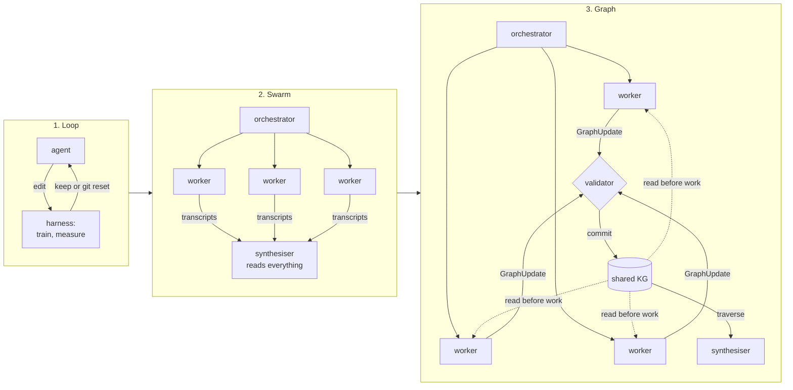

# 12 — KG as Shared Agent Memory

> Fan-out without shared state re-derives the same findings. Fan-out over a shared, typed, provenance-carrying graph accumulates them. The agent forgets; the graph does not.

---

## Where it sits

This is where the two tracks meet. Track A's execution graph has **state** ([note 03](03-state-and-reducers.md)), which lasts for one run and lives in one process. Track B's knowledge graph is **memory**: it outlives the run, the agent and the model. In a multi-agent system the KG often becomes the layer the execution graph coordinates through.

| | Execution-graph state (note 03) | Knowledge graph (this note) |
|---|---|---|
| Lifetime | One run (`thread_id`) | Across runs and sessions |
| Readers and writers | Nodes in this graph | Any agent, any run, people too |
| Shape | Typed dict with reducers | Entities, claims, relations, provenance |
| Concurrency control | Reducers; single writer per key | Validated, versioned, transactional upserts |
| Mistakes | Die with the run | **Persist and spread** |
| Memory tier ([02-context note 06](../../02-context-engineering/notes/06-memory.md)) | Short-term / working | Semantic (facts), plus an episodic lineage of runs |

The last two rows matter most for this note.

---

## Loop → swarm → graph

Each architecture moves a different bottleneck out of the agent's context. This progression comes from the community synthesis in [sources/](../sources/graph-engineering-karpathy-loop-anthropic-playbook-2026.pdf), which is secondary; the primary sources are cited inline.

**1. Loop.** Karpathy's [autoresearch](https://github.com/karpathy/autoresearch) (March 2026) runs one agent inside a research harness. The agent may edit `train.py` but not `prepare.py`, and a `program.md` sets the rules. It runs about 5 minutes of training per experiment, keeps a change only if validation bits-per-byte improves, and otherwise `git reset`s. The synthesis puts `train.py` at about 630 lines. It works for the reasons [04-loop](../../04-loop-engineering/README.md) gives: the result is verifiable, the action is reversible, the horizon is short and the environment is bounded. **The loop moves iteration and evaluation out of the agent.**

**2. Swarm.** Fan the loop out across parallel workers with fresh contexts, for example Claude Code's dynamic workflows, where orchestration is a generated script that spawns sub-agents. **The swarm moves parallel search out of the agent.** It also creates a new problem, **redundancy**: workers that share nothing rediscover the same findings, and the synthesiser has to read every transcript to combine them.

**3. Graph.** Workers publish **structured updates** to a shared typed graph. The synthesiser then traverses the graph instead of reading every source and transcript. **The graph moves shared facts, provenance and cross-session memory out of the agent.**

The key point: a swarm on its own re-derives findings, and a swarm writing to a shared graph accumulates them. The graph is how redundancy turns into accumulation.



### Three roles at once

| Role | What it buys |
|---|---|
| **Shared memory** | Workers write findings as typed updates, and the synthesiser combines them without any worker having seen every document |
| **Grounding layer** | An evaluator checks each claim against edges with sources: "no supported path from X to Y" is a critique you can act on |
| **Persistent world model** | Long investigations, incremental ingestion, contradiction tracking, facts with time ranges, handoff between models, recovery after a failed run |

The synthesis makes one further distinction worth keeping. A **commit or lineage DAG** records *what changed and who changed it*. The **KG** records *what is believed and why*. Don't collapse them into one structure. Track A tracing ([note 08](08-governance-and-production.md)) covers the first.

---

## The write path: `GraphUpdate`

All the safety lives in the write path. A worker never writes to the graph directly. It submits an update, and a validator checks it before anything is committed:

```python
@dataclass
class GraphUpdate:
    nodes: list[dict]      # each with id, type, props, source spans
    edges: list[dict]      # (src, type, dst) + source span + confidence
    run_id: str
    agent_id: str

def publish(update, graph, validator):
    validator.check_schema(update.nodes, update.edges)        # types and edge types exist
    validator.check_provenance(update.nodes, update.edges)    # every fact has a source span
    with graph.transaction() as tx:
        tx.upsert_versioned_nodes(update.nodes)               # versioned, never overwrite
        tx.add_edges(update.edges)
        tx.link_run(update.run_id, update.agent_id, update.nodes, update.edges)
        tx.commit()
```

The contract on the wire is a JSON Schema the validator enforces. Trimmed to its load-bearing parts:

```json
{
  "$schema": "https://json-schema.org/draft/2020-12/schema",
  "title": "GraphUpdate",
  "type": "object",
  "required": ["run_id", "agent_id", "nodes", "edges"],
  "properties": {
    "run_id":   {"type": "string"},
    "agent_id": {"type": "string"},
    "nodes": {"type": "array", "items": {
      "type": "object",
      "required": ["id", "type", "name", "sources"],
      "properties": {
        "id": {"type": "string"}, "type": {"type": "string"}, "name": {"type": "string"},
        "description": {"type": "string"}, "props": {"type": "object"},
        "sources": {"$ref": "#/$defs/sources"}
      }}},
    "edges": {"type": "array", "items": {
      "type": "object",
      "required": ["src", "type", "dst", "sources", "confidence"],
      "properties": {
        "src": {"type": "string"}, "dst": {"type": "string"},
        "type": {"type": "string", "description": "e.g. DEPENDS_ON, ALIAS_OF, RESOLVES_TO, CONTRADICTS"},
        "confidence": {"type": "number", "minimum": 0, "maximum": 1},
        "evidence": {"type": "string"},
        "sources": {"$ref": "#/$defs/sources"}
      }}}
  },
  "$defs": {
    "sources": {"type": "array", "minItems": 1, "items": {
      "type": "object", "required": ["doc_id"],
      "properties": {
        "doc_id": {"type": "string"},
        "start": {"type": "integer"}, "end": {"type": "integer"},
        "quote": {"type": "string"}
      }}}
  }
}
```

`minItems: 1` on `sources` is the provenance rule as a schema: a fact with no source span is rejected before it reaches the transaction. Compute `start`/`end` offsets in code from the `quote`, not by asking the model for character positions. This is [note 03](03-state-and-reducers.md)'s reducer idea at database scale. Many writers are allowed, but they go through one serialising, validating merge function, so no write happens unchecked.

### The non-negotiables

1. **Complete provenance.** Every node and edge records `run_id`, `agent_id` and a source span. Without it you can't audit a fact, and you can't roll one back.
2. **Reversible entity resolution.** Store `ALIAS_OF` and `RESOLVES_TO` edges with their evidence and confidence, and never merge destructively. This is [note 10](10-building-kgs-with-llms.md)'s metagraph rule, and here it decides whether a mistake can be undone.
3. **Claims are not truths.** Store "agent A claims X, citing source S", and let contradicting claims exist side by side. The graph keeps evidence so it can be inspected. It doesn't make a claim true.

**Why so strict.** A bad loop iteration gets reverted and is gone. A false merge in a shared graph **persists**, and every agent that reads afterwards inherits it. Merge two people into one node and every later query mixes their employers, projects and dates. This is the per-hop compounding from note 10, now affecting every reader. A graph amplifies its builder's ontology and source policy the way a loop amplifies its builder's objective. Whoever owns the schema owns the errors.

---

## Five planes

The synthesis's reference architecture keeps five concerns apart:

| Plane | Holds | Track A note |
|---|---|---|
| **Control** | Objectives, plans, budgets, start and stop decisions | [08](08-governance-and-production.md) |
| **Execution** | Tools, sub-agents and jobs in isolated environments | [05](05-topology-patterns.md), [07](07-failure-modes-at-scale.md) |
| **Artifact** | Plans, drafts, code, reports and metrics as immutable versions | — |
| **Graph** | Entities, claims, relations, provenance, task dependencies | 09–13 |
| **Evaluation** | Deterministic checks, model graders, human review | [06-eval](../../06-eval/README.md) |

**Anti-pattern: "the chat transcript became the database."** If a run's only durable record is its conversation log, then that log is serving as database, workflow engine and audit log at once, and it does all three badly. You can't query it, you can't roll it back, and the next agent can't read it without reading everything.

---

## What the swarm tier costs

| Claim | Status |
|---|---|
| Anthropic's multi-agent research system used ~15× the tokens of a chat interaction ([engineering post](https://www.anthropic.com/engineering/multi-agent-research-system)) | First-party |
| Claude Code dynamic workflows: up to **16 concurrent** sub-agents (fewer on low-core machines) and **1,000 total per run** | Consistent across several third-party write-ups that quote the Claude Code docs. I couldn't load the docs page itself (2026-10-28). Managed Agents workflows are reported at 64 concurrent, a different product. Check the docs before relying on either. |
| A 1,000-sub-agent run costs "tens of dollars" | From a secondary source; unverified |
| Bun's Zig→Rust port: about 50 workflows, peak parallelism 64, about $165,000 in usage | **Unverified.** A Claude-driven port branch with about 966k lines of Rust is reported, but I found no primary source for the cost. Don't cite the number. |

Two takeaways hold up regardless of the exact numbers. Graph topology makes swarm spend **tractable**, not cheap ([note 06](06-when-not-to-build-a-graph.md)). And the quieter risk is **correlated errors** across workers that share a model, a prompt and a graph ([note 07](07-failure-modes-at-scale.md)). A shared graph spreads a correlated error further, which is why the validator and provenance come first.

### What parallelises

Apply the true-dependency test from [note 03](03-state-and-reducers.md): *does the next step actually read the previous step's output?* If it does, the edge is real. If it doesn't, the serialisation is incidental, and the steps can fan out and meet in the graph.

Two safeguards matter only once work runs in parallel. Verifiers get **isolated context** (the task and the output, not the generator's reasoning). Workers get **isolated file spaces**.

---

## Evaluating it by layer

Each layer has a metric that is easy to misread:

| Layer | Metric | Common misreading |
|---|---|---|
| Extraction | Entity and relation F1 | High precision can hide missing entities |
| Resolution | Pairwise precision/recall, false-merge rate | A high compression ratio (surface forms ÷ canonicals) rewards over-merging |
| Query | Answer correctness **and** path validity: supported edges, cited, time and source constraints respected | A right answer reached through a wrong path is luck |
| Swarm | Redundant findings, tokens and quality compared with a single loop | Wall-clock gains that cost quality |

Improving the extraction prompt is itself an autoresearch loop. Propose one prompt or schema change, rerun on the gold set, keep it if precision, recall and false-merge rate improve, and revert it otherwise. The synthesis calls this "graph autoresearch". It is [04-loop](../../04-loop-engineering/README.md) applied to [note 10](10-building-kgs-with-llms.md).

---

## Build path

Don't start at the swarm. The synthesis's staged path matches [note 06](06-when-not-to-build-a-graph.md)'s adoption advice:

1. **One measured loop.** A fixed metric and reversible actions.
2. **A role split.** Generator and verifier with isolated contexts.
3. **A persistent graph.** Gate on whether queries across sessions work.
4. **A swarm writing to the graph.** Gate on a wall-clock gain with no loss of quality.

Move to the next stage only when the current one has been measured.

The persistent graph at stage 3 needn't be a graph database. The community consensus [flowtivity](https://flowtivity.ai/blog/graph-engineering-2026-guide-openclaw-codex/) reports (attributed to Eugeniu Ghelbur) is four properties: a **small typed core** of node and edge types, **cheap indexing**, **hybrid retrieval** (keyword or vector to find an entry point, then edges to expand), and **temporal supersession** (a newer fact `SUPERSEDES` an older one instead of overwriting it). All four can be built on markdown files you own. A vendor-relayed opinion, not a result, but a sensible bar to clear before reaching for Neo4j.

Gate stage 3 against flat retrieval, not only against no memory. Rusu et al. ([arXiv:2608.28978](https://arxiv.org/abs/2608.28978), 2026-08) had GPT-4o-mini extract every conversation turn into a nine-label ontology and answered from 2-hop subgraphs. On LongMemEval (500 questions) it lost to plain retrieval over the raw turns with the same five retrieval roots: token F1 0.417 vs. 0.468 (95% CI on the gap [−0.085, −0.016]). The worst category was recalling what the assistant itself had said, where judge accuracy fell from 0.911 to 0.607; the graph won only on temporal questions, and narrowly (judge 0.293 vs. 0.278). Detail the extractor drops can't be retrieved later. The same paper shows retention is cheap: scoring nodes on recency (90-day half-life), access frequency, centrality and turn decay, and pruning everything below 0.10, removed 9.8% of a 27,021-node graph with token F1 unchanged (+0.001) and judge accuracy down 1.6 points. The authors scope it themselves: one small extractor on one benchmark, so "these results characterise this extraction-based pipeline rather than graph-structured memory in general."

Two drills test whether the graph is earning its place:

- **With and without shared memory.** Fan out 5–10 workers over one corpus twice: once returning prose to a synthesiser that reads everything, once publishing validated `GraphUpdate`s that the synthesiser queries and must cite. Compare redundant findings, synthesiser input tokens, total tokens, and answer and path quality on a fixed question set. Add a third arm that keeps the workers' raw output in a flat retrieval index, so the graph has to beat verbatim recall, not just no memory.
- **Contamination.** Inject one false `RESOLVES_TO` merge under a fake `run_id`, re-run the questions and trace every changed answer back to the bad edge, then roll back by deleting everything carrying that `run_id`. If provenance alone can't restore the answers, the write path isn't strict enough.

---

## Working reference

`~/.claude/refs/agent-memory.md`: taxonomy, persistence by lifetime (in-turn → session → cross-session → **cross-agent**), and the single-writer rule. `~/.claude/refs/agent-architecture.md`: when to fan out.

Related: [02-context note 06](../../02-context-engineering/notes/06-memory.md) (memory types and hygiene); [its production memory designs](../../02-context-engineering/notes/06-memory.md) (ChatGPT, OpenClaw, Memoria).

---

→ Next: [13-graph-ml-and-gnns.md](13-graph-ml-and-gnns.md): predicting the edges and labels the graph doesn't have yet.
