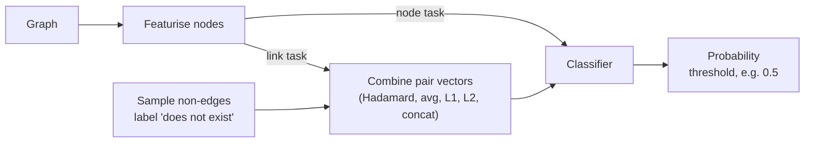
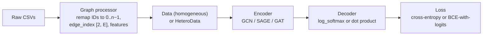

# 13 — Learning on Graphs: Features, Embeddings, GNNs

> Notes 09–12 query the edges a graph already has. Graph ML predicts the ones it doesn't: missing links, unlabeled nodes, hidden communities. A prediction is a claim, not a fact, so it enters the graph with a confidence score.

All book citations in this note are to Negro et al., *Knowledge Graphs and LLMs in Action* (Manning, 2025), abbreviated *KG & LLMs in Action*.

---

## Where it sits

This is the **Learning** pillar from [note 09](09-kg-fundamentals-and-cypher.md#what-a-knowledge-graph-is). You can build, query and share a KG without it. It earns its place when:

- the graph is **incomplete** and you want candidate edges ("which drug might treat this disease?", "which accounts are linked to this fraud ring?");
- you need **labels** for nodes nobody has labelled (bot, fraudster, protein function);
- the graph is too large to inspect, and **communities** give you a summary of it.

Two pieces of the earlier notes are already graph ML: **WCC** clusters mentions in entity resolution ([note 10](10-building-kgs-with-llms.md#graph-based-er-ch6)), and GraphRAG's **community summaries** rest on community detection ([note 11](11-kg-rag-and-text-to-cypher.md#retrieval-modes)).

The book frames all of this as the engine of an **intelligent advisory system**: one that surfaces something a user couldn't extract by querying alone, such as a drug-repurposing candidate in a disease–gene–compound graph (*KG & LLMs in Action*, ch. 9). Its case for graph ML has three parts: almost any data (tables, sequences, time series) can be recast as a graph; many business problems reduce to a handful of graph tasks; and graph models use the dependencies between records that classical ML throws away. [ch. 9 PDF](../sources/kg-and-llms-in-action/ch09-ml-on-knowledge-graphs.pdf)

---

## Why graphs need their own ML

Classical ML assumes data points are **i.i.d.** (independent and identically distributed). Nodes aren't. Three patterns break the assumption (*KG & LLMs in Action*, ch. 9):

| Pattern | Means | Example |
|---|---|---|
| **Homophily** | Connected nodes tend to be alike | Friends share interests |
| **Structural equivalence** | Nodes with similar neighbourhoods play similar roles, even far apart | Proteins with the same interaction shape share function |
| **Heterophily** | Connected nodes tend to differ | Buyers connect to sellers |

So node tasks are usually **semisupervised**. Training sees the whole graph, unlabelled nodes included; only their labels are missing, and their neighbourhoods still inform the model. That differs from textbook supervised learning, where test points are unseen at training time, and from textbook semisupervised learning, which still assumes i.i.d. (ch. 9).

Graphs are incomplete for two reasons, and they call for different evaluation: the edge exists but was never recorded (or is deliberately hidden, as in fraud), or the graph is still evolving (next year's co-authorships). The first is tested with random held-out edges; the second needs a time-based split (ch. 9).

### The task map

The book's main split is not supervised vs. unsupervised but **what one data point is**: a node or edge inside one graph (*node-focused*), or a whole graph in a set of graphs (*graph-focused*) (ch. 9).

| Task | Data point | Typical use | Needs training? |
|---|---|---|---|
| **Node classification** | A node in one graph | Fraud, bots, AML, protein function; multilabel variants (which groups will this user join?) | Yes |
| **Link prediction** | A node pair in one graph | KG completion, recommendations, drug repurposing, side effects | Yes; sample non-links as negatives |
| **Community detection** | The whole graph | Summarising, fraud rings, functional modules | No: WCC, Louvain, label propagation act on the graph directly |
| **Graph classification** | One whole graph among many | Molecule toxicity, enzyme vs. non-enzyme, malware | Yes |

A small set of tasks covers a large set of business problems. That is the book's main argument for the graph framing.

Two terms worth keeping apart: **link prediction** asks whether an edge of a fixed type exists; **relationship prediction** also predicts its type, typically by scoring each type separately (ch. 9).

**Community detection is not K-means.** K-means needs *k* up front and DBSCAN groups dense points in vector space; both treat records as independent points. Graph clustering needs no *k* and lets the edges decide membership, usually by maximising **modularity** (how much denser a community's internal edges are than chance would predict). **Label propagation** is fast but random: rerun it and the communities shift slightly, so pin a seed or check stability before you store community IDs. Louvain on the 34-node karate-club graph finds four communities that mostly match the real post-split factions, with one boundary node landing on the wrong side (ch. 9).

### Two ways to implement

1. **Graph-native** ("collective classification"): the algorithm takes the graph itself and uses node features and neighbourhoods together. GNNs are the modern form.
2. **Featurise, then classic ML**: turn each node, edge or graph into a vector, then use any classifier (logistic regression, random forest).

For the second route, both node and link tasks reduce to ordinary classification (ch. 9):



The one hard rule: **the featurisation at prediction time must be exactly the one used at training time** (ch. 9). In a graph that keeps changing, that means versioning the feature code and recomputing features from the same snapshot logic, not reusing stale columns.

---

## Features: the bottleneck

Models want vectors, so every node, edge or graph has to be **featurised**. The approaches trade interpretability for effort (*KG & LLMs in Action*, ch. 10):

| Approach | Examples | Interpretability | Effort |
|---|---|---|---|
| **Manual** | Degree, triangles, density, closeness, betweenness, PageRank; for edges, combine node vectors (Hadamard, average, L1, L2, concatenation) or count metapaths | High: every number traces to a graph property | High |
| **Semiautomated** | ReFeX: recursive local, egonet and aggregated features from topology alone, then pruned by correlation | Balanced, and deterministic | Medium |
| **Learned** | Node2Vec, GNN embeddings | Low | Low |

Manual features keep a place even when you plan to learn embeddings: they are explainable to a reviewer, they work on small graphs, they tell you what the automated methods ought to capture, and an LLM can reason about them because they rest on well-known algorithms (ch. 10). [ch. 10 PDF](../sources/kg-and-llms-in-action/ch10-graph-feature-engineering.pdf)

**The karate-club lesson** (ch. 9). Predicting which faction each member joined after the club split:

| Features | F1 |
|---|---|
| Degree only | 0.43 |
| Node2Vec, 64-dim, untuned | 0.65, and unstable between runs (30–70%) |
| Degree + "neighbours in faction A" + "neighbours in faction B" (homophily, written by hand) | **0.93**, stable |

The classifier was the same logistic regression each time, on standardised features (without scaling, a 1–1,000 degree column drowns a 0–1 centrality column). Domain knowledge expressed as three numbers beat a generic embedding. Learned features don't remove the need to understand the graph. They need tuning (here, shorter and fewer walks was the suggested fix for over-homogeneous vectors), and a domain-informed baseline tells you whether the tuning worked. The homophily feature is a two-liner:

```python
def homophily_features(G, label="club"):
    lab = nx.get_node_attributes(G, label)
    return {n: [G.degree(n)] + [sum(lab[m] == c for m in G[n]) for c in sorted(set(lab.values()))]
            for n in G}
```

The catch: counting labelled neighbours uses the labels you're predicting. Compute it from **training labels only**, or the test nodes leak their answers into their neighbours' features.

### Manual node features

Ch. 10 builds one feature vector per node on a 20-node toy fraud network (four known fraudsters), local features first, then global ones (*KG & LLMs in Action*, ch. 10). A node's **egonet** is the node (the ego) plus its one-hop neighbours (the alters).

| Feature | Scope | Fraud-aware variant | What it says | Value on the toy graph |
|---|---|---|---|---|
| **Degree** | Local | Split into fraud degree and legit degree | More fraudulent neighbours, more risk | D: 4 neighbours, 2 of them fraudsters |
| **Triangles** | Local | Fraudulent (both alters fraud), semifraudulent (one), legitimate (none) | Tight clustering; a fraud triangle is a ring signal | — |
| **Egonet density** | Local | None | Share of possible egonet edges that exist: 2M / N(N−1) | A: 7 nodes, 7 of 21 possible edges, 0.33 |
| **Geodesic distance** | Global | Distance to the nearest fraudster, and the number of fraudsters at 1, 2, 3 hops | Proximity to contamination | 0 for a fraudster |
| **Closeness** | Global | None | Inverse of mean shortest-path distance to everyone | A highest (0.5); R, S lowest (0.24) |
| **Betweenness** | Global | None | Share of shortest paths that pass through the node: a bridge | A = 104 (unnormalised); nine nodes are 0 |
| **PageRank** | Global | Personalised toward known fraudsters | Importance weighted by the importance of who points at you | A tops base PageRank (0.108) |

Two practical fixes from the chapter. Closeness breaks on disconnected graphs (distance to an unreachable node is infinite), so average over **reachable nodes only** and scale by the reachable fraction, which is what `networkx` does. And the PageRank pair is more useful than either number: the gap between base and fraud-personalised PageRank flags nodes whose fraud exposure is larger than their general prominence. The book reports D jumping to the top of the fraud-weighted ranking (0.168). Rerunning its setup as described (personalisation weight 2.0 on fraudsters) leaves A on top with D at about 0.085, so treat the exact numbers as sensitive to the weight; the divergence idea is what transfers.

Assembling and training is ordinary tabular ML: one row per node, a **stratified** split so both sides keep the fraud/legit ratio, `StandardScaler`, logistic regression, and the absolute coefficients as a first read on feature importance (ch. 10). With 20 nodes and four fraudsters, an 80/20 split leaves one fraudster in the test set, so read the toy's metrics as a demonstration, not evidence.

### Manual relationship features

For link prediction a node *pair* needs one vector. Two families (ch. 10):

**Node-based combination**: merge the two node vectors *u* and *v*.

| Operator | Element *i* | Length | Notes |
|---|---|---|---|
| Concatenate | u ‖ v | 2n | Keeps direction; order matters |
| Average | (uᵢ + vᵢ) / 2 | n | Symmetric |
| L1 | \|uᵢ − vᵢ\| | n | Symmetric; a per-dimension distance |
| L2 | (uᵢ − vᵢ)² | n | Symmetric; penalises big gaps |
| Hadamard | uᵢ · vᵢ | n | Symmetric; the usual default with learned embeddings |

There is no rule for which one wins; benchmark them on your task. With hand-made node features this family tends to lose to path-based features. It does better once the node vectors are learned (ch. 10).

**Path-based features** describe the pair by how it is connected. A **metapath** is a typed walk through the schema (the *metagraph*), e.g. Compound–binds–Gene–associates–Disease, abbreviated CbGaD. For drug repurposing on Hetionet, every compound–disease pair gets one column per metapath, whether or not the pair is directly linked (ch. 10):

| Metapath | Length | Reads as |
|---|---|---|
| CbGaD | 2 | The drug binds a gene associated with the disease |
| CdGuD | 2 | The drug down-regulates a gene the disease up-regulates |
| CrCtD | 2 | The drug resembles a drug that treats the disease |
| CbGbCtD | 3 | It binds a gene that another treating drug also binds |
| CbGeAlD | 3 | It binds a gene expressed in tissue where the disease localises |
| CbGpPWpGaD | 4 | It binds a gene in a pathway shared with a disease gene |

### DWPC: discount the hubs

Counting paths between two nodes overrates connections that go through **hubs**, the nodes connected to everything. **Degree-weighted path count** damps each path by the degrees of the nodes it passes through, so specific connections outrank generic ones (*KG & LLMs in Action*, ch. 4 and ch. 10). It was introduced by Himmelstein et al. for Hetionet, adapting the PathPredict method from social network analysis (ch. 4). It is the same instinct as dropping hub nodes in NED ([note 10](10-building-kgs-with-llms.md#ned-against-an-ontology-ch78)): a path through "Infectious process" says almost nothing. [ch. 4 PDF](../sources/kg-and-llms-in-action/ch04-multisource-integration.pdf)

**The formula.** For one path, collect the metaedge-specific degree of both endpoints of every edge on it (degree counted only over edges of that type), raise each to −*w*, and multiply. That is the **path-degree product** (PDP). DWPC sums PDPs over all paths that match the metapath:

```
PDP(path)        = ∏ d^(−w)      over the 2 × (path length) degrees on the path
DWPC_m(s, t)     = Σ PDP(path)   over all paths of metapath m from s to t
```

*w* = 0 gives plain path count; the book's queries use *w* = 0.4. Worked example (ch. 4): a two-edge path IRF1–CXCR4–multiple sclerosis with endpoint degrees 4, 2, 1, 4 and *w* = 0.5 gives 4^−0.5 · 2^−0.5 · 1 · 4^−0.5 ≈ 0.177.

In Cypher (Neo4j 5), one metapath for one pair:

```cypher
// CbGaD between one compound and one disease, damping w = 0.4
MATCH path = (c:Compound {name: $compound})-[:BINDS_CbG]-(g:Gene)
             -[:ASSOCIATES_DaG]-(d:Disease {name: $disease})
WITH path, [COUNT { (c)-[:BINDS_CbG]-() },      COUNT { (g)-[:BINDS_CbG]-() },
            COUNT { (g)-[:ASSOCIATES_DaG]-() }, COUNT { (d)-[:ASSOCIATES_DaG]-() }] AS degs
RETURN count(path) AS PC,
       sum(reduce(p = 1.0, k IN degs | p * k ^ -0.4)) AS DWPC
```

Every node on the path must be bound in the `MATCH`; the book's own listing counts degrees on an unbound variable, a slip worth checking for when you adapt it. For metformin and type 2 diabetes on CbGaD the book gets DWPC ≈ 0.0007, one cell of the feature matrix (ch. 10).

**Why it matters, in one table.** Ranking Gene Ontology processes by their connection to celiac disease (ch. 4):

| GO process | PC | Genes in process | DWPC | Rank by PC | Rank by DWPC |
|---|---|---|---|---|---|
| Positive regulation of immune system process | 21 | 880 | 0.0272 | Top | Drops down the list |
| T cell costimulation | 10 | 75 | **0.0335** | Lower | **Top** |

Raw counts surface the generic, well-studied process; DWPC surfaces the specific mechanism a researcher can act on.

**Cost.** DWPC over every pair and every metapath is expensive and noisy. Himmelstein et al. cut the metapaths from 1,026 to 709 by keeping those whose values differ between known treatments and non-treatments, then restricted the candidate pairs using domain knowledge and degree-based probabilities (ch. 10). Do the same: select metapaths against labelled positives before computing the full matrix.

### LLMs help with manual features

Because manual features rest on well-known algorithms, an LLM can reason about them. Ch. 10 gives it three jobs: translating metapath descriptions into Cypher, suggesting patterns a human might miss, and writing the code that runs the queries and collects the results. The prompt that produced per-metapath PC and DWPC queries contained four things: the schema (from `apoc.meta.schema()`), one worked query for CbGaD, the list of target metapaths, and sample node names to test with. Treat the output as a draft, the same way [note 11](11-kg-rag-and-text-to-cypher.md#text-to-cypher) treats text-to-Cypher; the book itself calls it a prompting pattern, not a pipeline (ch. 10).

### Semiautomated: ReFeX

**ReFeX** (Recursive Feature eXtraction) sits between hand-made and learned features. It works on **topology alone**, ignoring labels and types, and is built on two rules: needing no node or edge attributes, and producing features that predict attributes where they exist and transfer across graphs (*KG & LLMs in Action*, ch. 10).

It runs in three stages, then prunes:

1. **Local**: degree (in/out separately on directed graphs; weighted variants sum edge weights).
2. **Egonet**: edges inside the egonet, and edges leaving it.
3. **Recursive**: for every existing feature, the **sum** and **mean** over the node's neighbours; repeat, so each round reaches one hop further (`sum(mean(degree))` describes the two-hop region).
4. **Prune**: recursion multiplies the feature count each round, so drop features highly correlated with one already kept. The original method also uses logarithmic binning and threshold-based pruning.

Node A of the toy fraud graph, by hand (ch. 10):

| Stage | Feature | A |
|---|---|---|
| Local | Degree | 6 |
| Egonet | Edges inside the egonet | 7 |
| Egonet | Edges leaving the egonet | 9 |
| Recursive 1 | Sum / mean of neighbours' degrees | 17 / 2.83 |
| Recursive 2 | Sum / mean of neighbours' round-1 sums | 69 / 11.5 |

A minimal version (reproduces the table above):

```python
import networkx as nx, numpy as np

def refex(G, rounds=2, max_corr=0.95):
    nodes = list(G); pos = {n: i for i, n in enumerate(nodes)}
    def ego(n):
        e = set(G[n]) | {n}
        return [G.subgraph(e).number_of_edges(), sum(v not in e for u in e for v in G[u])]
    F = np.array([[G.degree(n), *ego(n)] for n in nodes], float)
    for _ in range(rounds):
        nbrs = [[pos[m] for m in G[n]] for n in nodes]
        F = np.hstack([F, [F[i].sum(0) for i in nbrs], [F[i].mean(0) for i in nbrs]])
        C = np.abs(np.corrcoef(F.T))
        F = F[:, [j for j in range(F.shape[1]) if not (C[:j, j] > max_corr).any()]]
    return nodes, F
```

What it buys: **deterministic** output (same graph, same features, which matters for reproducible production runs), features that still have a structural meaning, and **selective recomputation** when part of the graph changes. What it can't do: use node attributes or edge types. A domain expert still has to validate which surviving features matter (ch. 10).

---

## Representation learning

Manual features don't scale to KGs with millions of nodes. **Graph representation learning** learns the vectors instead. The book describes three generations: classical dimensionality reduction; word2vec-style methods such as Node2Vec, which treat random walks as sentences; and GNNs, which do for graphs what deep learning did for raw pixels (*KG & LLMs in Action*, ch. 11). [ch. 11 PDF](../sources/kg-and-llms-in-action/ch11-graph-representation-learning-gnns.pdf)

### Encoder–decoder: one frame for everything

Every graph representation learning method is an **encoder** (structure → vector) plus a **decoder** (vector → the property you care about) (ch. 11). Matrix factorisation, Node2Vec's random walks and GNNs differ only in how good the encoder is and which task the decoder serves.

| Part | Takes | Ranges from | Trains on |
|---|---|---|---|
| **Encoder** | Adjacency (structure) and, optionally, node features | A lookup table up to a deep GNN | — |
| **Decoder** | One or two embeddings | Dot product, softmax, a classifier head | The training signal: "are these connected?", neighbourhood overlap, or a node label |

**Node2Vec in this frame** (ch. 11): the encoder generates biased random walks (its `p` and `q` parameters trade staying inside a tight group against wandering to other circles) and gives nodes that co-occur on walks similar vectors; the decoder is a softmax asking "given *i*'s vector, how likely is *j* to appear near it on a walk?". On the karate club the vectors cluster by faction, members with friends in both camps land in between, and the two leaders get distinct vectors. Similarity to each leader predicts which faction a member joins.

Choose the embedding along four axes (ch. 11):

| Axis | Options | Pick by |
|---|---|---|
| What it preserves | **Positional** (where a node sits globally) vs. **structural** (what role it plays locally) | Link prediction and clustering lean positional; classification leans structural, which is where GNNs do well |
| New nodes | **Transductive** (fixed node set) vs. **inductive** (works on unseen nodes) | A graph that grows needs inductive |
| Geometry | **Euclidean** vs. **hyperbolic** | Hyperbolic only with evidence of strong hierarchy (taxonomies, org charts) |
| Supervision | **Unsupervised** (structure alone) vs. **supervised** (labels steer the vectors) | Labels for the task you care about → supervised |

Why hyperbolic suits hierarchies: available space grows exponentially outward, as a tree's node count does, while Euclidean space grows only polynomially. The cost is special distance functions everywhere downstream (indexing, visualisation, interpretation), so it is a whole-pipeline decision, not a model flag (ch. 11). The book's examples: a professional network wants structural vectors for similar roles, inductive learning for new members, and supervision from job titles; a medical KG wants hyperbolic geometry for its term hierarchy.

**Shallow embeddings** (one learned vector per node, as in Node2Vec) are simple but have four limits (ch. 11):

- **Parameters grow with the graph**: a million users means a million vectors.
- **No parameter sharing**: the same role in two parts of the graph is learned twice.
- **Feature-blind**: no natural place for node attributes.
- **Transductive**: a new node has no row in the table, so it means retraining.

They remain a fair baseline for small, static graphs. Those limits are why GNNs exist.

### KG embeddings

KGs are **multirelational**: (Aspirin, TREATS, Headache) and (Aspirin, INHIBITS, COX-2) are different facts about the same pair, so the embedding must encode *how* entities relate, not just *whether* (*KG & LLMs in Action*, ch. 11). That takes two pieces: a loss that scales, and a decoder that understands relation types.

**Loss: negative sampling.** Scoring all pairs is hopeless (a million nodes means about a trillion candidate edges, nearly all absent). Instead, each true triple (u, τ, v) is scored against a few corrupted ones (u, τ, vₙ):

```
L = Σ over true triples [ −log σ(DEC(z_u, τ, z_v))  −  γ · E_{vₙ}[ log σ(−DEC(z_u, τ, z_vₙ)) ] ]
```

The first term rewards a high score for the true fact; the second penalises a high score for the corruption. Because KGs are sparse, γ > 1 is typical, and 5–10 negatives per true triple is the usual budget (ch. 11).

**How you pick negatives matters** (ch. 11):

| Strategy | Example for (Aspirin, TREATS, ?) | Problem it addresses |
|---|---|---|
| Random | Laptop | Cheap, but too easy to teach anything; may hit a true-but-unrecorded edge (filter known triples out) |
| Type-constrained | Another disease | Forces finer distinctions |
| Adversarial | A disease the model currently confuses with the real one | Hardest examples, most signal |
| Corrupt head, tail or both | Sunlight TREATS Headache; Aspirin TREATS Happiness | Avoids a directional bias |

**Decoders** differ in which relation patterns they can represent: symmetric (`similar_to`), asymmetric (`causes`), inverse (`contains` / `part_of`) and compositional (A treats B, B is-a C, so A treats C) (ch. 11):

| Family | Example | Relation is… | Strength | Weakness |
|---|---|---|---|---|
| Translation | TransE | A vector added to the head to land on the tail | Intuitive; handles composition | Many-to-one relations |
| Matrix | RESCAL | A matrix transforming the head | Expressive | Parameter-heavy (one matrix per relation type) |
| Semantic matching | DistMult, ComplEx | A relation-conditioned similarity; ComplEx uses complex numbers | ComplEx handles asymmetry | May miss composition |

### Message passing

A GNN layer has each node **aggregate** its neighbours' vectors and **update** its own. After *k* layers a node's embedding encodes its *k*-hop neighbourhood, both its shape (an atom can come to "know" it sits in a benzene ring) and its neighbours' features (a paper absorbs related papers' content) (*KG & LLMs in Action*, ch. 11).


*Image Source: Negro et al., Knowledge Graphs and LLMs in Action, Fig. 11.5 (2025)*

The picture is two layers unrolled: the boxes on the right are the first layer's aggregations at D, B and C, and the big box is the second layer's aggregation at A. The basic layer is a normal neural-network layer whose input is a sum over however many neighbours the node has:

```
h_u⁽ᵏ⁾ = σ( W_self · h_u⁽ᵏ⁻¹⁾  +  W_neigh · Σ_{v ∈ N(u)} h_v⁽ᵏ⁻¹⁾  +  b )
          └── UPDATE ──┘          └──── AGGREGATE ────┘
```

The **self-loop** variant treats a node as its own neighbour and uses one weight matrix. It is simpler and more stable but can no longer weigh "me" differently from "my neighbours", which matters when a node's own features are its strongest signal (ch. 11).

The variants fix specific problems (ch. 11):

**Normalisation** stops high-degree nodes from dominating.

| Scheme | Aggregate | Use when |
|---|---|---|
| Sum | Σ h_v | Degree itself is informative |
| Mean | Σ h_v / \|N(u)\| | Simple degree variance |
| Symmetric (GCN, Kipf & Welling) | Σ h_v / √(\|N(u)\| · \|N(v)\|) | Wide degree range; stops a heavily cited paper from flooding its citers |

Normalisation is lossy: after it, nodes are harder to tell apart by degree. Prefer it when features matter more than structure, or when degree spread destabilises training.

**Attention** (GAT) weights neighbours by relevance instead of equally, with a learned score per edge, softmax-normalised over the neighbourhood. Use it when neighbour importance varies or many edges are noise. **Multi-head attention** is the transformer mechanism applied to a neighbourhood: each head learns its own query/key/value projections and can specialise (bond type vs. spatial layout in a molecule), and the per-edge weights double as an explanation. Some graph transformers also add **structural encodings** (e.g. a learned vector per degree), playing the role positional encodings play for token order.

**Update variants** fight **over-smoothing**, where deep stacks make every node look the same:

| Update | How | Use when |
|---|---|---|
| Skip / concat (GraphSAGE) | Concatenate the node's own vector with the aggregate before the linear layer | Default; keeps the node's original features reachable and helps gradients |
| Gated (GRU-style) | A learned gate mixes old state and new candidate per dimension | Some nodes should stay stable; noisy neighbourhoods (the book suggests citation graphs) |
| Jumping knowledge | Keep every layer's output and combine them (concat, max, or an LSTM) | Different nodes need different hop depths; multiscale structure (the book suggests molecules) |

The choice of update matters as much as the choice of aggregation, and the richer options cost time and memory (ch. 11).

### In practice (ch12, PyTorch Geometric)

Ch. 12 runs the same pipeline on two problems and compares three PyG encoders: **GCN**, **GraphSAGE** and **GAT**, each two layers with a ReLU between (*KG & LLMs in Action*, ch. 12). [ch. 12 PDF](../sources/kg-and-llms-in-action/ch12-node-classification-link-prediction.pdf)



| | Node classification: AML (Elliptic) | Link prediction: recommendations (MovieLens) |
|---|---|---|
| Data | 203,769 Bitcoin transactions, 234,355 payment edges, 166 anonymised features; 77% unlabelled, 2.2% illicit | 610 users, 9,742 movies, 100,836 ratings; movie features = 20 one-hot genres; only "rated or not" is predicted |
| Graph | Homogeneous (`Data`) | Heterogeneous (`HeteroData`, users and movies; `ToUndirected()` adds reverse `rev_rates` edges so messages flow both ways; `to_hetero()` converts the base GNN) |
| Input vectors | The 166 features | Users: a learned lookup only (no features). Movies: linear map of genres **plus** a learned lookup, so a new movie starts from its genres |
| Decoder | `log_softmax` + cross-entropy | Dot product + binary cross-entropy on logits |
| Splitting | Node masks; most nodes are unlabelled | `RandomLinkSplit`, with **message-passing edges kept apart from supervision edges** to avoid leakage |
| Result | SAGE best F1 (82.7% of illicit nodes caught); GCN missed 32% | SAGE fewest false positives; GCN best recall |

**Node-classification details.** Unknown-label nodes stay in the graph, so they still pass messages, but a mask keeps them out of the loss and the metrics. The labelled nodes split 80/10/10 at random, and each split keeps roughly 90% licit / 10% illicit. Use weighted precision/recall/F1, since accuracy on a 9:1 split flatters any model (ch. 12).

**Link-prediction details.** The leakage trap is the core lesson. A minimal split:

```python
import torch_geometric.transforms as T
split = T.RandomLinkSplit(
    num_val=0.1, num_test=0.1,
    disjoint_train_ratio=0.3,          # 30% of train edges become labels, never messages
    neg_sampling_ratio=2.0,            # 2 non-edges per positive in val/test
    add_negative_train_samples=False,  # the loader samples fresh negatives each batch
    edge_types=("user", "rates", "movie"),
    rev_edge_types=("movie", "rev_rates", "user"),
)
train, val, test = split(data)
```

If an edge the model is asked to predict is also present in the message-passing graph, the model can simply see it, and training metrics become meaningless. In the book's run the 80,669 training edges split into 56,469 message-passing edges (`edge_index`) and 24,201 supervision edges (`edge_label_index`). Reverse edges are only ever messages. Validation and test reuse all earlier edges for message passing and add their own labelled positives plus sampled negatives (validation: 10,083 positives, 20,166 negatives). For graphs that don't fit in memory, `LinkNeighborLoader` samples a subgraph per batch, e.g. 20 neighbours at hop 1 and 10 at hop 2 (ch. 12).

Two PyG gotchas from the chapter: GAT needs its own subclass because the first layer's multi-head output is `hidden × heads` wide and the last layer must not concatenate (`concat=False`); and a heterogeneous "GCN" uses `GraphConv`, not `GCNConv`, because `GCNConv`'s degree normalisation assumes one node and edge type.

**Cost and confusion matrices** (ch. 12; T4 GPU, 400 epochs for AML, 55 for MovieLens):

| Encoder | AML params / time | AML illicit caught | AML licit flagged | Links params / time | Links found (recall) | Non-links wrongly predicted |
|---|---|---|---|---|---|---|
| GCN | 2,723 / 19 s | 68% | 1.2% | 713k / 826 s | **78.6%** | 8.3% |
| GAT | 22,025 / 43 s | 81% | 1.0% | 1.07M / 956 s | 75.4% | 11.7% |
| SAGE | 5,427 / 37 s | **83%** | 1.1% | 713k / 777 s | 71.5% | **5.4%** |

Across both tasks **GAT** had the most parameters and the slowest training, with no accuracy gain to show for it: attention adds learnable weights per edge and head. GCN vs. SAGE is a precision/recall choice. Make it from the cost of each error: AML can't afford missed illicit accounts, and a recommender shouldn't over-suggest. The book's verdicts follow this: SAGE for AML, and GCN as the best overall balance for recommendations despite SAGE's lower false-positive rate.

---

## GNNs and LLMs together

GNNs handle structure and struggle with text. LLMs are the reverse. Ch. 11 names three ways to combine them (*KG & LLMs in Action*, ch. 11):

| Pattern | Flow | Example |
|---|---|---|
| **LLM as predictor** | GNN encodes the structure; the LLM produces the final output | KG question answering that explains a structural finding |
| **LLM as encoder** | The LLM embeds node text; the GNN propagates it over edges | Paper abstracts as node features for citation prediction |
| **LLM as aligner** | Both run in parallel, aligned by contrastive training | Multimodal KGs where both text and structure matter |

The predictor pattern is what the book's advisory systems do: a structural result (a DWPC ranking, a predicted link) gets explained in domain language. The LLM narrates; it doesn't decide. That is ch. 4's rule for clinical use, where the authors warn against acting on LLM interpretations of clinical-KG findings without expert review, and a reasonable default anywhere (*KG & LLMs in Action*, ch. 4).

---

## Predictions in a shared graph

A predicted edge is the clearest case of note 12's rule that **claims are not truths**. If a link-prediction model writes into a graph that agents read:

- Write it through the `GraphUpdate` path with a distinct edge type or a `predicted: true` property, the model's `confidence`, and the `run_id` of the training run ([note 12](12-kg-as-shared-agent-memory.md#the-write-path-graphupdate)).
- Keep predicted edges out of default traversals. A query should opt in to them.
- Never feed predicted edges back in as message-passing or supervision edges for the next training run unless they've been confirmed; otherwise the model learns from its own guesses.
- Evaluate on held-out edges, and watch the **false-positive rate**. A false link does what a false merge does in [note 10](10-building-kgs-with-llms.md): every later traversal follows it confidently.

---

## Working reference

`~/.claude/refs/agent-eval.md`: precision/recall trade-offs and held-out evaluation.

Try it: rerun the karate-club comparison 10 times per feature set and report the mean and spread of F1, then tune Node2Vec until it matches the homophily baseline or explain why it can't. On a graph of your own, hold out 10% of one edge type, score candidates with manual pair features (common neighbours, Adamic–Adar, DWPC) and with GraphSAGE plus a dot-product decoder, write the top 20 back as flagged predictions, and read them by hand to count real missing links against hub artefacts.

Depth: [ch. 4 PDF](../sources/kg-and-llms-in-action/ch04-multisource-integration.pdf) (Hetionet, metapaths, DWPC, celiac case), [ch. 9 PDF](../sources/kg-and-llms-in-action/ch09-ml-on-knowledge-graphs.pdf) (task taxonomy, karate club), [ch. 10 PDF](../sources/kg-and-llms-in-action/ch10-graph-feature-engineering.pdf) (manual features, metapaths, DWPC, ReFeX), [ch. 11 PDF](../sources/kg-and-llms-in-action/ch11-graph-representation-learning-gnns.pdf) (embeddings, KG decoders, message passing), [ch. 12 PDF](../sources/kg-and-llms-in-action/ch12-node-classification-link-prediction.pdf) (PyG walkthroughs).

---

→ Back to the start: [01-graph-vs-loop.md](01-graph-vs-loop.md). Next pillar: [06-eval](../../06-eval/README.md).
