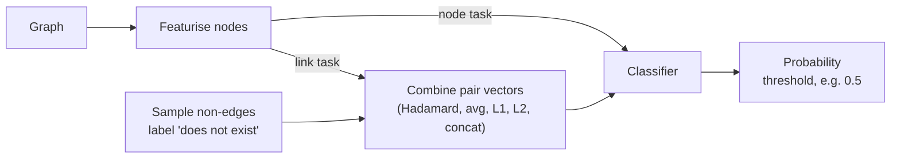

# 13 — Learning on Graphs: Tasks and Features

> Notes 09–12 query the edges a graph already has. Graph ML predicts the ones it doesn't: missing links, unlabeled nodes, hidden communities. A prediction is a claim, not a fact, so it enters the graph with a confidence score.

All book citations in this note are to Negro et al., *Knowledge Graphs and LLMs in Action* (Manning, 2025), abbreviated *KG & LLMs in Action*.

---

## Where it sits

This is the **Learning** pillar from [note 09](09-kg-fundamentals-and-cypher.md#what-a-knowledge-graph-is). You can build, query and share a KG without it. It earns its place when:

- the graph is **incomplete** and you want candidate edges ("which drug might treat this disease?", "which accounts are linked to this fraud ring?");
- you need **labels** for nodes nobody has labelled (bot, fraudster, protein function);
- the graph is too large to inspect, and **communities** give you a summary of it.

Two pieces of the earlier notes are already graph ML: **WCC** clusters mentions in entity resolution ([note 10](10-building-kgs-with-llms.md#graph-based-er-ch6)), and GraphRAG's **community summaries** rest on community detection ([note 11](11-kg-rag-and-text-to-cypher.md#retrieval-modes)).

The book frames all of this as the engine of an **intelligent advisory system**: one that surfaces something a user couldn't extract by querying alone, such as a drug-repurposing candidate in a disease–gene–compound graph (*KG & LLMs in Action*, ch. 9). Its case for graph ML has three parts: almost any data (tables, sequences, time series) can be recast as a graph; many business problems reduce to a handful of graph tasks; and graph models use the dependencies between records that classical ML throws away. [ch. 9 PDF](../sources/kg-and-llms-in-action/ch09-ml-on-knowledge-graphs.pdf)

---

## Why graphs need their own ML

Classical ML assumes data points are **i.i.d.** (independent and identically distributed). Nodes aren't. Three patterns break the assumption (*KG & LLMs in Action*, ch. 9):

| Pattern | Means | Example |
|---|---|---|
| **Homophily** | Connected nodes tend to be alike | Friends share interests |
| **Structural equivalence** | Nodes with similar neighbourhoods play similar roles, even far apart | Proteins with the same interaction shape share function |
| **Heterophily** | Connected nodes tend to differ | Buyers connect to sellers |

So node tasks are usually **semisupervised**. Training sees the whole graph, unlabelled nodes included; only their labels are missing, and their neighbourhoods still inform the model. That differs from textbook supervised learning, where test points are unseen at training time, and from textbook semisupervised learning, which still assumes i.i.d. (ch. 9).

Graphs are incomplete for two reasons: the edge exists but was never recorded (or is deliberately hidden, as in fraud), or the graph is still evolving (next year's co-authorships) (ch. 9). The book stops at the two causes, but they call for different evaluation. Random held-out edges test the first; the second needs a time-based split, or the model is scored on edges it could only know from the future.

### The task map

The book's main split is not supervised vs. unsupervised but **what one data point is**: a node or edge inside one graph (*node-focused*), or a whole graph in a set of graphs (*graph-focused*) (ch. 9).

| Task | Data point | Typical use | Needs training? |
|---|---|---|---|
| **Node classification** | A node in one graph | Fraud, bots, AML, protein function; multilabel variants (which groups will this user join?) | Yes |
| **Link prediction** | A node pair in one graph | KG completion, recommendations, drug repurposing, side effects | Yes, and semisupervised like node classification; sample non-links as negatives |
| **Community detection** | The whole graph | Summarising, fraud rings, functional modules | No: WCC, Louvain, label propagation act on the graph directly |
| **Graph classification** | One whole graph among many | Molecule toxicity, enzyme vs. non-enzyme, malware | Yes; here each graph *is* an i.i.d. data point, so ordinary supervised learning applies |

A small set of tasks covers a large set of business problems. That is the book's main argument for the graph framing.

Two terms worth keeping apart: **link prediction** asks whether an edge of a fixed type exists; **relationship prediction** also predicts its type (ch. 9). The book then uses the two "interchangeably", and ch. 10 frames the difference as the classifier's output: binary (does an edge exist?) or multiclass (which type of edge?).

**Community detection is not K-means.** K-means needs *k* up front and DBSCAN groups dense points in vector space; both treat records as independent points. Graph clustering needs no *k* and lets the edges decide membership, usually by maximising **modularity** (how much denser a community's internal edges are than chance would predict). **Label propagation** is fast but random: rerun it and the communities shift slightly, so pin a seed or check stability before you store community IDs. It can also take the labels you already have as seeds, which makes it a cheap semisupervised baseline. Louvain on the 34-node karate-club graph (seed 123) finds four communities that mostly match the real post-split factions, with one boundary node landing on the wrong side (ch. 9).

### Two ways to implement

1. **Graph-native** ("collective classification"): the algorithm takes the graph itself and uses node features and neighbourhoods together. GNNs are the modern form.
2. **Featurise, then classic ML**: turn each node, edge or graph into a vector, then use any classifier (logistic regression, random forest).

For the second route, both node and link tasks reduce to ordinary classification (ch. 9):



The one hard rule: **the featurisation at prediction time must be exactly the one used at training time** (ch. 9). In a graph that keeps changing, that means versioning the feature code and recomputing features from the same snapshot logic, not reusing stale columns.

---

## Features: the bottleneck

Models want vectors, so every node, edge or graph has to be **featurised**. The approaches trade interpretability for effort (*KG & LLMs in Action*, ch. 10):

| Approach | Examples | Interpretability | Effort |
|---|---|---|---|
| **Manual** | Degree, triangles, density, closeness, betweenness, PageRank; for edges, combine node vectors (Hadamard, average, L1, L2, concatenation) or count metapaths | High: every number traces to a graph property | High |
| **Semiautomated** | ReFeX: recursive local, egonet and aggregated features from topology alone, then pruned by correlation | Balanced, and deterministic | Medium |
| **Learned** | Node2Vec, GNN embeddings | Low | Low |

Manual features keep a place even when you plan to learn embeddings: they are explainable to a reviewer, they work on small graphs, they tell you what the automated methods ought to capture, and an LLM can reason about them because they rest on well-known algorithms (ch. 10). [ch. 10 PDF](../sources/kg-and-llms-in-action/ch10-graph-feature-engineering.pdf)

**The karate-club lesson** (ch. 9). Predicting which faction each member joined after the club split:

| Features | F1 |
|---|---|
| Degree only | 0.43 |
| Node2Vec, 64-dim, untuned (walk length 30, 200 walks per node, window 10, default p = q = 1) | 0.64 |
| Degree + "neighbours in faction A" + "neighbours in faction B" (homophily, written by hand) | **0.93**, "very stable" |

Read the numbers small. The test set is 40% of 34 nodes, i.e. 14 members, so one node moves F1 by several points. The classifier was the same one-vs-rest `LogisticRegressionCV` each time, on standardised features (without scaling, a 1–1,000 degree column drowns a 0–1 centrality column), scored with weighted P/R/F1. The book says repeated runs of *both* the degree and the Node2Vec setups swing between 30% and 70% F1. With the split fixed (`random_state=0`), only the multi-worker Node2Vec walks can actually vary between runs, so the swing presumably comes from changing the split. Domain knowledge expressed as three numbers beat a generic embedding. Learned features don't remove the need to understand the graph. They need tuning (here, shorter and fewer walks was the suggested fix for over-homogeneous vectors), and a domain-informed baseline tells you whether the tuning worked. The homophily feature is a two-liner:

```python
def homophily_features(G, label="club"):
    lab = nx.get_node_attributes(G, label)
    return {n: [G.degree(n)] + [sum(lab[m] == c for m in G[n]) for c in sorted(set(lab.values()))]
            for n in G}
```

The catch: counting labelled neighbours uses the labels you're predicting. Compute it from **training labels only**, or the test nodes leak their answers into their neighbours' features. The book's listing counts the club label of every neighbour, test nodes included, so its 0.93 is an optimistic upper bound.

### Manual node features

Ch. 10 builds one feature vector per node on a 20-node toy fraud network (four known fraudsters), local features first, then global ones (*KG & LLMs in Action*, ch. 10). A node's **egonet** is the node (the ego) plus its one-hop neighbours (the alters).

| Feature | Scope | Fraud-aware variant | What it says | Value on the toy graph |
|---|---|---|---|---|
| **Degree** | Local | Split into fraud degree and legit degree | More fraudulent neighbours, more risk | D: 4 neighbours, 2 of them fraudsters |
| **Triangles** | Local | Fraudulent (both alters fraud), semifraudulent (one), legitimate (none) | Tight clustering; a fraud triangle is a ring signal | D: 2 triangles, D–E–F fraudulent, D–F–G semifraudulent |
| **Egonet density** | Local | None | Share of possible egonet edges that exist: 2M / N(N−1) | A: 7 nodes, 7 of 21 possible edges, 0.33 |
| **Geodesic distance** | Global | Distance to the nearest fraudster, and the number of fraudsters at 1, 2, 3 hops | Proximity to contamination | 0 for a fraudster; A: 1 (I is a neighbour) |
| **Closeness** | Global | None | Inverse of mean shortest-path distance to everyone | A highest (0.5); R, S lowest (0.24) |
| **Betweenness** | Global | None | Share of shortest paths that pass through the node: a bridge | A = 104 (unnormalised; the book's code passes `normalized=True`, which gives 0.61); nine nodes are 0 |
| **PageRank** | Global | Personalised toward known fraudsters | Importance weighted by the importance of who points at you | A tops base PageRank (0.108) |

Two practical fixes from the chapter. Closeness breaks on disconnected graphs (distance to an unreachable node is infinite), so average over **reachable nodes only** and scale by the reachable fraction, which is what `networkx` does. And the PageRank pair is more useful than either number: the gap between base and fraud-personalised PageRank flags nodes whose fraud exposure is larger than their general prominence. The book reports D jumping to the top of the fraud-weighted ranking (0.168). Rerunning its setup as described (personalisation weight 2.0 on fraudsters) leaves A on top with D at about 0.085, so treat the exact numbers as sensitive to the weight; the divergence idea is what transfers.

The fraudster counts by hop have two definitions in the chapter, and they disagree. Its code counts fraudsters by shortest-path distance (A has 1, 2 and 1 at one, two and three hops). Its table counts walks, entries of the adjacency matrix raised to the power 2 or 3, which revisit nodes and count a fraudster once per route (A gets 4 and 18, and D's count includes walks that return to D). Pick one and document it; walk counts grow with degree and mostly re-measure it.

Assembling and training is ordinary tabular ML: one row per node, a **stratified** 80/20 split so both sides keep the fraud/legit ratio, `StandardScaler`, logistic regression, and the absolute coefficients as a first read on feature importance (ch. 10). With 20 nodes and four fraudsters, that split leaves one fraudster in the test set. The book draws the same conclusion and doesn't report the toy's results at all, since the graph is "too small to be statistically relevant".

### Manual relationship features

For link prediction a node *pair* needs one vector. Two families (ch. 10):

**Node-based combination**: merge the two node vectors *u* and *v*.

| Operator | Element *i* | Length | Notes |
|---|---|---|---|
| Concatenate | u ‖ v | 2n | Keeps direction; order matters |
| Average | (uᵢ + vᵢ) / 2 | n | Symmetric |
| L1 | \|uᵢ − vᵢ\| | n | Symmetric; a per-dimension distance |
| L2 | (uᵢ − vᵢ)² | n | Symmetric; penalises big gaps |
| Hadamard | uᵢ · vᵢ | n | Symmetric; the operator that won node2vec's own link-prediction benchmarks (Grover & Leskovec, 2016), not a claim the book makes |

There is no rule for which one wins; benchmark them on your task. With hand-made node features this family tends to lose to path-based features. It does better once the node vectors are learned (ch. 10).

**Path-based features** describe the pair by how it is connected. A **metapath** is a typed walk through the schema (the *metagraph*), e.g. Compound–binds–Gene–associates–Disease, abbreviated CbGaD. For drug repurposing on Hetionet (19 public databases, more than 50,000 nodes), every compound–disease pair gets one column per metapath, whether or not the pair is directly linked. Himmelstein et al. evaluated every compound-to-disease metapath of length 2 to 4, and the approach surfaced depression and alcoholism drugs as candidates for smoking addiction and epilepsy (ch. 10):

| Metapath | Length | Reads as |
|---|---|---|
| CbGaD | 2 | The drug binds a gene associated with the disease |
| CdGuD | 2 | The drug down-regulates a gene the disease up-regulates |
| CrCtD | 2 | The drug resembles a drug that treats the disease |
| CbGbCtD | 3 | It binds a gene that another treating drug also binds |
| CbGeAlD | 3 | It binds a gene expressed in tissue where the disease localises |
| CbGiGiGaD | 4 | It binds a gene two interaction steps from a disease gene |
| CbGpPWpGaD | 4 | It binds a gene in a pathway shared with a disease gene |

### DWPC: discount the hubs

Counting paths between two nodes overrates connections that go through **hubs**, the nodes connected to everything. **Degree-weighted path count** damps each path by the degrees of the nodes it passes through, so specific connections outrank generic ones (*KG & LLMs in Action*, ch. 4 and ch. 10). It was introduced by Himmelstein et al. for Hetionet, adapting the PathPredict method from social network analysis (ch. 4). It is the same instinct as dropping hub nodes in NED ([note 10](10-building-kgs-with-llms.md#ned-against-an-ontology-ch78)): a path through "Infectious process" says almost nothing. [ch. 4 PDF](../sources/kg-and-llms-in-action/ch04-multisource-integration.pdf)

**The formula.** For one path, collect the metaedge-specific degree of both endpoints of every edge on it (degree counted only over edges of that type), raise each to −*w*, and multiply. That is the **path-degree product** (PDP). DWPC sums PDPs over all paths that match the metapath:

```
PDP(path)        = ∏ d^(−w)      over the 2 × (path length) degrees on the path
DWPC_m(s, t)     = Σ PDP(path)   over all paths of metapath m from s to t
```

*w* = 0 gives plain path count; the book's queries use *w* = 0.4. Worked example (ch. 4): a two-edge path IRF1–CXCR4–multiple sclerosis with endpoint degrees 4, 2, 1, 4 and *w* = 0.5 gives 4^−0.5 · 2^−0.5 · 1 · 4^−0.5 ≈ 0.177.

In Cypher (Neo4j 5), one metapath for one pair:

```cypher
// CbGaD between one compound and one disease, damping w = 0.4
MATCH path = (c:Compound {name: $compound})-[:BINDS_CbG]-(g:Gene)
             -[:ASSOCIATES_DaG]-(d:Disease {name: $disease})
WITH path, [COUNT { (c)-[:BINDS_CbG]-() },      COUNT { (g)-[:BINDS_CbG]-() },
            COUNT { (g)-[:ASSOCIATES_DaG]-() }, COUNT { (d)-[:ASSOCIATES_DaG]-() }] AS degs
RETURN count(path) AS PC,
       sum(reduce(p = 1.0, k IN degs | p * k ^ -0.4)) AS DWPC
```

Every node on the path must be bound in the `MATCH`; the book's own listing counts degrees on an unbound variable, a slip worth checking for when you adapt it. For metformin and type 2 diabetes on CbGaD the book gets DWPC ≈ 0.0007, one cell of the feature matrix (ch. 10).

**Why it matters, in one table.** Ranking Gene Ontology processes by their connection to celiac disease (ch. 4):

| GO process | PC | Genes in process | DWPC | Rank by PC | Rank by DWPC |
|---|---|---|---|---|---|
| Positive regulation of immune system process | 21 | 880 | 0.0272 | Top | Drops down the list |
| T cell costimulation | 10 | 75 | **0.0335** | Lower | **Top** |

Raw counts surface the generic, well-studied process; DWPC surfaces the specific mechanism a researcher can act on.

DWPC scores are comparable only within one metapath and one damping exponent *w*. Ch. 4's own LLM prompt breaks this: it lists a glycoprotein-biosynthesis score (0.00342, from the GWAS + gene–gene metapath of Table 4.4) alongside four from the disease–gene–process metapath of Table 4.3 as if they were one ranking.

**Cost.** DWPC over every pair and every metapath is expensive and noisy. Himmelstein et al. cut the metapaths from 1,026 to 709 by keeping those whose values differ between known treatments and non-treatments, then restricted the candidate pairs using domain knowledge and degree-based probabilities (ch. 10). Do the same: select metapaths against labelled positives before computing the full matrix.

### LLMs help with manual features

Because manual features rest on well-known algorithms, an LLM can reason about them. Ch. 10 gives it three jobs: translating metapath descriptions into Cypher, suggesting patterns a human might miss, and writing the code that runs the queries and collects the results. The prompt that produced per-metapath PC and DWPC queries contained four things: the schema (from `apoc.meta.schema()`), one worked query for CbGaD, the list of target metapaths, and sample node names to test with. Treat the output as a draft, the same way [note 11](11-kg-rag-and-text-to-cypher.md#text-to-cypher) treats text-to-Cypher; the book itself calls it a prompting pattern, not a pipeline (ch. 10).

### Semiautomated: ReFeX

**ReFeX** (Recursive Feature eXtraction) sits between hand-made and learned features. It works on **topology alone**, ignoring labels and types, and is built on two rules: needing no node or edge attributes, and producing features that predict attributes where they exist and transfer across graphs (*KG & LLMs in Action*, ch. 10). The features describe the *kind* of nodes a node connects to, not which nodes: "it is who you know, or who you relate to". That is why they can be compared across different networks, or across snapshots of one network over time, which embeddings trained separately per graph can't offer.

It runs in three stages, then prunes:

1. **Local**: degree (in/out separately on directed graphs; weighted variants sum edge weights).
2. **Egonet**: edges inside the egonet, and edges leaving it.
3. **Recursive**: for every existing feature, the **sum** and **mean** over the node's neighbours (over in- and out-neighbours separately on directed graphs); repeat, so each round reaches one hop further (`sum(mean(degree))` describes the two-hop region; the book's example of a deeper name is `degree(sum)(mean)(mean)(sum)`).
4. **Prune**: recursion multiplies the feature count each round, so drop any feature highly correlated with an earlier one. The original method also uses logarithmic binning and threshold-based pruning.

Node A of the toy fraud graph, by hand (ch. 10):

| Stage | Feature | A |
|---|---|---|
| Local | Degree | 6 |
| Egonet | Edges inside the egonet | 7 |
| Egonet | Edges leaving the egonet | 9 |
| Recursive 1 | Sum / mean of neighbours' degrees | 17 / 2.83 |
| Recursive 2 | Sum / mean of neighbours' round-1 sums | 69 / 11.5 |

A minimal version. With `max_corr` above 1 (pruning off) it reproduces the table above; at the default 0.95 the round-2 sum (69) is pruned on this graph, because it tracks an earlier column. The book's own code computes different egonet features (node count, edge count and density, not edges leaving the egonet), so its vectors won't match this one column for column.

```python
import networkx as nx, numpy as np

def refex(G, rounds=2, max_corr=0.95):
    nodes = list(G); pos = {n: i for i, n in enumerate(nodes)}
    def ego(n):
        e = set(G[n]) | {n}
        return [G.subgraph(e).number_of_edges(), sum(v not in e for u in e for v in G[u])]
    F = np.array([[G.degree(n), *ego(n)] for n in nodes], float)
    for _ in range(rounds):
        nbrs = [[pos[m] for m in G[n]] for n in nodes]
        F = np.hstack([F, [F[i].sum(0) for i in nbrs], [F[i].mean(0) for i in nbrs]])
        C = np.abs(np.corrcoef(F.T))
        F = F[:, [j for j in range(F.shape[1]) if not (C[:j, j] > max_corr).any()]]
    return nodes, F
```

What it buys: **deterministic** output (same graph, same features, which matters for reproducible production runs), features that still have a structural meaning, and **selective recomputation** when part of the graph changes. What it can't do: use node attributes or edge types. A domain expert still has to validate which surviving features matter (ch. 10).

---

## Working reference

`~/.claude/refs/agent-eval.md`: precision/recall trade-offs and held-out evaluation.

Depth: [ch. 4 PDF](../sources/kg-and-llms-in-action/ch04-multisource-integration.pdf) (Hetionet, metapaths, DWPC, celiac case), [ch. 9 PDF](../sources/kg-and-llms-in-action/ch09-ml-on-knowledge-graphs.pdf) (task taxonomy, karate club), [ch. 10 PDF](../sources/kg-and-llms-in-action/ch10-graph-feature-engineering.pdf) (manual features, metapaths, DWPC, ReFeX).

---

→ Next: [13b-representation-learning-and-gnns.md](13b-representation-learning-and-gnns.md): when hand-built features stop scaling, learn the vectors instead.
