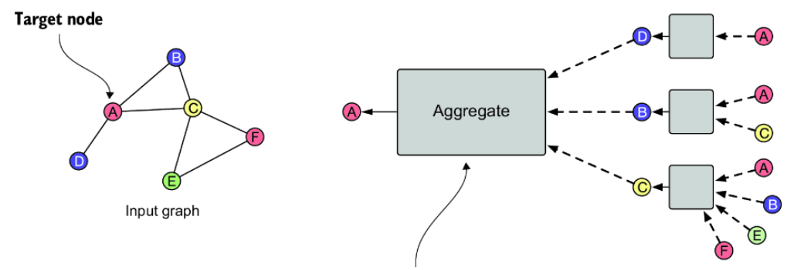
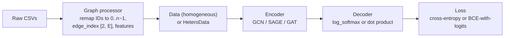
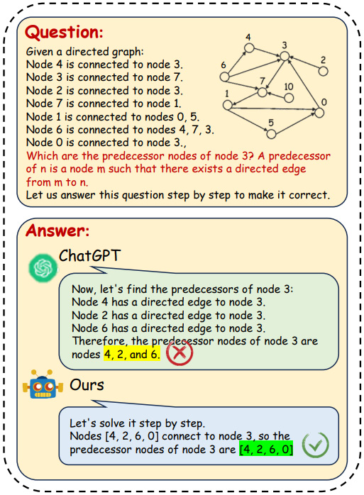

# 13b — Learning on Graphs: Embeddings and GNNs

> Hand-built features need someone to decide what matters. Embeddings and GNNs learn the vectors, and they give up the interpretability and the leak-free defaults you had before.

Manual features don't scale to graphs with millions of nodes, and learned ones bring new ways to fool yourself: 0.95–0.98 weighted F1 while catching 68–83% of illicit nodes, or a model that simply sees the link it was meant to predict. This chapter covers embeddings and GNNs, how to split edges without leakage, and what to do with predictions once they land in a graph agents read.

All book citations in this note are to Negro et al., *Knowledge Graphs and LLMs in Action* (Manning, 2025), abbreviated *KG & LLMs in Action*.

---

## Where it sits

[Note 13](13-graph-ml-and-gnns.md) set out the task map and the manual features: counts, metapaths, DWPC and ReFeX. This note learns the vectors instead, then asks where an LLM fits and how predictions enter a graph that agents read.

---

## Representation learning

Manual features don't scale to KGs with millions of nodes. **Graph representation learning** learns the vectors instead. The book describes three generations: classical dimensionality reduction; word2vec-style methods such as Node2Vec, which treat random walks as sentences; and GNNs, which do for graphs what deep learning did for raw pixels (*KG & LLMs in Action*, ch. 11). [ch. 11 PDF](../sources/kg-and-llms-in-action/ch11-graph-representation-learning-gnns.pdf)

### Encoder–decoder: one frame for everything

Every graph representation learning method is an **encoder** (structure → vector) plus a **decoder** (vector → the property you care about) (ch. 11). Matrix factorisation, Node2Vec's random walks and GNNs differ only in how good the encoder is and which task the decoder serves.

| Part | Takes | Ranges from | Trains on |
|---|---|---|---|
| **Encoder** | Adjacency (structure) and, optionally, node features | A lookup table up to a deep GNN | — |
| **Decoder** | One or two embeddings | Dot product, softmax, a classifier head | The training signal: "are these connected?", neighbourhood overlap, or a node label |

**Node2Vec in this frame** (ch. 11): the encoder generates biased random walks and gives nodes that co-occur on walks similar vectors; the decoder is a softmax asking "given *i*'s vector, how likely is *j* to appear near it on a walk?". The bias comes from the original paper (Grover & Leskovec, 2016): having just stepped from *t* to *v*, the walk moves to a next node *x* with unnormalised weight 1/*p* if *x* = *t* (go back), 1 if *x* is also a neighbour of *t*, and 1/*q* if *x* is farther from *t*. Low *q* pushes the walk outward (DFS-like, finds communities); high *q* keeps it local (BFS-like, finds structural roles). The book's gloss swaps the labels, calling exploring other circles "going broad" and staying in a tight group "going deep"; in the paper's terms that is the other way round. With *p* = *q* = 1 the walk is unbiased, i.e. DeepWalk, and that is what the book runs: its karate listing sets 16 dimensions, walk length 10, 20 walks per node, window 5, *p* = *q* = 1. The book reports the result only qualitatively: the vectors cluster by faction, members with friends in both camps land in between, and the two leaders get distinct vectors. Similarity to each leader predicts which faction a member joins.

Choose the embedding along four axes (ch. 11):

| Axis | Options | Pick by |
|---|---|---|
| What it preserves | **Positional** (where a node sits globally) vs. **structural** (what role it plays locally) | Link prediction and clustering lean positional; classification leans structural, which is where GNNs do well |
| New nodes | **Transductive** (fixed node set) vs. **inductive** (works on unseen nodes) | A graph that grows needs inductive |
| Geometry | **Euclidean** vs. **hyperbolic** | Hyperbolic only with evidence of strong hierarchy (taxonomies, org charts) |
| Supervision | **Unsupervised** (structure alone) vs. **supervised** (labels steer the vectors) | Labels for the task you care about → supervised |

Why hyperbolic suits hierarchies: available space grows exponentially outward, as a tree's node count does, while Euclidean space grows only polynomially. The cost is special distance functions everywhere downstream (indexing, visualisation, interpretation), so it is a whole-pipeline decision, not a model flag (ch. 11). The book's examples: a professional network wants structural vectors for similar roles, inductive learning for new members, and supervision from job titles; a medical KG wants hyperbolic geometry for its term hierarchy.

**Shallow embeddings** (one learned vector per node, as in Node2Vec) are simple but have four limits (ch. 11):

- **Parameters grow with the graph**: a million users means a million vectors.
- **No parameter sharing**: the same role in two parts of the graph is learned twice.
- **Feature-blind**: no natural place for node attributes.
- **Transductive**: a new node has no row in the table, so it means retraining.

They remain a fair baseline for small, static graphs. Those limits are why GNNs exist.

### KG embeddings

KGs are **multirelational**: (Aspirin, TREATS, Headache) and (Aspirin, INHIBITS, COX-2) are different facts about the same pair, so the embedding must encode *how* entities relate, not just *whether* (*KG & LLMs in Action*, ch. 11). That takes two pieces: a loss that scales, and a decoder that understands relation types.

**Loss: negative sampling.** Scoring all pairs is hopeless (a million nodes means about a trillion candidate edges, nearly all absent). Instead, each true triple (u, τ, v) is scored against a few corrupted ones (u, τ, vₙ):

```
L = Σ over true triples [ −log σ(DEC(z_u, τ, z_v))  −  γ · E_{vₙ}[ log σ(−DEC(z_u, τ, z_vₙ)) ] ]
```

The first term rewards a high score for the true fact; the second penalises a high score for the corruption. Because KGs are sparse, γ > 1 is typical, and 5–10 negatives per true triple is the usual budget (ch. 11).

**How you pick negatives matters** (ch. 11):

| Strategy | Example for (Aspirin, TREATS, ?) | Problem it addresses |
|---|---|---|
| Random | Laptop | Cheap, but too easy to teach anything; may hit a true-but-unrecorded edge (filter known triples out) |
| Type-constrained | Another disease | Forces finer distinctions |
| Adversarial | A disease the model currently confuses with the real one | Hardest examples, most signal |
| Corrupt head, tail or both | Sunlight TREATS Headache; Aspirin TREATS Happiness | Avoids a directional bias |

**Decoders** differ in which relation patterns they can represent: symmetric (`similar_to`), asymmetric (`causes`), inverse (`contains` / `part_of`) and compositional (A treats B, B is-a C, so A treats C) (ch. 11):

| Family | Example | Relation is… | Strength | Weakness |
|---|---|---|---|---|
| Translation | TransE | A vector added to the head to land on the tail | Intuitive; handles composition | Many-to-one relations |
| Matrix | RESCAL | A matrix transforming the head | Expressive | Parameter-heavy: one d × d matrix per relation type |
| Semantic matching | DistMult, ComplEx | A relation-conditioned similarity; ComplEx uses complex numbers | ComplEx handles asymmetry | DistMult's score is symmetric in head and tail, so it can't tell `causes` from `caused_by`; both may miss composition |

RESCAL's cost is per relation, not per entity. The book's illustration, "1,000 entities and 100 relationship types, we'd need millions of parameters", holds because of the relation count: 100 matrices at d = 100 is already 1M parameters, whatever the number of entities. DistMult is RESCAL with each matrix restricted to its diagonal (d parameters per relation), which is where its symmetry comes from.

Raieli and Iuculano add two decoders that answer the table's weaknesses (*Building AI Agents with LLMs, RAG, and Knowledge Graphs*, ch. 7). **RotatE** models each relation as a rotation in complex space, which covers symmetry, antisymmetry, inversion and composition together. Their examples: marriage is symmetric, and "my nephew is my brother's son" is a composition. **ATTH** embeds in hyperbolic space to keep hierarchies (the geometry row above) together with logical patterns. Their reason for caring about structure: standard embeddings lose a large KG's hierarchies, chains and rings, and those are the structures that reasoning and subgraph extraction depend on (ch. 7, Fig. 7.26). Pick the decoder by the relation patterns your questions use. If they depend on composition or symmetry, DistMult can't represent them.

### Message passing

A GNN layer has each node **aggregate** its neighbours' vectors and **update** its own. After *k* layers a node's embedding encodes its *k*-hop neighbourhood, both its shape (an atom can come to "know" it sits in a benzene ring) and its neighbours' features (a paper absorbs related papers' content) (*KG & LLMs in Action*, ch. 11).


*Image Source: Negro et al., Knowledge Graphs and LLMs in Action, Fig. 11.5 (2025)*

The picture is two layers unrolled: the boxes on the right are the first layer's aggregations at D, B and C, and the big box is the second layer's aggregation at A. The basic layer is a normal neural-network layer whose input is a sum over however many neighbours the node has:

```
h_u⁽ᵏ⁾ = σ( W_self · h_u⁽ᵏ⁻¹⁾  +  W_neigh · Σ_{v ∈ N(u)} h_v⁽ᵏ⁻¹⁾  +  b )
          └── UPDATE ──┘          └──── AGGREGATE ────┘
```

*W* can be shared across layers or learned per layer, and the bias is often dropped (ch. 11).

The **self-loop** variant treats a node as its own neighbour, h_u⁽ᵏ⁾ = AGGREGATE({h_v : v ∈ N(u) ∪ {u}}), and uses one weight matrix. The book credits it with simplicity, stability and less overfitting through parameter sharing. The cost is that it can no longer weigh "me" differently from "my neighbours", which matters when a node's own features are its strongest signal (ch. 11). GCN is built this way.

The variants fix specific problems (ch. 11):

**Normalisation** stops high-degree nodes from dominating.

| Scheme | Aggregate | Use when |
|---|---|---|
| Sum | Σ h_v | Degree itself is informative |
| Mean | Σ h_v / \|N(u)\| | Simple degree variance |
| Symmetric (GCN, Kipf & Welling) | Σ h_v / √(\|N(u)\| · \|N(v)\|) | Wide degree range; stops a heavily cited paper from flooding its citers |

Normalisation is lossy: after it, nodes are harder to tell apart by degree. Prefer it when features matter more than structure, or when degree spread destabilises training.

**Attention** (GAT) weights neighbours by relevance instead of equally: m_u = Σ α_uv · h_v, with α_uv a softmax over the neighbourhood of a score aᵀ[W h_u ‖ W h_v] (ch. 11). The book's formula leaves out the LeakyReLU that the original GAT paper (Veličković et al., 2018) and PyG's `GATConv` apply to that score before the softmax. The parameters are one shared *W* and one vector *a* per head; the score is *computed* per edge, not learned per edge. Use it when neighbour importance varies or many edges are noise. **Multi-head attention** is the transformer mechanism applied to a neighbourhood: each head learns its own query/key/value projections and can specialise (bond type vs. spatial layout in a molecule), and the per-edge weights double as an explanation. Some graph transformers also add **structural encodings** (e.g. a learned vector per degree), playing the role positional encodings play for token order.

**Update variants** fight **over-smoothing**, where deep stacks make every node look the same:

| Update | How | Use when |
|---|---|---|
| Skip / concat (GraphSAGE) | Concatenate the node's own vector with the aggregate before the linear layer | Default; keeps the node's original features reachable and helps gradients. (The book also cites GraphSAGE as an example of attention in aggregation; it isn't. Its aggregators are mean, LSTM and pooling.) |
| Gated (GRU-style) | A learned gate mixes old state and new candidate per dimension | Some nodes should stay stable; noisy neighbourhoods (the book suggests citation graphs) |
| Jumping knowledge | Keep every layer's output and combine them (concat, max, or an LSTM) | Different nodes need different hop depths; multiscale structure (the book suggests molecules) |

The choice of update matters as much as the choice of aggregation, and the richer options cost time and memory (ch. 11).

The three layers ch. 12 compares, as PyG implements them (one layer, node *u*, before the activation):

```
GCN   (GCNConv)   h_u' = W · Σ_{v ∈ N(u) ∪ {u}} h_v / √(d̂_u · d̂_v)          d̂ = degree + 1 (self-loop)
SAGE  (SAGEConv)  h_u' = W_root · h_u  +  W_neigh · mean_{v ∈ N(u)} h_v        = W · [h_u ‖ mean h_v]
GAT   (GATConv)   h_u' = Σ_{v ∈ N(u) ∪ {u}} α_uv · W h_v,
                  α_uv = softmax_v( LeakyReLU( aᵀ [W h_u ‖ W h_v] ) )          one (W, a) per head
```

So GCN is self-loops plus symmetric normalisation plus one matrix, SAGE is the concat update with a mean aggregator, and GAT is self-loops plus attention.

### In practice (ch12, PyTorch Geometric)

Ch. 12 runs the same pipeline on two problems and compares three PyG encoders: **GCN**, **GraphSAGE** and **GAT**, each two layers with a ReLU between (*KG & LLMs in Action*, ch. 12). [ch. 12 PDF](../sources/kg-and-llms-in-action/ch12-node-classification-link-prediction.pdf)



| | Node classification: AML (Elliptic) | Link prediction: recommendations (MovieLens) |
|---|---|---|
| Data | 203,769 Bitcoin transactions, 234,355 payment edges, 166 anonymised features; 77% unlabelled, 2.2% illicit | 610 users, 9,742 movies, 100,836 ratings; movie features = 20 one-hot genres; only "rated or not" is predicted |
| Graph | Homogeneous (`Data`) | Heterogeneous (`HeteroData`, users and movies; `ToUndirected()` adds reverse `rev_rates` edges so messages flow both ways; `to_hetero()` converts the base GNN) |
| Input vectors | The 166 features | Users: a learned lookup only (no features). Movies: linear map of genres **plus** a learned lookup. The genre path carries some signal for a new movie, but the lookup is indexed by node ID, so the model is still transductive |
| Decoder | `log_softmax` + cross-entropy | Dot product + binary cross-entropy on logits |
| Splitting | Node masks; most nodes are unlabelled | `RandomLinkSplit`, with **message-passing edges kept apart from supervision edges** to avoid leakage |
| Result | SAGE caught the most illicit nodes (82.7%) and had the best weighted F1; GCN missed 32% | SAGE fewest false positives; GCN best recall |

**Node-classification details.** Unknown-label nodes stay in the graph, so they still pass messages, but a mask keeps them out of the loss and the metrics. The labelled nodes split 80/10/10 at random (37,251 / 4,656 / 4,657), and each split keeps roughly 90% licit / 10% illicit (ch. 12). Elliptic is a time series, and a random node split lets the model train on transactions later than the ones it is tested on; the dataset's authors (Weber et al., 2019) split by time step instead, which is the harder and more honest test.

The book scores with sklearn's `average='weighted'`. That doesn't escape the imbalance: weighting by class support makes the 90% licit class dominate, which is why all three models sit near 0.95–0.98 weighted F1 on validation while catching only 68–83% of illicit nodes. For AML, report the illicit class's own recall and precision (or macro F1).

**Link-prediction details.** The leakage trap is the core lesson. A minimal split:

```python
import torch_geometric.transforms as T
split = T.RandomLinkSplit(
    num_val=0.1, num_test=0.1,
    disjoint_train_ratio=0.3,          # 30% of train edges become labels, never messages
    neg_sampling_ratio=2.0,            # 2 non-edges per positive in val/test
    add_negative_train_samples=False,  # the loader samples fresh negatives each batch
    edge_types=("user", "rates", "movie"),
    rev_edge_types=("movie", "rev_rates", "user"),
)
train, val, test = split(data)
```

If an edge the model is asked to predict is also present in the message-passing graph, the model can simply see it, and training metrics become meaningless. In the book's run the 80,669 training edges split into 56,469 message-passing edges (`edge_index`) and 24,201 supervision edges (`edge_label_index`). Reverse edges are only ever messages. Validation and test reuse all earlier edges for message passing and add their own labelled positives plus sampled negatives (validation: 10,083 positives, 20,166 negatives; test passes messages over 90,753 edges). For graphs that don't fit in memory, `LinkNeighborLoader` samples a subgraph per batch, e.g. 20 neighbours at hop 1 and 10 at hop 2, 128 supervision edges per batch with 2 sampled negatives each (ch. 12).

Check what the loader samples from. As printed, the book's training loader is built with `data=data`, the full graph, while taking `edge_label_index` from `train_data`. Message passing then runs over every rating, including the supervision edges and the validation and test edges: exactly the leakage the split was set up to prevent. Pass `data=train_data` (and `val_data` / `test_data` for the evaluation loaders).

Two PyG gotchas from the chapter: GAT needs its own subclass because the first layer's multi-head output is `hidden × heads` wide and the last layer must not concatenate (`concat=False`); and a heterogeneous "GCN" uses `GraphConv`, not `GCNConv`, because `GCNConv` assumes one node and edge type, whereas `GraphConv` has separate root and neighbour weights. `GraphConv` sums neighbours with no degree normalisation, so the link-prediction "GCN" is really an unnormalised two-matrix layer, structurally the same as SAGE with a sum in place of the mean.

**Cost and confusion matrices** (ch. 12; Colab T4, 400 epochs for AML, 55 for MovieLens; one run each, no seeds or error bars). The AML rates are read from the book's confusion-matrix figure, whose test set (451 illicit, 4,206 licit) doesn't match its split table (476 / 4,181), and the prose gives other counts again (SAGE missing 88 illicit nodes where the figure shows 78). Treat them as one illustrative run:

| Encoder | AML params / time | AML illicit caught | AML licit flagged | Links params / time | Links found (recall) | Non-links wrongly predicted |
|---|---|---|---|---|---|---|
| GCN | 2,723 / 19 s | 68% | 1.2% | 713k / 826 s | **78.6%** | 8.3% |
| GAT | 22,025 / 43 s | 81% | 1.0% | 1.07M / 956 s | 75.4% | 11.7% |
| SAGE | 5,427 / 37 s | **83%** | 1.1% | 713k / 777 s | 71.5% | **5.4%** |

Across both tasks **GAT** had the most parameters and the slowest training. It beat GCN on AML (81% vs. 68% of illicit caught) but never beat SAGE, and on MovieLens it had the most false positives (11.7%). (The book's prose says GAT "struggles with recall" there, but its own test confusion matrix puts GAT's recall at 75.4%, above SAGE's 71.5%.) The book puts its size down to "learnable coefficients for the neighborhood edges"; the counts say otherwise. The AML figures fit exactly with a hidden width of 16 and a 3-way output (the "unknown" class gets an output too, though the mask never trains it): GCN 166·16+16 + 16·3+3 = 2,723; SAGE doubles each weight matrix (root and neighbour) for 5,427; GAT's 8 heads make the first layer 128 wide, 166·128 = 21,248 weights, against only 262 attention parameters, for 22,025. The cost of attention is computing a score on every edge, not storing one. On MovieLens, GCN and SAGE have identical counts (713,408) because `GraphConv` and `SAGEConv` both carry one root and one neighbour matrix per layer, and most of those parameters are the user and movie lookup tables (10,352 rows), which the book names as the main reason link prediction is so much heavier. GCN vs. SAGE is a precision/recall choice. Make it from the cost of each error: AML can't afford missed illicit accounts, and a recommender shouldn't over-suggest. The book's verdicts follow this: SAGE for AML, and GCN as the best overall balance for recommendations despite SAGE's lower false-positive rate.

---

## GNNs and LLMs together

GNNs handle structure and struggle with text. LLMs are the reverse. Ch. 11 names three ways to combine them (*KG & LLMs in Action*, ch. 11). Raieli and Iuculano give the same encoder example, abstracts embedded as node features for a citation network, and add a fourth pattern (*Building AI Agents with LLMs, RAG, and Knowledge Graphs*, ch. 7):

| Pattern | Flow | Example |
|---|---|---|
| **LLM as predictor** | GNN encodes the structure; the LLM produces the final output | KG question answering that explains a structural finding |
| **LLM as encoder** | The LLM embeds node text; the GNN propagates it over edges | Paper abstracts as node features for citation prediction |
| **LLM as aligner** | Both run in parallel, aligned by contrastive training | Multimodal KGs where both text and structure matter |
| **LLM as labeller** | The LLM labels nodes zero-shot from their text; the GNN trains on those labels | Topic labels for papers from their titles, instead of paying annotators |

The predictor pattern is what the book's advisory systems do: a structural result (a DWPC ranking, a predicted link) gets explained in domain language. The LLM narrates; it doesn't decide. That is ch. 4's rule for clinical use, where the authors warn against acting on LLM interpretations of clinical-KG findings without expert review, and a reasonable default anywhere (*KG & LLMs in Action*, ch. 4).

The labeller row is worth noting for cost. [The task map](13-graph-ml-and-gnns.md#the-task-map) says node classification needs training, and training needs labels. A zero-shot LLM pass gives a first set of labels quickly, and a person can check a sample of them before the GNN learns from them. The book also mentions fine-tuning the LLM and the GNN jointly (ch. 7).

### When the LLM does the graph reasoning itself

The alternative to pairing an LLM with a GNN is asking the LLM to reason over the graph directly. Raieli and Iuculano separate two kinds of task, following a graph-and-LLM survey ([arXiv 2404.14809](https://arxiv.org/abs/2404.14809), not yet read for this course) (ch. 7):

- **Structure understanding**: degree, path search, shortest path, topological sort, Hamilton path. The first ones are easy and the last two are much harder.
- **Graph learning**: node, edge and graph classification, explaining a node's features, and KG question answering. These need the attributes as well as the structure.

There are three ways to prompt for it: a **manual** prompt with the graph inlined (plus an explanation of the algorithm, such as DFS, if you want it followed), limited by context length; **self-prompting**, where the model rewrites its own prompt over several rounds; and **API-call** prompts, where the model calls graph tools. The fourth option is **supervised fine-tuning** on graph tasks (ch. 7).

The chapter is frank about the limits. LLMs read a graph as linear text and attend to node labels more than to topology. Tokenisation breaks numbers apart, which hurts tasks that count or compare. Training corpora contain little graph data. The models "succeed in solving simple tasks on small graphs, but their performance decays rapidly as both graph and task complexity increase" (ch. 7). The book's evidence that fine-tuning helps is one figure:


*Image Source: Salvatore Raieli & Gabriele Iuculano, *Building AI Agents with LLMs, RAG, and Knowledge Graphs* (Packt, 2025), Fig. 7.31*

The figure comes from the paper the book cites ([arXiv 2403.04483](https://arxiv.org/abs/2403.04483), not yet read for this course). It shows a single question. Behind the book's claim that "SFT on graph datasets allows for results that are better than much larger models", the chapter gives one example, not a benchmark. The miss is worth studying anyway. Node 0's edge to 3 is on the **last line** of the list, and ChatGPT's answer goes through the edges in order and leaves that one out. Asking a model to scan a list of edges is a poor way to run a graph algorithm.

The practical rule follows. **Don't ask the model to do what a graph query does exactly.** Degree, paths, predecessors and topological order are one line of Cypher or `networkx`, and both are always right. Give the model those as tools (the API-call approach and the canned traversals of [note 11](11-kg-rag-and-text-to-cypher.md#retrieval-modes)), and keep the model for reading the question and explaining the result. Fine-tune only if you have a graph task no algorithm covers and enough labelled examples.

The chapter ends with **graph-formed reasoning** ([01-prompt note 03](../../01-prompt-engineering/notes/03-core-techniques.md#tree-of-thoughts)). *Think on the graph* treats intermediate thoughts as nodes and their dependencies as edges, as in Graph of Thoughts. It is expensive, with several calls per answer, and used for reasoning problems such as maths. *Verify on the graph* generates several lines of reasoning, joins them in a graph and has a verifier, usually another LLM, look for contradictions between paths. The book's worked example contradicts itself: the question is about "60 miles in 1.5 hours", and the thought nodes it lists are "Distance = 60 km" and "Speed = 40 km/h". The arithmetic is right and the unit has changed. It is an accidental demonstration of the point of verification. A checker that compares each node with the question would have caught it, and a single chain of thought never looks back.


---

## Predictions in a shared graph

A predicted edge is the clearest case of note 12's rule that **claims are not truths**. If a link-prediction model writes into a graph that agents read:

- Write it through the `GraphUpdate` path with a distinct edge type or a `predicted: true` property, the model's `confidence`, and the `run_id` of the training run ([note 12](12-kg-as-shared-agent-memory.md#the-write-path-graphupdate)).
- Keep predicted edges out of default traversals. A query should opt in to them.
- Never feed predicted edges back in as message-passing or supervision edges for the next training run unless they've been confirmed; otherwise the model learns from its own guesses.
- Evaluate on held-out edges, and watch the **false-positive rate**. A false link does what a false merge does in [note 10](10-building-kgs-with-llms.md): every later traversal follows it confidently.

---

## Working reference

Depth: [ch. 11 PDF](../sources/kg-and-llms-in-action/ch11-graph-representation-learning-gnns.pdf) (embeddings, KG decoders, message passing), [ch. 12 PDF](../sources/kg-and-llms-in-action/ch12-node-classification-link-prediction.pdf) (PyG walkthroughs). Raieli & Iuculano, *Building AI Agents with LLMs, RAG, and Knowledge Graphs* (Packt, 2025), ch. 7: a short survey of KG embeddings, GNNs and LLM graph reasoning.

---

## Pitfalls

- **Reporting weighted F1 on imbalanced data.** Symptom: 0.95–0.98 in validation while only 68–83% of illicit transactions are caught. Fix: report recall and false-positive rate on the class you care about.
- **Supervision edges in the message graph.** Symptom: link-prediction metrics too good to believe. Fix: split training edges into message and supervision sets, as in the book's 56,469 and 24,201.
- **Building the loader over the full graph.** Symptom: the book's `data=data` runs message passing over validation and test edges. Fix: build it over `train_data`.
- **Choosing a decoder that can't represent the relation.** Symptom: DistMult scores `causes` and `caused_by` the same. Fix: use ComplEx or RotatE for asymmetric relations.
- **Stacking GNN layers for reach.** Symptom: every node looks the same. Fix: over-smoothing is the cause, so use the update variants that counter it.
- **Asking a model for what a graph query does exactly.** Symptom: an LLM misses one predecessor of a node. Fix: degree, paths and predecessors are one line of Cypher or `networkx`, so give the model the results.
- **Feeding predictions back unconfirmed.** Symptom: the model learns from its own guesses. Fix: flag with `predicted: true`, confidence and `run_id`, keep them out of default traversals, and don't train on them until they are confirmed.

## Try it

1. On a graph of your own, hold out 10% of one edge type, score candidates with manual pair features (common neighbours, Adamic–Adar, DWPC) and with GraphSAGE plus a dot-product decoder, write the top 20 back as flagged predictions, and read them by hand to count real missing links against hub artefacts.

   <details><summary>What to look for</summary>

   Check that held-out edges are absent from message passing before reading any score. If the top 20 are dominated by high-degree nodes, they are probably hub artefacts rather than links. If the manual features tie with GraphSAGE, prefer them: they are explainable and cheaper.

   </details>

2. A KG has 100 relation types and d = 100. Compare relation parameters for RESCAL and DistMult.

   <details><summary>Answer</summary>

   RESCAL: 100 × 100 × 100 = 1,000,000, one d × d matrix per relation. DistMult: 100 × 100 = 10,000, one diagonal per relation. The saving costs symmetry: DistMult can't tell `causes` from `caused_by`.

   </details>

3. From the results table, choose an encoder for AML triage, and for a recommender where false links are costly. Say what the table can't tell you.

   <details><summary>Answer</summary>

   SAGE for both: it caught 83% of illicit nodes at 1.1% licit flagged, and on links had the lowest false positives at 5.4%, at the cost of the lowest recall (71.5%, against GCN's 78.6%). If missing a link costs more, GCN wins. These are single runs of the book's code, so the table can't tell you the spread across seeds.

   </details>

## Interview checklist

| Prompt | Answer in one line |
|---|---|
| Why negative sampling? | Scoring all pairs is hopeless: a million nodes means about a trillion candidates, nearly all absent. Each true triple is scored against a few corrupted ones. |
| What distinguishes KG embedding decoders? | The patterns they represent: symmetric, asymmetric, inverse, compositional. DistMult is symmetric in head and tail, and RESCAL's matrix per relation is expressive and parameter-heavy. |
| What are message edges and supervision edges? | Message edges carry information and supervision edges are what the model predicts. If they overlap, the model can see the answer and training metrics mean nothing. |
| Your AML model has 0.97 weighted F1. Ship it? | Not on that number. With 90% licit nodes, weighted F1 stays high while only 68–83% of illicit nodes are caught, so look at per-class recall and false positives. |
| GCN, GAT or GraphSAGE? | On the book's runs, GAT had the most parameters and never beat SAGE. SAGE caught most AML (83%) with fewest false links (5.4%), and GCN found most links (78.6%). |
| How can LLMs and GNNs combine? | As predictor, encoder, aligner or labeller: an LLM can embed node text for the GNN, or label nodes zero-shot, or narrate a structural result without deciding it. |
| What do you do with a predicted edge? | Write it through `GraphUpdate` flagged, with confidence and `run_id`, keep it out of default traversals, and watch false positives, since a false link acts like a false merge. |

## Next

[Inference engineering](../../07-inference-engineering/README.md): the next pillar, on what serving these models costs and how to make it fast. To go back to the start of this one, see [01-graph-vs-loop.md](01-graph-vs-loop.md).
