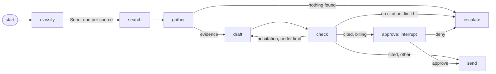

# Lab: a LangGraph support-triage graph (Python)

Pillar 05 says to start with a loop and add a node only when a signal forces it. This lab is what
the graph looks like once two signals have forced it: parallel retrieval with a join, and a human
checkpoint that has to survive a restart. It is about 100 lines of graph, with every primitive from
[note 02](../../notes/02-graph-primitives.md), [note 03](../../notes/03-state-and-reducers.md) and
[note 04](../../notes/04-durable-execution-and-interrupts.md) used once.

The [TypeScript version](../langgraph-graph-ts/README.md) reads the same `tickets.json` and `kb.json`
from this folder and prints the same report.



```bash
uv run run.py      # five tickets, one per route (uv installs langgraph from the script header)
uv run test.py     # the assertions
```

Real output with the stub, identical to the TypeScript version:

```text
model: stub

t1 [how_to] sent: classify > search:docs > search:tickets > gather > draft > check > send (95 tokens)
t2 paused at approve: Annual plans can be refunded within 30 days of renewal. [doc-refunds]
   outbox holds 1. A new graph object resumes from the checkpoint with: approve
t2 [billing] sent: classify > search:docs > search:tickets > gather > draft > check > approve > send (136 tokens)
t3 [bug] sent: classify > search:docs > search:tickets > gather > draft > check > draft > check > send (203 tokens)
t4 [how_to] escalated: classify > search:docs > search:tickets > gather > escalate (36 tokens)
t5 paused at approve: Annual plans can be refunded within 30 days of renewal. [doc-refunds]
   outbox holds 3. A new graph object resumes from the checkpoint with: deny
t5 [billing] escalated: classify > search:docs > search:tickets > gather > draft > check > approve > escalate (108 tokens)

outbox: 3 sent
  Admins add seats under Settings, Team, Seats. [doc-seats]
  Annual plans can be refunded within 30 days of renewal. [doc-refunds]
  A blank invoice page is a known bug; the fix is to clear the session. [tkt-blank-page]
```

Read it against the diagram. Ticket t3 goes round the `draft`, `check` cycle because the stub's first
draft forgets its citation. Ticket t4 finds nothing and escalates without drafting, so nothing is
invented. Tickets t2 and t5 pause with nothing added to the outbox, and a new graph object picks them
up from the checkpointer, which is what a restart would look like. The check is deterministic: code
decides whether the citation is real, not the model that wrote it.

## Things to try

1. Remove the `Annotated[..., operator.add]` from `evidence` and run it. Parallel searches now write
   the same key in one step: read the error. <details><summary>Answer</summary>LangGraph raises
   `InvalidUpdateError`, because a key with no reducer accepts one write per step.</details>
2. Move `outbox.append` above `interrupt` in a copy of `approve`, and count the sends for t2.
   <details><summary>Answer</summary>Two, one before the pause and one on resume. The node re-runs from
   its first line, which is why a side effect belongs after the interrupt or in its own node.</details>
3. Add a `bug` route that files a ticket through a new node, without touching the other routes.
   How many edges changed? Compare that with adding the same branch to a loop.
4. Swap `MemorySaver` for `SqliteSaver` (`uv run --with langgraph-checkpoint-sqlite run.py`), split the
   pause and the resume into two runs of the program, and confirm the state survives.

## Swap in a real model

```bash
export ANTHROPIC_API_KEY=...                # or: ant auth login
MODEL=claude-opus-5-5 uv run --with anthropic run.py    # or claude-haiku-5-5, claude-sonnet-5-5, claude-fable-5-1
```

`model.py` is the only file that knows about the provider, and it enables the server-side refusal
fallback (`fallbacks="default"`); its comment says how to remove it. The routing does not change. Only
the words and the token counts do, and a real model may not make the mistake that t3 shows.
