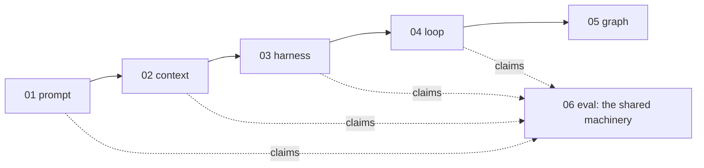
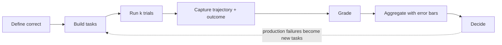

# 1 — What an Eval Is

> An eval is a repeatable experiment that turns "does this work?" into a number you can compare across changes. This chapter sets the vocabulary every later chapter uses.

---

## Why evals are their own discipline

**Every other layer makes claims. Evals are how you check them.** A prompt "works better", a context strategy "reduces hallucination", a harness "is more reliable", a loop "converges". Each is a hypothesis about a non-deterministic system, and only a measurement settles it.

Eval engineering means building that measurement. You decide what correct means, collect tasks that represent real use, choose graders you can trust, run them repeatedly, and read the results honestly. Then you wire them into the places where decisions get made: CI, releases and production monitoring. It is an engineering discipline, not a QA afterthought, for three reasons:

1. **The outputs are non-deterministic.** One run proves nothing. You need rates, repeats and error bars ([09](09-reading-results.md)).
2. **"Correct" is often a judgment.** So the graders are themselves models or people, and they need measuring too ([05](05-llm-as-judge.md)).
3. **The eval is software.** It has bugs, it drifts and it gets gamed. Treat a score drop as a claim about the eval before treating it as a claim about the system ([12](12-failure-modes.md)).

Every layer below this one has its own eval chapter. Each says **what** to measure at that layer:

| Layer | Its eval chapter | Measures |
|---|---|---|
| Prompt | [01/09](../../01-prompt-engineering/notes/09-evaluating-prompts.md) | Output quality per prompt version |
| Context | [02/12](../../02-context-engineering/notes/12-evaluating-context.md) | Whether the right content reached the model and got used |
| Harness | [03/05](../../03-harness-engineering/notes/05-verification-loops.md) | Verification inside a run |
| Loop | [04/03](../../04-loop-engineering/notes/03-the-scorekeeper.md) | The stop condition a loop optimises against |

This topic owns **how** to measure, for all of them: datasets, graders, judge calibration, traces, statistics, gates and production monitoring. It stands as its own topic because that machinery is the same everywhere, and copies spread across the layers would drift apart.

Without that machinery, every change to a prompt, model, tool or retrieval config is a guess. The GitHub Copilot team built their eval framework before the prompts and before the UI ([01/09](../../01-prompt-engineering/notes/09-evaluating-prompts.md#build-the-eval-first)). That order is the lesson.

> **An eval is the definition of "better" for your system, written down so a machine can check it.**

---

## The vocabulary

Anthropic, LangSmith, OpenAI and Inspect use slightly different words for the same six parts:

| Term | What it is | Also called |
|---|---|---|
| **Task** | One test: an input plus success criteria | case, example, sample, row |
| **Trial** | One attempt at a task. Outputs vary, so a task usually gets several trials | run, attempt, epoch |
| **Trajectory** | The full record of a trial: messages, tool calls, intermediate results | trace, transcript |
| **Outcome** | The final state at the end of the trial: the answer, the file system, the database row | final response, end state |
| **Grader** | Code, a model or a person that scores one aspect of a trial | evaluator, scorer, judge, metric |
| **Suite** | A set of tasks run together to give a system-level picture | dataset + evaluators, eval set, benchmark |

Two more terms come from the harness layer:

- **System under test (SUT).** The agent harness being measured: model, prompts, tools, routing, memory, control loop.
- **Eval harness.** The infrastructure that runs the suite: it loads tasks, runs trials (often in parallel), records trajectories, applies graders and aggregates results. It treats the SUT as a black box with an entry point.

Inspect AI uses the cleanest version of this split: a `Task` is a **dataset** + a **solver** (the SUT) + a **scorer** (the grader). Keep those three separable and you can swap any one without touching the others.

### The core flow

Each arrow is a chapter:

| Step | Chapter |
|---|---|
| Define correct, error analysis, failure taxonomy | [02](02-defining-correct.md) |
| Build tasks | [03](03-eval-datasets.md) |
| Grade | [04](04-graders.md), [05](05-llm-as-judge.md) |
| Agent trajectories, k trials | [06](06-evaluating-agents.md) |
| RAG and grounding | [07](07-evaluating-rag-and-grounding.md) |
| Capture traces | [08](08-tracing-and-observability.md) |
| Aggregate and decide | [09](09-reading-results.md) |
| Gate in CI | [10](10-evals-in-ci.md) |
| Production and the loop back | [11](11-production-and-the-maturity-ladder.md) |
| When the eval itself is wrong | [12](12-failure-modes.md) |
| All of it, on one real system | [13](13-case-study-support-agent.md) |

---

## Test vs. eval: the seam

Not everything about an LLM system needs an eval. Draw the line by determinism:

| Behavior | Deterministic? | Check with | Example |
|---|---|---|---|
| Prompt rendering, schema validation, retry logic, tool routing tables | Yes | **Unit tests**: assert exact values | "Template inserts the user name", "retry fires 3 times on 429" |
| Tool-call arguments parse, output matches a JSON schema | Yes, given an output | **Deterministic graders** inside an eval | "Response is valid JSON with a `citations` array" |
| Answer quality, grounding, helpfulness, end-to-end task success | No | **Evals**: many tasks, many trials, rates not assertions | "Grounded answer rate ≥ 0.90 on the golden set" |

Rules that follow:

- **Never assert a specific model response string in a unit test.** It will flake, and the fix will be to loosen the test until it checks nothing.
- **Unit tests gate merges; evals measure rates.** A unit test is pass/fail. An eval result is a proportion with an error bar ([09](09-reading-results.md)).
- **Mock the model in unit tests, never in evals.** An eval with a mocked model measures the mock.

---

## Capability vs. regression evals

Two suites answer two different questions, and they need different pass rates:

| | Capability eval | Regression eval |
|---|---|---|
| **Question** | "What can this system do?" | "Does it still do what it used to?" |
| **Expected pass rate** | Low to medium. Room to climb | Near 100% |
| **Tasks come from** | The frontier: hard cases, new use cases | Tasks the system has already mastered, plus every fixed bug |
| **A drop means** | Little on its own. You're measuring a hill | Something broke. Block the release |
| **Runs** | On demand, when exploring | Every change, in CI ([10](10-evals-in-ci.md)) |

Tasks **graduate**: once a capability task passes reliably, move it to the regression suite so it keeps being checked. Keep the frontier moving by adding harder cases as old ones saturate ([12](12-failure-modes.md#saturation)).

---

## Offline vs. online

| | Offline | Online |
|---|---|---|
| **Data** | A fixed dataset you curate | Live production traffic |
| **When** | Before a change ships | After it ships, continuously |
| **Ground truth** | Reference answers, labels | Usually none. Proxy signals, sampled human review, LLM judges |
| **Catches** | Regressions you thought to test for | Drift, new failure types, things nobody thought to test |
| **Chapter** | 02–10 | [11](11-production-and-the-maturity-ladder.md) |

You need both. Offline evals are the lab: cheap, repeatable, comparable. Online evals are the field: the only place you learn what real users actually do. Production failures feed the offline set, which is how the lab stays relevant ([03](03-eval-datasets.md#harvest-from-failures)).

---

## What an eval is not

- **Not a benchmark score.** Public benchmarks (MMLU, SWE-bench, τ-bench) tell you about a model in general. Your eval tells you about *your* system on *your* tasks. A model's leaderboard rank predicts little about your support bot.
- **Not a vibe check.** Reading ten outputs and feeling good is level 0 of the maturity ladder ([11](11-production-and-the-maturity-ladder.md#the-ladder)). It's where everyone starts. It is not where you stay.
- **Not a one-off.** An eval suite is a living artifact. It changes as the product, the users and the failure modes change. Anthropic describes evals as maintained by a team that owns the infrastructure, with domain experts contributing tasks.
- **Not only quality.** Latency, cost and steps-to-completion are eval metrics too. Log them on every trial: they're free to capture and catch regressions that quality scores miss ([06](06-evaluating-agents.md#efficiency-metrics)).

---

## Five ideas that carry the topic

1. **Read before you measure.** Failure modes come from error analysis on real traces, not from a list of generic metrics ([02](02-defining-correct.md#find-failure-modes-by-reading-error-analysis)).
2. **Use the simplest grader you can trust.** Code first. Use a judge only where code can't reach, and only after calibrating it against people ([04](04-graders.md)).
3. **Grade the path and the destination.** For agents, outcome and trajectory fail independently ([06](06-evaluating-agents.md#outcome-and-trajectory)).
4. **A score without an error bar is an anecdote.** Pair, repeat, slice ([09](09-reading-results.md)).
5. **The suite is alive.** Production failures become rows, saturated tasks graduate to regression, and you climb the maturity ladder one rung at a time ([11](11-production-and-the-maturity-ladder.md#the-ladder)).

---

## Where it sits

Eval measures every layer below it and inherits their weaknesses. It also has weaknesses of its own: an eval is only as good as its tasks (coverage), its graders (calibration) and its statistics (sample size). A well-built eval on an unrepresentative dataset gives precise answers to the wrong question. If the harness exposes no trajectory, you can only grade outcomes. If the loop has no stop condition, a trial can't end cleanly. Eval also feeds the top of the loop stack: the hill-climbing loop ([04/08](../../04-loop-engineering/notes/08-self-improving-loops.md)) is an optimizer pointed at an eval. A weak eval there produces a system that gets better at the eval and no better at the job ([12](12-failure-modes.md#goodhart-the-eval-becomes-the-target)).

---

## Working reference

`~/.claude/refs/agent-eval.md` — the unit/eval seam, grader contract, gate ladder and grader states. `~/.claude/refs/verification.md` — "a check that cannot fail is not a check", "state the corpus and the denominator". Both apply to every eval in this topic.

---

→ Next: [02-defining-correct.md](02-defining-correct.md) — before any data or graders, write down what success means.
