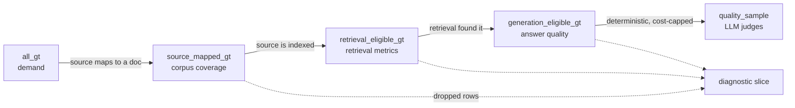

# 3 — Eval Datasets

> The dataset decides what your eval can see. Start small and real, grow it from failures, keep it versioned, and make sure every row is fair for the gate that scores it.

---

## Start small, start real

The first useful dataset is **20–50 tasks taken from real failures**: user complaints, support tickets, bad traces from error analysis ([02](02-defining-correct.md#find-failure-modes-by-reading-error-analysis)). Review each one by hand. A small, clean, realistic set beats a large, noisy benchmark, because every row in it is about *your* system.

| Stage | Size | Purpose |
|---|---|---|
| **Example suite** | 5–20 | Eyeball diffs while iterating on a prompt ([01/09](../../01-prompt-engineering/notes/09-evaluating-prompts.md#offline-the-tech-tree)) |
| **First golden set** | 20–50 | Real failures, hand-reviewed. Enough to catch big regressions |
| **Working set** | 100–300 | Enough for ±5–8 point error bars on a pass rate ([09](09-reading-results.md#how-many-tasks)) |
| **LLM-graded sample** | 50–200 | Cost-capped subset for expensive judges |
| **Large harness** | 1,000+ | Detecting small effects. Usually needs synthetic or logged data |

Grow toward the next stage when the current one can't separate two versions you need to tell apart. Statistics tells you when that is ([09](09-reading-results.md)). For scale, Oshin & Campos suggest 10–50 starter examples for a LangChain app (*Learning LangChain*, ch. 10), and Huyen reports that the tasks in EleutherAI's eval harness have a median of 1,000 examples, with an average of 2,159. The Inverse Scaling prize organizers called 300 the absolute minimum and preferred 1,000, especially for synthesized examples (*AI Engineering*, ch. 4).

---

## Where tasks come from

| Source | Strength | Watch out for |
|---|---|---|
| **Production logs / telemetry** | Real distribution, real phrasing | Doesn't exist before launch. Each big app change can make old rows obsolete. Consent and PII. Good *inputs*, weak *labels*: what the user did next was shaped by what your app suggested |
| **Real failures** (tickets, 👎, escalations) | The highest-value rows. Directly about your weak spots | Over-represents failure. Balance with normal traffic |
| **Existing records** (pre-AI support logs, docs, forums) | Plentiful, realistic | Shape mismatch. You may need to adapt them into tasks, trading similarity to your problem against scale |
| **Domain experts writing cases** | Hits the edge cases that matter | Slow. Experts write *hard* cases and under-sample common ones |
| **Synthetic (LLM-generated)** | Cheap coverage of combinations | Tropes, unrealistic phrasing, bias toward the generating model |

Telemetry is fine for graders that need no gold answer. Where you need one, Berryman & Ziegler suggest leaving telemetry to online evaluation. For existing records, GitHub Copilot is the standard example: no corpus of "what the user types next" existed, so the team took functions from open-source repos, deleted the bodies, and asked for completions. Function bodies run longer than typical suggestions, and edits that depend on the body (new imports) are already in the file, but the supply is nearly infinite (*Prompt Engineering for LLMs*, ch. 10).

### Synthetic data done right

Don't ask a model for "100 test questions". You'll get 100 variations of the same polite question. Generate along **dimensions** instead:

1. Pick 3–4 dimensions that matter for your product: *persona* (new user, power user, frustrated), *intent* (billing, how-to, bug report), *complexity* (one-step, multi-step, ambiguous), *channel* (chat, email).
2. Generate **tuples** of dimension values first (`frustrated × billing × ambiguous`). Check the tuples cover what you need.
3. Turn each tuple into a natural-language query in a **separate** call.
4. Read a sample. Delete the unrealistic ones.

If you want several queries per tuple, ask for them in one call. Provided the output fits, that gives more variety than repeated calls at temperature > 0. Synthesis is easiest when you can start from the answer and invent the question backward. It is riskiest when the model doesn't know the domain well, because the rows come out as simplistic tropes, popular misconceptions or plain errors (*Prompt Engineering for LLMs*, ch. 10).

Once a working set exists, **mutate it toward the edges** instead of generating from scratch. Albada lists three targeted moves (*Building Applications with AI Agents*, ch. 9):

- **Adversarial:** "Find a user message that causes the agent to contradict itself."
- **Counterfactual:** change one word in a passing case and see whether the agent fails.
- **Interpolation:** blend two intents into one deliberately ambiguous request.

Have a person review each mutated row before it joins the set.

Two traps:

- **Self-preference.** If the model generating the data is also a candidate under test, it'll find its own phrasing easy. If every row was written by model A, a harness that decides between A and B starts A with a head start. Generate with a different model family.
- **Synthetic-only suites.** Use synthetic data to bootstrap and fill coverage gaps, then replace it with real traffic as you get it.

### Harvest from failures

The suite stays relevant by eating its own production failures. Every confirmed failure becomes a row:

```
production failure → triage (real failure, or eval bug?) → label with taxonomy → add to discovery set
                                                                                     ↓ once fixed
                                                                              move to regression set
```

OpenAI recommends keeping two pools: a **regression suite** of known, fixed failures that must keep passing, and a rolling **discovery set** of new production failures that shows where the system currently breaks.

---

## Coverage and balance

Check the dataset against the distribution you care about:

- **Slice by the dimensions** from your failure taxonomy and user mix: intent, language, difficulty, source type, user segment. Record the slice on every row so you can report by slice later.
- **Match production frequencies** for the headline number. Over-sample rare-but-costly cases in *separate* slices, not the headline.
- **Balance positive and negative cases** ([02](02-defining-correct.md#positive-and-negative-cases)).
- **Include off-distribution rows**, not only inputs that resemble your few-shot examples or training data. Prompted in-context accuracy fell as test inputs drifted from the exemplars, fastest with CoT (slope −1.4, across 4 LLMs and 9 synthetic tasks) ([arXiv:2509.10414](https://arxiv.org/abs/2509.10414) (de Wynter, 2025-09)). A CoT trained into a small model on a toy task fell to 0% exact match on unseen transformations ([arXiv:2508.01191](https://arxiv.org/abs/2508.01191) (Zhao et al., 2025-08)).
- **Watch the denominator.** "92% pass" means nothing until you say *of what*. Report pass rate per slice, with the slice size.

---

## Row eligibility: is this row fair for this gate?

A row can be a valid task but unfair for a particular measurement. If the expected source isn't in the index, scoring that row on retrieval measures your corpus, not your retriever.

The case study handles this with **named row pools**, each a subset of the one above it ([case study](13-case-study-support-agent.md#row-pools)):

| Pool | Contains | Fair for |
|---|---|---|
| `all_gt` | Every golden row | Demand analysis: what users ask |
| `source_mapped_gt` | Rows whose expected source maps to a known document | Corpus coverage |
| `retrieval_eligible_gt` | Mapped rows whose source is actually indexed | Retrieval metrics |
| `generation_eligible_gt` | Rows where retrieval found the expected source | Answer quality |
| `quality_sample` | Deterministic, cost-capped sample of the above | LLM judges |



The rule: **a downstream gate never silently scores rows an upstream gate marked ineligible.** Ineligible rows appear only as a separate diagnostic slice. Otherwise a retrieval miss shows up as a "bad answer" and you fix the wrong thing.

---

## What a row contains

A general shape (adapt the fields to your system):

```json
{
  "id": "billing-refund-014",
  "input": {"messages": [{"role": "user", "content": "I was charged twice for order 8812"}]},
  "reference": {
    "answer": "Apologizes, confirms the duplicate charge, issues a refund for one charge",
    "expected_tool_calls": [{"name": "lookup_order", "args": {"order_id": "8812"}},
                            {"name": "issue_refund", "match": "ANY_ARGS"}],
    "expected_sources": ["help/billing/duplicate-charges"]
  },
  "labels": {"intent": "billing", "difficulty": "easy", "case_type": "positive", "language": "en"},
  "eligibility": {"retrieval": true, "generation": true},
  "provenance": {"source": "ticket", "added": "2026-10-02", "added_by": "ops-review"},
  "graders": ["tool_trajectory", "grounding", "completeness"]
}
```

What matters:

- **A reference, not always an answer.** For open-ended tasks, the reference is a rubric or a list of required points, not a gold string to match.
- **Labels** for slicing, **eligibility** per gate, **provenance** for trust.
- **Graders named per row**, so a row only gets graders that make sense for it.

Pin the row format with a JSON Schema and validate every row on load. A schema checks types, not consistency, so add **cross-field checks** too: every ID in `expected` must appear in the input. Albada's own example row shows why. The input order is `A89268`, the expected refund is `issue_refund(order_id="A12345", amount=19.99)`, and a correct agent would fail that row forever (*Building Applications with AI Agents*, ch. 9). The useful enums:

| Field | Values | Why |
|---|---|---|
| `reference.expected_tool_calls[].match` | `EXACT`, `NORMALIZED`, `ANY_ARGS`, `JUDGE` | How strictly each call's arguments must match |
| `reference.tool_match_mode` | `EXACT`, `IN_ORDER`, `ANY_ORDER`, `SUBSET`, `SUPERSET` | How the whole trajectory is compared ([06](06-evaluating-agents.md)) |
| `reference.forbidden_tools` | tool names | Negative cases: the agent must *not* call these |
| `reference.expected_state` | object | End-state assertions for outcome grading |
| `labels.case_type` | `positive`, `negative`, `boundary`, `out_of_scope`, `adversarial` | Balance and slicing |
| `split` | `dev`, `test`, `regression`, `discovery` | Keeps tuning data out of the reported number |
| `provenance.source` | `production`, `ticket`, `feedback`, `expert`, `synthetic`, `benchmark` | Trust and drift checks |

---

## Splits, versioning, contamination

- **Split it.** Keep a **dev** set you iterate against and a **held-out test** set you look at rarely. Tuning prompts against the full set overfits to it, exactly as in ML ([12](12-failure-modes.md#overfitting-the-dev-set)). For judge calibration, use train/dev/test splits of the human labels too ([05](05-llm-as-judge.md#calibrate-against-human-labels)).
- **Version it.** Datasets change. Store them in git (or a dataset tool with versions) and record the dataset version in every result. A score from v3 and a score from v4 are not comparable.
- **Freeze the reference with the data.** If labels came from a grader, record the grader version. Change the grader and the labels shift ([case study](13-case-study-support-agent.md#would-different-judges-give-different-golden-traces)).
- **Keep it out of training and prompts.** Don't paste eval rows into few-shot examples. Don't fine-tune on them. Don't let the agent see them at runtime.
- **Reset state per trial.** If tasks touch a database, sandbox or file system, every trial starts from a clean snapshot. Otherwise one trial's side effects look like the next trial's failure.

### Contamination: how public benchmarks fight it

If eval rows end up in a model's training data, the score measures memory, not ability. The public benchmarks use four tactics, and each works for a private set too:

| Tactic | Benchmark | How |
|---|---|---|
| **Unique answers** | GAIA | Answers need several sources combined, and some come from attachments (PDFs, audio, images) that aren't on the web |
| **Parameterized templates** | AndroidWorld, τ²-bench | The task is a template ("change `[CONTACT_NAME]`'s number to `[NEW_PHONE]`"), filled with fresh values every run. A memorized action sequence won't replay. Fixing some parameters while varying others gives you controlled experiments |
| **Temporal freshness** | SWE-bench-Live | Keep adding tasks created after the model's training cutoff |
| **Canaries** | Terminal-Bench | Embed a unique GUID in the data. If a model can produce it, the set has leaked |
| **Closed test set** | Enterprise Scenarios Leaderboard | Keep some test sets unpublished "to prevent gaming of the leaderboard" (*LLM Engineer's Handbook*, ch. 7). HLE keeps a private held-out set to detect overfitting. SHADE-Arena published only 5 of its 17 environments, to keep the rest out of training data ([PDF](https://assets.anthropic.com/m/4fb35becb0cd87e1/original/SHADE-Arena-Paper.pdf) (Kutasov et al., 2025-06)) |

For non-English suites, Iusztin & Labonne recommend human-translated versions of general benchmarks over machine-translated ones, plus tasks written in the native language (*LLM Engineer's Handbook*, ch. 7). How to detect contamination after the fact is in [12](12-failure-modes.md#contamination).

---

## Lessons from public benchmarks

Li's survey of GAIA, SWE-bench Verified, τ²-bench, Terminal-Bench, AndroidWorld and OSWorld (*AI Agents in Depth*, ch. 6) carries over to private suites:

- **Budget for rejection.** For SWE-bench Verified, OpenAI had 93 developers review 1,699 of the original 2,294 tasks. They checked that the description was clear, the tests complete and stable, the patch correct, and the difficulty sensible. Only **500 survived (29%)**. A row you didn't review is a row that might be wrong ([12](12-failure-modes.md#eval-bugs-look-like-agent-bugs)). OSWorld-Verified went through the same thing: over 300 issues surfaced in 15 months of use. Rows that no system ever passes are the cheapest place to look. BrowseComp's authors ran Deep Research 64 times per question and reviewed the 118 questions it never solved: 21 of them (18%) had a reference answer that was wrong, ambiguous or in the wrong format, and were removed ([arXiv:2504.12516](https://arxiv.org/abs/2504.12516) (Wei et al., 2025-04)).
- **Adversarial filtering biases the set against the filter models.** Humanity's Last Exam kept only the questions that stumped GPT-4o, Gemini 1.5 Pro, Claude 3.5 Sonnet and o1: about 13,000 of 70,000 attempts went on to two rounds of expert review, and 3,000 survived. Those same models then scored 3.3–9.4%, and the authors warn that "small inflections close to zero accuracy are not strongly indicative of progress". Their reviewers were also told it was fine not to check any answer that would take more than 5 minutes to solve, so some wrong labels got through ([arXiv:2501.14249](https://arxiv.org/abs/2501.14249) (Phan et al., 2025-01)). BrowseComp filtered against GPT-4o, o1 and an early Deep Research the same way, and GPT-4o scored 0.6% (Wei et al., above). A set filtered this way can show that a model is still far from the bar. It can't fairly rank the models it was filtered against.
- **Match difficulty across splits.** On ARC-AGI-1 the public evaluation set was easier than the private one, so public scores didn't predict private ones. ARC-AGI-2 had 407 people attempt the tasks, kept only tasks that at least two of them solved, and assigned tasks to the public, semi-private and private splits so that mean human accuracy differed by no more than 1 percentage point between them ([arXiv:2505.11831](https://arxiv.org/abs/2505.11831) (Chollet et al., 2025-05)). For a private suite, stratify the dev/test split by difficulty or slice, not just at random.
- **Check "fixed it" and "broke nothing" separately.** SWE-bench grades two test sets. **FAIL_TO_PASS** tests fail before the fix and pass after, which proves the problem is solved. **PASS_TO_PASS** tests pass both before and after, which proves nothing regressed.
- **Use difficulty levels as a diagnostic.** GAIA's Level 1 needs 1–2 tools (humans 93.9%, GPT-4 30.3%), Level 2 needs multi-step reasoning (91.8% vs 9.7%), and Level 3 needs long combinations (87.3% vs 0%). Failing at a given level points to a different fix: L1 to prompts and tool use, L2 to planning, L3 to architecture or post-training.
- **Tighten success conditions until a superficial fix can't pass.** τ²-bench accepts only an "excellent" speed rating, not "good". Loose conditions reward agents that half-solve the task.
- **Start some tasks mid-stream.** OSWorld often begins from a configured intermediate state, not a clean one, and accepts more than one valid end state.
- **Hold out at the level of generality you claim.** If the agent must handle new *kinds* of task, the test set needs task types the dev set never had, not just new instances of the same tasks. Kapoor et al. sorted 17 agent benchmarks this way. Only 1 of 8 domain-general benchmarks held out whole tasks, and 7 of the 17 had no holdout at all. The cost shows on WebArena, where the top agent at the time (STeP, 35.8%) "hardcodes policies to solve the specific tasks included in WebArena", such as building a Reddit profile URL by appending `/user/user_name` ([arXiv:2407.01502](https://arxiv.org/abs/2407.01502) (Kapoor et al., 2024-07)). A private suite tuned on the same tasks it reports on has the same problem ([12](12-failure-modes.md#overfitting-the-dev-set)).

---

## Checklist

- [ ] First 20–50 rows are real failures, hand-reviewed
- [ ] Synthetic rows generated along dimensions by a different model family, then read
- [ ] Every row has slice labels, eligibility and provenance
- [ ] Positive, negative and boundary cases present
- [ ] Dev / held-out split. Held-out looked at rarely
- [ ] Dataset versioned; version recorded with every result
- [ ] A path for production failures to become rows

---

→ Next: [04-graders.md](04-graders.md) — how each row gets scored.
