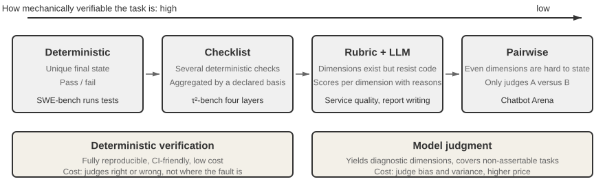

# 4 — Graders

> A grader turns one trial into a score for one dimension. Use the simplest grader that can be trusted: code first, a model above that floor, people to calibrate both.

---

## The three kinds


*Image Source: Li, [AI Agents in Depth](https://github.com/bojieli/ai-agent-book/blob/main/book-en/chapter7.md) (2026), Fig. 7-4 (Apache-2.0)*

| Grader | How it scores | Strength | Weakness | Use when |
|---|---|---|---|---|
| **Code** | String/regex match, schema check, unit tests, state check, numeric tolerance | Deterministic, fast, free, hard to argue with | Only checks what you can express exactly | There's a clear right answer or a checkable property |
| **Model** (LLM-as-judge) | A model scores against a rubric, compares two outputs, or votes | Handles meaning, tone, completeness | Biased, costly, needs calibration ([05](05-llm-as-judge.md)) | The quality is semantic and no code can check it |
| **Human** | Expert review, annotation | The ground truth for subjective quality | Slow, expensive, inconsistent at scale | Building the reference, calibrating judges, ambiguous cases |

A fourth kind sits between code and model: the **separated evaluator agent**, which *operates* the output (runs the app, clicks through it, runs the code) instead of reading it ([03/05](../../03-harness-engineering/notes/05-verification-loops.md#separating-generation-from-evaluation)). It's a model, but its verdict rests on observed behavior.

### Layer them, don't choose

The four are layers, not alternatives:

| Layer | Scales | Cost | Role |
|---|---|---|---|
| Code | Fully | ~0 | First line. Catches structural failures cheaply |
| Separated evaluator | Well | Medium | Behavioral verification |
| LLM judge | Fully | Medium | Subjective criteria at volume |
| Human sample | Poorly | High | **Calibrates** the judge. 5–10% of graded rows, not a review queue |

Run code graders first and stop early: an answer that fails the schema doesn't need a judge to tell you it's bad. That saves judge budget for the rows that need judgment.

The same order works when you build the layers. Oshin & Campos advise starting with heuristic (code) evaluators, then adding human review, and only then an LLM judge that automates the human review you now understand (*Learning LangChain*, ch. 10).

---

## Code graders: more than you think

Teams reach for a judge too early. Most systems have more checkable properties than they use:

| Property | Code check |
|---|---|
| Output format | JSON parses, matches schema, required fields present |
| Tool use | Right tool name, arguments parse, argument values match ([06](06-evaluating-agents.md#scoring-tool-calls)) |
| Citations | Every cited ID is in the retrieved set. Quoted text appears verbatim in the source ([07](07-evaluating-rag-and-grounding.md#citation-checks-in-code)) |
| Final state | Row exists in the DB, file was written, test suite passes |
| Code output | Compiles, runs, passes the repo's tests |
| Language | Response language matches query language (a language-ID library) |
| Boundaries | Didn't call a forbidden tool, didn't exceed N turns, didn't leak a regex-detectable secret |
| Efficiency | Steps, tokens, latency, cost from the trace |
| Exact facts | Number within tolerance, date matches, entity in an allowed set |

For tool calls, check **in order** and stop at the first failure: *called a tool? → right tool? → valid arguments? → right values?* An early failure makes the later checks meaningless. Check values with a tolerance or a range, not equality: a thermostat call at 76°F when the reference says 77°F is probably fine, while no call or the wrong tool is not ([01/09](../../01-prompt-engineering/notes/09-evaluating-prompts.md#scoring-outputs)).

### Partial match: grade the aspect that breaks

When exact match on the whole output is too strict, match on one aspect: code after stripping comments and whitespace, the destination country of a travel suggestion, the tool name of an action. Pick an aspect that separates breaking divergence from benign divergence, and that is neither so specific the model rarely hits it nor so general it means nothing. You find it by watching where the current system actually fails, which is circular, but still better than a weak or misleading aspect (*Prompt Engineering for LLMs*, ch. 10).

### Reference-based text metrics

BLEU, ROUGE and embedding similarity compare an output to a reference string. They're cheap and deterministic but correlate poorly with quality for open-ended answers: a correct answer worded differently scores low. A survey's comparison table puts numbers on it: on SummEval summaries, the average Spearman correlation with human ratings was 0.19 for ROUGE-1 and 0.23 for BERTScore, against 0.51 for G-Eval (a GPT-4 judge). The LLM judges were also about 200–400× slower than word-overlap metrics in the authors' timing, and on machine translation their advantage was not significant ([arXiv:2401.07103](https://arxiv.org/abs/2401.07103) (Li et al., 2024-01)). The references themselves are a second problem (*AI Engineering*, ch. 3):

- **They can be wrong.** The WMT 2023 Metrics shared task found many bad reference translations in its own data.
- **They can be incomplete.** Adept's Fuyu wrote correct image captions that scored low because no reference phrased them that way.
- **Overlap isn't correctness.** On HumanEval, OpenAI found correct and incorrect code solutions got similar BLEU scores.

> **Contradiction.** Albada describes "modern practice" for agents as relying increasingly on embedding distance, BERTScore, BLEU and ROUGE to judge whether outputs meet the intent of a task (*Building Applications with AI Agents*, ch. 9). The correlation numbers above say otherwise for open-ended text: BERTScore at 0.23 against human ratings is a weak gate. The same chapter later warns that optimizing a single score such as BLEU leads to "formulaic or unnatural outputs". Follow the warning, not the recommendation.

The case study ruled out ROUGE-L for conversational answers for this reason ([case study](13-case-study-support-agent.md#why-custom-graders-instead-of-a-frameworks-built-in-eval)). Use them for tightly constrained outputs (translation of fixed strings, extraction) or as a cheap tracking signal, not a gate.

### Multiple-choice: format is part of the score

Most public benchmarks are close-ended. In April 2024, 75% of the tasks in EleutherAI's lm-evaluation-harness were multiple-choice (MMLU, AGIEval, ARC-C) (*AI Engineering*, ch. 4). MCQ scoring looks like the safest code grader there is, but it has two traps:

- **Format sensitivity.** Alzahrani et al. (2024) found that adding an extra space between question and answer, or a phrase like "Choices:", changed models' answers (*AI Engineering*, ch. 4). Freeze the template and report it with the score.
- **How you read the answer.** The harness can score by log-likelihood (compare the model's probability of each option's full text) or by generation (let the model write a letter, then match it). Iusztin & Labonne recommend generation: it mirrors real use, it's easier to implement, and it discriminates better, because "low-quality models tend to overperform on probability-based evaluations" (*LLM Engineer's Handbook*, ch. 7). The two methods give different numbers for the same model, so don't compare scores across them.

MCQs test whether a model can pick the good answer, not whether it can write one. Use them for knowledge and reasoning checks, not for summarization or other generation tasks.

---

## The grader interface

Make every grader implement one contract. Then graders are swappable, composable and reportable the same way.

**Input** (what any grader may need):

| Field | Contents |
|---|---|
| `task` | The row: input, reference, labels |
| `output` | The final response / outcome |
| `trajectory` | Tool calls, intermediate messages (optional per grader) |
| `retrieved_context` | Passage **text**, not just IDs or URLs |
| `metadata` | Model, prompt version, config, run ID |

**Output:**

| Field | Contents |
|---|---|
| `score` | Number in [0, 1] (or the native scale, documented) |
| `passed` | Boolean against the grader's threshold |
| `reasoning` | Why. For judges, the explanation. For code, the failing check |
| `dimensions` | Sub-scores, if the grader checks several things |
| `labels` | Failure taxonomy labels this trial earned ([02](02-defining-correct.md#the-failure-taxonomy)) |
| `grader_version` | Name + prompt/code version, so scores are traceable |

```python
class Grader(Protocol):
    name: str
    version: str
    requires: set[str]            # e.g. {"retrieved_context"}: skip, don't guess, if missing
    def grade(self, task, output, trajectory=None, context=None) -> GraderResult: ...
```

The `requires` field matters. A grounding grader handed URLs instead of passage text should return "can't grade" (`context_missing`), not a made-up score ([case study](13-case-study-support-agent.md#why-the-grounding-cross-check-showed-low-agreement)).

---

## Grader states: which ones can block a release

Not every grader is trustworthy enough to gate on. Give each one an explicit state:

| State | Meaning | Can gate releases? |
|---|---|---|
| **Heuristic** | Deterministic code check | Yes |
| **Calibrated** | LLM judge with evidence it agrees with humans ([05](05-llm-as-judge.md)) | Yes, at the calibrated threshold |
| **Experimental** | New or uncalibrated judge | **No.** Tracking and investigation only |

A threshold change without fresh calibration evidence moves the grader back to experimental. Release decisions must name which state each cited metric is in.

---

## Combining graders: scoring design

A task often has several graders. Decide up front how they combine:

| Scheme | Rule | Use when |
|---|---|---|
| **Binary (all-pass)** | Task passes only if every grader passes | Any failure is unacceptable (safety, format, policy) |
| **Weighted** | Weighted sum of scores must clear a threshold | Dimensions trade off legitimately |
| **Hybrid** | Must-pass gates + weighted score on the rest | Most production systems |
| **Report separately** | No composite. Show each dimension | Diagnosis. Always do this alongside any composite |

Hybrid example: *schema valid AND no citation hallucination AND (0.5 × grounding + 0.3 × completeness + 0.2 × relevance ≥ 0.75)*.

### Veto items

A must-pass gate on a quality dimension is a **veto item**: if it fires, the total is zero. Hallucination is the classic one. It's orthogonal to quality, since a fluent, detailed, polite answer with a made-up fact does more harm than a terse correct one. A veto also blocks reward hacking by keyword stuffing: you can't pad your way past it.

Li (*AI Agents in Depth*, ch. 6), following Scale AI's *Rubrics as Rewards*, gives four rules for a rubric:

1. **Expert-grounded.** It encodes domain facts and reasoning steps, not surface features like fluency.
2. **Covers pitfalls.** It names the high-risk common errors explicitly, not only what good looks like.
3. **Weighted by importance.** Each item is Essential, Important, Optional or Pitfall, and Pitfall items can veto.
4. **Self-contained.** Each item can be checked without the grader's own expertise. "Cites at least two named sources and says how each supports the conclusion", not "shows deep understanding".

```yaml
- id: hallucination
  criterion: Every fact in the reply appears in a tool output
  weight: veto        # fires → total score is 0
```

HealthBench shows what this looks like at scale: 5,000 health conversations, each with its own physician-written rubric, 48,562 criteria in all. Each criterion is worth −10 to +10 points, and the negative ones are the pitfalls (for example, "recommends a dangerous dose"). A model grader marks each criterion met or not met independently. The example's score is the points earned divided by the maximum possible, which can be negative, and the mean is clipped to [0, 1] ([arXiv:2505.08775](https://arxiv.org/abs/2505.08775) (Arora et al., 2025-05); OpenAI built it and ranks its own models on it). Grading one criterion per call keeps each decision binary and auditable, though it costs one grader call per criterion.

A rubric gets better through use. Disagreements between graders turn it, over time, from principles into a casebook of edge cases.

Don't let a composite hide a regression. A model that gains 5 points of relevance while losing 5 points of grounding scores flat on the composite and is worse for users who need correct answers. Always report the dimensions too.

---

## Binary vs. scales

For judges and humans, prefer **binary pass/fail** per dimension over 1–5 scales:

- Graders disagree more on the middle of a scale. "Is this a 3 or a 4?" has no stable answer.
- Pass/fail forces you to define the bar, which is the point of [02](02-defining-correct.md).
- Rates of binary outcomes have simple statistics ([09](09-reading-results.md)).

Use an ordinal scale only when the levels are each *described* (what a 2 looks like vs. a 4), and only when the extra resolution changes a decision. If you have a scale, you can always threshold it into pass/fail later.

Not everyone agrees. Berryman & Ziegler argue for judges to drop yes/no in favor of a described 1–5 scale. A bare "is it right?" leaves the bar to the judge, which may then hold ambitious answers to a stricter standard than safe ones, or pass mostly-right answers while failing near-perfect ones (*Prompt Engineering for LLMs*, ch. 10). Both camps blame the same failure, a bar the judge has to guess. Binary with written PASS/FAIL definitions and a scale with each level described both fix it.

Binary has one trap when the task has a right answer and the system is allowed to abstain. If "I don't know" scores the same 0 as a wrong answer, guessing always has the higher expected score. Kalai et al. argue that this grading, used in 9 of the 10 benchmarks they surveyed, is one reason models learn to hallucinate ([arXiv:2509.04664](https://arxiv.org/abs/2509.04664) (Kalai et al., 2025-09); a theory paper with no experiments). OpenEQA does exactly this: it counts an abstention as wrong and makes abstaining agents guess ([PDF](https://open-eqa.github.io/assets/pdfs/paper.pdf) (Majumdar et al., 2024-06)). Their fix is three outcomes and a confidence target stated in the prompt: "answer only if you are more than *t* confident; a mistake costs *t*/(1−*t*) points, a correct answer earns 1, and IDK earns 0." At *t* = 0.5, 0.75 or 0.9, a mistake costs 1, 3 or 9 points (the paper prints 2 for *t* = 0.75, but the formula gives 3), so a well-calibrated system answers only when it is above the target. Use this whenever "I don't know" is an acceptable reply, and report the abstention rate on its own ([09](09-reading-results.md#metric-pitfalls)).

---

## Checklist

- [ ] Every checkable property has a code grader before any judge is added
- [ ] Code graders run first; failures short-circuit expensive graders
- [ ] All graders implement one interface, with `requires` and `grader_version`
- [ ] Each grader has a state (heuristic / calibrated / experimental)
- [ ] Composite scoring rule written down; dimensions always reported alongside
- [ ] Binary pass/fail by default; scales only with described levels

---

## Working reference

[13 · Case study: harness patterns](13-case-study-support-agent.md#harness-patterns) — four suite types and a tool-trajectory scorer in pytest.

---

→ Next: [05-llm-as-judge.md](05-llm-as-judge.md) — making model graders trustworthy.
