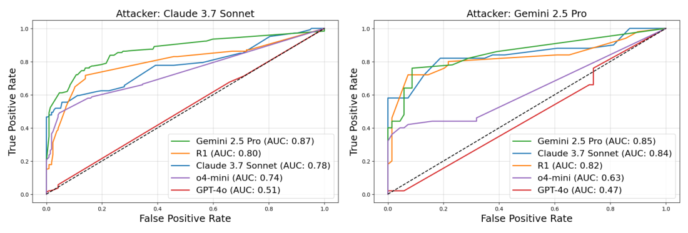

# 5 — LLM-as-Judge and Calibration

> A judge is a model making a measurement. Until you've checked it against human labels, you don't know what it measures. Write a narrow rubric, mitigate the known biases, and calibrate before you gate on it.

---

## When a judge is the right tool

Use a judge when the quality is semantic (is this complete? is it grounded? is the tone right?) and no code check can express it ([04](04-graders.md#code-graders-more-than-you-think)). Don't use one for things code can check. A judge that decides whether JSON is valid is slower, costlier and less reliable than `json.loads`.

### Three judge shapes

| Shape | Asks | Good for | Watch out for |
|---|---|---|---|
| **Pointwise** (single output + rubric) | "Does this answer meet criterion X?" | Absolute pass/fail gates, monitoring | Drift in what "pass" means over time |
| **Pairwise** (A vs. B) | "Which answer better meets X?" | Comparing two versions, model selection | Position bias. Swap and run both orders |
| **Reference-guided** (output + gold answer) | "Does this answer contain the facts in the reference?" | Factual correctness when you have a reference | The judge may accept paraphrases that are subtly wrong |

Pairwise judging is more reliable than pointwise for "which is better", because relative judgments are easier than absolute ones. But you can't monitor production with it, because there's no second answer to compare against. Most systems use pointwise for gates and pairwise for A/B decisions.

**A judge is model + prompt + sampling settings.** Change any of the three and you have a different judge (*AI Engineering*, ch. 3). Huyen's example: coherence was 90% last month and 92% this month. That means nothing unless the judge was identical both times, and a coworker fixing a typo in the judge prompt counts as a change. The same criterion name doesn't mean the same judge across tools either. MLflow, Ragas and LlamaIndex all ship a "faithfulness" judge, but MLflow scores 1–5, Ragas 0 or 1, and LlamaIndex YES/NO, so one (context, answer) pair can get 3, 1 and NO. Her rule: don't trust a judge whose model and prompt you can't see.

**Off-the-shelf specialized judges** exist if a general model is too costly: reward models such as Google's Cappy (360M parameters, a 0–1 correctness score for a prompt–response pair), reference-based judges such as Prometheus (prompt, response, reference and rubric in, a 1–5 score out, with the reference defined as a 5), and preference models such as PandaLM and JudgeLM (*AI Engineering*, ch. 3). These are 2023 models: calibrate them like any other judge.

---

## Writing the judge prompt

### One judge, one criterion

A judge that checks "quality" will silently switch between criteria from row to row. Write one judge per dimension ([02](02-defining-correct.md#from-criteria-to-dimensions)), each with a narrow question.

| Bad | Good |
|---|---|
| "Rate this response's quality 1–10" | "Does the answer state a specific menu path that appears in the source document? PASS or FAIL" |
| "Is this helpful?" | "Does the answer address every question the user asked? List each question, then mark each addressed or not" |

Huyen reports the same from practice: judges do better on classification than on numerical scores, discrete scores beat continuous ones, and the wider the discrete range, the worse the judge gets (*AI Engineering*, ch. 3). Oshin & Campos give the matching rule: a judge prompt a person could replicate, and no 0–10 scale with vague distinctions between scores (*Learning LangChain*, ch. 10).

### Structure that works

1. **Role and task.** Frame it as grading a third party's work. Never tell the model it's grading its own output. Berryman & Ziegler report that judges get a bit less accurate when told the work is the user's and much worse when told it is their own, because the model is pulled between conflicting habits: forum-style text that rarely self-criticizes fairly, and RLHF that makes it recant at any hint of doubt (*Prompt Engineering for LLMs*, ch. 10; [01/09](../../01-prompt-engineering/notes/09-evaluating-prompts.md#llm-as-judge)). This is about framing, and it is separate from self-preference (below), which applies even when the judge doesn't know whose output it is.
2. **The criterion**, with a precise definition of PASS and FAIL. State it before the content: the judge reads once, front to back, so it should read the output already knowing what to look for.
3. **Few-shot examples**: 2–4 labeled cases, including a tricky PASS and a tricky FAIL near the boundary. Take them from your human-labeled data, never from the test split.
4. **The inputs**, clearly delimited: question, output, reference or context.
5. **Reason, then verdict.** Ask for a short critique first, then a final label in a fixed format (`"verdict": "PASS"`). Reasoning first improves accuracy and gives you something to read when the judge is wrong.
6. **An escape hatch**: `CANNOT_GRADE` when the inputs are missing or the case is out of scope. Without it the judge guesses.

A reusable single-criterion judge prompt with all six parts:

```text
You are reviewing a response written by a customer-support assistant. Your job is to check
one thing only: <CRITERION, one sentence>.

## Definitions
PASS: <precise condition, e.g. "every specific fact (menu path, number, date, price) in the
response appears in the SOURCES">.
FAIL: <precise condition, e.g. "any specific fact is absent from or contradicts the SOURCES">.
Ignore everything else: length, tone and formatting do not affect this verdict.
CANNOT_GRADE: the SOURCES are empty, or the question is outside <domain>.

## Examples                                   (2–4, from the TRAIN split only)
<example> …a clear PASS…                       <verdict>PASS</verdict> </example>
<example> …tricky FAIL: looks right, one invented detail… <verdict>FAIL</verdict> </example>
<example> …short but correct (guards against verbosity bias)… <verdict>PASS</verdict> </example>

## Task
<question>{{question}}</question>
<sources>{{retrieved_context_text}}</sources>
<response>{{response}}</response>

First write a short critique in <critique> tags: list each relevant claim and whether it
meets the PASS definition. Then give your verdict in <verdict> tags: PASS, FAIL or CANNOT_GRADE.
```

Rules that go with it:

- **Parse `<verdict>` strictly.** Anything else counts as a grader error, not a FAIL.
- **Pin the judge model** to a different family from the system under test, and version the prompt (`grounding-v3`).
- **Give it the reference answer when you have one.** Iusztin & Labonne note that adding a ground-truth answer as context improves the judge's accuracy (*LLM Engineer's Handbook*, ch. 7). That's the reference-guided shape above.
- **Set temperature to 0**, as Huyen advises (*AI Engineering*, ch. 4). The worked example in *LLM Engineer's Handbook* (ch. 7) runs its GPT-4o-mini judge at temperature 0.8, single pass. That **contradicts** this rule: at 0.8 the same answer can get a different score on a rerun, and the chapter reports no repeat runs to show how much. If you must sample (to estimate judge variance, say), run several times and report the spread ([09](09-reading-results.md#repeats-and-clustering)).
- **A prompt change resets the judge to experimental** until it is re-calibrated (below).

A compact version from the DeepLearning.AI course's analysis-clarity judge (Lab 3). It is one criterion, delimited data, and the explanation before the label:

```text
You are evaluating whether an answer to a query is clear.
[BEGIN DATA]
Query: {query}
Answer: {response}
[END DATA]
"clear": the answer is easy to follow, well structured, and answers the query.
"unclear": it is confusing, off-topic, or hard to act on.

EXPLANATION: <step-by-step reasoning>
LABEL: "clear" or "unclear"
```

**Parse strictly.** Phoenix's `llm_classify(..., rails=["clear", "unclear"])` snaps the output to one of the rails and records anything else as unparseable. Count an unparseable verdict as a **grader error**, not a FAIL. Folding it into FAIL makes a formatting bug look like an agent regression. The course's Lab 5 adds a second judge on the same answer for entity correctness. That's the one-judge-per-criterion rule in practice.

### Decompose hard criteria

For grounding and completeness, a single holistic question ("is this faithful?") is weak. Decompose:

- **Grounding:** extract the answer's claims → check each against the context → score = supported / total ([07](07-evaluating-rag-and-grounding.md#faithfulness-claim-by-claim)).
- **Completeness:** list the sub-questions in the query → check each is answered.

Decomposition gives partial credit, finds *which* claim failed, and is easier for the judge. G-Eval (Liu et al. 2023) formalizes a version of this: the judge writes its own evaluation steps for a criterion, then follows them.

---

## Known biases

Zheng et al. ("Judging LLM-as-a-Judge", MT-Bench, 2023) documented the biases that matter most. Strong judges agreed with human preferences about as often as humans agreed with each other (over 80%) *once these were controlled*. Huyen gives the exact figures: GPT-4 agreed with humans 85% of the time, against 81% between humans. AlpacaEval's judges correlated 0.98 with human rankings (*AI Engineering*, ch. 3). The 2023 bias sizes she cites are a useful baseline for what to test: GPT-4 gave its own answers a 10% higher win rate and Claude-v1 25%. Zheng et al. themselves say their data was too limited to establish self-preference, and GPT-3.5 did not favour itself. Position bias was the solid finding: with two similar answers shown in both orders, GPT-4 gave a consistent verdict only 65% of the time and Claude-v1 23.8%. The 85% agreement also excludes ties. GPT-4 and Claude-1 preferred ~100-word answers with factual errors over ~50-word correct ones (Wu & Aji). On creative tasks, an answer twice as long almost always won (Saito et al.). AI judges favor the *first* answer in a pair, the opposite of the human recency bias.

People aren't a clean baseline either. Iusztin & Labonne note that human raters also favor long, confident answers, especially nicely formatted Markdown (*LLM Engineer's Handbook*, ch. 7). Calibrate against expert labels written to a rubric, not casual preference. A later survey sorts the documented biases into four groups (presentation, social, content, cognitive) and names fifteen. Among them are bandwagon (siding with a stated majority) and distraction, where an irrelevant sentence such as "System Star likes to eat oranges and apples" shifts the verdict ([arXiv:2412.05579](https://arxiv.org/abs/2412.05579) (Li et al., 2024-12)). The table keeps the ones worth testing for on your own data.

| Bias | What happens | Mitigation |
|---|---|---|
| **Position** | Pairwise judges favor the first (or second) answer | Run both orders. Count a win only if it holds in both. Otherwise call it a tie |
| **Verbosity** | Longer answers score higher, even when padded. Much weaker in 2026 judges under a pairwise rubric (below), but not ruled out | Rubric says length is not quality. Include a short correct example scored PASS. Track score vs. length |
| **Self-preference** | A model favors outputs from its own family | Judge with a different model family from the system under test |
| **Leniency** | Judges pass borderline cases | Binary criteria with explicit FAIL conditions. Tricky-FAIL few-shot examples |
| **Format / authority** | Confident tone, markdown, citations look correct | Check citations in code ([07](07-evaluating-rag-and-grounding.md#citation-checks-in-code)). Judge the content, not the style |
| **Limited capability** | The judge can't verify what it can't do (hard math, niche code) | Use a reference answer, or a code check, or a stronger judge |
| **Master keys** | A reference-guided judge passes a non-answer: a lone `:`, a blank space, `Thought process:` | Put empty and opener-only responses in the calibration set as must-FAIL cases. Check the answer is non-empty in code |

**Measure the biases on your judge instead of assuming them.** Norman et al. audited 21 judges from 9 providers on MT-Bench, JudgeBench and RewardBench (about 541k judgments, temperature 0, March–April 2026). **Verbosity bias was below 0.011 for all 21**, measured as the correlation between length difference and verdict under one pairwise rubric. 2023-era studies had put the effect of style and length at 20–40% of variance. The authors warn that this "should not be interpreted as a universal claim that verbosity bias is solved": another rubric or task may bring it back. Position bias had not gone away. It ranged from 0.002 (Gemini 2.5 Pro) to 0.192 (Qwen 3 8B), measured as |P(A wins) − 0.5| over both orders ([arXiv:2606.19544](https://arxiv.org/abs/2606.19544) (Norman et al., 2026-06)). Keep the swap test mandatory, and treat the length check as a cheap confirmation. A useful length check compares win rates only on pairs of similar length. HealthBench found a weak length–score correlation for o3 (Pearson *r* = 0.123). On pairs within 10% of each other's length, o3's win rate over GPT-4.1 fell from 72.9% to 63.7%, and GPT-4.1's win over o1 went the other way, from 61.0% to 65.2% (Arora et al., [below](#what-to-measure)). The length-matched number is the one to report.

The limited-capability row has a clean example from chemistry. On 14 tasks, expert chemists rated ChemCrow (GPT-4 with 18 chemistry tools) above tool-less GPT-4, most clearly on novel syntheses. A GPT-4 grader concluded the opposite: it **preferred GPT-4's fluent, complete-looking answers even where they were factually wrong** ([arXiv:2304.05376](https://arxiv.org/abs/2304.05376) (Bran et al., 2023-04)). A judge that cannot check the facts grades the style.

The master-key row comes from Zhao et al., who tested judges that grade reasoning answers against a gold answer (five math and general-reasoning benchmarks, temperature 0). **Content-free responses passed**: "punctuation-only responses (e.g., “:”) can induce errors in GPT-4o with up to 35% FPRs", and `Thought process:` reached 60–90% false positives on LLaMA3-70B-Instruct and Qwen2.5-72B-Instruct. Averaged over all their attack strings, the false-positive rate was 6.0% for o1, 12.4% for Claude 4 Sonnet and 14.6% for GPT-4o. Chain-of-thought with majority voting did not reliably help and sometimes made it worse. Two things did help: removing the question from the judge prompt, and fine-tuning a verifier on truncated "first sentence only" answers labeled wrong ([arXiv:2507.08794](https://arxiv.org/abs/2507.08794) (Zhao et al., 2025-07)). Their setting is RL reward models, where the policy finds such strings by itself. An agent optimized against your judge can do the same ([12](12-failure-modes.md#goodhart-the-eval-becomes-the-target)).

---

## Calibrate against human labels

**A judge is calibrated when you've measured how often it agrees with humans on your data.** Until then it's experimental and can't gate releases ([04](04-graders.md#grader-states-which-ones-can-block-a-release)).

### The procedure

1. **Get human labels.** 100–200 outputs labeled PASS/FAIL on the judge's criterion, by your domain expert ([02](02-defining-correct.md#one-person-decides)). Include both classes in reasonable numbers. If real user signal exists (👍/👎, escalation, resolution), it can serve as the label, as in the case study, but only for a criterion it actually measures. **Satisfaction is not task success.** In GAUGE (25 agents on τ²-bench and SimulatorArena), "57.5% of conversations our blind human panel rated satisfied (≥5/7) had failed the customer’s task". That is the same as the 57.3% base failure rate, so the rating carried no information about success (AUC 0.44). A policy-aware judge that read the tool calls did discriminate success (AUC 0.73) ([arXiv:2609.12191](https://arxiv.org/abs/2609.12191) (Bodhwani et al., 2026-09)). A 👍 can label a tone or experience judge. A resolution judge needs labels from the outcome.
2. **Split** the labels: **train** (pick few-shot examples from here), **dev** (iterate on the prompt here), **test** (measure once at the end).
3. **Run the judge** on dev. Build the confusion matrix against the human labels.
4. **Read the disagreements.** Each one is either a judge prompt problem (fix the prompt), a criteria problem (fix the criteria, re-label), or a hard case (add to few-shot).
5. **Iterate** on dev until the numbers are good enough for the job.
6. **Measure on test once.** That's the number you report. If you tune against test, it's a dev set.
7. **Record** the judge model, prompt version and test metrics. Re-run when any of them changes.

Keep one calibration record per judge version. It holds: the label counts per split (train/dev/test, PASS/FAIL); human–human agreement on a double-labelled subset (the ceiling); one line per dev iteration (prompt change → TPR/TNR); the test confusion matrix with TPR, TNR, precision, κ, separation and the `CANNOT_GRADE` rate; the bias checks (position swap, length, self-preference); and a decision (calibrated for gating, tracking only, or rework).

**Few-shot examples help consistency, not necessarily accuracy.** Zheng et al. raised GPT-4's consistency from 65% to 77.5% by putting evaluation examples in the prompt, but the longer prompt quadrupled their judge cost, and "high consistency may not imply high accuracy": the judge can make the same mistake every time (*AI Engineering*, ch. 3). LangSmith turns calibration into a loop: when a person corrects a judge verdict, the correction, with an optional explanation, is stored and fed back as a few-shot example on later runs (*Learning LangChain*, ch. 10). Draw those examples from the train split only, or the test agreement you report is inflated.

**Evaluate the evaluator with seeded cases.** Phoenix & Taylor write test cases that are known to contain an issue and cases known not to, then count false positives (the judge invents an issue) and false negatives (it misses one) (*Prompt Engineering for Generative AI*, ch. 3). Their own demo claims "near 100% accuracy" for a GPT-4 conciseness judge on 10 responses they generated to be concise or verbose. That's a sanity check, not a calibration: 10 rows give a confidence interval tens of points wide ([09](09-reading-results.md#how-many-tasks)), and synthetic extremes are easier than real borderline cases.

### What to measure

Accuracy alone hides the failure you care about. Report the two error rates separately:

| Metric | Meaning | Matters for |
|---|---|---|
| **TPR** (recall on PASS) | Of outputs humans passed, how many the judge passed | Not blocking good releases |
| **TNR** (recall on FAIL) | Of outputs humans failed, how many the judge failed | **Catching bad outputs.** Usually the one that matters |
| **Precision on PASS** | Of outputs the judge passed, how many humans passed | Using judge-passed outputs as golden labels |
| **Cohen's κ** | Agreement corrected for chance | Comparing against human–human agreement |
| **Score separation** | Mean score on human-PASS minus mean on human-FAIL (and Cohen's *d*) | Whether a continuous judge discriminates at all |


*Image Source: Norman et al., [Reliability without Validity](https://arxiv.org/abs/2606.19544) (2026), Fig. 1*

Rules of thumb:

- **Different jobs, different metric.** A release gate needs high TNR (catch bad outputs). A golden-label builder needs high precision on PASS (clean labels). If one judge can't do both, use two ([case study](13-case-study-support-agent.md#decision-framework)).
- **Lead with κ, not raw agreement.** Across 21 judges on MT-Bench, exact-match agreement exceeded Cohen's κ by 33.8–41.3 points: "a judge reporting “85% agreement” on MT-Bench has κ≈0.48" (Norman et al., [above](#known-biases)). Ties and an unbalanced base rate inflate raw agreement.
- **Repeatable is not valid.** Qwen 3 8B gave the same verdict across reruns almost every time (test–retest α 0.992) and had the cohort's strongest position bias (0.192). A deterministic judge reproduces its bias exactly. Run the swap check even on a judge that never changes its mind.
- **Benchmark against human–human agreement**, on the same statistic. If two experts agree 85% of the time, a judge at 83% is about as good as a second expert. Expecting 99% is expecting better than humans. Berryman & Ziegler's version of the test: have several people rate the same items, then add the judge (one query per item, temperature 0) to the pool and check that the pool's disagreement, measured with something like Kendall's τ, doesn't rise (*Prompt Engineering for LLMs*, ch. 10). Three recent benchmarks report their judge this way. OpenEQA's GPT-4 answer-matcher correlated with blind human raters at Spearman ρ 0.909 (95% CI 0.883–0.928, 300 responses), inside the 0.91–0.93 range between human raters. Swapping in GPT-3.5 or LLaMA-2 as the judge dropped ρ below 0.7 ([PDF](https://open-eqa.github.io/assets/pdfs/paper.pdf) (Majumdar et al., 2024-06)). HealthBench's GPT-4.1 grader reached macro-F1 0.709 against physicians, where individual physicians scored 0.569–0.730, and it beat the average physician in 5 of 7 themes. Note that the grader prompt was developed with GPT-4.1, which may be part of why it came out the best grader ([arXiv:2505.08775](https://arxiv.org/abs/2505.08775) (Arora et al., 2025-05)). GDPval's experimental autograder agreed with expert graders 65.7% of the time, against 70.8% between experts, over three grading sweeps. The authors released it but "do not consider it a full substitute for industry expert graders" ([arXiv:2510.04374](https://arxiv.org/abs/2510.04374) (Patwardhan et al., 2025-10)). All three are vendor- or lab-run on their own benchmarks, and a weaker judge model can lose most of the agreement.
- **Small separation means the threshold is doing the work.** If PASS and FAIL means differ by < 0.05, the judge isn't discriminating. Fix the prompt.
- **For a monitor, set the threshold from a false-positive budget.** A judge that flags rare bad behaviour in agent transcripts (sabotage, policy breaches) runs mostly on benign traffic, so its false positives decide what it costs. SHADE-Arena set the suspicion threshold at the 99th percentile of scores on benign transcripts, which is about 1% FPR. The best monitor, Gemini 2.5 Pro, reached AUC 0.87, but even it would need an FPR above 20% to catch 80% of attacks. Human reviewers did worse, at AUC 0.65 after an average of 103 minutes per transcript (on a small subset that isn't directly comparable). Monitoring after every turn helped a little but flagged many more benign transcripts. Extra budget did more good spent on re-querying the monitor at the end and averaging the scores. A better system prompt helped more than turn-by-turn monitoring, even when it said nothing qualitatively new ([PDF](https://assets.anthropic.com/m/4fb35becb0cd87e1/original/SHADE-Arena-Paper.pdf) (Kutasov et al., 2025-06); 17 environments, with Anthropic models among those tested). Report the ROC curve or TPR at your FPR budget, not just AUC.


*Image Source: Kutasov et al., [SHADE-Arena](https://assets.anthropic.com/m/4fb35becb0cd87e1/original/SHADE-Arena-Paper.pdf) (2025), Fig. 8*

- **Inverted separation means it measures something else.** The case study found off-the-shelf judges scoring *disliked* answers higher on completeness and escalation ([case study](13-case-study-support-agent.md#calibration-results)). Generic metrics aren't tuned to your users.

### Correcting the pass rate

An uncalibrated judge's pass rate is only a relative measure. "The judge passes 81% of answers" means little alone, while "version B passes more often than version A" is a usable claim (*Prompt Engineering for LLMs*, ch. 10). Calibration is what turns it into an estimate. A judge with known error rates gives a biased estimate of the true pass rate. If the judge's observed pass rate is *p̂*, and you measured TPR and TNR on the test split, the corrected estimate is:

```
true pass rate ≈ (p̂ + TNR − 1) / (TPR + TNR − 1)
```

Example: judge passes 80% of production outputs, TPR 0.95, TNR 0.80 → (0.80 + 0.80 − 1) / (0.95 + 0.80 − 1) = 0.60 / 0.75 = **0.80**. With TNR 0.70 instead → 0.50 / 0.65 = **0.77**. The correction is small when the judge is good and large when it's lenient. Only valid when TPR + TNR is well above 1.

---

## Keep it calibrated

- **Re-calibrate when anything changes**: judge model, judge prompt, the system under test (new failure types appear), or the user population.
- **Watch for domain shift.** The case study's judges separated well on one product's traffic and near-zero on another, because users there disliked answers for different reasons (tone, escalation, multi-turn context) ([case study](13-case-study-support-agent.md#domain-shift)). Calibration is per domain. Public benchmarks show the same: in Norman et al.'s study 11 of 21 judges moved four or more places between benchmarks, and Llama 3.3 70B went from 5th on MT-Bench to 20th on JudgeBench, so a judge's leaderboard rank says little about how it does on your data.
- **Keep a human sample flowing.** A 5–10% human-reviewed sample in production is what tells you the judge is drifting ([11](11-production-and-the-maturity-ladder.md#two-layer-online-review)).
- **Pin the judge model version.** A provider updating the judge silently changes all your scores.
- **Don't mix judges** across runs you intend to compare.

### Cross-checking with other judges

Comparing your judge to an off-the-shelf one (RAGAS, DeepEval, G-Eval) tells you whether they measure the same thing (correlation), not which is right. Only agreement with *human labels* settles that. Low correlation is a reason to investigate both against the labels, not to switch.

### Multi-family judging

Self-preference ([above](#known-biases)) gets worse when the agent is *optimized* against the judge: it learns that judge's blind spots. The mitigation is several independent judges from **different model families** on the same rubric. If the agent runs on Claude, judge with GPT and Gemini. Their biases tend to be orthogonal, so the agent rarely fools all of them at once. Aggregate by weighted average or require agreement. To keep cost down, run one judge on every case and the full panel as a periodic audit (*AI Agents in Depth*, ch. 6). GAUGE measured the self-preference this guards against: an Opus-4.8 judge rated Claude agents 0.75 points (on a 7-point scale) higher, relative to a GPT-5.5 judge, than it rated non-Claude agents (Bodhwani et al., [above](#the-procedure)). GDPval saw the same thing with a GPT-5 autograder: it agreed with experts less often on outputs from the more capable OpenAI models. Blinding by itself doesn't hide which family wrote an output, either. GDPval's authors scrubbed model names from filenames but note that outputs "may still have been identifiable" by style: OpenAI outputs used em dashes, Claude's often used the first person, and Grok sometimes called itself Grok (Patwardhan et al., [above](#what-to-measure)).

**A panel doesn't fix a shared resolution limit.** In the same study, four judges from two providers ranked τ²-bench agents. They recovered the full 25-agent ladder (ρ 0.84–0.94) but not the near-equal strong agents. On pairs whose verifiable rewards differed by less than 0.1, the best single judge picked the wrong winner 31% of the time, against under 1% on wide pairs. The four-judge average gave exactly 31% too, because the judges correlated at ρ 0.67–0.98 and flipped the same close pairs. The one thing that helped was **calibrated abstention**: refuse to rank a pair whose score gap falls inside its bootstrap noise. That halved the error to 14.8% on the pairs it ranked, but it ranked only 31–49% of them. When two candidates are close, report "no detectable difference" ([09](09-reading-results.md#compare-on-the-same-tasks-paired-differences)) rather than adding judges.

### Beyond text

The same pattern extends to other modalities. Score TTS output with an audio model (or ASR, then a text judge), UI agents from screenshots, and video from sampled frames. Each modality needs its own calibration set.

---

## Pairwise ranking: Elo and Bradley–Terry


*Image Source: Li, [AI Agents in Depth](https://github.com/bojieli/ai-agent-book/blob/main/book-en/chapter7.md) (2026), Fig. 7-6 (Apache-2.0)*

When there's no absolute standard, ask "which is better, A or B?" and turn many such votes into a ranking.

- **Bradley–Terry** gives each system a latent strength. P(A beats B) depends only on the difference in strengths.
- **Elo** is the online-update form of that model. Everyone starts at 1000. After each match, the winner gains points in proportion to how surprising the win was. A 1200-rated model is expected to beat a 1000-rated one about 76% of the time, and an upset moves both ratings more.
- **Chatbot Arena** ranks models this way from millions of blind human votes. The catch: the ranking reflects what users happened to ask. A flood of coding questions lifts coding models.

Huyen adds numbers to the Arena caveats (*AI Engineering*, ch. 3, figures from 2023–24):

- **It switched from Elo to Bradley–Terry**, then rescales BT scores to look like Elo. Elo depends on the order of matches, as the worked example below shows.
- **Coverage is thin.** In January 2024, 57 models and 244,000 comparisons averaged only 153 comparisons per model pair (1,596 pairs).
- **The prompts aren't your traffic.** Of 33,000 published prompts, 180 were "hello" or "hi", and one brainteaser was asked 44 times.
- **Preference isn't capability.** "B beats A" fits B good and A bad, both bad, or both good. If A resolves 70% of support tickets, a 51% win rate for B says nothing about how many B would resolve, so you can't weigh it against B costing twice as much.

The update in two lines, with K setting how far one match moves a rating:

```
expected  E_A = 1 / (1 + 10^((R_B − R_A) / 400))     # 1200 vs 1000 → 0.76
update    R_A ← R_A + K · (S_A − E_A)                # S_A = 1 win, ½ tie, 0 loss
```

With an LLM judge doing the voting, **swap the order** on every pair and count a win only if it holds both ways, as in the position-bias row above. Bradley–Terry also assumes preferences are transitive (A > B > C ⇒ A > C). Judges and humans often violate that, so check for cycles before trusting a ranking.

The same "compare candidates to each other" idea drives GRPO in post-training ([gen-AI 05-RL](../../../generative-ai/05-RL/README.md)).

The swap check from the lab's judge:

```python
def judge_pair(question, a, b) -> str:
    first = judge_once(question, a, b)              # "A" | "B" | "tie"
    second = judge_once(question, b, a)             # same pair, order swapped
    second = {"A": "B", "B": "A"}.get(second, second)   # map back to the real answers
    return first if first == second else "tie"      # a win must survive the swap
```

### Worked example: online Elo vs. a Bradley–Terry fit

These snippets are trimmed from Li's Elo leaderboard lab (link below). Both methods read the same battle table: one row per vote, with `model_a`, `model_b` and `winner` ∈ {`model_a`, `model_b`, `tie`}.

**Elo** walks the votes in order and nudges two ratings per vote:

```python
def expected(r_a, r_b):                       # P(A beats B) from the rating gap
    return 1 / (1 + 10 ** ((r_b - r_a) / 400))

def update(ratings, a, b, winner, k=4, init=1000):
    r_a, r_b = ratings.get(a, init), ratings.get(b, init)
    e_a = expected(r_a, r_b)
    s_a = {"model_a": 1.0, "model_b": 0.0}.get(winner, 0.5)   # a tie is half a win
    ratings[a] = r_a + k * (s_a - e_a)        # surprise × K
    ratings[b] = r_b + k * ((1 - s_a) - (1 - e_a))
```

**Bradley–Terry** ignores order. It counts wins per pair, then fits every strength at once with a logistic regression, which is how Chatbot Arena computes its leaderboard:

```python
models = sorted(set(df.model_a) | set(df.model_b))
def pivot(rows):                              # counts per (a, b), on the full square
    return (pd.pivot_table(rows, index="model_a", columns="model_b",
                           aggfunc="size", fill_value=0)
              .reindex(index=models, columns=models, fill_value=0))

a_win = pivot(df[df.winner == "model_a"])
b_win = pivot(df[df.winner == "model_b"])
tie   = pivot(df[df.winner.str.startswith("tie")])
tie   = tie + tie.T                           # a tie counts for both directions
wins  = 2 * a_win + 2 * b_win.T + tie         # wins weigh 2, a tie 1 each way

X, y, w = [], [], []
for i, m_a in enumerate(models):
    for j, m_b in enumerate(models):
        if i == j: continue
        x = np.zeros(len(models)); x[i], x[j] = np.log(10), -np.log(10)
        X += [x, x]; y += [1, 0]              # the same pair, once as a win, once as a loss
        w += [wins.loc[m_a, m_b], wins.loc[m_b, m_a]]

lr = LogisticRegression(fit_intercept=False, penalty=None).fit(X, y, sample_weight=w)
ratings = pd.Series(400 * lr.coef_[0] + 1000, index=models)
```

Two details are easy to get wrong:

- **Ties.** Count a tie as half a win for each side, in both methods. Drop ties and two models that keep drawing drift apart on noise.
- **The pivot.** Reindex every pivot to the full model × model square *before* you add the transpose. Small samples give pivots with different rows and columns, and pandas aligns on labels, so `tie + tie.T` on a ragged pivot fills cells with NaN or zeroes them. The ties then vanish from the fit without an error.

Why run both? **Elo depends on the order of the votes. Bradley–Terry is a global fit, so it doesn't.** Here is the lab's offline simulator: 3,000 battles between eight models with known skills, 10% ties. Elo (K = 4) was run on five shuffles of the same battles:

```text
                true     BT   Elo min  Elo max
gpt-4           1250   1116     1114     1133
claude-3-opus   1225   1114     1100     1110
gemini-1.5-pro  1180   1058     1051     1068
mixtral-8x7b    1075    974      955      988
vicuna-13b       935    876      862      887
```

Both recover the true order, and the gaps between models match. The absolute level differs because each method anchors its own mean. Elo moved up to 34 points depending only on the order of the votes. At K = 32 the spread reached 148 points, enough to swap the top two. Use Elo for a live, streaming leaderboard. Use Bradley–Terry, with bootstrap confidence intervals, for any ranking you publish or gate on.

**Run the full lab:** [ai-agent-book/chapter7/elo-leaderboard](https://github.com/bojieli/ai-agent-book/tree/main/chapter7/elo-leaderboard) (Li, ch. 7 Elo leaderboard lab, formerly 6-6; Apache-2.0). Inside it, run `pip install -r requirements.txt && python quickstart.py` for an offline demo. `python cli.py --help` lists the simulate → Elo → leaderboard pipeline.

---

## Cost

Judges multiply cost: every trial × every judge × every repeat. Ways to control it:

- Code graders first; skip the judge when code already failed the row.
- A cost-capped, deterministic **quality sample** for judges, not every row ([03](03-eval-datasets.md#row-eligibility-is-this-row-fair-for-this-gate)).
- A smaller judge model once it's calibrated as well as the large one on your test split.
- Cache judge results keyed by (output hash, judge version).

Know the multiplier. Using GPT-4 to generate and to judge one criterion doubles the calls. Judging three criteria (quality, factual consistency, toxicity) quadruples them (*AI Engineering*, ch. 3). The usual answer is **spot-checking**: a cheap model generates and a strong judge scores 1% of responses, which buys cost at the price of missed failures. Choose the sample rate against the error bar you need ([09](09-reading-results.md#how-many-tasks)).

---

## Checklist

- [ ] One judge per criterion, binary verdict, reasoning before verdict, `CANNOT_GRADE` escape
- [ ] Judge is a different model family from the system under test
- [ ] Pairwise judges run in both orders
- [ ] 100–200 human labels, split train/dev/test
- [ ] TPR, TNR and κ reported on test, compared with human–human agreement
- [ ] Judge model + prompt version pinned and recorded
- [ ] Re-calibration triggered by any change to judge, SUT or domain

## Working reference

`~/.claude/refs/agent-eval.md` — grader states (heuristic / calibrated / experimental) and what each may gate.

---

→ Next: [06-evaluating-agents.md](06-evaluating-agents.md) — when the output is a trajectory, not an answer.
