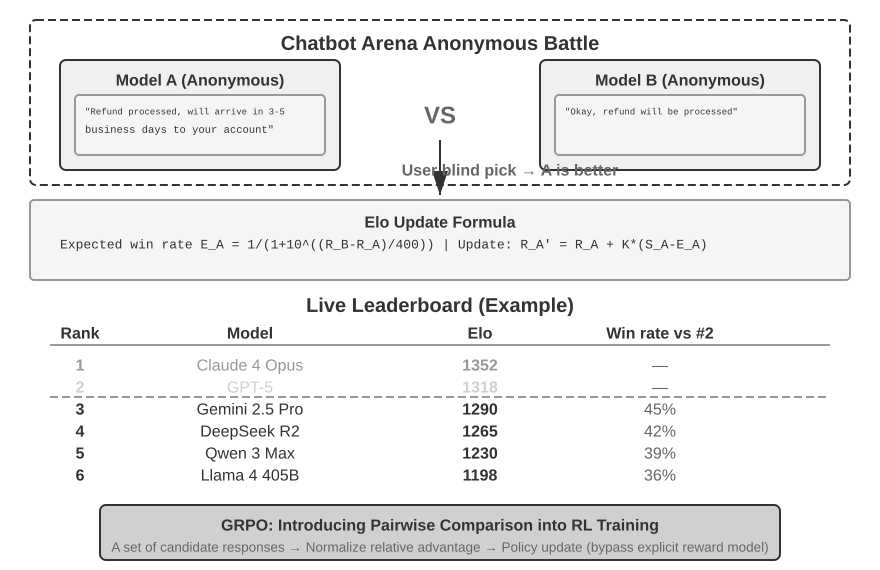

# 5 — LLM-as-Judge and Calibration

> A judge is a model making a measurement. Until you've checked it against human labels, you don't know what it measures. Write a narrow rubric, mitigate the known biases, and calibrate before you gate on it.

---

## When a judge is the right tool

Use a judge when the quality is semantic (is this complete? is it grounded? is the tone right?) and no code check can express it ([04](04-graders.md#code-graders-more-than-you-think)). Don't use one for things code can check. A judge that decides whether JSON is valid is slower, costlier and less reliable than `json.loads`.

### Three judge shapes

| Shape | Asks | Good for | Watch out for |
|---|---|---|---|
| **Pointwise** (single output + rubric) | "Does this answer meet criterion X?" | Absolute pass/fail gates, monitoring | Drift in what "pass" means over time |
| **Pairwise** (A vs. B) | "Which answer better meets X?" | Comparing two versions, model selection | Position bias. Swap and run both orders |
| **Reference-guided** (output + gold answer) | "Does this answer contain the facts in the reference?" | Factual correctness when you have a reference | The judge may accept paraphrases that are subtly wrong |

Pairwise judging is more reliable than pointwise for "which is better", because relative judgments are easier than absolute ones. But you can't monitor production with it, because there's no second answer to compare against. Most systems use pointwise for gates and pairwise for A/B decisions.

---

## Writing the judge prompt

### One judge, one criterion

A judge that checks "quality" will silently switch between criteria from row to row. Write one judge per dimension ([02](02-defining-correct.md#from-criteria-to-dimensions)), each with a narrow question.

| Bad | Good |
|---|---|
| "Rate this response's quality 1–10" | "Does the answer state a specific menu path that appears in the source document? PASS or FAIL" |
| "Is this helpful?" | "Does the answer address every question the user asked? List each question, then mark each addressed or not" |

### Structure that works

1. **Role and task.** Frame it as grading a third party's work. Never tell the model it's grading its own output: self-grading leans lenient ([01/09](../../01-prompt-engineering/notes/09-evaluating-prompts.md#llm-as-judge)).
2. **The criterion**, with a precise definition of PASS and FAIL.
3. **Few-shot examples**: 2–4 labeled cases, including a tricky PASS and a tricky FAIL near the boundary. Take them from your human-labeled data, never from the test split.
4. **The inputs**, clearly delimited: question, output, reference or context.
5. **Reason, then verdict.** Ask for a short critique first, then a final label in a fixed format (`"verdict": "PASS"`). Reasoning first improves accuracy and gives you something to read when the judge is wrong.
6. **An escape hatch**: `CANNOT_GRADE` when the inputs are missing or the case is out of scope. Without it the judge guesses.

A reusable single-criterion judge prompt with all six parts:

```text
You are reviewing a response written by a customer-support assistant. Your job is to check
one thing only: <CRITERION, one sentence>.

## Definitions
PASS: <precise condition, e.g. "every specific fact (menu path, number, date, price) in the
response appears in the SOURCES">.
FAIL: <precise condition, e.g. "any specific fact is absent from or contradicts the SOURCES">.
Ignore everything else: length, tone and formatting do not affect this verdict.
CANNOT_GRADE: the SOURCES are empty, or the question is outside <domain>.

## Examples                                   (2–4, from the TRAIN split only)
<example> …a clear PASS…                       <verdict>PASS</verdict> </example>
<example> …tricky FAIL: looks right, one invented detail… <verdict>FAIL</verdict> </example>
<example> …short but correct (guards against verbosity bias)… <verdict>PASS</verdict> </example>

## Task
<question>{{question}}</question>
<sources>{{retrieved_context_text}}</sources>
<response>{{response}}</response>

First write a short critique in <critique> tags: list each relevant claim and whether it
meets the PASS definition. Then give your verdict in <verdict> tags: PASS, FAIL or CANNOT_GRADE.
```

Rules that go with it:

- **Parse `<verdict>` strictly.** Anything else counts as a grader error, not a FAIL.
- **Pin the judge model** to a different family from the system under test, and version the prompt (`grounding-v3`).
- **A prompt change resets the judge to experimental** until it is re-calibrated (below).

A compact version from the DeepLearning.AI course's analysis-clarity judge (Lab 3). It is one criterion, delimited data, and the explanation before the label:

```text
You are evaluating whether an answer to a query is clear.
[BEGIN DATA]
Query: {query}
Answer: {response}
[END DATA]
"clear": the answer is easy to follow, well structured, and answers the query.
"unclear": it is confusing, off-topic, or hard to act on.

EXPLANATION: <step-by-step reasoning>
LABEL: "clear" or "unclear"
```

**Parse strictly.** Phoenix's `llm_classify(..., rails=["clear", "unclear"])` snaps the output to one of the rails and records anything else as unparseable. Count an unparseable verdict as a **grader error**, not a FAIL. Folding it into FAIL makes a formatting bug look like an agent regression. The course's Lab 5 adds a second judge on the same answer for entity correctness. That's the one-judge-per-criterion rule in practice.

### Decompose hard criteria

For grounding and completeness, a single holistic question ("is this faithful?") is weak. Decompose:

- **Grounding:** extract the answer's claims → check each against the context → score = supported / total ([07](07-evaluating-rag-and-grounding.md#faithfulness-claim-by-claim)).
- **Completeness:** list the sub-questions in the query → check each is answered.

Decomposition gives partial credit, finds *which* claim failed, and is easier for the judge. G-Eval (Liu et al. 2023) formalizes a version of this: the judge writes its own evaluation steps for a criterion, then follows them.

---

## Known biases

Zheng et al. ("Judging LLM-as-a-Judge", MT-Bench, 2023) documented the biases that matter most. Strong judges agreed with human preferences about as often as humans agreed with each other (over 80%) *once these were controlled*.

| Bias | What happens | Mitigation |
|---|---|---|
| **Position** | Pairwise judges favor the first (or second) answer | Run both orders. Count a win only if it holds in both. Otherwise call it a tie |
| **Verbosity** | Longer answers score higher, even when padded | Rubric says length is not quality. Include a short correct example scored PASS. Track score vs. length |
| **Self-preference** | A model favors outputs from its own family | Judge with a different model family from the system under test |
| **Leniency** | Judges pass borderline cases | Binary criteria with explicit FAIL conditions. Tricky-FAIL few-shot examples |
| **Format / authority** | Confident tone, markdown, citations look correct | Check citations in code ([07](07-evaluating-rag-and-grounding.md#citation-checks-in-code)). Judge the content, not the style |
| **Limited capability** | The judge can't verify what it can't do (hard math, niche code) | Use a reference answer, or a code check, or a stronger judge |

---

## Calibrate against human labels

**A judge is calibrated when you've measured how often it agrees with humans on your data.** Until then it's experimental and can't gate releases ([04](04-graders.md#grader-states-which-ones-can-block-a-release)).

### The procedure

1. **Get human labels.** 100–200 outputs labeled PASS/FAIL on the judge's criterion, by your domain expert ([02](02-defining-correct.md#one-person-decides)). Include both classes in reasonable numbers. If real user signal exists (👍/👎, escalation, resolution), it can serve as the label, as in the case study.
2. **Split** the labels: **train** (pick few-shot examples from here), **dev** (iterate on the prompt here), **test** (measure once at the end).
3. **Run the judge** on dev. Build the confusion matrix against the human labels.
4. **Read the disagreements.** Each one is either a judge prompt problem (fix the prompt), a criteria problem (fix the criteria, re-label), or a hard case (add to few-shot).
5. **Iterate** on dev until the numbers are good enough for the job.
6. **Measure on test once.** That's the number you report. If you tune against test, it's a dev set.
7. **Record** the judge model, prompt version and test metrics. Re-run when any of them changes.

Keep one calibration record per judge version. It holds: the label counts per split (train/dev/test, PASS/FAIL); human–human agreement on a double-labelled subset (the ceiling); one line per dev iteration (prompt change → TPR/TNR); the test confusion matrix with TPR, TNR, precision, κ, separation and the `CANNOT_GRADE` rate; the bias checks (position swap, length, self-preference); and a decision (calibrated for gating, tracking only, or rework).

### What to measure

Accuracy alone hides the failure you care about. Report the two error rates separately:

| Metric | Meaning | Matters for |
|---|---|---|
| **TPR** (recall on PASS) | Of outputs humans passed, how many the judge passed | Not blocking good releases |
| **TNR** (recall on FAIL) | Of outputs humans failed, how many the judge failed | **Catching bad outputs.** Usually the one that matters |
| **Precision on PASS** | Of outputs the judge passed, how many humans passed | Using judge-passed outputs as golden labels |
| **Cohen's κ** | Agreement corrected for chance | Comparing against human–human agreement |
| **Score separation** | Mean score on human-PASS minus mean on human-FAIL (and Cohen's *d*) | Whether a continuous judge discriminates at all |

Rules of thumb:

- **Different jobs, different metric.** A release gate needs high TNR (catch bad outputs). A golden-label builder needs high precision on PASS (clean labels). If one judge can't do both, use two ([case study](13-case-study-support-agent.md#decision-framework)).
- **Benchmark against human–human agreement.** If two experts agree 85% of the time, a judge at 83% is about as good as a second expert. Expecting 99% is expecting better than humans.
- **Small separation means the threshold is doing the work.** If PASS and FAIL means differ by < 0.05, the judge isn't discriminating. Fix the prompt.
- **Inverted separation means it measures something else.** The case study found off-the-shelf judges scoring *disliked* answers higher on completeness and escalation ([case study](13-case-study-support-agent.md#calibration-results)). Generic metrics aren't tuned to your users.

### Correcting the pass rate

A judge with known error rates gives a biased estimate of the true pass rate. If the judge's observed pass rate is *p̂*, and you measured TPR and TNR on the test split, the corrected estimate is:

```
true pass rate ≈ (p̂ + TNR − 1) / (TPR + TNR − 1)
```

Example: judge passes 80% of production outputs, TPR 0.95, TNR 0.80 → (0.80 + 0.80 − 1) / (0.95 + 0.80 − 1) = 0.60 / 0.75 = **0.80**. With TNR 0.70 instead → 0.50 / 0.65 = **0.77**. The correction is small when the judge is good and large when it's lenient. Only valid when TPR + TNR is well above 1.

---

## Keep it calibrated

- **Re-calibrate when anything changes**: judge model, judge prompt, the system under test (new failure types appear), or the user population.
- **Watch for domain shift.** The case study's judges separated well on one product's traffic and near-zero on another, because users there disliked answers for different reasons (tone, escalation, multi-turn context) ([case study](13-case-study-support-agent.md#domain-shift)). Calibration is per domain.
- **Keep a human sample flowing.** A 5–10% human-reviewed sample in production is what tells you the judge is drifting ([11](11-production-and-the-maturity-ladder.md#two-layer-online-review)).
- **Pin the judge model version.** A provider updating the judge silently changes all your scores.
- **Don't mix judges** across runs you intend to compare.

### Cross-checking with other judges

Comparing your judge to an off-the-shelf one (RAGAS, DeepEval, G-Eval) tells you whether they measure the same thing (correlation), not which is right. Only agreement with *human labels* settles that. Low correlation is a reason to investigate both against the labels, not to switch.

### Multi-family judging

Self-preference ([above](#known-biases)) gets worse when the agent is *optimized* against the judge: it learns that judge's blind spots. The mitigation is several independent judges from **different model families** on the same rubric. If the agent runs on Claude, judge with GPT and Gemini. Their biases tend to be orthogonal, so the agent rarely fools all of them at once. Aggregate by weighted average or require agreement. To keep cost down, run one judge on every case and the full panel as a periodic audit (*AI Agents in Depth*, ch. 6).

### Beyond text

The same pattern extends to other modalities. Score TTS output with an audio model (or ASR, then a text judge), UI agents from screenshots, and video from sampled frames. Each modality needs its own calibration set.

---

## Pairwise ranking: Elo and Bradley–Terry


*Image Source: Li, [AI Agents in Depth](https://github.com/bojieli/ai-agent-book/blob/main/book-en/chapter7.md) (2026), Fig. 7-6 (Apache-2.0)*

When there's no absolute standard, ask "which is better, A or B?" and turn many such votes into a ranking.

- **Bradley–Terry** gives each system a latent strength. P(A beats B) depends only on the difference in strengths.
- **Elo** is the online-update form of that model. Everyone starts at 1000. After each match, the winner gains points in proportion to how surprising the win was. A 1200-rated model is expected to beat a 1000-rated one about 76% of the time, and an upset moves both ratings more.
- **Chatbot Arena** ranks models this way from millions of blind human votes. The catch: the ranking reflects what users happened to ask. A flood of coding questions lifts coding models.

The update in two lines, with K setting how far one match moves a rating:

```
expected  E_A = 1 / (1 + 10^((R_B − R_A) / 400))     # 1200 vs 1000 → 0.76
update    R_A ← R_A + K · (S_A − E_A)                # S_A = 1 win, ½ tie, 0 loss
```

With an LLM judge doing the voting, **swap the order** on every pair and count a win only if it holds both ways, as in the position-bias row above. Bradley–Terry also assumes preferences are transitive (A > B > C ⇒ A > C). Judges and humans often violate that, so check for cycles before trusting a ranking.

The same "compare candidates to each other" idea drives GRPO in post-training ([gen-AI 05-RL](../../../generative-ai/05-RL/README.md)).

The swap check from the lab's judge:

```python
def judge_pair(question, a, b) -> str:
    first = judge_once(question, a, b)              # "A" | "B" | "tie"
    second = judge_once(question, b, a)             # same pair, order swapped
    second = {"A": "B", "B": "A"}.get(second, second)   # map back to the real answers
    return first if first == second else "tie"      # a win must survive the swap
```

### Worked example: online Elo vs. a Bradley–Terry fit

These snippets are trimmed from Li's Elo leaderboard lab (link below). Both methods read the same battle table: one row per vote, with `model_a`, `model_b` and `winner` ∈ {`model_a`, `model_b`, `tie`}.

**Elo** walks the votes in order and nudges two ratings per vote:

```python
def expected(r_a, r_b):                       # P(A beats B) from the rating gap
    return 1 / (1 + 10 ** ((r_b - r_a) / 400))

def update(ratings, a, b, winner, k=4, init=1000):
    r_a, r_b = ratings.get(a, init), ratings.get(b, init)
    e_a = expected(r_a, r_b)
    s_a = {"model_a": 1.0, "model_b": 0.0}.get(winner, 0.5)   # a tie is half a win
    ratings[a] = r_a + k * (s_a - e_a)        # surprise × K
    ratings[b] = r_b + k * ((1 - s_a) - (1 - e_a))
```

**Bradley–Terry** ignores order. It counts wins per pair, then fits every strength at once with a logistic regression, which is how Chatbot Arena computes its leaderboard:

```python
models = sorted(set(df.model_a) | set(df.model_b))
def pivot(rows):                              # counts per (a, b), on the full square
    return (pd.pivot_table(rows, index="model_a", columns="model_b",
                           aggfunc="size", fill_value=0)
              .reindex(index=models, columns=models, fill_value=0))

a_win = pivot(df[df.winner == "model_a"])
b_win = pivot(df[df.winner == "model_b"])
tie   = pivot(df[df.winner.str.startswith("tie")])
tie   = tie + tie.T                           # a tie counts for both directions
wins  = 2 * a_win + 2 * b_win.T + tie         # wins weigh 2, a tie 1 each way

X, y, w = [], [], []
for i, m_a in enumerate(models):
    for j, m_b in enumerate(models):
        if i == j: continue
        x = np.zeros(len(models)); x[i], x[j] = np.log(10), -np.log(10)
        X += [x, x]; y += [1, 0]              # the same pair, once as a win, once as a loss
        w += [wins.loc[m_a, m_b], wins.loc[m_b, m_a]]

lr = LogisticRegression(fit_intercept=False, penalty=None).fit(X, y, sample_weight=w)
ratings = pd.Series(400 * lr.coef_[0] + 1000, index=models)
```

Two details are easy to get wrong:

- **Ties.** Count a tie as half a win for each side, in both methods. Drop ties and two models that keep drawing drift apart on noise.
- **The pivot.** Reindex every pivot to the full model × model square *before* you add the transpose. Small samples give pivots with different rows and columns, and pandas aligns on labels, so `tie + tie.T` on a ragged pivot fills cells with NaN or zeroes them. The ties then vanish from the fit without an error.

Why run both? **Elo depends on the order of the votes. Bradley–Terry is a global fit, so it doesn't.** Here is the lab's offline simulator: 3,000 battles between eight models with known skills, 10% ties. Elo (K = 4) was run on five shuffles of the same battles:

```text
                true     BT   Elo min  Elo max
gpt-4           1250   1116     1114     1133
claude-3-opus   1225   1114     1100     1110
gemini-1.5-pro  1180   1058     1051     1068
mixtral-8x7b    1075    974      955      988
vicuna-13b       935    876      862      887
```

Both recover the true order, and the gaps between models match. The absolute level differs because each method anchors its own mean. Elo moved up to 34 points depending only on the order of the votes. At K = 32 the spread reached 148 points, enough to swap the top two. Use Elo for a live, streaming leaderboard. Use Bradley–Terry, with bootstrap confidence intervals, for any ranking you publish or gate on.

**Run the full lab:** [ai-agent-book/chapter7/elo-leaderboard](https://github.com/bojieli/ai-agent-book/tree/main/chapter7/elo-leaderboard) (Li, ch. 7 Elo leaderboard lab, formerly 6-6; Apache-2.0). Inside it, run `pip install -r requirements.txt && python quickstart.py` for an offline demo. `python cli.py --help` lists the simulate → Elo → leaderboard pipeline.

---

## Cost

Judges multiply cost: every trial × every judge × every repeat. Ways to control it:

- Code graders first; skip the judge when code already failed the row.
- A cost-capped, deterministic **quality sample** for judges, not every row ([03](03-eval-datasets.md#row-eligibility-is-this-row-fair-for-this-gate)).
- A smaller judge model once it's calibrated as well as the large one on your test split.
- Cache judge results keyed by (output hash, judge version).

---

## Checklist

- [ ] One judge per criterion, binary verdict, reasoning before verdict, `CANNOT_GRADE` escape
- [ ] Judge is a different model family from the system under test
- [ ] Pairwise judges run in both orders
- [ ] 100–200 human labels, split train/dev/test
- [ ] TPR, TNR and κ reported on test, compared with human–human agreement
- [ ] Judge model + prompt version pinned and recorded
- [ ] Re-calibration triggered by any change to judge, SUT or domain

## Working reference

`~/.claude/refs/agent-eval.md` — grader states (heuristic / calibrated / experimental) and what each may gate.

---

→ Next: [06-evaluating-agents.md](06-evaluating-agents.md) — when the output is a trajectory, not an answer.
