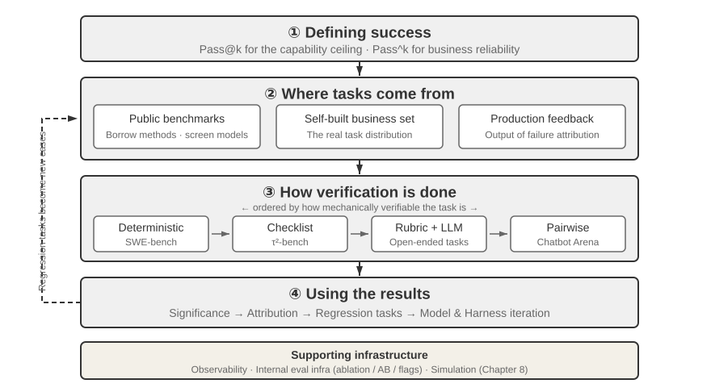
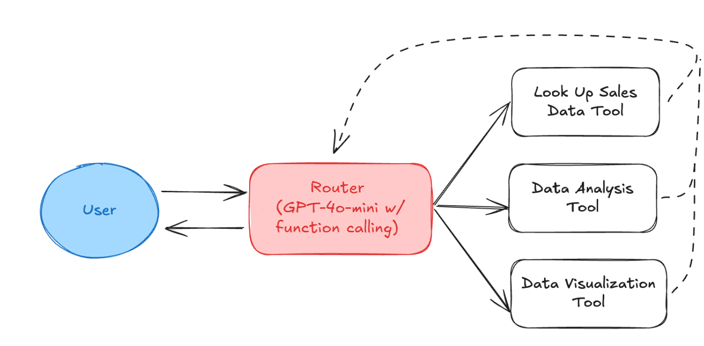
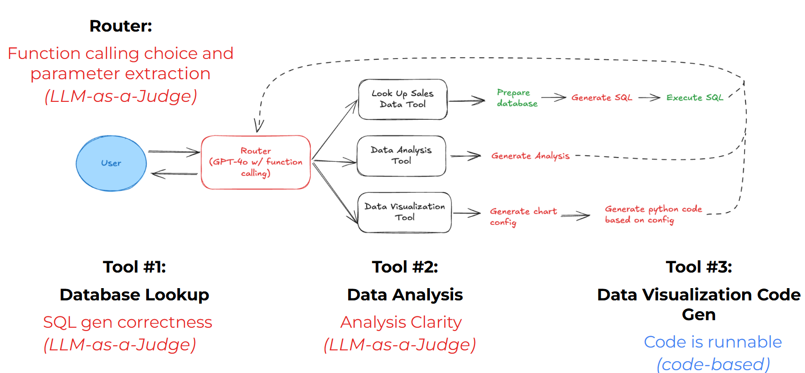
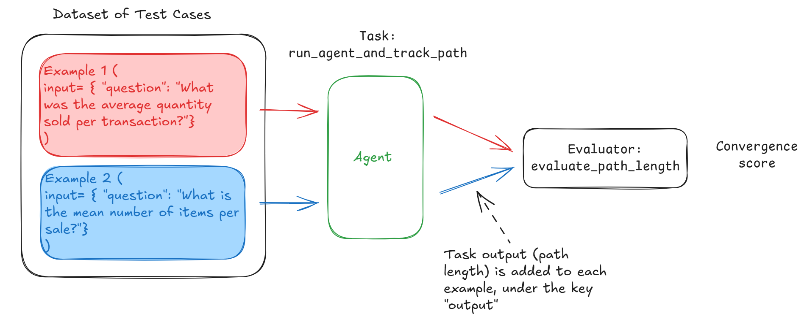

# 6 — Evaluating Agents

> An agent's output is a path, not just an answer. Grade the outcome *and* the trajectory, run every task several times, and evaluate each component (router, tools, final answer) on its own as well as end to end.

---

## Outcome and trajectory


*Image Source: Li, [AI Agents in Depth](https://github.com/bojieli/ai-agent-book/blob/main/book-en/chapter7.md) (2026), Fig. 7-1 (Apache-2.0)*

```
Outcome:     did the agent reach the goal?
Trajectory:  did it get there in an acceptable way?
```

Both are needed because they fail independently:

| Outcome | Trajectory | What happened | Outcome-only eval says |
|---|---|---|---|
| ✅ | ✅ | Worked | Pass |
| ✅ | ❌ | Right answer by an unsafe or wasteful path: deleted and recreated a file, called a paid API 40 times, guessed instead of looking up | **Pass** (wrong) |
| ❌ | ✅ | Reasonable process, failed on an external issue: tool timeout, missing data | Fail (but the agent isn't the problem) |
| ❌ | ❌ | Broken | Fail |

Anthropic recommends grading both the final environment state and the transcript. The second row is why. The third row is why you read traces before blaming the agent ([12](12-failure-modes.md#eval-bugs-look-like-agent-bugs)).

The reverse also happens: a strict trajectory check can fail a run that did *better* than the script. Anthropic's example is a flight-booking agent that found a loophole in the airline's policy and got the user a cheaper fare. Scored against the preset path, it failed. Scored by outcome, the user got a better deal. Let trajectory checks enforce invariants ("never book before confirming"), not a single golden path.

Trajectory analysis also tells you **where** a run failed. A multi-step run has many paths to the same wrong answer, and each needs a different fix. An outcome-only eval scores them identically.

---

## Grade the outcome by state, not by words

For agents that act, check the **end state** directly where you can:

| Agent | Outcome check |
|---|---|
| Coding | The repo's tests pass. The diff touches only allowed paths |
| Data / SQL | Query result matches the reference result (not the reference SQL text) |
| Customer action | The refund row exists with the right amount. No other rows changed |
| Computer use | The target page / form / file is in the expected state |
| Research | The report contains the required facts with valid citations ([07](07-evaluating-rag-and-grounding.md)) |

An agent that says "I've issued your refund" when no refund exists is the most important failure to catch, and only a state check catches it.

---

## Scoring tool calls

Three levels of strictness for comparing the actual tool calls to the expected ones:

| Match mode | Passes when | Use for |
|---|---|---|
| **Exact** | Same tools, same order, same arguments | Strict protocols (auth before action) |
| **In order** | Expected calls appear in order, extra calls allowed | Required sequence with some freedom |
| **Any order** | Expected calls all appear, any order | Independent lookups |
| **Subset / superset** | Agent's calls ⊆ (or ⊇) the allowed set | "Never call outside this set" / "must at least call these" |

Check arguments separately from tool names, and allow per-argument matching rules: exact, normalized (case, whitespace), numeric tolerance, "any value", or a judge for free-text arguments.

```python
def trajectory_score(expected: list[Call], actual: list[Call], mode="in_order") -> float:
    """Fraction of expected calls matched under `mode`, penalized for extra calls."""
    matched = match_calls(expected, actual, mode)          # mode-specific matching
    return len(matched) / max(len(expected), len(actual))  # extras lower the score
```

Labeling expected tool calls is real work. Two shortcuts:

- **Label from successful traces.** Run the agent, have a human confirm the good runs, and save their trajectories as references.
- **Bootstrap from metadata.** If the system already logs which domain or sub-agent handled a request, that's a free routing label ([case study](case-study/eval-architecture.md#strand-e--response-metadata-signals)).

If there's no single correct path, don't force one. Use a **judge over the trajectory** with a rubric ("did the agent look up the order before changing it?") or check **invariants** ("never `issue_refund` before `lookup_order`").

---

## Evaluate the components, then the whole

An agent is a router plus skills plus a final answer. Evaluate each, because an end-to-end failure doesn't say which one broke. The DeepLearning.AI [*Evaluating AI Agents*](https://www.deeplearning.ai/short-courses/evaluating-ai-agents/) course (code: [upstream repo](https://github.com/ginny100/DeepLearning.AI-Evaluating-AI-Agents)) builds exactly this on a sales-data agent: a function-calling router that picks between three tools and loops until it can answer.


*Image Source: DeepLearning.AI & Arize, Evaluating AI Agents (2025), Lab 1*

Each box gets its own grader. Three are LLM judges and one is plain code:


*Image Source: DeepLearning.AI & Arize, Evaluating AI Agents (2025), Lab 3*

| Component | Question | Grader in the course |
|---|---|---|
| **Router** | Did it pick the right tool with the right parameters? | LLM judge over the tool-call span (Phoenix `TOOL_CALLING_PROMPT_TEMPLATE`) |
| **Skill: SQL lookup** | Does the SQL answer the question? | LLM judge with the instruction and query |
| **Skill: analysis** | Is the analysis clear? Are entities correct? | Two LLM judges, one per criterion |
| **Skill: visualization** | Does the generated code run? | Code: `exec()` it |
| **Path** | Did it converge in a reasonable number of steps? | Code: optimal steps ÷ actual steps |

The router judge, in the course's code. It pulls every LLM span from the traces, judges each tool choice against the tool definitions, and writes the label back onto the span:

```python
# Pull LLM spans that made a tool call (Lab 3)
query = SpanQuery().where("span_kind == 'LLM'").select(
    question="input.value", tool_call="llm.tools")
df = px.Client().query_spans(query, project_name=PROJECT).dropna(subset=["tool_call"])

with suppress_tracing():                     # don't trace the judge itself
    evals = llm_classify(
        dataframe=df,
        template=TOOL_CALLING_PROMPT_TEMPLATE,   # course pastes tool JSON into it
        rails=["correct", "incorrect"],          # output is snapped to these labels
        model=OpenAIModel(model="gpt-4o"),
        provide_explanation=True)                # reasoning stored next to the label
evals["score"] = (evals["label"] == "correct").astype(int)
px.Client().log_evaluations(SpanEvaluations(eval_name="Tool Calling Eval", dataframe=evals))
```

The visualization check needs no judge:

````python
def code_is_runnable(output: str) -> bool:
    code = output.strip().replace("```python", "").replace("```", "")
    try:
        exec(code)        # course shortcut: run untrusted code only in a sandbox
        return True
    except Exception:
        return False
````

These APIs have moved since the course was recorded. `px.Client()` and `SpanEvaluations`/`log_evaluations` are legacy: current Phoenix uses `phoenix.client.Client` and logs span annotations. phoenix.evals 2.x replaces `llm_classify(dataframe=…)` and `OpenAIModel` with `create_classifier` and `LLM(provider="openai", model=…)`. The course also fills the template's `{tool_definitions}` slot with string `.replace()` calls that turn the JSON braces into quotes. Pass the definitions in as a template variable instead. "Runs without raising" is also a weak check: code that draws an empty chart passes it.

### Routing vs. domain evals in multi-agent systems

With a supervisor and sub-agents, split the suites ([case study](case-study/eval-architecture.md#the-core-gap-routing-vs-domain-evals)):

- **Routing eval**: does the supervisor pick the right sub-agent? Seed with queries on the boundaries between domains.
- **Domain eval**: given correct routing, does each sub-agent call the right tools and produce the right output?

Neither replaces the other. A retrieval-quality eval and an answer-quality eval together still miss "right answer, wrong sub-agent" and "right sub-agent, wrong tool path".

---

## Non-determinism: run every task k times

The same task can pass on one trial and fail on the next. A single run per task tells you about luck. Run each task **k** times (3–10 is typical) and report rates.

Two metrics answer different questions:

| Metric | Definition | Question | Rises or falls with k |
|---|---|---|---|
| **pass@k** | P(at least one of k trials succeeds) | "Can it do this at all, given retries?" | Rises |
| **pass^k** | P(all k trials succeed) | "Does it do this *every* time?" | Falls |
| **Best@k** | Score of the best of k trials | "What's the quality ceiling?" (continuous scores, open-ended tasks) | Rises |

If per-trial success is *p* and trials are independent: pass@k = 1 − (1 − p)^k, and pass^k = p^k. At p = 0.75 and k = 3: pass@3 = 0.98, pass^3 = **0.42**.

- **pass@k** fits tools where a user or system can retry and pick a good result: code generation with tests, candidate generation. From *n* samples with *c* correct, the unbiased estimator is pass@k = 1 − C(n−c, k) / C(n, k) (Chen et al. 2021, the Codex paper).
- **pass^k** fits customer-facing agents, where every user gets one try. τ-bench (Yao et al. 2024) introduced it and showed agents that look fine on pass@1 falling sharply at pass^8.

Also report the **per-task pass rate distribution**. A suite at 70% could be "every task passes 70% of the time" (flaky) or "70% of tasks always pass, 30% never do" (capability gaps). They need different fixes.

---

## Efficiency metrics

Log these on every trial. They catch regressions that pass rates miss:

| Metric | Why |
|---|---|
| **Steps / turns to completion** | Rising steps at a flat pass rate means the agent is thrashing toward the right answer |
| **Tool calls** (total, per tool, failed) | Retry storms, wrong-tool loops |
| **Tokens** (input / output / cached) | Cost driver. Context bloat shows here first |
| **Latency** (p50 / p95, time to first token) | User experience |
| **Cost per success** | The sustainability metric. Failed runs are pure cost, so at 50% success the real cost is 2× the per-run cost |
| **Convergence** | Optimal steps ÷ actual steps (the course's Lab 4 metric, [below](#convergence-in-practice)) |

### Convergence in practice

The course's Lab 4 asks the same question 17 ways ("average quantity per transaction", paraphrased), runs the agent on each, and scores how close each run came to the shortest path:


*Image Source: DeepLearning.AI & Arize, Evaluating AI Agents (2025), Lab 4*

```python
def run_and_track(example):                      # the experiment's task
    msgs = run_agent([{"role": "user", "content": example.input["question"]}])
    return {"path_length": len(msgs)}            # counts messages, not tool calls

experiment = run_experiment(dataset, run_and_track, experiment_name="Convergence Eval")
optimal = min(o["path_length"] for o in outputs if o)   # shortest run observed

@create_evaluator(name="Convergence Eval", kind="CODE")
def convergence(output) -> float:
    return optimal / output["path_length"] if output else 0.0   # 1.0 = shortest

experiment = evaluate_experiment(experiment, evaluators=[convergence])
```

Read the score for what it is. "Optimal" means the shortest run *observed*, not the shortest possible, so a suite where every run thrashes can still score near 1.0. The score is also relative to this batch, so it doesn't compare across agent versions unless you fix the reference length. Set the optimum by hand (or from a confirmed good trace) before using it as a regression gate.

### Why agent cost grows faster than the step count

Every turn re-sends the whole context. Li's worked example (*AI Agents in Depth*, Table 6-4) is a three-turn refund agent: 9,500 input tokens, 470 output, **$0.022** in total. Prefix caching saves nearly half the input cost. The amplifiers are what break the budget:

- **Thinking tokens.** 500–2,000 extra per turn can multiply cost 3–5×. At 50 tokens/s, 2,000 thinking tokens is 40 s of latency.
- **Big tool outputs.** A 5,000-token web page returned on turn 2 is billed again on every later turn.
- **Detours.** Ten turns instead of three, and the context passes 20,000 tokens.

So the levers are turn count and context growth, not just a cheaper model ([02-context/03](../../02-context-engineering/notes/03-budgeting-the-window.md)). Set a **per-task cost cap** in the harness, and log thinking tokens separately.

**Latency has two stages.** Prefill reads the context and sets **time to first token** (queueing + prefill; grows with context). Decode sets tokens/s. Report **p95**, not the mean: the mean hides the slow minority.

**Report a budget–capability curve, not one point.** RE-Bench (Wijk et al. 2025): at a 2-hour budget the best agent scored about 4× human experts. At 8 hours humans narrowly passed it, and with 32 hours total across attempts they scored about 2× the agent. Leading at a short budget doesn't predict long-horizon ability. Compare at budgets close to the real workload.

---

## Agent-specific suites

| Agent type | Add these to the suite |
|---|---|
| **Conversational** | Multi-turn tasks. Turn-count limits. Tone and interaction quality. Long, adversarial conversations. A simulated user ([below](#multi-turn-evaluation)) |
| **Coding** | Repo state + tests as the grader. Held-out tests the agent can't see ([04/03](../../04-loop-engineering/notes/03-the-scorekeeper.md#plus-the-fifth-hard-to-fake)). Diff scope |
| **Research** | Citation validity, coverage of required facts, source quality ([07](07-evaluating-rag-and-grounding.md)) |
| **Computer use** | End-state checks on the environment. Sandboxed, reset per trial |
| **Any tool-using agent** | Error-handling suite: malformed input, tool errors, timeouts, empty results. Adversarial suite: injection, out-of-scope requests ([case study](case-study/harness-patterns.md#adversarial-cases)) |

### Multi-turn evaluation

Two approaches, each with a trade-off:

- **Canned conversations.** Score each turn against a fixed, scripted history. Isolates turns and is reproducible, but misses compounding errors, because the history never reflects what the agent actually said.
- **Simulated user.** An LLM plays the user with a goal and persona, and the conversation runs to the end. Tests the real thing end to end, but inherits the simulator's biases and adds variance. Give the simulator a clear goal and stop condition, and calibrate it: does it behave like your real users?

**Progressive information disclosure** is what makes a simulated user realistic. Real users don't state everything up front ("There's a problem with my flight." → "Which one?" → "It's too long, I want to change it." → "Any afternoon flight is fine."). τ-bench gives the simulator two parts: *known information* and *instructions* for when to reveal it. The agent has to ask. A simulator that dumps all the facts in turn 1 tests a much easier task. Hold the script fixed so runs stay reproducible.

**τ²-bench** (the successor) adds a **dual-control environment**: the simulated user can also call tools on the shared state. The agent says "switch to airplane mode", and the user's action really changes the environment. This fits tech support, where the user has to do part of the work, and tests whether the agent notices state changes it didn't make. It also tightened success conditions ("only an *excellent* speed rating counts") and generates task parameters fresh each run.

Grade multi-turn runs at both levels: per turn (grounded, on-policy) and per conversation (goal reached, turns used, escalation correct).

---

## Environment hygiene

An agent eval environment has five parts. Each one can be wrong on its own:

| Part | Holds | Gets it wrong when |
|---|---|---|
| **Dataset** | Initial state, goal, optional reference solution | Ambiguous goals ([03](03-eval-datasets.md)) |
| **Environment state** | Mutable records (orders, balances, files) | It doesn't follow business rules, or can't reset to the same start |
| **Tools** | Atomic operations (look up order, modify booking) | They're too high-level ("solve the user's problem") and skip the planning you meant to test |
| **Rubric** | Binary, continuous or multi-dimensional score | See [04](04-graders.md) |
| **Interaction protocol** | Who acts when: single-shot, multi-turn, simulated user, dual control | The user model is unrealistic ([above](#multi-turn-evaluation)) |

- **Reset state for every trial.** Fresh sandbox, database snapshot, clean working directory. Shared state turns one trial's side effects into the next trial's failure.
- **Isolate trials.** Parallel trials must not share mutable resources.
- **Stub or record unstable externals** (live web, third-party APIs) for regression suites. Keep a separate live suite for capability checks.
- **Treat a 0% task as suspect.** If a task fails every trial across several model versions, check the task before the agent. It's often broken: unreachable state, wrong reference, missing permission.

---

## Checklist

- [ ] Outcome graded by end state where possible, not by what the agent says
- [ ] Trajectory graded: match mode chosen per task, or invariants, or a trajectory judge
- [ ] Router, each skill, and end-to-end evaluated separately
- [ ] Each task run k times; pass^k reported for user-facing agents
- [ ] Steps, tokens, latency and cost per success logged per trial
- [ ] Error-handling and adversarial suites present
- [ ] Environment reset per trial; 0% tasks investigated before blaming the agent

---

→ Next: [07-evaluating-rag-and-grounding.md](07-evaluating-rag-and-grounding.md) — when the answer has to come from the documents.
